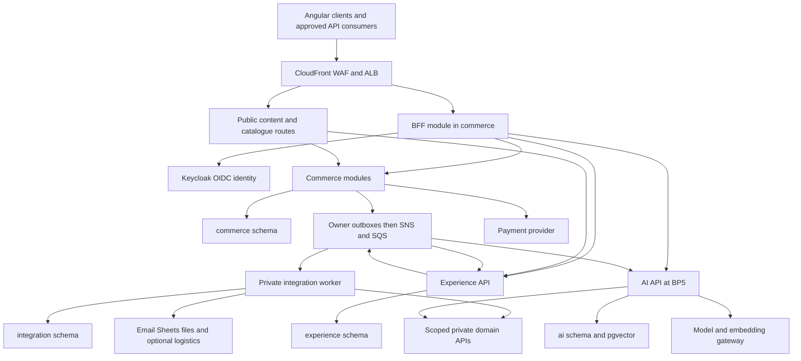
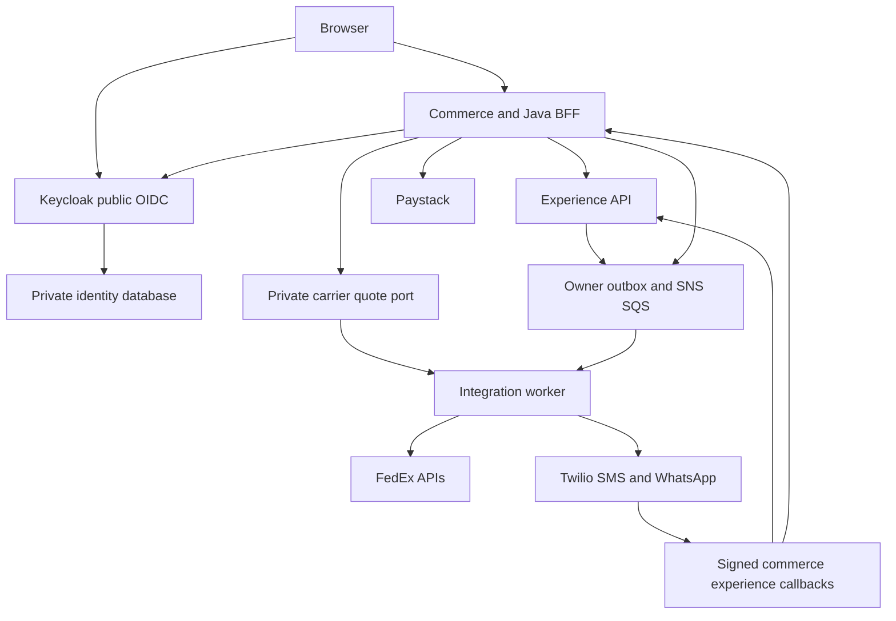
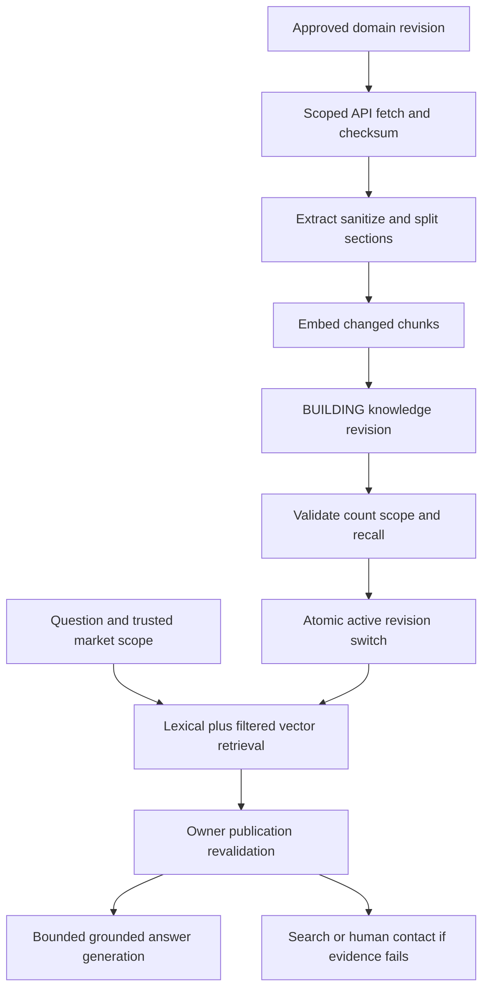

# Nigson Backend Implementation Master

Specification1.1.0 | Architecture source1.0 + ADR-008 |4 October2026

**Catalog:**4 domain service owners + production Keycloak identity; 122 business tables; 195 endpoint contracts; 28 events; 68 implementation tasks;14 engineering increments.

Confirmed launch: Nigeria/NGN, Paystack only, FedEx API logistics, SMS/WhatsApp via Twilio, production Keycloak. Stateful provider mocks are implementation requirements, not generated backend code.

## Contents

- [1. Document Metadata](#1-document-metadata)
- [2. Executive Technical Summary](#2-executive-technical-summary)
- [3. Architecture Assumptions](#3-architecture-assumptions)
- [4. Backend Architecture](#4-backend-architecture)
- [5. Service Catalog](#5-service-catalog)
- [6. Repository Structure](#6-repository-structure)
- [7. Standard Service Structure](#7-standard-service-structure)
- [8. Domain Model](#8-domain-model)
- [9. Database Architecture](#9-database-architecture)
- [10. Complete Database Schema](#10-complete-database-schema)
- [11. Liquibase Architecture](#11-liquibase-architecture)
- [12. API Standards](#12-api-standards)
- [13. API Contract](#13-api-contract)
- [14. API Error Model](#14-api-error-model)
- [15. Security Architecture](#15-security-architecture)
- [16. Event-Driven Architecture](#16-event-driven-architecture)
- [17. Transaction Strategy](#17-transaction-strategy)
- [18. Caching Strategy](#18-caching-strategy)
- [19. Search Architecture](#19-search-architecture)
- [20. AI Architecture](#20-ai-architecture)
- [21. AI Gateway](#21-ai-gateway)
- [22. RAG Architecture](#22-rag-architecture)
- [23. Agent Architecture](#23-agent-architecture)
- [24. MCP Strategy](#24-mcp-strategy)
- [25. External Integrations](#25-external-integrations)
- [26. File Storage](#26-file-storage)
- [27. Notification Architecture](#27-notification-architecture)
- [28. Observability](#28-observability)
- [29. Audit Architecture](#29-audit-architecture)
- [30. Configuration Management](#30-configuration-management)
- [31. Docker](#31-docker)
- [32. Kubernetes](#32-kubernetes)
- [33. Helm](#33-helm)
- [34. Infrastructure as Code](#34-infrastructure-as-code)
- [35. Testing Strategy](#35-testing-strategy)
- [36. Test Data](#36-test-data)
- [37. Code Quality](#37-code-quality)
- [38. CI/CD Pipeline](#38-cicd-pipeline)
- [39. Local Development Setup](#39-local-development-setup)
- [40. Developer Experience](#40-developer-experience)
- [41. Coding Standards](#41-coding-standards)
- [42. Performance Standards](#42-performance-standards)
- [43. Scalability](#43-scalability)
- [44. Resilience](#44-resilience)
- [45. Security Checklist](#45-security-checklist)
- [46. Implementation Phases](#46-implementation-phases)
- [47. Codex Execution Rules](#47-codex-execution-rules)
- [48. Codex Completion Report Format](#48-codex-completion-report-format)
- [49. Codex Task Breakdown](#49-codex-task-breakdown)
- [50. Acceptance Criteria](#50-acceptance-criteria)
- [51. Dependency Matrix](#51-dependency-matrix)
- [52. Requirement Traceability](#52-requirement-traceability)
- [53. Architecture Decision Records](#53-architecture-decision-records)
- [54. Definition of Done](#54-definition-of-done)
- [55. Final Implementation Roadmap](#55-final-implementation-roadmap)
- [56. Codex State Tracking](#56-codex-state-tracking)
- [57. Additional Codex Instruction Files](#57-additional-codex-instruction-files)
- [58. Anti-Patterns Codex Must Avoid](#58-anti-patterns-codex-must-avoid)
- [59. Output Requirement and Completeness Check](#59-output-requirement-and-completeness-check)


# 1. Document Metadata

| Field | Value |
|---|---|
| Project | Nigson Digital Commerce Platform |
| Document | BACKEND_IMPLEMENTATION_MASTER.md |
| Specification version | 1.1.0 |
| Architecture version | Nigson Platform Architecture 1.0, 22 pages, 3 October 2026 |
| Backend target version | 0.1.0 at launch; semantic versioning after launch |
| Generated | 4 October 2026 America/New_York and UTC |
| Status | Implementation contract with explicit provisional assumptions; not evidence of client scope approval |
| Audience | Codex in VS Code, backend engineers, DBA, DevOps, security and Nigson product owners |
| Scope | Backend engineering specification only; no application source code is generated by this task |

Normative terms: MUST is required; SHOULD requires a documented exception; MAY is optional. This master file is authoritative. Supporting documents are synchronized views, not independent contracts. Read sections 3, 17, 46 and 47 before coding. A business activation dependency is not permission to generate a fake production integration.

Inputs: the complete Nigson_Platform_Architecture.docx/PDF generated in this conversation and the attached Pasted text(1).txt instruction. Source architecture sections are denoted ARCH-01 through ARCH-21, matching its numbered headings. The five product phases are BP1..BP5. Engineering increments are EP00..EP13 and do not rename the product phases.


Revision4 October2026: incorporates explicit user clarification of assumptions002/003/004/012/013. Architecture source1.0 retained, superseded in stated areas by ADR-008. Original approved/unapproved input distinction retained for all other policies.


# 2. Executive Technical Summary

Implement commerce and experience APIs plus a private integration worker in Java. Add the Python AI service only for BP5. Commerce contains modular catalogue, party, pricing, cart, inventory, payment, order, reward, quote and fulfillment contexts and the Java BFF. Keep checkout's financial and stock invariants in one PostgreSQL transaction boundary.

Use one managed PostgreSQL 18 instance initially, with commerce, experience, integration and ai schemas and separate runtime/migration roles. Only the owning service may access its schema. Each publisher commits an outbox event with its business change; SNS fans out to dedicated SQS queues. Duplicate delivery is expected and handled through persisted business keys.

Authentication uses self-hosted Keycloak OIDC, server-side BFF sessions, staff MFA and resource/organization authorization. Production hosting is ECS Fargate, ALB, CloudFront/WAF, private RDS, S3, Secrets Manager, KMS and CloudWatch. The AI service owns a bounded RAG graph and provider gateway; it may read approved content and live authorized commerce data, never alter financial or stock state.

Retain Java 25, Spring Boot 4.1.1, Spring Modulith 2.1.1, Maven, Spring Security, Spring Data JPA, Hibernate, Liquibase, PostgreSQL 18, Python 3.12, FastAPI, Pydantic and LangGraph. Use the Spring Boot BOM for managed dependencies; record locked non-BOM versions in EP00. PostgreSQL 18.6 and pgvector 0.8.2 are baseline candidates; verify region/image availability and pin image digests. Use JUnit Jupiter managed by the Boot test BOM rather than forcing an incompatible JUnit 5 version. No Spring Cloud gateway, Eureka, Kafka, OpenSearch, Kubernetes or Helm is part of the launch contract. Caching may use optional Valkey after measurement. Backend scope supplies contracts for Angular; it does not generate the frontend.

Primary technical references, verified for this specification: [Spring Boot](https://docs.spring.io/spring-boot/system-requirements.html), [Spring Modulith](https://docs.spring.io/spring-modulith/reference/), [pgvector](https://github.com/pgvector/pgvector), [Paystack transaction API](https://paystack.com/docs/api/transaction/), [Paystack webhooks](https://paystack.com/docs/payments/webhooks/), [Bedrock embeddings](https://docs.aws.amazon.com/bedrock/latest/userguide/titan-embedding-models.html), [Spring Session JDBC](https://docs.spring.io/spring-session/reference/api.html). Technical facts from these sources are limited to version/feature verification; all Nigson policies below are explicit recommendations.


# 3. Architecture Assumptions

### ASSUMPTION-001

- **Description:** Account-only checkout at launch
- **Reason:** Source leaves guest checkout undecided.
- **Implementation impact:** All carts/orders require mapped party; guest checkout is deferred, not silently implemented.

### ASSUMPTION-002

- **Status:** Confirmed by user; replaces specification1.0.0.
- **Description:** Nigeria and Nigerian Naira approved for launch
- **Reason:** User clarification, 4 October2026.
- **Implementation impact:** Seed market code NG, destination country NG, currency NGN with minor_unit2. The country/currency approval is complete. Tax, returns, retail prices and actual serviceable delivery areas remain separate configuration inputs; never substitute a guessed tax rate.

### ASSUMPTION-003

- **Status:** Confirmed by user; replaces specification1.0.0.
- **Description:** Paystack is the only launch payment gateway
- **Reason:** User explicitly selected Paystack and requested a mock server before adding demo/live credentials.
- **Implementation impact:** Implement real initialize/verify/refund adapters and signed webhook verification through PaymentProvider. Implement a local stateful HTTP mock with dummy keys; PAYSTACK_MODE=mock|test|live selects configuration, not different domain logic. Real test/live keys are added on release; no other payment gateway in launch code.

### ASSUMPTION-004

- **Status:** Confirmed by user; replaces specification1.0.0.
- **Description:** Carrier API logistics required at launch; FedEx selected as initial adapter
- **Reason:** User authorized FedEx or another prominent Nigeria carrier and mock-first implementation.
- **Implementation impact:** Implement FedEx OAuth, rate requests, shipment creation/labels, cancellation and tracking polling through CarrierProvider, plus local stateful mocks. Carrier work is BP1 required, not deferred to BP4. Real service/account/route availability is checked with release credentials; no claim that every domestic Nigerian route supports a FedEx service. Manual exception handling is a contingency only.

### ASSUMPTION-005

- **Description:** Java BFF shares the commerce process
- **Reason:** Source specifies BFF in commerce.
- **Implementation impact:** Use Spring Session JDBC in commerce; default idle TTL 30m, absolute 12h, staff recent MFA <=15m; encrypted refresh tokens.

### ASSUMPTION-006

- **Description:** One location, extensible stock ledger
- **Reason:** Source launch inventory is platform-managed.
- **Implementation impact:** Location allocation order is configured; launch permits one location per line. Additional locations do not change SKU units.

### ASSUMPTION-007

- **Description:** Reservation TTL 15m and priced quote TTL 5m
- **Reason:** Exact timing not specified.
- **Implementation impact:** Configuration validates TTL bounds; late settlement follows explicit hold/re-reservation rules; never assume expired equals unpaid.

### ASSUMPTION-008

- **Description:** Paystack full capture, no partial order payments
- **Reason:** Source does not request installments or split payment.
- **Implementation impact:** One accepted settlement per order; partial refunds supported; decline partial settlement as mismatch for resolution.

### ASSUMPTION-009

- **Description:** Single company with organizations, not SaaS tenancy
- **Reason:** Source is Nigson platform with distributors.
- **Implementation impact:** Do not generate tenant onboarding or one-database-per-customer infrastructure; party may belong to several organizations.

### ASSUMPTION-010

- **Description:** Currency minor-unit rounding HALF_UP
- **Reason:** No rounding/tax policy specified.
- **Implementation impact:** Use BigDecimal; round each line net/tax under configured policy and derive totals from rounded lines. Tax rules and rates need explicit activation.

### ASSUMPTION-011

- **Description:** Commercial features disabled until rules approved
- **Reason:** Amounts and thresholds are missing.
- **Implementation impact:** Implement versioned rule engines and staff configuration; no production free rewards or blanket discounts seeded.

### ASSUMPTION-012

- **Status:** Confirmed by user; replaces specification1.0.0.
- **Description:** Email, SMS and WhatsApp integrations required
- **Reason:** User expanded automated communications beyond entry links.
- **Implementation impact:** Keep email and newsletter double opt-in; add Twilio SMS and Twilio WhatsApp Business adapters, signed status/inbound callbacks, verified destinations, purpose/channel consent and templates. Mock-first implementation uses dummy credentials and synthetic recipients. Credentials, sender identities and approved WhatsApp templates are supplied for provider testing/release.

### ASSUMPTION-013

- **Status:** Confirmed by user; replaces specification1.0.0.
- **Description:** Keycloak is the identity provider in every environment, including production
- **Reason:** User explicitly replaced the Cognito production recommendation.
- **Implementation impact:** Deploy and configure Keycloak with supported PostgreSQL identity database, OIDC/PKCE, confidential BFF/workload clients, staff MFA, TLS/proxy settings, private admin access, HA/backup/upgrade runbooks. Spring Session JDBC BFF sessions remain in commerce; business schemas never own password hashes.

### ASSUMPTION-014

- **Description:** Bedrock reference model/embedding provider
- **Reason:** AWS reference hosting and approved AI service in architecture.
- **Implementation impact:** Use boto3 Converse/ConverseStream for compatible selected chat model, InvokeModel Titan v2 for normalized 1024 embeddings; chat model ID is required activation config, not fabricated default.

### ASSUMPTION-015

- **Description:** No raw transcripts retained by default
- **Reason:** Privacy and AI retention undecided.
- **Implementation impact:** Encrypt bounded checkpoints <=24h; redact run logs. Optional approved transcript retention requires explicit policy.

### ASSUMPTION-016

- **Description:** SQS standard queues, SNS routing
- **Reason:** Architecture explicitly picks SNS/SQS.
- **Implementation impact:** At-least-once, no global ordering, consumer-local dedup. Use aggregate versions and authoritative reads; no exactly-once transport claim.

### ASSUMPTION-017

- **Description:** Terraform selected from IaC options
- **Reason:** Architecture allows Terraform or OpenTofu.
- **Implementation impact:** Use Terraform pinned stable 1.x in EP00; no Helm/EKS manifests unless separate approved architecture change.

### ASSUMPTION-018

- **Description:** Recovery profile and load fixture are engineering targets
- **Reason:** Production demand/budget unspecified.
- **Implementation impact:** Initial test workload: 100 concurrent sessions, 20 catalogue RPS plus 2 checkout RPS, 30m; 10k products/20k SKUs synthetic. Verify real sizing before commitment.

### ASSUMPTION-019

- **Description:** Retention defaults are provisional
- **Reason:** Operating jurisdiction unspecified.
- **Implementation impact:** Configurable defaults: outbox 30d after publish, dedup 90d, notification context 30d, careers 180d, audit/financial 7y, AI checkpoints 24h; approval required before production retention activation.

### ASSUMPTION-020

- **Description:** Two-person sensitive finance/entitlement approval supported
- **Reason:** Source expects governance but not exact thresholds.
- **Implementation impact:** Finance refund policy and sales discount thresholds are config. Default require second actor on refund approval and distributor approval for production; business may approve adjusted controls.

### ASSUMPTION-021

- **Description:** CMS structured JSON, sanitized rich text
- **Reason:** No CMS product named.
- **Implementation impact:** Implement content schemas and revision workflows in experience, not a new service or external CMS dependency.

### ASSUMPTION-022

- **Description:** Signed actor delegation for private BFF/tool hops
- **Reason:** Independent APIs need trusted context without trusting model/body IDs.
- **Implementation impact:** Workload OAuth token plus short-lived signed actor assertion; audience-bound, operation-scoped, validated at target; detailed security contract in section 15.

Missing real credentials/account configuration, catalogue, tax/returns and service-area policy are production activation blockers only. Continue independent local/sandbox implementation and record their status. Never mark their production tests as passed without evidence.


Remaining activation inputs are credentials/accounts/senders/templates, Nigeria tax/returns/prices/service areas, hosting/data location and unchanged campaign/AI policies. Nigeria/NGN, Paystack selection, automated messaging and production Keycloak are no longer unresolved provider/market decisions. Dummy values are local/test-only and cannot authenticate to real providers.


# 4. Backend Architecture



The four database nodes are separate schema/role boundaries on one RDS instance initially. The worker has no ALB/public route. `/internal/**` paths are reachable only through private service discovery and workload policies. BFF handling must not become a separate service in this scope. Never infer a synchronous dependency from every event arrow: outbox publication occurs after local commits. SNS subscriptions also supply experience its entitlement/quote projection queue.

Commerce module dependency direction: party/authorization and catalogue/market -> pricing/inventory -> cart/order -> payment/fulfillment; promotion/reward expose pricing ports. Use application orchestration for checkout; modules do not directly import each other's internal persistence types. Reward and notification handling cannot extend the atomic payment transaction with remote calls. Experience modules depend on typed commerce ports for proofs/entitlements, not its database.


## Updated platform topology



Mocks replace only Paystack/FedEx/Twilio target configuration in local/test. Keycloak is real locally and hardened in production. AI/BP5 and the four owner-schema boundaries remain as the earlier diagram specifies.


# 5. Service Catalog

| Service | Responsibility | Schema | APIs | Produced events | Consumed events |
|---|---|---|---|---|---|
| commerce | Commerce core and Java BFF | commerce | API-001, API-002, API-003, API-004, API-005, API-006, API-007, API-008, API-009, API-010, API-011, API-012, API-013, API-014, API-015, API-016, API-017, API-018, API-019, API-020, API-021, API-022, API-023, API-024, API-025, API-026, API-027, API-028, API-029, API-030, API-031, API-032, API-033, API-034, API-035, API-036, API-037, API-038, API-039, API-040, API-041, API-042, API-043, API-044, API-045, API-046, API-047, API-048, API-049, API-050, API-051, API-052, API-053, API-054, API-055, API-056, API-057, API-058, API-059, API-060, API-061, API-062, API-063, API-064, API-065, API-066, API-067, API-068, API-069, API-070, API-071, API-072, API-073, API-074, API-075, API-111, API-112, API-113, API-117, API-118, API-119, API-120, API-121, API-122, API-123, API-124, API-132, API-133, API-134, API-135, API-149, API-150, API-151, API-152, API-153, API-154, API-155, API-159, API-160, API-161, API-162, API-163, API-164, API-165, API-169, API-170, API-171, API-173, API-174 | EVT-001, EVT-002, EVT-003, EVT-004, EVT-005, EVT-006, EVT-007, EVT-008, EVT-009, EVT-010, EVT-011, EVT-012, EVT-013, EVT-014, EVT-015, EVT-025, EVT-026 | EVT-002, EVT-004, EVT-011, EVT-012 |
| experience | CMS engagement and business intake | experience | API-076, API-077, API-078, API-079, API-080, API-081, API-082, API-083, API-084, API-085, API-086, API-087, API-088, API-089, API-090, API-091, API-092, API-093, API-094, API-095, API-096, API-097, API-098, API-099, API-100, API-101, API-102, API-103, API-104, API-105, API-106, API-107, API-108, API-109, API-110, API-114, API-115, API-116, API-125, API-126, API-127, API-128, API-129, API-130, API-131, API-136, API-137, API-138, API-139, API-156, API-157, API-158, API-172, API-175, API-176, API-177 | EVT-016, EVT-017, EVT-018, EVT-019, EVT-020, EVT-021, EVT-022, EVT-023, EVT-024, EVT-025 | EVT-013, EVT-014, EVT-015, EVT-020 |
| integration | Private adapters notifications and scheduled work | integration | API-140, API-141, API-142 |  | EVT-001, EVT-002, EVT-003, EVT-004, EVT-005, EVT-006, EVT-007, EVT-008, EVT-009, EVT-010, EVT-011, EVT-012, EVT-013, EVT-014, EVT-015, EVT-016, EVT-017, EVT-018, EVT-019, EVT-021, EVT-022, EVT-023, EVT-024, EVT-025, EVT-026 |
| ai | Bounded customer assistant knowledge and provider gateway | ai | API-143, API-144, API-145, API-146, API-147, API-148, API-166, API-167, API-168, API-178, API-179, API-180 |  | EVT-006, EVT-008, EVT-017, EVT-018 |

## Commerce core and Java BFF

### Responsibilities

Modules: party, authorization, catalogue, pricing, market, cart, order, inventory, payment, fulfillment, quote, promotion, reward, files, reporting, session. All money and stock effects are atomic local commands; public retail data may cache but prices and entitlements are authoritative.

### Owned entities and database tables

`party`, `customer_profile`, `staff_role_assignment`, `organization`, `organization_membership`, `address`, `account_entitlement`, `brand`, `category`, `product`, `sku`, `product_category`, `product_attribute`, `asset_reference`, `currency`, `market`, `market_destination`, `product_market_eligibility`, `price_book`, `price_entry`, `price_assignment`, `wholesale_rule`, `delivery_rule`, `cart`, `cart_line`, `checkout_quote`, `sales_order`, `order_line`, `order_total_component`, `order_status_history`, `stock_location`, `inventory_balance`, `inventory_reservation`, `inventory_movement`, `payment_attempt`, `payment_transaction`, `webhook_receipt`, `refund`, `refund_line`, `shipment`, `shipment_line`, `shipment_event`, `quote`, `quote_revision`, `quote_line`, `promotion_rule`, `coupon`, `coupon_redemption`, `reward_entry`, `referral_code`, `referral_attribution`, `wheel_campaign`, `wheel_outcome`, `wheel_draw`, `product_recommendation`, `abandoned_cart_candidate`, `outbox_event`, `processed_event`, `idempotency_record`, `audit_record`, `feature_configuration`, `spring_session`, `spring_session_attributes`.

### REST APIs

API-001, API-002, API-003, API-004, API-005, API-006, API-007, API-008, API-009, API-010, API-011, API-012, API-013, API-014, API-015, API-016, API-017, API-018, API-019, API-020, API-021, API-022, API-023, API-024, API-025, API-026, API-027, API-028, API-029, API-030, API-031, API-032, API-033, API-034, API-035, API-036, API-037, API-038, API-039, API-040, API-041, API-042, API-043, API-044, API-045, API-046, API-047, API-048, API-049, API-050, API-051, API-052, API-053, API-054, API-055, API-056, API-057, API-058, API-059, API-060, API-061, API-062, API-063, API-064, API-065, API-066, API-067, API-068, API-069, API-070, API-071, API-072, API-073, API-074, API-075, API-111, API-112, API-113, API-117, API-118, API-119, API-120, API-121, API-122, API-123, API-124, API-132, API-133, API-134, API-135, API-149, API-150, API-151, API-152, API-153, API-154, API-155, API-159, API-160, API-161, API-162, API-163, API-164, API-165, API-169, API-170, API-171, API-173, API-174. Every route, DTO and rule is specified in section 13.

### Events published and consumed

EVT-001 order.pending.v1, EVT-002 order.paid.v1, EVT-003 order.processing.v1, EVT-004 order.cancelled.v1, EVT-005 inventory.availability.changed.v1, EVT-006 catalogue.product.changed.v1, EVT-007 pricing.changed.v1, EVT-008 market.changed.v1, EVT-009 shipment.changed.v1, EVT-010 refund.requested.v1, EVT-011 refund.approved.v1, EVT-012 refund.succeeded.v1, EVT-013 quote.offered.v1, EVT-014 quote.accepted.v1, EVT-015 distributor.entitlement.changed.v1, EVT-025 file.scan.requested.v1, EVT-026 cart.recovery.requested.v1.

### External and internal dependencies

External: Keycloak/OIDC; Paystack-only launch adapter; S3; SNS; KMS. Internal: experience through proofs/lead context only; no checkout remote dependency.

### Caching

Use section 18 policies; no financial authorization from cache. Every service supports cache-disabled operation.

### Authorization and validation

Deny by default; enforce service-specific API permissions in section 13, signed workload/actor scope in section 15 and invariants in sections 8/10. Reject unknown enum/JSON rule values. Never bind request bodies to persistence entities.

### Failure handling

Apply section 44 budgets. Commit primary data and outbox locally, surface a correlated Problem response on failure, persist provider uncertainty, and expose reconciliation status without pretending that a remote effect succeeded.

## CMS engagement and business intake

### Responsibilities

Modules: content, lead, distributor, engagement, consent, careers, files, reporting. Publication and suppression become immediately authoritative in this service; failures of worker do not erase primary records.

### Owned entities and database tables

`content_item`, `content_revision`, `file_asset`, `lead`, `lead_activity`, `distributor_application`, `application_document`, `review`, `consent_event`, `newsletter_subscription`, `communication_suppression`, `career_opportunity`, `career_application`, `campaign`, `channel_configuration`, `outbox_event`, `processed_event`, `idempotency_record`, `audit_record`, `feature_configuration`, `lead_requested_item`, `upload_session`.

### REST APIs

API-076, API-077, API-078, API-079, API-080, API-081, API-082, API-083, API-084, API-085, API-086, API-087, API-088, API-089, API-090, API-091, API-092, API-093, API-094, API-095, API-096, API-097, API-098, API-099, API-100, API-101, API-102, API-103, API-104, API-105, API-106, API-107, API-108, API-109, API-110, API-114, API-115, API-116, API-125, API-126, API-127, API-128, API-129, API-130, API-131, API-136, API-137, API-138, API-139, API-156, API-157, API-158, API-172, API-175, API-176, API-177. Every route, DTO and rule is specified in section 13.

### Events published and consumed

EVT-013 quote.offered.v1, EVT-014 quote.accepted.v1, EVT-015 distributor.entitlement.changed.v1, EVT-016 lead.created.v1, EVT-017 content.published.v1, EVT-018 content.withdrawn.v1, EVT-019 distributor.application.created.v1, EVT-020 distributor.decision.requested.v1, EVT-021 review.published.v1, EVT-022 newsletter.verification.requested.v1, EVT-023 consent.changed.v1, EVT-024 career.application.created.v1, EVT-025 file.scan.requested.v1.

### External and internal dependencies

External: S3; SNS; KMS. Internal: commerce proof/entitlement APIs; acknowledged approval relay.

### Caching

Use section 18 policies; no financial authorization from cache. Every service supports cache-disabled operation.

### Authorization and validation

Deny by default; enforce service-specific API permissions in section 13, signed workload/actor scope in section 15 and invariants in sections 8/10. Reject unknown enum/JSON rule values. Never bind request bodies to persistence entities.

### Failure handling

Apply section 44 budgets. Commit primary data and outbox locally, surface a correlated Problem response on failure, persist provider uncertainty, and expose reconciliation status without pretending that a remote effect succeeded.

## Private adapters notifications and scheduled work

### Responsibilities

Modules: notification, provider, files, reporting, platform. All remote attempts carry stable references; UNKNOWN external outcomes reconcile before replay; no direct domain-table access.

### Owned entities and database tables

`notification_template`, `notification_job`, `notification_attempt`, `integration_job`, `provider_cursor`, `sheet_sync_record`, `outbox_event`, `processed_event`, `idempotency_record`, `audit_record`, `feature_configuration`.

### REST APIs

API-140, API-141, API-142. Every route, DTO and rule is specified in section 13.

### Events published and consumed

EVT-001 order.pending.v1, EVT-002 order.paid.v1, EVT-003 order.processing.v1, EVT-004 order.cancelled.v1, EVT-005 inventory.availability.changed.v1, EVT-006 catalogue.product.changed.v1, EVT-007 pricing.changed.v1, EVT-008 market.changed.v1, EVT-009 shipment.changed.v1, EVT-010 refund.requested.v1, EVT-011 refund.approved.v1, EVT-012 refund.succeeded.v1, EVT-013 quote.offered.v1, EVT-014 quote.accepted.v1, EVT-015 distributor.entitlement.changed.v1, EVT-016 lead.created.v1, EVT-017 content.published.v1, EVT-018 content.withdrawn.v1, EVT-019 distributor.application.created.v1, EVT-021 review.published.v1, EVT-022 newsletter.verification.requested.v1, EVT-023 consent.changed.v1, EVT-024 career.application.created.v1, EVT-025 file.scan.requested.v1, EVT-026 cart.recovery.requested.v1.

### External and internal dependencies

External: SES/SMTP; Sheets; required FedEx logistics; S3 scanner; SNS/SQS. Internal: scoped commerce/experience APIs only.

### Caching

Use section 18 policies; no financial authorization from cache. Every service supports cache-disabled operation.

### Authorization and validation

Deny by default; enforce service-specific API permissions in section 13, signed workload/actor scope in section 15 and invariants in sections 8/10. Reject unknown enum/JSON rule values. Never bind request bodies to persistence entities.

### Failure handling

Apply section 44 budgets. Commit primary data and outbox locally, surface a correlated Problem response on failure, persist provider uncertainty, and expose reconciliation status without pretending that a remote effect succeeded.

## Bounded customer assistant knowledge and provider gateway

### Responsibilities

Modules: assistant, knowledge, gateway, evaluation, platform. No business mutation tools, arbitrary SQL/URL tools or private knowledge; provider outages degrade to contact and search.

### Owned entities and database tables

`knowledge_document`, `knowledge_revision`, `knowledge_chunk`, `embedding_revision`, `conversation`, `ai_run`, `ai_checkpoint`, `tool_invocation`, `ai_feedback`, `evaluation_suite`, `evaluation_result`, `outbox_event`, `processed_event`, `idempotency_record`, `audit_record`, `feature_configuration`, `ingestion_job`, `model_policy`, `prompt_revision`, `model_rate`.

### REST APIs

API-143, API-144, API-145, API-146, API-147, API-148, API-166, API-167, API-168, API-178, API-179, API-180. Every route, DTO and rule is specified in section 13.

### Events published and consumed

EVT-006 catalogue.product.changed.v1, EVT-008 market.changed.v1, EVT-017 content.published.v1, EVT-018 content.withdrawn.v1.

### External and internal dependencies

External: Bedrock reference adapter; S3 report objects; SQS; KMS. Internal: approved content and catalogue APIs; signed-actor commerce tools.

### Caching

Use section 18 policies; no financial authorization from cache. Every service supports cache-disabled operation.

### Authorization and validation

Deny by default; enforce service-specific API permissions in section 13, signed workload/actor scope in section 15 and invariants in sections 8/10. Reject unknown enum/JSON rule values. Never bind request bodies to persistence entities.

### Failure handling

Apply section 44 budgets. Commit primary data and outbox locally, surface a correlated Problem response on failure, persist provider uncertainty, and expose reconciliation status without pretending that a remote effect succeeded.


## Launch amendment coverage

| Owner | New tables / responsibilities | New APIs |
|---|---|---|
| commerce | carrier_quote | API-181, API-188, API-191, API-195 |
| experience | communication_destination, destination_verification, inbound_message | API-183, API-184, API-185, API-186, API-187, API-190, API-192, API-194 |
| integration | carrier_booking, message_receipt | API-182, API-189, API-193 |


Identity platform: production Keycloak, dedicated identity DB and clients/MFA; IDP-001. Updated owner catalogs in sections8/10 and endpoints in section13 are authoritative; older summary list is supplemented by this matrix.


# 6. Repository Structure

Use a backend monorepo at the current repository root; do not create a nested git repository. The frontend apps may coexist but are outside this generation task. Java services are Maven modules; AI is a separate locked Python project. Shared packages contain protocol utilities only, not domain entities or repositories.

```text
BACKEND_IMPLEMENTATION_MASTER.md
IMPLEMENTATION_STATUS.md
pom.xml  mvnw  mvnw.cmd  .mvn/wrapper/
services/commerce/pom.xml
services/experience/pom.xml
services/integration/pom.xml
services/ai/pyproject.toml  uv.lock
services/<java-service>/src/main/java/com/nigson/<service>/
services/<java-service>/src/main/resources/application.yml
services/<java-service>/src/main/resources/db/changelog/
services/<java-service>/src/test/java/com/nigson/<service>/
services/<java-service>/src/test/resources/fixtures/
services/<service>/Dockerfile
shared/common-security/
shared/common-observability/
shared/common-events/
shared/common-problem/
contracts/openapi/commerce.yaml  experience.yaml  ai.yaml  integration-private.yaml
contracts/events/<event-name>.schema.json
contracts/rules/  contracts/content/  contracts/ai/
database/bootstrap/  database/changelog/ai/
infrastructure/terraform/modules/{network,compute,database,messaging,storage,identity,secrets,monitoring}/
infrastructure/terraform/environments/{dev,stage,prod}/
infrastructure/docker/{localstack,keycloak,otel,postgres}/
.github/workflows/{ci,deploy,ai-evaluation,restore-drill}.yml
docs/{ARCHITECTURE,API_CONTRACT,DATA_MODEL,EVENT_CATALOG,SECURITY,AI_ARCHITECTURE,LOCAL_DEVELOPMENT}.md
docs/adr/  docs/implementation/  docs/runbooks/
tests/contract/  tests/e2e/  tests/load/  tests/fixtures/
scripts/  .env.example  docker-compose.yml  Makefile  README.md
```

Do not generate `platform/api-gateway`, discovery server, config server, `kubernetes/` or `helm/` directories. AWS ALB/service discovery and environment/secrets configuration replace those unnecessary deployables. Java Maven packaging produces three executable JARs and shared library JARs. Each service image carries only its required shared code; release independently through paths-filtered CI while contracts remain versioned in one repo.


Required implementation paths added: tests/mocks/{paystack,fedex,twilio}, contracts/providers/{paystack,fedex,twilio}, infrastructure/docker/keycloak, infrastructure/terraform/modules/identity, docs/runbooks/{provider-release,keycloak,carrier,messaging}. No actual mock/application source is generated by this specification edit.


# 7. Standard Service Structure

Java root is `com.nigson.<service>`. Each first-level business module has its own `package-info.java` with Spring Modulith declaration, an exported `api` package containing domain-facing ports/value contracts, and `internal` application/domain/infrastructure/API-adapter code. REST controllers are internal delivery adapters, not public module interfaces. Exported module ports do not expose JPA entities.

```text
com/nigson/commerce/CommerceApplication.java
com/nigson/commerce/order/package-info.java
com/nigson/commerce/order/api/{OrderCommands,OrderQueries,OrderSummary,OrderPaid}.java
com/nigson/commerce/order/internal/api/{controller,request,response,mapper}/
com/nigson/commerce/order/internal/application/{command,query,service}/
com/nigson/commerce/order/internal/domain/{model,valueobject,repository,event}/
com/nigson/commerce/order/internal/infrastructure/{persistence,messaging,external,configuration}/
com/nigson/commerce/order/internal/{security,exception,observability}/
```

Domain repository interfaces belong to domain; JPA/SQL implementations to infrastructure. Controllers call application services. Use constructor injection, Java records for DTOs, immutable value objects and application-layer transaction boundaries. Use JDBC/explicit SQL for atomic inventory, outbox leases and projection updates where JPA locking semantics would be obscure. Disable Open Session in View and require explicit fetch plans.

Experience follows the same module pattern. Integration exposes only private API adapters and queue/scheduler delivery adapters. A Modulith architecture test and ArchUnit rules reject cycles and external references to another module's `internal` packages.

Python: `src/nigson_ai/{api,application,domain,infrastructure,gateway,knowledge,workflow,security,observability}`. FastAPI routes depend on typed use cases; use async PostgreSQL and HTTP clients with bounded pools. Pydantic request/response types forbid unexpected keys. LangGraph state is typed and stored through the owned checkpointer, not implicit unmanaged migrations.


# 8. Domain Model

An aggregate is the consistency boundary, not necessarily a deployable. The fields, types, nullable values, constraints and indexes for every entity appear in section 10; that catalog is the normative field specification. Mutable aggregates require expected version checks. Append-only records are evidence/ledger entries with no mutation API.

| Aggregate root | Service | Children and invariants |
|---|---|---|
| Party / Organization | commerce | Profile, addresses, memberships and entitlements. Multi-organization actor context must be explicit. |
| Product | commerce | SKU, categories, attributes and asset references. Published catalogue is market-filtered. |
| PriceBook | commerce | Revisioned tier entries and organization assignments. Currency and revision frozen at order. |
| Cart | commerce | Lines and checkout quote. Cannot modify after conversion; no stock promise before reserve. |
| SalesOrder | commerce | Line and total snapshots, status history, payment attempt, reservations, refunds and shipments. Atomic lock order governs financial/stock transitions. |
| InventoryBalance | commerce | Reservation/movement evidence; available never negative. |
| Quote | commerce | Approved immutable revisions and lines; acceptance has exactly one order. |
| PromotionRule / WheelCampaign | commerce | Immutable policy revisions, coupons/draws and budget; no client selected rewards. |
| RewardAccount logical view | commerce | Append-only reward_entry per party/organization and currency, no independently editable points balance. |
| ContentItem | experience | Reviewed content revisions and active publication pointer. Withdrawal suppresses knowledge immediately. |
| Lead / DistributorApplication | experience | Follow-up activity, requested items/documents and acknowledged entitlement decision. |
| Review / Subscription / Opportunity | experience | Moderation, append-only consent/suppression and private applications. |
| NotificationJob / IntegrationJob | integration | Persisted retries, attempts and external uncertainty; no foreign domain FK. |
| KnowledgeDocument / Conversation | ai | Atomic knowledge revision activation and owner-scoped runs/checkpoints. |

States are case-sensitive wire strings. Map SQL names to Java/Python names explicitly; public JSON uses camelCase, event envelopes snake_case. Money is a decimal string, Quantity a decimal string with SKU scale, and Instant an RFC3339 UTC string. Do not accept JSON floating-point money. Each entity creation/modification is actor-attributed; sensitive transitions write audit_record in the same transaction.

### Entity commerce.party

- **Owner/module:** commerce/party; BP1.
- **Fields/relations/keys:** section10 exact table; EXTERNAL references are never SQL FKs.
- **Invariant:** The identity issuer and subject pair is the immutable identity mapping; do not use email as an authentication key.
- **Audit:** Versioned actor-attributed changes.

### Entity commerce.customer_profile

- **Owner/module:** commerce/party; BP1.
- **Fields/relations/keys:** section10 exact table; EXTERNAL references are never SQL FKs.
- **Invariant:** At most one profile per party; marketing consent is owned by experience.
- **Audit:** Versioned actor-attributed changes.

### Entity commerce.staff_role_assignment

- **Owner/module:** commerce/authorization; BP1.
- **Fields/relations/keys:** section10 exact table; EXTERNAL references are never SQL FKs.
- **Invariant:** Administrative assignment is audited; a role change invalidates affected BFF sessions.
- **Audit:** Versioned actor-attributed changes.

### Entity commerce.organization

- **Owner/module:** commerce/party; BP3.
- **Fields/relations/keys:** section10 exact table; EXTERNAL references are never SQL FKs.
- **Invariant:** Organization lifecycle is distinct from identity account lifecycle.
- **Audit:** Versioned actor-attributed changes.

### Entity commerce.organization_membership

- **Owner/module:** commerce/party; BP3.
- **Fields/relations/keys:** section10 exact table; EXTERNAL references are never SQL FKs.
- **Invariant:** Every organizational operation checks both active membership and current organization entitlement.
- **Audit:** Versioned actor-attributed changes.

### Entity commerce.address

- **Owner/module:** commerce/party; BP1.
- **Fields/relations/keys:** section10 exact table; EXTERNAL references are never SQL FKs.
- **Invariant:** Soft deletion affects future checkout only; orders preserve an immutable address snapshot.
- **Audit:** Versioned actor-attributed changes.

### Entity commerce.account_entitlement

- **Owner/module:** commerce/authorization; BP3.
- **Fields/relations/keys:** section10 exact table; EXTERNAL references are never SQL FKs.
- **Invariant:** No external FK; repeat approval command returns the existing acknowledged result.
- **Audit:** Versioned actor-attributed changes.

### Entity commerce.brand

- **Owner/module:** commerce/catalogue; BP1.
- **Fields/relations/keys:** section10 exact table; EXTERNAL references are never SQL FKs.
- **Invariant:** Referenced brands are deactivated, not cascade deleted.
- **Audit:** Versioned actor-attributed changes.

### Entity commerce.category

- **Owner/module:** commerce/catalogue; BP1.
- **Fields/relations/keys:** section10 exact table; EXTERNAL references are never SQL FKs.
- **Invariant:** Reject ancestor cycles and depth above 5.
- **Audit:** Versioned actor-attributed changes.

### Entity commerce.product

- **Owner/module:** commerce/catalogue; BP1.
- **Fields/relations/keys:** section10 exact table; EXTERNAL references are never SQL FKs.
- **Invariant:** Publishing requires at least one active SKU, category and approved image. search_vector is generated from name and description; see search section.
- **Audit:** Versioned actor-attributed changes.

### Entity commerce.sku

- **Owner/module:** commerce/catalogue; BP1.
- **Fields/relations/keys:** section10 exact table; EXTERNAL references are never SQL FKs.
- **Invariant:** Stock, pricing and ordering quantities use this SKU unit and scale. Carrier-ready SKU requires an approved server-owned packaging rule and positive weight/dimensions; browser values cannot reduce shipping weight.
- **Audit:** Versioned actor-attributed changes.

### Entity commerce.product_category

- **Owner/module:** commerce/catalogue; BP1.
- **Fields/relations/keys:** section10 exact table; EXTERNAL references are never SQL FKs.
- **Invariant:** Removing this link does not delete the category or product.
- **Audit:** Versioned actor-attributed changes.

### Entity commerce.product_attribute

- **Owner/module:** commerce/catalogue; BP1.
- **Fields/relations/keys:** section10 exact table; EXTERNAL references are never SQL FKs.
- **Invariant:** Validate each attribute against its configured type and length; no arbitrary HTML.
- **Audit:** Versioned actor-attributed changes.

### Entity commerce.asset_reference

- **Owner/module:** commerce/files; BP1.
- **Fields/relations/keys:** section10 exact table; EXTERNAL references are never SQL FKs.
- **Invariant:** Only clean assets may be published; public URLs use immutable object keys. SHIPPING_LABEL is generated by trusted carrier result only, always PRIVATE and staff OPERATIONS-readable; excluded from product/CDN APIs and browser upload purposes.
- **Audit:** Versioned actor-attributed changes.

### Entity commerce.currency

- **Owner/module:** commerce/market; BP1.
- **Fields/relations/keys:** section10 exact table; EXTERNAL references are never SQL FKs.
- **Invariant:** Seed supported ISO currency metadata; activate only approved currencies.
- **Audit:** Versioned actor-attributed changes.

### Entity commerce.market

- **Owner/module:** commerce/market; BP1.
- **Fields/relations/keys:** section10 exact table; EXTERNAL references are never SQL FKs.
- **Invariant:** Production baseline NG/Nigeria, currency NGN, destination NG; international markets remain disabled until BP5 approval. An approved retail book, tax/returns and carrier service policy are required before live selling. Market approval itself is complete.
- **Audit:** Versioned actor-attributed changes.

### Entity commerce.market_destination

- **Owner/module:** commerce/market; BP1.
- **Fields/relations/keys:** section10 exact table; EXTERNAL references are never SQL FKs.
- **Invariant:** The approved destination and address rule are checked before any reservation.
- **Audit:** Versioned actor-attributed changes.

### Entity commerce.product_market_eligibility

- **Owner/module:** commerce/market; BP1.
- **Fields/relations/keys:** section10 exact table; EXTERNAL references are never SQL FKs.
- **Invariant:** Missing eligibility means disallowed; no permissive default.
- **Audit:** Versioned actor-attributed changes.

### Entity commerce.price_book

- **Owner/module:** commerce/pricing; BP1.
- **Fields/relations/keys:** section10 exact table; EXTERNAL references are never SQL FKs.
- **Invariant:** Published price book revisions are immutable; changes produce a new revision.
- **Audit:** Versioned actor-attributed changes.

### Entity commerce.price_entry

- **Owner/module:** commerce/pricing; BP1.
- **Fields/relations/keys:** section10 exact table; EXTERNAL references are never SQL FKs.
- **Invariant:** Resolve the greatest qualifying quantity threshold; amounts must conform to currency minor units.
- **Audit:** Versioned actor-attributed changes.

### Entity commerce.price_assignment

- **Owner/module:** commerce/pricing; BP3.
- **Fields/relations/keys:** section10 exact table; EXTERNAL references are never SQL FKs.
- **Invariant:** Book currency must match market and segment DISTRIBUTOR; enforce in application transaction.
- **Audit:** Versioned actor-attributed changes.

### Entity commerce.wholesale_rule

- **Owner/module:** commerce/pricing; BP3.
- **Fields/relations/keys:** section10 exact table; EXTERNAL references are never SQL FKs.
- **Invariant:** Specific organization rule overrides the market default; quantity rules and order minimums are separately evaluated.
- **Audit:** Versioned actor-attributed changes.

### Entity commerce.delivery_rule

- **Owner/module:** commerce/fulfillment; BP1.
- **Fields/relations/keys:** section10 exact table; EXTERNAL references are never SQL FKs.
- **Invariant:** Match most specific area then priority; reject ambiguous matching rules at activation.
- **Audit:** Versioned actor-attributed changes.

### Entity commerce.cart

- **Owner/module:** commerce/cart; BP1.
- **Fields/relations/keys:** section10 exact table; EXTERNAL references are never SQL FKs.
- **Invariant:** One active cart per party and organization and market; enforce a COALESCE expression unique index with documented UUID nil sentinel.
- **Audit:** Versioned actor-attributed changes.

### Entity commerce.cart_line

- **Owner/module:** commerce/cart; BP1.
- **Fields/relations/keys:** section10 exact table; EXTERNAL references are never SQL FKs.
- **Invariant:** Quantity scale and pack multiples must conform to the SKU and current wholesale rules.
- **Audit:** Versioned actor-attributed changes.

### Entity commerce.checkout_quote

- **Owner/module:** commerce/pricing; BP1.
- **Fields/relations/keys:** section10 exact table; EXTERNAL references are never SQL FKs.
- **Invariant:** Signed by server state, immutable; expires after 5 minutes; reservation creation verifies current rule and cart versions.
- **Audit:** Append-only evidence.

### Entity commerce.sales_order

- **Owner/module:** commerce/order; BP1.
- **Fields/relations/keys:** section10 exact table; EXTERNAL references are never SQL FKs.
- **Invariant:** Use sales_order to avoid the reserved SQL word order. State transitions in section 17 are exhaustive.
- **Audit:** Versioned actor-attributed changes.

### Entity commerce.order_line

- **Owner/module:** commerce/order; BP1.
- **Fields/relations/keys:** section10 exact table; EXTERNAL references are never SQL FKs.
- **Invariant:** Commercial values are immutable snapshots; track refund and fulfillment quantities in separate records.
- **Audit:** Append-only evidence.

### Entity commerce.order_total_component

- **Owner/module:** commerce/order; BP1.
- **Fields/relations/keys:** section10 exact table; EXTERNAL references are never SQL FKs.
- **Invariant:** Components reconcile exactly to the persisted grand total.
- **Audit:** Append-only evidence.

### Entity commerce.order_status_history

- **Owner/module:** commerce/order; BP1.
- **Fields/relations/keys:** section10 exact table; EXTERNAL references are never SQL FKs.
- **Invariant:** History is inserted in the same transaction as the state change.
- **Audit:** Append-only evidence.

### Entity commerce.stock_location

- **Owner/module:** commerce/inventory; BP1.
- **Fields/relations/keys:** section10 exact table; EXTERNAL references are never SQL FKs.
- **Invariant:** One launch location; schema supports more. Default fulfillment selects configured priority, never arbitrary row order.
- **Audit:** Versioned actor-attributed changes.

### Entity commerce.inventory_balance

- **Owner/module:** commerce/inventory; BP1.
- **Fields/relations/keys:** section10 exact table; EXTERNAL references are never SQL FKs.
- **Invariant:** available=on_hand-reserved-allocated; no cached value authorizes a sale.
- **Audit:** Versioned actor-attributed changes.

### Entity commerce.inventory_reservation

- **Owner/module:** commerce/inventory; BP1.
- **Fields/relations/keys:** section10 exact table; EXTERNAL references are never SQL FKs.
- **Invariant:** Transitions lock order first and balance rows in sorted ID order; quantity may split through shipment lines.
- **Audit:** Versioned actor-attributed changes.

### Entity commerce.inventory_movement

- **Owner/module:** commerce/inventory; BP1.
- **Fields/relations/keys:** section10 exact table; EXTERNAL references are never SQL FKs.
- **Invariant:** Reconcile sum of deltas to balance; operation keys make mutations exactly once at the business level. Return business_key is stable return command + line; cumulative returned quantity cannot exceed dispatched or still-allocated eligible quantity.
- **Audit:** Append-only evidence.

### Entity commerce.payment_attempt

- **Owner/module:** commerce/payment; BP1.
- **Fields/relations/keys:** section10 exact table; EXTERNAL references are never SQL FKs.
- **Invariant:** Never create a second payable attempt while provider outcome is uncertain. Mode is recorded at creation; provider callback/verify must match configured environment/account and saved mode. No mock/test financial state may be reused for live settlement.
- **Audit:** Versioned actor-attributed changes.

### Entity commerce.payment_transaction

- **Owner/module:** commerce/payment; BP1.
- **Fields/relations/keys:** section10 exact table; EXTERNAL references are never SQL FKs.
- **Invariant:** Only independently verified successful settlement may create this immutable record. Mode is recorded at creation; provider callback/verify must match configured environment/account and saved mode. No mock/test financial state may be reused for live settlement.
- **Audit:** Append-only evidence.

### Entity commerce.webhook_receipt

- **Owner/module:** commerce/payment; BP1.
- **Fields/relations/keys:** section10 exact table; EXTERNAL references are never SQL FKs.
- **Invariant:** Authenticate raw bytes before parsing; event_key includes event type and stable provider object ID; fallback keyed canonical body digest.
- **Audit:** Versioned actor-attributed changes.

### Entity commerce.refund

- **Owner/module:** commerce/payment; BP1.
- **Fields/relations/keys:** section10 exact table; EXTERNAL references are never SQL FKs.
- **Invariant:** Under order lock, successful plus in-flight refunds cannot exceed settlement. Provider uncertainty retains the reserved refund amount.
- **Audit:** Versioned actor-attributed changes.

### Entity commerce.refund_line

- **Owner/module:** commerce/payment; BP1.
- **Fields/relations/keys:** section10 exact table; EXTERNAL references are never SQL FKs.
- **Invariant:** Cumulative refunded quantity cannot exceed purchased quantity; shipping-only refunds can omit lines.
- **Audit:** Versioned actor-attributed changes.

### Entity commerce.shipment

- **Owner/module:** commerce/fulfillment; BP1.
- **Fields/relations/keys:** section10 exact table; EXTERNAL references are never SQL FKs.
- **Invariant:** Dispatch requires paid, unheld order and sufficient allocated stock; verified return is a separate stock adjustment.
- **Audit:** Versioned actor-attributed changes.

### Entity commerce.shipment_line

- **Owner/module:** commerce/fulfillment; BP1.
- **Fields/relations/keys:** section10 exact table; EXTERNAL references are never SQL FKs.
- **Invariant:** Cumulative dispatched quantity cannot exceed allocated noncancelled line quantity.
- **Audit:** Versioned actor-attributed changes.

### Entity commerce.shipment_event

- **Owner/module:** commerce/fulfillment; BP1.
- **Fields/relations/keys:** section10 exact table; EXTERNAL references are never SQL FKs.
- **Invariant:** Ignore stale event regressions; persist event evidence while keeping the current lifecycle monotonic.
- **Audit:** Append-only evidence.

### Entity commerce.quote

- **Owner/module:** commerce/quote; BP3.
- **Fields/relations/keys:** section10 exact table; EXTERNAL references are never SQL FKs.
- **Invariant:** Lead and quote synchronization uses acknowledged commands; sales approval is explicit.
- **Audit:** Versioned actor-attributed changes.

### Entity commerce.quote_revision

- **Owner/module:** commerce/quote; BP3.
- **Fields/relations/keys:** section10 exact table; EXTERNAL references are never SQL FKs.
- **Invariant:** Offering freezes this revision; modifications produce a new revision.
- **Audit:** Versioned actor-attributed changes.

### Entity commerce.quote_line

- **Owner/module:** commerce/quote; BP3.
- **Fields/relations/keys:** section10 exact table; EXTERNAL references are never SQL FKs.
- **Invariant:** Only approved quote prices override normal repricing; eligibility and inventory still revalidate.
- **Audit:** Versioned actor-attributed changes.

### Entity commerce.promotion_rule

- **Owner/module:** commerce/promotion; BP2.
- **Fields/relations/keys:** section10 exact table; EXTERNAL references are never SQL FKs.
- **Invariant:** Validate JSON against versioned rule schemas. Published commercial rule revisions do not mutate.
- **Audit:** Versioned actor-attributed changes.

### Entity commerce.coupon

- **Owner/module:** commerce/promotion; BP2.
- **Fields/relations/keys:** section10 exact table; EXTERNAL references are never SQL FKs.
- **Invariant:** Reserve usage under lock with order; nonzero defaults are safety limits, not approved reward policy.
- **Audit:** Versioned actor-attributed changes.

### Entity commerce.coupon_redemption

- **Owner/module:** commerce/promotion; BP2.
- **Fields/relations/keys:** section10 exact table; EXTERNAL references are never SQL FKs.
- **Invariant:** Per-party usage counts RESERVED and CONSUMED; refund reversal follows configured campaign policy.
- **Audit:** Versioned actor-attributed changes.

### Entity commerce.reward_entry

- **Owner/module:** commerce/reward; BP2.
- **Fields/relations/keys:** section10 exact table; EXTERNAL references are never SQL FKs.
- **Invariant:** Represent value changes as new entries. Unspent balance is the signed ledger sum, never an editable profile counter. Multiple partial-refund reversals may reference one earning. Lock earning/order and enforce cumulative reverse amount<=earned; business_key includes refund_id. Round cumulative entitlement then subtract prior reversals.
- **Audit:** Append-only evidence.

### Entity commerce.referral_code

- **Owner/module:** commerce/reward; BP2.
- **Fields/relations/keys:** section10 exact table; EXTERNAL references are never SQL FKs.
- **Invariant:** Never reveal inviter personal details publicly.
- **Audit:** Versioned actor-attributed changes.

### Entity commerce.referral_attribution

- **Owner/module:** commerce/reward; BP2.
- **Fields/relations/keys:** section10 exact table; EXTERNAL references are never SQL FKs.
- **Invariant:** Default first attribution wins; exactly one qualifying purchase reward, with a configured hold period.
- **Audit:** Versioned actor-attributed changes.

### Entity commerce.wheel_campaign

- **Owner/module:** commerce/promotion; BP2.
- **Fields/relations/keys:** section10 exact table; EXTERNAL references are never SQL FKs.
- **Invariant:** Weighted outcome is sampled securely server side while campaign row protects budget.
- **Audit:** Versioned actor-attributed changes.

### Entity commerce.wheel_outcome

- **Owner/module:** commerce/promotion; BP2.
- **Fields/relations/keys:** section10 exact table; EXTERNAL references are never SQL FKs.
- **Invariant:** Benefit JSON must reference a valid active rule; sum of active weights is strictly positive.
- **Audit:** Versioned actor-attributed changes.

### Entity commerce.wheel_draw

- **Owner/module:** commerce/promotion; BP2.
- **Fields/relations/keys:** section10 exact table; EXTERNAL references are never SQL FKs.
- **Invariant:** UTC day boundary default; draw number cannot exceed campaign daily limit; immutable result replay.
- **Audit:** Append-only evidence.

### Entity commerce.product_recommendation

- **Owner/module:** commerce/catalogue; BP5.
- **Fields/relations/keys:** section10 exact table; EXTERNAL references are never SQL FKs.
- **Invariant:** Curated rules precede learning-based recommendations; filter all results by active market eligibility.
- **Audit:** Versioned actor-attributed changes.

### Entity commerce.abandoned_cart_candidate

- **Owner/module:** commerce/cart; BP4.
- **Fields/relations/keys:** section10 exact table; EXTERNAL references are never SQL FKs.
- **Invariant:** After 24 hours inactivity by default; recheck active cart and consent before send.
- **Audit:** Versioned actor-attributed changes.

### Entity experience.content_item

- **Owner/module:** experience/content; BP1.
- **Fields/relations/keys:** section10 exact table; EXTERNAL references are never SQL FKs.
- **Invariant:** Public API serves only the currently published approved revision.
- **Audit:** Versioned actor-attributed changes.

### Entity experience.content_revision

- **Owner/module:** experience/content; BP1.
- **Fields/relations/keys:** section10 exact table; EXTERNAL references are never SQL FKs.
- **Invariant:** Published text is immutable; withdrawal changes status and current pointer, and immediately affects revision validation APIs.
- **Audit:** Versioned actor-attributed changes.

### Entity experience.file_asset

- **Owner/module:** experience/files; BP1.
- **Fields/relations/keys:** section10 exact table; EXTERNAL references are never SQL FKs.
- **Invariant:** Linked owner and purpose determine download access; no public URI for applications or business proofs.
- **Audit:** Versioned actor-attributed changes.

### Entity experience.lead

- **Owner/module:** experience/lead; BP1.
- **Fields/relations/keys:** section10 exact table; EXTERNAL references are never SQL FKs.
- **Invariant:** Notification recipient group is configuration; complaint details never enter shared events.
- **Audit:** Versioned actor-attributed changes.

### Entity experience.lead_activity

- **Owner/module:** experience/lead; BP1.
- **Fields/relations/keys:** section10 exact table; EXTERNAL references are never SQL FKs.
- **Invariant:** Notes are staff-only and audit-preserved.
- **Audit:** Append-only evidence.

### Entity experience.distributor_application

- **Owner/module:** experience/distributor; BP3.
- **Fields/relations/keys:** section10 exact table; EXTERNAL references are never SQL FKs.
- **Invariant:** Distinguish commercial decision from acknowledged entitlement; retries reuse command ID.
- **Audit:** Versioned actor-attributed changes.

### Entity experience.application_document

- **Owner/module:** experience/distributor; BP3.
- **Fields/relations/keys:** section10 exact table; EXTERNAL references are never SQL FKs.
- **Invariant:** All linked assets belong to the applicant and are CLEAN before review approval.
- **Audit:** Versioned actor-attributed changes.

### Entity experience.review

- **Owner/module:** experience/engagement; BP2.
- **Fields/relations/keys:** section10 exact table; EXTERNAL references are never SQL FKs.
- **Invariant:** Verified purchase comes from commerce proof API, never a client boolean.
- **Audit:** Versioned actor-attributed changes.

### Entity experience.consent_event

- **Owner/module:** experience/consent; BP1.
- **Fields/relations/keys:** section10 exact table; EXTERNAL references are never SQL FKs.
- **Invariant:** Append withdrawal and grant events. Transactional service notices are classified separately.
- **Audit:** Append-only evidence.

### Entity experience.newsletter_subscription

- **Owner/module:** experience/consent; BP2.
- **Fields/relations/keys:** section10 exact table; EXTERNAL references are never SQL FKs.
- **Invariant:** Default double opt-in; unsubscribe succeeds even if provider sync is temporarily unavailable.
- **Audit:** Versioned actor-attributed changes.

### Entity experience.communication_suppression

- **Owner/module:** experience/consent; BP1.
- **Fields/relations/keys:** section10 exact table; EXTERNAL references are never SQL FKs.
- **Invariant:** Local suppression overrides a historical grant; sending checks this authoritative service.
- **Audit:** Versioned actor-attributed changes.

### Entity experience.career_opportunity

- **Owner/module:** experience/careers; BP2.
- **Fields/relations/keys:** section10 exact table; EXTERNAL references are never SQL FKs.
- **Invariant:** Application form schema version is captured with submissions.
- **Audit:** Versioned actor-attributed changes.

### Entity experience.career_application

- **Owner/module:** experience/careers; BP2.
- **Fields/relations/keys:** section10 exact table; EXTERNAL references are never SQL FKs.
- **Invariant:** Applicant data is private, excluded from AI ingestion and marketing.
- **Audit:** Versioned actor-attributed changes.

### Entity experience.campaign

- **Owner/module:** experience/engagement; BP2.
- **Fields/relations/keys:** section10 exact table; EXTERNAL references are never SQL FKs.
- **Invariant:** Campaign UI cannot create a commercial entitlement; commerce owns qualification.
- **Audit:** Versioned actor-attributed changes.

### Entity experience.channel_configuration

- **Owner/module:** experience/content; BP1.
- **Fields/relations/keys:** section10 exact table; EXTERNAL references are never SQL FKs.
- **Invariant:** Public API excludes recipient addresses; secrets remain in Secrets Manager.
- **Audit:** Versioned actor-attributed changes.

### Entity integration.notification_template

- **Owner/module:** integration/notification; BP1.
- **Fields/relations/keys:** section10 exact table; EXTERNAL references are never SQL FKs.
- **Invariant:** Templates use an allowlisted field schema; sanitize substitutions and prohibit executable template code.
- **Audit:** Versioned actor-attributed changes.

### Entity integration.notification_job

- **Owner/module:** integration/notification; BP1.
- **Fields/relations/keys:** section10 exact table; EXTERNAL references are never SQL FKs.
- **Invariant:** Fetch minimum authorized delivery context just before send; fail closed if consent cannot be checked. Unique business_key includes channel and destination. Never fallback between channels without fresh consent and explicitly configured routing.
- **Audit:** Versioned actor-attributed changes.

### Entity integration.notification_attempt

- **Owner/module:** integration/notification; BP1.
- **Fields/relations/keys:** section10 exact table; EXTERNAL references are never SQL FKs.
- **Invariant:** Do not store rendered personal message bodies in general telemetry.
- **Audit:** Append-only evidence.

### Entity integration.integration_job

- **Owner/module:** integration/provider; BP1.
- **Fields/relations/keys:** section10 exact table; EXTERNAL references are never SQL FKs.
- **Invariant:** Persist execution state before remote side effects; preserve provider request identity across retries.
- **Audit:** Versioned actor-attributed changes.

### Entity integration.provider_cursor

- **Owner/module:** integration/provider; BP1.
- **Fields/relations/keys:** section10 exact table; EXTERNAL references are never SQL FKs.
- **Invariant:** Checkpoint advancement occurs only after all items in the page have durable outcomes.
- **Audit:** Versioned actor-attributed changes.

### Entity integration.sheet_sync_record

- **Owner/module:** integration/provider; BP2.
- **Fields/relations/keys:** section10 exact table; EXTERNAL references are never SQL FKs.
- **Invariant:** Write/update by stable application ID column rather than blindly appending on retry.
- **Audit:** Versioned actor-attributed changes.

### Entity ai.knowledge_document

- **Owner/module:** ai/knowledge; BP5.
- **Fields/relations/keys:** section10 exact table; EXTERNAL references are never SQL FKs.
- **Invariant:** Only approved public content enters knowledge; private documents are never indexed.
- **Audit:** Versioned actor-attributed changes.

### Entity ai.knowledge_revision

- **Owner/module:** ai/knowledge; BP5.
- **Fields/relations/keys:** section10 exact table; EXTERNAL references are never SQL FKs.
- **Invariant:** Build then atomically switch active pointer; validate owner publication before any cited answer.
- **Audit:** Versioned actor-attributed changes.

### Entity ai.knowledge_chunk

- **Owner/module:** ai/knowledge; BP5.
- **Fields/relations/keys:** section10 exact table; EXTERNAL references are never SQL FKs.
- **Invariant:** Use normalized 1024-dimensional embeddings; model dimension changes require a new column/index migration.
- **Audit:** Versioned actor-attributed changes.

### Entity ai.embedding_revision

- **Owner/module:** ai/knowledge; BP5.
- **Fields/relations/keys:** section10 exact table; EXTERNAL references are never SQL FKs.
- **Invariant:** Reference adapter is Bedrock Titan v2; provider/model revisions do not mix in one active vector space.
- **Audit:** Versioned actor-attributed changes.

### Entity ai.conversation

- **Owner/module:** ai/assistant; BP5.
- **Fields/relations/keys:** section10 exact table; EXTERNAL references are never SQL FKs.
- **Invariant:** Conversation ownership is verified for every message and feedback command.
- **Audit:** Versioned actor-attributed changes.

### Entity ai.ai_run

- **Owner/module:** ai/assistant; BP5.
- **Fields/relations/keys:** section10 exact table; EXTERNAL references are never SQL FKs.
- **Invariant:** No raw sensitive prompts in this audit record; token usage and price-table revision make spend estimation explainable.
- **Audit:** Versioned actor-attributed changes.

### Entity ai.ai_checkpoint

- **Owner/module:** ai/assistant; BP5.
- **Fields/relations/keys:** section10 exact table; EXTERNAL references are never SQL FKs.
- **Invariant:** Implement a typed application-controlled LangGraph checkpointer; do not create framework tables outside Liquibase.
- **Audit:** Append-only evidence.

### Entity ai.tool_invocation

- **Owner/module:** ai/assistant; BP5.
- **Fields/relations/keys:** section10 exact table; EXTERNAL references are never SQL FKs.
- **Invariant:** Record argument digest, not order details or identity documents.
- **Audit:** Append-only evidence.

### Entity ai.ai_feedback

- **Owner/module:** ai/assistant; BP5.
- **Fields/relations/keys:** section10 exact table; EXTERNAL references are never SQL FKs.
- **Invariant:** Only the conversation owner may rate a run; redact comments before aggregation.
- **Audit:** Versioned actor-attributed changes.

### Entity ai.evaluation_suite

- **Owner/module:** ai/evaluation; BP5.
- **Fields/relations/keys:** section10 exact table; EXTERNAL references are never SQL FKs.
- **Invariant:** At least 200 synthetic or approved cases; no production PII.
- **Audit:** Append-only evidence.

### Entity ai.evaluation_result

- **Owner/module:** ai/evaluation; BP5.
- **Fields/relations/keys:** section10 exact table; EXTERNAL references are never SQL FKs.
- **Invariant:** Activation requires passing access, fallback and grounded correctness gates.
- **Audit:** Append-only evidence.

### Entity commerce.outbox_event

- **Owner/module:** commerce/platform; BP1.
- **Fields/relations/keys:** section10 exact table; EXTERNAL references are never SQL FKs.
- **Invariant:** Owner relay claims rows using short leases, publishes after commit, then acknowledges; duplicate publish is safe.
- **Audit:** Versioned actor-attributed changes.

### Entity commerce.processed_event

- **Owner/module:** commerce/platform; BP1.
- **Fields/relations/keys:** section10 exact table; EXTERNAL references are never SQL FKs.
- **Invariant:** Insert only when local handling or durable external job creation commits successfully.
- **Audit:** Append-only evidence.

### Entity commerce.idempotency_record

- **Owner/module:** commerce/platform; BP1.
- **Fields/relations/keys:** section10 exact table; EXTERNAL references are never SQL FKs.
- **Invariant:** Persist minimal response; a same key/different request hash returns 409. Financial business keys outlive response cache.
- **Audit:** Versioned actor-attributed changes.

### Entity commerce.audit_record

- **Owner/module:** commerce/platform; BP1.
- **Fields/relations/keys:** section10 exact table; EXTERNAL references are never SQL FKs.
- **Invariant:** Allowlisted redacted fields only; append-only role; sensitive field plaintext is excluded.
- **Audit:** Append-only evidence.

### Entity commerce.feature_configuration

- **Owner/module:** commerce/platform; BP1.
- **Fields/relations/keys:** section10 exact table; EXTERNAL references are never SQL FKs.
- **Invariant:** Feature exposure is not permission; invalid enabled provider policy makes activation fail validation.
- **Audit:** Versioned actor-attributed changes.

### Entity experience.outbox_event

- **Owner/module:** experience/platform; BP1.
- **Fields/relations/keys:** section10 exact table; EXTERNAL references are never SQL FKs.
- **Invariant:** Owner relay claims rows using short leases, publishes after commit, then acknowledges; duplicate publish is safe.
- **Audit:** Versioned actor-attributed changes.

### Entity experience.processed_event

- **Owner/module:** experience/platform; BP1.
- **Fields/relations/keys:** section10 exact table; EXTERNAL references are never SQL FKs.
- **Invariant:** Insert only when local handling or durable external job creation commits successfully.
- **Audit:** Append-only evidence.

### Entity experience.idempotency_record

- **Owner/module:** experience/platform; BP1.
- **Fields/relations/keys:** section10 exact table; EXTERNAL references are never SQL FKs.
- **Invariant:** Persist minimal response; a same key/different request hash returns 409. Financial business keys outlive response cache.
- **Audit:** Versioned actor-attributed changes.

### Entity experience.audit_record

- **Owner/module:** experience/platform; BP1.
- **Fields/relations/keys:** section10 exact table; EXTERNAL references are never SQL FKs.
- **Invariant:** Allowlisted redacted fields only; append-only role; sensitive field plaintext is excluded.
- **Audit:** Append-only evidence.

### Entity experience.feature_configuration

- **Owner/module:** experience/platform; BP1.
- **Fields/relations/keys:** section10 exact table; EXTERNAL references are never SQL FKs.
- **Invariant:** Feature exposure is not permission; invalid enabled provider policy makes activation fail validation.
- **Audit:** Versioned actor-attributed changes.

### Entity integration.outbox_event

- **Owner/module:** integration/platform; BP1.
- **Fields/relations/keys:** section10 exact table; EXTERNAL references are never SQL FKs.
- **Invariant:** Owner relay claims rows using short leases, publishes after commit, then acknowledges; duplicate publish is safe.
- **Audit:** Versioned actor-attributed changes.

### Entity integration.processed_event

- **Owner/module:** integration/platform; BP1.
- **Fields/relations/keys:** section10 exact table; EXTERNAL references are never SQL FKs.
- **Invariant:** Insert only when local handling or durable external job creation commits successfully.
- **Audit:** Append-only evidence.

### Entity integration.idempotency_record

- **Owner/module:** integration/platform; BP1.
- **Fields/relations/keys:** section10 exact table; EXTERNAL references are never SQL FKs.
- **Invariant:** Persist minimal response; a same key/different request hash returns 409. Financial business keys outlive response cache.
- **Audit:** Versioned actor-attributed changes.

### Entity integration.audit_record

- **Owner/module:** integration/platform; BP1.
- **Fields/relations/keys:** section10 exact table; EXTERNAL references are never SQL FKs.
- **Invariant:** Allowlisted redacted fields only; append-only role; sensitive field plaintext is excluded.
- **Audit:** Append-only evidence.

### Entity integration.feature_configuration

- **Owner/module:** integration/platform; BP1.
- **Fields/relations/keys:** section10 exact table; EXTERNAL references are never SQL FKs.
- **Invariant:** Feature exposure is not permission; invalid enabled provider policy makes activation fail validation.
- **Audit:** Versioned actor-attributed changes.

### Entity ai.outbox_event

- **Owner/module:** ai/platform; BP5.
- **Fields/relations/keys:** section10 exact table; EXTERNAL references are never SQL FKs.
- **Invariant:** Owner relay claims rows using short leases, publishes after commit, then acknowledges; duplicate publish is safe.
- **Audit:** Versioned actor-attributed changes.

### Entity ai.processed_event

- **Owner/module:** ai/platform; BP5.
- **Fields/relations/keys:** section10 exact table; EXTERNAL references are never SQL FKs.
- **Invariant:** Insert only when local handling or durable external job creation commits successfully.
- **Audit:** Append-only evidence.

### Entity ai.idempotency_record

- **Owner/module:** ai/platform; BP5.
- **Fields/relations/keys:** section10 exact table; EXTERNAL references are never SQL FKs.
- **Invariant:** Persist minimal response; a same key/different request hash returns 409. Financial business keys outlive response cache.
- **Audit:** Versioned actor-attributed changes.

### Entity ai.audit_record

- **Owner/module:** ai/platform; BP5.
- **Fields/relations/keys:** section10 exact table; EXTERNAL references are never SQL FKs.
- **Invariant:** Allowlisted redacted fields only; append-only role; sensitive field plaintext is excluded.
- **Audit:** Append-only evidence.

### Entity ai.feature_configuration

- **Owner/module:** ai/platform; BP5.
- **Fields/relations/keys:** section10 exact table; EXTERNAL references are never SQL FKs.
- **Invariant:** Feature exposure is not permission; invalid enabled provider policy makes activation fail validation.
- **Audit:** Versioned actor-attributed changes.

### Entity commerce.spring_session

- **Owner/module:** commerce/session; BP1.
- **Fields/relations/keys:** section10 exact table; EXTERNAL references are never SQL FKs.
- **Invariant:** Framework-owned physical shape; configure table name commerce.spring_session and initialize only through Liquibase.
- **Audit:** Versioned actor-attributed changes.

### Entity commerce.spring_session_attributes

- **Owner/module:** commerce/session; BP1.
- **Fields/relations/keys:** section10 exact table; EXTERNAL references are never SQL FKs.
- **Invariant:** Serialize an allowlisted typed session record; encrypt provider tokens and reject arbitrary deserialization types.
- **Audit:** Versioned actor-attributed changes.

### Entity experience.lead_requested_item

- **Owner/module:** experience/lead; BP3.
- **Fields/relations/keys:** section10 exact table; EXTERNAL references are never SQL FKs.
- **Invariant:** Persist normalized quote-request products; validate through commerce before acceptance.
- **Audit:** Versioned actor-attributed changes.

### Entity experience.upload_session

- **Owner/module:** experience/files; BP2.
- **Fields/relations/keys:** section10 exact table; EXTERNAL references are never SQL FKs.
- **Invariant:** Anonymous upload capability is short-lived and purpose-scoped; linking claims it once.
- **Audit:** Versioned actor-attributed changes.

### Entity ai.ingestion_job

- **Owner/module:** ai/knowledge; BP5.
- **Fields/relations/keys:** section10 exact table; EXTERNAL references are never SQL FKs.
- **Invariant:** Owned queue/reindex work state; retries cannot activate partial embeddings.
- **Audit:** Versioned actor-attributed changes.

### Entity ai.model_policy

- **Owner/module:** ai/gateway; BP5.
- **Fields/relations/keys:** section10 exact table; EXTERNAL references are never SQL FKs.
- **Invariant:** Activation requires compatible provider model, region and passing evaluated policy; no implicit provider fallback.
- **Audit:** Versioned actor-attributed changes.

### Entity ai.prompt_revision

- **Owner/module:** ai/gateway; BP5.
- **Fields/relations/keys:** section10 exact table; EXTERNAL references are never SQL FKs.
- **Invariant:** Immutable templates; runtime selects explicitly versioned approved policy.
- **Audit:** Append-only evidence.

### Entity ai.model_rate

- **Owner/module:** ai/gateway; BP5.
- **Fields/relations/keys:** section10 exact table; EXTERNAL references are never SQL FKs.
- **Invariant:** Rates are audited approved config; estimates are not billed-cost claims.
- **Audit:** Append-only evidence.

### Entity commerce.carrier_quote

- **Owner/module:** commerce/fulfillment; BP1.
- **Fields/relations/keys:** section10 exact table; EXTERNAL references are never SQL FKs.
- **Invariant:** Server-computed NGN fee with bound address/package/cart revision; valid5m. No mock quote can be used in live checkout. Carrier can return another rate currency: reject unless a separate approved FX policy exists, never treat it as NGN.
- **Audit:** Versioned actor-attributed changes.

### Entity integration.carrier_booking

- **Owner/module:** integration/provider; BP1.
- **Fields/relations/keys:** section10 exact table; EXTERNAL references are never SQL FKs.
- **Invariant:** Stable shipment business reference; UNKNOWN creates are reconciled by reference or operator before retry. Booking/label creation does not dispatch or debit stock.
- **Audit:** Versioned actor-attributed changes.

### Entity experience.communication_destination

- **Owner/module:** experience/consent; BP1.
- **Fields/relations/keys:** section10 exact table; EXTERNAL references are never SQL FKs.
- **Invariant:** A phone in an address/profile is not messaging consent. OTP proves control; separate channel/purpose grants required, latest withdrawal/suppression authoritative. No cross-owner party FK. At most one active phone per actor/channel; a second activation returns409 until the actor withdraws the old destination. Party-only eligibility resolves that one destination, never arbitrarily selects among phones.
- **Audit:** Versioned actor-attributed changes.

### Entity experience.destination_verification

- **Owner/module:** experience/consent; BP1.
- **Fields/relations/keys:** section10 exact table; EXTERNAL references are never SQL FKs.
- **Invariant:** Six-digit CSPRNG proof code, expiry10m, max5 tries, max3 requests/hour/party+destination. Erase ciphertext on confirm/expiry; no plaintext code/events/logs; not a Keycloak login/MFA replacement.
- **Audit:** Versioned actor-attributed changes.

### Entity experience.inbound_message

- **Owner/module:** experience/lead; BP1.
- **Fields/relations/keys:** section10 exact table; EXTERNAL references are never SQL FKs.
- **Invariant:** Signed WhatsApp inbound is a contact/lead, never authentication or authority to inspect orders; STOP suppresses matching phone/channel immediately. No autonomous financial/AI commands.
- **Audit:** Versioned actor-attributed changes.

### Entity integration.message_receipt

- **Owner/module:** integration/notification; BP1.
- **Fields/relations/keys:** section10 exact table; EXTERNAL references are never SQL FKs.
- **Invariant:** Persist verified callback mapping before HTTP acknowledgment; duplicate and out-of-order statuses cannot regress DELIVERED. SENT/QUEUED is not delivery proof.
- **Audit:** Append-only evidence.


# 9. Database Architecture

Topology: one `nigson` PostgreSQL 18 database, four owning schemas. Runtime roles `nigson_<service>_app` receive schema USAGE and only owned-object CRUD, with immutable ledgers/audit INSERT and SELECT only. Migration roles `nigson_<service>_migrator` own that schema and Liquibase tracking objects. Bootstrap superuser is infrastructure-only, never an application secret. Revoke CREATE from public schema and cross-service USAGE; set explicit search_path. An acceptance test attempts cross-owner reads/writes and must fail.

Use application UUIDv7 for business identifiers, generated before insert so event/correlation IDs exist in the transaction. PostgreSQL's uuid type stores them; do not rely on monotonically contiguous identifiers. Framework session keys use the framework's required char(36) shape. Entity versions are bigint >=0 incremented once per aggregate mutation. Timestamps are timestamptz UTC, not local timestamp.

Naming: snake_case tables/columns; singular names, explicit constraints `<table>_<fields>_{pk,fk,uq,ck,ix}`. Use `sales_order` for reserved SQL keyword avoidance. All FKs are same-owner schema. No cross-schema join, trigger, FK, view or security-definer function. Service projections ingest minimal events and can rebuild via scoped snapshot APIs. `ON DELETE RESTRICT` is the default; CASCADE only for framework sessions and nonhistorical draft children after explicit validated deletion.

Mutable business rows normally contain `id uuid PK`, `created_at`, `created_by`, `updated_at`, `updated_by`, `version`; full column types below. Append-only evidence rows contain id/creation actor/time and omit update/version columns. Framework tracking tables follow upstream schema and are explicitly exempt. Soft deletion is only where marked; historical orders/payment/stock evidence are never hidden by a deleted flag. Slugs remain unique after archive unless an explicit redirect policy is added.

Validate JSONB against versioned schemas at the application boundary; size cap 64KiB for specifications/rules and 1MiB approved content. No JSONB blobs for money/stock ledgers. Index FKs and primary lookup/filter paths; specify GIN full-text and HNSW vectors. No automatic partitioning at launch. Introduce monthly time partitioning only after table size/query/retention evidence, with Liquibase and a migration plan preserving uniqueness semantics.

Encrypt RDS/S3/backups via KMS. Envelope-encrypt refresh tokens, private webhook payloads, sensitive application emails and checkpoint state. Deterministic HMAC-SHA256 lookup hashes use a dedicated rotating keyed secret; ordinary SHA256 is insufficient for enumerable emails. Hash columns named email_hash use this keyed definition. Keys/nonce/ciphertext/tag/version are packaged in a validated envelope; no encryption key in a row.

Archival/retention policy is configuration and actor audited. Jobs process bounded batches, honor active legal holds and provider uncertainty, and never purge evidence before policy approval. Outbox/dedup retention must exceed queue and replay windows. Reconcile balance/movement and payment/order totals nightly. Point-in-time restore, immutable backups and access-separated audit export are tested. All schema changes including framework session/checkpointer/index definitions go through Liquibase.


Keycloak is a platform-owned separate logical database and identity role. Prefer the same managed PostgreSQL instance only if the pinned Keycloak supported matrix includes that engine version; otherwise provision a compatible separate managed identity instance. Domain runtime/migration roles have no identity-table access. Include its pool/restore/upgrade budget; domain owner rules unchanged.


# 10. Complete Database Schema

Column notation: NN = NOT NULL; NULL = nullable; PK = primary key; UQ = unique constraint/index; IX = B-tree index unless an operator class is stated; FK = same-owner foreign key with RESTRICT unless explicit; EXTERNAL = UUID reference to another service, no database FK. JSON default `{}`/`[]` means a typed JSONB literal. `currency.code` is a same-schema unique target. Every varchar and enum length must be enforced. CHECK expressions below are normative predicates; cross-row checks must use locked application commands, not illegal SQL CHECK subqueries.

Create all tables first, then cyclic FKs in a dedicated constraints changeset. For NULL-aware cart uniqueness use `COALESCE(organization_id, '00000000-0000-0000-0000-000000000000'::uuid)` with a constraint prohibiting nil business UUIDs. Lifecycle CHECK predicates and domain enums are detailed in section 17. Add expression/default search_vector columns via the search changesets.

### commerce.party

Owner: `commerce`; module: `party`; introduced: BP1; mutation: versioned.

```text
id uuid NN PK
created_at timestamptz NN DEFAULT now()
created_by varchar(200) NN
updated_at timestamptz NN DEFAULT now()
updated_by varchar(200) NN
version bigint NN DEFAULT 0
identity_subject varchar(200) NN
identity_issuer varchar(500) NN
email varchar(254) NN
display_name varchar(160) NN
status varchar(20) NN DEFAULT ACTIVE
email_verified boolean NN DEFAULT false
```

- **Keys and indexes:** UQ(identity_issuer,identity_subject); IX(lower(email)).
- **Checks:** status IN (ACTIVE,SUSPENDED,ANONYMIZED).
- **Business invariant:** The identity issuer and subject pair is the immutable identity mapping; do not use email as an authentication key.

### commerce.customer_profile

Owner: `commerce`; module: `party`; introduced: BP1; mutation: versioned.

```text
id uuid NN PK
created_at timestamptz NN DEFAULT now()
created_by varchar(200) NN
updated_at timestamptz NN DEFAULT now()
updated_by varchar(200) NN
version bigint NN DEFAULT 0
party_id uuid NN FK party
phone varchar(32) NULL
locale varchar(16) NN DEFAULT en
preferred_currency char(3) NULL
```

- **Keys and indexes:** UQ(party_id).
- **Checks:** No additional table-level predicate..
- **Business invariant:** At most one profile per party; marketing consent is owned by experience.

### commerce.staff_role_assignment

Owner: `commerce`; module: `authorization`; introduced: BP1; mutation: versioned.

```text
id uuid NN PK
created_at timestamptz NN DEFAULT now()
created_by varchar(200) NN
updated_at timestamptz NN DEFAULT now()
updated_by varchar(200) NN
version bigint NN DEFAULT 0
party_id uuid NN FK party
role varchar(30) NN
granted_by uuid NN FK party
revoked_at timestamptz NULL
```

- **Keys and indexes:** UQ(party_id,role) WHERE revoked_at IS NULL.
- **Checks:** role IN (ADMIN,CONTENT_EDITOR,CONTENT_PUBLISHER,SALES,OPERATIONS,FINANCE,ANALYST).
- **Business invariant:** Administrative assignment is audited; a role change invalidates affected BFF sessions.

### commerce.organization

Owner: `commerce`; module: `party`; introduced: BP3; mutation: versioned.

```text
id uuid NN PK
created_at timestamptz NN DEFAULT now()
created_by varchar(200) NN
updated_at timestamptz NN DEFAULT now()
updated_by varchar(200) NN
version bigint NN DEFAULT 0
name varchar(200) NN
business_reference varchar(100) NULL
country_code char(2) NN
status varchar(20) NN DEFAULT PENDING
```

- **Keys and indexes:** UQ(country_code,business_reference) WHERE business_reference IS NOT NULL.
- **Checks:** status IN (PENDING,ACTIVE,SUSPENDED).
- **Business invariant:** Organization lifecycle is distinct from identity account lifecycle.

### commerce.organization_membership

Owner: `commerce`; module: `party`; introduced: BP3; mutation: versioned.

```text
id uuid NN PK
created_at timestamptz NN DEFAULT now()
created_by varchar(200) NN
updated_at timestamptz NN DEFAULT now()
updated_by varchar(200) NN
version bigint NN DEFAULT 0
organization_id uuid NN FK organization
party_id uuid NN FK party
role varchar(20) NN
status varchar(20) NN
```

- **Keys and indexes:** UQ(organization_id,party_id).
- **Checks:** role IN (OWNER,BUYER); status IN (ACTIVE,SUSPENDED,REVOKED).
- **Business invariant:** Every organizational operation checks both active membership and current organization entitlement.

### commerce.address

Owner: `commerce`; module: `party`; introduced: BP1; mutation: versioned.

```text
id uuid NN PK
created_at timestamptz NN DEFAULT now()
created_by varchar(200) NN
updated_at timestamptz NN DEFAULT now()
updated_by varchar(200) NN
version bigint NN DEFAULT 0
party_id uuid NN FK party
organization_id uuid NULL FK organization
label varchar(60) NULL
recipient varchar(160) NN
phone varchar(32) NN
line1 varchar(200) NN
line2 varchar(200) NULL
city varchar(100) NN
region varchar(100) NULL
postal_code varchar(24) NULL
country_code char(2) NN
is_default boolean NN DEFAULT false
deleted_at timestamptz NULL
deleted_by varchar(200) NULL
```

- **Keys and indexes:** IX(party_id); IX(organization_id); UQ(party_id) WHERE is_default AND deleted_at IS NULL.
- **Checks:** No additional table-level predicate..
- **Business invariant:** Soft deletion affects future checkout only; orders preserve an immutable address snapshot.

### commerce.account_entitlement

Owner: `commerce`; module: `authorization`; introduced: BP3; mutation: versioned.

```text
id uuid NN PK
created_at timestamptz NN DEFAULT now()
created_by varchar(200) NN
updated_at timestamptz NN DEFAULT now()
updated_by varchar(200) NN
version bigint NN DEFAULT 0
organization_id uuid NN FK organization
entitlement varchar(40) NN
status varchar(20) NN
source_application_id uuid NN EXTERNAL experience.distributor_application
approval_command_id uuid NN
activated_at timestamptz NULL
suspended_at timestamptz NULL
```

- **Keys and indexes:** UQ(organization_id,entitlement); UQ(approval_command_id).
- **Checks:** status IN (PENDING,ACTIVE,SUSPENDED,REVOKED).
- **Business invariant:** No external FK; repeat approval command returns the existing acknowledged result.

### commerce.brand

Owner: `commerce`; module: `catalogue`; introduced: BP1; mutation: versioned.

```text
id uuid NN PK
created_at timestamptz NN DEFAULT now()
created_by varchar(200) NN
updated_at timestamptz NN DEFAULT now()
updated_by varchar(200) NN
version bigint NN DEFAULT 0
name varchar(120) NN
slug varchar(140) NN
active boolean NN DEFAULT true
deleted_at timestamptz NULL
deleted_by varchar(200) NULL
```

- **Keys and indexes:** UQ(slug).
- **Checks:** No additional table-level predicate..
- **Business invariant:** Referenced brands are deactivated, not cascade deleted.

### commerce.category

Owner: `commerce`; module: `catalogue`; introduced: BP1; mutation: versioned.

```text
id uuid NN PK
created_at timestamptz NN DEFAULT now()
created_by varchar(200) NN
updated_at timestamptz NN DEFAULT now()
updated_by varchar(200) NN
version bigint NN DEFAULT 0
parent_id uuid NULL FK category
name varchar(120) NN
slug varchar(140) NN
sort_order integer NN DEFAULT 0
active boolean NN DEFAULT true
deleted_at timestamptz NULL
deleted_by varchar(200) NULL
```

- **Keys and indexes:** UQ(slug); IX(parent_id).
- **Checks:** No additional table-level predicate..
- **Business invariant:** Reject ancestor cycles and depth above 5.

### commerce.product

Owner: `commerce`; module: `catalogue`; introduced: BP1; mutation: versioned.

```text
id uuid NN PK
created_at timestamptz NN DEFAULT now()
created_by varchar(200) NN
updated_at timestamptz NN DEFAULT now()
updated_by varchar(200) NN
version bigint NN DEFAULT 0
brand_id uuid NULL FK brand
division_code varchar(40) NULL
name varchar(200) NN
slug varchar(220) NN
description text NN
specifications jsonb NN DEFAULT {}
status varchar(20) NN DEFAULT DRAFT
revision bigint NN DEFAULT 1
published_at timestamptz NULL
deleted_at timestamptz NULL
deleted_by varchar(200) NULL
```

- **Keys and indexes:** UQ(slug); GIN(search_vector); IX(status,published_at).
- **Checks:** status IN (DRAFT,ACTIVE,ARCHIVED); jsonb_typeof(specifications)=object; revision>0.
- **Business invariant:** Publishing requires at least one active SKU, category and approved image. search_vector is generated from name and description; see search section.

### commerce.sku

Owner: `commerce`; module: `catalogue`; introduced: BP1; mutation: versioned.

```text
id uuid NN PK
created_at timestamptz NN DEFAULT now()
created_by varchar(200) NN
updated_at timestamptz NN DEFAULT now()
updated_by varchar(200) NN
version bigint NN DEFAULT 0
product_id uuid NN FK product
code varchar(80) NN
variant_name varchar(160) NN
unit varchar(20) NN
quantity_scale smallint NN DEFAULT 0
pack_size numeric(20,3) NN DEFAULT 1
weight_kg numeric(12,3) NULL
dimensions jsonb NULL
active boolean NN DEFAULT true
carrier_packaging jsonb NULL
deleted_at timestamptz NULL
deleted_by varchar(200) NULL
```

- **Keys and indexes:** UQ(code); IX(product_id).
- **Checks:** quantity_scale BETWEEN 0 AND 3; pack_size>0; weight_kg IS NULL OR weight_kg>=0.
- **Business invariant:** Stock, pricing and ordering quantities use this SKU unit and scale. Carrier-ready SKU requires an approved server-owned packaging rule and positive weight/dimensions; browser values cannot reduce shipping weight.

### commerce.product_category

Owner: `commerce`; module: `catalogue`; introduced: BP1; mutation: versioned.

```text
id uuid NN PK
created_at timestamptz NN DEFAULT now()
created_by varchar(200) NN
updated_at timestamptz NN DEFAULT now()
updated_by varchar(200) NN
version bigint NN DEFAULT 0
product_id uuid NN FK product
category_id uuid NN FK category
```

- **Keys and indexes:** UQ(product_id,category_id); IX(category_id,product_id).
- **Checks:** No additional table-level predicate..
- **Business invariant:** Removing this link does not delete the category or product.

### commerce.product_attribute

Owner: `commerce`; module: `catalogue`; introduced: BP1; mutation: versioned.

```text
id uuid NN PK
created_at timestamptz NN DEFAULT now()
created_by varchar(200) NN
updated_at timestamptz NN DEFAULT now()
updated_by varchar(200) NN
version bigint NN DEFAULT 0
product_id uuid NN FK product
attribute_key varchar(80) NN
value jsonb NN
schema_version integer NN DEFAULT 1
```

- **Keys and indexes:** UQ(product_id,attribute_key).
- **Checks:** schema_version>0.
- **Business invariant:** Validate each attribute against its configured type and length; no arbitrary HTML.

### commerce.asset_reference

Owner: `commerce`; module: `files`; introduced: BP1; mutation: versioned.

```text
id uuid NN PK
created_at timestamptz NN DEFAULT now()
created_by varchar(200) NN
updated_at timestamptz NN DEFAULT now()
updated_by varchar(200) NN
version bigint NN DEFAULT 0
product_id uuid NULL FK product
sku_id uuid NULL FK sku
object_key varchar(500) NN
purpose varchar(20) NN
mime_type varchar(100) NN
byte_size bigint NN
checksum_sha256 char(64) NN
status varchar(20) NN
sort_order integer NN DEFAULT 0
classification varchar(20) NN DEFAULT PUBLIC
shipment_id uuid NULL FK shipment
```

- **Keys and indexes:** UQ(object_key); IX(product_id,purpose).
- **Checks:** byte_size>0; purpose IN (IMAGE,BROCHURE,SHIPPING_LABEL); status IN (UPLOADING,QUARANTINED,CLEAN,PUBLISHED,REJECTED); classification IN (PUBLIC,PRIVATE).
- **Business invariant:** Only clean assets may be published; public URLs use immutable object keys. SHIPPING_LABEL is generated by trusted carrier result only, always PRIVATE and staff OPERATIONS-readable; excluded from product/CDN APIs and browser upload purposes.

### commerce.file_transfer

Owner: `commerce`; module: `files`; introduced: BP1; mutation: versioned.

```text
id uuid NN PK FK asset_reference
created_at timestamptz NN DEFAULT now()
created_by varchar(200) NN
updated_at timestamptz NN DEFAULT now()
updated_by varchar(200) NN
version bigint NN DEFAULT 0
owner_party_id uuid NN FK party
source_key varchar(500) NN
final_key varchar(500) NN
upload_expires_at timestamptz NN
scan_command_id uuid NULL
source_version varchar(200) NULL
source_etag varchar(200) NULL
state varchar(20) NN DEFAULT UPLOADING
copy_lease_until timestamptz NULL
scan_request_hash char(64) NULL
scan_result varchar(8) NULL
scanner_version varchar(100) NULL
```

- **Keys and indexes:** UQ(scan_command_id); IX(owner_party_id); IX(state,updated_at).
- **Checks:** state IN (UPLOADING,QUARANTINED,COPYING,UNKNOWN,CLEAN,REJECTED); scan_result IN (CLEAN,REJECTED).
- **Business invariant:** ADR-009 additive owned transfer intent; verified source version/ETag and emitted scan event ID bind callbacks. Provider HTTP occurs outside transactions; expired copy lease becomes UNKNOWN and final-object reconciliation precedes any further decision. No blind copy retry or terminal scan reversal. Immutable source/final keys never include original filenames; owner-party and purpose/resource checks govern detached uploads.

### commerce.currency

Owner: `commerce`; module: `market`; introduced: BP1; mutation: versioned.

```text
id uuid NN PK
created_at timestamptz NN DEFAULT now()
created_by varchar(200) NN
updated_at timestamptz NN DEFAULT now()
updated_by varchar(200) NN
version bigint NN DEFAULT 0
code char(3) NN
minor_unit smallint NN
active boolean NN DEFAULT false
```

- **Keys and indexes:** UQ(code).
- **Checks:** minor_unit BETWEEN 0 AND 4.
- **Business invariant:** Seed supported ISO currency metadata; activate only approved currencies.

### commerce.market

Owner: `commerce`; module: `market`; introduced: BP1; mutation: versioned.

```text
id uuid NN PK
created_at timestamptz NN DEFAULT now()
created_by varchar(200) NN
updated_at timestamptz NN DEFAULT now()
updated_by varchar(200) NN
version bigint NN DEFAULT 0
code varchar(32) NN
name varchar(100) NN
currency_code char(3) NN FK currency.code
enabled boolean NN DEFAULT false
policy_revision bigint NN DEFAULT 1
tax_policy jsonb NN DEFAULT {}
returns_policy_revision varchar(80) NULL
retail_price_book_id uuid NULL FK price_book
```

- **Keys and indexes:** UQ(code).
- **Checks:** policy_revision>0.
- **Business invariant:** Production baseline NG/Nigeria, currency NGN, destination NG; international markets remain disabled until BP5 approval. An approved retail book, tax/returns and carrier service policy are required before live selling. Market approval itself is complete.

### commerce.market_destination

Owner: `commerce`; module: `market`; introduced: BP1; mutation: versioned.

```text
id uuid NN PK
created_at timestamptz NN DEFAULT now()
created_by varchar(200) NN
updated_at timestamptz NN DEFAULT now()
updated_by varchar(200) NN
version bigint NN DEFAULT 0
market_id uuid NN FK market
country_code char(2) NN
address_rules jsonb NN
delivery_enabled boolean NN DEFAULT false
```

- **Keys and indexes:** UQ(market_id,country_code).
- **Checks:** jsonb_typeof(address_rules)=object.
- **Business invariant:** The approved destination and address rule are checked before any reservation.

### commerce.product_market_eligibility

Owner: `commerce`; module: `market`; introduced: BP1; mutation: versioned.

```text
id uuid NN PK
created_at timestamptz NN DEFAULT now()
created_by varchar(200) NN
updated_at timestamptz NN DEFAULT now()
updated_by varchar(200) NN
version bigint NN DEFAULT 0
product_id uuid NN FK product
market_id uuid NN FK market
eligible boolean NN DEFAULT false
reason varchar(300) NULL
```

- **Keys and indexes:** UQ(product_id,market_id).
- **Checks:** No additional table-level predicate..
- **Business invariant:** Missing eligibility means disallowed; no permissive default.

### commerce.price_book

Owner: `commerce`; module: `pricing`; introduced: BP1; mutation: versioned.

```text
id uuid NN PK
created_at timestamptz NN DEFAULT now()
created_by varchar(200) NN
updated_at timestamptz NN DEFAULT now()
updated_by varchar(200) NN
version bigint NN DEFAULT 0
code varchar(60) NN
currency_code char(3) NN FK currency.code
segment varchar(20) NN
revision bigint NN
effective_from timestamptz NN
effective_until timestamptz NULL
active boolean NN DEFAULT false
```

- **Keys and indexes:** UQ(code,revision); IX(segment,currency_code,effective_from).
- **Checks:** segment IN (RETAIL,DISTRIBUTOR); revision>0; effective_until IS NULL OR effective_until>effective_from.
- **Business invariant:** Published price book revisions are immutable; changes produce a new revision.

### commerce.price_entry

Owner: `commerce`; module: `pricing`; introduced: BP1; mutation: versioned.

```text
id uuid NN PK
created_at timestamptz NN DEFAULT now()
created_by varchar(200) NN
updated_at timestamptz NN DEFAULT now()
updated_by varchar(200) NN
version bigint NN DEFAULT 0
price_book_id uuid NN FK price_book
sku_id uuid NN FK sku
minimum_quantity numeric(20,3) NN DEFAULT 1
unit_amount numeric(19,4) NN
```

- **Keys and indexes:** UQ(price_book_id,sku_id,minimum_quantity); IX(sku_id,price_book_id).
- **Checks:** minimum_quantity>0; unit_amount>=0.
- **Business invariant:** Resolve the greatest qualifying quantity threshold; amounts must conform to currency minor units.

### commerce.price_assignment

Owner: `commerce`; module: `pricing`; introduced: BP3; mutation: versioned.

```text
id uuid NN PK
created_at timestamptz NN DEFAULT now()
created_by varchar(200) NN
updated_at timestamptz NN DEFAULT now()
updated_by varchar(200) NN
version bigint NN DEFAULT 0
organization_id uuid NN FK organization
market_id uuid NN FK market
price_book_id uuid NN FK price_book
active boolean NN DEFAULT true
```

- **Keys and indexes:** UQ(organization_id,market_id) WHERE active.
- **Checks:** No additional table-level predicate..
- **Business invariant:** Book currency must match market and segment DISTRIBUTOR; enforce in application transaction.

### commerce.wholesale_rule

Owner: `commerce`; module: `pricing`; introduced: BP3; mutation: versioned.

```text
id uuid NN PK
created_at timestamptz NN DEFAULT now()
created_by varchar(200) NN
updated_at timestamptz NN DEFAULT now()
updated_by varchar(200) NN
version bigint NN DEFAULT 0
organization_id uuid NULL FK organization
sku_id uuid NULL FK sku
market_id uuid NN FK market
minimum_quantity numeric(20,3) NULL
pack_multiple numeric(20,3) NULL
minimum_order_amount numeric(19,4) NULL
rule_revision bigint NN
```

- **Keys and indexes:** IX(organization_id,market_id,sku_id).
- **Checks:** minimum_quantity IS NULL OR minimum_quantity>0; pack_multiple IS NULL OR pack_multiple>0; minimum_order_amount IS NULL OR minimum_order_amount>=0.
- **Business invariant:** Specific organization rule overrides the market default; quantity rules and order minimums are separately evaluated.

### commerce.delivery_rule

Owner: `commerce`; module: `fulfillment`; introduced: BP1; mutation: versioned.

```text
id uuid NN PK
created_at timestamptz NN DEFAULT now()
created_by varchar(200) NN
updated_at timestamptz NN DEFAULT now()
updated_by varchar(200) NN
version bigint NN DEFAULT 0
market_id uuid NN FK market
country_code char(2) NN
region_code varchar(80) NULL
postal_prefix varchar(24) NULL
fee numeric(19,4) NN
free_above numeric(19,4) NULL
priority integer NN DEFAULT 0
active boolean NN DEFAULT true
```

- **Keys and indexes:** IX(market_id,country_code,priority).
- **Checks:** fee>=0; free_above IS NULL OR free_above>=0.
- **Business invariant:** Match most specific area then priority; reject ambiguous matching rules at activation.

### commerce.cart

Owner: `commerce`; module: `cart`; introduced: BP1; mutation: versioned.

```text
id uuid NN PK
created_at timestamptz NN DEFAULT now()
created_by varchar(200) NN
updated_at timestamptz NN DEFAULT now()
updated_by varchar(200) NN
version bigint NN DEFAULT 0
party_id uuid NN FK party
organization_id uuid NULL FK organization
market_id uuid NN FK market
status varchar(20) NN DEFAULT ACTIVE
last_activity_at timestamptz NN
converted_order_id uuid NULL FK sales_order
```

- **Keys and indexes:** IX(party_id,status); IX(status,last_activity_at).
- **Checks:** status IN (ACTIVE,CHECKOUT_PENDING,CONVERTED,EXPIRED).
- **Business invariant:** One active cart per party and organization and market; enforce a COALESCE expression unique index with documented UUID nil sentinel.

### commerce.cart_line

Owner: `commerce`; module: `cart`; introduced: BP1; mutation: versioned.

```text
id uuid NN PK
created_at timestamptz NN DEFAULT now()
created_by varchar(200) NN
updated_at timestamptz NN DEFAULT now()
updated_by varchar(200) NN
version bigint NN DEFAULT 0
cart_id uuid NN FK cart
sku_id uuid NN FK sku
quantity numeric(20,3) NN
```

- **Keys and indexes:** UQ(cart_id,sku_id).
- **Checks:** quantity>0.
- **Business invariant:** Quantity scale and pack multiples must conform to the SKU and current wholesale rules.

### commerce.checkout_quote

Owner: `commerce`; module: `pricing`; introduced: BP1; mutation: append-only.

```text
id uuid NN PK
created_at timestamptz NN DEFAULT now()
created_by varchar(200) NN
cart_id uuid NN FK cart
cart_version bigint NN
market_revision bigint NN
address_snapshot jsonb NN
price_snapshot jsonb NN
quote_hash char(64) NN
expires_at timestamptz NN
carrier_quote_id uuid NN FK carrier_quote
```

- **Keys and indexes:** IX(cart_id,expires_at).
- **Checks:** expires_at>created_at.
- **Business invariant:** Signed by server state, immutable; expires after 5 minutes; reservation creation verifies current rule and cart versions.

### commerce.sales_order

Owner: `commerce`; module: `order`; introduced: BP1; mutation: versioned.

```text
id uuid NN PK
created_at timestamptz NN DEFAULT now()
created_by varchar(200) NN
updated_at timestamptz NN DEFAULT now()
updated_by varchar(200) NN
version bigint NN DEFAULT 0
order_number varchar(40) NN
party_id uuid NN FK party
organization_id uuid NULL FK organization
market_id uuid NN FK market
cart_id uuid NULL FK cart
status varchar(30) NN
payment_status varchar(30) NN
fulfillment_status varchar(30) NN
currency_code char(3) NN FK currency.code
subtotal numeric(19,4) NN
discount_total numeric(19,4) NN
tax_total numeric(19,4) NN
delivery_total numeric(19,4) NN
grand_total numeric(19,4) NN
refunded_total numeric(19,4) NN DEFAULT 0
address_snapshot jsonb NN
commercial_snapshot jsonb NN
reservation_expires_at timestamptz NULL
accepted_quote_revision_id uuid NULL FK quote_revision
hold_reason varchar(300) NULL
carrier_quote_id uuid NN FK carrier_quote
carrier_snapshot jsonb NN
```

- **Keys and indexes:** UQ(order_number); UQ(cart_id) WHERE cart_id IS NOT NULL; IX(party_id,created_at); IX(organization_id,created_at); IX(status,created_at).
- **Checks:** grand_total=subtotal-discount_total+tax_total+delivery_total; subtotal>=0; discount_total>=0; tax_total>=0; delivery_total>=0; grand_total>=0; refunded_total BETWEEN 0 AND grand_total; status IN (PENDING,PAID,PROCESSING,SHIPPED,DELIVERED,CANCELLED,PAYMENT_HOLD,REFUNDING,REFUNDED); payment_status IN (UNPAID,PENDING,PAID,PARTIALLY_REFUNDED,REFUNDED,FAILED); fulfillment_status IN (UNFULFILLED,PROCESSING,PARTIALLY_SHIPPED,SHIPPED,DELIVERED,CANCELLED,HOLD).
- **Business invariant:** Use sales_order to avoid the reserved SQL word order. State transitions in section 17 are exhaustive.

### commerce.order_line

Owner: `commerce`; module: `order`; introduced: BP1; mutation: append-only.

```text
id uuid NN PK
created_at timestamptz NN DEFAULT now()
created_by varchar(200) NN
order_id uuid NN FK sales_order
sku_id uuid NN FK sku
sku_code varchar(80) NN
product_name varchar(200) NN
unit varchar(20) NN
quantity numeric(20,3) NN
unit_amount numeric(19,4) NN
discount_amount numeric(19,4) NN
tax_amount numeric(19,4) NN
line_total numeric(19,4) NN
price_book_revision bigint NN
```

- **Keys and indexes:** IX(order_id).
- **Checks:** quantity>0; unit_amount>=0; discount_amount>=0; tax_amount>=0; line_total>=0.
- **Business invariant:** Commercial values are immutable snapshots; track refund and fulfillment quantities in separate records.

### commerce.order_total_component

Owner: `commerce`; module: `order`; introduced: BP1; mutation: append-only.

```text
id uuid NN PK
created_at timestamptz NN DEFAULT now()
created_by varchar(200) NN
order_id uuid NN FK sales_order
component_type varchar(20) NN
amount numeric(19,4) NN
source_rule_id uuid NULL
source_revision bigint NULL
metadata jsonb NN DEFAULT {}
```

- **Keys and indexes:** IX(order_id).
- **Checks:** component_type IN (SUBTOTAL,DISCOUNT,TAX,DELIVERY,REWARD).
- **Business invariant:** Components reconcile exactly to the persisted grand total.

### commerce.order_status_history

Owner: `commerce`; module: `order`; introduced: BP1; mutation: append-only.

```text
id uuid NN PK
created_at timestamptz NN DEFAULT now()
created_by varchar(200) NN
order_id uuid NN FK sales_order
previous_status varchar(30) NULL
new_status varchar(30) NN
reason varchar(500) NN
source_event_id uuid NULL
```

- **Keys and indexes:** IX(order_id,created_at).
- **Checks:** No additional table-level predicate..
- **Business invariant:** History is inserted in the same transaction as the state change.

### commerce.stock_location

Owner: `commerce`; module: `inventory`; introduced: BP1; mutation: versioned.

```text
id uuid NN PK
created_at timestamptz NN DEFAULT now()
created_by varchar(200) NN
updated_at timestamptz NN DEFAULT now()
updated_by varchar(200) NN
version bigint NN DEFAULT 0
code varchar(40) NN
name varchar(120) NN
active boolean NN DEFAULT true
```

- **Keys and indexes:** UQ(code).
- **Checks:** No additional table-level predicate..
- **Business invariant:** One launch location; schema supports more. Default fulfillment selects configured priority, never arbitrary row order.

### commerce.inventory_balance

Owner: `commerce`; module: `inventory`; introduced: BP1; mutation: versioned.

```text
id uuid NN PK
created_at timestamptz NN DEFAULT now()
created_by varchar(200) NN
updated_at timestamptz NN DEFAULT now()
updated_by varchar(200) NN
version bigint NN DEFAULT 0
sku_id uuid NN FK sku
location_id uuid NN FK stock_location
on_hand numeric(20,3) NN DEFAULT 0
reserved numeric(20,3) NN DEFAULT 0
allocated numeric(20,3) NN DEFAULT 0
```

- **Keys and indexes:** UQ(sku_id,location_id).
- **Checks:** on_hand>=0; reserved>=0; allocated>=0; on_hand>=reserved+allocated.
- **Business invariant:** available=on_hand-reserved-allocated; no cached value authorizes a sale.

### commerce.inventory_reservation

Owner: `commerce`; module: `inventory`; introduced: BP1; mutation: versioned.

```text
id uuid NN PK
created_at timestamptz NN DEFAULT now()
created_by varchar(200) NN
updated_at timestamptz NN DEFAULT now()
updated_by varchar(200) NN
version bigint NN DEFAULT 0
order_id uuid NN FK sales_order
balance_id uuid NN FK inventory_balance
quantity numeric(20,3) NN
status varchar(20) NN
expires_at timestamptz NN
```

- **Keys and indexes:** UQ(order_id,balance_id); IX(status,expires_at).
- **Checks:** quantity>0; status IN (RESERVED,ALLOCATED,RELEASED,DISPATCHED).
- **Business invariant:** Transitions lock order first and balance rows in sorted ID order; quantity may split through shipment lines.

### commerce.inventory_movement

Owner: `commerce`; module: `inventory`; introduced: BP1; mutation: append-only.

```text
id uuid NN PK
created_at timestamptz NN DEFAULT now()
created_by varchar(200) NN
balance_id uuid NN FK inventory_balance
order_id uuid NULL FK sales_order
operation_key varchar(150) NN
movement_type varchar(30) NN
delta_on_hand numeric(20,3) NN
delta_reserved numeric(20,3) NN
delta_allocated numeric(20,3) NN
reason varchar(500) NN
order_line_id uuid NULL FK order_line
return_kind varchar(30) NULL
receipt_reference varchar(120) NULL
```

- **Keys and indexes:** UQ(operation_key); IX(balance_id,created_at).
- **Checks:** ; return_kind IS NULL OR return_kind IN (PHYSICAL_RETURN,UNSHIPPED_CANCEL).
- **Business invariant:** Reconcile sum of deltas to balance; operation keys make mutations exactly once at the business level. Return business_key is stable return command + line; cumulative returned quantity cannot exceed dispatched or still-allocated eligible quantity.

### commerce.payment_attempt

Owner: `commerce`; module: `payment`; introduced: BP1; mutation: versioned.

```text
id uuid NN PK
created_at timestamptz NN DEFAULT now()
created_by varchar(200) NN
updated_at timestamptz NN DEFAULT now()
updated_by varchar(200) NN
version bigint NN DEFAULT 0
order_id uuid NN FK sales_order
provider varchar(40) NN
reference varchar(100) NN
merchant_account varchar(100) NN
expected_amount numeric(19,4) NN
currency_code char(3) NN FK currency.code
state varchar(25) NN
checkout_url varchar(1000) NULL
initiating_until timestamptz NULL
verified_at timestamptz NULL
next_reconcile_at timestamptz NULL
provider_mode varchar(10) NN DEFAULT MOCK
```

- **Keys and indexes:** UQ(provider,merchant_account,reference); IX(state,next_reconcile_at); UQ(order_id) WHERE state IN (CREATED,INITIATING,PENDING,UNKNOWN).
- **Checks:** expected_amount>=0; state IN (CREATED,INITIATING,PENDING,UNKNOWN,SUCCEEDED,FAILED,CANCELLED); provider_mode IN (MOCK,TEST,LIVE).
- **Business invariant:** Never create a second payable attempt while provider outcome is uncertain. Mode is recorded at creation; provider callback/verify must match configured environment/account and saved mode. No mock/test financial state may be reused for live settlement.

### commerce.payment_transaction

Owner: `commerce`; module: `payment`; introduced: BP1; mutation: append-only.

```text
id uuid NN PK
created_at timestamptz NN DEFAULT now()
created_by varchar(200) NN
attempt_id uuid NN FK payment_attempt
provider_transaction_id varchar(120) NN
settled_amount numeric(19,4) NN
currency_code char(3) NN FK currency.code
provider_status varchar(40) NN
settled_at timestamptz NN
verification_hash char(64) NN
provider_mode varchar(10) NN DEFAULT MOCK
```

- **Keys and indexes:** UQ(attempt_id); UQ(provider_transaction_id).
- **Checks:** settled_amount>=0; provider_mode IN (MOCK,TEST,LIVE).
- **Business invariant:** Only independently verified successful settlement may create this immutable record. Mode is recorded at creation; provider callback/verify must match configured environment/account and saved mode. No mock/test financial state may be reused for live settlement.

### commerce.webhook_receipt

Owner: `commerce`; module: `payment`; introduced: BP1; mutation: versioned.

```text
id uuid NN PK
created_at timestamptz NN DEFAULT now()
created_by varchar(200) NN
updated_at timestamptz NN DEFAULT now()
updated_by varchar(200) NN
version bigint NN DEFAULT 0
provider varchar(40) NN
merchant_account varchar(100) NN
event_key varchar(200) NN
body_hash char(64) NN
payload_ciphertext bytea NN
verified_signature boolean NN
received_at timestamptz NN
state varchar(20) NN
rejection_code varchar(60) NULL
```

- **Keys and indexes:** UQ(provider,merchant_account,event_key); IX(state,received_at).
- **Checks:** state IN (RECEIVED,APPLIED,REJECTED,RETRY).
- **Business invariant:** Authenticate raw bytes before parsing; event_key includes event type and stable provider object ID; fallback keyed canonical body digest.

### commerce.refund

Owner: `commerce`; module: `payment`; introduced: BP1; mutation: versioned.

```text
id uuid NN PK
created_at timestamptz NN DEFAULT now()
created_by varchar(200) NN
updated_at timestamptz NN DEFAULT now()
updated_by varchar(200) NN
version bigint NN DEFAULT 0
order_id uuid NN FK sales_order
attempt_id uuid NN FK payment_attempt
request_key varchar(100) NN
provider_refund_id varchar(120) NULL
amount numeric(19,4) NN
currency_code char(3) NN FK currency.code
state varchar(20) NN
reason varchar(500) NN
requested_by uuid NN FK party
approved_by uuid NULL FK party
provider_reference varchar(120) NN
```

- **Keys and indexes:** UQ(request_key); UQ(provider_reference); UQ(provider_refund_id) WHERE provider_refund_id IS NOT NULL; IX(state,created_at).
- **Checks:** amount>0; state IN (REQUESTED,APPROVED,SUBMITTING,PENDING,UNKNOWN,SUCCEEDED,FAILED,REJECTED).
- **Business invariant:** Under order lock, successful plus in-flight refunds cannot exceed settlement. Provider uncertainty retains the reserved refund amount.

### commerce.refund_line

Owner: `commerce`; module: `payment`; introduced: BP1; mutation: versioned.

```text
id uuid NN PK
created_at timestamptz NN DEFAULT now()
created_by varchar(200) NN
updated_at timestamptz NN DEFAULT now()
updated_by varchar(200) NN
version bigint NN DEFAULT 0
refund_id uuid NN FK refund
order_line_id uuid NN FK order_line
quantity numeric(20,3) NN
amount numeric(19,4) NN
```

- **Keys and indexes:** UQ(refund_id,order_line_id).
- **Checks:** quantity>0; amount>=0.
- **Business invariant:** Cumulative refunded quantity cannot exceed purchased quantity; shipping-only refunds can omit lines.

### commerce.shipment

Owner: `commerce`; module: `fulfillment`; introduced: BP1; mutation: versioned.

```text
id uuid NN PK
created_at timestamptz NN DEFAULT now()
created_by varchar(200) NN
updated_at timestamptz NN DEFAULT now()
updated_by varchar(200) NN
version bigint NN DEFAULT 0
order_id uuid NN FK sales_order
provider varchar(40) NN DEFAULT MANUAL
provider_reference varchar(120) NULL
tracking_url varchar(1000) NULL
status varchar(20) NN
dispatched_at timestamptz NULL
delivered_at timestamptz NULL
booking_request_id uuid NULL
package_snapshot jsonb NULL
label_asset_id uuid NULL FK asset_reference
```

- **Keys and indexes:** IX(order_id); UQ(provider,provider_reference) WHERE provider_reference IS NOT NULL.
- **Checks:** status IN (CREATED,READY,SHIPPED,DELIVERED,CANCELLED,EXCEPTION).
- **Business invariant:** Dispatch requires paid, unheld order and sufficient allocated stock; verified return is a separate stock adjustment.

### commerce.shipment_line

Owner: `commerce`; module: `fulfillment`; introduced: BP1; mutation: versioned.

```text
id uuid NN PK
created_at timestamptz NN DEFAULT now()
created_by varchar(200) NN
updated_at timestamptz NN DEFAULT now()
updated_by varchar(200) NN
version bigint NN DEFAULT 0
shipment_id uuid NN FK shipment
order_line_id uuid NN FK order_line
balance_id uuid NN FK inventory_balance
quantity numeric(20,3) NN
```

- **Keys and indexes:** UQ(shipment_id,order_line_id,balance_id).
- **Checks:** quantity>0.
- **Business invariant:** Cumulative dispatched quantity cannot exceed allocated noncancelled line quantity.

### commerce.shipment_event

Owner: `commerce`; module: `fulfillment`; introduced: BP1; mutation: append-only.

```text
id uuid NN PK
created_at timestamptz NN DEFAULT now()
created_by varchar(200) NN
shipment_id uuid NN FK shipment
source varchar(40) NN
event_key varchar(180) NN
status varchar(20) NN
occurred_at timestamptz NN
note varchar(500) NULL
```

- **Keys and indexes:** UQ(source,event_key); IX(shipment_id,occurred_at).
- **Checks:** No additional table-level predicate..
- **Business invariant:** Ignore stale event regressions; persist event evidence while keeping the current lifecycle monotonic.

### commerce.quote

Owner: `commerce`; module: `quote`; introduced: BP3; mutation: versioned.

```text
id uuid NN PK
created_at timestamptz NN DEFAULT now()
created_by varchar(200) NN
updated_at timestamptz NN DEFAULT now()
updated_by varchar(200) NN
version bigint NN DEFAULT 0
party_id uuid NN FK party
organization_id uuid NULL FK organization
market_id uuid NN FK market
source_lead_id uuid NN EXTERNAL experience.lead
status varchar(20) NN
current_revision_id uuid NULL FK quote_revision
accepted_order_id uuid NULL FK sales_order
```

- **Keys and indexes:** IX(party_id,created_at); UQ(source_lead_id).
- **Checks:** status IN (DRAFT,OFFERED,ACCEPTED,REJECTED,EXPIRED,CANCELLED).
- **Business invariant:** Lead and quote synchronization uses acknowledged commands; sales approval is explicit.

### commerce.quote_revision

Owner: `commerce`; module: `quote`; introduced: BP3; mutation: versioned.

```text
id uuid NN PK
created_at timestamptz NN DEFAULT now()
created_by varchar(200) NN
updated_at timestamptz NN DEFAULT now()
updated_by varchar(200) NN
version bigint NN DEFAULT 0
quote_id uuid NN FK quote
revision integer NN
currency_code char(3) NN FK currency.code
valid_until timestamptz NN
terms text NN
approval_status varchar(20) NN
approved_by uuid NULL FK party
total numeric(19,4) NN
```

- **Keys and indexes:** UQ(quote_id,revision).
- **Checks:** revision>0; total>=0; approval_status IN (DRAFT,APPROVED,REJECTED).
- **Business invariant:** Offering freezes this revision; modifications produce a new revision.

### commerce.quote_line

Owner: `commerce`; module: `quote`; introduced: BP3; mutation: versioned.

```text
id uuid NN PK
created_at timestamptz NN DEFAULT now()
created_by varchar(200) NN
updated_at timestamptz NN DEFAULT now()
updated_by varchar(200) NN
version bigint NN DEFAULT 0
revision_id uuid NN FK quote_revision
sku_id uuid NN FK sku
quantity numeric(20,3) NN
agreed_unit_amount numeric(19,4) NN
discount_amount numeric(19,4) NN DEFAULT 0
tax_amount numeric(19,4) NN DEFAULT 0
```

- **Keys and indexes:** IX(revision_id).
- **Checks:** quantity>0; agreed_unit_amount>=0; discount_amount>=0; tax_amount>=0.
- **Business invariant:** Only approved quote prices override normal repricing; eligibility and inventory still revalidate.

### commerce.promotion_rule

Owner: `commerce`; module: `promotion`; introduced: BP2; mutation: versioned.

```text
id uuid NN PK
created_at timestamptz NN DEFAULT now()
created_by varchar(200) NN
updated_at timestamptz NN DEFAULT now()
updated_by varchar(200) NN
version bigint NN DEFAULT 0
code varchar(80) NN
revision bigint NN
kind varchar(30) NN
market_id uuid NN FK market
starts_at timestamptz NN
ends_at timestamptz NN
parameters jsonb NN
eligibility jsonb NN
stacking_policy varchar(20) NN
enabled boolean NN DEFAULT false
```

- **Keys and indexes:** UQ(code,revision); IX(market_id,enabled,starts_at).
- **Checks:** revision>0; ends_at>starts_at; kind IN (PERCENT,FIXED,FREE_DELIVERY,SPEND_REWARD,REFERRAL,DEALER); stacking_policy IN (EXCLUSIVE,STACKABLE).
- **Business invariant:** Validate JSON against versioned rule schemas. Published commercial rule revisions do not mutate.

### commerce.coupon

Owner: `commerce`; module: `promotion`; introduced: BP2; mutation: versioned.

```text
id uuid NN PK
created_at timestamptz NN DEFAULT now()
created_by varchar(200) NN
updated_at timestamptz NN DEFAULT now()
updated_by varchar(200) NN
version bigint NN DEFAULT 0
rule_id uuid NN FK promotion_rule
code varchar(80) NN
party_id uuid NULL FK party
maximum_uses integer NN DEFAULT 1
maximum_uses_per_party integer NN DEFAULT 1
reserved_uses integer NN DEFAULT 0
consumed_uses integer NN DEFAULT 0
expires_at timestamptz NN
active boolean NN DEFAULT true
```

- **Keys and indexes:** UQ(lower(code)); IX(party_id,active).
- **Checks:** maximum_uses>0; maximum_uses_per_party>0; reserved_uses>=0; consumed_uses>=0; reserved_uses+consumed_uses<=maximum_uses.
- **Business invariant:** Reserve usage under lock with order; nonzero defaults are safety limits, not approved reward policy.

### commerce.coupon_redemption

Owner: `commerce`; module: `promotion`; introduced: BP2; mutation: versioned.

```text
id uuid NN PK
created_at timestamptz NN DEFAULT now()
created_by varchar(200) NN
updated_at timestamptz NN DEFAULT now()
updated_by varchar(200) NN
version bigint NN DEFAULT 0
coupon_id uuid NN FK coupon
party_id uuid NN FK party
order_id uuid NN FK sales_order
state varchar(20) NN
amount numeric(19,4) NN
expires_at timestamptz NULL
```

- **Keys and indexes:** UQ(coupon_id,order_id); IX(coupon_id,party_id).
- **Checks:** state IN (RESERVED,CONSUMED,RELEASED,REVERSED); amount>=0.
- **Business invariant:** Per-party usage counts RESERVED and CONSUMED; refund reversal follows configured campaign policy.

### commerce.reward_entry

Owner: `commerce`; module: `reward`; introduced: BP2; mutation: append-only.

```text
id uuid NN PK
created_at timestamptz NN DEFAULT now()
created_by varchar(200) NN
party_id uuid NN FK party
organization_id uuid NULL FK organization
order_id uuid NULL FK sales_order
rule_id uuid NN FK promotion_rule
kind varchar(20) NN
amount numeric(19,4) NN
currency_code char(3) NN FK currency.code
business_key varchar(180) NN
reverses_id uuid NULL FK reward_entry
expires_at timestamptz NULL
coupon_id uuid NULL FK coupon
```

- **Keys and indexes:** UQ(business_key); IX(reverses_id); IX(party_id,created_at).
- **Checks:** kind IN (EARN,REDEEM,EXPIRE,REVERSE,DEALER_ISSUE); amount>=0.
- **Business invariant:** Represent value changes as new entries. Unspent balance is the signed ledger sum, never an editable profile counter. Multiple partial-refund reversals may reference one earning. Lock earning/order and enforce cumulative reverse amount<=earned; business_key includes refund_id. Round cumulative entitlement then subtract prior reversals.

### commerce.referral_code

Owner: `commerce`; module: `reward`; introduced: BP2; mutation: versioned.

```text
id uuid NN PK
created_at timestamptz NN DEFAULT now()
created_by varchar(200) NN
updated_at timestamptz NN DEFAULT now()
updated_by varchar(200) NN
version bigint NN DEFAULT 0
party_id uuid NN FK party
code varchar(60) NN
active boolean NN DEFAULT true
```

- **Keys and indexes:** UQ(code); UQ(party_id).
- **Checks:** No additional table-level predicate..
- **Business invariant:** Never reveal inviter personal details publicly.

### commerce.referral_attribution

Owner: `commerce`; module: `reward`; introduced: BP2; mutation: versioned.

```text
id uuid NN PK
created_at timestamptz NN DEFAULT now()
created_by varchar(200) NN
updated_at timestamptz NN DEFAULT now()
updated_by varchar(200) NN
version bigint NN DEFAULT 0
referrer_party_id uuid NN FK party
referred_party_id uuid NN FK party
qualifying_order_id uuid NULL FK sales_order
rule_id uuid NN FK promotion_rule
state varchar(20) NN
qualify_after timestamptz NULL
```

- **Keys and indexes:** UQ(referred_party_id).
- **Checks:** referrer_party_id<>referred_party_id; state IN (ATTRIBUTED,PENDING,QUALIFIED,REVERSED,INELIGIBLE).
- **Business invariant:** Default first attribution wins; exactly one qualifying purchase reward, with a configured hold period.

### commerce.wheel_campaign

Owner: `commerce`; module: `promotion`; introduced: BP2; mutation: versioned.

```text
id uuid NN PK
created_at timestamptz NN DEFAULT now()
created_by varchar(200) NN
updated_at timestamptz NN DEFAULT now()
updated_by varchar(200) NN
version bigint NN DEFAULT 0
rule_id uuid NN FK promotion_rule
market_id uuid NN FK market
code varchar(80) NN
daily_limit integer NN DEFAULT 1
reward_budget numeric(19,4) NN
reserved_budget numeric(19,4) NN DEFAULT 0
spent_budget numeric(19,4) NN DEFAULT 0
enabled boolean NN DEFAULT false
```

- **Keys and indexes:** UQ(code).
- **Checks:** daily_limit>0; reward_budget>=0; reserved_budget>=0; spent_budget>=0; reserved_budget+spent_budget<=reward_budget.
- **Business invariant:** Weighted outcome is sampled securely server side while campaign row protects budget.

### commerce.wheel_outcome

Owner: `commerce`; module: `promotion`; introduced: BP2; mutation: versioned.

```text
id uuid NN PK
created_at timestamptz NN DEFAULT now()
created_by varchar(200) NN
updated_at timestamptz NN DEFAULT now()
updated_by varchar(200) NN
version bigint NN DEFAULT 0
campaign_id uuid NN FK wheel_campaign
label varchar(100) NN
kind varchar(20) NN
weight integer NN
benefit jsonb NN
```

- **Keys and indexes:** IX(campaign_id).
- **Checks:** weight>0; kind IN (COUPON,FREE_DELIVERY,RETRY,NONE).
- **Business invariant:** Benefit JSON must reference a valid active rule; sum of active weights is strictly positive.

### commerce.wheel_draw

Owner: `commerce`; module: `promotion`; introduced: BP2; mutation: append-only.

```text
id uuid NN PK
created_at timestamptz NN DEFAULT now()
created_by varchar(200) NN
campaign_id uuid NN FK wheel_campaign
party_id uuid NN FK party
outcome_id uuid NN FK wheel_outcome
window_key date NN
draw_number integer NN
coupon_id uuid NULL FK coupon
request_key varchar(100) NN
```

- **Keys and indexes:** UQ(request_key); UQ(campaign_id,party_id,window_key,draw_number).
- **Checks:** draw_number>0.
- **Business invariant:** UTC day boundary default; draw number cannot exceed campaign daily limit; immutable result replay.

### commerce.product_recommendation

Owner: `commerce`; module: `catalogue`; introduced: BP5; mutation: versioned.

```text
id uuid NN PK
created_at timestamptz NN DEFAULT now()
created_by varchar(200) NN
updated_at timestamptz NN DEFAULT now()
updated_by varchar(200) NN
version bigint NN DEFAULT 0
product_id uuid NN FK product
related_product_id uuid NN FK product
kind varchar(20) NN
priority integer NN DEFAULT 0
active boolean NN DEFAULT true
```

- **Keys and indexes:** UQ(product_id,related_product_id,kind).
- **Checks:** product_id<>related_product_id; kind IN (RELATED,FEATURED).
- **Business invariant:** Curated rules precede learning-based recommendations; filter all results by active market eligibility.

### commerce.abandoned_cart_candidate

Owner: `commerce`; module: `cart`; introduced: BP4; mutation: versioned.

```text
id uuid NN PK
created_at timestamptz NN DEFAULT now()
created_by varchar(200) NN
updated_at timestamptz NN DEFAULT now()
updated_by varchar(200) NN
version bigint NN DEFAULT 0
cart_id uuid NN FK cart
party_id uuid NN FK party
scheduled_at timestamptz NN
status varchar(20) NN
notification_key varchar(160) NN
completed_at timestamptz NULL
```

- **Keys and indexes:** UQ(cart_id,notification_key); IX(status,scheduled_at).
- **Checks:** status IN (ELIGIBLE,REQUESTED,SUPPRESSED,COMPLETED).
- **Business invariant:** After 24 hours inactivity by default; recheck active cart and consent before send.

### experience.content_item

Owner: `experience`; module: `content`; introduced: BP1; mutation: versioned.

```text
id uuid NN PK
created_at timestamptz NN DEFAULT now()
created_by varchar(200) NN
updated_at timestamptz NN DEFAULT now()
updated_by varchar(200) NN
version bigint NN DEFAULT 0
content_type varchar(30) NN
slug varchar(220) NN
locale varchar(16) NN
current_published_revision_id uuid NULL FK content_revision
status varchar(20) NN
deleted_at timestamptz NULL
deleted_by varchar(200) NULL
```

- **Keys and indexes:** UQ(content_type,slug,locale).
- **Checks:** content_type IN (HOME,ABOUT,LEADERSHIP,DIVISION,BLOG,VIDEO,FAQ,CAREERS,CONTACT); status IN (ACTIVE,ARCHIVED).
- **Business invariant:** Public API serves only the currently published approved revision.

### experience.content_revision

Owner: `experience`; module: `content`; introduced: BP1; mutation: versioned.

```text
id uuid NN PK
created_at timestamptz NN DEFAULT now()
created_by varchar(200) NN
updated_at timestamptz NN DEFAULT now()
updated_by varchar(200) NN
version bigint NN DEFAULT 0
content_item_id uuid NN FK content_item
revision integer NN
title varchar(220) NN
body jsonb NN
metadata jsonb NN
state varchar(20) NN
scheduled_at timestamptz NULL
published_at timestamptz NULL
review_reason varchar(500) NULL
approved_by uuid NULL EXTERNAL commerce.party
checksum_sha256 char(64) NN
```

- **Keys and indexes:** UQ(content_item_id,revision); IX(state,scheduled_at).
- **Checks:** revision>0; state IN (DRAFT,REVIEW,APPROVED,PUBLISHED,WITHDRAWN,ARCHIVED).
- **Business invariant:** Published text is immutable; withdrawal changes status and current pointer, and immediately affects revision validation APIs.

### experience.file_asset

Owner: `experience`; module: `files`; introduced: BP1; mutation: versioned.

```text
id uuid NN PK
created_at timestamptz NN DEFAULT now()
created_by varchar(200) NN
updated_at timestamptz NN DEFAULT now()
updated_by varchar(200) NN
version bigint NN DEFAULT 0
owner_party_id uuid NULL EXTERNAL commerce.party
organization_id uuid NULL EXTERNAL commerce.organization
object_key varchar(500) NN
purpose varchar(30) NN
mime_type varchar(100) NN
byte_size bigint NN
checksum_sha256 char(64) NN
classification varchar(20) NN
scan_status varchar(20) NN
scan_result varchar(300) NULL
linked_resource_type varchar(40) NULL
linked_resource_id uuid NULL
upload_session_id uuid NULL FK upload_session
```

- **Keys and indexes:** UQ(object_key); IX(owner_party_id); IX(scan_status,created_at).
- **Checks:** byte_size>0; classification IN (PUBLIC,PRIVATE); scan_status IN (UPLOADING,QUARANTINED,CLEAN,REJECTED); owner_party_id IS NOT NULL OR upload_session_id IS NOT NULL.
- **Business invariant:** Linked owner and purpose determine download access; no public URI for applications or business proofs.

### experience.lead

Owner: `experience`; module: `lead`; introduced: BP1; mutation: versioned.

```text
id uuid NN PK
created_at timestamptz NN DEFAULT now()
created_by varchar(200) NN
updated_at timestamptz NN DEFAULT now()
updated_by varchar(200) NN
version bigint NN DEFAULT 0
type varchar(20) NN
party_id uuid NULL EXTERNAL commerce.party
organization_id uuid NULL EXTERNAL commerce.organization
name varchar(160) NN
email varchar(254) NN
phone varchar(32) NULL
subject varchar(200) NN
message text NN
status varchar(20) NN
assigned_to uuid NULL EXTERNAL commerce.party
priority varchar(10) NN DEFAULT NORMAL
follow_up_at timestamptz NULL
source varchar(40) NN
related_quote_id uuid NULL EXTERNAL commerce.quote
```

- **Keys and indexes:** IX(status,priority,created_at); IX(assigned_to,follow_up_at).
- **Checks:** type IN (CONTACT,COMPLAINT,QUOTE,DISTRIBUTOR); status IN (NEW,ASSIGNED,IN_PROGRESS,RESOLVED,CLOSED); priority IN (NORMAL,HIGH).
- **Business invariant:** Notification recipient group is configuration; complaint details never enter shared events.

### experience.lead_activity

Owner: `experience`; module: `lead`; introduced: BP1; mutation: append-only.

```text
id uuid NN PK
created_at timestamptz NN DEFAULT now()
created_by varchar(200) NN
lead_id uuid NN FK lead
activity_type varchar(30) NN
note text NN
from_status varchar(20) NULL
to_status varchar(20) NULL
actor_party_id uuid NULL EXTERNAL commerce.party
```

- **Keys and indexes:** IX(lead_id,created_at).
- **Checks:** No additional table-level predicate..
- **Business invariant:** Notes are staff-only and audit-preserved.

### experience.distributor_application

Owner: `experience`; module: `distributor`; introduced: BP3; mutation: versioned.

```text
id uuid NN PK
created_at timestamptz NN DEFAULT now()
created_by varchar(200) NN
updated_at timestamptz NN DEFAULT now()
updated_by varchar(200) NN
version bigint NN DEFAULT 0
party_id uuid NN EXTERNAL commerce.party
organization_name varchar(200) NN
country_code char(2) NN
business_reference varchar(100) NULL
status varchar(30) NN
reviewer_party_id uuid NULL EXTERNAL commerce.party
review_reason varchar(500) NULL
decision_command_id uuid NULL
commerce_organization_id uuid NULL EXTERNAL commerce.organization
acknowledgment_revision bigint NULL
submitted_at timestamptz NN
decision_payload jsonb NN DEFAULT {}
```

- **Keys and indexes:** IX(party_id,submitted_at); UQ(decision_command_id) WHERE decision_command_id IS NOT NULL.
- **Checks:** status IN (SUBMITTED,UNDER_REVIEW,ACTIVATION_PENDING,APPROVED,REJECTED,SUSPENSION_PENDING,SUSPENDED).
- **Business invariant:** Distinguish commercial decision from acknowledged entitlement; retries reuse command ID.

### experience.application_document

Owner: `experience`; module: `distributor`; introduced: BP3; mutation: versioned.

```text
id uuid NN PK
created_at timestamptz NN DEFAULT now()
created_by varchar(200) NN
updated_at timestamptz NN DEFAULT now()
updated_by varchar(200) NN
version bigint NN DEFAULT 0
application_id uuid NN FK distributor_application
file_asset_id uuid NN FK file_asset
document_type varchar(40) NN
```

- **Keys and indexes:** UQ(application_id,file_asset_id).
- **Checks:** No additional table-level predicate..
- **Business invariant:** All linked assets belong to the applicant and are CLEAN before review approval.

### experience.review

Owner: `experience`; module: `engagement`; introduced: BP2; mutation: versioned.

```text
id uuid NN PK
created_at timestamptz NN DEFAULT now()
created_by varchar(200) NN
updated_at timestamptz NN DEFAULT now()
updated_by varchar(200) NN
version bigint NN DEFAULT 0
product_id uuid NULL EXTERNAL commerce.product
order_line_id uuid NULL EXTERNAL commerce.order_line
party_id uuid NN EXTERNAL commerce.party
kind varchar(20) NN
rating smallint NULL
title varchar(160) NULL
body text NN
state varchar(20) NN
verified_purchase boolean NN DEFAULT false
moderation_reason varchar(500) NULL
```

- **Keys and indexes:** IX(product_id,state,created_at); UQ(party_id,order_line_id) WHERE order_line_id IS NOT NULL.
- **Checks:** kind IN (PRODUCT,TESTIMONIAL); rating IS NULL OR rating BETWEEN 1 AND 5; state IN (PENDING,PUBLISHED,REJECTED,WITHDRAWN).
- **Business invariant:** Verified purchase comes from commerce proof API, never a client boolean.

### experience.consent_event

Owner: `experience`; module: `consent`; introduced: BP1; mutation: append-only.

```text
id uuid NN PK
created_at timestamptz NN DEFAULT now()
created_by varchar(200) NN
party_id uuid NULL EXTERNAL commerce.party
email_hash char(64) NULL
channel varchar(20) NN
purpose varchar(30) NN
granted boolean NN
policy_version varchar(40) NN
source varchar(80) NN
occurred_at timestamptz NN
destination_hash char(64) NN
destination_kind varchar(10) NN
hash_key_version integer NN
```

- **Keys and indexes:** IX(email_hash,channel,purpose,occurred_at).
- **Checks:** channel IN (EMAIL,SMS,WHATSAPP); purpose IN (NEWSLETTER,MARKETING,CART_RECOVERY,ORDER_UPDATES); destination_kind IN (EMAIL,PHONE); hash_key_version>0.
- **Business invariant:** Append withdrawal and grant events. Transactional service notices are classified separately.

### experience.newsletter_subscription

Owner: `experience`; module: `consent`; introduced: BP2; mutation: versioned.

```text
id uuid NN PK
created_at timestamptz NN DEFAULT now()
created_by varchar(200) NN
updated_at timestamptz NN DEFAULT now()
updated_by varchar(200) NN
version bigint NN DEFAULT 0
party_id uuid NULL EXTERNAL commerce.party
email_ciphertext bytea NN
email_hash char(64) NN
state varchar(20) NN
verified_at timestamptz NULL
unsubscribe_token_hash char(64) NN
provider_contact_id varchar(120) NULL
confirmation_token_hash char(64) NULL
confirmation_expires_at timestamptz NULL
encrypted_confirmation_context bytea NULL
confirmation_context_expires_at timestamptz NULL
```

- **Keys and indexes:** UQ(email_hash); UQ(unsubscribe_token_hash).
- **Checks:** state IN (PENDING,ACTIVE,UNSUBSCRIBED,SUPPRESSED).
- **Business invariant:** Default double opt-in; unsubscribe succeeds even if provider sync is temporarily unavailable.

### experience.communication_suppression

Owner: `experience`; module: `consent`; introduced: BP1; mutation: versioned.

```text
id uuid NN PK
created_at timestamptz NN DEFAULT now()
created_by varchar(200) NN
updated_at timestamptz NN DEFAULT now()
updated_by varchar(200) NN
version bigint NN DEFAULT 0
email_hash char(64) NULL
channel varchar(20) NN
reason varchar(40) NN
suppressed_at timestamptz NN
destination_hash char(64) NN
destination_kind varchar(10) NN
hash_key_version integer NN
```

- **Keys and indexes:** UQ(destination_hash,channel); IX(email_hash,channel).
- **Checks:** ; destination_kind IN (EMAIL,PHONE); hash_key_version>0.
- **Business invariant:** Local suppression overrides a historical grant; sending checks this authoritative service.

### experience.career_opportunity

Owner: `experience`; module: `careers`; introduced: BP2; mutation: versioned.

```text
id uuid NN PK
created_at timestamptz NN DEFAULT now()
created_by varchar(200) NN
updated_at timestamptz NN DEFAULT now()
updated_by varchar(200) NN
version bigint NN DEFAULT 0
title varchar(180) NN
slug varchar(200) NN
kind varchar(30) NN
description text NN
fields_schema jsonb NN
state varchar(20) NN
closes_at timestamptz NULL
deleted_at timestamptz NULL
deleted_by varchar(200) NULL
```

- **Keys and indexes:** UQ(slug).
- **Checks:** kind IN (JOB,INTERNSHIP,INFLUENCER,AFFILIATE); state IN (DRAFT,PUBLISHED,CLOSED).
- **Business invariant:** Application form schema version is captured with submissions.

### experience.career_application

Owner: `experience`; module: `careers`; introduced: BP2; mutation: versioned.

```text
id uuid NN PK
created_at timestamptz NN DEFAULT now()
created_by varchar(200) NN
updated_at timestamptz NN DEFAULT now()
updated_by varchar(200) NN
version bigint NN DEFAULT 0
opportunity_id uuid NN FK career_opportunity
name varchar(160) NN
email_ciphertext bytea NN
email_hash char(64) NN
answers jsonb NN
form_revision integer NN
cv_file_id uuid NULL FK file_asset
state varchar(20) NN
retention_until timestamptz NN
```

- **Keys and indexes:** IX(opportunity_id,state); IX(retention_until).
- **Checks:** form_revision>0; state IN (SUBMITTED,REVIEWED,SHORTLISTED,REJECTED,CLOSED).
- **Business invariant:** Applicant data is private, excluded from AI ingestion and marketing.

### experience.campaign

Owner: `experience`; module: `engagement`; introduced: BP2; mutation: versioned.

```text
id uuid NN PK
created_at timestamptz NN DEFAULT now()
created_by varchar(200) NN
updated_at timestamptz NN DEFAULT now()
updated_by varchar(200) NN
version bigint NN DEFAULT 0
code varchar(80) NN
title varchar(180) NN
market_id uuid NN EXTERNAL commerce.market
commercial_rule_id uuid NULL EXTERNAL commerce.promotion_rule
display_config jsonb NN
starts_at timestamptz NN
ends_at timestamptz NN
published boolean NN DEFAULT false
```

- **Keys and indexes:** UQ(code).
- **Checks:** ends_at>starts_at.
- **Business invariant:** Campaign UI cannot create a commercial entitlement; commerce owns qualification.

### experience.channel_configuration

Owner: `experience`; module: `content`; introduced: BP1; mutation: versioned.

```text
id uuid NN PK
created_at timestamptz NN DEFAULT now()
created_by varchar(200) NN
updated_at timestamptz NN DEFAULT now()
updated_by varchar(200) NN
version bigint NN DEFAULT 0
kind varchar(30) NN
key varchar(80) NN
public_value jsonb NN
active boolean NN DEFAULT false
```

- **Keys and indexes:** UQ(kind,key).
- **Checks:** kind IN (WHATSAPP,SOCIAL,MAP,LEAD_RECIPIENT_GROUP,SEO).
- **Business invariant:** Public API excludes recipient addresses; secrets remain in Secrets Manager.

### integration.notification_template

Owner: `integration`; module: `notification`; introduced: BP1; mutation: versioned.

```text
id uuid NN PK
created_at timestamptz NN DEFAULT now()
created_by varchar(200) NN
updated_at timestamptz NN DEFAULT now()
updated_by varchar(200) NN
version bigint NN DEFAULT 0
code varchar(80) NN
revision integer NN
channel varchar(20) NN
locale varchar(16) NN
subject varchar(200) NULL
body text NN
classification varchar(20) NN
active boolean NN DEFAULT false
provider_template_id varchar(160) NULL
variables_schema jsonb NN DEFAULT {}
```

- **Keys and indexes:** UQ(code,revision,locale,channel).
- **Checks:** revision>0; channel IN (EMAIL,SMS,WHATSAPP); classification IN (TRANSACTIONAL,MARKETING).
- **Business invariant:** Templates use an allowlisted field schema; sanitize substitutions and prohibit executable template code.

### integration.notification_job

Owner: `integration`; module: `notification`; introduced: BP1; mutation: versioned.

```text
id uuid NN PK
created_at timestamptz NN DEFAULT now()
created_by varchar(200) NN
updated_at timestamptz NN DEFAULT now()
updated_by varchar(200) NN
version bigint NN DEFAULT 0
business_key varchar(180) NN
source_event_id uuid NULL
owner_service varchar(30) NN
resource_id uuid NN
recipient_party_id uuid NULL
recipient_group varchar(80) NULL
template_code varchar(80) NN
template_revision integer NN
classification varchar(20) NN
state varchar(20) NN
next_attempt_at timestamptz NN
lease_until timestamptz NULL
attempt_count integer NN DEFAULT 0
provider_reference varchar(160) NULL
channel varchar(20) NN DEFAULT EMAIL
destination_id uuid NULL EXTERNAL experience.communication_destination
destination_hash char(64) NULL
provider_mode varchar(10) NN DEFAULT MOCK
```

- **Keys and indexes:** UQ(business_key); IX(state,next_attempt_at).
- **Checks:** state IN (PENDING,CLAIMED,SENT,DELIVERED,SUPPRESSED,FAILED,UNKNOWN); attempt_count>=0; channel IN (EMAIL,SMS,WHATSAPP); provider_mode IN (MOCK,SANDBOX,LIVE).
- **Business invariant:** Fetch minimum authorized delivery context just before send; fail closed if consent cannot be checked. Unique business_key includes channel and destination. Never fallback between channels without fresh consent and explicitly configured routing.

### integration.notification_attempt

Owner: `integration`; module: `notification`; introduced: BP1; mutation: append-only.

```text
id uuid NN PK
created_at timestamptz NN DEFAULT now()
created_by varchar(200) NN
job_id uuid NN FK notification_job
attempt_number integer NN
provider varchar(40) NN
provider_message_id varchar(160) NULL
result varchar(20) NN
error_code varchar(60) NULL
duration_ms integer NN
channel varchar(20) NN DEFAULT EMAIL
```

- **Keys and indexes:** UQ(job_id,attempt_number); IX(provider_message_id).
- **Checks:** attempt_number>0; duration_ms>=0.
- **Business invariant:** Do not store rendered personal message bodies in general telemetry.

### integration.integration_job

Owner: `integration`; module: `provider`; introduced: BP1; mutation: versioned.

```text
id uuid NN PK
created_at timestamptz NN DEFAULT now()
created_by varchar(200) NN
updated_at timestamptz NN DEFAULT now()
updated_by varchar(200) NN
version bigint NN DEFAULT 0
kind varchar(30) NN
business_key varchar(180) NN
owner_service varchar(30) NN
resource_id uuid NN
state varchar(20) NN
attempt_count integer NN DEFAULT 0
next_attempt_at timestamptz NN
lease_until timestamptz NULL
cursor jsonb NN DEFAULT {}
error_code varchar(60) NULL
```

- **Keys and indexes:** UQ(business_key); IX(kind,state,next_attempt_at).
- **Checks:** kind IN (SHEETS_SYNC,LOGISTICS_CREATE,PAYMENT_RECONCILE,ASSET_SCAN,REPORT_EXPORT); state IN (PENDING,CLAIMED,SUCCEEDED,FAILED,UNKNOWN).
- **Business invariant:** Persist execution state before remote side effects; preserve provider request identity across retries.

### integration.provider_cursor

Owner: `integration`; module: `provider`; introduced: BP1; mutation: versioned.

```text
id uuid NN PK
created_at timestamptz NN DEFAULT now()
created_by varchar(200) NN
updated_at timestamptz NN DEFAULT now()
updated_by varchar(200) NN
version bigint NN DEFAULT 0
provider varchar(40) NN
job_kind varchar(40) NN
checkpoint jsonb NN
last_success_at timestamptz NULL
```

- **Keys and indexes:** UQ(provider,job_kind).
- **Checks:** No additional table-level predicate..
- **Business invariant:** Checkpoint advancement occurs only after all items in the page have durable outcomes.

### integration.sheet_sync_record

Owner: `integration`; module: `provider`; introduced: BP2; mutation: versioned.

```text
id uuid NN PK
created_at timestamptz NN DEFAULT now()
created_by varchar(200) NN
updated_at timestamptz NN DEFAULT now()
updated_by varchar(200) NN
version bigint NN DEFAULT 0
application_id uuid NN EXTERNAL experience.career_application
spreadsheet_key varchar(120) NN
row_key varchar(120) NN
content_hash char(64) NN
state varchar(20) NN
```

- **Keys and indexes:** UQ(application_id,spreadsheet_key); UQ(spreadsheet_key,row_key).
- **Checks:** state IN (PENDING,SYNCED,FAILED).
- **Business invariant:** Write/update by stable application ID column rather than blindly appending on retry.

### ai.knowledge_document

Owner: `ai`; module: `knowledge`; introduced: BP5; mutation: versioned.

```text
id uuid NN PK
created_at timestamptz NN DEFAULT now()
created_by varchar(200) NN
updated_at timestamptz NN DEFAULT now()
updated_by varchar(200) NN
version bigint NN DEFAULT 0
source_service varchar(30) NN
source_resource_id uuid NN
source_type varchar(30) NN
locale varchar(16) NN
market_code varchar(32) NN
visibility varchar(20) NN
active_revision_id uuid NULL FK knowledge_revision
withdrawn_at timestamptz NULL
```

- **Keys and indexes:** UQ(source_service,source_resource_id,locale,market_code).
- **Checks:** source_type IN (CONTENT,PRODUCT,FAQ,BROCHURE); visibility IN (PUBLIC).
- **Business invariant:** Only approved public content enters knowledge; private documents are never indexed.

### ai.knowledge_revision

Owner: `ai`; module: `knowledge`; introduced: BP5; mutation: versioned.

```text
id uuid NN PK
created_at timestamptz NN DEFAULT now()
created_by varchar(200) NN
updated_at timestamptz NN DEFAULT now()
updated_by varchar(200) NN
version bigint NN DEFAULT 0
document_id uuid NN FK knowledge_document
source_revision bigint NN
checksum_sha256 char(64) NN
source_url varchar(1000) NN
embedding_revision_id uuid NN FK embedding_revision
status varchar(20) NN
activated_at timestamptz NULL
```

- **Keys and indexes:** UQ(document_id,source_revision,embedding_revision_id).
- **Checks:** status IN (BUILDING,VALIDATED,ACTIVE,SUPERSEDED,WITHDRAWN,FAILED).
- **Business invariant:** Build then atomically switch active pointer; validate owner publication before any cited answer.

### ai.knowledge_chunk

Owner: `ai`; module: `knowledge`; introduced: BP5; mutation: versioned.

```text
id uuid NN PK
created_at timestamptz NN DEFAULT now()
created_by varchar(200) NN
updated_at timestamptz NN DEFAULT now()
updated_by varchar(200) NN
version bigint NN DEFAULT 0
revision_id uuid NN FK knowledge_revision
ordinal integer NN
section_title varchar(200) NN
body text NN
token_count integer NN
embedding vector(1024) NN
metadata jsonb NN
source_hash char(64) NN
```

- **Keys and indexes:** UQ(revision_id,ordinal); HNSW(embedding vector_cosine_ops); GIN(search_vector).
- **Checks:** ordinal>=0; token_count BETWEEN 1 AND 1200.
- **Business invariant:** Use normalized 1024-dimensional embeddings; model dimension changes require a new column/index migration.

### ai.embedding_revision

Owner: `ai`; module: `knowledge`; introduced: BP5; mutation: versioned.

```text
id uuid NN PK
created_at timestamptz NN DEFAULT now()
created_by varchar(200) NN
updated_at timestamptz NN DEFAULT now()
updated_by varchar(200) NN
version bigint NN DEFAULT 0
provider varchar(40) NN
model_id varchar(200) NN
dimensions integer NN
normalization boolean NN
chunker_version varchar(40) NN
enabled boolean NN DEFAULT false
```

- **Keys and indexes:** UQ(provider,model_id,dimensions,chunker_version).
- **Checks:** dimensions=1024.
- **Business invariant:** Reference adapter is Bedrock Titan v2; provider/model revisions do not mix in one active vector space.

### ai.conversation

Owner: `ai`; module: `assistant`; introduced: BP5; mutation: versioned.

```text
id uuid NN PK
created_at timestamptz NN DEFAULT now()
created_by varchar(200) NN
updated_at timestamptz NN DEFAULT now()
updated_by varchar(200) NN
version bigint NN DEFAULT 0
party_id uuid NULL
anonymous_session_hash char(64) NULL
market_code varchar(32) NN
locale varchar(16) NN
state varchar(20) NN
expires_at timestamptz NN
```

- **Keys and indexes:** IX(party_id,created_at); IX(expires_at).
- **Checks:** state IN (ACTIVE,CLOSED,EXPIRED); num_nonnulls(party_id,anonymous_session_hash)=1.
- **Business invariant:** Conversation ownership is verified for every message and feedback command.

### ai.ai_run

Owner: `ai`; module: `assistant`; introduced: BP5; mutation: versioned.

```text
id uuid NN PK
created_at timestamptz NN DEFAULT now()
created_by varchar(200) NN
updated_at timestamptz NN DEFAULT now()
updated_by varchar(200) NN
version bigint NN DEFAULT 0
conversation_id uuid NN FK conversation
request_key varchar(100) NN
workflow_version varchar(40) NN
prompt_version varchar(40) NN
provider varchar(40) NN
model_id varchar(200) NN
status varchar(20) NN
input_tokens integer NN DEFAULT 0
output_tokens integer NN DEFAULT 0
cost_estimate numeric(19,6) NN DEFAULT 0
step_count integer NN DEFAULT 0
failure_code varchar(60) NULL
source_revision_ids jsonb NN DEFAULT []
rate_revision integer NN
```

- **Keys and indexes:** UQ(conversation_id,request_key); IX(status,created_at).
- **Checks:** status IN (RUNNING,SUCCEEDED,ESCALATED,FAILED,CANCELLED); input_tokens>=0; output_tokens>=0; step_count BETWEEN 0 AND 8.
- **Business invariant:** No raw sensitive prompts in this audit record; token usage and price-table revision make spend estimation explainable.

### ai.ai_checkpoint

Owner: `ai`; module: `assistant`; introduced: BP5; mutation: append-only.

```text
id uuid NN PK
created_at timestamptz NN DEFAULT now()
created_by varchar(200) NN
conversation_id uuid NN FK conversation
run_id uuid NN FK ai_run
checkpoint_number integer NN
state_ciphertext bytea NN
parent_checkpoint_id uuid NULL FK ai_checkpoint
expires_at timestamptz NN
```

- **Keys and indexes:** UQ(run_id,checkpoint_number); IX(expires_at).
- **Checks:** checkpoint_number>=0.
- **Business invariant:** Implement a typed application-controlled LangGraph checkpointer; do not create framework tables outside Liquibase.

### ai.tool_invocation

Owner: `ai`; module: `assistant`; introduced: BP5; mutation: append-only.

```text
id uuid NN PK
created_at timestamptz NN DEFAULT now()
created_by varchar(200) NN
run_id uuid NN FK ai_run
tool_name varchar(60) NN
invocation_number integer NN
argument_hash char(64) NN
authorization_scope varchar(100) NN
outcome varchar(20) NN
duration_ms integer NN
```

- **Keys and indexes:** UQ(run_id,invocation_number).
- **Checks:** invocation_number BETWEEN 1 AND 4; outcome IN (SUCCEEDED,DENIED,FAILED); duration_ms>=0.
- **Business invariant:** Record argument digest, not order details or identity documents.

### ai.ai_feedback

Owner: `ai`; module: `assistant`; introduced: BP5; mutation: versioned.

```text
id uuid NN PK
created_at timestamptz NN DEFAULT now()
created_by varchar(200) NN
updated_at timestamptz NN DEFAULT now()
updated_by varchar(200) NN
version bigint NN DEFAULT 0
run_id uuid NN FK ai_run
party_id uuid NULL
anonymous_session_hash char(64) NULL
rating smallint NN
category varchar(30) NULL
comment varchar(1000) NULL
```

- **Keys and indexes:** UQ(run_id).
- **Checks:** rating IN (-1,1).
- **Business invariant:** Only the conversation owner may rate a run; redact comments before aggregation.

### ai.evaluation_suite

Owner: `ai`; module: `evaluation`; introduced: BP5; mutation: append-only.

```text
id uuid NN PK
created_at timestamptz NN DEFAULT now()
created_by varchar(200) NN
code varchar(80) NN
revision integer NN
dataset_checksum char(64) NN
cases jsonb NN
scoring_policy jsonb NN
```

- **Keys and indexes:** UQ(code,revision).
- **Checks:** revision>0; jsonb_typeof(cases)=array.
- **Business invariant:** At least 200 synthetic or approved cases; no production PII.

### ai.evaluation_result

Owner: `ai`; module: `evaluation`; introduced: BP5; mutation: append-only.

```text
id uuid NN PK
created_at timestamptz NN DEFAULT now()
created_by varchar(200) NN
suite_id uuid NN FK evaluation_suite
model_policy_revision varchar(80) NN
prompt_revision varchar(40) NN
retrieval_revision varchar(40) NN
scores jsonb NN
passed boolean NN
report_object_key varchar(500) NN
```

- **Keys and indexes:** IX(suite_id,created_at).
- **Checks:** No additional table-level predicate..
- **Business invariant:** Activation requires passing access, fallback and grounded correctness gates.

### commerce.outbox_event

Owner: `commerce`; module: `platform`; introduced: BP1; mutation: versioned.

```text
id uuid NN PK
created_at timestamptz NN DEFAULT now()
created_by varchar(200) NN
updated_at timestamptz NN DEFAULT now()
updated_by varchar(200) NN
version bigint NN DEFAULT 0
event_id uuid NN
event_type varchar(100) NN
schema_version integer NN
aggregate_id uuid NN
aggregate_version bigint NN
payload jsonb NN
occurred_at timestamptz NN
state varchar(20) NN DEFAULT PENDING
attempt_count integer NN DEFAULT 0
next_attempt_at timestamptz NN
lease_until timestamptz NULL
```

- **Keys and indexes:** UQ(event_id); IX(state,next_attempt_at).
- **Checks:** schema_version>0; aggregate_version>=0; state IN (PENDING,CLAIMED,PUBLISHED,FAILED).
- **Business invariant:** Owner relay claims rows using short leases, publishes after commit, then acknowledges; duplicate publish is safe.

### commerce.processed_event

Owner: `commerce`; module: `platform`; introduced: BP1; mutation: append-only.

```text
id uuid NN PK
created_at timestamptz NN DEFAULT now()
created_by varchar(200) NN
consumer varchar(80) NN
event_id uuid NN
event_type varchar(100) NN
outcome varchar(20) NN
processed_at timestamptz NN
```

- **Keys and indexes:** UQ(consumer,event_id).
- **Checks:** outcome IN (APPLIED,IGNORED).
- **Business invariant:** Insert only when local handling or durable external job creation commits successfully.

### commerce.idempotency_record

Owner: `commerce`; module: `platform`; introduced: BP1; mutation: versioned.

```text
id uuid NN PK
created_at timestamptz NN DEFAULT now()
created_by varchar(200) NN
updated_at timestamptz NN DEFAULT now()
updated_by varchar(200) NN
version bigint NN DEFAULT 0
principal_key varchar(200) NN
operation varchar(120) NN
request_key varchar(100) NN
request_hash char(64) NN
state varchar(20) NN
response_status integer NULL
response_body jsonb NULL
resource_id uuid NULL
lease_until timestamptz NULL
expires_at timestamptz NN
```

- **Keys and indexes:** UQ(principal_key,operation,request_key); IX(expires_at).
- **Checks:** state IN (RUNNING,SUCCEEDED,FAILED_RETRYABLE); response_status IS NULL OR response_status BETWEEN 100 AND 599.
- **Business invariant:** Persist minimal response; a same key/different request hash returns 409. Financial business keys outlive response cache.

### commerce.audit_record

Owner: `commerce`; module: `platform`; introduced: BP1; mutation: append-only.

```text
id uuid NN PK
created_at timestamptz NN DEFAULT now()
created_by varchar(200) NN
actor_subject varchar(200) NN
actor_kind varchar(20) NN
action varchar(100) NN
resource_type varchar(80) NN
resource_id uuid NN
occurred_at timestamptz NN
correlation_id uuid NN
ip_hash char(64) NULL
reason varchar(500) NULL
old_value jsonb NULL
new_value jsonb NULL
```

- **Keys and indexes:** IX(resource_type,resource_id,occurred_at); IX(actor_subject,occurred_at).
- **Checks:** actor_kind IN (USER,SERVICE,SYSTEM).
- **Business invariant:** Allowlisted redacted fields only; append-only role; sensitive field plaintext is excluded.

### commerce.feature_configuration

Owner: `commerce`; module: `platform`; introduced: BP1; mutation: versioned.

```text
id uuid NN PK
created_at timestamptz NN DEFAULT now()
created_by varchar(200) NN
updated_at timestamptz NN DEFAULT now()
updated_by varchar(200) NN
version bigint NN DEFAULT 0
key varchar(120) NN
revision bigint NN
value jsonb NN
active boolean NN DEFAULT false
approved_by varchar(200) NULL
```

- **Keys and indexes:** UQ(key,revision).
- **Checks:** revision>0.
- **Business invariant:** Feature exposure is not permission; invalid enabled provider policy makes activation fail validation.

### experience.outbox_event

Owner: `experience`; module: `platform`; introduced: BP1; mutation: versioned.

```text
id uuid NN PK
created_at timestamptz NN DEFAULT now()
created_by varchar(200) NN
updated_at timestamptz NN DEFAULT now()
updated_by varchar(200) NN
version bigint NN DEFAULT 0
event_id uuid NN
event_type varchar(100) NN
schema_version integer NN
aggregate_id uuid NN
aggregate_version bigint NN
payload jsonb NN
occurred_at timestamptz NN
state varchar(20) NN DEFAULT PENDING
attempt_count integer NN DEFAULT 0
next_attempt_at timestamptz NN
lease_until timestamptz NULL
```

- **Keys and indexes:** UQ(event_id); IX(state,next_attempt_at).
- **Checks:** schema_version>0; aggregate_version>=0; state IN (PENDING,CLAIMED,PUBLISHED,FAILED).
- **Business invariant:** Owner relay claims rows using short leases, publishes after commit, then acknowledges; duplicate publish is safe.

### experience.processed_event

Owner: `experience`; module: `platform`; introduced: BP1; mutation: append-only.

```text
id uuid NN PK
created_at timestamptz NN DEFAULT now()
created_by varchar(200) NN
consumer varchar(80) NN
event_id uuid NN
event_type varchar(100) NN
outcome varchar(20) NN
processed_at timestamptz NN
```

- **Keys and indexes:** UQ(consumer,event_id).
- **Checks:** outcome IN (APPLIED,IGNORED).
- **Business invariant:** Insert only when local handling or durable external job creation commits successfully.

### experience.idempotency_record

Owner: `experience`; module: `platform`; introduced: BP1; mutation: versioned.

```text
id uuid NN PK
created_at timestamptz NN DEFAULT now()
created_by varchar(200) NN
updated_at timestamptz NN DEFAULT now()
updated_by varchar(200) NN
version bigint NN DEFAULT 0
principal_key varchar(200) NN
operation varchar(120) NN
request_key varchar(100) NN
request_hash char(64) NN
state varchar(20) NN
response_status integer NULL
response_body jsonb NULL
resource_id uuid NULL
lease_until timestamptz NULL
expires_at timestamptz NN
```

- **Keys and indexes:** UQ(principal_key,operation,request_key); IX(expires_at).
- **Checks:** state IN (RUNNING,SUCCEEDED,FAILED_RETRYABLE); response_status IS NULL OR response_status BETWEEN 100 AND 599.
- **Business invariant:** Persist minimal response; a same key/different request hash returns 409. Financial business keys outlive response cache.

### experience.audit_record

Owner: `experience`; module: `platform`; introduced: BP1; mutation: append-only.

```text
id uuid NN PK
created_at timestamptz NN DEFAULT now()
created_by varchar(200) NN
actor_subject varchar(200) NN
actor_kind varchar(20) NN
action varchar(100) NN
resource_type varchar(80) NN
resource_id uuid NN
occurred_at timestamptz NN
correlation_id uuid NN
ip_hash char(64) NULL
reason varchar(500) NULL
old_value jsonb NULL
new_value jsonb NULL
```

- **Keys and indexes:** IX(resource_type,resource_id,occurred_at); IX(actor_subject,occurred_at).
- **Checks:** actor_kind IN (USER,SERVICE,SYSTEM).
- **Business invariant:** Allowlisted redacted fields only; append-only role; sensitive field plaintext is excluded.

### experience.feature_configuration

Owner: `experience`; module: `platform`; introduced: BP1; mutation: versioned.

```text
id uuid NN PK
created_at timestamptz NN DEFAULT now()
created_by varchar(200) NN
updated_at timestamptz NN DEFAULT now()
updated_by varchar(200) NN
version bigint NN DEFAULT 0
key varchar(120) NN
revision bigint NN
value jsonb NN
active boolean NN DEFAULT false
approved_by varchar(200) NULL
```

- **Keys and indexes:** UQ(key,revision).
- **Checks:** revision>0.
- **Business invariant:** Feature exposure is not permission; invalid enabled provider policy makes activation fail validation.

### integration.outbox_event

Owner: `integration`; module: `platform`; introduced: BP1; mutation: versioned.

```text
id uuid NN PK
created_at timestamptz NN DEFAULT now()
created_by varchar(200) NN
updated_at timestamptz NN DEFAULT now()
updated_by varchar(200) NN
version bigint NN DEFAULT 0
event_id uuid NN
event_type varchar(100) NN
schema_version integer NN
aggregate_id uuid NN
aggregate_version bigint NN
payload jsonb NN
occurred_at timestamptz NN
state varchar(20) NN DEFAULT PENDING
attempt_count integer NN DEFAULT 0
next_attempt_at timestamptz NN
lease_until timestamptz NULL
```

- **Keys and indexes:** UQ(event_id); IX(state,next_attempt_at).
- **Checks:** schema_version>0; aggregate_version>=0; state IN (PENDING,CLAIMED,PUBLISHED,FAILED).
- **Business invariant:** Owner relay claims rows using short leases, publishes after commit, then acknowledges; duplicate publish is safe.

### integration.processed_event

Owner: `integration`; module: `platform`; introduced: BP1; mutation: append-only.

```text
id uuid NN PK
created_at timestamptz NN DEFAULT now()
created_by varchar(200) NN
consumer varchar(80) NN
event_id uuid NN
event_type varchar(100) NN
outcome varchar(20) NN
processed_at timestamptz NN
```

- **Keys and indexes:** UQ(consumer,event_id).
- **Checks:** outcome IN (APPLIED,IGNORED).
- **Business invariant:** Insert only when local handling or durable external job creation commits successfully.

### integration.idempotency_record

Owner: `integration`; module: `platform`; introduced: BP1; mutation: versioned.

```text
id uuid NN PK
created_at timestamptz NN DEFAULT now()
created_by varchar(200) NN
updated_at timestamptz NN DEFAULT now()
updated_by varchar(200) NN
version bigint NN DEFAULT 0
principal_key varchar(200) NN
operation varchar(120) NN
request_key varchar(100) NN
request_hash char(64) NN
state varchar(20) NN
response_status integer NULL
response_body jsonb NULL
resource_id uuid NULL
lease_until timestamptz NULL
expires_at timestamptz NN
```

- **Keys and indexes:** UQ(principal_key,operation,request_key); IX(expires_at).
- **Checks:** state IN (RUNNING,SUCCEEDED,FAILED_RETRYABLE); response_status IS NULL OR response_status BETWEEN 100 AND 599.
- **Business invariant:** Persist minimal response; a same key/different request hash returns 409. Financial business keys outlive response cache.

### integration.audit_record

Owner: `integration`; module: `platform`; introduced: BP1; mutation: append-only.

```text
id uuid NN PK
created_at timestamptz NN DEFAULT now()
created_by varchar(200) NN
actor_subject varchar(200) NN
actor_kind varchar(20) NN
action varchar(100) NN
resource_type varchar(80) NN
resource_id uuid NN
occurred_at timestamptz NN
correlation_id uuid NN
ip_hash char(64) NULL
reason varchar(500) NULL
old_value jsonb NULL
new_value jsonb NULL
```

- **Keys and indexes:** IX(resource_type,resource_id,occurred_at); IX(actor_subject,occurred_at).
- **Checks:** actor_kind IN (USER,SERVICE,SYSTEM).
- **Business invariant:** Allowlisted redacted fields only; append-only role; sensitive field plaintext is excluded.

### integration.feature_configuration

Owner: `integration`; module: `platform`; introduced: BP1; mutation: versioned.

```text
id uuid NN PK
created_at timestamptz NN DEFAULT now()
created_by varchar(200) NN
updated_at timestamptz NN DEFAULT now()
updated_by varchar(200) NN
version bigint NN DEFAULT 0
key varchar(120) NN
revision bigint NN
value jsonb NN
active boolean NN DEFAULT false
approved_by varchar(200) NULL
```

- **Keys and indexes:** UQ(key,revision).
- **Checks:** revision>0.
- **Business invariant:** Feature exposure is not permission; invalid enabled provider policy makes activation fail validation.

### ai.outbox_event

Owner: `ai`; module: `platform`; introduced: BP5; mutation: versioned.

```text
id uuid NN PK
created_at timestamptz NN DEFAULT now()
created_by varchar(200) NN
updated_at timestamptz NN DEFAULT now()
updated_by varchar(200) NN
version bigint NN DEFAULT 0
event_id uuid NN
event_type varchar(100) NN
schema_version integer NN
aggregate_id uuid NN
aggregate_version bigint NN
payload jsonb NN
occurred_at timestamptz NN
state varchar(20) NN DEFAULT PENDING
attempt_count integer NN DEFAULT 0
next_attempt_at timestamptz NN
lease_until timestamptz NULL
```

- **Keys and indexes:** UQ(event_id); IX(state,next_attempt_at).
- **Checks:** schema_version>0; aggregate_version>=0; state IN (PENDING,CLAIMED,PUBLISHED,FAILED).
- **Business invariant:** Owner relay claims rows using short leases, publishes after commit, then acknowledges; duplicate publish is safe.

### ai.processed_event

Owner: `ai`; module: `platform`; introduced: BP5; mutation: append-only.

```text
id uuid NN PK
created_at timestamptz NN DEFAULT now()
created_by varchar(200) NN
consumer varchar(80) NN
event_id uuid NN
event_type varchar(100) NN
outcome varchar(20) NN
processed_at timestamptz NN
```

- **Keys and indexes:** UQ(consumer,event_id).
- **Checks:** outcome IN (APPLIED,IGNORED).
- **Business invariant:** Insert only when local handling or durable external job creation commits successfully.

### ai.idempotency_record

Owner: `ai`; module: `platform`; introduced: BP5; mutation: versioned.

```text
id uuid NN PK
created_at timestamptz NN DEFAULT now()
created_by varchar(200) NN
updated_at timestamptz NN DEFAULT now()
updated_by varchar(200) NN
version bigint NN DEFAULT 0
principal_key varchar(200) NN
operation varchar(120) NN
request_key varchar(100) NN
request_hash char(64) NN
state varchar(20) NN
response_status integer NULL
response_body jsonb NULL
resource_id uuid NULL
lease_until timestamptz NULL
expires_at timestamptz NN
```

- **Keys and indexes:** UQ(principal_key,operation,request_key); IX(expires_at).
- **Checks:** state IN (RUNNING,SUCCEEDED,FAILED_RETRYABLE); response_status IS NULL OR response_status BETWEEN 100 AND 599.
- **Business invariant:** Persist minimal response; a same key/different request hash returns 409. Financial business keys outlive response cache.

### ai.audit_record

Owner: `ai`; module: `platform`; introduced: BP5; mutation: append-only.

```text
id uuid NN PK
created_at timestamptz NN DEFAULT now()
created_by varchar(200) NN
actor_subject varchar(200) NN
actor_kind varchar(20) NN
action varchar(100) NN
resource_type varchar(80) NN
resource_id uuid NN
occurred_at timestamptz NN
correlation_id uuid NN
ip_hash char(64) NULL
reason varchar(500) NULL
old_value jsonb NULL
new_value jsonb NULL
```

- **Keys and indexes:** IX(resource_type,resource_id,occurred_at); IX(actor_subject,occurred_at).
- **Checks:** actor_kind IN (USER,SERVICE,SYSTEM).
- **Business invariant:** Allowlisted redacted fields only; append-only role; sensitive field plaintext is excluded.

### ai.feature_configuration

Owner: `ai`; module: `platform`; introduced: BP5; mutation: versioned.

```text
id uuid NN PK
created_at timestamptz NN DEFAULT now()
created_by varchar(200) NN
updated_at timestamptz NN DEFAULT now()
updated_by varchar(200) NN
version bigint NN DEFAULT 0
key varchar(120) NN
revision bigint NN
value jsonb NN
active boolean NN DEFAULT false
approved_by varchar(200) NULL
```

- **Keys and indexes:** UQ(key,revision).
- **Checks:** revision>0.
- **Business invariant:** Feature exposure is not permission; invalid enabled provider policy makes activation fail validation.

### commerce.spring_session

Owner: `commerce`; module: `session`; introduced: BP1; mutation: versioned.

```text
primary_id char(36) NN PK
session_id char(36) NN
creation_time bigint NN
last_access_time bigint NN
max_inactive_interval integer NN
expiry_time bigint NN
principal_name varchar(100) NULL
```

- **Keys and indexes:** UQ(session_id); IX(expiry_time); IX(principal_name).
- **Checks:** max_inactive_interval>0.
- **Business invariant:** Framework-owned physical shape; configure table name commerce.spring_session and initialize only through Liquibase.

### commerce.spring_session_attributes

Owner: `commerce`; module: `session`; introduced: BP1; mutation: versioned.

```text
session_primary_id char(36) NN FK spring_session.primary_id ON DELETE CASCADE
attribute_name varchar(200) NN
attribute_bytes bytea NN
```

- **Keys and indexes:** PK(session_primary_id,attribute_name).
- **Checks:** No additional table-level predicate..
- **Business invariant:** Serialize an allowlisted typed session record; encrypt provider tokens and reject arbitrary deserialization types.

### experience.lead_requested_item

Owner: `experience`; module: `lead`; introduced: BP3; mutation: versioned.

```text
id uuid NN PK
created_at timestamptz NN DEFAULT now()
created_by varchar(200) NN
updated_at timestamptz NN DEFAULT now()
updated_by varchar(200) NN
version bigint NN DEFAULT 0
lead_id uuid NN FK lead
sku_id uuid NN EXTERNAL commerce.sku
quantity numeric(20,3) NN
```

- **Keys and indexes:** UQ(lead_id,sku_id).
- **Checks:** quantity>0.
- **Business invariant:** Persist normalized quote-request products; validate through commerce before acceptance.

### experience.upload_session

Owner: `experience`; module: `files`; introduced: BP2; mutation: versioned.

```text
id uuid NN PK
created_at timestamptz NN DEFAULT now()
created_by varchar(200) NN
updated_at timestamptz NN DEFAULT now()
updated_by varchar(200) NN
version bigint NN DEFAULT 0
owner_party_id uuid NULL EXTERNAL commerce.party
token_hash char(64) NN
purpose varchar(30) NN
expires_at timestamptz NN
maximum_bytes bigint NN
claimed_application_id uuid NULL FK career_application
```

- **Keys and indexes:** UQ(token_hash); IX(expires_at).
- **Checks:** maximum_bytes>0; purpose IN (CAREER_CV).
- **Business invariant:** Anonymous upload capability is short-lived and purpose-scoped; linking claims it once.

### ai.ingestion_job

Owner: `ai`; module: `knowledge`; introduced: BP5; mutation: versioned.

```text
id uuid NN PK
created_at timestamptz NN DEFAULT now()
created_by varchar(200) NN
updated_at timestamptz NN DEFAULT now()
updated_by varchar(200) NN
version bigint NN DEFAULT 0
business_key varchar(180) NN
document_id uuid NULL FK knowledge_document
source_service varchar(30) NN
source_resource_id uuid NULL
embedding_revision_id uuid NN FK embedding_revision
status varchar(20) NN
next_attempt_at timestamptz NN
lease_until timestamptz NULL
attempt_count integer NN DEFAULT 0
```

- **Keys and indexes:** UQ(business_key); IX(status,next_attempt_at).
- **Checks:** status IN (PENDING,CLAIMED,SUCCEEDED,FAILED).
- **Business invariant:** Owned queue/reindex work state; retries cannot activate partial embeddings.

### ai.model_policy

Owner: `ai`; module: `gateway`; introduced: BP5; mutation: versioned.

```text
id uuid NN PK
created_at timestamptz NN DEFAULT now()
created_by varchar(200) NN
updated_at timestamptz NN DEFAULT now()
updated_by varchar(200) NN
version bigint NN DEFAULT 0
code varchar(80) NN
revision integer NN
provider varchar(40) NN
chat_model_id varchar(200) NN
fallback_model_id varchar(200) NULL
parameters jsonb NN
approved boolean NN DEFAULT false
evaluation_result_id uuid NULL FK evaluation_result
prompt_revision_id uuid NN FK prompt_revision
```

- **Keys and indexes:** UQ(code,revision).
- **Checks:** revision>0.
- **Business invariant:** Activation requires compatible provider model, region and passing evaluated policy; no implicit provider fallback.

### ai.prompt_revision

Owner: `ai`; module: `gateway`; introduced: BP5; mutation: append-only.

```text
id uuid NN PK
created_at timestamptz NN DEFAULT now()
created_by varchar(200) NN
code varchar(80) NN
revision integer NN
body text NN
output_schema jsonb NN
checksum_sha256 char(64) NN
tool_schema_revision varchar(80) NN
```

- **Keys and indexes:** UQ(code,revision).
- **Checks:** revision>0.
- **Business invariant:** Immutable templates; runtime selects explicitly versioned approved policy.

### ai.model_rate

Owner: `ai`; module: `gateway`; introduced: BP5; mutation: append-only.

```text
id uuid NN PK
created_at timestamptz NN DEFAULT now()
created_by varchar(200) NN
provider varchar(40) NN
model_id varchar(200) NN
revision integer NN
input_per_million numeric(19,6) NN
output_per_million numeric(19,6) NN
currency_code char(3) NN
effective_from timestamptz NN
```

- **Keys and indexes:** UQ(provider,model_id,revision).
- **Checks:** revision>0; input_per_million>=0; output_per_million>=0.
- **Business invariant:** Rates are audited approved config; estimates are not billed-cost claims.

### commerce.carrier_quote

Owner: `commerce`; module: `fulfillment`; introduced: BP1; mutation: versioned.

```text
id uuid NN PK
created_at timestamptz NN DEFAULT now()
created_by varchar(200) NN
updated_at timestamptz NN DEFAULT now()
updated_by varchar(200) NN
version bigint NN DEFAULT 0
cart_id uuid NN FK cart
cart_version bigint NN
market_id uuid NN FK market
provider varchar(30) NN
mode varchar(10) NN
provider_quote_reference varchar(160) NULL
service_code varchar(80) NN
currency_code char(3) NN FK currency.code
delivery_amount numeric(19,4) NN
address_hash char(64) NN
package_hash char(64) NN
package_snapshot jsonb NN
provider_snapshot jsonb NN
expires_at timestamptz NN
status varchar(20) NN
source_quote_revision_id uuid NULL FK quote_revision
```

- **Keys and indexes:** IX(cart_id,expires_at); UQ(cart_id,cart_version,address_hash,package_hash,service_code,mode).
- **Checks:** provider=FEDEX; mode IN (MOCK,SANDBOX,LIVE); status IN (QUOTED,EXPIRED,CONSUMED); delivery_amount>=0.
- **Business invariant:** Server-computed NGN fee with bound address/package/cart revision; valid5m. No mock quote can be used in live checkout. Carrier can return another rate currency: reject unless a separate approved FX policy exists, never treat it as NGN.

### commerce.carrier_cancellation

Owner: `commerce`; module: `fulfillment`; introduced: BP1; mutation: versioned.

```text
id uuid NN PK
created_at timestamptz NN DEFAULT now()
created_by varchar(200) NN
updated_at timestamptz NN DEFAULT now()
updated_by varchar(200) NN
version bigint NN DEFAULT 0
shipment_id uuid NN FK shipment
booking_request_id uuid NN
reference varchar(40) NN
mode varchar(10) NN
reason varchar(500) NN
request_hash char(64) NN
requested_at timestamptz NN
state varchar(20) NN DEFAULT REQUESTED
accepted_at timestamptz NULL
next_attempt_at timestamptz NN DEFAULT now()
lease_until timestamptz NULL
attempt_count integer NN DEFAULT 0
last_result_command_id uuid NULL
error_code varchar(60) NULL
```

- **Keys and indexes:** UQ(shipment_id) WHERE state IN (REQUESTED,QUEUED,UNKNOWN); IX(state,next_attempt_at); IX(shipment_id,created_at).
- **Checks:** state IN (REQUESTED,QUEUED,UNKNOWN,CANCELLED,REJECTED); mode IN (MOCK,SANDBOX,LIVE); attempt_count>=0.
- **Business invariant:** ADR-014. Active cancellation is a durable dispatch exclusion serialized under order/shipment locks. Original request UUID/reference/mode/time survives relay uncertainty; current staff authorization precedes intent. Provider cancellation never refunds money or returns stock. Source callbacks bind the original approved intent and cannot cancel an already physically shipped/delivered shipment.

### integration.carrier_booking

Owner: `integration`; module: `provider`; introduced: BP1; mutation: versioned.

```text
id uuid NN PK
created_at timestamptz NN DEFAULT now()
created_by varchar(200) NN
updated_at timestamptz NN DEFAULT now()
updated_by varchar(200) NN
version bigint NN DEFAULT 0
shipment_id uuid NN EXTERNAL commerce.shipment
business_key varchar(180) NN
provider varchar(30) NN
mode varchar(10) NN
state varchar(20) NN
request_hash char(64) NN
tracking_number varchar(160) NULL
provider_shipment_id varchar(160) NULL
label_object_key varchar(500) NULL
next_poll_at timestamptz NULL
lease_until timestamptz NULL
last_provider_status varchar(80) NULL
error_code varchar(80) NULL
```

- **Keys and indexes:** UQ(shipment_id,provider); UQ(business_key); IX(state,next_poll_at).
- **Checks:** state IN (PENDING,CLAIMED,BOOKED,UNKNOWN,FAILED,CANCELLED); mode IN (MOCK,SANDBOX,LIVE).
- **Business invariant:** Stable shipment business reference; UNKNOWN creates are reconciled by reference or operator before retry. Booking/label creation does not dispatch or debit stock.

### integration.carrier_cancellation

Owner: `integration`; module: `provider`; introduced: BP1; mutation: versioned.

```text
id uuid NN PK
created_at timestamptz NN DEFAULT now()
created_by varchar(200) NN
updated_at timestamptz NN DEFAULT now()
updated_by varchar(200) NN
version bigint NN DEFAULT 0
source_request_id uuid NN EXTERNAL commerce.carrier_cancellation
booking_id uuid NN FK carrier_booking
shipment_id uuid NN EXTERNAL commerce.shipment
reference varchar(40) NN
mode varchar(10) NN
account_hash char(64) NN
request_hash char(64) NN
generation uuid NN
requested_at timestamptz NN
piece_numbers jsonb NN
state varchar(20) NN DEFAULT QUEUED
attempt_count integer NN DEFAULT 0
next_attempt_at timestamptz NN DEFAULT now()
lease_until timestamptz NULL
submitted_at timestamptz NULL
outcome_state varchar(20) NULL
occurred_at timestamptz NULL
callback_id uuid NULL
callback_body jsonb NULL
notified_state varchar(20) NULL
error_code varchar(60) NULL
```

- **Keys and indexes:** UQ(source_request_id); UQ(booking_id) WHERE state IN (QUEUED,SUBMITTING,UNKNOWN,ACK_PENDING); IX(state,next_attempt_at); IX(booking_id).
- **Checks:** state IN (QUEUED,SUBMITTING,UNKNOWN,ACK_PENDING,CANCELLED,REJECTED); outcome_state IN (UNKNOWN,CANCELLED,REJECTED); notified_state IN (UNKNOWN,CANCELLED,REJECTED); mode IN (MOCK,SANDBOX,LIVE); attempt_count>=0; jsonb_typeof(piece_numbers)=array.
- **Business invariant:** ADR-014. Source request dedup and fenced SUBMITTING intent precede a single provider cancellation. Submitted/expired/restored/uncertain records reconcile by saved physical-piece tracking; no blind repeat or new shipment. Account/mode/generation/source-time guards fail closed. Callback body/UUID persists before source HTTP and UNKNOWN remains durable until authoritative evidence.

### experience.communication_destination

Owner: `experience`; module: `consent`; introduced: BP1; mutation: versioned.

```text
id uuid NN PK
created_at timestamptz NN DEFAULT now()
created_by varchar(200) NN
updated_at timestamptz NN DEFAULT now()
updated_by varchar(200) NN
version bigint NN DEFAULT 0
party_id uuid NN EXTERNAL commerce.party
channel varchar(20) NN
address_ciphertext bytea NN
destination_hash char(64) NN
hash_key_version integer NN
status varchar(20) NN
verified_at timestamptz NULL
policy_version varchar(40) NN
consented_purposes jsonb NN
```

- **Keys and indexes:** UQ(party_id,channel,destination_hash); IX(destination_hash,channel); UQ(party_id,channel) WHERE status=ACTIVE.
- **Checks:** channel IN (SMS,WHATSAPP); status IN (PENDING,ACTIVE,UNSUBSCRIBED,SUPPRESSED); hash_key_version>0.
- **Business invariant:** A phone in an address/profile is not messaging consent. OTP proves control; separate channel/purpose grants required, latest withdrawal/suppression authoritative. No cross-owner party FK. At most one active phone per actor/channel; a second activation returns409 until the actor withdraws the old destination. Party-only eligibility resolves that one destination, never arbitrarily selects among phones.

### experience.destination_verification

Owner: `experience`; module: `consent`; introduced: BP1; mutation: versioned.

```text
id uuid NN PK
created_at timestamptz NN DEFAULT now()
created_by varchar(200) NN
updated_at timestamptz NN DEFAULT now()
updated_by varchar(200) NN
version bigint NN DEFAULT 0
destination_id uuid NN FK communication_destination
code_hmac char(64) NN
code_ciphertext bytea NULL
expires_at timestamptz NN
attempts integer NN DEFAULT 0
status varchar(20) NN
sent_job_key varchar(180) NN
```

- **Keys and indexes:** UQ(sent_job_key); IX(destination_id,status); UQ(destination_id) WHERE status=PENDING.
- **Checks:** attempts BETWEEN 0 AND 5; status IN (PENDING,CONFIRMED,EXPIRED,LOCKED).
- **Business invariant:** Six-digit CSPRNG proof code, expiry10m, max5 tries, max3 requests/hour/party+destination. Erase ciphertext on confirm/expiry; no plaintext code/events/logs; not a Keycloak login/MFA replacement.

### experience.inbound_message

Owner: `experience`; module: `lead`; introduced: BP1; mutation: versioned.

```text
id uuid NN PK
created_at timestamptz NN DEFAULT now()
created_by varchar(200) NN
updated_at timestamptz NN DEFAULT now()
updated_by varchar(200) NN
version bigint NN DEFAULT 0
provider varchar(30) NN
provider_message_id varchar(160) NN
channel varchar(20) NN
sender_hash char(64) NN
sender_ciphertext bytea NN
body_ciphertext bytea NULL
lead_id uuid NULL FK lead
received_at timestamptz NN
retention_until timestamptz NN
disposition varchar(20) NN
```

- **Keys and indexes:** UQ(provider,provider_message_id); IX(retention_until).
- **Checks:** channel=WHATSAPP; disposition IN (RECEIVED,LEAD_CREATED,OPT_OUT,HELP,IGNORED).
- **Business invariant:** Signed WhatsApp inbound is a contact/lead, never authentication or authority to inspect orders; STOP suppresses matching phone/channel immediately. No autonomous financial/AI commands.

### integration.message_receipt

Owner: `integration`; module: `notification`; introduced: BP1; mutation: append-only.

```text
id uuid NN PK
created_at timestamptz NN DEFAULT now()
created_by varchar(200) NN
job_id uuid NN FK notification_job
provider varchar(30) NN
provider_message_id varchar(160) NN
event_hash char(64) NN
provider_status varchar(40) NN
occurred_at timestamptz NULL
received_at timestamptz NN
error_code varchar(80) NULL
```

- **Keys and indexes:** UQ(provider,provider_message_id,event_hash); IX(job_id,received_at).
- **Checks:** No additional table-level predicate..
- **Business invariant:** Persist verified callback mapping before HTTP acknowledgment; duplicate and out-of-order statuses cannot regress DELIVERED. SENT/QUEUED is not delivery proof.

## Versioned JSONB / object schemas

Implement these as closed JSON Schema2020-12 documents under contracts/rules/content/ai and equivalent Bean Validation/Pydantic types. Unknown keys rejected. All approval references refer to reviewed configuration records; schemas do not supply actual commercial rates.

| Type / storage | Required fields and constraints |
|---|---|
| TaxPolicy / market.tax_policy | `{schemaVersion:1,mode:NONE\|EXCLUSIVE\|INCLUSIVE,rate:decimal-string 0..1,rounding:HALF_UP,approvalReference:string<=120}`; NONE requires approved explicit zero policy. Flat-rate launch policy applies all SKU lines; jurisdiction-dependent exemptions or multiple rates require a new approved schema/ADR before activation. |
| AddressRules / destination.address_rules | `{schemaVersion:1,requiredFields:[RECIPIENT,PHONE,LINE1,CITY,REGION,POSTAL_CODE],postalPattern:string\|null,regionCodes:[string<=100]}`; fixed required recipient/phone/line1/city/country; regex <=120 compiled with safe bounded engine, input postal <=24. |
| PromotionEligibility / promotion_rule.eligibility | `{schemaVersion:1,segment:RETAIL\|DISTRIBUTOR\|ANY,productIds:[UUID],categoryIds:[UUID],minimumSpend:Money\|null,minimumQuantity:Quantity\|null,firstSettledPurchaseOnly:boolean}`; empty lists mean no product restriction; conjunctive constraints; scope price/currency/market authoritative. |
| PERCENT parameters | `{schemaVersion:1,percentage:decimal-string >0..1,maximumDiscount:Money\|null}`; calculate eligible rounded line-net discount, never above eligible amount. |
| FIXED parameters | `{schemaVersion:1,amount:Money>0}`; allocate discount proportionally to eligible line net using largest remainder in currency minor units and SKU-ID tie-break. |
| FREE_DELIVERY parameters | `{schemaVersion:1,maximumDeliveryDiscount:Money\|null}`; no negative delivery charge. |
| SPEND_REWARD parameters | `{schemaVersion:1,threshold:Money>0,rewardAmount:Money>0,maximumRewardPerOrder:Money>0,holdDays:int0..365,expiresDays:int1..3650,refundMode:PROPORTIONAL\|FULL_ON_ANY_REFUND}`; one reward per order, no multiples unless future schema approved. |
| REFERRAL parameters | `{schemaVersion:1,minimumSettledSpend:Money>=0,referrerReward:Money>0,referredReward:Money>=0,holdDays:int0..365,expiresDays:int1..3650,maximumRewardsPerReferrer:int>0,refundMode:PROPORTIONAL\|FULL_ON_ANY_REFUND}`; reject self/same-party and reuse; fraud flags may block qualification. |
| DEALER parameters | `{schemaVersion:1,minimumSettledSpend:Money>=0,maximumIssue:Money>0,expiresDays:int1..3650,requiresSecondActor:boolean}`; only active org and authorized staff issue; amount within approved remaining budget. |
| WheelBenefit / wheel_outcome.benefit | COUPON `{schemaVersion:1,ruleId:UUID,expiresHours:int1..8760,maximumDiscount:Money>0}`; FREE_DELIVERY same active rule/expiry/cap; RETRY `{schemaVersion:1,extraDraws:1}` consumes daily slot and budget cap; NONE `{schemaVersion:1}`. Campaign daily limit always absolute, RETRY cannot create an unlimited loop. |
| Product specifications / product_attribute.value | Object <=50 keys; key `[a-z][a-z0-9_]{0,79}`; value string<=1000, decimal string, boolean or primitive array<=20; depth<=2; no HTML/executable references. Division-specific registered attribute definitions enforce expected type/unit. |
| ContentBody / content_revision.body | `{schemaVersion:1,blocks:[Block]}` <=200; Block discriminated type TEXT `{text:string<=20000}` sanitized allowed markup; IMAGE `{assetId:UUID,alt:string<=300}` clean public file; VIDEO `{provider:YOUTUBE\|VIMEO,videoId:string<=100,caption:string<=500}` validated ID/no arbitrary embed; PERSON `{name:string<=160,title:string<=160,bio:string<=10000,assetId:UUID\|null}`; LINK `{label:string<=160,url:HTTPS}` allowlisted; MAP `{channelKey:string<=80}`; PRODUCT_LIST `{productIds:[UUID]<=30}`; FAQ `{question:string<=500,answer:string<=5000}`. Require appropriate blocks for content type; no arbitrary scripts/iframes. |
| Career fields_schema | `{schemaVersion:int>=1,fields:[{key:string<=80,type:TEXT\|LONG_TEXT\|SELECT\|BOOLEAN,required:boolean,maximumLength:int1..5000,options:[string<=100]}]}` <=30; reserved name/email/CV fields cannot override privacy limits; answers match types/required keys and captured schemaVersion. |
| Channel public_value | WHATSAPP `{label:string<=120,phone:E164}`; SOCIAL `{label:string<=120,url:HTTPS}` allowlisted host; MAP `{label:string<=120,latitude:decimal -90..90,longitude:decimal -180..180}`; LEAD_RECIPIENT_GROUP `{groupKey:string<=80}` no public email; SEO uses SeoDTO. |
| CampaignDisplay / display_config | `{schemaVersion:1,summary:string<=1000,assetId:UUID\|null,cta:{label:string<=80,url:relative-approved-path},commercialRuleId:UUID\|null}`; no override discount/eligibility values. |
| ModelParameters / model_policy.parameters | `{schemaVersion:1,temperature:decimal0..1,maxOutputTokens:int128..2000,requestDeadlineSeconds:int1..20,maximumSteps:int1..8,maximumTools:int0..4,maximumInputTokens:int1..12000,concurrency:int1..10,dailyBudget:decimal-string>0,rateRevision:int>=1}`; provider capability validates exact supported model parameters, never blindly passes these internal budget fields to Bedrock. |

Tax computation: choose eligible current book tier, derive quantity*unitAmount; round line net HALF_UP to currency minor scale. Allocate discounts in minor units, capped at net. EXCLUSIVE tax=round(discountedNet*rate); INCLUSIVE: let grossBefore be rounded quantity*unitAmount and grossDiscount allocated discount; grossAfter=grossBefore-grossDiscount, baseBefore=round(grossBefore/(1+rate)), baseAfter=round(grossAfter/(1+rate)), line discount=baseBefore-baseAfter, line tax=grossAfter-baseAfter. Header subtotal=sum(baseBefore), discount=sum(line discount), tax=sum(line tax), so subtotal-discount+tax equals final inclusive merchandise gross exactly. EXCLUSIVE header subtotal/discount/tax sum their rounded line components; NONE tax=0. Delivery tax is zero under this provisional flat launch schema; activation requires approval of that treatment or a schema extension. No generic configured tax engine without an approved calculation schema.

Rule priority: nonexpired approved quote revision supplies agreed prices; otherwise active org-assigned wholesale book; otherwise market's explicit retail book. Reject missing/ineligible assignments. Apply one EXCLUSIVE qualifying discount by maximum benefit then rule UUID; STACKABLE rules apply in startsAt/UUID order to remaining eligible net, never negative. Reward qualification uses settled net merchandise after refunds, excluding tax/delivery; spend/hold/budget values are business inputs. Refund proportional reversals = round(originalEarn*cumulativeEligibleRefund/originalEligibleSpend) minus prior reversal amount; cap at originalEarn and distinguish refund IDs in business keys. Reject zero original denominator. This supersedes any shorthand suggesting only one reversal per original earning.


Distributor decision_payload is closed `{schemaVersion:1,decision:ACTIVATE|SUSPEND|REJECT,marketId:UUID|null,priceBookId:UUID|null,reason:string<=500,decisionActor:UUID}`. Persist in the same experience transaction as decision command/outbox; retries reconstruct the identical request and never lose selected assignment. Catalog/price/market knowledge revisions are validated through authoritative owner APIs at answer time; withdrawn or no-longer-eligible facts are filtered even if a cache/queue update is late.


## Confirmed launch schema extensions

CarrierPackaging is closed `{schemaVersion:1,maximumUnitsPerPackage:Quantity>0,unitWeightKg:Quantity>0,tareWeightKg:Quantity>=0,lengthCm:decimal>0,widthCm:decimal>0,heightCm:decimal>0}`. Use one SKU per package: full cartons plus one remainder carton, fixed approved carton dimensions and actual units*unit weight+tare; calculate on server, validate totals/quantity scale. Missing rule makes shipping quote ineligible, not weight0. CarrierAddress is `{recipient:string,phone:E164,line1:string,line2:string|null,city:string,region:string,postalCode:string|null,countryCode:NG}`; CarrierPackage is `{skuId:UUID,quantity:Quantity,weightKg:Quantity,lengthCm:decimal,widthCm:decimal,heightCm:decimal}`. Shipper comes from approved origin config, never browser input.

Phone hashes are HMAC-SHA256 over canonical E164, keyed/versioned separately from encryption. `destination_hash` is the common email/phone suppression key; email legacy hash may be null for phones. Keycloak owns a separate logical PostgreSQL database `keycloak` and its vendor tables; none of the four business services can query it. Its vendor migrations are the explicit exception to business Liquibase ownership, coordinated with pinned Keycloak upgrade/backup/runbook; never attempt to invent or maintain Keycloak's vendor columns in commerce Liquibase.


# 11. Liquibase Architecture

Each owner has `db/changelog/master.yaml` in its Java service resources; AI changesets live in `database/changelog/ai/master.yaml`. A standalone migration CLI/container uses Liquibase JDBC against each owner. Root `database/master-all-local.yaml` is convenience only for local integration tests and must never grant one runtime service access to all schemas.

Structure per owner: `000-schema-and-roles.yaml`, `010-platform-tables.yaml`, `020-bp1-domain-tables.yaml`, `021-bp1-indexes.yaml`, `022-bp1-constraints.yaml`, `030-bp2-*`, `040-bp3-*`, `050-bp4-*`, `060-bp5-*`, `090-reporting-views.yaml`, `seed/local-only.yaml`, `migrations/<date>-<purpose>.yaml`. AI platform tables start in BP5. A schemas manifest maps every section-10 table to exactly one creation changeset and its phase.

ID format `<owner>-<yyyyMMdd>-<sequence>`; author `nigson-platform`; stable logicalFilePath. Define schemaName on every operation. Never edit an applied changeset or clear checksums to hide drift. Run validate, status and updateSQL before update. Use preconditions to check supported PostgreSQL/extension versions and fail on conflicting objects. Liquibase DATABASECHANGELOG and LOCK tables are owner-local. Schema/role bootstrap belongs to an explicit infrastructure changeset with elevated provisioning identity; normal migrations do not reuse it.

Migrations run once as an ECS task per owner before new application deployment. Runtime settings: Hibernate ddl-auto=validate, Liquibase auto-run=false, Spring Session initialize-schema=never, and no LangGraph setup() unmanaged SQL. Tests invoke production Liquibase masters on a real PostgreSQL container. Seed only deterministic dev/test data under local/test contexts; production seeds only approved static currency/unit metadata and deny-by-default settings.

Rollback: additive tables/columns/indexes have explicit rollback where non-destructive. Mark backfills and financial changes irreversible when downgrade would lose truth. Production release uses expand/backfill/switch/contract across at least two releases; container rollback assumes backward compatible schema, not automatic database downgrade. Concurrent index creation uses runInTransaction=false with pre/post validation; transactional DDL otherwise remains atomic. Backfill batches have checkpoint and cancellation controls.

The framework Spring Session schema must be copied from the version actually locked by Boot, mapped to commerce schema/lowercase names, and versioned through Liquibase. The AI custom checkpointer tables above avoid unstable upstream auto-created shapes. HNSW index creation requires pgvector compatible with the selected RDS engine and 1024 dimensions.


Specification1.1.0 changesets add carrier/messaging records and extend existing columns/checks/uniques. Fresh DB uses the revised schema; upgrade uses expand/backfill/validate/set-not-null. Existing email consent/suppression rows backfill destination_hash=email_hash, destination_kind=EMAIL and the known existing HMAC key version. Phone rows use new E164 hashes. Update event/API pre-release contracts consistently; no deployed backend was generated by this task. Keycloak vendor migrations run separately under controlled identity upgrade, never commerce Liquibase or runtime auto-DDL.


# 12. API Standards

Each service publishes independent OpenAPI 3.1 documents using compatible springdoc or FastAPI generation, then CI compares them to the versioned contract. Contract-first schemas in this document define request/response shape; generated docs cannot justify silently changing the contract.

Public resources `/api/v1/...`; private resources `/internal/v1/...`; session flow `/bff/...`. JSON camelCase, enums UPPER_SNAKE_CASE, event JSON snake_case. UUID path IDs must be valid nonnil UUIDs. Methods: GET read, POST resource/action, PUT full replacement or set member, PATCH allowlisted partial update, DELETE remove/deactivate. 201 includes Location; 202 includes durable resource/job ID and polling/status information; 204 has no body. No GET mutation except explicitly documented one-time OIDC callback/provisioning.

Page default 0, size 20, maximum 100. Response `{items:[],page:0,size:20,totalElements:0,totalPages:0}`. Sort allowlist per resource, default createdAt desc with id tie-break; reject unknown filters and sort properties. Query max length 200. Max report window 366d, export rows 10000 through background job where necessary. Prefer keyset pagination only for deep staff exports, with opaque bounded cursor; do not mix response modes silently.

Money strings match `^-?\d{1,15}(\.\d{1,4})?$` and allowed sign; response uses currency minor-unit scale. Quantities strings use max 3 decimal places and SKU scale, positive on order/cart inputs. Prices are server-authoritative. ISO codes validate against approved metadata. Instant inputs normalize UTC and reject nonsensical effective ranges. Validate object size, nested array length <=100 unless endpoint lower cap, forbidden unknown fields and rich-text sanitization.

Authenticated browser mutations require CSRF header; APIs validate workload or bearer tokens as specified. OrganizationId may select context but never confer authorization. If-Match carries aggregate version on mutable updates and returns 412 on mismatch. Create actions with financial/external effects require Idempotency-Key (UUID or printable ASCII <=100); cache identity key by authenticated subject + operation, SHA256 canonical request; concurrent duplicate returns 409 IN_PROGRESS with Retry-After or waits <=1s then replays completed result. Same key/different input always 409. Missing key returns 400. Keep response record >=24h; durable domain uniqueness prevents duplicate effects after that.

Request IDs: validated UUID X-Correlation-ID or generated server UUID; W3C traceparent independently validated. Responses include X-Correlation-ID and no secrets. Private responses Cache-Control:no-store. Public ETag carries catalogue/content revision; Vary fields must match locale/market; no wholesale or actor-specific cache. CORS accepts configured exact HTTPS origins only, credentials explicitly; local origins only in local profile. Public body <=1MiB, webhook <=256KiB, AI user message <=2000 chars. Internal bulk caps <=100, source validation <=20.


# 13. API Contract

Every endpoint below is identified by service authority plus method/path. Browser protected routes are dispatched by the BFF's **compiled allowlist** of service/route/method, never an arbitrary upstream URL supplied by a request. Identical private paths across owners use distinct private hostnames. ALB routes only approved public/session paths; `/internal/**` is blocked publicly. The worker private job/template APIs are accessed through staff-authorized commerce BFF routes registered in its OpenAPI facade; they are not internet endpoints.

Types: `UUID`, `Instant`, `ISO3166`, `ISO4217`, `BCP47`, `HTTPS`, `Slug` (lowercase `[a-z0-9]+(?:-[a-z0-9]+)*` max220), `Money`/`Quantity` as section12, `OpaqueToken` >=128bits entropy. `Page<T>` has the section12 shape. `...request` means the explicitly enumerated request fields plus id/version; it does not mean arbitrary JSON. `Partial` allows only specified fields and explicit null where nullable. Each named DTO first occurrence defines its fields; subsequent references reuse those exact definitions. Never serialize a JPA entity directly.

Common parameter contracts: each `{id}`, `{skuId}`, `{marketId}`, `{orderId}`, `{provider}` parameter is required; IDs are UUID, provider is configured allowlist name. `type` enum and `slug` are validated as defined. Common request headers: Accept application/json (or text/event-stream for AI), Content-Type application/json on JSON mutations, X-Correlation-ID optional UUID, traceparent optional W3C. Cookie-auth mutations X-CSRF-TOKEN required. Commands mentioned as idempotent require Idempotency-Key; PATCH/PUT and specified transitions require If-Match; direct workload APIs require Authorization:Bearer plus scoped actor assertion where indicated. Signature webhooks use raw bytes and provider signature instead. No request/query/body is allowed when it says none.

Common statuses per route: documented success; 400 validation or missing headers; 401 missing/invalid authentication; 403 known subject without role/scope; 404 unknown or actor-invisible object; 409 invalid state/idempotency/business conflict; 412 stale version; 422 rule/market/stock ineligibility; 429 rate limit; 502 upstream protocol failure; 503 temporarily unavailable critical dependency. For anonymous public routes, 401/403 apply only when optional provided credentials are invalid. Deny ownership as 404 to reduce enumeration. RFC9457 Problem response applies to errors. Provider signature 401, invalid raw event 400, authenticated unsupported event 200 durable ignored receipt. Durable accepted webhook returns 200 even when later independent verification is pending.

`AddressDTO` is the AddressInput field set plus id/version; immutable order address excludes mutable identifiers. `SeoDTO={title:string<=70,description:string<=180,canonicalUrl:HTTPS|null,robots:INDEX|NOINDEX,alternates:[{locale:BCP47,url:HTTPS}],structuredData:object}`. `QuoteLineDTO={id:UUID,skuId:UUID,quantity:Quantity,unitAmount:Money,discountAmount:Money,taxAmount:Money,lineTotal:Money}`. `AnswerDTO={status:ANSWERED|CLARIFY|ESCALATED,answer:string,sources:[{id:UUID,url:HTTPS,title:string,revision:int64}],products:[{id:UUID,reason:string}],handoffUrl:HTTPS|null,runId:UUID}`. `SourceDTO` is the source element in AnswerDTO. State enum definitions are section17 and the table CHECK constraints. ProductAdminDTO extends ProductDTO with status and version and includes draft assets under staff policy. All undeclared response properties are forbidden.


Modes: provider mocks use local-only configurable HTTP URLs and dummy credentials. Public provider callbacks are narrow commerce/experience routes; integration worker remains private. Form/XML callbacks are explicitly exempt from JSON-only wire defaults, never from provider authentication.

### API-001 GET /bff/login

- **Service / module / phase:** commerce / session / BP1.
- **Authentication:** No user login; anti-abuse controls.
- **Authorization:** PUBLIC; resource/organization/market checks required.
- **Headers:** section12; CSRF on cookie mutations, If-Match on versioned commands, Idempotency-Key on creates/external side effects; provider callback uses its signature header and exact content type.
- **Path parameters:** None; section13 common UUID/identifier types.
- **Query:** returnTo:string optional relative allowlisted path
- **Request:** `none`.
- **Response:** `302 Location: configured OIDC authorization endpoint`.
- **Statuses:** 302 success; common section13 errors;202 for explicitly uncertain/queued external actions.
- **Validation / business rules:** Generate state, nonce and PKCE verifier in server session; return path must be allowlisted.
- **Events:** None directly; owned audit/history where applicable.
- **Errors:** VALIDATION_ERROR, AUTH_REQUIRED, ACCESS_DENIED, NOT_FOUND, VERSION_MISMATCH, INVALID_TRANSITION, SESSION_RULE_VIOLATION; PROVIDER_UNAVAILABLE, PROVIDER_OUTCOME_UNKNOWN, PROVIDER_MODE_MISMATCH, FEATURE_DISABLED as applicable.

### API-002 GET /bff/callback

- **Service / module / phase:** commerce / session / BP1.
- **Authentication:** Verified session/bearer or explicitly described capability/OIDC flow.
- **Authorization:** OIDC_CALLBACK; resource/organization/market checks required.
- **Headers:** section12; CSRF on cookie mutations, If-Match on versioned commands, Idempotency-Key on creates/external side effects; provider callback uses its signature header and exact content type.
- **Path parameters:** None; section13 common UUID/identifier types.
- **Query:** code:string required; state:string required
- **Request:** `none`.
- **Response:** `302 Location: allowlisted return path`.
- **Statuses:** 302 success; common section13 errors;202 for explicitly uncertain/queued external actions.
- **Validation / business rules:** Validate one-use state/nonce, code and PKCE; rotate session; provision issuer/subject mapping.
- **Events:** None directly; owned audit/history where applicable.
- **Errors:** VALIDATION_ERROR, AUTH_REQUIRED, ACCESS_DENIED, NOT_FOUND, VERSION_MISMATCH, INVALID_TRANSITION, SESSION_RULE_VIOLATION; PROVIDER_UNAVAILABLE, PROVIDER_OUTCOME_UNKNOWN, PROVIDER_MODE_MISMATCH, FEATURE_DISABLED as applicable.

### API-003 GET /bff/session

- **Service / module / phase:** commerce / session / BP1.
- **Authentication:** No user login; anti-abuse controls.
- **Authorization:** PUBLIC; resource/organization/market checks required.
- **Headers:** section12; CSRF on cookie mutations, If-Match on versioned commands, Idempotency-Key on creates/external side effects; provider callback uses its signature header and exact content type.
- **Path parameters:** None; section13 common UUID/identifier types.
- **Query:** None; reject unknown parameters.
- **Request:** `none`.
- **Response:** `SessionDTO{authenticated:boolean,partyId:UUID|null,displayName:string|null,roles:[Role],organizationMemberships:[{organizationId:UUID,role:OWNER|BUYER}],expiresAt:Instant|null,csrfToken:string|null}`.
- **Statuses:** 200 success; common section13 errors;202 for explicitly uncertain/queued external actions.
- **Validation / business rules:** Return no provider access or refresh tokens.
- **Events:** None directly; owned audit/history where applicable.
- **Errors:** VALIDATION_ERROR, AUTH_REQUIRED, ACCESS_DENIED, NOT_FOUND, VERSION_MISMATCH, INVALID_TRANSITION, SESSION_RULE_VIOLATION; PROVIDER_UNAVAILABLE, PROVIDER_OUTCOME_UNKNOWN, PROVIDER_MODE_MISMATCH, FEATURE_DISABLED as applicable.

### API-004 POST /bff/logout

- **Service / module / phase:** commerce / session / BP1.
- **Authentication:** Verified session/bearer or explicitly described capability/OIDC flow.
- **Authorization:** SESSION; resource/organization/market checks required.
- **Headers:** section12; CSRF on cookie mutations, If-Match on versioned commands, Idempotency-Key on creates/external side effects; provider callback uses its signature header and exact content type.
- **Path parameters:** None; section13 common UUID/identifier types.
- **Query:** None; reject unknown parameters.
- **Request:** `{}`.
- **Response:** `none`.
- **Statuses:** 204 success; common section13 errors;202 for explicitly uncertain/queued external actions.
- **Validation / business rules:** CSRF required; delete JDBC session; revoke refresh token where supported.
- **Events:** None directly; owned audit/history where applicable.
- **Errors:** VALIDATION_ERROR, AUTH_REQUIRED, ACCESS_DENIED, NOT_FOUND, VERSION_MISMATCH, INVALID_TRANSITION, SESSION_RULE_VIOLATION; PROVIDER_UNAVAILABLE, PROVIDER_OUTCOME_UNKNOWN, PROVIDER_MODE_MISMATCH, FEATURE_DISABLED as applicable.

### API-005 GET /api/v1/me

- **Service / module / phase:** commerce / party / BP1.
- **Authentication:** Verified session/bearer or explicitly described capability/OIDC flow.
- **Authorization:** CUSTOMER; resource/organization/market checks required.
- **Headers:** section12; CSRF on cookie mutations, If-Match on versioned commands, Idempotency-Key on creates/external side effects; provider callback uses its signature header and exact content type.
- **Path parameters:** None; section13 common UUID/identifier types.
- **Query:** None; reject unknown parameters.
- **Request:** `none`.
- **Response:** `ProfileDTO{id:UUID,displayName:string,email:string,emailVerified:boolean,phone:string|null,locale:string,version:int64}`.
- **Statuses:** 200 success; common section13 errors;202 for explicitly uncertain/queued external actions.
- **Validation / business rules:** Return the mapped authenticated subject only.
- **Events:** None directly; owned audit/history where applicable.
- **Errors:** VALIDATION_ERROR, AUTH_REQUIRED, ACCESS_DENIED, NOT_FOUND, VERSION_MISMATCH, INVALID_TRANSITION, PARTY_RULE_VIOLATION; PROVIDER_UNAVAILABLE, PROVIDER_OUTCOME_UNKNOWN, PROVIDER_MODE_MISMATCH, FEATURE_DISABLED as applicable.

### API-006 PATCH /api/v1/me

- **Service / module / phase:** commerce / party / BP1.
- **Authentication:** Verified session/bearer or explicitly described capability/OIDC flow.
- **Authorization:** CUSTOMER; resource/organization/market checks required.
- **Headers:** section12; CSRF on cookie mutations, If-Match on versioned commands, Idempotency-Key on creates/external side effects; provider callback uses its signature header and exact content type.
- **Path parameters:** None; section13 common UUID/identifier types.
- **Query:** None; reject unknown parameters.
- **Request:** `{displayName?:string[1..160],phone?:string|null,locale?:BCP47}`.
- **Response:** `ProfileDTO as API-005`.
- **Statuses:** 200 success; common section13 errors;202 for explicitly uncertain/queued external actions.
- **Validation / business rules:** Email changes use identity provider workflow, not this endpoint.
- **Events:** None directly; owned audit/history where applicable.
- **Errors:** VALIDATION_ERROR, AUTH_REQUIRED, ACCESS_DENIED, NOT_FOUND, VERSION_MISMATCH, INVALID_TRANSITION, PARTY_RULE_VIOLATION; PROVIDER_UNAVAILABLE, PROVIDER_OUTCOME_UNKNOWN, PROVIDER_MODE_MISMATCH, FEATURE_DISABLED as applicable.

### API-007 GET /api/v1/me/addresses

- **Service / module / phase:** commerce / party / BP1.
- **Authentication:** Verified session/bearer or explicitly described capability/OIDC flow.
- **Authorization:** CUSTOMER; resource/organization/market checks required.
- **Headers:** section12; CSRF on cookie mutations, If-Match on versioned commands, Idempotency-Key on creates/external side effects; provider callback uses its signature header and exact content type.
- **Path parameters:** None; section13 common UUID/identifier types.
- **Query:** None; reject unknown parameters.
- **Request:** `none`.
- **Response:** `[AddressDTO]`.
- **Statuses:** 200 success; common section13 errors;202 for explicitly uncertain/queued external actions.
- **Validation / business rules:** Only addresses owned by the actor; organization context requires membership.
- **Events:** None directly; owned audit/history where applicable.
- **Errors:** VALIDATION_ERROR, AUTH_REQUIRED, ACCESS_DENIED, NOT_FOUND, VERSION_MISMATCH, INVALID_TRANSITION, PARTY_RULE_VIOLATION; PROVIDER_UNAVAILABLE, PROVIDER_OUTCOME_UNKNOWN, PROVIDER_MODE_MISMATCH, FEATURE_DISABLED as applicable.

### API-008 POST /api/v1/me/addresses

- **Service / module / phase:** commerce / party / BP1.
- **Authentication:** Verified session/bearer or explicitly described capability/OIDC flow.
- **Authorization:** CUSTOMER; resource/organization/market checks required.
- **Headers:** section12; CSRF on cookie mutations, If-Match on versioned commands, Idempotency-Key on creates/external side effects; provider callback uses its signature header and exact content type.
- **Path parameters:** None; section13 common UUID/identifier types.
- **Query:** None; reject unknown parameters.
- **Request:** `AddressInput{label?:string,recipient:string,phone:string,line1:string,line2?:string,city:string,region?:string,postalCode?:string,countryCode:ISO3166,organizationId?:UUID,isDefault?:boolean}`.
- **Response:** `AddressDTO{id:UUID,...AddressInput,version:int64}`.
- **Statuses:** 201 success; common section13 errors;202 for explicitly uncertain/queued external actions.
- **Validation / business rules:** Validate country-specific schema; serialize default-address switch.
- **Events:** None directly; owned audit/history where applicable.
- **Errors:** VALIDATION_ERROR, AUTH_REQUIRED, ACCESS_DENIED, NOT_FOUND, VERSION_MISMATCH, INVALID_TRANSITION, PARTY_RULE_VIOLATION; PROVIDER_UNAVAILABLE, PROVIDER_OUTCOME_UNKNOWN, PROVIDER_MODE_MISMATCH, FEATURE_DISABLED as applicable.

### API-009 PATCH /api/v1/me/addresses/{id}

- **Service / module / phase:** commerce / party / BP1.
- **Authentication:** Verified session/bearer or explicitly described capability/OIDC flow.
- **Authorization:** CUSTOMER; resource/organization/market checks required.
- **Headers:** section12; CSRF on cookie mutations, If-Match on versioned commands, Idempotency-Key on creates/external side effects; provider callback uses its signature header and exact content type.
- **Path parameters:** id; section13 common UUID/identifier types.
- **Query:** None; reject unknown parameters.
- **Request:** `Partial AddressInput; required If-Match`.
- **Response:** `AddressDTO`.
- **Statuses:** 200 success; common section13 errors;202 for explicitly uncertain/queued external actions.
- **Validation / business rules:** Actor owns address; cannot transfer owner.
- **Events:** None directly; owned audit/history where applicable.
- **Errors:** VALIDATION_ERROR, AUTH_REQUIRED, ACCESS_DENIED, NOT_FOUND, VERSION_MISMATCH, INVALID_TRANSITION, PARTY_RULE_VIOLATION; PROVIDER_UNAVAILABLE, PROVIDER_OUTCOME_UNKNOWN, PROVIDER_MODE_MISMATCH, FEATURE_DISABLED as applicable.

### API-010 DELETE /api/v1/me/addresses/{id}

- **Service / module / phase:** commerce / party / BP1.
- **Authentication:** Verified session/bearer or explicitly described capability/OIDC flow.
- **Authorization:** CUSTOMER; resource/organization/market checks required.
- **Headers:** section12; CSRF on cookie mutations, If-Match on versioned commands, Idempotency-Key on creates/external side effects; provider callback uses its signature header and exact content type.
- **Path parameters:** id; section13 common UUID/identifier types.
- **Query:** None; reject unknown parameters.
- **Request:** `none`.
- **Response:** `none`.
- **Statuses:** 204 success; common section13 errors;202 for explicitly uncertain/queued external actions.
- **Validation / business rules:** Soft delete; protect historical order snapshots.
- **Events:** None directly; owned audit/history where applicable.
- **Errors:** VALIDATION_ERROR, AUTH_REQUIRED, ACCESS_DENIED, NOT_FOUND, VERSION_MISMATCH, INVALID_TRANSITION, PARTY_RULE_VIOLATION; PROVIDER_UNAVAILABLE, PROVIDER_OUTCOME_UNKNOWN, PROVIDER_MODE_MISMATCH, FEATURE_DISABLED as applicable.

### API-011 GET /api/v1/staff/users

- **Service / module / phase:** commerce / authorization / BP1.
- **Authentication:** Verified session/bearer or explicitly described capability/OIDC flow.
- **Authorization:** ADMIN; resource/organization/market checks required.
- **Headers:** section12; CSRF on cookie mutations, If-Match on versioned commands, Idempotency-Key on creates/external side effects; provider callback uses its signature header and exact content type.
- **Path parameters:** None; section13 common UUID/identifier types.
- **Query:** q:string<=200; page,size,sort
- **Request:** `none`.
- **Response:** `Page<StaffDTO{id:UUID,displayName:string,email:string,roles:[Role],version:int64}>`.
- **Statuses:** 200 success; common section13 errors;202 for explicitly uncertain/queued external actions.
- **Validation / business rules:** Search mapped staff subjects only.
- **Events:** None directly; owned audit/history where applicable.
- **Errors:** VALIDATION_ERROR, AUTH_REQUIRED, ACCESS_DENIED, NOT_FOUND, VERSION_MISMATCH, INVALID_TRANSITION, AUTHORIZATION_RULE_VIOLATION; PROVIDER_UNAVAILABLE, PROVIDER_OUTCOME_UNKNOWN, PROVIDER_MODE_MISMATCH, FEATURE_DISABLED as applicable.

### API-012 PUT /api/v1/staff/users/{id}/roles

- **Service / module / phase:** commerce / authorization / BP1.
- **Authentication:** Verified session/bearer or explicitly described capability/OIDC flow.
- **Authorization:** ADMIN; resource/organization/market checks required.
- **Headers:** section12; CSRF on cookie mutations, If-Match on versioned commands, Idempotency-Key on creates/external side effects; provider callback uses its signature header and exact content type.
- **Path parameters:** id; section13 common UUID/identifier types.
- **Query:** None; reject unknown parameters.
- **Request:** `{roles:[Role],reason:string[10..500]}`.
- **Response:** `StaffDTO`.
- **Statuses:** 200 success; common section13 errors;202 for explicitly uncertain/queued external actions.
- **Validation / business rules:** Require recent MFA; prevent removal of last active ADMIN; audit and invalidate sessions.
- **Events:** None directly; owned audit/history where applicable.
- **Errors:** VALIDATION_ERROR, AUTH_REQUIRED, ACCESS_DENIED, NOT_FOUND, VERSION_MISMATCH, INVALID_TRANSITION, AUTHORIZATION_RULE_VIOLATION; PROVIDER_UNAVAILABLE, PROVIDER_OUTCOME_UNKNOWN, PROVIDER_MODE_MISMATCH, FEATURE_DISABLED as applicable.

### API-013 GET /api/v1/catalogue/products

- **Service / module / phase:** commerce / catalogue / BP1.
- **Authentication:** No user login; anti-abuse controls.
- **Authorization:** PUBLIC; resource/organization/market checks required.
- **Headers:** section12; CSRF on cookie mutations, If-Match on versioned commands, Idempotency-Key on creates/external side effects; provider callback uses its signature header and exact content type.
- **Path parameters:** None; section13 common UUID/identifier types.
- **Query:** market:code required; q:string<=200; categoryId,brandId:UUID optional; productType:string optional; page,size,sort
- **Request:** `none`.
- **Response:** `Page<ProductSummaryDTO{id:UUID,name:string,slug:string,brandName:string|null,imageUrl:HTTPS|null,available:boolean,revision:int64}>`.
- **Statuses:** 200 success; common section13 errors;202 for explicitly uncertain/queued external actions.
- **Validation / business rules:** Only ACTIVE products in enabled market with explicit eligibility; no wholesale prices.
- **Events:** None directly; owned audit/history where applicable.
- **Errors:** VALIDATION_ERROR, AUTH_REQUIRED, ACCESS_DENIED, NOT_FOUND, VERSION_MISMATCH, INVALID_TRANSITION, CATALOGUE_RULE_VIOLATION; PROVIDER_UNAVAILABLE, PROVIDER_OUTCOME_UNKNOWN, PROVIDER_MODE_MISMATCH, FEATURE_DISABLED as applicable.

### API-014 GET /api/v1/catalogue/products/{id}

- **Service / module / phase:** commerce / catalogue / BP1.
- **Authentication:** No user login; anti-abuse controls.
- **Authorization:** PUBLIC; resource/organization/market checks required.
- **Headers:** section12; CSRF on cookie mutations, If-Match on versioned commands, Idempotency-Key on creates/external side effects; provider callback uses its signature header and exact content type.
- **Path parameters:** id; section13 common UUID/identifier types.
- **Query:** market:code required
- **Request:** `none`.
- **Response:** `ProductDTO{id:UUID,name:string,slug:string,description:string,specifications:object,brand:{id:UUID,name:string}|null,categories:[{id:UUID,name:string}],skus:[{id:UUID,code:string,variantName:string,unit:string,packSize:Quantity,available:boolean}],assets:[{id:UUID,purpose:string,url:HTTPS}],revision:int64}`.
- **Statuses:** 200 success; common section13 errors;202 for explicitly uncertain/queued external actions.
- **Validation / business rules:** Reject ineligible or archived products with 404.
- **Events:** None directly; owned audit/history where applicable.
- **Errors:** VALIDATION_ERROR, AUTH_REQUIRED, ACCESS_DENIED, NOT_FOUND, VERSION_MISMATCH, INVALID_TRANSITION, CATALOGUE_RULE_VIOLATION; PROVIDER_UNAVAILABLE, PROVIDER_OUTCOME_UNKNOWN, PROVIDER_MODE_MISMATCH, FEATURE_DISABLED as applicable.

### API-015 GET /api/v1/catalogue/categories

- **Service / module / phase:** commerce / catalogue / BP1.
- **Authentication:** No user login; anti-abuse controls.
- **Authorization:** PUBLIC; resource/organization/market checks required.
- **Headers:** section12; CSRF on cookie mutations, If-Match on versioned commands, Idempotency-Key on creates/external side effects; provider callback uses its signature header and exact content type.
- **Path parameters:** None; section13 common UUID/identifier types.
- **Query:** market:code required
- **Request:** `none`.
- **Response:** `[{id:UUID,parentId:UUID|null,name:string,slug:string,sortOrder:int}]`.
- **Statuses:** 200 success; common section13 errors;202 for explicitly uncertain/queued external actions.
- **Validation / business rules:** Only active categories with eligible products.
- **Events:** None directly; owned audit/history where applicable.
- **Errors:** VALIDATION_ERROR, AUTH_REQUIRED, ACCESS_DENIED, NOT_FOUND, VERSION_MISMATCH, INVALID_TRANSITION, CATALOGUE_RULE_VIOLATION; PROVIDER_UNAVAILABLE, PROVIDER_OUTCOME_UNKNOWN, PROVIDER_MODE_MISMATCH, FEATURE_DISABLED as applicable.

### API-016 GET /api/v1/catalogue/brands

- **Service / module / phase:** commerce / catalogue / BP1.
- **Authentication:** No user login; anti-abuse controls.
- **Authorization:** PUBLIC; resource/organization/market checks required.
- **Headers:** section12; CSRF on cookie mutations, If-Match on versioned commands, Idempotency-Key on creates/external side effects; provider callback uses its signature header and exact content type.
- **Path parameters:** None; section13 common UUID/identifier types.
- **Query:** None; reject unknown parameters.
- **Request:** `none`.
- **Response:** `[{id:UUID,name:string,slug:string}]`.
- **Statuses:** 200 success; common section13 errors;202 for explicitly uncertain/queued external actions.
- **Validation / business rules:** Only active public brands.
- **Events:** None directly; owned audit/history where applicable.
- **Errors:** VALIDATION_ERROR, AUTH_REQUIRED, ACCESS_DENIED, NOT_FOUND, VERSION_MISMATCH, INVALID_TRANSITION, CATALOGUE_RULE_VIOLATION; PROVIDER_UNAVAILABLE, PROVIDER_OUTCOME_UNKNOWN, PROVIDER_MODE_MISMATCH, FEATURE_DISABLED as applicable.

### API-017 POST /api/v1/staff/products

- **Service / module / phase:** commerce / catalogue / BP1.
- **Authentication:** Verified session/bearer or explicitly described capability/OIDC flow.
- **Authorization:** CONTENT_EDITOR; resource/organization/market checks required.
- **Headers:** section12; CSRF on cookie mutations, If-Match on versioned commands, Idempotency-Key on creates/external side effects; provider callback uses its signature header and exact content type.
- **Path parameters:** None; section13 common UUID/identifier types.
- **Query:** None; reject unknown parameters.
- **Request:** `{name:string[1..200],slug:Slug,description:string<=20000,brandId?:UUID,divisionCode?:string,specifications:object,categoryIds:[UUID]}`.
- **Response:** `ProductDTO{id:UUID,name:string,slug:string,description:string,specifications:object,brand:{id:UUID,name:string}|null,categories:[{id:UUID,name:string}],skus:[{id:UUID,code:string,variantName:string,unit:string,packSize:Quantity,available:boolean}],assets:[{id:UUID,purpose:string,url:HTTPS}],revision:int64} plus status,version`.
- **Statuses:** 201 success; common section13 errors;202 for explicitly uncertain/queued external actions.
- **Validation / business rules:** Validate slug and schema; create DRAFT; link only owned valid taxonomy.
- **Events:** catalogue.product.changed.v1
- **Errors:** VALIDATION_ERROR, AUTH_REQUIRED, ACCESS_DENIED, NOT_FOUND, VERSION_MISMATCH, INVALID_TRANSITION, CATALOGUE_RULE_VIOLATION; PROVIDER_UNAVAILABLE, PROVIDER_OUTCOME_UNKNOWN, PROVIDER_MODE_MISMATCH, FEATURE_DISABLED as applicable.

### API-018 PATCH /api/v1/staff/products/{id}

- **Service / module / phase:** commerce / catalogue / BP1.
- **Authentication:** Verified session/bearer or explicitly described capability/OIDC flow.
- **Authorization:** CONTENT_EDITOR; resource/organization/market checks required.
- **Headers:** section12; CSRF on cookie mutations, If-Match on versioned commands, Idempotency-Key on creates/external side effects; provider callback uses its signature header and exact content type.
- **Path parameters:** id; section13 common UUID/identifier types.
- **Query:** None; reject unknown parameters.
- **Request:** `Partial API-017 request; If-Match`.
- **Response:** `ProductDTO{id:UUID,name:string,slug:string,description:string,specifications:object,brand:{id:UUID,name:string}|null,categories:[{id:UUID,name:string}],skus:[{id:UUID,code:string,variantName:string,unit:string,packSize:Quantity,available:boolean}],assets:[{id:UUID,purpose:string,url:HTTPS}],revision:int64} plus status,version`.
- **Statuses:** 200 success; common section13 errors;202 for explicitly uncertain/queued external actions.
- **Validation / business rules:** Version increment; never silently change SKU codes; emit revision change.
- **Events:** catalogue.product.changed.v1
- **Errors:** VALIDATION_ERROR, AUTH_REQUIRED, ACCESS_DENIED, NOT_FOUND, VERSION_MISMATCH, INVALID_TRANSITION, CATALOGUE_RULE_VIOLATION; PROVIDER_UNAVAILABLE, PROVIDER_OUTCOME_UNKNOWN, PROVIDER_MODE_MISMATCH, FEATURE_DISABLED as applicable.

### API-019 POST /api/v1/staff/products/{id}/publication

- **Service / module / phase:** commerce / catalogue / BP1.
- **Authentication:** Verified session/bearer or explicitly described capability/OIDC flow.
- **Authorization:** CONTENT_PUBLISHER; resource/organization/market checks required.
- **Headers:** section12; CSRF on cookie mutations, If-Match on versioned commands, Idempotency-Key on creates/external side effects; provider callback uses its signature header and exact content type.
- **Path parameters:** id; section13 common UUID/identifier types.
- **Query:** None; reject unknown parameters.
- **Request:** `{action:PUBLISH|ARCHIVE,reason:string}`.
- **Response:** `ProductDTO{id:UUID,name:string,slug:string,description:string,specifications:object,brand:{id:UUID,name:string}|null,categories:[{id:UUID,name:string}],skus:[{id:UUID,code:string,variantName:string,unit:string,packSize:Quantity,available:boolean}],assets:[{id:UUID,purpose:string,url:HTTPS}],revision:int64} plus status,version`.
- **Statuses:** 201 success; common section13 errors;202 for explicitly uncertain/queued external actions.
- **Validation / business rules:** PUBLISH requires SKU, eligible market, clean image; ARCHIVE removes public visibility immediately.
- **Events:** catalogue.product.changed.v1
- **Errors:** VALIDATION_ERROR, AUTH_REQUIRED, ACCESS_DENIED, NOT_FOUND, VERSION_MISMATCH, INVALID_TRANSITION, CATALOGUE_RULE_VIOLATION; PROVIDER_UNAVAILABLE, PROVIDER_OUTCOME_UNKNOWN, PROVIDER_MODE_MISMATCH, FEATURE_DISABLED as applicable.

### API-020 POST /api/v1/staff/products/{id}/skus

- **Service / module / phase:** commerce / catalogue / BP1.
- **Authentication:** Verified session/bearer or explicitly described capability/OIDC flow.
- **Authorization:** CONTENT_EDITOR; resource/organization/market checks required.
- **Headers:** section12; CSRF on cookie mutations, If-Match on versioned commands, Idempotency-Key on creates/external side effects; provider callback uses its signature header and exact content type.
- **Path parameters:** id; section13 common UUID/identifier types.
- **Query:** None; reject unknown parameters.
- **Request:** `{code:string[1..80],variantName:string,unit:configuredUnit,quantityScale:0|1|2|3,packSize:Quantity,weightKg?:Quantity}; required FedEx carrierPackaging:CarrierPackaging (staff-managed)`.
- **Response:** `{id:UUID,code:string,variantName:string,unit:string,quantityScale:int,packSize:Quantity,version:int64}`.
- **Statuses:** 201 success; common section13 errors;202 for explicitly uncertain/queued external actions.
- **Validation / business rules:** SKU code unique; used unit/scale cannot change after transactions.
- **Events:** None directly; owned audit/history where applicable.
- **Errors:** VALIDATION_ERROR, AUTH_REQUIRED, ACCESS_DENIED, NOT_FOUND, VERSION_MISMATCH, INVALID_TRANSITION, CATALOGUE_RULE_VIOLATION; PROVIDER_UNAVAILABLE, PROVIDER_OUTCOME_UNKNOWN, PROVIDER_MODE_MISMATCH, FEATURE_DISABLED as applicable.

### API-021 PATCH /api/v1/staff/skus/{id}

- **Service / module / phase:** commerce / catalogue / BP1.
- **Authentication:** Verified session/bearer or explicitly described capability/OIDC flow.
- **Authorization:** CONTENT_EDITOR; resource/organization/market checks required.
- **Headers:** section12; CSRF on cookie mutations, If-Match on versioned commands, Idempotency-Key on creates/external side effects; provider callback uses its signature header and exact content type.
- **Path parameters:** id; section13 common UUID/identifier types.
- **Query:** None; reject unknown parameters.
- **Request:** `{variantName?:string,active?:boolean,weightKg?:Quantity}; If-Match; required FedEx carrierPackaging:CarrierPackaging`.
- **Response:** `SkuDTO as API-020`.
- **Statuses:** 200 success; common section13 errors;202 for explicitly uncertain/queued external actions.
- **Validation / business rules:** Immutable code and unit; deactivation prohibits new sales.
- **Events:** catalogue.product.changed.v1
- **Errors:** VALIDATION_ERROR, AUTH_REQUIRED, ACCESS_DENIED, NOT_FOUND, VERSION_MISMATCH, INVALID_TRANSITION, CATALOGUE_RULE_VIOLATION; PROVIDER_UNAVAILABLE, PROVIDER_OUTCOME_UNKNOWN, PROVIDER_MODE_MISMATCH, FEATURE_DISABLED as applicable.

### API-022 POST /api/v1/staff/brands

- **Service / module / phase:** commerce / catalogue / BP1.
- **Authentication:** Verified session/bearer or explicitly described capability/OIDC flow.
- **Authorization:** CONTENT_EDITOR; resource/organization/market checks required.
- **Headers:** section12; CSRF on cookie mutations, If-Match on versioned commands, Idempotency-Key on creates/external side effects; provider callback uses its signature header and exact content type.
- **Path parameters:** None; section13 common UUID/identifier types.
- **Query:** None; reject unknown parameters.
- **Request:** `{name:string,slug:Slug,active?:boolean}`.
- **Response:** `TaxonomyDTO{id:UUID,name:string,slug:string,parentId:UUID|null,active:boolean,version:int64}`.
- **Statuses:** 201 success; common section13 errors;202 for explicitly uncertain/queued external actions.
- **Validation / business rules:** Reject slug collisions; category cycles and depth>5 forbidden.
- **Events:** None directly; owned audit/history where applicable.
- **Errors:** VALIDATION_ERROR, AUTH_REQUIRED, ACCESS_DENIED, NOT_FOUND, VERSION_MISMATCH, INVALID_TRANSITION, CATALOGUE_RULE_VIOLATION; PROVIDER_UNAVAILABLE, PROVIDER_OUTCOME_UNKNOWN, PROVIDER_MODE_MISMATCH, FEATURE_DISABLED as applicable.

### API-023 PATCH /api/v1/staff/brands/{id}

- **Service / module / phase:** commerce / catalogue / BP1.
- **Authentication:** Verified session/bearer or explicitly described capability/OIDC flow.
- **Authorization:** CONTENT_EDITOR; resource/organization/market checks required.
- **Headers:** section12; CSRF on cookie mutations, If-Match on versioned commands, Idempotency-Key on creates/external side effects; provider callback uses its signature header and exact content type.
- **Path parameters:** id; section13 common UUID/identifier types.
- **Query:** None; reject unknown parameters.
- **Request:** `Partial {name:string,slug:Slug,active?:boolean}; If-Match`.
- **Response:** `TaxonomyDTO`.
- **Statuses:** 200 success; common section13 errors;202 for explicitly uncertain/queued external actions.
- **Validation / business rules:** Deactivate rather than delete referenced taxonomy; validate cycles.
- **Events:** None directly; owned audit/history where applicable.
- **Errors:** VALIDATION_ERROR, AUTH_REQUIRED, ACCESS_DENIED, NOT_FOUND, VERSION_MISMATCH, INVALID_TRANSITION, CATALOGUE_RULE_VIOLATION; PROVIDER_UNAVAILABLE, PROVIDER_OUTCOME_UNKNOWN, PROVIDER_MODE_MISMATCH, FEATURE_DISABLED as applicable.

### API-024 POST /api/v1/staff/categories

- **Service / module / phase:** commerce / catalogue / BP1.
- **Authentication:** Verified session/bearer or explicitly described capability/OIDC flow.
- **Authorization:** CONTENT_EDITOR; resource/organization/market checks required.
- **Headers:** section12; CSRF on cookie mutations, If-Match on versioned commands, Idempotency-Key on creates/external side effects; provider callback uses its signature header and exact content type.
- **Path parameters:** None; section13 common UUID/identifier types.
- **Query:** None; reject unknown parameters.
- **Request:** `{name:string,slug:Slug,parentId?:UUID,sortOrder?:int,active?:boolean}`.
- **Response:** `TaxonomyDTO{id:UUID,name:string,slug:string,parentId:UUID|null,active:boolean,version:int64}`.
- **Statuses:** 201 success; common section13 errors;202 for explicitly uncertain/queued external actions.
- **Validation / business rules:** Reject slug collisions; category cycles and depth>5 forbidden.
- **Events:** None directly; owned audit/history where applicable.
- **Errors:** VALIDATION_ERROR, AUTH_REQUIRED, ACCESS_DENIED, NOT_FOUND, VERSION_MISMATCH, INVALID_TRANSITION, CATALOGUE_RULE_VIOLATION; PROVIDER_UNAVAILABLE, PROVIDER_OUTCOME_UNKNOWN, PROVIDER_MODE_MISMATCH, FEATURE_DISABLED as applicable.

### API-025 PATCH /api/v1/staff/categories/{id}

- **Service / module / phase:** commerce / catalogue / BP1.
- **Authentication:** Verified session/bearer or explicitly described capability/OIDC flow.
- **Authorization:** CONTENT_EDITOR; resource/organization/market checks required.
- **Headers:** section12; CSRF on cookie mutations, If-Match on versioned commands, Idempotency-Key on creates/external side effects; provider callback uses its signature header and exact content type.
- **Path parameters:** id; section13 common UUID/identifier types.
- **Query:** None; reject unknown parameters.
- **Request:** `Partial {name:string,slug:Slug,parentId?:UUID,sortOrder?:int,active?:boolean}; If-Match`.
- **Response:** `TaxonomyDTO`.
- **Statuses:** 200 success; common section13 errors;202 for explicitly uncertain/queued external actions.
- **Validation / business rules:** Deactivate rather than delete referenced taxonomy; validate cycles.
- **Events:** None directly; owned audit/history where applicable.
- **Errors:** VALIDATION_ERROR, AUTH_REQUIRED, ACCESS_DENIED, NOT_FOUND, VERSION_MISMATCH, INVALID_TRANSITION, CATALOGUE_RULE_VIOLATION; PROVIDER_UNAVAILABLE, PROVIDER_OUTCOME_UNKNOWN, PROVIDER_MODE_MISMATCH, FEATURE_DISABLED as applicable.

### API-026 GET /api/v1/catalogue/skus/{id}/price

- **Service / module / phase:** commerce / pricing / BP1.
- **Authentication:** Verified session/bearer or explicitly described capability/OIDC flow.
- **Authorization:** PUBLIC_OR_CUSTOMER; resource/organization/market checks required.
- **Headers:** section12; CSRF on cookie mutations, If-Match on versioned commands, Idempotency-Key on creates/external side effects; provider callback uses its signature header and exact content type.
- **Path parameters:** id; section13 common UUID/identifier types.
- **Query:** market:code required; quantity:Quantity required; organizationId:UUID optional
- **Request:** `none`.
- **Response:** `PriceDTO{skuId:UUID,unitAmount:Money,currency:ISO4217,minimumQuantity:Quantity,packMultiple:Quantity,priceBookRevision:int64,validUntil:Instant}`.
- **Statuses:** 200 success; common section13 errors;202 for explicitly uncertain/queued external actions.
- **Validation / business rules:** Unauthenticated returns approved retail only; organization context is authenticated and checked.
- **Events:** None directly; owned audit/history where applicable.
- **Errors:** VALIDATION_ERROR, AUTH_REQUIRED, ACCESS_DENIED, NOT_FOUND, VERSION_MISMATCH, INVALID_TRANSITION, PRICING_RULE_VIOLATION; PROVIDER_UNAVAILABLE, PROVIDER_OUTCOME_UNKNOWN, PROVIDER_MODE_MISMATCH, FEATURE_DISABLED as applicable.

### API-027 POST /api/v1/staff/price-books

- **Service / module / phase:** commerce / pricing / BP1.
- **Authentication:** Verified session/bearer or explicitly described capability/OIDC flow.
- **Authorization:** SALES; resource/organization/market checks required.
- **Headers:** section12; CSRF on cookie mutations, If-Match on versioned commands, Idempotency-Key on creates/external side effects; provider callback uses its signature header and exact content type.
- **Path parameters:** None; section13 common UUID/identifier types.
- **Query:** None; reject unknown parameters.
- **Request:** `{code:string,currency:ISO4217,segment:RETAIL|DISTRIBUTOR,effectiveFrom:Instant,effectiveUntil?:Instant,entries:[{skuId:UUID,minimumQuantity:Quantity,unitAmount:Money}]}`.
- **Response:** `PriceBookDTO{id:UUID,code:string,revision:int64,currency:ISO4217,segment:RETAIL|DISTRIBUTOR,effectiveFrom:Instant,effectiveUntil:Instant|null,active:boolean,entries:[{skuId:UUID,minimumQuantity:Quantity,unitAmount:Money}],version:int64}`.
- **Statuses:** 201 success; common section13 errors;202 for explicitly uncertain/queued external actions.
- **Validation / business rules:** Draft revision; full validation; prevent overlapping active default retail assignments.
- **Events:** None directly; owned audit/history where applicable.
- **Errors:** VALIDATION_ERROR, AUTH_REQUIRED, ACCESS_DENIED, NOT_FOUND, VERSION_MISMATCH, INVALID_TRANSITION, PRICING_RULE_VIOLATION; PROVIDER_UNAVAILABLE, PROVIDER_OUTCOME_UNKNOWN, PROVIDER_MODE_MISMATCH, FEATURE_DISABLED as applicable.

### API-028 POST /api/v1/staff/price-books/{id}/activation

- **Service / module / phase:** commerce / pricing / BP1.
- **Authentication:** Verified session/bearer or explicitly described capability/OIDC flow.
- **Authorization:** FINANCE; resource/organization/market checks required.
- **Headers:** section12; CSRF on cookie mutations, If-Match on versioned commands, Idempotency-Key on creates/external side effects; provider callback uses its signature header and exact content type.
- **Path parameters:** id; section13 common UUID/identifier types.
- **Query:** None; reject unknown parameters.
- **Request:** `{reason:string}`.
- **Response:** `PriceBookDTO`.
- **Statuses:** 201 success; common section13 errors;202 for explicitly uncertain/queued external actions.
- **Validation / business rules:** Require valid market currency and nonambiguous tiers; activated revision immutable.
- **Events:** pricing.changed.v1
- **Errors:** VALIDATION_ERROR, AUTH_REQUIRED, ACCESS_DENIED, NOT_FOUND, VERSION_MISMATCH, INVALID_TRANSITION, PRICING_RULE_VIOLATION; PROVIDER_UNAVAILABLE, PROVIDER_OUTCOME_UNKNOWN, PROVIDER_MODE_MISMATCH, FEATURE_DISABLED as applicable.

### API-029 GET /api/v1/markets

- **Service / module / phase:** commerce / market / BP1.
- **Authentication:** No user login; anti-abuse controls.
- **Authorization:** PUBLIC; resource/organization/market checks required.
- **Headers:** section12; CSRF on cookie mutations, If-Match on versioned commands, Idempotency-Key on creates/external side effects; provider callback uses its signature header and exact content type.
- **Path parameters:** None; section13 common UUID/identifier types.
- **Query:** None; reject unknown parameters.
- **Request:** `none`.
- **Response:** `[{id:UUID,code:string,currency:string,destinations:[ISO3166],policyRevision:int64}]`.
- **Statuses:** 200 success; common section13 errors;202 for explicitly uncertain/queued external actions.
- **Validation / business rules:** Only enabled markets and destinations; no draft international policy.
- **Events:** None directly; owned audit/history where applicable.
- **Errors:** VALIDATION_ERROR, AUTH_REQUIRED, ACCESS_DENIED, NOT_FOUND, VERSION_MISMATCH, INVALID_TRANSITION, MARKET_RULE_VIOLATION; PROVIDER_UNAVAILABLE, PROVIDER_OUTCOME_UNKNOWN, PROVIDER_MODE_MISMATCH, FEATURE_DISABLED as applicable.

### API-030 PUT /api/v1/staff/markets/{id}

- **Service / module / phase:** commerce / market / BP5.
- **Authentication:** Verified session/bearer or explicitly described capability/OIDC flow.
- **Authorization:** ADMIN; resource/organization/market checks required.
- **Headers:** section12; CSRF on cookie mutations, If-Match on versioned commands, Idempotency-Key on creates/external side effects; provider callback uses its signature header and exact content type.
- **Path parameters:** id; section13 common UUID/identifier types.
- **Query:** None; reject unknown parameters.
- **Request:** `{name:string,currency:string,enabled:boolean,destinations:[{countryCode:string,addressRules:object,deliveryEnabled:boolean}],taxPolicy:object,returnsPolicyRevision:string}; If-Match`.
- **Response:** `MarketDTO{id:UUID,...request,policyRevision:int64,version:int64}`.
- **Statuses:** 200 success; common section13 errors;202 for explicitly uncertain/queued external actions.
- **Validation / business rules:** Enabling requires business approval evidence, supported provider currency, price book and delivery/tax rules; market currency immutable after orders.
- **Events:** market.changed.v1
- **Errors:** VALIDATION_ERROR, AUTH_REQUIRED, ACCESS_DENIED, NOT_FOUND, VERSION_MISMATCH, INVALID_TRANSITION, MARKET_RULE_VIOLATION; PROVIDER_UNAVAILABLE, PROVIDER_OUTCOME_UNKNOWN, PROVIDER_MODE_MISMATCH, FEATURE_DISABLED as applicable.

### API-031 PUT /api/v1/staff/products/{id}/markets/{marketId}

- **Service / module / phase:** commerce / market / BP1.
- **Authentication:** Verified session/bearer or explicitly described capability/OIDC flow.
- **Authorization:** CONTENT_PUBLISHER; resource/organization/market checks required.
- **Headers:** section12; CSRF on cookie mutations, If-Match on versioned commands, Idempotency-Key on creates/external side effects; provider callback uses its signature header and exact content type.
- **Path parameters:** id, marketId; section13 common UUID/identifier types.
- **Query:** None; reject unknown parameters.
- **Request:** `{eligible:boolean,reason:string}`.
- **Response:** `{productId:UUID,marketId:UUID,eligible:boolean,version:int64}`.
- **Statuses:** 200 success; common section13 errors;202 for explicitly uncertain/queued external actions.
- **Validation / business rules:** Explicit product restrictions; emit public revision and invalidate discovery.
- **Events:** catalogue.product.changed.v1
- **Errors:** VALIDATION_ERROR, AUTH_REQUIRED, ACCESS_DENIED, NOT_FOUND, VERSION_MISMATCH, INVALID_TRANSITION, MARKET_RULE_VIOLATION; PROVIDER_UNAVAILABLE, PROVIDER_OUTCOME_UNKNOWN, PROVIDER_MODE_MISMATCH, FEATURE_DISABLED as applicable.

### API-032 POST /api/v1/carts

- **Service / module / phase:** commerce / cart / BP1.
- **Authentication:** Verified session/bearer or explicitly described capability/OIDC flow.
- **Authorization:** CUSTOMER; resource/organization/market checks required.
- **Headers:** section12; CSRF on cookie mutations, If-Match on versioned commands, Idempotency-Key on creates/external side effects; provider callback uses its signature header and exact content type.
- **Path parameters:** None; section13 common UUID/identifier types.
- **Query:** None; reject unknown parameters.
- **Request:** `{marketId:UUID,organizationId?:UUID}`.
- **Response:** `CartDTO{id:UUID,marketId:UUID,organizationId:UUID|null,state:CartState,lines:[{id:UUID,skuId:UUID,quantity:Quantity}],version:int64,lastActivityAt:Instant}`.
- **Statuses:** 201 success; common section13 errors;202 for explicitly uncertain/queued external actions.
- **Validation / business rules:** Create or return unique active context cart; validate organization eligibility.
- **Events:** None directly; owned audit/history where applicable.
- **Errors:** VALIDATION_ERROR, AUTH_REQUIRED, ACCESS_DENIED, NOT_FOUND, VERSION_MISMATCH, INVALID_TRANSITION, CART_RULE_VIOLATION; PROVIDER_UNAVAILABLE, PROVIDER_OUTCOME_UNKNOWN, PROVIDER_MODE_MISMATCH, FEATURE_DISABLED as applicable.

### API-033 GET /api/v1/carts/{id}

- **Service / module / phase:** commerce / cart / BP1.
- **Authentication:** Verified session/bearer or explicitly described capability/OIDC flow.
- **Authorization:** CUSTOMER; resource/organization/market checks required.
- **Headers:** section12; CSRF on cookie mutations, If-Match on versioned commands, Idempotency-Key on creates/external side effects; provider callback uses its signature header and exact content type.
- **Path parameters:** id; section13 common UUID/identifier types.
- **Query:** None; reject unknown parameters.
- **Request:** `none`.
- **Response:** `CartDTO{id:UUID,marketId:UUID,organizationId:UUID|null,state:CartState,lines:[{id:UUID,skuId:UUID,quantity:Quantity}],version:int64,lastActivityAt:Instant}`.
- **Statuses:** 200 success; common section13 errors;202 for explicitly uncertain/queued external actions.
- **Validation / business rules:** Actor owns cart; no shared caches.
- **Events:** None directly; owned audit/history where applicable.
- **Errors:** VALIDATION_ERROR, AUTH_REQUIRED, ACCESS_DENIED, NOT_FOUND, VERSION_MISMATCH, INVALID_TRANSITION, CART_RULE_VIOLATION; PROVIDER_UNAVAILABLE, PROVIDER_OUTCOME_UNKNOWN, PROVIDER_MODE_MISMATCH, FEATURE_DISABLED as applicable.

### API-034 PUT /api/v1/carts/{id}/lines/{skuId}

- **Service / module / phase:** commerce / cart / BP1.
- **Authentication:** Verified session/bearer or explicitly described capability/OIDC flow.
- **Authorization:** CUSTOMER; resource/organization/market checks required.
- **Headers:** section12; CSRF on cookie mutations, If-Match on versioned commands, Idempotency-Key on creates/external side effects; provider callback uses its signature header and exact content type.
- **Path parameters:** id, skuId; section13 common UUID/identifier types.
- **Query:** None; reject unknown parameters.
- **Request:** `{quantity:Quantity}; If-Match`.
- **Response:** `CartDTO{id:UUID,marketId:UUID,organizationId:UUID|null,state:CartState,lines:[{id:UUID,skuId:UUID,quantity:Quantity}],version:int64,lastActivityAt:Instant}`.
- **Statuses:** 200 success; common section13 errors;202 for explicitly uncertain/queued external actions.
- **Validation / business rules:** Set positive quantity; zero is rejected; use DELETE to remove; update last activity.
- **Events:** None directly; owned audit/history where applicable.
- **Errors:** VALIDATION_ERROR, AUTH_REQUIRED, ACCESS_DENIED, NOT_FOUND, VERSION_MISMATCH, INVALID_TRANSITION, CART_RULE_VIOLATION; PROVIDER_UNAVAILABLE, PROVIDER_OUTCOME_UNKNOWN, PROVIDER_MODE_MISMATCH, FEATURE_DISABLED as applicable.

### API-035 DELETE /api/v1/carts/{id}/lines/{skuId}

- **Service / module / phase:** commerce / cart / BP1.
- **Authentication:** Verified session/bearer or explicitly described capability/OIDC flow.
- **Authorization:** CUSTOMER; resource/organization/market checks required.
- **Headers:** section12; CSRF on cookie mutations, If-Match on versioned commands, Idempotency-Key on creates/external side effects; provider callback uses its signature header and exact content type.
- **Path parameters:** id, skuId; section13 common UUID/identifier types.
- **Query:** None; reject unknown parameters.
- **Request:** `none; If-Match`.
- **Response:** `none`.
- **Statuses:** 204 success; common section13 errors;202 for explicitly uncertain/queued external actions.
- **Validation / business rules:** Remove owned active cart line and increment cart version.
- **Events:** None directly; owned audit/history where applicable.
- **Errors:** VALIDATION_ERROR, AUTH_REQUIRED, ACCESS_DENIED, NOT_FOUND, VERSION_MISMATCH, INVALID_TRANSITION, CART_RULE_VIOLATION; PROVIDER_UNAVAILABLE, PROVIDER_OUTCOME_UNKNOWN, PROVIDER_MODE_MISMATCH, FEATURE_DISABLED as applicable.

### API-036 POST /api/v1/checkout/quotes

- **Service / module / phase:** commerce / pricing / BP1.
- **Authentication:** Verified session/bearer or explicitly described capability/OIDC flow.
- **Authorization:** CUSTOMER; resource/organization/market checks required.
- **Headers:** section12; CSRF on cookie mutations, If-Match on versioned commands, Idempotency-Key on creates/external side effects; provider callback uses its signature header and exact content type.
- **Path parameters:** None; section13 common UUID/identifier types.
- **Query:** None; reject unknown parameters.
- **Request:** `{cartId:UUID,addressId:UUID,carrierQuoteId:UUID,couponCode?:string}`.
- **Response:** `{id:UUID,cartVersion:int64,currency:string,lines:[{skuId:UUID,quantity:Quantity,unitAmount:Money,lineTotal:Money}],totals:{subtotal:Money,discount:Money,tax:Money,delivery:Money,grandTotal:Money},quoteHash:string,expiresAt:Instant}`.
- **Statuses:** 201 success; common section13 errors;202 for explicitly uncertain/queued external actions.
- **Validation / business rules:** No stock reservation; calculate current rules and immutable server quote. Carrier quote unexpired, same actor/cart version/address/package/service, NGN and matching provider mode; freeze its fee with commercial quote. Rate lookup happens before checkout transaction, never inside T1.
- **Events:** None directly; owned audit/history where applicable.
- **Errors:** VALIDATION_ERROR, AUTH_REQUIRED, ACCESS_DENIED, NOT_FOUND, VERSION_MISMATCH, INVALID_TRANSITION, PRICING_RULE_VIOLATION; PROVIDER_UNAVAILABLE, PROVIDER_OUTCOME_UNKNOWN, PROVIDER_MODE_MISMATCH, FEATURE_DISABLED as applicable.

### API-037 POST /api/v1/checkout/attempts

- **Service / module / phase:** commerce / order / BP1.
- **Authentication:** Verified session/bearer or explicitly described capability/OIDC flow.
- **Authorization:** CUSTOMER; resource/organization/market checks required.
- **Headers:** section12; CSRF on cookie mutations, If-Match on versioned commands, Idempotency-Key on creates/external side effects; provider callback uses its signature header and exact content type.
- **Path parameters:** None; section13 common UUID/identifier types.
- **Query:** None; reject unknown parameters.
- **Request:** `{checkoutQuoteId:UUID,quoteHash:string,paymentMethod:HOSTED}`.
- **Response:** `{order:OrderDTO{id:UUID,orderNumber:string,status:OrderState,paymentStatus:PaymentState,fulfillmentStatus:FulfillmentState,currency:ISO4217,totals:{subtotal:Money,discount:Money,tax:Money,delivery:Money,grandTotal:Money,refunded:Money},lines:[{id:UUID,skuId:UUID,skuCode:string,name:string,quantity:Quantity,unitAmount:Money,lineTotal:Money}],address:AddressDTO,version:int64,createdAt:Instant},payment:{attemptId:UUID,state:PaymentAttemptState,checkoutUrl:HTTPS|null,reference:string}}`.
- **Statuses:** 201 success; common section13 errors;202 for explicitly uncertain/queued external actions.
- **Validation / business rules:** Idempotency-Key required; atomic stock/coupon reserve; persist attempt then initiate externally. Uncertain initiation returns 202 with existing order reference. Revalidate bound carrier quote but make no carrier HTTP call under stock/order locks; paid-order fulfillment books later.
- **Events:** order.pending.v1, inventory.availability.changed.v1
- **Errors:** VALIDATION_ERROR, AUTH_REQUIRED, ACCESS_DENIED, NOT_FOUND, VERSION_MISMATCH, INVALID_TRANSITION, ORDER_RULE_VIOLATION; PROVIDER_UNAVAILABLE, PROVIDER_OUTCOME_UNKNOWN, PROVIDER_MODE_MISMATCH, FEATURE_DISABLED as applicable.

### API-038 GET /api/v1/orders

- **Service / module / phase:** commerce / order / BP1.
- **Authentication:** Verified session/bearer or explicitly described capability/OIDC flow.
- **Authorization:** CUSTOMER; resource/organization/market checks required.
- **Headers:** section12; CSRF on cookie mutations, If-Match on versioned commands, Idempotency-Key on creates/external side effects; provider callback uses its signature header and exact content type.
- **Path parameters:** None; section13 common UUID/identifier types.
- **Query:** organizationId:UUID optional; status:OrderState optional; page,size,sort
- **Request:** `none`.
- **Response:** `Page<OrderDTO{id:UUID,orderNumber:string,status:OrderState,paymentStatus:PaymentState,fulfillmentStatus:FulfillmentState,currency:ISO4217,totals:{subtotal:Money,discount:Money,tax:Money,delivery:Money,grandTotal:Money,refunded:Money},lines:[{id:UUID,skuId:UUID,skuCode:string,name:string,quantity:Quantity,unitAmount:Money,lineTotal:Money}],address:AddressDTO,version:int64,createdAt:Instant}>`.
- **Statuses:** 200 success; common section13 errors;202 for explicitly uncertain/queued external actions.
- **Validation / business rules:** Own retail or active own-organization orders.
- **Events:** None directly; owned audit/history where applicable.
- **Errors:** VALIDATION_ERROR, AUTH_REQUIRED, ACCESS_DENIED, NOT_FOUND, VERSION_MISMATCH, INVALID_TRANSITION, ORDER_RULE_VIOLATION; PROVIDER_UNAVAILABLE, PROVIDER_OUTCOME_UNKNOWN, PROVIDER_MODE_MISMATCH, FEATURE_DISABLED as applicable.

### API-039 GET /api/v1/orders/{id}

- **Service / module / phase:** commerce / order / BP1.
- **Authentication:** Verified session/bearer or explicitly described capability/OIDC flow.
- **Authorization:** CUSTOMER; resource/organization/market checks required.
- **Headers:** section12; CSRF on cookie mutations, If-Match on versioned commands, Idempotency-Key on creates/external side effects; provider callback uses its signature header and exact content type.
- **Path parameters:** id; section13 common UUID/identifier types.
- **Query:** None; reject unknown parameters.
- **Request:** `none`.
- **Response:** `OrderDTO{id:UUID,orderNumber:string,status:OrderState,paymentStatus:PaymentState,fulfillmentStatus:FulfillmentState,currency:ISO4217,totals:{subtotal:Money,discount:Money,tax:Money,delivery:Money,grandTotal:Money,refunded:Money},lines:[{id:UUID,skuId:UUID,skuCode:string,name:string,quantity:Quantity,unitAmount:Money,lineTotal:Money}],address:AddressDTO,version:int64,createdAt:Instant}`.
- **Statuses:** 200 success; common section13 errors;202 for explicitly uncertain/queued external actions.
- **Validation / business rules:** Actor ownership or authorized organization membership; otherwise 404.
- **Events:** None directly; owned audit/history where applicable.
- **Errors:** VALIDATION_ERROR, AUTH_REQUIRED, ACCESS_DENIED, NOT_FOUND, VERSION_MISMATCH, INVALID_TRANSITION, ORDER_RULE_VIOLATION; PROVIDER_UNAVAILABLE, PROVIDER_OUTCOME_UNKNOWN, PROVIDER_MODE_MISMATCH, FEATURE_DISABLED as applicable.

### API-040 POST /api/v1/orders/{id}/cancellation

- **Service / module / phase:** commerce / order / BP1.
- **Authentication:** Verified session/bearer or explicitly described capability/OIDC flow.
- **Authorization:** CUSTOMER; resource/organization/market checks required.
- **Headers:** section12; CSRF on cookie mutations, If-Match on versioned commands, Idempotency-Key on creates/external side effects; provider callback uses its signature header and exact content type.
- **Path parameters:** id; section13 common UUID/identifier types.
- **Query:** None; reject unknown parameters.
- **Request:** `{reason:string}`.
- **Response:** `OrderDTO`.
- **Statuses:** 200 success; common section13 errors;202 for explicitly uncertain/queued external actions.
- **Validation / business rules:** Only unpaid PENDING or failed orders can self-cancel; query uncertain payment first; paid cancellation uses staff refund workflow.
- **Events:** order.cancelled.v1, inventory.availability.changed.v1
- **Errors:** VALIDATION_ERROR, AUTH_REQUIRED, ACCESS_DENIED, NOT_FOUND, VERSION_MISMATCH, INVALID_TRANSITION, ORDER_RULE_VIOLATION; PROVIDER_UNAVAILABLE, PROVIDER_OUTCOME_UNKNOWN, PROVIDER_MODE_MISMATCH, FEATURE_DISABLED as applicable.

### API-041 GET /api/v1/orders/{id}/payment

- **Service / module / phase:** commerce / payment / BP1.
- **Authentication:** Verified session/bearer or explicitly described capability/OIDC flow.
- **Authorization:** CUSTOMER; resource/organization/market checks required.
- **Headers:** section12; CSRF on cookie mutations, If-Match on versioned commands, Idempotency-Key on creates/external side effects; provider callback uses its signature header and exact content type.
- **Path parameters:** id; section13 common UUID/identifier types.
- **Query:** None; reject unknown parameters.
- **Request:** `none`.
- **Response:** `{orderId:UUID,state:PaymentAttemptState,settled:boolean,reference:string,checkoutUrl:HTTPS|null}`.
- **Statuses:** 200 success; common section13 errors;202 for explicitly uncertain/queued external actions.
- **Validation / business rules:** Owned order; do not call provider on every poll; local verified state only.
- **Events:** None directly; owned audit/history where applicable.
- **Errors:** VALIDATION_ERROR, AUTH_REQUIRED, ACCESS_DENIED, NOT_FOUND, VERSION_MISMATCH, INVALID_TRANSITION, PAYMENT_RULE_VIOLATION; PROVIDER_UNAVAILABLE, PROVIDER_OUTCOME_UNKNOWN, PROVIDER_MODE_MISMATCH, FEATURE_DISABLED as applicable.

### API-042 POST /api/v1/webhooks/payments/paystack

- **Service / module / phase:** commerce / payment / BP1.
- **Authentication:** Provider signature, raw/form payload validator and durable dedup; no browser CSRF requirement.
- **Authorization:** PAYSTACK_SIGNATURE; resource/organization/market checks required.
- **Headers:** section12; CSRF on cookie mutations, If-Match on versioned commands, Idempotency-Key on creates/external side effects; provider callback uses its signature header and exact content type.
- **Path parameters:** None; section13 common UUID/identifier types.
- **Query:** None; reject unknown parameters.
- **Request:** `Raw provider event JSON; max 256KiB`.
- **Response:** `{received:boolean}`.
- **Statuses:** 200 success; common section13 errors;202 for explicitly uncertain/queued external actions.
- **Validation / business rules:** HMAC SHA512 over raw bytes; dedup stable event; verify transaction server-side; acknowledge durable receipt, not an unverified paid state.
- **Events:** order.paid.v1, inventory.availability.changed.v1, refund.succeeded.v1
- **Errors:** VALIDATION_ERROR, AUTH_REQUIRED, ACCESS_DENIED, NOT_FOUND, VERSION_MISMATCH, INVALID_TRANSITION, PAYMENT_RULE_VIOLATION; PROVIDER_UNAVAILABLE, PROVIDER_OUTCOME_UNKNOWN, PROVIDER_MODE_MISMATCH, FEATURE_DISABLED as applicable.

### API-043 GET /api/v1/staff/orders

- **Service / module / phase:** commerce / order / BP1.
- **Authentication:** Verified session/bearer or explicitly described capability/OIDC flow.
- **Authorization:** OPERATIONS_OR_FINANCE; resource/organization/market checks required.
- **Headers:** section12; CSRF on cookie mutations, If-Match on versioned commands, Idempotency-Key on creates/external side effects; provider callback uses its signature header and exact content type.
- **Path parameters:** None; section13 common UUID/identifier types.
- **Query:** status,paymentStatus:enum optional; from,to:Instant optional; page,size,sort
- **Request:** `none`.
- **Response:** `Page<OrderDTO{id:UUID,orderNumber:string,status:OrderState,paymentStatus:PaymentState,fulfillmentStatus:FulfillmentState,currency:ISO4217,totals:{subtotal:Money,discount:Money,tax:Money,delivery:Money,grandTotal:Money,refunded:Money},lines:[{id:UUID,skuId:UUID,skuCode:string,name:string,quantity:Quantity,unitAmount:Money,lineTotal:Money}],address:AddressDTO,version:int64,createdAt:Instant}>`.
- **Statuses:** 200 success; common section13 errors;202 for explicitly uncertain/queued external actions.
- **Validation / business rules:** Protected staff filter; access audit for exports.
- **Events:** None directly; owned audit/history where applicable.
- **Errors:** VALIDATION_ERROR, AUTH_REQUIRED, ACCESS_DENIED, NOT_FOUND, VERSION_MISMATCH, INVALID_TRANSITION, ORDER_RULE_VIOLATION; PROVIDER_UNAVAILABLE, PROVIDER_OUTCOME_UNKNOWN, PROVIDER_MODE_MISMATCH, FEATURE_DISABLED as applicable.

### API-044 POST /api/v1/staff/orders/{id}/processing

- **Service / module / phase:** commerce / order / BP1.
- **Authentication:** Verified session/bearer or explicitly described capability/OIDC flow.
- **Authorization:** OPERATIONS; resource/organization/market checks required.
- **Headers:** section12; CSRF on cookie mutations, If-Match on versioned commands, Idempotency-Key on creates/external side effects; provider callback uses its signature header and exact content type.
- **Path parameters:** id; section13 common UUID/identifier types.
- **Query:** None; reject unknown parameters.
- **Request:** `{reason:string}; If-Match`.
- **Response:** `OrderDTO{id:UUID,orderNumber:string,status:OrderState,paymentStatus:PaymentState,fulfillmentStatus:FulfillmentState,currency:ISO4217,totals:{subtotal:Money,discount:Money,tax:Money,delivery:Money,grandTotal:Money,refunded:Money},lines:[{id:UUID,skuId:UUID,skuCode:string,name:string,quantity:Quantity,unitAmount:Money,lineTotal:Money}],address:AddressDTO,version:int64,createdAt:Instant}`.
- **Statuses:** 200 success; common section13 errors;202 for explicitly uncertain/queued external actions.
- **Validation / business rules:** Only Paid, unheld orders; do not alter financial state.
- **Events:** order.processing.v1
- **Errors:** VALIDATION_ERROR, AUTH_REQUIRED, ACCESS_DENIED, NOT_FOUND, VERSION_MISMATCH, INVALID_TRANSITION, ORDER_RULE_VIOLATION; PROVIDER_UNAVAILABLE, PROVIDER_OUTCOME_UNKNOWN, PROVIDER_MODE_MISMATCH, FEATURE_DISABLED as applicable.

### API-045 GET /api/v1/staff/inventory

- **Service / module / phase:** commerce / inventory / BP1.
- **Authentication:** Verified session/bearer or explicitly described capability/OIDC flow.
- **Authorization:** OPERATIONS; resource/organization/market checks required.
- **Headers:** section12; CSRF on cookie mutations, If-Match on versioned commands, Idempotency-Key on creates/external side effects; provider callback uses its signature header and exact content type.
- **Path parameters:** None; section13 common UUID/identifier types.
- **Query:** skuId,locationId:UUID optional; page,size,sort
- **Request:** `none`.
- **Response:** `Page<StockDTO{skuId:UUID,locationId:UUID,onHand:Quantity,reserved:Quantity,allocated:Quantity,available:Quantity,version:int64}>`.
- **Statuses:** 200 success; common section13 errors;202 for explicitly uncertain/queued external actions.
- **Validation / business rules:** Owned stock query; no cross-schema join.
- **Events:** None directly; owned audit/history where applicable.
- **Errors:** VALIDATION_ERROR, AUTH_REQUIRED, ACCESS_DENIED, NOT_FOUND, VERSION_MISMATCH, INVALID_TRANSITION, INVENTORY_RULE_VIOLATION; PROVIDER_UNAVAILABLE, PROVIDER_OUTCOME_UNKNOWN, PROVIDER_MODE_MISMATCH, FEATURE_DISABLED as applicable.

### API-046 POST /api/v1/staff/stock-adjustments

- **Service / module / phase:** commerce / inventory / BP1.
- **Authentication:** Verified session/bearer or explicitly described capability/OIDC flow.
- **Authorization:** OPERATIONS; resource/organization/market checks required.
- **Headers:** section12; CSRF on cookie mutations, If-Match on versioned commands, Idempotency-Key on creates/external side effects; provider callback uses its signature header and exact content type.
- **Path parameters:** None; section13 common UUID/identifier types.
- **Query:** None; reject unknown parameters.
- **Request:** `{skuId:UUID,locationId:UUID,delta:Quantity,reason:string[10..500]}`.
- **Response:** `StockDTO`.
- **Statuses:** 201 success; common section13 errors;202 for explicitly uncertain/queued external actions.
- **Validation / business rules:** Idempotency required; lock balance; reject reduction below reserved+allocated; append movement and audit.
- **Events:** inventory.availability.changed.v1
- **Errors:** VALIDATION_ERROR, AUTH_REQUIRED, ACCESS_DENIED, NOT_FOUND, VERSION_MISMATCH, INVALID_TRANSITION, INVENTORY_RULE_VIOLATION; PROVIDER_UNAVAILABLE, PROVIDER_OUTCOME_UNKNOWN, PROVIDER_MODE_MISMATCH, FEATURE_DISABLED as applicable.

### API-047 PUT /api/v1/staff/delivery-rules/{id}

- **Service / module / phase:** commerce / fulfillment / BP1.
- **Authentication:** Verified session/bearer or explicitly described capability/OIDC flow.
- **Authorization:** OPERATIONS; resource/organization/market checks required.
- **Headers:** section12; CSRF on cookie mutations, If-Match on versioned commands, Idempotency-Key on creates/external side effects; provider callback uses its signature header and exact content type.
- **Path parameters:** id; section13 common UUID/identifier types.
- **Query:** None; reject unknown parameters.
- **Request:** `{marketId:UUID,countryCode:string,regionCode?:string,postalPrefix?:string,fee:Money,freeAbove?:Money,priority:int,active:boolean}; If-Match`.
- **Response:** `DeliveryRuleDTO{id:UUID,...request,version:int64}`.
- **Statuses:** 200 success; common section13 errors;202 for explicitly uncertain/queued external actions.
- **Validation / business rules:** Validate overlapping priorities and approved market coverage.
- **Events:** None directly; owned audit/history where applicable.
- **Errors:** VALIDATION_ERROR, AUTH_REQUIRED, ACCESS_DENIED, NOT_FOUND, VERSION_MISMATCH, INVALID_TRANSITION, FULFILLMENT_RULE_VIOLATION; PROVIDER_UNAVAILABLE, PROVIDER_OUTCOME_UNKNOWN, PROVIDER_MODE_MISMATCH, FEATURE_DISABLED as applicable.

### API-048 POST /api/v1/staff/orders/{id}/shipments

- **Service / module / phase:** commerce / fulfillment / BP1.
- **Authentication:** Verified session/bearer or explicitly described capability/OIDC flow.
- **Authorization:** OPERATIONS; resource/organization/market checks required.
- **Headers:** section12; CSRF on cookie mutations, If-Match on versioned commands, Idempotency-Key on creates/external side effects; provider callback uses its signature header and exact content type.
- **Path parameters:** id; section13 common UUID/identifier types.
- **Query:** None; reject unknown parameters.
- **Request:** `{lines:[{orderLineId:UUID,balanceId:UUID,quantity:Quantity}],provider?:string,providerReference?:string,trackingUrl?:HTTPS}`.
- **Response:** `ShipmentDTO{id:UUID,orderId:UUID,status:ShipmentState,lines:[{orderLineId:UUID,quantity:Quantity}],trackingUrl:HTTPS|null,version:int64}`.
- **Statuses:** 201 success; common section13 errors;202 for explicitly uncertain/queued external actions.
- **Validation / business rules:** Default MANUAL; ensure allocated nonrefunded lines; tracking domains allowlisted. Create durable provider booking request and package snapshot; label is private, no shipment dispatch until BOOKED.
- **Events:** shipment.changed.v1, shipment.booking.requested.v1
- **Errors:** VALIDATION_ERROR, AUTH_REQUIRED, ACCESS_DENIED, NOT_FOUND, VERSION_MISMATCH, INVALID_TRANSITION, FULFILLMENT_RULE_VIOLATION; PROVIDER_UNAVAILABLE, PROVIDER_OUTCOME_UNKNOWN, PROVIDER_MODE_MISMATCH, FEATURE_DISABLED as applicable.

### API-049 POST /api/v1/staff/shipments/{id}/dispatch

- **Service / module / phase:** commerce / fulfillment / BP1.
- **Authentication:** Verified session/bearer or explicitly described capability/OIDC flow.
- **Authorization:** OPERATIONS; resource/organization/market checks required.
- **Headers:** section12; CSRF on cookie mutations, If-Match on versioned commands, Idempotency-Key on creates/external side effects; provider callback uses its signature header and exact content type.
- **Path parameters:** id; section13 common UUID/identifier types.
- **Query:** None; reject unknown parameters.
- **Request:** `{reason:string, dispatchedAt?:Instant}; If-Match`.
- **Response:** `ShipmentDTO`.
- **Statuses:** 200 success; common section13 errors;202 for explicitly uncertain/queued external actions.
- **Validation / business rules:** Under order/shipment locks, require current OPERATIONS, version, paid/unheld state, qualified booking/private label and no active carrier cancellation. Decrease on_hand and allocated together exactly once; record movement. Optional actual dispatchedAt must be nonfuture and at or after shipment creation; omission retains processing time and original reason-only command hashes. Explicit null/malformed/unknown fields reject. Persist actual handover at PostgreSQL microsecond precision in shipment/history/EVT-009 payload; audit/ledger/event envelope retain processing time. Provider scans keep their original timestamps. ADR-015 resolves CF-CARRIER-008 without schema/owner/event changes.
- **Events:** shipment.changed.v1, inventory.availability.changed.v1
- **Errors:** VALIDATION_ERROR, AUTH_REQUIRED, ACCESS_DENIED, NOT_FOUND, VERSION_MISMATCH, INVALID_TRANSITION, FULFILLMENT_RULE_VIOLATION; PROVIDER_UNAVAILABLE, PROVIDER_OUTCOME_UNKNOWN, PROVIDER_MODE_MISMATCH, FEATURE_DISABLED as applicable.

### API-050 POST /api/v1/staff/shipments/{id}/delivery

- **Service / module / phase:** commerce / fulfillment / BP1.
- **Authentication:** Verified session/bearer or explicitly described capability/OIDC flow.
- **Authorization:** OPERATIONS; resource/organization/market checks required.
- **Headers:** section12; CSRF on cookie mutations, If-Match on versioned commands, Idempotency-Key on creates/external side effects; provider callback uses its signature header and exact content type.
- **Path parameters:** id; section13 common UUID/identifier types.
- **Query:** None; reject unknown parameters.
- **Request:** `{deliveredAt:Instant,reason:string}; If-Match`.
- **Response:** `ShipmentDTO`.
- **Statuses:** 200 success; common section13 errors;202 for explicitly uncertain/queued external actions.
- **Validation / business rules:** Only SHIPPED shipment; order DELIVERED after all noncancelled lines delivered.
- **Events:** shipment.changed.v1
- **Errors:** VALIDATION_ERROR, AUTH_REQUIRED, ACCESS_DENIED, NOT_FOUND, VERSION_MISMATCH, INVALID_TRANSITION, FULFILLMENT_RULE_VIOLATION; PROVIDER_UNAVAILABLE, PROVIDER_OUTCOME_UNKNOWN, PROVIDER_MODE_MISMATCH, FEATURE_DISABLED as applicable.

### API-051 GET /api/v1/orders/{id}/tracking

- **Service / module / phase:** commerce / fulfillment / BP1.
- **Authentication:** Verified session/bearer or explicitly described capability/OIDC flow.
- **Authorization:** CUSTOMER; resource/organization/market checks required.
- **Headers:** section12; CSRF on cookie mutations, If-Match on versioned commands, Idempotency-Key on creates/external side effects; provider callback uses its signature header and exact content type.
- **Path parameters:** id; section13 common UUID/identifier types.
- **Query:** None; reject unknown parameters.
- **Request:** `none`.
- **Response:** `{orderId:UUID,shipments:[ShipmentDTO],events:[{status:string,occurredAt:Instant,note:string|null}]}`.
- **Statuses:** 200 success; common section13 errors;202 for explicitly uncertain/queued external actions.
- **Validation / business rules:** Only own order or current active organization membership under historical order authority; stale logistics updates never reverse status. Events are the latest100 with stable newest-first ordering (CF-CARRIER-003), with full durable history retained. Raw internal/provider notes remain private (response note null); private label keys are never returned. More than100 shipments fails explicitly rather than silently reporting incomplete shipment composition.
- **Events:** None directly; owned audit/history where applicable.
- **Errors:** VALIDATION_ERROR, AUTH_REQUIRED, ACCESS_DENIED, NOT_FOUND, VERSION_MISMATCH, INVALID_TRANSITION, FULFILLMENT_RULE_VIOLATION; PROVIDER_UNAVAILABLE, PROVIDER_OUTCOME_UNKNOWN, PROVIDER_MODE_MISMATCH, FEATURE_DISABLED as applicable.

### API-052 POST /api/v1/staff/orders/{id}/refunds

- **Service / module / phase:** commerce / payment / BP1.
- **Authentication:** Verified session/bearer or explicitly described capability/OIDC flow.
- **Authorization:** FINANCE; resource/organization/market checks required.
- **Headers:** section12; CSRF on cookie mutations, If-Match on versioned commands, Idempotency-Key on creates/external side effects; provider callback uses its signature header and exact content type.
- **Path parameters:** id; section13 common UUID/identifier types.
- **Query:** None; reject unknown parameters.
- **Request:** `{amount:Money,reason:string[10..500],lines?:[{orderLineId:UUID,quantity:Quantity,amount:Money}]}`.
- **Response:** `RefundDTO{id:UUID,state:RefundState,amount:Money,currency:string,version:int64}`.
- **Statuses:** 201 success; common section13 errors;202 for explicitly uncertain/queued external actions.
- **Validation / business rules:** Idempotency required; lock order; reserve refundable value; request alone does not restock.
- **Events:** refund.requested.v1
- **Errors:** VALIDATION_ERROR, AUTH_REQUIRED, ACCESS_DENIED, NOT_FOUND, VERSION_MISMATCH, INVALID_TRANSITION, PAYMENT_RULE_VIOLATION; PROVIDER_UNAVAILABLE, PROVIDER_OUTCOME_UNKNOWN, PROVIDER_MODE_MISMATCH, FEATURE_DISABLED as applicable.

### API-053 POST /api/v1/staff/refunds/{id}/approval

- **Service / module / phase:** commerce / payment / BP1.
- **Authentication:** Verified session/bearer or explicitly described capability/OIDC flow.
- **Authorization:** FINANCE; resource/organization/market checks required.
- **Headers:** section12; CSRF on cookie mutations, If-Match on versioned commands, Idempotency-Key on creates/external side effects; provider callback uses its signature header and exact content type.
- **Path parameters:** id; section13 common UUID/identifier types.
- **Query:** None; reject unknown parameters.
- **Request:** `{approve:boolean,reason:string}; If-Match`.
- **Response:** `RefundDTO`.
- **Statuses:** 200 success; common section13 errors;202 for explicitly uncertain/queued external actions.
- **Validation / business rules:** Require recent MFA and different requester for enabled two-person policy; uncertainty prevents second refund.
- **Events:** refund.approved.v1
- **Errors:** VALIDATION_ERROR, AUTH_REQUIRED, ACCESS_DENIED, NOT_FOUND, VERSION_MISMATCH, INVALID_TRANSITION, PAYMENT_RULE_VIOLATION; PROVIDER_UNAVAILABLE, PROVIDER_OUTCOME_UNKNOWN, PROVIDER_MODE_MISMATCH, FEATURE_DISABLED as applicable.

### API-054 GET /api/v1/staff/refunds/{id}

- **Service / module / phase:** commerce / payment / BP1.
- **Authentication:** Verified session/bearer or explicitly described capability/OIDC flow.
- **Authorization:** FINANCE; resource/organization/market checks required.
- **Headers:** section12; CSRF on cookie mutations, If-Match on versioned commands, Idempotency-Key on creates/external side effects; provider callback uses its signature header and exact content type.
- **Path parameters:** id; section13 common UUID/identifier types.
- **Query:** None; reject unknown parameters.
- **Request:** `none`.
- **Response:** `RefundDTO`.
- **Statuses:** 200 success; common section13 errors;202 for explicitly uncertain/queued external actions.
- **Validation / business rules:** Include verified provider reference and state, not credentials.
- **Events:** None directly; owned audit/history where applicable.
- **Errors:** VALIDATION_ERROR, AUTH_REQUIRED, ACCESS_DENIED, NOT_FOUND, VERSION_MISMATCH, INVALID_TRANSITION, PAYMENT_RULE_VIOLATION; PROVIDER_UNAVAILABLE, PROVIDER_OUTCOME_UNKNOWN, PROVIDER_MODE_MISMATCH, FEATURE_DISABLED as applicable.

### API-055 POST /api/v1/staff/promotion-rules

- **Service / module / phase:** commerce / promotion / BP2.
- **Authentication:** Verified session/bearer or explicitly described capability/OIDC flow.
- **Authorization:** SALES; resource/organization/market checks required.
- **Headers:** section12; CSRF on cookie mutations, If-Match on versioned commands, Idempotency-Key on creates/external side effects; provider callback uses its signature header and exact content type.
- **Path parameters:** None; section13 common UUID/identifier types.
- **Query:** None; reject unknown parameters.
- **Request:** `{code:string,kind:PromotionKind,marketId:UUID,startsAt:Instant,endsAt:Instant,parameters:object,eligibility:object,stackingPolicy:EXCLUSIVE|STACKABLE,enabled:boolean}`.
- **Response:** `PromotionRuleDTO{id:UUID,...request,revision:int64,version:int64}`.
- **Statuses:** 201 success; common section13 errors;202 for explicitly uncertain/queued external actions.
- **Validation / business rules:** Validate typed rule schema, dates, market and safe limits; benefits remain disabled unless approved.
- **Events:** None directly; owned audit/history where applicable.
- **Errors:** VALIDATION_ERROR, AUTH_REQUIRED, ACCESS_DENIED, NOT_FOUND, VERSION_MISMATCH, INVALID_TRANSITION, PROMOTION_RULE_VIOLATION; PROVIDER_UNAVAILABLE, PROVIDER_OUTCOME_UNKNOWN, PROVIDER_MODE_MISMATCH, FEATURE_DISABLED as applicable.

### API-056 GET /api/v1/staff/promotion-rules

- **Service / module / phase:** commerce / promotion / BP2.
- **Authentication:** Verified session/bearer or explicitly described capability/OIDC flow.
- **Authorization:** SALES; resource/organization/market checks required.
- **Headers:** section12; CSRF on cookie mutations, If-Match on versioned commands, Idempotency-Key on creates/external side effects; provider callback uses its signature header and exact content type.
- **Path parameters:** None; section13 common UUID/identifier types.
- **Query:** page,size,sort
- **Request:** `none`.
- **Response:** `Page<PromotionRuleDTO{id:UUID,...request,revision:int64,version:int64}>`.
- **Statuses:** 200 success; common section13 errors;202 for explicitly uncertain/queued external actions.
- **Validation / business rules:** Staff-only configuration query.
- **Events:** None directly; owned audit/history where applicable.
- **Errors:** VALIDATION_ERROR, AUTH_REQUIRED, ACCESS_DENIED, NOT_FOUND, VERSION_MISMATCH, INVALID_TRANSITION, PROMOTION_RULE_VIOLATION; PROVIDER_UNAVAILABLE, PROVIDER_OUTCOME_UNKNOWN, PROVIDER_MODE_MISMATCH, FEATURE_DISABLED as applicable.

### API-057 POST /api/v1/staff/coupons

- **Service / module / phase:** commerce / promotion / BP2.
- **Authentication:** Verified session/bearer or explicitly described capability/OIDC flow.
- **Authorization:** SALES; resource/organization/market checks required.
- **Headers:** section12; CSRF on cookie mutations, If-Match on versioned commands, Idempotency-Key on creates/external side effects; provider callback uses its signature header and exact content type.
- **Path parameters:** None; section13 common UUID/identifier types.
- **Query:** None; reject unknown parameters.
- **Request:** `{ruleId:UUID,code:string,partyId?:UUID,maximumUses:int,maximumUsesPerParty:int,expiresAt:Instant}`.
- **Response:** `CouponDTO{id:UUID,code:string,active:boolean,remainingUses:int,version:int64}`.
- **Statuses:** 201 success; common section13 errors;202 for explicitly uncertain/queued external actions.
- **Validation / business rules:** Validate typed rule schema, dates, market and safe limits; benefits remain disabled unless approved.
- **Events:** None directly; owned audit/history where applicable.
- **Errors:** VALIDATION_ERROR, AUTH_REQUIRED, ACCESS_DENIED, NOT_FOUND, VERSION_MISMATCH, INVALID_TRANSITION, PROMOTION_RULE_VIOLATION; PROVIDER_UNAVAILABLE, PROVIDER_OUTCOME_UNKNOWN, PROVIDER_MODE_MISMATCH, FEATURE_DISABLED as applicable.

### API-058 GET /api/v1/staff/coupons

- **Service / module / phase:** commerce / promotion / BP2.
- **Authentication:** Verified session/bearer or explicitly described capability/OIDC flow.
- **Authorization:** SALES; resource/organization/market checks required.
- **Headers:** section12; CSRF on cookie mutations, If-Match on versioned commands, Idempotency-Key on creates/external side effects; provider callback uses its signature header and exact content type.
- **Path parameters:** None; section13 common UUID/identifier types.
- **Query:** page,size,sort
- **Request:** `none`.
- **Response:** `Page<CouponDTO{id:UUID,code:string,active:boolean,remainingUses:int,version:int64}>`.
- **Statuses:** 200 success; common section13 errors;202 for explicitly uncertain/queued external actions.
- **Validation / business rules:** Staff-only configuration query.
- **Events:** None directly; owned audit/history where applicable.
- **Errors:** VALIDATION_ERROR, AUTH_REQUIRED, ACCESS_DENIED, NOT_FOUND, VERSION_MISMATCH, INVALID_TRANSITION, PROMOTION_RULE_VIOLATION; PROVIDER_UNAVAILABLE, PROVIDER_OUTCOME_UNKNOWN, PROVIDER_MODE_MISMATCH, FEATURE_DISABLED as applicable.

### API-059 POST /api/v1/staff/wheel-campaigns

- **Service / module / phase:** commerce / promotion / BP2.
- **Authentication:** Verified session/bearer or explicitly described capability/OIDC flow.
- **Authorization:** SALES; resource/organization/market checks required.
- **Headers:** section12; CSRF on cookie mutations, If-Match on versioned commands, Idempotency-Key on creates/external side effects; provider callback uses its signature header and exact content type.
- **Path parameters:** None; section13 common UUID/identifier types.
- **Query:** None; reject unknown parameters.
- **Request:** `{code:string,ruleId:UUID,marketId:UUID,dailyLimit:int,rewardBudget:Money,outcomes:[{label:string,kind:WheelOutcomeKind,weight:int,benefit:object}],enabled:boolean}`.
- **Response:** `WheelCampaignDTO{id:UUID,...request,version:int64}`.
- **Statuses:** 201 success; common section13 errors;202 for explicitly uncertain/queued external actions.
- **Validation / business rules:** Validate typed rule schema, dates, market and safe limits; benefits remain disabled unless approved.
- **Events:** None directly; owned audit/history where applicable.
- **Errors:** VALIDATION_ERROR, AUTH_REQUIRED, ACCESS_DENIED, NOT_FOUND, VERSION_MISMATCH, INVALID_TRANSITION, PROMOTION_RULE_VIOLATION; PROVIDER_UNAVAILABLE, PROVIDER_OUTCOME_UNKNOWN, PROVIDER_MODE_MISMATCH, FEATURE_DISABLED as applicable.

### API-060 GET /api/v1/staff/wheel-campaigns

- **Service / module / phase:** commerce / promotion / BP2.
- **Authentication:** Verified session/bearer or explicitly described capability/OIDC flow.
- **Authorization:** SALES; resource/organization/market checks required.
- **Headers:** section12; CSRF on cookie mutations, If-Match on versioned commands, Idempotency-Key on creates/external side effects; provider callback uses its signature header and exact content type.
- **Path parameters:** None; section13 common UUID/identifier types.
- **Query:** page,size,sort
- **Request:** `none`.
- **Response:** `Page<WheelCampaignDTO{id:UUID,...request,version:int64}>`.
- **Statuses:** 200 success; common section13 errors;202 for explicitly uncertain/queued external actions.
- **Validation / business rules:** Staff-only configuration query.
- **Events:** None directly; owned audit/history where applicable.
- **Errors:** VALIDATION_ERROR, AUTH_REQUIRED, ACCESS_DENIED, NOT_FOUND, VERSION_MISMATCH, INVALID_TRANSITION, PROMOTION_RULE_VIOLATION; PROVIDER_UNAVAILABLE, PROVIDER_OUTCOME_UNKNOWN, PROVIDER_MODE_MISMATCH, FEATURE_DISABLED as applicable.

### API-061 POST /api/v1/wheel-campaigns/{id}/draws

- **Service / module / phase:** commerce / promotion / BP2.
- **Authentication:** Verified session/bearer or explicitly described capability/OIDC flow.
- **Authorization:** CUSTOMER; resource/organization/market checks required.
- **Headers:** section12; CSRF on cookie mutations, If-Match on versioned commands, Idempotency-Key on creates/external side effects; provider callback uses its signature header and exact content type.
- **Path parameters:** id; section13 common UUID/identifier types.
- **Query:** None; reject unknown parameters.
- **Request:** `{marketId:UUID}`.
- **Response:** `{drawId:UUID,outcome:{label:string,kind:WheelOutcomeKind},couponCode:string|null,expiresAt:Instant|null}`.
- **Statuses:** 201 success; common section13 errors;202 for explicitly uncertain/queued external actions.
- **Validation / business rules:** Idempotency required; secure weighted draw, campaign budget and per-party window checked atomically; result immutable.
- **Events:** None directly; owned audit/history where applicable.
- **Errors:** VALIDATION_ERROR, AUTH_REQUIRED, ACCESS_DENIED, NOT_FOUND, VERSION_MISMATCH, INVALID_TRANSITION, PROMOTION_RULE_VIOLATION; PROVIDER_UNAVAILABLE, PROVIDER_OUTCOME_UNKNOWN, PROVIDER_MODE_MISMATCH, FEATURE_DISABLED as applicable.

### API-062 GET /api/v1/me/rewards

- **Service / module / phase:** commerce / reward / BP2.
- **Authentication:** Verified session/bearer or explicitly described capability/OIDC flow.
- **Authorization:** CUSTOMER; resource/organization/market checks required.
- **Headers:** section12; CSRF on cookie mutations, If-Match on versioned commands, Idempotency-Key on creates/external side effects; provider callback uses its signature header and exact content type.
- **Path parameters:** None; section13 common UUID/identifier types.
- **Query:** None; reject unknown parameters.
- **Request:** `none`.
- **Response:** `{availableByCurrency:[{currency:string,amount:Money}],entries:[{id:UUID,kind:RewardKind,amount:Money,currency:string,createdAt:Instant}]}`.
- **Statuses:** 200 success; common section13 errors;202 for explicitly uncertain/queued external actions.
- **Validation / business rules:** Only actor ledger; signed sum and expiry logic.
- **Events:** None directly; owned audit/history where applicable.
- **Errors:** VALIDATION_ERROR, AUTH_REQUIRED, ACCESS_DENIED, NOT_FOUND, VERSION_MISMATCH, INVALID_TRANSITION, REWARD_RULE_VIOLATION; PROVIDER_UNAVAILABLE, PROVIDER_OUTCOME_UNKNOWN, PROVIDER_MODE_MISMATCH, FEATURE_DISABLED as applicable.

### API-063 GET /api/v1/me/referral-code

- **Service / module / phase:** commerce / reward / BP2.
- **Authentication:** Verified session/bearer or explicitly described capability/OIDC flow.
- **Authorization:** CUSTOMER; resource/organization/market checks required.
- **Headers:** section12; CSRF on cookie mutations, If-Match on versioned commands, Idempotency-Key on creates/external side effects; provider callback uses its signature header and exact content type.
- **Path parameters:** None; section13 common UUID/identifier types.
- **Query:** None; reject unknown parameters.
- **Request:** `none`.
- **Response:** `{code:string,link:HTTPS,qualifiedReferralCount:int}`.
- **Statuses:** 200 success; common section13 errors;202 for explicitly uncertain/queued external actions.
- **Validation / business rules:** Read an existing stable referral code; return 404 if not created. Creation uses the separate POST command; no referred-user personal data.
- **Events:** None directly; owned audit/history where applicable.
- **Errors:** VALIDATION_ERROR, AUTH_REQUIRED, ACCESS_DENIED, NOT_FOUND, VERSION_MISMATCH, INVALID_TRANSITION, REWARD_RULE_VIOLATION; PROVIDER_UNAVAILABLE, PROVIDER_OUTCOME_UNKNOWN, PROVIDER_MODE_MISMATCH, FEATURE_DISABLED as applicable.

### API-064 POST /api/v1/me/referral-attribution

- **Service / module / phase:** commerce / reward / BP2.
- **Authentication:** Verified session/bearer or explicitly described capability/OIDC flow.
- **Authorization:** CUSTOMER; resource/organization/market checks required.
- **Headers:** section12; CSRF on cookie mutations, If-Match on versioned commands, Idempotency-Key on creates/external side effects; provider callback uses its signature header and exact content type.
- **Path parameters:** None; section13 common UUID/identifier types.
- **Query:** None; reject unknown parameters.
- **Request:** `{code:string}`.
- **Response:** `{attributionId:UUID,state:ReferralState}`.
- **Statuses:** 201 success; common section13 errors;202 for explicitly uncertain/queued external actions.
- **Validation / business rules:** Reject self referral, existing attribution and qualifying order already settled.
- **Events:** None directly; owned audit/history where applicable.
- **Errors:** VALIDATION_ERROR, AUTH_REQUIRED, ACCESS_DENIED, NOT_FOUND, VERSION_MISMATCH, INVALID_TRANSITION, REWARD_RULE_VIOLATION; PROVIDER_UNAVAILABLE, PROVIDER_OUTCOME_UNKNOWN, PROVIDER_MODE_MISMATCH, FEATURE_DISABLED as applicable.

### API-065 POST /api/v1/staff/organizations/{id}/dealer-rewards

- **Service / module / phase:** commerce / reward / BP3.
- **Authentication:** Verified session/bearer or explicitly described capability/OIDC flow.
- **Authorization:** SALES; resource/organization/market checks required.
- **Headers:** section12; CSRF on cookie mutations, If-Match on versioned commands, Idempotency-Key on creates/external side effects; provider callback uses its signature header and exact content type.
- **Path parameters:** id; section13 common UUID/identifier types.
- **Query:** None; reject unknown parameters.
- **Request:** `{ruleId:UUID,amount:Money,reason:string}`.
- **Response:** `{entryId:UUID,couponId:UUID|null}`.
- **Statuses:** 201 success; common section13 errors;202 for explicitly uncertain/queued external actions.
- **Validation / business rules:** Idempotency, verified purchase threshold, current entitlement and recorded staff issuance.
- **Events:** None directly; owned audit/history where applicable.
- **Errors:** VALIDATION_ERROR, AUTH_REQUIRED, ACCESS_DENIED, NOT_FOUND, VERSION_MISMATCH, INVALID_TRANSITION, REWARD_RULE_VIOLATION; PROVIDER_UNAVAILABLE, PROVIDER_OUTCOME_UNKNOWN, PROVIDER_MODE_MISMATCH, FEATURE_DISABLED as applicable.

### API-066 GET /api/v1/me/organizations

- **Service / module / phase:** commerce / party / BP3.
- **Authentication:** Verified session/bearer or explicitly described capability/OIDC flow.
- **Authorization:** CUSTOMER; resource/organization/market checks required.
- **Headers:** section12; CSRF on cookie mutations, If-Match on versioned commands, Idempotency-Key on creates/external side effects; provider callback uses its signature header and exact content type.
- **Path parameters:** None; section13 common UUID/identifier types.
- **Query:** None; reject unknown parameters.
- **Request:** `none`.
- **Response:** `[{id:UUID,name:string,membershipRole:OWNER|BUYER,entitlementState:EntitlementState}]`.
- **Statuses:** 200 success; common section13 errors;202 for explicitly uncertain/queued external actions.
- **Validation / business rules:** Actor memberships only.
- **Events:** None directly; owned audit/history where applicable.
- **Errors:** VALIDATION_ERROR, AUTH_REQUIRED, ACCESS_DENIED, NOT_FOUND, VERSION_MISMATCH, INVALID_TRANSITION, PARTY_RULE_VIOLATION; PROVIDER_UNAVAILABLE, PROVIDER_OUTCOME_UNKNOWN, PROVIDER_MODE_MISMATCH, FEATURE_DISABLED as applicable.

### API-067 PUT /api/v1/staff/organizations/{id}/price-assignment

- **Service / module / phase:** commerce / pricing / BP3.
- **Authentication:** Verified session/bearer or explicitly described capability/OIDC flow.
- **Authorization:** SALES; resource/organization/market checks required.
- **Headers:** section12; CSRF on cookie mutations, If-Match on versioned commands, Idempotency-Key on creates/external side effects; provider callback uses its signature header and exact content type.
- **Path parameters:** id; section13 common UUID/identifier types.
- **Query:** None; reject unknown parameters.
- **Request:** `{marketId:UUID,priceBookId:UUID,minimumRules:[{skuId?:UUID,minimumQuantity?:Quantity,packMultiple?:Quantity,minimumOrderAmount?:Money}]}`.
- **Response:** `{organizationId:UUID,priceBookId:UUID,revision:int64}`.
- **Statuses:** 200 success; common section13 errors;202 for explicitly uncertain/queued external actions.
- **Validation / business rules:** Currency and segment checks; no automatic activation of suspended distributor.
- **Events:** pricing.changed.v1
- **Errors:** VALIDATION_ERROR, AUTH_REQUIRED, ACCESS_DENIED, NOT_FOUND, VERSION_MISMATCH, INVALID_TRANSITION, PRICING_RULE_VIOLATION; PROVIDER_UNAVAILABLE, PROVIDER_OUTCOME_UNKNOWN, PROVIDER_MODE_MISMATCH, FEATURE_DISABLED as applicable.

### API-068 POST /api/v1/staff/quotes

- **Service / module / phase:** commerce / quote / BP3.
- **Authentication:** Verified session/bearer or explicitly described capability/OIDC flow.
- **Authorization:** SALES; resource/organization/market checks required.
- **Headers:** section12; CSRF on cookie mutations, If-Match on versioned commands, Idempotency-Key on creates/external side effects; provider callback uses its signature header and exact content type.
- **Path parameters:** None; section13 common UUID/identifier types.
- **Query:** None; reject unknown parameters.
- **Request:** `{partyId:UUID,organizationId?:UUID,marketId:UUID,sourceLeadId:UUID,validUntil:Instant,terms:string,lines:[{skuId:UUID,quantity:Quantity,agreedUnitAmount:Money,discountAmount:Money,taxAmount:Money}]}`.
- **Response:** `QuoteDTO{id:UUID,state:QuoteState,revisionId:UUID,revision:int,total:Money,currency:string,validUntil:Instant,lines:[QuoteLineDTO],version:int64}`.
- **Statuses:** 201 success; common section13 errors;202 for explicitly uncertain/queued external actions.
- **Validation / business rules:** Command verifies source lead with experience; create draft revision; totals server computed.
- **Events:** None directly; owned audit/history where applicable.
- **Errors:** VALIDATION_ERROR, AUTH_REQUIRED, ACCESS_DENIED, NOT_FOUND, VERSION_MISMATCH, INVALID_TRANSITION, QUOTE_RULE_VIOLATION; PROVIDER_UNAVAILABLE, PROVIDER_OUTCOME_UNKNOWN, PROVIDER_MODE_MISMATCH, FEATURE_DISABLED as applicable.

### API-069 POST /api/v1/staff/quotes/{id}/revisions

- **Service / module / phase:** commerce / quote / BP3.
- **Authentication:** Verified session/bearer or explicitly described capability/OIDC flow.
- **Authorization:** SALES; resource/organization/market checks required.
- **Headers:** section12; CSRF on cookie mutations, If-Match on versioned commands, Idempotency-Key on creates/external side effects; provider callback uses its signature header and exact content type.
- **Path parameters:** id; section13 common UUID/identifier types.
- **Query:** None; reject unknown parameters.
- **Request:** `{validUntil:Instant,terms:string,lines:[{skuId:UUID,quantity:Quantity,agreedUnitAmount:Money,discountAmount:Money,taxAmount:Money}]}`.
- **Response:** `QuoteDTO`.
- **Statuses:** 201 success; common section13 errors;202 for explicitly uncertain/queued external actions.
- **Validation / business rules:** Cannot mutate offered revision; create next immutable version.
- **Events:** None directly; owned audit/history where applicable.
- **Errors:** VALIDATION_ERROR, AUTH_REQUIRED, ACCESS_DENIED, NOT_FOUND, VERSION_MISMATCH, INVALID_TRANSITION, QUOTE_RULE_VIOLATION; PROVIDER_UNAVAILABLE, PROVIDER_OUTCOME_UNKNOWN, PROVIDER_MODE_MISMATCH, FEATURE_DISABLED as applicable.

### API-070 POST /api/v1/staff/quotes/{id}/offer

- **Service / module / phase:** commerce / quote / BP3.
- **Authentication:** Verified session/bearer or explicitly described capability/OIDC flow.
- **Authorization:** SALES; resource/organization/market checks required.
- **Headers:** section12; CSRF on cookie mutations, If-Match on versioned commands, Idempotency-Key on creates/external side effects; provider callback uses its signature header and exact content type.
- **Path parameters:** id; section13 common UUID/identifier types.
- **Query:** None; reject unknown parameters.
- **Request:** `{revisionId:UUID,reason:string}`.
- **Response:** `QuoteDTO`.
- **Statuses:** 200 success; common section13 errors;202 for explicitly uncertain/queued external actions.
- **Validation / business rules:** Only authorized approved price terms; recent approval threshold policy; freeze revision.
- **Events:** quote.offered.v1
- **Errors:** VALIDATION_ERROR, AUTH_REQUIRED, ACCESS_DENIED, NOT_FOUND, VERSION_MISMATCH, INVALID_TRANSITION, QUOTE_RULE_VIOLATION; PROVIDER_UNAVAILABLE, PROVIDER_OUTCOME_UNKNOWN, PROVIDER_MODE_MISMATCH, FEATURE_DISABLED as applicable.

### API-071 GET /api/v1/quotes/{id}

- **Service / module / phase:** commerce / quote / BP3.
- **Authentication:** Verified session/bearer or explicitly described capability/OIDC flow.
- **Authorization:** CUSTOMER; resource/organization/market checks required.
- **Headers:** section12; CSRF on cookie mutations, If-Match on versioned commands, Idempotency-Key on creates/external side effects; provider callback uses its signature header and exact content type.
- **Path parameters:** id; section13 common UUID/identifier types.
- **Query:** None; reject unknown parameters.
- **Request:** `none`.
- **Response:** `QuoteDTO`.
- **Statuses:** 200 success; common section13 errors;202 for explicitly uncertain/queued external actions.
- **Validation / business rules:** Actor or purchasing organization owns quote.
- **Events:** None directly; owned audit/history where applicable.
- **Errors:** VALIDATION_ERROR, AUTH_REQUIRED, ACCESS_DENIED, NOT_FOUND, VERSION_MISMATCH, INVALID_TRANSITION, QUOTE_RULE_VIOLATION; PROVIDER_UNAVAILABLE, PROVIDER_OUTCOME_UNKNOWN, PROVIDER_MODE_MISMATCH, FEATURE_DISABLED as applicable.

### API-072 POST /api/v1/quotes/{id}/accept

- **Service / module / phase:** commerce / quote / BP3.
- **Authentication:** Verified session/bearer or explicitly described capability/OIDC flow.
- **Authorization:** CUSTOMER; resource/organization/market checks required.
- **Headers:** section12; CSRF on cookie mutations, If-Match on versioned commands, Idempotency-Key on creates/external side effects; provider callback uses its signature header and exact content type.
- **Path parameters:** id; section13 common UUID/identifier types.
- **Query:** None; reject unknown parameters.
- **Request:** `{revisionId:UUID,addressId:UUID,carrierQuoteId:UUID}`.
- **Response:** `CheckoutAttemptDTO as API-037`.
- **Statuses:** 201 success; common section13 errors;202 for explicitly uncertain/queued external actions.
- **Validation / business rules:** Idempotency, ownership, active latest offered revision, expiry, market and stock revalidation; reserve accepted terms. Carrier quote must match the offered source revision/cart/address/packages/mode/NGN; quote-specific rate endpoint creates owned temporary cart from frozen offered lines; checkout preserves accepted negotiated pricing.
- **Events:** quote.accepted.v1, order.pending.v1
- **Errors:** VALIDATION_ERROR, AUTH_REQUIRED, ACCESS_DENIED, NOT_FOUND, VERSION_MISMATCH, INVALID_TRANSITION, QUOTE_RULE_VIOLATION; PROVIDER_UNAVAILABLE, PROVIDER_OUTCOME_UNKNOWN, PROVIDER_MODE_MISMATCH, FEATURE_DISABLED as applicable.

### API-073 GET /api/v1/catalogue/products/{id}/recommendations

- **Service / module / phase:** commerce / catalogue / BP5.
- **Authentication:** No user login; anti-abuse controls.
- **Authorization:** PUBLIC; resource/organization/market checks required.
- **Headers:** section12; CSRF on cookie mutations, If-Match on versioned commands, Idempotency-Key on creates/external side effects; provider callback uses its signature header and exact content type.
- **Path parameters:** id; section13 common UUID/identifier types.
- **Query:** market:code required; limit:int 1..12 default 6
- **Request:** `none`.
- **Response:** `[{productId:UUID,name:string,reason:RELATED|FEATURED|POPULAR}]`.
- **Statuses:** 200 success; common section13 errors;202 for explicitly uncertain/queued external actions.
- **Validation / business rules:** Curated and verified popular eligible products only; no behavioral profiling.
- **Events:** None directly; owned audit/history where applicable.
- **Errors:** VALIDATION_ERROR, AUTH_REQUIRED, ACCESS_DENIED, NOT_FOUND, VERSION_MISMATCH, INVALID_TRANSITION, CATALOGUE_RULE_VIOLATION; PROVIDER_UNAVAILABLE, PROVIDER_OUTCOME_UNKNOWN, PROVIDER_MODE_MISMATCH, FEATURE_DISABLED as applicable.

### API-074 PUT /api/v1/staff/products/{id}/recommendations

- **Service / module / phase:** commerce / catalogue / BP5.
- **Authentication:** Verified session/bearer or explicitly described capability/OIDC flow.
- **Authorization:** SALES; resource/organization/market checks required.
- **Headers:** section12; CSRF on cookie mutations, If-Match on versioned commands, Idempotency-Key on creates/external side effects; provider callback uses its signature header and exact content type.
- **Path parameters:** id; section13 common UUID/identifier types.
- **Query:** None; reject unknown parameters.
- **Request:** `{items:[{relatedProductId:UUID,kind:RELATED|FEATURED,priority:int}]}`.
- **Response:** `{productId:UUID,items:[RecommendationDTO],version:int64}`.
- **Statuses:** 200 success; common section13 errors;202 for explicitly uncertain/queued external actions.
- **Validation / business rules:** Reject self references and inactive products; replace set atomically.
- **Events:** None directly; owned audit/history where applicable.
- **Errors:** VALIDATION_ERROR, AUTH_REQUIRED, ACCESS_DENIED, NOT_FOUND, VERSION_MISMATCH, INVALID_TRANSITION, CATALOGUE_RULE_VIOLATION; PROVIDER_UNAVAILABLE, PROVIDER_OUTCOME_UNKNOWN, PROVIDER_MODE_MISMATCH, FEATURE_DISABLED as applicable.

### API-075 GET /api/v1/staff/reports/commerce

- **Service / module / phase:** commerce / reporting / BP4.
- **Authentication:** Verified session/bearer or explicitly described capability/OIDC flow.
- **Authorization:** ANALYST; resource/organization/market checks required.
- **Headers:** section12; CSRF on cookie mutations, If-Match on versioned commands, Idempotency-Key on creates/external side effects; provider callback uses its signature header and exact content type.
- **Path parameters:** None; section13 common UUID/identifier types.
- **Query:** from,to:Instant required max 366d; currency:ISO4217 required; organizationId:UUID optional
- **Request:** `none`.
- **Response:** `{period:{from:Instant,to:Instant},currency:string,sales:Money,orders:int,customers:int,products:[{skuId:UUID,quantity:Quantity,revenue:Money}],stock:[StockDTO]}`.
- **Statuses:** 200 success; common section13 errors;202 for explicitly uncertain/queued external actions.
- **Validation / business rules:** Never aggregate monetary values across currencies without explicit separate groups.
- **Events:** None directly; owned audit/history where applicable.
- **Errors:** VALIDATION_ERROR, AUTH_REQUIRED, ACCESS_DENIED, NOT_FOUND, VERSION_MISMATCH, INVALID_TRANSITION, REPORTING_RULE_VIOLATION; PROVIDER_UNAVAILABLE, PROVIDER_OUTCOME_UNKNOWN, PROVIDER_MODE_MISMATCH, FEATURE_DISABLED as applicable.

### API-076 GET /api/v1/content/{type}/{slug}

- **Service / module / phase:** experience / content / BP1.
- **Authentication:** No user login; anti-abuse controls.
- **Authorization:** PUBLIC; resource/organization/market checks required.
- **Headers:** section12; CSRF on cookie mutations, If-Match on versioned commands, Idempotency-Key on creates/external side effects; provider callback uses its signature header and exact content type.
- **Path parameters:** type, slug; section13 common UUID/identifier types.
- **Query:** locale:BCP47 default en; market:code optional
- **Request:** `none`.
- **Response:** `ContentDTO{id:UUID,type:ContentType,slug:string,locale:string,revision:int,title:string,body:object,metadata:SeoDTO,publishedAt:Instant}`.
- **Statuses:** 200 success; common section13 errors;202 for explicitly uncertain/queued external actions.
- **Validation / business rules:** Only approved current published content; no previews through public caching.
- **Events:** None directly; owned audit/history where applicable.
- **Errors:** VALIDATION_ERROR, AUTH_REQUIRED, ACCESS_DENIED, NOT_FOUND, VERSION_MISMATCH, INVALID_TRANSITION, CONTENT_RULE_VIOLATION; PROVIDER_UNAVAILABLE, PROVIDER_OUTCOME_UNKNOWN, PROVIDER_MODE_MISMATCH, FEATURE_DISABLED as applicable.

### API-077 GET /api/v1/content

- **Service / module / phase:** experience / content / BP1.
- **Authentication:** No user login; anti-abuse controls.
- **Authorization:** PUBLIC; resource/organization/market checks required.
- **Headers:** section12; CSRF on cookie mutations, If-Match on versioned commands, Idempotency-Key on creates/external side effects; provider callback uses its signature header and exact content type.
- **Path parameters:** None; section13 common UUID/identifier types.
- **Query:** type:ContentType required; locale; page,size,sort
- **Request:** `none`.
- **Response:** `Page<ContentDTO>`.
- **Statuses:** 200 success; common section13 errors;202 for explicitly uncertain/queued external actions.
- **Validation / business rules:** List published content by type only.
- **Events:** None directly; owned audit/history where applicable.
- **Errors:** VALIDATION_ERROR, AUTH_REQUIRED, ACCESS_DENIED, NOT_FOUND, VERSION_MISMATCH, INVALID_TRANSITION, CONTENT_RULE_VIOLATION; PROVIDER_UNAVAILABLE, PROVIDER_OUTCOME_UNKNOWN, PROVIDER_MODE_MISMATCH, FEATURE_DISABLED as applicable.

### API-078 POST /api/v1/staff/content

- **Service / module / phase:** experience / content / BP1.
- **Authentication:** Verified session/bearer or explicitly described capability/OIDC flow.
- **Authorization:** CONTENT_EDITOR; resource/organization/market checks required.
- **Headers:** section12; CSRF on cookie mutations, If-Match on versioned commands, Idempotency-Key on creates/external side effects; provider callback uses its signature header and exact content type.
- **Path parameters:** None; section13 common UUID/identifier types.
- **Query:** None; reject unknown parameters.
- **Request:** `{type:ContentType,slug:Slug,locale:BCP47,title:string,body:object,metadata:SeoDTO}`.
- **Response:** `ContentRevisionDTO{id:UUID,contentItemId:UUID,revision:int,state:ContentState,...request,version:int64}`.
- **Statuses:** 201 success; common section13 errors;202 for explicitly uncertain/queued external actions.
- **Validation / business rules:** Validate type-specific JSON schema, safe rich text and allowed video host.
- **Events:** None directly; owned audit/history where applicable.
- **Errors:** VALIDATION_ERROR, AUTH_REQUIRED, ACCESS_DENIED, NOT_FOUND, VERSION_MISMATCH, INVALID_TRANSITION, CONTENT_RULE_VIOLATION; PROVIDER_UNAVAILABLE, PROVIDER_OUTCOME_UNKNOWN, PROVIDER_MODE_MISMATCH, FEATURE_DISABLED as applicable.

### API-079 POST /api/v1/staff/content/{id}/revisions

- **Service / module / phase:** experience / content / BP1.
- **Authentication:** Verified session/bearer or explicitly described capability/OIDC flow.
- **Authorization:** CONTENT_EDITOR; resource/organization/market checks required.
- **Headers:** section12; CSRF on cookie mutations, If-Match on versioned commands, Idempotency-Key on creates/external side effects; provider callback uses its signature header and exact content type.
- **Path parameters:** id; section13 common UUID/identifier types.
- **Query:** None; reject unknown parameters.
- **Request:** `{title:string,body:object,metadata:SeoDTO}`.
- **Response:** `ContentRevisionDTO`.
- **Statuses:** 201 success; common section13 errors;202 for explicitly uncertain/queued external actions.
- **Validation / business rules:** Create revision rather than overwrite publication.
- **Events:** None directly; owned audit/history where applicable.
- **Errors:** VALIDATION_ERROR, AUTH_REQUIRED, ACCESS_DENIED, NOT_FOUND, VERSION_MISMATCH, INVALID_TRANSITION, CONTENT_RULE_VIOLATION; PROVIDER_UNAVAILABLE, PROVIDER_OUTCOME_UNKNOWN, PROVIDER_MODE_MISMATCH, FEATURE_DISABLED as applicable.

### API-080 POST /api/v1/staff/content-revisions/{id}/review

- **Service / module / phase:** experience / content / BP1.
- **Authentication:** Verified session/bearer or explicitly described capability/OIDC flow.
- **Authorization:** CONTENT_EDITOR; resource/organization/market checks required.
- **Headers:** section12; CSRF on cookie mutations, If-Match on versioned commands, Idempotency-Key on creates/external side effects; provider callback uses its signature header and exact content type.
- **Path parameters:** id; section13 common UUID/identifier types.
- **Query:** None; reject unknown parameters.
- **Request:** `{reason:string}`.
- **Response:** `ContentRevisionDTO`.
- **Statuses:** 200 success; common section13 errors;202 for explicitly uncertain/queued external actions.
- **Validation / business rules:** DRAFT to REVIEW only; actor attribution audited.
- **Events:** None directly; owned audit/history where applicable.
- **Errors:** VALIDATION_ERROR, AUTH_REQUIRED, ACCESS_DENIED, NOT_FOUND, VERSION_MISMATCH, INVALID_TRANSITION, CONTENT_RULE_VIOLATION; PROVIDER_UNAVAILABLE, PROVIDER_OUTCOME_UNKNOWN, PROVIDER_MODE_MISMATCH, FEATURE_DISABLED as applicable.

### API-081 POST /api/v1/staff/content-revisions/{id}/approval

- **Service / module / phase:** experience / content / BP1.
- **Authentication:** Verified session/bearer or explicitly described capability/OIDC flow.
- **Authorization:** CONTENT_PUBLISHER; resource/organization/market checks required.
- **Headers:** section12; CSRF on cookie mutations, If-Match on versioned commands, Idempotency-Key on creates/external side effects; provider callback uses its signature header and exact content type.
- **Path parameters:** id; section13 common UUID/identifier types.
- **Query:** None; reject unknown parameters.
- **Request:** `{approve:boolean,reason:string}`.
- **Response:** `ContentRevisionDTO`.
- **Statuses:** 200 success; common section13 errors;202 for explicitly uncertain/queued external actions.
- **Validation / business rules:** REVIEW to APPROVED or DRAFT; no public visibility until publication.
- **Events:** None directly; owned audit/history where applicable.
- **Errors:** VALIDATION_ERROR, AUTH_REQUIRED, ACCESS_DENIED, NOT_FOUND, VERSION_MISMATCH, INVALID_TRANSITION, CONTENT_RULE_VIOLATION; PROVIDER_UNAVAILABLE, PROVIDER_OUTCOME_UNKNOWN, PROVIDER_MODE_MISMATCH, FEATURE_DISABLED as applicable.

### API-082 POST /api/v1/staff/content-revisions/{id}/publication

- **Service / module / phase:** experience / content / BP1.
- **Authentication:** Verified session/bearer or explicitly described capability/OIDC flow.
- **Authorization:** CONTENT_PUBLISHER; resource/organization/market checks required.
- **Headers:** section12; CSRF on cookie mutations, If-Match on versioned commands, Idempotency-Key on creates/external side effects; provider callback uses its signature header and exact content type.
- **Path parameters:** id; section13 common UUID/identifier types.
- **Query:** None; reject unknown parameters.
- **Request:** `{action:PUBLISH|WITHDRAW,scheduleAt?:Instant,reason:string}`.
- **Response:** `ContentRevisionDTO`.
- **Statuses:** 200 success; common section13 errors;202 for explicitly uncertain/queued external actions.
- **Validation / business rules:** PUBLISH approved immutable revision and switch pointer; withdrawal effective immediately.
- **Events:** content.published.v1, content.withdrawn.v1
- **Errors:** VALIDATION_ERROR, AUTH_REQUIRED, ACCESS_DENIED, NOT_FOUND, VERSION_MISMATCH, INVALID_TRANSITION, CONTENT_RULE_VIOLATION; PROVIDER_UNAVAILABLE, PROVIDER_OUTCOME_UNKNOWN, PROVIDER_MODE_MISMATCH, FEATURE_DISABLED as applicable.

### API-083 GET /api/v1/staff/content-revisions/{id}/preview

- **Service / module / phase:** experience / content / BP1.
- **Authentication:** Verified session/bearer or explicitly described capability/OIDC flow.
- **Authorization:** CONTENT_EDITOR; resource/organization/market checks required.
- **Headers:** section12; CSRF on cookie mutations, If-Match on versioned commands, Idempotency-Key on creates/external side effects; provider callback uses its signature header and exact content type.
- **Path parameters:** id; section13 common UUID/identifier types.
- **Query:** None; reject unknown parameters.
- **Request:** `none`.
- **Response:** `ContentRevisionDTO`.
- **Statuses:** 200 success; common section13 errors;202 for explicitly uncertain/queued external actions.
- **Validation / business rules:** Private no-store preview; staff authorization required.
- **Events:** None directly; owned audit/history where applicable.
- **Errors:** VALIDATION_ERROR, AUTH_REQUIRED, ACCESS_DENIED, NOT_FOUND, VERSION_MISMATCH, INVALID_TRANSITION, CONTENT_RULE_VIOLATION; PROVIDER_UNAVAILABLE, PROVIDER_OUTCOME_UNKNOWN, PROVIDER_MODE_MISMATCH, FEATURE_DISABLED as applicable.

### API-084 GET /api/v1/seo/sitemap

- **Service / module / phase:** experience / content / BP1.
- **Authentication:** No user login; anti-abuse controls.
- **Authorization:** PUBLIC; resource/organization/market checks required.
- **Headers:** section12; CSRF on cookie mutations, If-Match on versioned commands, Idempotency-Key on creates/external side effects; provider callback uses its signature header and exact content type.
- **Path parameters:** None; section13 common UUID/identifier types.
- **Query:** None; reject unknown parameters.
- **Request:** `none`.
- **Response:** `{entries:[{url:HTTPS,lastModified:Instant,locale:BCP47,alternateUrls:[HTTPS]}]}`.
- **Statuses:** 200 success; common section13 errors;202 for explicitly uncertain/queued external actions.
- **Validation / business rules:** Approved public content and commerce catalogue sitemap data composed by public APIs; no private URLs.
- **Events:** None directly; owned audit/history where applicable.
- **Errors:** VALIDATION_ERROR, AUTH_REQUIRED, ACCESS_DENIED, NOT_FOUND, VERSION_MISMATCH, INVALID_TRANSITION, CONTENT_RULE_VIOLATION; PROVIDER_UNAVAILABLE, PROVIDER_OUTCOME_UNKNOWN, PROVIDER_MODE_MISMATCH, FEATURE_DISABLED as applicable.

### API-085 GET /api/v1/channels

- **Service / module / phase:** experience / content / BP1.
- **Authentication:** No user login; anti-abuse controls.
- **Authorization:** PUBLIC; resource/organization/market checks required.
- **Headers:** section12; CSRF on cookie mutations, If-Match on versioned commands, Idempotency-Key on creates/external side effects; provider callback uses its signature header and exact content type.
- **Path parameters:** None; section13 common UUID/identifier types.
- **Query:** None; reject unknown parameters.
- **Request:** `none`.
- **Response:** `{whatsapp:[{label:string,phone:string,url:HTTPS}],social:[{label:string,url:HTTPS}],maps:[{label:string,latitude:decimal,longitude:decimal}]}`.
- **Statuses:** 200 success; common section13 errors;202 for explicitly uncertain/queued external actions.
- **Validation / business rules:** Exclude lead recipient group data and provider secrets.
- **Events:** None directly; owned audit/history where applicable.
- **Errors:** VALIDATION_ERROR, AUTH_REQUIRED, ACCESS_DENIED, NOT_FOUND, VERSION_MISMATCH, INVALID_TRANSITION, CONTENT_RULE_VIOLATION; PROVIDER_UNAVAILABLE, PROVIDER_OUTCOME_UNKNOWN, PROVIDER_MODE_MISMATCH, FEATURE_DISABLED as applicable.

### API-086 PUT /api/v1/staff/channel-configurations/{id}

- **Service / module / phase:** experience / content / BP1.
- **Authentication:** Verified session/bearer or explicitly described capability/OIDC flow.
- **Authorization:** ADMIN; resource/organization/market checks required.
- **Headers:** section12; CSRF on cookie mutations, If-Match on versioned commands, Idempotency-Key on creates/external side effects; provider callback uses its signature header and exact content type.
- **Path parameters:** id; section13 common UUID/identifier types.
- **Query:** None; reject unknown parameters.
- **Request:** `{kind:ChannelKind,key:string,publicValue:object,active:boolean}; If-Match`.
- **Response:** `{id:UUID,...request,version:int64}`.
- **Statuses:** 200 success; common section13 errors;202 for explicitly uncertain/queued external actions.
- **Validation / business rules:** Validate HTTPS social/video host allowlist, E.164 WhatsApp number and map coordinates.
- **Events:** None directly; owned audit/history where applicable.
- **Errors:** VALIDATION_ERROR, AUTH_REQUIRED, ACCESS_DENIED, NOT_FOUND, VERSION_MISMATCH, INVALID_TRANSITION, CONTENT_RULE_VIOLATION; PROVIDER_UNAVAILABLE, PROVIDER_OUTCOME_UNKNOWN, PROVIDER_MODE_MISMATCH, FEATURE_DISABLED as applicable.

### API-087 POST /api/v1/enquiries

- **Service / module / phase:** experience / lead / BP1.
- **Authentication:** No user login; anti-abuse controls.
- **Authorization:** PUBLIC; resource/organization/market checks required.
- **Headers:** section12; CSRF on cookie mutations, If-Match on versioned commands, Idempotency-Key on creates/external side effects; provider callback uses its signature header and exact content type.
- **Path parameters:** None; section13 common UUID/identifier types.
- **Query:** None; reject unknown parameters.
- **Request:** `{type:CONTACT|COMPLAINT,name:string,email:Email,phone?:string,subject:string,message:string[1..10000],antiSpamToken:string}`.
- **Response:** `{id:UUID,state:NEW,receivedAt:Instant}`.
- **Statuses:** 201 success; common section13 errors;202 for explicitly uncertain/queued external actions.
- **Validation / business rules:** Rate limit and anti-spam; store primary record before notification; no unapproved marketing subscription.
- **Events:** lead.created.v1
- **Errors:** VALIDATION_ERROR, AUTH_REQUIRED, ACCESS_DENIED, NOT_FOUND, VERSION_MISMATCH, INVALID_TRANSITION, LEAD_RULE_VIOLATION; PROVIDER_UNAVAILABLE, PROVIDER_OUTCOME_UNKNOWN, PROVIDER_MODE_MISMATCH, FEATURE_DISABLED as applicable.

### API-088 POST /api/v1/quote-requests

- **Service / module / phase:** experience / lead / BP3.
- **Authentication:** Verified session/bearer or explicitly described capability/OIDC flow.
- **Authorization:** CUSTOMER; resource/organization/market checks required.
- **Headers:** section12; CSRF on cookie mutations, If-Match on versioned commands, Idempotency-Key on creates/external side effects; provider callback uses its signature header and exact content type.
- **Path parameters:** None; section13 common UUID/identifier types.
- **Query:** None; reject unknown parameters.
- **Request:** `{marketId:UUID,organizationId?:UUID,products:[{skuId:UUID,quantity:Quantity}],subject:string,message:string,contact:{name:string,email:Email,phone?:string}}`.
- **Response:** `{leadId:UUID,state:NEW}`.
- **Statuses:** 201 success; common section13 errors;202 for explicitly uncertain/queued external actions.
- **Validation / business rules:** Validate catalogue IDs through commerce; do not store provisional negotiated prices.
- **Events:** lead.created.v1
- **Errors:** VALIDATION_ERROR, AUTH_REQUIRED, ACCESS_DENIED, NOT_FOUND, VERSION_MISMATCH, INVALID_TRANSITION, LEAD_RULE_VIOLATION; PROVIDER_UNAVAILABLE, PROVIDER_OUTCOME_UNKNOWN, PROVIDER_MODE_MISMATCH, FEATURE_DISABLED as applicable.

### API-089 GET /api/v1/staff/leads

- **Service / module / phase:** experience / lead / BP1.
- **Authentication:** Verified session/bearer or explicitly described capability/OIDC flow.
- **Authorization:** SALES; resource/organization/market checks required.
- **Headers:** section12; CSRF on cookie mutations, If-Match on versioned commands, Idempotency-Key on creates/external side effects; provider callback uses its signature header and exact content type.
- **Path parameters:** None; section13 common UUID/identifier types.
- **Query:** type,state,priority:enum optional; assignedTo:UUID optional; page,size,sort
- **Request:** `none`.
- **Response:** `Page<LeadDTO{id:UUID,type:LeadType,subject:string,name:string,email:string,phone:string|null,message:string,state:LeadState,priority:NORMAL|HIGH,assignedTo:UUID|null,followUpAt:Instant|null,version:int64,createdAt:Instant}>`.
- **Statuses:** 200 success; common section13 errors;202 for explicitly uncertain/queued external actions.
- **Validation / business rules:** Assigned scope unless sales supervisor/admin policy grants all.
- **Events:** None directly; owned audit/history where applicable.
- **Errors:** VALIDATION_ERROR, AUTH_REQUIRED, ACCESS_DENIED, NOT_FOUND, VERSION_MISMATCH, INVALID_TRANSITION, LEAD_RULE_VIOLATION; PROVIDER_UNAVAILABLE, PROVIDER_OUTCOME_UNKNOWN, PROVIDER_MODE_MISMATCH, FEATURE_DISABLED as applicable.

### API-090 GET /api/v1/staff/leads/{id}

- **Service / module / phase:** experience / lead / BP1.
- **Authentication:** Verified session/bearer or explicitly described capability/OIDC flow.
- **Authorization:** SALES; resource/organization/market checks required.
- **Headers:** section12; CSRF on cookie mutations, If-Match on versioned commands, Idempotency-Key on creates/external side effects; provider callback uses its signature header and exact content type.
- **Path parameters:** id; section13 common UUID/identifier types.
- **Query:** None; reject unknown parameters.
- **Request:** `none`.
- **Response:** `LeadDTO{id:UUID,type:LeadType,subject:string,name:string,email:string,phone:string|null,message:string,state:LeadState,priority:NORMAL|HIGH,assignedTo:UUID|null,followUpAt:Instant|null,version:int64,createdAt:Instant} plus activities:[{kind:string,note:string,createdAt:Instant}]`.
- **Statuses:** 200 success; common section13 errors;202 for explicitly uncertain/queued external actions.
- **Validation / business rules:** Assignment or supervisor access; exclude private applicant files unless separately authorized.
- **Events:** None directly; owned audit/history where applicable.
- **Errors:** VALIDATION_ERROR, AUTH_REQUIRED, ACCESS_DENIED, NOT_FOUND, VERSION_MISMATCH, INVALID_TRANSITION, LEAD_RULE_VIOLATION; PROVIDER_UNAVAILABLE, PROVIDER_OUTCOME_UNKNOWN, PROVIDER_MODE_MISMATCH, FEATURE_DISABLED as applicable.

### API-091 PATCH /api/v1/staff/leads/{id}

- **Service / module / phase:** experience / lead / BP1.
- **Authentication:** Verified session/bearer or explicitly described capability/OIDC flow.
- **Authorization:** SALES; resource/organization/market checks required.
- **Headers:** section12; CSRF on cookie mutations, If-Match on versioned commands, Idempotency-Key on creates/external side effects; provider callback uses its signature header and exact content type.
- **Path parameters:** id; section13 common UUID/identifier types.
- **Query:** None; reject unknown parameters.
- **Request:** `{state?:LeadState,assignedTo?:UUID,priority?:NORMAL|HIGH,followUpAt?:Instant,note:string}; If-Match`.
- **Response:** `LeadDTO{id:UUID,type:LeadType,subject:string,name:string,email:string,phone:string|null,message:string,state:LeadState,priority:NORMAL|HIGH,assignedTo:UUID|null,followUpAt:Instant|null,version:int64,createdAt:Instant}`.
- **Statuses:** 200 success; common section13 errors;202 for explicitly uncertain/queued external actions.
- **Validation / business rules:** Allowed transition; assignment targets validated staff role; append activity and audit.
- **Events:** None directly; owned audit/history where applicable.
- **Errors:** VALIDATION_ERROR, AUTH_REQUIRED, ACCESS_DENIED, NOT_FOUND, VERSION_MISMATCH, INVALID_TRANSITION, LEAD_RULE_VIOLATION; PROVIDER_UNAVAILABLE, PROVIDER_OUTCOME_UNKNOWN, PROVIDER_MODE_MISMATCH, FEATURE_DISABLED as applicable.

### API-092 POST /api/v1/distributor-applications

- **Service / module / phase:** experience / distributor / BP3.
- **Authentication:** Verified session/bearer or explicitly described capability/OIDC flow.
- **Authorization:** CUSTOMER; resource/organization/market checks required.
- **Headers:** section12; CSRF on cookie mutations, If-Match on versioned commands, Idempotency-Key on creates/external side effects; provider callback uses its signature header and exact content type.
- **Path parameters:** None; section13 common UUID/identifier types.
- **Query:** None; reject unknown parameters.
- **Request:** `{organizationName:string,countryCode:ISO3166,businessReference?:string,documentIds:[UUID]}`.
- **Response:** `ApplicationDTO{id:UUID,state:ApplicationState,organizationId:UUID|null,submittedAt:Instant,version:int64}`.
- **Statuses:** 201 success; common section13 errors;202 for explicitly uncertain/queued external actions.
- **Validation / business rules:** Applicant owns CLEAN private files; required document types come from approved configuration.
- **Events:** distributor.application.created.v1
- **Errors:** VALIDATION_ERROR, AUTH_REQUIRED, ACCESS_DENIED, NOT_FOUND, VERSION_MISMATCH, INVALID_TRANSITION, DISTRIBUTOR_RULE_VIOLATION; PROVIDER_UNAVAILABLE, PROVIDER_OUTCOME_UNKNOWN, PROVIDER_MODE_MISMATCH, FEATURE_DISABLED as applicable.

### API-093 GET /api/v1/me/distributor-applications

- **Service / module / phase:** experience / distributor / BP3.
- **Authentication:** Verified session/bearer or explicitly described capability/OIDC flow.
- **Authorization:** CUSTOMER; resource/organization/market checks required.
- **Headers:** section12; CSRF on cookie mutations, If-Match on versioned commands, Idempotency-Key on creates/external side effects; provider callback uses its signature header and exact content type.
- **Path parameters:** None; section13 common UUID/identifier types.
- **Query:** None; reject unknown parameters.
- **Request:** `none`.
- **Response:** `[ApplicationDTO]`.
- **Statuses:** 200 success; common section13 errors;202 for explicitly uncertain/queued external actions.
- **Validation / business rules:** Actor submissions only.
- **Events:** None directly; owned audit/history where applicable.
- **Errors:** VALIDATION_ERROR, AUTH_REQUIRED, ACCESS_DENIED, NOT_FOUND, VERSION_MISMATCH, INVALID_TRANSITION, DISTRIBUTOR_RULE_VIOLATION; PROVIDER_UNAVAILABLE, PROVIDER_OUTCOME_UNKNOWN, PROVIDER_MODE_MISMATCH, FEATURE_DISABLED as applicable.

### API-094 GET /api/v1/staff/distributor-applications

- **Service / module / phase:** experience / distributor / BP3.
- **Authentication:** Verified session/bearer or explicitly described capability/OIDC flow.
- **Authorization:** SALES; resource/organization/market checks required.
- **Headers:** section12; CSRF on cookie mutations, If-Match on versioned commands, Idempotency-Key on creates/external side effects; provider callback uses its signature header and exact content type.
- **Path parameters:** None; section13 common UUID/identifier types.
- **Query:** state:ApplicationState optional; page,size,sort
- **Request:** `none`.
- **Response:** `Page<ApplicationDTO>`.
- **Statuses:** 200 success; common section13 errors;202 for explicitly uncertain/queued external actions.
- **Validation / business rules:** Review staff only.
- **Events:** None directly; owned audit/history where applicable.
- **Errors:** VALIDATION_ERROR, AUTH_REQUIRED, ACCESS_DENIED, NOT_FOUND, VERSION_MISMATCH, INVALID_TRANSITION, DISTRIBUTOR_RULE_VIOLATION; PROVIDER_UNAVAILABLE, PROVIDER_OUTCOME_UNKNOWN, PROVIDER_MODE_MISMATCH, FEATURE_DISABLED as applicable.

### API-095 POST /api/v1/staff/distributor-applications/{id}/decision

- **Service / module / phase:** experience / distributor / BP3.
- **Authentication:** Verified session/bearer or explicitly described capability/OIDC flow.
- **Authorization:** SALES; resource/organization/market checks required.
- **Headers:** section12; CSRF on cookie mutations, If-Match on versioned commands, Idempotency-Key on creates/external side effects; provider callback uses its signature header and exact content type.
- **Path parameters:** id; section13 common UUID/identifier types.
- **Query:** None; reject unknown parameters.
- **Request:** `{decision:APPROVE|REJECT|SUSPEND,reason:string,marketId?:UUID,priceBookId?:UUID}`.
- **Response:** `ApplicationDTO`.
- **Statuses:** 202 success; common section13 errors;202 for explicitly uncertain/queued external actions.
- **Validation / business rules:** Idempotency required; persist pending command then invoke commerce; return 202 pending until acknowledged. Reject requires no entitlement activation. Production APPROVE requires prior UNDER_REVIEW with reviewer distinct from decision actor; no self-approval.
- **Events:** distributor.decision.requested.v1
- **Errors:** VALIDATION_ERROR, AUTH_REQUIRED, ACCESS_DENIED, NOT_FOUND, VERSION_MISMATCH, INVALID_TRANSITION, DISTRIBUTOR_RULE_VIOLATION; PROVIDER_UNAVAILABLE, PROVIDER_OUTCOME_UNKNOWN, PROVIDER_MODE_MISMATCH, FEATURE_DISABLED as applicable.

### API-096 POST /api/v1/reviews

- **Service / module / phase:** experience / engagement / BP2.
- **Authentication:** Verified session/bearer or explicitly described capability/OIDC flow.
- **Authorization:** CUSTOMER; resource/organization/market checks required.
- **Headers:** section12; CSRF on cookie mutations, If-Match on versioned commands, Idempotency-Key on creates/external side effects; provider callback uses its signature header and exact content type.
- **Path parameters:** None; section13 common UUID/identifier types.
- **Query:** None; reject unknown parameters.
- **Request:** `{kind:PRODUCT|TESTIMONIAL,productId?:UUID,orderLineId?:UUID,rating?:int,title?:string,body:string[1..5000]}`.
- **Response:** `ReviewDTO{id:UUID,state:ReviewState,rating:int|null,verifiedPurchase:boolean,version:int64}`.
- **Statuses:** 201 success; common section13 errors;202 for explicitly uncertain/queued external actions.
- **Validation / business rules:** Verify order association through commerce proof; no client verification flag.
- **Events:** None directly; owned audit/history where applicable.
- **Errors:** VALIDATION_ERROR, AUTH_REQUIRED, ACCESS_DENIED, NOT_FOUND, VERSION_MISMATCH, INVALID_TRANSITION, ENGAGEMENT_RULE_VIOLATION; PROVIDER_UNAVAILABLE, PROVIDER_OUTCOME_UNKNOWN, PROVIDER_MODE_MISMATCH, FEATURE_DISABLED as applicable.

### API-097 GET /api/v1/reviews

- **Service / module / phase:** experience / engagement / BP2.
- **Authentication:** No user login; anti-abuse controls.
- **Authorization:** PUBLIC; resource/organization/market checks required.
- **Headers:** section12; CSRF on cookie mutations, If-Match on versioned commands, Idempotency-Key on creates/external side effects; provider callback uses its signature header and exact content type.
- **Path parameters:** None; section13 common UUID/identifier types.
- **Query:** productId:UUID optional; kind:ReviewKind optional; page,size,sort
- **Request:** `none`.
- **Response:** `Page<ReviewPublicDTO{id:UUID,displayName:string,rating:int|null,title:string|null,body:string,verifiedPurchase:boolean,publishedAt:Instant}>`.
- **Statuses:** 200 success; common section13 errors;202 for explicitly uncertain/queued external actions.
- **Validation / business rules:** Published only; display name uses user-consented alias, no email.
- **Events:** None directly; owned audit/history where applicable.
- **Errors:** VALIDATION_ERROR, AUTH_REQUIRED, ACCESS_DENIED, NOT_FOUND, VERSION_MISMATCH, INVALID_TRANSITION, ENGAGEMENT_RULE_VIOLATION; PROVIDER_UNAVAILABLE, PROVIDER_OUTCOME_UNKNOWN, PROVIDER_MODE_MISMATCH, FEATURE_DISABLED as applicable.

### API-098 POST /api/v1/staff/reviews/{id}/moderation

- **Service / module / phase:** experience / engagement / BP2.
- **Authentication:** Verified session/bearer or explicitly described capability/OIDC flow.
- **Authorization:** CONTENT_PUBLISHER; resource/organization/market checks required.
- **Headers:** section12; CSRF on cookie mutations, If-Match on versioned commands, Idempotency-Key on creates/external side effects; provider callback uses its signature header and exact content type.
- **Path parameters:** id; section13 common UUID/identifier types.
- **Query:** None; reject unknown parameters.
- **Request:** `{decision:PUBLISH|REJECT|WITHDRAW,reason:string}`.
- **Response:** `ReviewDTO`.
- **Statuses:** 200 success; common section13 errors;202 for explicitly uncertain/queued external actions.
- **Validation / business rules:** Sanitize content and audit reason; rejected/withdrawn never returned publicly.
- **Events:** review.published.v1
- **Errors:** VALIDATION_ERROR, AUTH_REQUIRED, ACCESS_DENIED, NOT_FOUND, VERSION_MISMATCH, INVALID_TRANSITION, ENGAGEMENT_RULE_VIOLATION; PROVIDER_UNAVAILABLE, PROVIDER_OUTCOME_UNKNOWN, PROVIDER_MODE_MISMATCH, FEATURE_DISABLED as applicable.

### API-099 POST /api/v1/newsletter-subscriptions

- **Service / module / phase:** experience / consent / BP2.
- **Authentication:** No user login; anti-abuse controls.
- **Authorization:** PUBLIC; resource/organization/market checks required.
- **Headers:** section12; CSRF on cookie mutations, If-Match on versioned commands, Idempotency-Key on creates/external side effects; provider callback uses its signature header and exact content type.
- **Path parameters:** None; section13 common UUID/identifier types.
- **Query:** None; reject unknown parameters.
- **Request:** `{email:Email,policyVersion:string,antiSpamToken:string}`.
- **Response:** `{accepted:boolean}`.
- **Statuses:** 202 success; common section13 errors;202 for explicitly uncertain/queued external actions.
- **Validation / business rules:** Neutral accepted response prevents email enumeration; send transactional double opt-in; subscription not yet marketing eligible.
- **Events:** newsletter.verification.requested.v1
- **Errors:** VALIDATION_ERROR, AUTH_REQUIRED, ACCESS_DENIED, NOT_FOUND, VERSION_MISMATCH, INVALID_TRANSITION, CONSENT_RULE_VIOLATION; PROVIDER_UNAVAILABLE, PROVIDER_OUTCOME_UNKNOWN, PROVIDER_MODE_MISMATCH, FEATURE_DISABLED as applicable.

### API-100 POST /api/v1/newsletter-subscriptions/confirmation

- **Service / module / phase:** experience / consent / BP2.
- **Authentication:** Verified session/bearer or explicitly described capability/OIDC flow.
- **Authorization:** PUBLIC_TOKEN; resource/organization/market checks required.
- **Headers:** section12; CSRF on cookie mutations, If-Match on versioned commands, Idempotency-Key on creates/external side effects; provider callback uses its signature header and exact content type.
- **Path parameters:** None; section13 common UUID/identifier types.
- **Query:** None; reject unknown parameters.
- **Request:** `{token:OpaqueToken}`.
- **Response:** `{confirmed:boolean}`.
- **Statuses:** 200 success; common section13 errors;202 for explicitly uncertain/queued external actions.
- **Validation / business rules:** Token hashed, scoped, one use and 24h expiry; active only after verified grant.
- **Events:** None directly; owned audit/history where applicable.
- **Errors:** VALIDATION_ERROR, AUTH_REQUIRED, ACCESS_DENIED, NOT_FOUND, VERSION_MISMATCH, INVALID_TRANSITION, CONSENT_RULE_VIOLATION; PROVIDER_UNAVAILABLE, PROVIDER_OUTCOME_UNKNOWN, PROVIDER_MODE_MISMATCH, FEATURE_DISABLED as applicable.

### API-101 POST /api/v1/unsubscribe

- **Service / module / phase:** experience / consent / BP2.
- **Authentication:** Verified session/bearer or explicitly described capability/OIDC flow.
- **Authorization:** PUBLIC_TOKEN; resource/organization/market checks required.
- **Headers:** section12; CSRF on cookie mutations, If-Match on versioned commands, Idempotency-Key on creates/external side effects; provider callback uses its signature header and exact content type.
- **Path parameters:** None; section13 common UUID/identifier types.
- **Query:** None; reject unknown parameters.
- **Request:** `{token:OpaqueToken}`.
- **Response:** `{unsubscribed:boolean}`.
- **Statuses:** 200 success; common section13 errors;202 for explicitly uncertain/queued external actions.
- **Validation / business rules:** Idempotent withdrawal and local suppression atomic; do not require login; malformed token returns generic response.
- **Events:** consent.changed.v1
- **Errors:** VALIDATION_ERROR, AUTH_REQUIRED, ACCESS_DENIED, NOT_FOUND, VERSION_MISMATCH, INVALID_TRANSITION, CONSENT_RULE_VIOLATION; PROVIDER_UNAVAILABLE, PROVIDER_OUTCOME_UNKNOWN, PROVIDER_MODE_MISMATCH, FEATURE_DISABLED as applicable.

### API-102 PUT /api/v1/me/consents

- **Service / module / phase:** experience / consent / BP1.
- **Authentication:** Verified session/bearer or explicitly described capability/OIDC flow.
- **Authorization:** CUSTOMER; resource/organization/market checks required.
- **Headers:** section12; CSRF on cookie mutations, If-Match on versioned commands, Idempotency-Key on creates/external side effects; provider callback uses its signature header and exact content type.
- **Path parameters:** None; section13 common UUID/identifier types.
- **Query:** None; reject unknown parameters.
- **Request:** `{destinationId?:UUID,channel:EMAIL|SMS|WHATSAPP,purpose:NEWSLETTER|MARKETING|CART_RECOVERY|ORDER_UPDATES,granted:boolean,policyVersion:string}`.
- **Response:** `{channel:string,purpose:string,granted:boolean,recordedAt:Instant}`.
- **Statuses:** 200 success; common section13 errors;202 for explicitly uncertain/queued external actions.
- **Validation / business rules:** Grant/withdraw append event; withdrawal updates suppression before provider sync. SMS/WhatsApp grants require active actor-owned verified destination. Withdrawal updates destination/channel suppression transactionally.
- **Events:** consent.changed.v1
- **Errors:** VALIDATION_ERROR, AUTH_REQUIRED, ACCESS_DENIED, NOT_FOUND, VERSION_MISMATCH, INVALID_TRANSITION, CONSENT_RULE_VIOLATION; PROVIDER_UNAVAILABLE, PROVIDER_OUTCOME_UNKNOWN, PROVIDER_MODE_MISMATCH, FEATURE_DISABLED as applicable.

### API-103 GET /api/v1/career-opportunities

- **Service / module / phase:** experience / careers / BP2.
- **Authentication:** No user login; anti-abuse controls.
- **Authorization:** PUBLIC; resource/organization/market checks required.
- **Headers:** section12; CSRF on cookie mutations, If-Match on versioned commands, Idempotency-Key on creates/external side effects; provider callback uses its signature header and exact content type.
- **Path parameters:** None; section13 common UUID/identifier types.
- **Query:** kind:OpportunityKind optional; page,size,sort
- **Request:** `none`.
- **Response:** `Page<OpportunityDTO{id:UUID,title:string,slug:string,kind:OpportunityKind,description:string,fieldsSchema:object,closesAt:Instant|null}>`.
- **Statuses:** 200 success; common section13 errors;202 for explicitly uncertain/queued external actions.
- **Validation / business rules:** Published and open opportunities only.
- **Events:** None directly; owned audit/history where applicable.
- **Errors:** VALIDATION_ERROR, AUTH_REQUIRED, ACCESS_DENIED, NOT_FOUND, VERSION_MISMATCH, INVALID_TRANSITION, CAREERS_RULE_VIOLATION; PROVIDER_UNAVAILABLE, PROVIDER_OUTCOME_UNKNOWN, PROVIDER_MODE_MISMATCH, FEATURE_DISABLED as applicable.

### API-104 POST /api/v1/staff/career-opportunities

- **Service / module / phase:** experience / careers / BP2.
- **Authentication:** Verified session/bearer or explicitly described capability/OIDC flow.
- **Authorization:** SALES; resource/organization/market checks required.
- **Headers:** section12; CSRF on cookie mutations, If-Match on versioned commands, Idempotency-Key on creates/external side effects; provider callback uses its signature header and exact content type.
- **Path parameters:** None; section13 common UUID/identifier types.
- **Query:** None; reject unknown parameters.
- **Request:** `{title:string,slug:Slug,kind:OpportunityKind,description:string,fieldsSchema:object,closesAt?:Instant,state:DRAFT|PUBLISHED|CLOSED}`.
- **Response:** `OpportunityDTO plus version:int64`.
- **Statuses:** 201 success; common section13 errors;202 for explicitly uncertain/queued external actions.
- **Validation / business rules:** Validate JSON form schema and allowed field types; publishing approved content only.
- **Events:** None directly; owned audit/history where applicable.
- **Errors:** VALIDATION_ERROR, AUTH_REQUIRED, ACCESS_DENIED, NOT_FOUND, VERSION_MISMATCH, INVALID_TRANSITION, CAREERS_RULE_VIOLATION; PROVIDER_UNAVAILABLE, PROVIDER_OUTCOME_UNKNOWN, PROVIDER_MODE_MISMATCH, FEATURE_DISABLED as applicable.

### API-105 POST /api/v1/career-opportunities/{id}/applications

- **Service / module / phase:** experience / careers / BP2.
- **Authentication:** No user login; anti-abuse controls.
- **Authorization:** PUBLIC; resource/organization/market checks required.
- **Headers:** section12; CSRF on cookie mutations, If-Match on versioned commands, Idempotency-Key on creates/external side effects; provider callback uses its signature header and exact content type.
- **Path parameters:** id; section13 common UUID/identifier types.
- **Query:** None; reject unknown parameters.
- **Request:** `{name:string,email:Email,answers:object,cvFileId?:UUID,privacyPolicyVersion:string,antiSpamToken:string}`.
- **Response:** `{id:UUID,state:SUBMITTED}`.
- **Statuses:** 201 success; common section13 errors;202 for explicitly uncertain/queued external actions.
- **Validation / business rules:** Validate answers against form revision; clean owned upload token; store private applicant record first.
- **Events:** career.application.created.v1
- **Errors:** VALIDATION_ERROR, AUTH_REQUIRED, ACCESS_DENIED, NOT_FOUND, VERSION_MISMATCH, INVALID_TRANSITION, CAREERS_RULE_VIOLATION; PROVIDER_UNAVAILABLE, PROVIDER_OUTCOME_UNKNOWN, PROVIDER_MODE_MISMATCH, FEATURE_DISABLED as applicable.

### API-106 GET /api/v1/staff/career-applications

- **Service / module / phase:** experience / careers / BP2.
- **Authentication:** Verified session/bearer or explicitly described capability/OIDC flow.
- **Authorization:** SALES; resource/organization/market checks required.
- **Headers:** section12; CSRF on cookie mutations, If-Match on versioned commands, Idempotency-Key on creates/external side effects; provider callback uses its signature header and exact content type.
- **Path parameters:** None; section13 common UUID/identifier types.
- **Query:** opportunityId:UUID optional; state:enum optional; page,size,sort
- **Request:** `none`.
- **Response:** `Page<ApplicationSummaryDTO{id:UUID,opportunityId:UUID,name:string,state:string,createdAt:Instant}>`.
- **Statuses:** 200 success; common section13 errors;202 for explicitly uncertain/queued external actions.
- **Validation / business rules:** Require careers.read permission in addition to SALES; no public applicant data.
- **Events:** None directly; owned audit/history where applicable.
- **Errors:** VALIDATION_ERROR, AUTH_REQUIRED, ACCESS_DENIED, NOT_FOUND, VERSION_MISMATCH, INVALID_TRANSITION, CAREERS_RULE_VIOLATION; PROVIDER_UNAVAILABLE, PROVIDER_OUTCOME_UNKNOWN, PROVIDER_MODE_MISMATCH, FEATURE_DISABLED as applicable.

### API-107 PATCH /api/v1/staff/career-applications/{id}

- **Service / module / phase:** experience / careers / BP2.
- **Authentication:** Verified session/bearer or explicitly described capability/OIDC flow.
- **Authorization:** SALES; resource/organization/market checks required.
- **Headers:** section12; CSRF on cookie mutations, If-Match on versioned commands, Idempotency-Key on creates/external side effects; provider callback uses its signature header and exact content type.
- **Path parameters:** id; section13 common UUID/identifier types.
- **Query:** None; reject unknown parameters.
- **Request:** `{state:REVIEWED|SHORTLISTED|REJECTED|CLOSED,reason:string}; If-Match`.
- **Response:** `{id:UUID,state:string,version:int64}`.
- **Statuses:** 200 success; common section13 errors;202 for explicitly uncertain/queued external actions.
- **Validation / business rules:** Require careers.manage permission; audit confidential access and transition.
- **Events:** None directly; owned audit/history where applicable.
- **Errors:** VALIDATION_ERROR, AUTH_REQUIRED, ACCESS_DENIED, NOT_FOUND, VERSION_MISMATCH, INVALID_TRANSITION, CAREERS_RULE_VIOLATION; PROVIDER_UNAVAILABLE, PROVIDER_OUTCOME_UNKNOWN, PROVIDER_MODE_MISMATCH, FEATURE_DISABLED as applicable.

### API-108 POST /api/v1/staff/campaigns

- **Service / module / phase:** experience / engagement / BP2.
- **Authentication:** Verified session/bearer or explicitly described capability/OIDC flow.
- **Authorization:** SALES; resource/organization/market checks required.
- **Headers:** section12; CSRF on cookie mutations, If-Match on versioned commands, Idempotency-Key on creates/external side effects; provider callback uses its signature header and exact content type.
- **Path parameters:** None; section13 common UUID/identifier types.
- **Query:** None; reject unknown parameters.
- **Request:** `{code:string,title:string,marketId:UUID,commercialRuleId?:UUID,displayConfig:object,startsAt:Instant,endsAt:Instant,published:boolean}`.
- **Response:** `CampaignDTO{id:UUID,...request,version:int64}`.
- **Statuses:** 201 success; common section13 errors;202 for explicitly uncertain/queued external actions.
- **Validation / business rules:** Only display settings; validate commerce rule via API and never grant discount here.
- **Events:** None directly; owned audit/history where applicable.
- **Errors:** VALIDATION_ERROR, AUTH_REQUIRED, ACCESS_DENIED, NOT_FOUND, VERSION_MISMATCH, INVALID_TRANSITION, ENGAGEMENT_RULE_VIOLATION; PROVIDER_UNAVAILABLE, PROVIDER_OUTCOME_UNKNOWN, PROVIDER_MODE_MISMATCH, FEATURE_DISABLED as applicable.

### API-109 GET /api/v1/campaigns

- **Service / module / phase:** experience / engagement / BP2.
- **Authentication:** No user login; anti-abuse controls.
- **Authorization:** PUBLIC; resource/organization/market checks required.
- **Headers:** section12; CSRF on cookie mutations, If-Match on versioned commands, Idempotency-Key on creates/external side effects; provider callback uses its signature header and exact content type.
- **Path parameters:** None; section13 common UUID/identifier types.
- **Query:** market:code required
- **Request:** `none`.
- **Response:** `[{id:UUID,code:string,title:string,displayConfig:object,startsAt:Instant,endsAt:Instant}]`.
- **Statuses:** 200 success; common section13 errors;202 for explicitly uncertain/queued external actions.
- **Validation / business rules:** Only published active campaign for requested market.
- **Events:** None directly; owned audit/history where applicable.
- **Errors:** VALIDATION_ERROR, AUTH_REQUIRED, ACCESS_DENIED, NOT_FOUND, VERSION_MISMATCH, INVALID_TRANSITION, ENGAGEMENT_RULE_VIOLATION; PROVIDER_UNAVAILABLE, PROVIDER_OUTCOME_UNKNOWN, PROVIDER_MODE_MISMATCH, FEATURE_DISABLED as applicable.

### API-110 GET /api/v1/staff/reports/engagement

- **Service / module / phase:** experience / reporting / BP4.
- **Authentication:** Verified session/bearer or explicitly described capability/OIDC flow.
- **Authorization:** ANALYST; resource/organization/market checks required.
- **Headers:** section12; CSRF on cookie mutations, If-Match on versioned commands, Idempotency-Key on creates/external side effects; provider callback uses its signature header and exact content type.
- **Path parameters:** None; section13 common UUID/identifier types.
- **Query:** from,to:Instant required max 366d
- **Request:** `none`.
- **Response:** `{leadsByState:object,applicationsByState:object,reviewsByState:object,subscriptions:int,campaigns:[{id:UUID,entries:int}]}`.
- **Statuses:** 200 success; common section13 errors;202 for explicitly uncertain/queued external actions.
- **Validation / business rules:** Owned aggregates only; commerce reward totals fetched via separate report API.
- **Events:** None directly; owned audit/history where applicable.
- **Errors:** VALIDATION_ERROR, AUTH_REQUIRED, ACCESS_DENIED, NOT_FOUND, VERSION_MISMATCH, INVALID_TRANSITION, REPORTING_RULE_VIOLATION; PROVIDER_UNAVAILABLE, PROVIDER_OUTCOME_UNKNOWN, PROVIDER_MODE_MISMATCH, FEATURE_DISABLED as applicable.

### API-111 POST /api/v1/commerce/files/uploads

- **Service / module / phase:** commerce / files / BP1.
- **Authentication:** Verified session/bearer or explicitly described capability/OIDC flow.
- **Authorization:** CONTENT_EDITOR; resource/organization/market checks required.
- **Headers:** section12; CSRF on cookie mutations, If-Match on versioned commands, Idempotency-Key on creates/external side effects; provider callback uses its signature header and exact content type.
- **Path parameters:** None; section13 common UUID/identifier types.
- **Query:** None; reject unknown parameters.
- **Request:** `{purpose:FilePurpose,filename:string,mimeType:string,size:int64,checksumSha256:string,linkedResourceId?:UUID}`.
- **Response:** `{assetId:UUID,uploadUrl:HTTPS,requiredHeaders:object,expiresAt:Instant}`.
- **Statuses:** 201 success; common section13 errors;202 for explicitly uncertain/queued external actions.
- **Validation / business rules:** Issue quarantine key and signed upload restrictions; purpose-specific authorization; no final public URL until scan.
- **Events:** None directly; owned audit/history where applicable.
- **Errors:** VALIDATION_ERROR, AUTH_REQUIRED, ACCESS_DENIED, NOT_FOUND, VERSION_MISMATCH, INVALID_TRANSITION, FILES_RULE_VIOLATION; PROVIDER_UNAVAILABLE, PROVIDER_OUTCOME_UNKNOWN, PROVIDER_MODE_MISMATCH, FEATURE_DISABLED as applicable.

### API-112 POST /api/v1/commerce/files/{id}/completion

- **Service / module / phase:** commerce / files / BP1.
- **Authentication:** Verified session/bearer or explicitly described capability/OIDC flow.
- **Authorization:** CONTENT_EDITOR; resource/organization/market checks required.
- **Headers:** section12; CSRF on cookie mutations, If-Match on versioned commands, Idempotency-Key on creates/external side effects; provider callback uses its signature header and exact content type.
- **Path parameters:** id; section13 common UUID/identifier types.
- **Query:** None; reject unknown parameters.
- **Request:** `{checksumSha256:string}`.
- **Response:** `AssetDTO`.
- **Statuses:** 202 success; common section13 errors;202 for explicitly uncertain/queued external actions.
- **Validation / business rules:** HEAD quarantined object; verify content, size and ownership; queue scan.
- **Events:** file.scan.requested.v1
- **Errors:** VALIDATION_ERROR, AUTH_REQUIRED, ACCESS_DENIED, NOT_FOUND, VERSION_MISMATCH, INVALID_TRANSITION, FILES_RULE_VIOLATION; PROVIDER_UNAVAILABLE, PROVIDER_OUTCOME_UNKNOWN, PROVIDER_MODE_MISMATCH, FEATURE_DISABLED as applicable.

### API-113 GET /api/v1/commerce/files/{id}/download

- **Service / module / phase:** commerce / files / BP1.
- **Authentication:** Verified session/bearer or explicitly described capability/OIDC flow.
- **Authorization:** CONTENT_EDITOR; resource/organization/market checks required.
- **Headers:** section12; CSRF on cookie mutations, If-Match on versioned commands, Idempotency-Key on creates/external side effects; provider callback uses its signature header and exact content type.
- **Path parameters:** id; section13 common UUID/identifier types.
- **Query:** None; reject unknown parameters.
- **Request:** `none`.
- **Response:** `{url:HTTPS,expiresAt:Instant}`.
- **Statuses:** 200 success; common section13 errors;202 for explicitly uncertain/queued external actions.
- **Validation / business rules:** Only CLEAN and purpose-authorized document; 60-second private signed URL. Public brochure URL has immutable key.
- **Events:** None directly; owned audit/history where applicable.
- **Errors:** VALIDATION_ERROR, AUTH_REQUIRED, ACCESS_DENIED, NOT_FOUND, VERSION_MISMATCH, INVALID_TRANSITION, FILES_RULE_VIOLATION; PROVIDER_UNAVAILABLE, PROVIDER_OUTCOME_UNKNOWN, PROVIDER_MODE_MISMATCH, FEATURE_DISABLED as applicable.

### API-114 POST /api/v1/experience/files/uploads

- **Service / module / phase:** experience / files / BP1.
- **Authentication:** Verified session/bearer or explicitly described capability/OIDC flow.
- **Authorization:** CUSTOMER_OR_UPLOAD_TOKEN; resource/organization/market checks required.
- **Headers:** section12; CSRF on cookie mutations, If-Match on versioned commands, Idempotency-Key on creates/external side effects; provider callback uses its signature header and exact content type.
- **Path parameters:** None; section13 common UUID/identifier types.
- **Query:** None; reject unknown parameters.
- **Request:** `{purpose:FilePurpose,filename:string,mimeType:string,size:int64,checksumSha256:string,linkedResourceId?:UUID}`.
- **Response:** `{assetId:UUID,uploadUrl:HTTPS,requiredHeaders:object,expiresAt:Instant}`.
- **Statuses:** 201 success; common section13 errors;202 for explicitly uncertain/queued external actions.
- **Validation / business rules:** Issue quarantine key and signed upload restrictions; purpose-specific authorization; no final public URL until scan.
- **Events:** None directly; owned audit/history where applicable.
- **Errors:** VALIDATION_ERROR, AUTH_REQUIRED, ACCESS_DENIED, NOT_FOUND, VERSION_MISMATCH, INVALID_TRANSITION, FILES_RULE_VIOLATION; PROVIDER_UNAVAILABLE, PROVIDER_OUTCOME_UNKNOWN, PROVIDER_MODE_MISMATCH, FEATURE_DISABLED as applicable.

### API-115 POST /api/v1/experience/files/{id}/completion

- **Service / module / phase:** experience / files / BP1.
- **Authentication:** Verified session/bearer or explicitly described capability/OIDC flow.
- **Authorization:** CUSTOMER_OR_UPLOAD_TOKEN; resource/organization/market checks required.
- **Headers:** section12; CSRF on cookie mutations, If-Match on versioned commands, Idempotency-Key on creates/external side effects; provider callback uses its signature header and exact content type.
- **Path parameters:** id; section13 common UUID/identifier types.
- **Query:** None; reject unknown parameters.
- **Request:** `{checksumSha256:string}`.
- **Response:** `AssetDTO`.
- **Statuses:** 202 success; common section13 errors;202 for explicitly uncertain/queued external actions.
- **Validation / business rules:** HEAD quarantined object; verify content, size and ownership; queue scan.
- **Events:** file.scan.requested.v1
- **Errors:** VALIDATION_ERROR, AUTH_REQUIRED, ACCESS_DENIED, NOT_FOUND, VERSION_MISMATCH, INVALID_TRANSITION, FILES_RULE_VIOLATION; PROVIDER_UNAVAILABLE, PROVIDER_OUTCOME_UNKNOWN, PROVIDER_MODE_MISMATCH, FEATURE_DISABLED as applicable.

### API-116 GET /api/v1/experience/files/{id}/download

- **Service / module / phase:** experience / files / BP1.
- **Authentication:** Verified session/bearer or explicitly described capability/OIDC flow.
- **Authorization:** CUSTOMER_OR_UPLOAD_TOKEN; resource/organization/market checks required.
- **Headers:** section12; CSRF on cookie mutations, If-Match on versioned commands, Idempotency-Key on creates/external side effects; provider callback uses its signature header and exact content type.
- **Path parameters:** id; section13 common UUID/identifier types.
- **Query:** None; reject unknown parameters.
- **Request:** `none`.
- **Response:** `{url:HTTPS,expiresAt:Instant}`.
- **Statuses:** 200 success; common section13 errors;202 for explicitly uncertain/queued external actions.
- **Validation / business rules:** Only CLEAN and purpose-authorized document; 60-second private signed URL. Public brochure URL has immutable key.
- **Events:** None directly; owned audit/history where applicable.
- **Errors:** VALIDATION_ERROR, AUTH_REQUIRED, ACCESS_DENIED, NOT_FOUND, VERSION_MISMATCH, INVALID_TRANSITION, FILES_RULE_VIOLATION; PROVIDER_UNAVAILABLE, PROVIDER_OUTCOME_UNKNOWN, PROVIDER_MODE_MISMATCH, FEATURE_DISABLED as applicable.

### API-117 POST /internal/v1/distributor-entitlements

- **Service / module / phase:** commerce / authorization / BP3.
- **Authentication:** Workload JWT with exact client scope and signed actor where specified.
- **Authorization:** SERVICE_EXPERIENCE:entitlement.write; resource/organization/market checks required.
- **Headers:** section12; CSRF on cookie mutations, If-Match on versioned commands, Idempotency-Key on creates/external side effects; provider callback uses its signature header and exact content type.
- **Path parameters:** None; section13 common UUID/identifier types.
- **Query:** None; reject unknown parameters.
- **Request:** `{commandId:UUID,applicationId:UUID,partyId:UUID,organizationName:string,countryCode:string,businessReference?:string,decision:ACTIVATE|SUSPEND,marketId:UUID,priceBookId?:UUID}`.
- **Response:** `{commandId:UUID,organizationId:UUID,state:EntitlementState,revision:int64}`.
- **Statuses:** 200 success; common section13 errors;202 for explicitly uncertain/queued external actions.
- **Validation / business rules:** Dedup command; experience cannot set arbitrary staff roles; suspend is effective before ACK.
- **Events:** distributor.entitlement.changed.v1
- **Errors:** VALIDATION_ERROR, AUTH_REQUIRED, ACCESS_DENIED, NOT_FOUND, VERSION_MISMATCH, INVALID_TRANSITION, AUTHORIZATION_RULE_VIOLATION; PROVIDER_UNAVAILABLE, PROVIDER_OUTCOME_UNKNOWN, PROVIDER_MODE_MISMATCH, FEATURE_DISABLED as applicable.

### API-118 POST /internal/v1/payments/reconciliation

- **Service / module / phase:** commerce / payment / BP1.
- **Authentication:** Workload JWT with exact client scope and signed actor where specified.
- **Authorization:** SERVICE_INTEGRATION:payment.reconcile; resource/organization/market checks required.
- **Headers:** section12; CSRF on cookie mutations, If-Match on versioned commands, Idempotency-Key on creates/external side effects; provider callback uses its signature header and exact content type.
- **Path parameters:** None; section13 common UUID/identifier types.
- **Query:** None; reject unknown parameters.
- **Request:** `{jobId:UUID,limit:int<=100,cursor?:string}`.
- **Response:** `{processed:int,nextCursor:string|null,mismatches:int}`.
- **Statuses:** 202 success; common section13 errors;202 for explicitly uncertain/queued external actions.
- **Validation / business rules:** Commerce performs provider verification using its credentials; worker never receives payment secret.
- **Events:** None directly; owned audit/history where applicable.
- **Errors:** VALIDATION_ERROR, AUTH_REQUIRED, ACCESS_DENIED, NOT_FOUND, VERSION_MISMATCH, INVALID_TRANSITION, PAYMENT_RULE_VIOLATION; PROVIDER_UNAVAILABLE, PROVIDER_OUTCOME_UNKNOWN, PROVIDER_MODE_MISMATCH, FEATURE_DISABLED as applicable.

### API-119 GET /internal/v1/shipments/{id}/provider-context

- **Service / module / phase:** commerce / fulfillment / BP1.
- **Authentication:** Workload JWT with exact client scope and signed actor where specified.
- **Authorization:** SERVICE_INTEGRATION:logistics.read; resource/organization/market checks required.
- **Headers:** section12; CSRF on cookie mutations, If-Match on versioned commands, Idempotency-Key on creates/external side effects; provider callback uses its signature header and exact content type.
- **Path parameters:** id; section13 common UUID/identifier types.
- **Query:** None; reject unknown parameters.
- **Request:** `none`.
- **Response:** `{shipmentId:UUID,orderId:UUID,address:immutable order address snapshot (CF-ORDER-001),shipper:CarrierAddress,serviceCode:string,packages:[CarrierPackage],bookingReference:string,mode:MOCK|SANDBOX|LIVE}`.
- **Statuses:** 200 success; common section13 errors;202 for explicitly uncertain/queued external actions.
- **Validation / business rules:** Minimum logistics data only; immutable stable request reference. Creation context is limited to outstanding CREATED/EXCEPTION intents; READY/SHIPPED/DELIVERED/CANCELLED reject INVALID_TRANSITION (CF-CARRIER-004). Tracking and ACK recovery use existing owned provider identifiers/stored ACKs, never another creation context.
- **Events:** None directly; owned audit/history where applicable.
- **Errors:** VALIDATION_ERROR, AUTH_REQUIRED, ACCESS_DENIED, NOT_FOUND, VERSION_MISMATCH, INVALID_TRANSITION, FULFILLMENT_RULE_VIOLATION; PROVIDER_UNAVAILABLE, PROVIDER_OUTCOME_UNKNOWN, PROVIDER_MODE_MISMATCH, FEATURE_DISABLED as applicable.

### API-120 POST /internal/v1/shipments/{id}/provider-result

- **Service / module / phase:** commerce / fulfillment / BP1.
- **Authentication:** Workload JWT with exact client scope and signed actor where specified.
- **Authorization:** SERVICE_INTEGRATION:logistics.write; resource/organization/market checks required.
- **Headers:** section12; CSRF on cookie mutations, If-Match on versioned commands, Idempotency-Key on creates/external side effects; provider callback uses its signature header and exact content type.
- **Path parameters:** id; section13 common UUID/identifier types.
- **Query:** None; reject unknown parameters.
- **Request:** `{commandId:UUID,provider:FEDEX,reference:string,status:ShipmentState,occurredAt:Instant,trackingUrl?:HTTPS,labelObjectKey?:string,labelChecksum?:string,bookingState?:BOOKED|UNKNOWN|FAILED,mode:MOCK|SANDBOX|LIVE}`.
- **Response:** `ShipmentDTO`.
- **Statuses:** 200 success; common section13 errors;202 for explicitly uncertain/queued external actions.
- **Validation / business rules:** Dedup command; verify configured provider and state; no financial state mutation. Label key must be under configured private label prefix and match trusted booking/checksum; create private SHIPPING_LABEL metadata idempotently, never user URL/download fetch. BOOKED maps created label without stock dispatch.
- **Events:** shipment.changed.v1
- **Errors:** VALIDATION_ERROR, AUTH_REQUIRED, ACCESS_DENIED, NOT_FOUND, VERSION_MISMATCH, INVALID_TRANSITION, FULFILLMENT_RULE_VIOLATION; PROVIDER_UNAVAILABLE, PROVIDER_OUTCOME_UNKNOWN, PROVIDER_MODE_MISMATCH, FEATURE_DISABLED as applicable.

### API-121 POST /internal/v1/purchase-proofs

- **Service / module / phase:** commerce / order / BP1.
- **Authentication:** Workload JWT with exact client scope and signed actor where specified.
- **Authorization:** SERVICE_EXPERIENCE:purchase-proof.read; resource/organization/market checks required.
- **Headers:** section12; CSRF on cookie mutations, If-Match on versioned commands, Idempotency-Key on creates/external side effects; provider callback uses its signature header and exact content type.
- **Path parameters:** None; section13 common UUID/identifier types.
- **Query:** None; reject unknown parameters.
- **Request:** `{partyId:UUID,orderLineId:UUID,productId:UUID}`.
- **Response:** `ProofDTO`.
- **Statuses:** 201 success; common section13 errors;202 for explicitly uncertain/queued external actions.
- **Validation / business rules:** Boolean proof only; party and line association enforced, including settlement.
- **Events:** None directly; owned audit/history where applicable.
- **Errors:** VALIDATION_ERROR, AUTH_REQUIRED, ACCESS_DENIED, NOT_FOUND, VERSION_MISMATCH, INVALID_TRANSITION, ORDER_RULE_VIOLATION; PROVIDER_UNAVAILABLE, PROVIDER_OUTCOME_UNKNOWN, PROVIDER_MODE_MISMATCH, FEATURE_DISABLED as applicable.

### API-122 GET /internal/v1/notification-context/{orderId}

- **Service / module / phase:** commerce / notification / BP1.
- **Authentication:** Workload JWT with exact client scope and signed actor where specified.
- **Authorization:** SERVICE_INTEGRATION:notification.read; resource/organization/market checks required.
- **Headers:** section12; CSRF on cookie mutations, If-Match on versioned commands, Idempotency-Key on creates/external side effects; provider callback uses its signature header and exact content type.
- **Path parameters:** orderId; section13 common UUID/identifier types.
- **Query:** None; reject unknown parameters.
- **Request:** `none`.
- **Response:** `{orderNumber:string,recipient:{partyId:UUID,email:Email},total:Money,currency:string,trackingUrl:HTTPS|null}`.
- **Statuses:** 200 success; common section13 errors;202 for explicitly uncertain/queued external actions.
- **Validation / business rules:** Job references an allowed notification type and order ID; no entire customer profile.
- **Events:** None directly; owned audit/history where applicable.
- **Errors:** VALIDATION_ERROR, AUTH_REQUIRED, ACCESS_DENIED, NOT_FOUND, VERSION_MISMATCH, INVALID_TRANSITION, NOTIFICATION_RULE_VIOLATION; PROVIDER_UNAVAILABLE, PROVIDER_OUTCOME_UNKNOWN, PROVIDER_MODE_MISMATCH, FEATURE_DISABLED as applicable.

### API-123 GET /internal/v1/catalogue/knowledge/{id}

- **Service / module / phase:** commerce / catalogue / BP5.
- **Authentication:** Workload JWT with exact client scope and signed actor where specified.
- **Authorization:** SERVICE_AI:knowledge.read; resource/organization/market checks required.
- **Headers:** section12; CSRF on cookie mutations, If-Match on versioned commands, Idempotency-Key on creates/external side effects; provider callback uses its signature header and exact content type.
- **Path parameters:** id; section13 common UUID/identifier types.
- **Query:** None; reject unknown parameters.
- **Request:** `none`.
- **Response:** `{id:UUID,revision:int64,approved:boolean,marketCodes:[string],name:string,description:string,specifications:object,publicUrl:HTTPS,checksum:string}`.
- **Statuses:** 200 success; common section13 errors;202 for explicitly uncertain/queued external actions.
- **Validation / business rules:** No wholesale pricing or customer fields; current publication/eligibility authoritative.
- **Events:** None directly; owned audit/history where applicable.
- **Errors:** VALIDATION_ERROR, AUTH_REQUIRED, ACCESS_DENIED, NOT_FOUND, VERSION_MISMATCH, INVALID_TRANSITION, CATALOGUE_RULE_VIOLATION; PROVIDER_UNAVAILABLE, PROVIDER_OUTCOME_UNKNOWN, PROVIDER_MODE_MISMATCH, FEATURE_DISABLED as applicable.

### API-124 POST /internal/v1/ai/order-status

- **Service / module / phase:** commerce / order / BP5.
- **Authentication:** Workload JWT with exact client scope and signed actor where specified.
- **Authorization:** SERVICE_AI:order-status.read_WITH_SIGNED_ACTOR; resource/organization/market checks required.
- **Headers:** section12; CSRF on cookie mutations, If-Match on versioned commands, Idempotency-Key on creates/external side effects; provider callback uses its signature header and exact content type.
- **Path parameters:** None; section13 common UUID/identifier types.
- **Query:** None; reject unknown parameters.
- **Request:** `{orderId:UUID}`.
- **Response:** `{orderNumber:string,status:string,fulfillmentStatus:string,trackingUrl:HTTPS|null}`.
- **Statuses:** 200 success; common section13 errors;202 for explicitly uncertain/queued external actions.
- **Validation / business rules:** Trusted signed actor required; actor ownership independently rechecked; model cannot choose a party ID.
- **Events:** None directly; owned audit/history where applicable.
- **Errors:** VALIDATION_ERROR, AUTH_REQUIRED, ACCESS_DENIED, NOT_FOUND, VERSION_MISMATCH, INVALID_TRANSITION, ORDER_RULE_VIOLATION; PROVIDER_UNAVAILABLE, PROVIDER_OUTCOME_UNKNOWN, PROVIDER_MODE_MISMATCH, FEATURE_DISABLED as applicable.

### API-125 POST /internal/v1/content/revision-validation

- **Service / module / phase:** experience / content / BP5.
- **Authentication:** Workload JWT with exact client scope and signed actor where specified.
- **Authorization:** SERVICE_AI:knowledge.validate; resource/organization/market checks required.
- **Headers:** section12; CSRF on cookie mutations, If-Match on versioned commands, Idempotency-Key on creates/external side effects; provider callback uses its signature header and exact content type.
- **Path parameters:** None; section13 common UUID/identifier types.
- **Query:** None; reject unknown parameters.
- **Request:** `{items:[{contentItemId:UUID,revision:int}]}`.
- **Response:** `{items:[{contentItemId:UUID,revision:int,approved:boolean,current:boolean}]}`.
- **Statuses:** 200 success; common section13 errors;202 for explicitly uncertain/queued external actions.
- **Validation / business rules:** Batch validate <=20; unavailable owner means do not use that source.
- **Events:** None directly; owned audit/history where applicable.
- **Errors:** VALIDATION_ERROR, AUTH_REQUIRED, ACCESS_DENIED, NOT_FOUND, VERSION_MISMATCH, INVALID_TRANSITION, CONTENT_RULE_VIOLATION; PROVIDER_UNAVAILABLE, PROVIDER_OUTCOME_UNKNOWN, PROVIDER_MODE_MISMATCH, FEATURE_DISABLED as applicable.

### API-126 GET /internal/v1/content/knowledge/{id}

- **Service / module / phase:** experience / content / BP5.
- **Authentication:** Workload JWT with exact client scope and signed actor where specified.
- **Authorization:** SERVICE_AI:knowledge.read; resource/organization/market checks required.
- **Headers:** section12; CSRF on cookie mutations, If-Match on versioned commands, Idempotency-Key on creates/external side effects; provider callback uses its signature header and exact content type.
- **Path parameters:** id; section13 common UUID/identifier types.
- **Query:** None; reject unknown parameters.
- **Request:** `none`.
- **Response:** `ContentDTO plus approved:boolean,checksum:string,visibility:PUBLIC`.
- **Statuses:** 200 success; common section13 errors;202 for explicitly uncertain/queued external actions.
- **Validation / business rules:** Return only approved PUBLIC content; never include leads/applications.
- **Events:** None directly; owned audit/history where applicable.
- **Errors:** VALIDATION_ERROR, AUTH_REQUIRED, ACCESS_DENIED, NOT_FOUND, VERSION_MISMATCH, INVALID_TRANSITION, CONTENT_RULE_VIOLATION; PROVIDER_UNAVAILABLE, PROVIDER_OUTCOME_UNKNOWN, PROVIDER_MODE_MISMATCH, FEATURE_DISABLED as applicable.

### API-127 POST /internal/v1/communication-eligibility

- **Service / module / phase:** experience / consent / BP1.
- **Authentication:** Workload JWT with exact client scope and signed actor where specified.
- **Authorization:** SERVICE_INTEGRATION:consent.read; resource/organization/market checks required.
- **Headers:** section12; CSRF on cookie mutations, If-Match on versioned commands, Idempotency-Key on creates/external side effects; provider callback uses its signature header and exact content type.
- **Path parameters:** None; section13 common UUID/identifier types.
- **Query:** None; reject unknown parameters.
- **Request:** `{partyId?:UUID,destinationId?:UUID,emailHash?:string,channel:EMAIL|SMS|WHATSAPP,purpose:NEWSLETTER|MARKETING|CART_RECOVERY|ORDER_UPDATES}`.
- **Response:** `{eligible:boolean,reasonCode:string,email:Email|null,phone:E164|null,destinationHash:string,policyRevision:string}`.
- **Statuses:** 200 success; common section13 errors;202 for explicitly uncertain/queued external actions.
- **Validation / business rules:** Fail closed for MARKETING and recovery without current grant; response encrypted in transit and not logged.
- **Events:** None directly; owned audit/history where applicable.
- **Errors:** VALIDATION_ERROR, AUTH_REQUIRED, ACCESS_DENIED, NOT_FOUND, VERSION_MISMATCH, INVALID_TRANSITION, CONSENT_RULE_VIOLATION; PROVIDER_UNAVAILABLE, PROVIDER_OUTCOME_UNKNOWN, PROVIDER_MODE_MISMATCH, FEATURE_DISABLED as applicable.

### API-128 GET /internal/v1/career-applications/{id}/sheet-context

- **Service / module / phase:** experience / careers / BP2.
- **Authentication:** Workload JWT with exact client scope and signed actor where specified.
- **Authorization:** SERVICE_INTEGRATION:sheets.read; resource/organization/market checks required.
- **Headers:** section12; CSRF on cookie mutations, If-Match on versioned commands, Idempotency-Key on creates/external side effects; provider callback uses its signature header and exact content type.
- **Path parameters:** id; section13 common UUID/identifier types.
- **Query:** None; reject unknown parameters.
- **Request:** `none`.
- **Response:** `{applicationId:UUID,opportunityTitle:string,name:string,email:Email,submittedAt:Instant,state:string,approvedAnswers:object}`.
- **Statuses:** 200 success; common section13 errors;202 for explicitly uncertain/queued external actions.
- **Validation / business rules:** Export only approved field allowlist, never CV bytes.
- **Events:** None directly; owned audit/history where applicable.
- **Errors:** VALIDATION_ERROR, AUTH_REQUIRED, ACCESS_DENIED, NOT_FOUND, VERSION_MISMATCH, INVALID_TRANSITION, CAREERS_RULE_VIOLATION; PROVIDER_UNAVAILABLE, PROVIDER_OUTCOME_UNKNOWN, PROVIDER_MODE_MISMATCH, FEATURE_DISABLED as applicable.

### API-129 GET /internal/v1/leads/{id}/notification-context

- **Service / module / phase:** experience / lead / BP1.
- **Authentication:** Workload JWT with exact client scope and signed actor where specified.
- **Authorization:** SERVICE_INTEGRATION:notification.read; resource/organization/market checks required.
- **Headers:** section12; CSRF on cookie mutations, If-Match on versioned commands, Idempotency-Key on creates/external side effects; provider callback uses its signature header and exact content type.
- **Path parameters:** id; section13 common UUID/identifier types.
- **Query:** None; reject unknown parameters.
- **Request:** `none`.
- **Response:** `{leadId:UUID,type:string,subject:string,recipientGroup:string,adminLink:HTTPS}`.
- **Statuses:** 200 success; common section13 errors;202 for explicitly uncertain/queued external actions.
- **Validation / business rules:** Recipient addresses configured in worker; complaint message is not event payload.
- **Events:** None directly; owned audit/history where applicable.
- **Errors:** VALIDATION_ERROR, AUTH_REQUIRED, ACCESS_DENIED, NOT_FOUND, VERSION_MISMATCH, INVALID_TRANSITION, LEAD_RULE_VIOLATION; PROVIDER_UNAVAILABLE, PROVIDER_OUTCOME_UNKNOWN, PROVIDER_MODE_MISMATCH, FEATURE_DISABLED as applicable.

### API-130 GET /internal/v1/leads/{id}/quote-context

- **Service / module / phase:** experience / lead / BP3.
- **Authentication:** Workload JWT with exact client scope and signed actor where specified.
- **Authorization:** SERVICE_COMMERCE:quote.read; resource/organization/market checks required.
- **Headers:** section12; CSRF on cookie mutations, If-Match on versioned commands, Idempotency-Key on creates/external side effects; provider callback uses its signature header and exact content type.
- **Path parameters:** id; section13 common UUID/identifier types.
- **Query:** None; reject unknown parameters.
- **Request:** `none`.
- **Response:** `{id:UUID,partyId:UUID,organizationId:UUID|null,state:string}`.
- **Statuses:** 200 success; common section13 errors;202 for explicitly uncertain/queued external actions.
- **Validation / business rules:** Verify quote source association before draft creation.
- **Events:** None directly; owned audit/history where applicable.
- **Errors:** VALIDATION_ERROR, AUTH_REQUIRED, ACCESS_DENIED, NOT_FOUND, VERSION_MISMATCH, INVALID_TRANSITION, LEAD_RULE_VIOLATION; PROVIDER_UNAVAILABLE, PROVIDER_OUTCOME_UNKNOWN, PROVIDER_MODE_MISMATCH, FEATURE_DISABLED as applicable.

### API-131 POST /internal/v1/leads/{id}/quote-association

- **Service / module / phase:** experience / lead / BP3.
- **Authentication:** Workload JWT with exact client scope and signed actor where specified.
- **Authorization:** SERVICE_COMMERCE:quote.write; resource/organization/market checks required.
- **Headers:** section12; CSRF on cookie mutations, If-Match on versioned commands, Idempotency-Key on creates/external side effects; provider callback uses its signature header and exact content type.
- **Path parameters:** id; section13 common UUID/identifier types.
- **Query:** None; reject unknown parameters.
- **Request:** `{commandId:UUID,quoteId:UUID,quoteState:QuoteState}`.
- **Response:** `{acknowledged:boolean}`.
- **Statuses:** 200 success; common section13 errors;202 for explicitly uncertain/queued external actions.
- **Validation / business rules:** Dedup command, do not change customer identity from callback.
- **Events:** None directly; owned audit/history where applicable.
- **Errors:** VALIDATION_ERROR, AUTH_REQUIRED, ACCESS_DENIED, NOT_FOUND, VERSION_MISMATCH, INVALID_TRANSITION, LEAD_RULE_VIOLATION; PROVIDER_UNAVAILABLE, PROVIDER_OUTCOME_UNKNOWN, PROVIDER_MODE_MISMATCH, FEATURE_DISABLED as applicable.

### API-132 POST /internal/v1/files/{id}/scan-result

- **Service / module / phase:** commerce / files / BP1.
- **Authentication:** Workload JWT with exact client scope and signed actor where specified.
- **Authorization:** SERVICE_INTEGRATION:files.scan.write; resource/organization/market checks required.
- **Headers:** section12; CSRF on cookie mutations, If-Match on versioned commands, Idempotency-Key on creates/external side effects; provider callback uses its signature header and exact content type.
- **Path parameters:** id; section13 common UUID/identifier types.
- **Query:** None; reject unknown parameters.
- **Request:** `{commandId:UUID,checksumSha256:string,result:CLEAN|REJECTED,scannerVersion:string,reasonCode?:string}`.
- **Response:** `AssetDTO`.
- **Statuses:** 200 success; common section13 errors;202 for explicitly uncertain/queued external actions.
- **Validation / business rules:** Same owned quarantine asset and checksum; only configured scanner job; clean promotion copies to final key.
- **Events:** None directly; owned audit/history where applicable.
- **Errors:** VALIDATION_ERROR, AUTH_REQUIRED, ACCESS_DENIED, NOT_FOUND, VERSION_MISMATCH, INVALID_TRANSITION, FILES_RULE_VIOLATION; PROVIDER_UNAVAILABLE, PROVIDER_OUTCOME_UNKNOWN, PROVIDER_MODE_MISMATCH, FEATURE_DISABLED as applicable.

### API-133 POST /internal/v1/notification-deliveries

- **Service / module / phase:** commerce / notification / BP1.
- **Authentication:** Workload JWT with exact client scope and signed actor where specified.
- **Authorization:** SERVICE_INTEGRATION:notification.write; resource/organization/market checks required.
- **Headers:** section12; CSRF on cookie mutations, If-Match on versioned commands, Idempotency-Key on creates/external side effects; provider callback uses its signature header and exact content type.
- **Path parameters:** None; section13 common UUID/identifier types.
- **Query:** None; reject unknown parameters.
- **Request:** `{jobId:UUID,resourceId:UUID,state:SENT|FAILED|SUPPRESSED|UNKNOWN,providerReference?:string}`.
- **Response:** `{acknowledged:boolean}`.
- **Statuses:** 200 success; common section13 errors;202 for explicitly uncertain/queued external actions.
- **Validation / business rules:** Record minimal delivery outcome and expose failed work to staff; dedup job/state.
- **Events:** None directly; owned audit/history where applicable.
- **Errors:** VALIDATION_ERROR, AUTH_REQUIRED, ACCESS_DENIED, NOT_FOUND, VERSION_MISMATCH, INVALID_TRANSITION, NOTIFICATION_RULE_VIOLATION; PROVIDER_UNAVAILABLE, PROVIDER_OUTCOME_UNKNOWN, PROVIDER_MODE_MISMATCH, FEATURE_DISABLED as applicable.

### API-134 GET /api/v1/commerce/staff/audit-records

- **Service / module / phase:** commerce / audit / BP4.
- **Authentication:** Verified session/bearer or explicitly described capability/OIDC flow.
- **Authorization:** ADMIN; resource/organization/market checks required.
- **Headers:** section12; CSRF on cookie mutations, If-Match on versioned commands, Idempotency-Key on creates/external side effects; provider callback uses its signature header and exact content type.
- **Path parameters:** None; section13 common UUID/identifier types.
- **Query:** resourceId:UUID optional; action:string optional; from,to:Instant; page,size,sort
- **Request:** `none`.
- **Response:** `Page<AuditDTO{id:UUID,actor:string,action:string,resourceType:string,resourceId:UUID,occurredAt:Instant,reason:string|null,oldValue:object|null,newValue:object|null}>`.
- **Statuses:** 200 success; common section13 errors;202 for explicitly uncertain/queued external actions.
- **Validation / business rules:** Owned service audit; protected allowlisted fields; no delete API.
- **Events:** None directly; owned audit/history where applicable.
- **Errors:** VALIDATION_ERROR, AUTH_REQUIRED, ACCESS_DENIED, NOT_FOUND, VERSION_MISMATCH, INVALID_TRANSITION, AUDIT_RULE_VIOLATION; PROVIDER_UNAVAILABLE, PROVIDER_OUTCOME_UNKNOWN, PROVIDER_MODE_MISMATCH, FEATURE_DISABLED as applicable.

### API-135 PUT /api/v1/commerce/staff/configuration/{key}

- **Service / module / phase:** commerce / platform / BP1.
- **Authentication:** Verified session/bearer or explicitly described capability/OIDC flow.
- **Authorization:** ADMIN; resource/organization/market checks required.
- **Headers:** section12; CSRF on cookie mutations, If-Match on versioned commands, Idempotency-Key on creates/external side effects; provider callback uses its signature header and exact content type.
- **Path parameters:** key; section13 common UUID/identifier types.
- **Query:** None; reject unknown parameters.
- **Request:** `{value:object,active:boolean,reason:string}; If-Match`.
- **Response:** `{key:string,revision:int64,active:boolean,version:int64}`.
- **Statuses:** 200 success; common section13 errors;202 for explicitly uncertain/queued external actions.
- **Validation / business rules:** Typed allowlisted configuration keys only; do not store secrets; sensitive activation requires recent MFA.
- **Events:** None directly; owned audit/history where applicable.
- **Errors:** VALIDATION_ERROR, AUTH_REQUIRED, ACCESS_DENIED, NOT_FOUND, VERSION_MISMATCH, INVALID_TRANSITION, PLATFORM_RULE_VIOLATION; PROVIDER_UNAVAILABLE, PROVIDER_OUTCOME_UNKNOWN, PROVIDER_MODE_MISMATCH, FEATURE_DISABLED as applicable.

### API-136 POST /internal/v1/files/{id}/scan-result

- **Service / module / phase:** experience / files / BP1.
- **Authentication:** Workload JWT with exact client scope and signed actor where specified.
- **Authorization:** SERVICE_INTEGRATION:files.scan.write; resource/organization/market checks required.
- **Headers:** section12; CSRF on cookie mutations, If-Match on versioned commands, Idempotency-Key on creates/external side effects; provider callback uses its signature header and exact content type.
- **Path parameters:** id; section13 common UUID/identifier types.
- **Query:** None; reject unknown parameters.
- **Request:** `{commandId:UUID,checksumSha256:string,result:CLEAN|REJECTED,scannerVersion:string,reasonCode?:string}`.
- **Response:** `AssetDTO`.
- **Statuses:** 200 success; common section13 errors;202 for explicitly uncertain/queued external actions.
- **Validation / business rules:** Same owned quarantine asset and checksum; only configured scanner job; clean promotion copies to final key.
- **Events:** None directly; owned audit/history where applicable.
- **Errors:** VALIDATION_ERROR, AUTH_REQUIRED, ACCESS_DENIED, NOT_FOUND, VERSION_MISMATCH, INVALID_TRANSITION, FILES_RULE_VIOLATION; PROVIDER_UNAVAILABLE, PROVIDER_OUTCOME_UNKNOWN, PROVIDER_MODE_MISMATCH, FEATURE_DISABLED as applicable.

### API-137 POST /internal/v1/notification-deliveries

- **Service / module / phase:** experience / notification / BP1.
- **Authentication:** Workload JWT with exact client scope and signed actor where specified.
- **Authorization:** SERVICE_INTEGRATION:notification.write; resource/organization/market checks required.
- **Headers:** section12; CSRF on cookie mutations, If-Match on versioned commands, Idempotency-Key on creates/external side effects; provider callback uses its signature header and exact content type.
- **Path parameters:** None; section13 common UUID/identifier types.
- **Query:** None; reject unknown parameters.
- **Request:** `{jobId:UUID,resourceId:UUID,state:SENT|FAILED|SUPPRESSED|UNKNOWN,providerReference?:string}`.
- **Response:** `{acknowledged:boolean}`.
- **Statuses:** 200 success; common section13 errors;202 for explicitly uncertain/queued external actions.
- **Validation / business rules:** Record minimal delivery outcome and expose failed work to staff; dedup job/state.
- **Events:** None directly; owned audit/history where applicable.
- **Errors:** VALIDATION_ERROR, AUTH_REQUIRED, ACCESS_DENIED, NOT_FOUND, VERSION_MISMATCH, INVALID_TRANSITION, NOTIFICATION_RULE_VIOLATION; PROVIDER_UNAVAILABLE, PROVIDER_OUTCOME_UNKNOWN, PROVIDER_MODE_MISMATCH, FEATURE_DISABLED as applicable.

### API-138 GET /api/v1/experience/staff/audit-records

- **Service / module / phase:** experience / audit / BP4.
- **Authentication:** Verified session/bearer or explicitly described capability/OIDC flow.
- **Authorization:** ADMIN; resource/organization/market checks required.
- **Headers:** section12; CSRF on cookie mutations, If-Match on versioned commands, Idempotency-Key on creates/external side effects; provider callback uses its signature header and exact content type.
- **Path parameters:** None; section13 common UUID/identifier types.
- **Query:** resourceId:UUID optional; action:string optional; from,to:Instant; page,size,sort
- **Request:** `none`.
- **Response:** `Page<AuditDTO{id:UUID,actor:string,action:string,resourceType:string,resourceId:UUID,occurredAt:Instant,reason:string|null,oldValue:object|null,newValue:object|null}>`.
- **Statuses:** 200 success; common section13 errors;202 for explicitly uncertain/queued external actions.
- **Validation / business rules:** Owned service audit; protected allowlisted fields; no delete API.
- **Events:** None directly; owned audit/history where applicable.
- **Errors:** VALIDATION_ERROR, AUTH_REQUIRED, ACCESS_DENIED, NOT_FOUND, VERSION_MISMATCH, INVALID_TRANSITION, AUDIT_RULE_VIOLATION; PROVIDER_UNAVAILABLE, PROVIDER_OUTCOME_UNKNOWN, PROVIDER_MODE_MISMATCH, FEATURE_DISABLED as applicable.

### API-139 PUT /api/v1/experience/staff/configuration/{key}

- **Service / module / phase:** experience / platform / BP1.
- **Authentication:** Verified session/bearer or explicitly described capability/OIDC flow.
- **Authorization:** ADMIN; resource/organization/market checks required.
- **Headers:** section12; CSRF on cookie mutations, If-Match on versioned commands, Idempotency-Key on creates/external side effects; provider callback uses its signature header and exact content type.
- **Path parameters:** key; section13 common UUID/identifier types.
- **Query:** None; reject unknown parameters.
- **Request:** `{value:object,active:boolean,reason:string}; If-Match`.
- **Response:** `{key:string,revision:int64,active:boolean,version:int64}`.
- **Statuses:** 200 success; common section13 errors;202 for explicitly uncertain/queued external actions.
- **Validation / business rules:** Typed allowlisted configuration keys only; do not store secrets; sensitive activation requires recent MFA.
- **Events:** None directly; owned audit/history where applicable.
- **Errors:** VALIDATION_ERROR, AUTH_REQUIRED, ACCESS_DENIED, NOT_FOUND, VERSION_MISMATCH, INVALID_TRANSITION, PLATFORM_RULE_VIOLATION; PROVIDER_UNAVAILABLE, PROVIDER_OUTCOME_UNKNOWN, PROVIDER_MODE_MISMATCH, FEATURE_DISABLED as applicable.

### API-140 GET /internal/v1/jobs

- **Service / module / phase:** integration / provider / BP1.
- **Authentication:** Workload JWT with exact client scope and signed actor where specified.
- **Authorization:** SERVICE_COMMERCE:jobs.read; resource/organization/market checks required.
- **Headers:** section12; CSRF on cookie mutations, If-Match on versioned commands, Idempotency-Key on creates/external side effects; provider callback uses its signature header and exact content type.
- **Path parameters:** None; section13 common UUID/identifier types.
- **Query:** kind,state:enum optional; page,size,sort
- **Request:** `none`.
- **Response:** `Page<JobDTO{id:UUID,state:string,attemptCount:int,nextAttemptAt:Instant,lastErrorCode:string|null}>`.
- **Statuses:** 200 success; common section13 errors;202 for explicitly uncertain/queued external actions.
- **Validation / business rules:** Staff views proxy through commerce after OPERATIONS or ADMIN authorization; worker remains private.
- **Events:** None directly; owned audit/history where applicable.
- **Errors:** VALIDATION_ERROR, AUTH_REQUIRED, ACCESS_DENIED, NOT_FOUND, VERSION_MISMATCH, INVALID_TRANSITION, PROVIDER_RULE_VIOLATION; PROVIDER_UNAVAILABLE, PROVIDER_OUTCOME_UNKNOWN, PROVIDER_MODE_MISMATCH, FEATURE_DISABLED as applicable.

### API-141 POST /internal/v1/jobs/{id}/retry

- **Service / module / phase:** integration / provider / BP1.
- **Authentication:** Workload JWT with exact client scope and signed actor where specified.
- **Authorization:** SERVICE_COMMERCE:jobs.retry_WITH_SIGNED_STAFF; resource/organization/market checks required.
- **Headers:** section12; CSRF on cookie mutations, If-Match on versioned commands, Idempotency-Key on creates/external side effects; provider callback uses its signature header and exact content type.
- **Path parameters:** id; section13 common UUID/identifier types.
- **Query:** None; reject unknown parameters.
- **Request:** `{reason:string}`.
- **Response:** `JobDTO`.
- **Statuses:** 202 success; common section13 errors;202 for explicitly uncertain/queued external actions.
- **Validation / business rules:** Preserve original business/provider idempotency key; UNKNOWN side effect requires reconciliation before retry.
- **Events:** None directly; owned audit/history where applicable.
- **Errors:** VALIDATION_ERROR, AUTH_REQUIRED, ACCESS_DENIED, NOT_FOUND, VERSION_MISMATCH, INVALID_TRANSITION, PROVIDER_RULE_VIOLATION; PROVIDER_UNAVAILABLE, PROVIDER_OUTCOME_UNKNOWN, PROVIDER_MODE_MISMATCH, FEATURE_DISABLED as applicable.

### API-142 POST /internal/v1/templates

- **Service / module / phase:** integration / notification / BP1.
- **Authentication:** Workload JWT with exact client scope and signed actor where specified.
- **Authorization:** SERVICE_COMMERCE:templates.write_WITH_SIGNED_ADMIN; resource/organization/market checks required.
- **Headers:** section12; CSRF on cookie mutations, If-Match on versioned commands, Idempotency-Key on creates/external side effects; provider callback uses its signature header and exact content type.
- **Path parameters:** None; section13 common UUID/identifier types.
- **Query:** None; reject unknown parameters.
- **Request:** `{code:string,revision:int,locale:BCP47,channel:EMAIL|SMS|WHATSAPP,classification:TRANSACTIONAL|MARKETING,subject?:string,body:string,providerTemplateId?:string,variablesSchema:object,active:boolean,reason?:string}`.
- **Response:** `{id:UUID,code:string,revision:int,active:boolean}`.
- **Statuses:** 201 success; common section13 errors;202 for explicitly uncertain/queued external actions.
- **Validation / business rules:** Validate template schema and approved variables; no runtime arbitrary code evaluation.
- **Events:** None directly; owned audit/history where applicable.
- **Errors:** VALIDATION_ERROR, AUTH_REQUIRED, ACCESS_DENIED, NOT_FOUND, VERSION_MISMATCH, INVALID_TRANSITION, NOTIFICATION_RULE_VIOLATION; PROVIDER_UNAVAILABLE, PROVIDER_OUTCOME_UNKNOWN, PROVIDER_MODE_MISMATCH, FEATURE_DISABLED as applicable.

### API-143 POST /api/v1/ai/conversations

- **Service / module / phase:** ai / assistant / BP5.
- **Authentication:** Verified session/bearer or explicitly described capability/OIDC flow.
- **Authorization:** PUBLIC_OR_CUSTOMER; resource/organization/market checks required.
- **Headers:** section12; CSRF on cookie mutations, If-Match on versioned commands, Idempotency-Key on creates/external side effects; provider callback uses its signature header and exact content type.
- **Path parameters:** None; section13 common UUID/identifier types.
- **Query:** None; reject unknown parameters.
- **Request:** `{market:string,locale?:string}`.
- **Response:** `{id:UUID,expiresAt:Instant,anonymousToken:OpaqueToken|null}`.
- **Statuses:** 201 success; common section13 errors;202 for explicitly uncertain/queued external actions.
- **Validation / business rules:** Anonymous token is signed ownership capability, HttpOnly cookie preferred; no private tools without a session.
- **Events:** None directly; owned audit/history where applicable.
- **Errors:** VALIDATION_ERROR, AUTH_REQUIRED, ACCESS_DENIED, NOT_FOUND, VERSION_MISMATCH, INVALID_TRANSITION, ASSISTANT_RULE_VIOLATION; PROVIDER_UNAVAILABLE, PROVIDER_OUTCOME_UNKNOWN, PROVIDER_MODE_MISMATCH, FEATURE_DISABLED as applicable.

### API-144 POST /api/v1/ai/conversations/{id}/messages

- **Service / module / phase:** ai / assistant / BP5.
- **Authentication:** Verified session/bearer or explicitly described capability/OIDC flow.
- **Authorization:** CONVERSATION_OWNER; resource/organization/market checks required.
- **Headers:** section12; CSRF on cookie mutations, If-Match on versioned commands, Idempotency-Key on creates/external side effects; provider callback uses its signature header and exact content type.
- **Path parameters:** id; section13 common UUID/identifier types.
- **Query:** None; reject unknown parameters.
- **Request:** `{message:string[1..2000],clientRequestId:UUID}`.
- **Response:** `SSE events: metadata{runId:UUID}; delta{text:string}; sources{items:[SourceDTO]}; completed{answer:AnswerDTO}; error{problem:Problem}`.
- **Statuses:** 200 success; common section13 errors;202 for explicitly uncertain/queued external actions.
- **Validation / business rules:** Max 8 steps, 4 tools, 20-second deadline, 12000 total tokens; authorize actor/context server side.
- **Events:** None directly; owned audit/history where applicable.
- **Errors:** VALIDATION_ERROR, AUTH_REQUIRED, ACCESS_DENIED, NOT_FOUND, VERSION_MISMATCH, INVALID_TRANSITION, ASSISTANT_RULE_VIOLATION; PROVIDER_UNAVAILABLE, PROVIDER_OUTCOME_UNKNOWN, PROVIDER_MODE_MISMATCH, FEATURE_DISABLED as applicable.

### API-145 POST /api/v1/ai/runs/{id}/feedback

- **Service / module / phase:** ai / assistant / BP5.
- **Authentication:** Verified session/bearer or explicitly described capability/OIDC flow.
- **Authorization:** CONVERSATION_OWNER; resource/organization/market checks required.
- **Headers:** section12; CSRF on cookie mutations, If-Match on versioned commands, Idempotency-Key on creates/external side effects; provider callback uses its signature header and exact content type.
- **Path parameters:** id; section13 common UUID/identifier types.
- **Query:** None; reject unknown parameters.
- **Request:** `{rating:-1|1,category?:string,comment?:string<=1000}`.
- **Response:** `{received:boolean}`.
- **Statuses:** 200 success; common section13 errors;202 for explicitly uncertain/queued external actions.
- **Validation / business rules:** Validate run belongs to current conversation owner; one feedback per run.
- **Events:** None directly; owned audit/history where applicable.
- **Errors:** VALIDATION_ERROR, AUTH_REQUIRED, ACCESS_DENIED, NOT_FOUND, VERSION_MISMATCH, INVALID_TRANSITION, ASSISTANT_RULE_VIOLATION; PROVIDER_UNAVAILABLE, PROVIDER_OUTCOME_UNKNOWN, PROVIDER_MODE_MISMATCH, FEATURE_DISABLED as applicable.

### API-146 POST /internal/v1/knowledge/reindex

- **Service / module / phase:** ai / knowledge / BP5.
- **Authentication:** Workload JWT with exact client scope and signed actor where specified.
- **Authorization:** SERVICE_COMMERCE:ai.manage_WITH_SIGNED_ADMIN; resource/organization/market checks required.
- **Headers:** section12; CSRF on cookie mutations, If-Match on versioned commands, Idempotency-Key on creates/external side effects; provider callback uses its signature header and exact content type.
- **Path parameters:** None; section13 common UUID/identifier types.
- **Query:** None; reject unknown parameters.
- **Request:** `{sourceService:COMMERCE|EXPERIENCE,resourceId?:UUID,embeddingRevisionId:UUID}`.
- **Response:** `{jobId:UUID,state:QUEUED}`.
- **Statuses:** 202 success; common section13 errors;202 for explicitly uncertain/queued external actions.
- **Validation / business rules:** Only approved sources; create owned ingestion job and audit; no arbitrary URL.
- **Events:** None directly; owned audit/history where applicable.
- **Errors:** VALIDATION_ERROR, AUTH_REQUIRED, ACCESS_DENIED, NOT_FOUND, VERSION_MISMATCH, INVALID_TRANSITION, KNOWLEDGE_RULE_VIOLATION; PROVIDER_UNAVAILABLE, PROVIDER_OUTCOME_UNKNOWN, PROVIDER_MODE_MISMATCH, FEATURE_DISABLED as applicable.

### API-147 POST /internal/v1/evaluations

- **Service / module / phase:** ai / evaluation / BP5.
- **Authentication:** Workload JWT with exact client scope and signed actor where specified.
- **Authorization:** SERVICE_COMMERCE:ai.manage_WITH_SIGNED_ADMIN; resource/organization/market checks required.
- **Headers:** section12; CSRF on cookie mutations, If-Match on versioned commands, Idempotency-Key on creates/external side effects; provider callback uses its signature header and exact content type.
- **Path parameters:** None; section13 common UUID/identifier types.
- **Query:** None; reject unknown parameters.
- **Request:** `{suiteId:UUID,modelPolicyRevision:string,promptRevision:string,retrievalRevision:string}`.
- **Response:** `{evaluationId:UUID,state:QUEUED}`.
- **Statuses:** 202 success; common section13 errors;202 for explicitly uncertain/queued external actions.
- **Validation / business rules:** Run sealed dataset and publish approved report; activation remains blocked on failed cases.
- **Events:** None directly; owned audit/history where applicable.
- **Errors:** VALIDATION_ERROR, AUTH_REQUIRED, ACCESS_DENIED, NOT_FOUND, VERSION_MISMATCH, INVALID_TRANSITION, EVALUATION_RULE_VIOLATION; PROVIDER_UNAVAILABLE, PROVIDER_OUTCOME_UNKNOWN, PROVIDER_MODE_MISMATCH, FEATURE_DISABLED as applicable.

### API-148 GET /api/v1/staff/reports/ai

- **Service / module / phase:** ai / evaluation / BP5.
- **Authentication:** Verified session/bearer or explicitly described capability/OIDC flow.
- **Authorization:** ANALYST; resource/organization/market checks required.
- **Headers:** section12; CSRF on cookie mutations, If-Match on versioned commands, Idempotency-Key on creates/external side effects; provider callback uses its signature header and exact content type.
- **Path parameters:** None; section13 common UUID/identifier types.
- **Query:** from,to:Instant required max 90d
- **Request:** `none`.
- **Response:** `{requests:int,escalations:int,topIntents:[{intent:string,count:int}],emptySearches:int,tokenUsage:int,costEstimate:decimal,latencyMs:{p50:int,p95:int}}`.
- **Statuses:** 200 success; common section13 errors;202 for explicitly uncertain/queued external actions.
- **Validation / business rules:** Aggregates only, no raw prompts or private tool results.
- **Events:** None directly; owned audit/history where applicable.
- **Errors:** VALIDATION_ERROR, AUTH_REQUIRED, ACCESS_DENIED, NOT_FOUND, VERSION_MISMATCH, INVALID_TRANSITION, EVALUATION_RULE_VIOLATION; PROVIDER_UNAVAILABLE, PROVIDER_OUTCOME_UNKNOWN, PROVIDER_MODE_MISMATCH, FEATURE_DISABLED as applicable.

### API-149 GET /api/v1/staff/products

- **Service / module / phase:** commerce / catalogue / BP1.
- **Authentication:** Verified session/bearer or explicitly described capability/OIDC flow.
- **Authorization:** CONTENT_EDITOR; resource/organization/market checks required.
- **Headers:** section12; CSRF on cookie mutations, If-Match on versioned commands, Idempotency-Key on creates/external side effects; provider callback uses its signature header and exact content type.
- **Path parameters:** None; section13 common UUID/identifier types.
- **Query:** q,status:optional; page,size,sort
- **Request:** `none`.
- **Response:** `Page<ProductAdminDTO>`.
- **Statuses:** 200 success; common section13 errors;202 for explicitly uncertain/queued external actions.
- **Validation / business rules:** Include draft/archived and unpublished assets; private no-store.
- **Events:** None directly; owned audit/history where applicable.
- **Errors:** VALIDATION_ERROR, AUTH_REQUIRED, ACCESS_DENIED, NOT_FOUND, VERSION_MISMATCH, INVALID_TRANSITION, CATALOGUE_RULE_VIOLATION; PROVIDER_UNAVAILABLE, PROVIDER_OUTCOME_UNKNOWN, PROVIDER_MODE_MISMATCH, FEATURE_DISABLED as applicable.

### API-150 GET /api/v1/staff/price-books

- **Service / module / phase:** commerce / pricing / BP1.
- **Authentication:** Verified session/bearer or explicitly described capability/OIDC flow.
- **Authorization:** SALES; resource/organization/market checks required.
- **Headers:** section12; CSRF on cookie mutations, If-Match on versioned commands, Idempotency-Key on creates/external side effects; provider callback uses its signature header and exact content type.
- **Path parameters:** None; section13 common UUID/identifier types.
- **Query:** segment,currency:optional; page,size,sort
- **Request:** `none`.
- **Response:** `Page<PriceBookDTO>`.
- **Statuses:** 200 success; common section13 errors;202 for explicitly uncertain/queued external actions.
- **Validation / business rules:** Show draft and active revisions.
- **Events:** None directly; owned audit/history where applicable.
- **Errors:** VALIDATION_ERROR, AUTH_REQUIRED, ACCESS_DENIED, NOT_FOUND, VERSION_MISMATCH, INVALID_TRANSITION, PRICING_RULE_VIOLATION; PROVIDER_UNAVAILABLE, PROVIDER_OUTCOME_UNKNOWN, PROVIDER_MODE_MISMATCH, FEATURE_DISABLED as applicable.

### API-151 POST /api/v1/staff/price-books/{id}/revisions

- **Service / module / phase:** commerce / pricing / BP1.
- **Authentication:** Verified session/bearer or explicitly described capability/OIDC flow.
- **Authorization:** SALES; resource/organization/market checks required.
- **Headers:** section12; CSRF on cookie mutations, If-Match on versioned commands, Idempotency-Key on creates/external side effects; provider callback uses its signature header and exact content type.
- **Path parameters:** id; section13 common UUID/identifier types.
- **Query:** None; reject unknown parameters.
- **Request:** `{currency:ISO4217,segment:RETAIL|DISTRIBUTOR,effectiveFrom:Instant,effectiveUntil?:Instant,entries:[{skuId:UUID,minimumQuantity:Quantity,unitAmount:Money}]}`.
- **Response:** `PriceBookDTO`.
- **Statuses:** 201 success; common section13 errors;202 for explicitly uncertain/queued external actions.
- **Validation / business rules:** Copy-on-write; never mutate active prices; require next effective interval.
- **Events:** None directly; owned audit/history where applicable.
- **Errors:** VALIDATION_ERROR, AUTH_REQUIRED, ACCESS_DENIED, NOT_FOUND, VERSION_MISMATCH, INVALID_TRANSITION, PRICING_RULE_VIOLATION; PROVIDER_UNAVAILABLE, PROVIDER_OUTCOME_UNKNOWN, PROVIDER_MODE_MISMATCH, FEATURE_DISABLED as applicable.

### API-152 POST /api/v1/staff/promotion-rules/{id}/revisions

- **Service / module / phase:** commerce / promotion / BP2.
- **Authentication:** Verified session/bearer or explicitly described capability/OIDC flow.
- **Authorization:** SALES; resource/organization/market checks required.
- **Headers:** section12; CSRF on cookie mutations, If-Match on versioned commands, Idempotency-Key on creates/external side effects; provider callback uses its signature header and exact content type.
- **Path parameters:** id; section13 common UUID/identifier types.
- **Query:** None; reject unknown parameters.
- **Request:** `{kind:PromotionKind,marketId:UUID,startsAt:Instant,endsAt:Instant,parameters:PromotionParameters,eligibility:PromotionEligibility,stackingPolicy:EXCLUSIVE|STACKABLE,enabled:false}`.
- **Response:** `PromotionRuleDTO`.
- **Statuses:** 201 success; common section13 errors;202 for explicitly uncertain/queued external actions.
- **Validation / business rules:** Copy-on-write; previous redemption references remain stable.
- **Events:** None directly; owned audit/history where applicable.
- **Errors:** VALIDATION_ERROR, AUTH_REQUIRED, ACCESS_DENIED, NOT_FOUND, VERSION_MISMATCH, INVALID_TRANSITION, PROMOTION_RULE_VIOLATION; PROVIDER_UNAVAILABLE, PROVIDER_OUTCOME_UNKNOWN, PROVIDER_MODE_MISMATCH, FEATURE_DISABLED as applicable.

### API-153 POST /api/v1/staff/promotion-rules/{id}/activation

- **Service / module / phase:** commerce / promotion / BP2.
- **Authentication:** Verified session/bearer or explicitly described capability/OIDC flow.
- **Authorization:** FINANCE; resource/organization/market checks required.
- **Headers:** section12; CSRF on cookie mutations, If-Match on versioned commands, Idempotency-Key on creates/external side effects; provider callback uses its signature header and exact content type.
- **Path parameters:** id; section13 common UUID/identifier types.
- **Query:** None; reject unknown parameters.
- **Request:** `{enabled:boolean,approvalReference:string,reason:string}`.
- **Response:** `PromotionRuleDTO`.
- **Statuses:** 200 success; common section13 errors;202 for explicitly uncertain/queued external actions.
- **Validation / business rules:** Validate approved budgets/limits and all required commercial parameters.
- **Events:** pricing.changed.v1
- **Errors:** VALIDATION_ERROR, AUTH_REQUIRED, ACCESS_DENIED, NOT_FOUND, VERSION_MISMATCH, INVALID_TRANSITION, PROMOTION_RULE_VIOLATION; PROVIDER_UNAVAILABLE, PROVIDER_OUTCOME_UNKNOWN, PROVIDER_MODE_MISMATCH, FEATURE_DISABLED as applicable.

### API-154 PATCH /api/v1/staff/coupons/{id}

- **Service / module / phase:** commerce / promotion / BP2.
- **Authentication:** Verified session/bearer or explicitly described capability/OIDC flow.
- **Authorization:** SALES; resource/organization/market checks required.
- **Headers:** section12; CSRF on cookie mutations, If-Match on versioned commands, Idempotency-Key on creates/external side effects; provider callback uses its signature header and exact content type.
- **Path parameters:** id; section13 common UUID/identifier types.
- **Query:** None; reject unknown parameters.
- **Request:** `{active:boolean,reason:string}; If-Match`.
- **Response:** `CouponDTO`.
- **Statuses:** 200 success; common section13 errors;202 for explicitly uncertain/queued external actions.
- **Validation / business rules:** Disable future redemptions without invalidating already committed orders.
- **Events:** None directly; owned audit/history where applicable.
- **Errors:** VALIDATION_ERROR, AUTH_REQUIRED, ACCESS_DENIED, NOT_FOUND, VERSION_MISMATCH, INVALID_TRANSITION, PROMOTION_RULE_VIOLATION; PROVIDER_UNAVAILABLE, PROVIDER_OUTCOME_UNKNOWN, PROVIDER_MODE_MISMATCH, FEATURE_DISABLED as applicable.

### API-155 PATCH /api/v1/staff/wheel-campaigns/{id}

- **Service / module / phase:** commerce / promotion / BP2.
- **Authentication:** Verified session/bearer or explicitly described capability/OIDC flow.
- **Authorization:** SALES; resource/organization/market checks required.
- **Headers:** section12; CSRF on cookie mutations, If-Match on versioned commands, Idempotency-Key on creates/external side effects; provider callback uses its signature header and exact content type.
- **Path parameters:** id; section13 common UUID/identifier types.
- **Query:** None; reject unknown parameters.
- **Request:** `{enabled:boolean,reason:string}; If-Match`.
- **Response:** `WheelCampaignDTO`.
- **Statuses:** 200 success; common section13 errors;202 for explicitly uncertain/queued external actions.
- **Validation / business rules:** Active outcomes remain immutable for draw evidence; disable immediately stops new draws.
- **Events:** None directly; owned audit/history where applicable.
- **Errors:** VALIDATION_ERROR, AUTH_REQUIRED, ACCESS_DENIED, NOT_FOUND, VERSION_MISMATCH, INVALID_TRANSITION, PROMOTION_RULE_VIOLATION; PROVIDER_UNAVAILABLE, PROVIDER_OUTCOME_UNKNOWN, PROVIDER_MODE_MISMATCH, FEATURE_DISABLED as applicable.

### API-156 GET /api/v1/staff/career-applications/{id}

- **Service / module / phase:** experience / careers / BP2.
- **Authentication:** Verified session/bearer or explicitly described capability/OIDC flow.
- **Authorization:** SALES_WITH_CAREERS_READ; resource/organization/market checks required.
- **Headers:** section12; CSRF on cookie mutations, If-Match on versioned commands, Idempotency-Key on creates/external side effects; provider callback uses its signature header and exact content type.
- **Path parameters:** id; section13 common UUID/identifier types.
- **Query:** None; reject unknown parameters.
- **Request:** `none`.
- **Response:** `{id:UUID,name:string,email:Email,answers:object,cvFileId:UUID|null,state:string,version:int64}`.
- **Statuses:** 200 success; common section13 errors;202 for explicitly uncertain/queued external actions.
- **Validation / business rules:** Audit confidential record access; protected clean-file download separate.
- **Events:** None directly; owned audit/history where applicable.
- **Errors:** VALIDATION_ERROR, AUTH_REQUIRED, ACCESS_DENIED, NOT_FOUND, VERSION_MISMATCH, INVALID_TRANSITION, CAREERS_RULE_VIOLATION; PROVIDER_UNAVAILABLE, PROVIDER_OUTCOME_UNKNOWN, PROVIDER_MODE_MISMATCH, FEATURE_DISABLED as applicable.

### API-157 POST /api/v1/career-upload-sessions

- **Service / module / phase:** experience / files / BP2.
- **Authentication:** No user login; anti-abuse controls.
- **Authorization:** PUBLIC; resource/organization/market checks required.
- **Headers:** section12; CSRF on cookie mutations, If-Match on versioned commands, Idempotency-Key on creates/external side effects; provider callback uses its signature header and exact content type.
- **Path parameters:** None; section13 common UUID/identifier types.
- **Query:** None; reject unknown parameters.
- **Request:** `{antiSpamToken:string}`.
- **Response:** `{uploadToken:OpaqueToken,expiresAt:Instant,maximumBytes:int64}`.
- **Statuses:** 201 success; common section13 errors;202 for explicitly uncertain/queued external actions.
- **Validation / business rules:** Token expires after 30m; purpose CAREER_CV; no anonymous distributor proof uploads.
- **Events:** None directly; owned audit/history where applicable.
- **Errors:** VALIDATION_ERROR, AUTH_REQUIRED, ACCESS_DENIED, NOT_FOUND, VERSION_MISMATCH, INVALID_TRANSITION, FILES_RULE_VIOLATION; PROVIDER_UNAVAILABLE, PROVIDER_OUTCOME_UNKNOWN, PROVIDER_MODE_MISMATCH, FEATURE_DISABLED as applicable.

### API-158 POST /internal/v1/newsletter-subscriptions/{id}/notification-context

- **Service / module / phase:** experience / notification / BP2.
- **Authentication:** Workload JWT with exact client scope and signed actor where specified.
- **Authorization:** SERVICE_INTEGRATION:notification.read; resource/organization/market checks required.
- **Headers:** section12; CSRF on cookie mutations, If-Match on versioned commands, Idempotency-Key on creates/external side effects; provider callback uses its signature header and exact content type.
- **Path parameters:** id; section13 common UUID/identifier types.
- **Query:** None; reject unknown parameters.
- **Request:** `{jobId:UUID}`.
- **Response:** `{email:Email,confirmationLink:HTTPS|null,unsubscribeLink:HTTPS,classification:TRANSACTIONAL}`.
- **Statuses:** 200 success; common section13 errors;202 for explicitly uncertain/queued external actions.
- **Validation / business rules:** Idempotent mint-or-fetch under stable jobId; confirmation hash/expiry and encrypted context persist atomically; retries reuse unexpired context, never log raw tokens.
- **Events:** None directly; owned audit/history where applicable.
- **Errors:** VALIDATION_ERROR, AUTH_REQUIRED, ACCESS_DENIED, NOT_FOUND, VERSION_MISMATCH, INVALID_TRANSITION, NOTIFICATION_RULE_VIOLATION; PROVIDER_UNAVAILABLE, PROVIDER_OUTCOME_UNKNOWN, PROVIDER_MODE_MISMATCH, FEATURE_DISABLED as applicable.

### API-159 POST /internal/v1/cart-recovery/{id}/eligibility

- **Service / module / phase:** commerce / cart / BP4.
- **Authentication:** Workload JWT with exact client scope and signed actor where specified.
- **Authorization:** SERVICE_INTEGRATION:recovery.read; resource/organization/market checks required.
- **Headers:** section12; CSRF on cookie mutations, If-Match on versioned commands, Idempotency-Key on creates/external side effects; provider callback uses its signature header and exact content type.
- **Path parameters:** id; section13 common UUID/identifier types.
- **Query:** None; reject unknown parameters.
- **Request:** `{}`.
- **Response:** `{eligible:boolean,partyId:UUID,cartLink:HTTPS|null}`.
- **Statuses:** 200 success; common section13 errors;202 for explicitly uncertain/queued external actions.
- **Validation / business rules:** Check still active and inactive >=24h, no completed order; integration independently rechecks consent.
- **Events:** None directly; owned audit/history where applicable.
- **Errors:** VALIDATION_ERROR, AUTH_REQUIRED, ACCESS_DENIED, NOT_FOUND, VERSION_MISMATCH, INVALID_TRANSITION, CART_RULE_VIOLATION; PROVIDER_UNAVAILABLE, PROVIDER_OUTCOME_UNKNOWN, PROVIDER_MODE_MISMATCH, FEATURE_DISABLED as applicable.

### API-160 POST /api/v1/webhooks/logistics/{provider}

- **Service / module / phase:** commerce / fulfillment / BP1.
- **Authentication:** Provider signature, raw/form payload validator and durable dedup; no browser CSRF requirement.
- **Authorization:** PROVIDER_SIGNATURE; resource/organization/market checks required.
- **Headers:** section12; CSRF on cookie mutations, If-Match on versioned commands, Idempotency-Key on creates/external side effects; provider callback uses its signature header and exact content type.
- **Path parameters:** provider; section13 common UUID/identifier types.
- **Query:** None; reject unknown parameters.
- **Request:** `Provider-specific bounded raw payload`.
- **Response:** `{received:boolean}`.
- **Statuses:** 200 success; common section13 errors;202 for explicitly uncertain/queued external actions.
- **Validation / business rules:** Reserved extension route disabled for launch FedEx polling. Never invent a FedEx webhook signature; enable only a separately documented provider webhook contract. Baseline uses authoritative Track API polling.
- **Events:** shipment.changed.v1
- **Errors:** VALIDATION_ERROR, AUTH_REQUIRED, ACCESS_DENIED, NOT_FOUND, VERSION_MISMATCH, INVALID_TRANSITION, FULFILLMENT_RULE_VIOLATION; PROVIDER_UNAVAILABLE, PROVIDER_OUTCOME_UNKNOWN, PROVIDER_MODE_MISMATCH, FEATURE_DISABLED as applicable.

### API-161 POST /api/v1/me/referral-code

- **Service / module / phase:** commerce / reward / BP2.
- **Authentication:** Verified session/bearer or explicitly described capability/OIDC flow.
- **Authorization:** CUSTOMER; resource/organization/market checks required.
- **Headers:** section12; CSRF on cookie mutations, If-Match on versioned commands, Idempotency-Key on creates/external side effects; provider callback uses its signature header and exact content type.
- **Path parameters:** None; section13 common UUID/identifier types.
- **Query:** None; reject unknown parameters.
- **Request:** `{}`.
- **Response:** `{code:string,link:HTTPS,qualifiedReferralCount:int}`.
- **Statuses:** 201 success; common section13 errors;202 for explicitly uncertain/queued external actions.
- **Validation / business rules:** Idempotent create-or-read stable own referral code; unique party_id prevents duplicate issuance.
- **Events:** None directly; owned audit/history where applicable.
- **Errors:** VALIDATION_ERROR, AUTH_REQUIRED, ACCESS_DENIED, NOT_FOUND, VERSION_MISMATCH, INVALID_TRANSITION, REWARD_RULE_VIOLATION; PROVIDER_UNAVAILABLE, PROVIDER_OUTCOME_UNKNOWN, PROVIDER_MODE_MISMATCH, FEATURE_DISABLED as applicable.

### API-162 PUT /api/v1/staff/markets/{id}/retail-price-book

- **Service / module / phase:** commerce / market / BP1.
- **Authentication:** Verified session/bearer or explicitly described capability/OIDC flow.
- **Authorization:** FINANCE; resource/organization/market checks required.
- **Headers:** section12; CSRF on cookie mutations, If-Match on versioned commands, Idempotency-Key on creates/external side effects; provider callback uses its signature header and exact content type.
- **Path parameters:** id; section13 common UUID/identifier types.
- **Query:** None; reject unknown parameters.
- **Request:** `{priceBookId:UUID,reason:string}`.
- **Response:** `MarketDTO`.
- **Statuses:** 200 success; common section13 errors;202 for explicitly uncertain/queued external actions.
- **Validation / business rules:** Recent MFA and If-Match; book RETAIL/currency/effective dates valid; atomically update policy revision.
- **Events:** market.changed.v1
- **Errors:** VALIDATION_ERROR, AUTH_REQUIRED, ACCESS_DENIED, NOT_FOUND, VERSION_MISMATCH, INVALID_TRANSITION, MARKET_RULE_VIOLATION; PROVIDER_UNAVAILABLE, PROVIDER_OUTCOME_UNKNOWN, PROVIDER_MODE_MISMATCH, FEATURE_DISABLED as applicable.

### API-163 GET /api/v1/staff/integration-jobs

- **Service / module / phase:** commerce / provider / BP1.
- **Authentication:** Verified session/bearer or explicitly described capability/OIDC flow.
- **Authorization:** OPERATIONS; resource/organization/market checks required.
- **Headers:** section12; CSRF on cookie mutations, If-Match on versioned commands, Idempotency-Key on creates/external side effects; provider callback uses its signature header and exact content type.
- **Path parameters:** None; section13 common UUID/identifier types.
- **Query:** state:optional; page,size,sort
- **Request:** `none`.
- **Response:** `Page<JobDTO>`.
- **Statuses:** 200 success; common section13 errors;202 for explicitly uncertain/queued external actions.
- **Validation / business rules:** Compiled proxy to integration jobs; exact service scope and signed actor; redacted errors only.
- **Events:** None directly; owned audit/history where applicable.
- **Errors:** VALIDATION_ERROR, AUTH_REQUIRED, ACCESS_DENIED, NOT_FOUND, VERSION_MISMATCH, INVALID_TRANSITION, PROVIDER_RULE_VIOLATION; PROVIDER_UNAVAILABLE, PROVIDER_OUTCOME_UNKNOWN, PROVIDER_MODE_MISMATCH, FEATURE_DISABLED as applicable.

### API-164 POST /api/v1/staff/integration-jobs/{id}/retry

- **Service / module / phase:** commerce / provider / BP1.
- **Authentication:** Verified session/bearer or explicitly described capability/OIDC flow.
- **Authorization:** OPERATIONS; resource/organization/market checks required.
- **Headers:** section12; CSRF on cookie mutations, If-Match on versioned commands, Idempotency-Key on creates/external side effects; provider callback uses its signature header and exact content type.
- **Path parameters:** id; section13 common UUID/identifier types.
- **Query:** None; reject unknown parameters.
- **Request:** `{reason:string}`.
- **Response:** `JobDTO`.
- **Statuses:** 202 success; common section13 errors;202 for explicitly uncertain/queued external actions.
- **Validation / business rules:** Compiled proxy; no arbitrary upstream URL; same durable job key; UNKNOWN first reconciles.
- **Events:** None directly; owned audit/history where applicable.
- **Errors:** VALIDATION_ERROR, AUTH_REQUIRED, ACCESS_DENIED, NOT_FOUND, VERSION_MISMATCH, INVALID_TRANSITION, PROVIDER_RULE_VIOLATION; PROVIDER_UNAVAILABLE, PROVIDER_OUTCOME_UNKNOWN, PROVIDER_MODE_MISMATCH, FEATURE_DISABLED as applicable.

### API-165 POST /api/v1/staff/notification-templates

- **Service / module / phase:** commerce / notification / BP1.
- **Authentication:** Verified session/bearer or explicitly described capability/OIDC flow.
- **Authorization:** ADMIN; resource/organization/market checks required.
- **Headers:** section12; CSRF on cookie mutations, If-Match on versioned commands, Idempotency-Key on creates/external side effects; provider callback uses its signature header and exact content type.
- **Path parameters:** None; section13 common UUID/identifier types.
- **Query:** None; reject unknown parameters.
- **Request:** `{code:string,revision:int,locale:BCP47,channel:EMAIL|SMS|WHATSAPP,classification:TRANSACTIONAL|MARKETING,subject?:string,body:string,providerTemplateId?:string,variablesSchema:object,active:boolean,reason?:string}`.
- **Response:** `{code:string,revision:int64}`.
- **Statuses:** 200 success; common section13 errors;202 for explicitly uncertain/queued external actions.
- **Validation / business rules:** Compiled worker proxy; recent MFA; strict escaped variable allowlist; immutable activated revision.
- **Events:** None directly; owned audit/history where applicable.
- **Errors:** VALIDATION_ERROR, AUTH_REQUIRED, ACCESS_DENIED, NOT_FOUND, VERSION_MISMATCH, INVALID_TRANSITION, NOTIFICATION_RULE_VIOLATION; PROVIDER_UNAVAILABLE, PROVIDER_OUTCOME_UNKNOWN, PROVIDER_MODE_MISMATCH, FEATURE_DISABLED as applicable.

### API-166 POST /api/v1/staff/ai/model-policies

- **Service / module / phase:** ai / gateway / BP5.
- **Authentication:** Verified session/bearer or explicitly described capability/OIDC flow.
- **Authorization:** ADMIN; resource/organization/market checks required.
- **Headers:** section12; CSRF on cookie mutations, If-Match on versioned commands, Idempotency-Key on creates/external side effects; provider callback uses its signature header and exact content type.
- **Path parameters:** None; section13 common UUID/identifier types.
- **Query:** None; reject unknown parameters.
- **Request:** `{code:string,provider:BEDROCK,chatModelId:string,fallbackModelId?:string,parameters:ModelParameters,promptRevisionId:UUID}`.
- **Response:** `{id:UUID,revision:int,approved:boolean,version:int64}`.
- **Statuses:** 201 success; common section13 errors;202 for explicitly uncertain/queued external actions.
- **Validation / business rules:** Persist disabled policy; provider model/region capabilities checked; no model ID supplied by customer.
- **Events:** None directly; owned audit/history where applicable.
- **Errors:** VALIDATION_ERROR, AUTH_REQUIRED, ACCESS_DENIED, NOT_FOUND, VERSION_MISMATCH, INVALID_TRANSITION, GATEWAY_RULE_VIOLATION; PROVIDER_UNAVAILABLE, PROVIDER_OUTCOME_UNKNOWN, PROVIDER_MODE_MISMATCH, FEATURE_DISABLED as applicable.

### API-167 POST /api/v1/staff/ai/model-policies/{id}/activation

- **Service / module / phase:** ai / gateway / BP5.
- **Authentication:** Verified session/bearer or explicitly described capability/OIDC flow.
- **Authorization:** ADMIN; resource/organization/market checks required.
- **Headers:** section12; CSRF on cookie mutations, If-Match on versioned commands, Idempotency-Key on creates/external side effects; provider callback uses its signature header and exact content type.
- **Path parameters:** id; section13 common UUID/identifier types.
- **Query:** None; reject unknown parameters.
- **Request:** `{evaluationResultId:UUID,reason:string}`.
- **Response:** `{id:UUID,revision:int,approved:boolean}`.
- **Statuses:** 200 success; common section13 errors;202 for explicitly uncertain/queued external actions.
- **Validation / business rules:** Recent MFA; passing same-policy prompt/model evaluation and budget required; immutable active revision.
- **Events:** None directly; owned audit/history where applicable.
- **Errors:** VALIDATION_ERROR, AUTH_REQUIRED, ACCESS_DENIED, NOT_FOUND, VERSION_MISMATCH, INVALID_TRANSITION, GATEWAY_RULE_VIOLATION; PROVIDER_UNAVAILABLE, PROVIDER_OUTCOME_UNKNOWN, PROVIDER_MODE_MISMATCH, FEATURE_DISABLED as applicable.

### API-168 POST /api/v1/staff/ai/prompt-revisions

- **Service / module / phase:** ai / gateway / BP5.
- **Authentication:** Verified session/bearer or explicitly described capability/OIDC flow.
- **Authorization:** ADMIN; resource/organization/market checks required.
- **Headers:** section12; CSRF on cookie mutations, If-Match on versioned commands, Idempotency-Key on creates/external side effects; provider callback uses its signature header and exact content type.
- **Path parameters:** None; section13 common UUID/identifier types.
- **Query:** None; reject unknown parameters.
- **Request:** `{code:string,template:string,toolSchemaRevision:string,reason:string}`.
- **Response:** `{id:UUID,code:string,revision:int,checksum:string}`.
- **Statuses:** 201 success; common section13 errors;202 for explicitly uncertain/queued external actions.
- **Validation / business rules:** Trusted reviewed template only; bounded input interpolation; never include secrets or instructions from retrieved text.
- **Events:** None directly; owned audit/history where applicable.
- **Errors:** VALIDATION_ERROR, AUTH_REQUIRED, ACCESS_DENIED, NOT_FOUND, VERSION_MISMATCH, INVALID_TRANSITION, GATEWAY_RULE_VIOLATION; PROVIDER_UNAVAILABLE, PROVIDER_OUTCOME_UNKNOWN, PROVIDER_MODE_MISMATCH, FEATURE_DISABLED as applicable.

### API-169 POST /api/v1/staff/markets

- **Service / module / phase:** commerce / market / BP1.
- **Authentication:** Verified session/bearer or explicitly described capability/OIDC flow.
- **Authorization:** FINANCE; resource/organization/market checks required.
- **Headers:** section12; CSRF on cookie mutations, If-Match on versioned commands, Idempotency-Key on creates/external side effects; provider callback uses its signature header and exact content type.
- **Path parameters:** None; section13 common UUID/identifier types.
- **Query:** None; reject unknown parameters.
- **Request:** `{code:string,name:string,currency:ISO4217}`.
- **Response:** `MarketDTO`.
- **Statuses:** 201 success; common section13 errors;202 for explicitly uncertain/queued external actions.
- **Validation / business rules:** Create disabled market with policyRevision1; no default tax/destination/book/provider approval. Audit recent MFA.
- **Events:** None directly; owned audit/history where applicable.
- **Errors:** VALIDATION_ERROR, AUTH_REQUIRED, ACCESS_DENIED, NOT_FOUND, VERSION_MISMATCH, INVALID_TRANSITION, MARKET_RULE_VIOLATION; PROVIDER_UNAVAILABLE, PROVIDER_OUTCOME_UNKNOWN, PROVIDER_MODE_MISMATCH, FEATURE_DISABLED as applicable.

### API-170 POST /api/v1/staff/stock-locations

- **Service / module / phase:** commerce / inventory / BP1.
- **Authentication:** Verified session/bearer or explicitly described capability/OIDC flow.
- **Authorization:** OPERATIONS; resource/organization/market checks required.
- **Headers:** section12; CSRF on cookie mutations, If-Match on versioned commands, Idempotency-Key on creates/external side effects; provider callback uses its signature header and exact content type.
- **Path parameters:** None; section13 common UUID/identifier types.
- **Query:** None; reject unknown parameters.
- **Request:** `{code:string,name:string}`.
- **Response:** `{id:UUID,code:string,name:string,active:boolean,version:int64}`.
- **Statuses:** 201 success; common section13 errors;202 for explicitly uncertain/queued external actions.
- **Validation / business rules:** Unique code; zero initial balances created by explicit stock adjustment per SKU, never fabricated available stock.
- **Events:** None directly; owned audit/history where applicable.
- **Errors:** VALIDATION_ERROR, AUTH_REQUIRED, ACCESS_DENIED, NOT_FOUND, VERSION_MISMATCH, INVALID_TRANSITION, INVENTORY_RULE_VIOLATION; PROVIDER_UNAVAILABLE, PROVIDER_OUTCOME_UNKNOWN, PROVIDER_MODE_MISMATCH, FEATURE_DISABLED as applicable.

### API-171 POST /api/v1/staff/delivery-rules

- **Service / module / phase:** commerce / fulfillment / BP1.
- **Authentication:** Verified session/bearer or explicitly described capability/OIDC flow.
- **Authorization:** OPERATIONS; resource/organization/market checks required.
- **Headers:** section12; CSRF on cookie mutations, If-Match on versioned commands, Idempotency-Key on creates/external side effects; provider callback uses its signature header and exact content type.
- **Path parameters:** None; section13 common UUID/identifier types.
- **Query:** None; reject unknown parameters.
- **Request:** `{marketId:UUID,countryCode:ISO3166,regionCode?:string,postalPrefix?:string,fee:Money,freeAbove?:Money,priority:int,active:boolean}`.
- **Response:** `DeliveryRuleDTO`.
- **Statuses:** 201 success; common section13 errors;202 for explicitly uncertain/queued external actions.
- **Validation / business rules:** Create fee rule; validate approved market and reject ambiguous specificity/priority.
- **Events:** None directly; owned audit/history where applicable.
- **Errors:** VALIDATION_ERROR, AUTH_REQUIRED, ACCESS_DENIED, NOT_FOUND, VERSION_MISMATCH, INVALID_TRANSITION, FULFILLMENT_RULE_VIOLATION; PROVIDER_UNAVAILABLE, PROVIDER_OUTCOME_UNKNOWN, PROVIDER_MODE_MISMATCH, FEATURE_DISABLED as applicable.

### API-172 POST /api/v1/staff/distributor-applications/{id}/review

- **Service / module / phase:** experience / distributor / BP3.
- **Authentication:** Verified session/bearer or explicitly described capability/OIDC flow.
- **Authorization:** SALES; resource/organization/market checks required.
- **Headers:** section12; CSRF on cookie mutations, If-Match on versioned commands, Idempotency-Key on creates/external side effects; provider callback uses its signature header and exact content type.
- **Path parameters:** id; section13 common UUID/identifier types.
- **Query:** None; reject unknown parameters.
- **Request:** `{reason:string,documentsVerified:boolean}`.
- **Response:** `ApplicationDTO`.
- **Statuses:** 200 success; common section13 errors;202 for explicitly uncertain/queued external actions.
- **Validation / business rules:** Set UNDER_REVIEW, record reviewer; clean applicant-owned proofs required. Final production approval must be by a distinct SALES actor.
- **Events:** None directly; owned audit/history where applicable.
- **Errors:** VALIDATION_ERROR, AUTH_REQUIRED, ACCESS_DENIED, NOT_FOUND, VERSION_MISMATCH, INVALID_TRANSITION, DISTRIBUTOR_RULE_VIOLATION; PROVIDER_UNAVAILABLE, PROVIDER_OUTCOME_UNKNOWN, PROVIDER_MODE_MISMATCH, FEATURE_DISABLED as applicable.

### API-173 POST /api/v1/staff/quotes/{id}/revisions/{revisionId}/approval

- **Service / module / phase:** commerce / quote / BP3.
- **Authentication:** Verified session/bearer or explicitly described capability/OIDC flow.
- **Authorization:** FINANCE; resource/organization/market checks required.
- **Headers:** section12; CSRF on cookie mutations, If-Match on versioned commands, Idempotency-Key on creates/external side effects; provider callback uses its signature header and exact content type.
- **Path parameters:** id, revisionId; section13 common UUID/identifier types.
- **Query:** None; reject unknown parameters.
- **Request:** `{approve:boolean,reason:string}`.
- **Response:** `QuoteDTO`.
- **Statuses:** 200 success; common section13 errors;202 for explicitly uncertain/queued external actions.
- **Validation / business rules:** Set APPROVED/REJECTED; approval actor differs from revision creator when threshold policy requires; offer requires APPROVED.
- **Events:** None directly; owned audit/history where applicable.
- **Errors:** VALIDATION_ERROR, AUTH_REQUIRED, ACCESS_DENIED, NOT_FOUND, VERSION_MISMATCH, INVALID_TRANSITION, QUOTE_RULE_VIOLATION; PROVIDER_UNAVAILABLE, PROVIDER_OUTCOME_UNKNOWN, PROVIDER_MODE_MISMATCH, FEATURE_DISABLED as applicable.

### API-174 POST /api/v1/staff/orders/{id}/stock-returns

- **Service / module / phase:** commerce / fulfillment / BP1.
- **Authentication:** Verified session/bearer or explicitly described capability/OIDC flow.
- **Authorization:** OPERATIONS; resource/organization/market checks required.
- **Headers:** section12; CSRF on cookie mutations, If-Match on versioned commands, Idempotency-Key on creates/external side effects; provider callback uses its signature header and exact content type.
- **Path parameters:** id; section13 common UUID/identifier types.
- **Query:** None; reject unknown parameters.
- **Request:** `{lines:[{orderLineId:UUID,balanceId:UUID,quantity:Quantity}],kind:PHYSICAL_RETURN|UNSHIPPED_CANCEL,receiptReference?:string[1..120],reason:string}`.
- **Response:** `{returnId:UUID,orderId:UUID,lines:[{orderLineId:UUID,quantity:Quantity}]}`.
- **Statuses:** 201 success; common section13 errors;202 for explicitly uncertain/queued external actions.
- **Validation / business rules:** Idempotent stock return; physical receipt evidence required after dispatch; unshipped cancellation releases allocation without increasing on_hand; lock order/balances and append movements. No money refund implied. PHYSICAL_RETURN requires receiptReference; each movement stores order_line_id and evidence, and cumulative returned quantities are checked under order/line lock.
- **Events:** None directly; owned audit/history where applicable.
- **Errors:** VALIDATION_ERROR, AUTH_REQUIRED, ACCESS_DENIED, NOT_FOUND, VERSION_MISMATCH, INVALID_TRANSITION, FULFILLMENT_RULE_VIOLATION; PROVIDER_UNAVAILABLE, PROVIDER_OUTCOME_UNKNOWN, PROVIDER_MODE_MISMATCH, FEATURE_DISABLED as applicable.

### API-175 POST /internal/v1/communication-suppressions

- **Service / module / phase:** experience / consent / BP1.
- **Authentication:** Workload JWT with exact client scope and signed actor where specified.
- **Authorization:** SERVICE_INTEGRATION:consent.write; resource/organization/market checks required.
- **Headers:** section12; CSRF on cookie mutations, If-Match on versioned commands, Idempotency-Key on creates/external side effects; provider callback uses its signature header and exact content type.
- **Path parameters:** None; section13 common UUID/identifier types.
- **Query:** None; reject unknown parameters.
- **Request:** `{commandId:UUID,emailHash?:string,destinationHash?:string,channel:EMAIL|SMS|WHATSAPP,reason:HARD_BOUNCE|COMPLAINT|OPT_OUT}`.
- **Response:** `{acknowledged:boolean}`.
- **Statuses:** 200 success; common section13 errors;202 for explicitly uncertain/queued external actions.
- **Validation / business rules:** Idempotent authoritative suppression on verified provider signal; no arbitrary grant.
- **Events:** None directly; owned audit/history where applicable.
- **Errors:** VALIDATION_ERROR, AUTH_REQUIRED, ACCESS_DENIED, NOT_FOUND, VERSION_MISMATCH, INVALID_TRANSITION, CONSENT_RULE_VIOLATION; PROVIDER_UNAVAILABLE, PROVIDER_OUTCOME_UNKNOWN, PROVIDER_MODE_MISMATCH, FEATURE_DISABLED as applicable.

### API-176 GET /api/v1/staff/reviews

- **Service / module / phase:** experience / engagement / BP2.
- **Authentication:** Verified session/bearer or explicitly described capability/OIDC flow.
- **Authorization:** CONTENT_PUBLISHER; resource/organization/market checks required.
- **Headers:** section12; CSRF on cookie mutations, If-Match on versioned commands, Idempotency-Key on creates/external side effects; provider callback uses its signature header and exact content type.
- **Path parameters:** None; section13 common UUID/identifier types.
- **Query:** state:ReviewState optional; kind:optional; page,size,sort
- **Request:** `none`.
- **Response:** `Page<ReviewAdminDTO{id:UUID,productId:UUID|null,orderLineId:UUID|null,kind:PRODUCT|TESTIMONIAL,title:string|null,body:string,rating:int|null,state:ReviewState,verifiedPurchase:boolean,version:int64}>`.
- **Statuses:** 200 success; common section13 errors;202 for explicitly uncertain/queued external actions.
- **Validation / business rules:** Private moderation queue; do not expose reviewer email or private order data.
- **Events:** None directly; owned audit/history where applicable.
- **Errors:** VALIDATION_ERROR, AUTH_REQUIRED, ACCESS_DENIED, NOT_FOUND, VERSION_MISMATCH, INVALID_TRANSITION, ENGAGEMENT_RULE_VIOLATION; PROVIDER_UNAVAILABLE, PROVIDER_OUTCOME_UNKNOWN, PROVIDER_MODE_MISMATCH, FEATURE_DISABLED as applicable.

### API-177 GET /api/v1/staff/distributor-applications/{id}

- **Service / module / phase:** experience / distributor / BP3.
- **Authentication:** Verified session/bearer or explicitly described capability/OIDC flow.
- **Authorization:** SALES; resource/organization/market checks required.
- **Headers:** section12; CSRF on cookie mutations, If-Match on versioned commands, Idempotency-Key on creates/external side effects; provider callback uses its signature header and exact content type.
- **Path parameters:** id; section13 common UUID/identifier types.
- **Query:** None; reject unknown parameters.
- **Request:** `none`.
- **Response:** `ApplicationDetailDTO{id:UUID,organizationName:string,countryCode:ISO3166,businessReference:string|null,state:ApplicationState,documents:[{fileId:UUID,documentType:string,scanStatus:string}],reviewerPartyId:UUID|null,reviewReason:string|null,organizationId:UUID|null,version:int64}`.
- **Statuses:** 200 success; common section13 errors;202 for explicitly uncertain/queued external actions.
- **Validation / business rules:** Authorized staff only; document signed download obtained separately through ownership/role check.
- **Events:** None directly; owned audit/history where applicable.
- **Errors:** VALIDATION_ERROR, AUTH_REQUIRED, ACCESS_DENIED, NOT_FOUND, VERSION_MISMATCH, INVALID_TRANSITION, DISTRIBUTOR_RULE_VIOLATION; PROVIDER_UNAVAILABLE, PROVIDER_OUTCOME_UNKNOWN, PROVIDER_MODE_MISMATCH, FEATURE_DISABLED as applicable.

### API-178 POST /api/v1/staff/ai/model-rates

- **Service / module / phase:** ai / gateway / BP5.
- **Authentication:** Verified session/bearer or explicitly described capability/OIDC flow.
- **Authorization:** ADMIN; resource/organization/market checks required.
- **Headers:** section12; CSRF on cookie mutations, If-Match on versioned commands, Idempotency-Key on creates/external side effects; provider callback uses its signature header and exact content type.
- **Path parameters:** None; section13 common UUID/identifier types.
- **Query:** None; reject unknown parameters.
- **Request:** `{provider:BEDROCK,modelId:string,inputPerMillion:decimal-string>=0,outputPerMillion:decimal-string>=0,currency:ISO4217,effectiveFrom:Instant,approvalReference:string}`.
- **Response:** `{id:UUID,revision:int}`.
- **Statuses:** 201 success; common section13 errors;202 for explicitly uncertain/queued external actions.
- **Validation / business rules:** Recent MFA; persist immutable audited approved rate; no invented live pricing.
- **Events:** None directly; owned audit/history where applicable.
- **Errors:** VALIDATION_ERROR, AUTH_REQUIRED, ACCESS_DENIED, NOT_FOUND, VERSION_MISMATCH, INVALID_TRANSITION, GATEWAY_RULE_VIOLATION; PROVIDER_UNAVAILABLE, PROVIDER_OUTCOME_UNKNOWN, PROVIDER_MODE_MISMATCH, FEATURE_DISABLED as applicable.

### API-179 POST /api/v1/staff/ai/embedding-revisions

- **Service / module / phase:** ai / knowledge / BP5.
- **Authentication:** Verified session/bearer or explicitly described capability/OIDC flow.
- **Authorization:** ADMIN; resource/organization/market checks required.
- **Headers:** section12; CSRF on cookie mutations, If-Match on versioned commands, Idempotency-Key on creates/external side effects; provider callback uses its signature header and exact content type.
- **Path parameters:** None; section13 common UUID/identifier types.
- **Query:** None; reject unknown parameters.
- **Request:** `{provider:BEDROCK,modelId:amazon.titan-embed-text-v2:0,dimensions:1024,chunkingRevision:string,approvalReference:string}`.
- **Response:** `{id:UUID,enabled:false}`.
- **Statuses:** 201 success; common section13 errors;202 for explicitly uncertain/queued external actions.
- **Validation / business rules:** Create disabled embedding revision; activate only after complete rebuild with passing retrieval evaluation; no mixed dimensions.
- **Events:** None directly; owned audit/history where applicable.
- **Errors:** VALIDATION_ERROR, AUTH_REQUIRED, ACCESS_DENIED, NOT_FOUND, VERSION_MISMATCH, INVALID_TRANSITION, KNOWLEDGE_RULE_VIOLATION; PROVIDER_UNAVAILABLE, PROVIDER_OUTCOME_UNKNOWN, PROVIDER_MODE_MISMATCH, FEATURE_DISABLED as applicable.

### API-180 POST /api/v1/staff/ai/evaluation-suites

- **Service / module / phase:** ai / evaluation / BP5.
- **Authentication:** Verified session/bearer or explicitly described capability/OIDC flow.
- **Authorization:** ADMIN; resource/organization/market checks required.
- **Headers:** section12; CSRF on cookie mutations, If-Match on versioned commands, Idempotency-Key on creates/external side effects; provider callback uses its signature header and exact content type.
- **Path parameters:** None; section13 common UUID/identifier types.
- **Query:** None; reject unknown parameters.
- **Request:** `{code:string,cases:[{id:string,input:string,market:string,locale:BCP47,expectedIntent:string,requiredSourceIds:[UUID],mustEscalate:boolean,forbiddenActions:[string]}],thresholds:{groundednessMinimum:decimal0..1,scopeLeaksMaximum:0,injectionMutationMaximum:0,latencyP95MaximumMs:int<=20000}}`.
- **Response:** `{id:UUID,revision:int}`.
- **Statuses:** 201 success; common section13 errors;202 for explicitly uncertain/queued external actions.
- **Validation / business rules:** Versioned sanitized synthetic suite; >=200 approved cases, malicious/cross-owner/withdrawal/provider-error coverage; no real private customer transcripts. Explicit array cap500 overrides common100 limit.
- **Events:** None directly; owned audit/history where applicable.
- **Errors:** VALIDATION_ERROR, AUTH_REQUIRED, ACCESS_DENIED, NOT_FOUND, VERSION_MISMATCH, INVALID_TRANSITION, EVALUATION_RULE_VIOLATION; PROVIDER_UNAVAILABLE, PROVIDER_OUTCOME_UNKNOWN, PROVIDER_MODE_MISMATCH, FEATURE_DISABLED as applicable.

### API-181 POST /api/v1/carts/{id}/delivery-quotes

- **Service / module / phase:** commerce / fulfillment / BP1.
- **Authentication:** Verified session/bearer or explicitly described capability/OIDC flow.
- **Authorization:** CUSTOMER; resource/organization/market checks required.
- **Headers:** section12; CSRF on cookie mutations, If-Match on versioned commands, Idempotency-Key on creates/external side effects; provider callback uses its signature header and exact content type.
- **Path parameters:** id; section13 common UUID/identifier types.
- **Query:** None; reject unknown parameters.
- **Request:** `{addressId:UUID,serviceCode?:string}`.
- **Response:** `DeliveryQuoteDTO{id:UUID,provider:FEDEX,serviceCode:string,currency:NGN,deliveryAmount:Money,expiresAt:Instant,cartVersion:int64,mode:MOCK|SANDBOX|LIVE}`.
- **Statuses:** 201 success; common section13 errors;202 for explicitly uncertain/queued external actions.
- **Validation / business rules:** Idempotent owned cart; validated Nigerian address, positive server packing; commerce calls private rate port before transaction, persists exact approved result. Reject unsupported route/non-NGN response, no mock/live mixing.
- **Events:** None directly; owned audit/history where applicable.
- **Errors:** VALIDATION_ERROR, AUTH_REQUIRED, ACCESS_DENIED, NOT_FOUND, VERSION_MISMATCH, INVALID_TRANSITION, FULFILLMENT_RULE_VIOLATION; PROVIDER_UNAVAILABLE, PROVIDER_OUTCOME_UNKNOWN, PROVIDER_MODE_MISMATCH, FEATURE_DISABLED as applicable.

### API-182 POST /internal/v1/carrier/quotes

- **Service / module / phase:** integration / provider / BP1.
- **Authentication:** Workload JWT with exact client scope and signed actor where specified.
- **Authorization:** SERVICE_COMMERCE:carrier.quote_WITH_SIGNED_ACTOR; resource/organization/market checks required.
- **Headers:** section12; CSRF on cookie mutations, If-Match on versioned commands, Idempotency-Key on creates/external side effects; provider callback uses its signature header and exact content type.
- **Path parameters:** None; section13 common UUID/identifier types.
- **Query:** None; reject unknown parameters.
- **Request:** `{commandId:UUID,cartId:UUID,market:NG,currency:NGN,shipper:CarrierAddress,destination:CarrierAddress,packages:[CarrierPackage],serviceCode?:string}`.
- **Response:** `{provider:FEDEX,serviceCode:string,currency:NGN,amount:Money,expiresAt:Instant,providerReference:string|null}`.
- **Response metadata:** `X-Nigson-Carrier-Mode: MOCK|SANDBOX|LIVE` from the actual adapter configuration; TEST transport maps to SANDBOX. Commerce must match its approved mode before binding the fee. The closed request/response body shapes are unchanged; caller input cannot select this metadata.
- **Statuses:** 200 success; common section13 errors;202 for explicitly uncertain/queued external actions.
- **Validation / business rules:** Allowlisted server packing/address only, bounded OAuth/rate request, no provider account or base URL from caller.
- **Events:** None directly; owned audit/history where applicable.
- **Errors:** VALIDATION_ERROR, AUTH_REQUIRED, ACCESS_DENIED, NOT_FOUND, VERSION_MISMATCH, INVALID_TRANSITION, PROVIDER_RULE_VIOLATION; PROVIDER_UNAVAILABLE, PROVIDER_OUTCOME_UNKNOWN, PROVIDER_MODE_MISMATCH, FEATURE_DISABLED as applicable.

### API-183 POST /api/v1/me/communication-destinations

- **Service / module / phase:** experience / consent / BP1.
- **Authentication:** Verified session/bearer or explicitly described capability/OIDC flow.
- **Authorization:** CUSTOMER; resource/organization/market checks required.
- **Headers:** section12; CSRF on cookie mutations, If-Match on versioned commands, Idempotency-Key on creates/external side effects; provider callback uses its signature header and exact content type.
- **Path parameters:** None; section13 common UUID/identifier types.
- **Query:** None; reject unknown parameters.
- **Request:** `{channel:SMS|WHATSAPP,address:E164,policyVersion:string,consentedPurposes:[ORDER_UPDATES|MARKETING|CART_RECOVERY]}`.
- **Response:** `DestinationDTO{id:UUID,channel:SMS|WHATSAPP,maskedAddress:string,status:PENDING|ACTIVE|UNSUBSCRIBED|SUPPRESSED,version:int64}`.
- **Statuses:** 201 success; common section13 errors;202 for explicitly uncertain/queued external actions.
- **Validation / business rules:** Idempotent create PENDING and verification request; authenticated explicit opt-in, normalize +234 number for Nigeria launch. Verified does not grant unrequested purpose.
- **Events:** communication.verification.requested.v1
- **Errors:** VALIDATION_ERROR, AUTH_REQUIRED, ACCESS_DENIED, NOT_FOUND, VERSION_MISMATCH, INVALID_TRANSITION, CONSENT_RULE_VIOLATION; PROVIDER_UNAVAILABLE, PROVIDER_OUTCOME_UNKNOWN, PROVIDER_MODE_MISMATCH, FEATURE_DISABLED as applicable.

### API-184 POST /api/v1/me/communication-destinations/{id}/verification

- **Service / module / phase:** experience / consent / BP1.
- **Authentication:** Verified session/bearer or explicitly described capability/OIDC flow.
- **Authorization:** CUSTOMER; resource/organization/market checks required.
- **Headers:** section12; CSRF on cookie mutations, If-Match on versioned commands, Idempotency-Key on creates/external side effects; provider callback uses its signature header and exact content type.
- **Path parameters:** id; section13 common UUID/identifier types.
- **Query:** None; reject unknown parameters.
- **Request:** `{code:string[6 digits]}`.
- **Response:** `DestinationDTO`.
- **Statuses:** 200 success; common section13 errors;202 for explicitly uncertain/queued external actions.
- **Validation / business rules:** Own pending proof only, max5 tries/10m; constant-time HMAC match; activate/grant requested purpose once and delete code ciphertext. Lock destination/proof, deny expired or locked proof.
- **Events:** consent.changed.v1
- **Errors:** VALIDATION_ERROR, AUTH_REQUIRED, ACCESS_DENIED, NOT_FOUND, VERSION_MISMATCH, INVALID_TRANSITION, CONSENT_RULE_VIOLATION; PROVIDER_UNAVAILABLE, PROVIDER_OUTCOME_UNKNOWN, PROVIDER_MODE_MISMATCH, FEATURE_DISABLED as applicable.

### API-185 GET /api/v1/me/communication-destinations

- **Service / module / phase:** experience / consent / BP1.
- **Authentication:** Verified session/bearer or explicitly described capability/OIDC flow.
- **Authorization:** CUSTOMER; resource/organization/market checks required.
- **Headers:** section12; CSRF on cookie mutations, If-Match on versioned commands, Idempotency-Key on creates/external side effects; provider callback uses its signature header and exact content type.
- **Path parameters:** None; section13 common UUID/identifier types.
- **Query:** None; reject unknown parameters.
- **Request:** `none`.
- **Response:** `[DestinationDTO]`.
- **Statuses:** 200 success; common section13 errors;202 for explicitly uncertain/queued external actions.
- **Validation / business rules:** Own masked destinations only; never expose stored plaintext address in lists.
- **Events:** None directly; owned audit/history where applicable.
- **Errors:** VALIDATION_ERROR, AUTH_REQUIRED, ACCESS_DENIED, NOT_FOUND, VERSION_MISMATCH, INVALID_TRANSITION, CONSENT_RULE_VIOLATION; PROVIDER_UNAVAILABLE, PROVIDER_OUTCOME_UNKNOWN, PROVIDER_MODE_MISMATCH, FEATURE_DISABLED as applicable.

### API-186 DELETE /api/v1/me/communication-destinations/{id}

- **Service / module / phase:** experience / consent / BP1.
- **Authentication:** Verified session/bearer or explicitly described capability/OIDC flow.
- **Authorization:** CUSTOMER; resource/organization/market checks required.
- **Headers:** section12; CSRF on cookie mutations, If-Match on versioned commands, Idempotency-Key on creates/external side effects; provider callback uses its signature header and exact content type.
- **Path parameters:** id; section13 common UUID/identifier types.
- **Query:** None; reject unknown parameters.
- **Request:** `none`.
- **Response:** `none`.
- **Statuses:** 204 success; common section13 errors;202 for explicitly uncertain/queued external actions.
- **Validation / business rules:** Withdraw all phone/channel purpose grants and suppress before asynchronous provider cleanup; audit/history retained.
- **Events:** consent.changed.v1
- **Errors:** VALIDATION_ERROR, AUTH_REQUIRED, ACCESS_DENIED, NOT_FOUND, VERSION_MISMATCH, INVALID_TRANSITION, CONSENT_RULE_VIOLATION; PROVIDER_UNAVAILABLE, PROVIDER_OUTCOME_UNKNOWN, PROVIDER_MODE_MISMATCH, FEATURE_DISABLED as applicable.

### API-187 POST /internal/v1/communication-verifications/{id}/notification-context

- **Service / module / phase:** experience / notification / BP1.
- **Authentication:** Workload JWT with exact client scope and signed actor where specified.
- **Authorization:** SERVICE_INTEGRATION:notification.read; resource/organization/market checks required.
- **Headers:** section12; CSRF on cookie mutations, If-Match on versioned commands, Idempotency-Key on creates/external side effects; provider callback uses its signature header and exact content type.
- **Path parameters:** id; section13 common UUID/identifier types.
- **Query:** None; reject unknown parameters.
- **Request:** `{jobId:UUID}`.
- **Response:** `{phone:E164,channel:SMS|WHATSAPP,code:string,expiresAt:Instant,templateCode:CONTACT_VERIFICATION}`.
- **Statuses:** 200 success; common section13 errors;202 for explicitly uncertain/queued external actions.
- **Validation / business rules:** Same stable job and unexpired proof; minimum encrypted ephemeral context, never logs code/phone; no reissue on worker replay.
- **Events:** None directly; owned audit/history where applicable.
- **Errors:** VALIDATION_ERROR, AUTH_REQUIRED, ACCESS_DENIED, NOT_FOUND, VERSION_MISMATCH, INVALID_TRANSITION, NOTIFICATION_RULE_VIOLATION; PROVIDER_UNAVAILABLE, PROVIDER_OUTCOME_UNKNOWN, PROVIDER_MODE_MISMATCH, FEATURE_DISABLED as applicable.

### API-188 POST /api/v1/webhooks/notifications/twilio/status

- **Service / module / phase:** commerce / notification / BP1.
- **Authentication:** Provider signature, raw/form payload validator and durable dedup; no browser CSRF requirement.
- **Authorization:** TWILIO_SIGNATURE; resource/organization/market checks required.
- **Headers:** section12; CSRF on cookie mutations, If-Match on versioned commands, Idempotency-Key on creates/external side effects; provider callback uses its signature header and exact content type.
- **Path parameters:** None; section13 common UUID/identifier types.
- **Query:** jobId:UUID required
- **Request:** `Twilio application/x-www-form-urlencoded status fields; full parameter set used by official signature validator`.
- **Response:** `{received:boolean}`.
- **Statuses:** 200 success; common section13 errors;202 for explicitly uncertain/queued external actions.
- **Validation / business rules:** Validate exact configured public URL incl jobId query, X-Twilio-Signature with official SDK and configured account. Relay sanitized receipt to scoped integration API;200 only after durable receipt. Unknown job/account denied, duplicate/status regression ignored.
- **Events:** None directly; owned audit/history where applicable.
- **Errors:** VALIDATION_ERROR, AUTH_REQUIRED, ACCESS_DENIED, NOT_FOUND, VERSION_MISMATCH, INVALID_TRANSITION, NOTIFICATION_RULE_VIOLATION; PROVIDER_UNAVAILABLE, PROVIDER_OUTCOME_UNKNOWN, PROVIDER_MODE_MISMATCH, FEATURE_DISABLED as applicable.

### API-189 POST /internal/v1/notification-provider-receipts

- **Service / module / phase:** integration / notification / BP1.
- **Authentication:** Workload JWT with exact client scope and signed actor where specified.
- **Authorization:** SERVICE_COMMERCE:notification.feedback.write; resource/organization/market checks required.
- **Headers:** section12; CSRF on cookie mutations, If-Match on versioned commands, Idempotency-Key on creates/external side effects; provider callback uses its signature header and exact content type.
- **Path parameters:** None; section13 common UUID/identifier types.
- **Query:** None; reject unknown parameters.
- **Request:** `{jobId:UUID,provider:TWILIO,accountSid:string,messageSid:string,status:string,eventHash:string,errorCode?:string,receivedAt:Instant}`.
- **Response:** `{acknowledged:boolean}`.
- **Statuses:** 200 success; common section13 errors;202 for explicitly uncertain/queued external actions.
- **Validation / business rules:** Trusted verified facade only; validate configured account/job/mode and unique receipt; queued/sent/delivered/read/failed/undelivered mapped to monotonic job transitions. UNKNOWN resolves only on matched authoritative receipt/poll.
- **Events:** None directly; owned audit/history where applicable.
- **Errors:** VALIDATION_ERROR, AUTH_REQUIRED, ACCESS_DENIED, NOT_FOUND, VERSION_MISMATCH, INVALID_TRANSITION, NOTIFICATION_RULE_VIOLATION; PROVIDER_UNAVAILABLE, PROVIDER_OUTCOME_UNKNOWN, PROVIDER_MODE_MISMATCH, FEATURE_DISABLED as applicable.

### API-190 POST /api/v1/webhooks/notifications/twilio/whatsapp

- **Service / module / phase:** experience / lead / BP1.
- **Authentication:** Provider signature, raw/form payload validator and durable dedup; no browser CSRF requirement.
- **Authorization:** TWILIO_SIGNATURE; resource/organization/market checks required.
- **Headers:** section12; CSRF on cookie mutations, If-Match on versioned commands, Idempotency-Key on creates/external side effects; provider callback uses its signature header and exact content type.
- **Path parameters:** None; section13 common UUID/identifier types.
- **Query:** None; reject unknown parameters.
- **Request:** `Twilio signed form fields: AccountSid,MessageSid,From,To,Body plus all signature parameters`.
- **Response:** `TwiML empty Response XML`.
- **Statuses:** 200 success; common section13 errors;202 for explicitly uncertain/queued external actions.
- **Validation / business rules:** Validate account/registered sender/publicURL/signature using SDK; dedupMessageSid; STOP/UNSUBSCRIBE opt-out immediately, HELP safe static response, other bounded messages create private CONTACT lead. No order lookup/login/financial mutation. Acknowledge only after owner commit.
- **Events:** lead.created.v1, consent.changed.v1
- **Errors:** VALIDATION_ERROR, AUTH_REQUIRED, ACCESS_DENIED, NOT_FOUND, VERSION_MISMATCH, INVALID_TRANSITION, LEAD_RULE_VIOLATION; PROVIDER_UNAVAILABLE, PROVIDER_OUTCOME_UNKNOWN, PROVIDER_MODE_MISMATCH, FEATURE_DISABLED as applicable.

### API-191 POST /api/v1/staff/shipments/{id}/booking-reconciliation

- **Service / module / phase:** commerce / fulfillment / BP1.
- **Authentication:** Verified session/bearer or explicitly described capability/OIDC flow.
- **Authorization:** OPERATIONS; resource/organization/market checks required.
- **Headers:** section12; CSRF on cookie mutations, If-Match on versioned commands, Idempotency-Key on creates/external side effects; provider callback uses its signature header and exact content type.
- **Path parameters:** id; section13 common UUID/identifier types.
- **Query:** None; reject unknown parameters.
- **Request:** `{reason:string}`.
- **Response:** `{shipmentId:UUID,state:BOOKED|UNKNOWN|FAILED,jobId:UUID}`.
- **Statuses:** 202 success; common section13 errors;202 for explicitly uncertain/queued external actions.
- **Validation / business rules:** ADR-013: current OPERATIONS/recent-MFA BFF session, CSRF/If-Match/idempotency; persist original private command before signed API-196 HTTP. Return real owned job identity; preserve UNKNOWN and live leases. Never blindly create a second FedEx label.
- **Events:** None directly; owned audit/history where applicable.
- **Errors:** VALIDATION_ERROR, AUTH_REQUIRED, ACCESS_DENIED, NOT_FOUND, VERSION_MISMATCH, INVALID_TRANSITION, FULFILLMENT_RULE_VIOLATION; PROVIDER_UNAVAILABLE, PROVIDER_OUTCOME_UNKNOWN, PROVIDER_MODE_MISMATCH, FEATURE_DISABLED as applicable.

### API-192 POST /api/v1/staff/leads/{id}/messages

- **Service / module / phase:** experience / lead / BP1.
- **Authentication:** Verified session/bearer or explicitly described capability/OIDC flow.
- **Authorization:** SALES; resource/organization/market checks required.
- **Headers:** section12; CSRF on cookie mutations, If-Match on versioned commands, Idempotency-Key on creates/external side effects; provider callback uses its signature header and exact content type.
- **Path parameters:** id; section13 common UUID/identifier types.
- **Query:** None; reject unknown parameters.
- **Request:** `{channel:WHATSAPP,templateCode:string,variables:object}`.
- **Response:** `{jobId:UUID,state:PENDING}`.
- **Statuses:** 202 success; common section13 errors;202 for explicitly uncertain/queued external actions.
- **Validation / business rules:** Lead from verified inbound or verified opt-in destination, own role, closed allowlisted templates and fresh suppression; private relay creates unique worker job, no send inside DB transaction.
- **Events:** None directly; owned audit/history where applicable.
- **Errors:** VALIDATION_ERROR, AUTH_REQUIRED, ACCESS_DENIED, NOT_FOUND, VERSION_MISMATCH, INVALID_TRANSITION, LEAD_RULE_VIOLATION; PROVIDER_UNAVAILABLE, PROVIDER_OUTCOME_UNKNOWN, PROVIDER_MODE_MISMATCH, FEATURE_DISABLED as applicable.

### API-193 POST /internal/v1/notification-commands

- **Service / module / phase:** integration / notification / BP1.
- **Authentication:** Workload JWT with exact client scope and signed actor where specified.
- **Authorization:** SERVICE_EXPERIENCE:notification.send_WITH_SIGNED_ACTOR; resource/organization/market checks required.
- **Headers:** section12; CSRF on cookie mutations, If-Match on versioned commands, Idempotency-Key on creates/external side effects; provider callback uses its signature header and exact content type.
- **Path parameters:** None; section13 common UUID/identifier types.
- **Query:** None; reject unknown parameters.
- **Request:** `{commandId:UUID,leadId:UUID,templateCode:string,channel:WHATSAPP,variables:object}`.
- **Response:** `{jobId:UUID,state:PENDING}`.
- **Statuses:** 202 success; common section13 errors;202 for explicitly uncertain/queued external actions.
- **Validation / business rules:** Allowlisted sender/template/context and trusted SALES actor; fetch authoritative destination/context, never arbitrary phone/provider URL; audited stable command dedup.
- **Events:** None directly; owned audit/history where applicable.
- **Errors:** VALIDATION_ERROR, AUTH_REQUIRED, ACCESS_DENIED, NOT_FOUND, VERSION_MISMATCH, INVALID_TRANSITION, NOTIFICATION_RULE_VIOLATION; PROVIDER_UNAVAILABLE, PROVIDER_OUTCOME_UNKNOWN, PROVIDER_MODE_MISMATCH, FEATURE_DISABLED as applicable.

### API-194 GET /internal/v1/leads/{id}/messaging-context

- **Service / module / phase:** experience / notification / BP1.
- **Authentication:** Workload JWT with exact client scope and signed actor where specified.
- **Authorization:** SERVICE_INTEGRATION:notification.read_WITH_SIGNED_ACTOR; resource/organization/market checks required.
- **Headers:** section12; CSRF on cookie mutations, If-Match on versioned commands, Idempotency-Key on creates/external side effects; provider callback uses its signature header and exact content type.
- **Path parameters:** id; section13 common UUID/identifier types.
- **Query:** None; reject unknown parameters.
- **Request:** `none`.
- **Response:** `{phone:E164,channel:WHATSAPP,destinationHash:string,eligible:boolean,basis:SIGNED_INBOUND_REQUEST|VERIFIED_DESTINATION,approvedTemplateCodes:[string]}`.
- **Statuses:** 200 success; common section13 errors;202 for explicitly uncertain/queued external actions.
- **Validation / business rules:** Trusted originating SALES actor and exact lead scope required; phone from verified signed inbound or owned active destination, latest suppression enforced. Signed inbound supports requested utility reply only, never marketing consent or authenticated order access.
- **Events:** None directly; owned audit/history where applicable.
- **Errors:** VALIDATION_ERROR, AUTH_REQUIRED, ACCESS_DENIED, NOT_FOUND, VERSION_MISMATCH, INVALID_TRANSITION, NOTIFICATION_RULE_VIOLATION; PROVIDER_UNAVAILABLE, PROVIDER_OUTCOME_UNKNOWN, PROVIDER_MODE_MISMATCH, FEATURE_DISABLED as applicable.

### API-195 POST /api/v1/quotes/{id}/delivery-quotes

- **Service / module / phase:** commerce / fulfillment / BP3.
- **Authentication:** Verified session/bearer or explicitly described capability/OIDC flow.
- **Authorization:** CUSTOMER; resource/organization/market checks required.
- **Headers:** section12; CSRF on cookie mutations, If-Match on versioned commands, Idempotency-Key on creates/external side effects; provider callback uses its signature header and exact content type.
- **Path parameters:** id; section13 common UUID/identifier types.
- **Query:** None; reject unknown parameters.
- **Request:** `{revisionId:UUID,addressId:UUID,serviceCode?:string}`.
- **Response:** `DeliveryQuoteDTO`.
- **Statuses:** 201 success; common section13 errors;202 for explicitly uncertain/queued external actions.
- **Validation / business rules:** Owned approved nonexpired offered revision; create/reuse owned temporary cart from frozen quantities for carrier packing; store source_quote_revision_id, calculate rate outside transaction and bind revision/address/package/mode. No negotiated price mutation.
- **Events:** None directly; owned audit/history where applicable.
- **Errors:** VALIDATION_ERROR, AUTH_REQUIRED, ACCESS_DENIED, NOT_FOUND, VERSION_MISMATCH, INVALID_TRANSITION, FULFILLMENT_RULE_VIOLATION; PROVIDER_UNAVAILABLE, PROVIDER_OUTCOME_UNKNOWN, PROVIDER_MODE_MISMATCH, FEATURE_DISABLED as applicable.

### API-196 POST /internal/v1/carrier/shipments/{id}/reconciliation

- **Service / module / phase:** integration / provider / BP1.
- **Authentication:** Private Keycloak workload JWT and signed staff actor.
- **Authorization:** SERVICE_COMMERCE:carrier.reconcile_WITH_SIGNED_STAFF; originating OPERATIONS, recent MFA and no selected organization.
- **Headers:** Idempotency-Key (source command UUID), X-Correlation-ID and X-Nigson-Actor bound to exact method/path/body; no cookie or query.
- **Path parameters:** id:UUID.
- **Query:** None; reject unknown parameters.
- **Request:** `{bookingRequestId:UUID,mode:MOCK|SANDBOX|LIVE,reason:string}`.
- **Response:** `{shipmentId:UUID,state:BOOKED|UNKNOWN|FAILED,jobId:UUID}`.
- **Statuses:** 202 accepted; standard safe errors.
- **Validation / business rules:** ADR-013. Match original shipment/business reference/account/mode and existing owned LOGISTICS_CREATE job. Preserve active leases and original request/provider/checkpoint/attempt evidence; schedule only reconciliation, never fresh shipment creation. No provider HTTP or cross-owner SQL. Missing records fail explicitly without fabricated job IDs.
- **Events:** None directly; durable scoped acknowledgement and audit.
- **Errors:** VALIDATION_ERROR, AUTH_REQUIRED, ACCESS_DENIED, NOT_FOUND, INVALID_TRANSITION, IDEMPOTENCY_HASH_MISMATCH, IDEMPOTENCY_IN_PROGRESS, PROVIDER_MODE_MISMATCH, PROVIDER_OUTCOME_UNKNOWN, FEATURE_DISABLED.

### API-197 POST /api/v1/staff/shipments/{id}/carrier-cancellation

- **Service / module / phase:** commerce / fulfillment / BP1.
- **Authentication / authorization:** Current OPERATIONS and recent MFA; CSRF on cookies, If-Match source shipment version and Idempotency-Key.
- **Headers:** section12; private POST Idempotency-Key is the original cancellation/receipt UUID and X-Correlation-ID is required.
- **Path parameters:** id:UUID.
- **Query:** None; reject unknown parameters.
- **Request:** `{reason:string}`.
- **Response:** `CarrierCancellationDTO`.
- **Statuses:** 202; standard safe errors.
- **Validation / business rules:** ADR-014. Persist/audit approved unshipped FEDEX/BOOKED cancellation under order/shipment locks; active intent excludes dispatch. Durable relay, no provider HTTP in this command; no automatic refund/stock return.
- **Events:** Existing EVT-009 only on actual source shipment status change; owned audit.
- **Errors:** VALIDATION_ERROR, AUTH_REQUIRED, ACCESS_DENIED, NOT_FOUND, VERSION_MISMATCH, INVALID_TRANSITION, IDEMPOTENCY_HASH_MISMATCH, IDEMPOTENCY_IN_PROGRESS, FULFILLMENT_RULE_VIOLATION, PROVIDER_OUTCOME_UNKNOWN, PROVIDER_MODE_MISMATCH, FEATURE_DISABLED.

### API-198 POST /internal/v1/carrier/cancellations

- **Service / module / phase:** integration / provider / BP1.
- **Authentication / authorization:** SERVICE_COMMERCE:carrier.cancel; exact private workload, no browser or actor token.
- **Headers:** section12; private POST Idempotency-Key is the original cancellation/receipt UUID and X-Correlation-ID is required.
- **Path parameters:** None.
- **Query:** None; reject unknown parameters.
- **Request:** `{cancellationId:UUID,shipmentId:UUID,bookingRequestId:UUID,reference:string,mode:MOCK|SANDBOX|LIVE,requestedAt:Instant}`.
- **Response:** `{cancellationId:UUID,shipmentId:UUID,state:QUEUED|UNKNOWN|CANCELLED|REJECTED,receipt?:CarrierCancellationReceipt}`.
- **Statuses:** 202; standard safe errors.
- **Validation / business rules:** ADR-014. Original source UUID/header key and exact request bind existing account/mode/booking/piece evidence. Persist once, return current state/original receipt on replay; never resend an uncertain cancel or create a shipment.
- **Events:** Existing EVT-009 only on actual source shipment status change; owned audit.
- **Errors:** VALIDATION_ERROR, AUTH_REQUIRED, ACCESS_DENIED, NOT_FOUND, VERSION_MISMATCH, INVALID_TRANSITION, IDEMPOTENCY_HASH_MISMATCH, IDEMPOTENCY_IN_PROGRESS, FULFILLMENT_RULE_VIOLATION, PROVIDER_OUTCOME_UNKNOWN, PROVIDER_MODE_MISMATCH, FEATURE_DISABLED.

### API-199 POST /internal/v1/carrier/cancellation-results

- **Service / module / phase:** commerce / fulfillment / BP1.
- **Authentication / authorization:** SERVICE_INTEGRATION:logistics.write; exact private workload, no actor/cookie.
- **Headers:** section12; private POST Idempotency-Key is the original cancellation/receipt UUID and X-Correlation-ID is required.
- **Path parameters:** None.
- **Query:** None; reject unknown parameters.
- **Request:** `CarrierCancellationReceipt`.
- **Response:** `CarrierCancellationDTO`.
- **Statuses:** 200; standard safe errors.
- **Validation / business rules:** ADR-014. Idempotent original callback UUID/body; match approved source intent, identity/mode/reference. UNKNOWN retains dispatch exclusion; rejection releases it; confirmed cancellation only for an unshipped matching shipment. Atomic audit/history/outbox; no money/stock reversal.
- **Events:** Existing EVT-009 only on actual source shipment status change; owned audit.
- **Errors:** VALIDATION_ERROR, AUTH_REQUIRED, ACCESS_DENIED, NOT_FOUND, VERSION_MISMATCH, INVALID_TRANSITION, IDEMPOTENCY_HASH_MISMATCH, IDEMPOTENCY_IN_PROGRESS, FULFILLMENT_RULE_VIOLATION, PROVIDER_OUTCOME_UNKNOWN, PROVIDER_MODE_MISMATCH, FEATURE_DISABLED.

### API-200 GET /api/v1/staff/shipments/{id}/carrier-cancellation

- **Service / module / phase:** commerce / fulfillment / BP1.
- **Authentication / authorization:** Current OPERATIONS; no query/body.
- **Headers:** section12; private POST Idempotency-Key is the original cancellation/receipt UUID and X-Correlation-ID is required.
- **Path parameters:** id:UUID.
- **Query:** None; reject unknown parameters.
- **Request:** `none`.
- **Response:** `CarrierCancellationDTO`.
- **Statuses:** 200; standard safe errors.
- **Validation / business rules:** ADR-014. Latest owned cancellation status with current source shipment version; no provider HTTP or protected operator/provider messages.
- **Events:** Existing EVT-009 only on actual source shipment status change; owned audit.
- **Errors:** VALIDATION_ERROR, AUTH_REQUIRED, ACCESS_DENIED, NOT_FOUND, VERSION_MISMATCH, INVALID_TRANSITION, IDEMPOTENCY_HASH_MISMATCH, IDEMPOTENCY_IN_PROGRESS, FULFILLMENT_RULE_VIOLATION, PROVIDER_OUTCOME_UNKNOWN, PROVIDER_MODE_MISMATCH, FEATURE_DISABLED.

CarrierCancellationDTO is closed `{id:UUID,shipmentId:UUID,state:REQUESTED|QUEUED|UNKNOWN|CANCELLED|REJECTED,version:int64,shipmentVersion:int64,errorCode:string|null}`. CarrierCancellationReceipt is closed `{commandId:UUID,cancellationId:UUID,shipmentId:UUID,bookingRequestId:UUID,reference:string,mode:MOCK|SANDBOX|LIVE,state:UNKNOWN|CANCELLED|REJECTED,occurredAt:Instant,reasonCode:string}`. Reason codes are the reviewed nonpersonal NONE/PROVIDER_OUTCOME_UNKNOWN/PROVIDER_UNAVAILABLE/PROVIDER_MODE_MISMATCH/CARRIER_CANCEL_REJECTED/CARRIER_ALREADY_DELIVERED/CARRIER_APPROVAL_REQUIRED vocabulary. The relay may consume the exact persisted receipt from the authenticated API-198 reply; it uses the same source receipt dedup namespace as API-199, without fabricating a workload proof. This read-back recovers a source restore/lost callback without a second provider cancel.

## Normative reusable DTO registry

Closed fields below take precedence over shorthand ...request/plus/as API notation. API-072 uses API-037. Staff product APIs add status/version; request lengths inherit matching section10 columns. E164 is a normalized +country-number string<=16. Unknown fields rejected.

| Type | Closed wire fields |
|---|---|
| AddressDTO | {id:UUID,label:string\|null,recipient:string,phone:string,line1:string,line2:string\|null,city:string,region:string\|null,postalCode:string\|null,countryCode:ISO3166,organizationId:UUID\|null,isDefault:boolean,version:int64} |
| AnswerDTO | {status:ANSWERED\|CLARIFY\|ESCALATED,answer:string,sources:[SourceDTO],products:[{id:UUID,reason:string}],handoffUrl:HTTPS\|null,runId:UUID} |
| ApplicationDTO | {id:UUID,state:ApplicationState,organizationId:UUID\|null,submittedAt:Instant,version:int64} |
| ApplicationDetailDTO | {id:UUID,organizationName:string,countryCode:ISO3166,businessReference:string\|null,state:ApplicationState,documents:[{fileId:UUID,documentType:string,scanStatus:string}],reviewerPartyId:UUID\|null,reviewReason:string\|null,organizationId:UUID\|null,version:int64} |
| ApplicationSummaryDTO | {id:UUID,opportunityId:UUID,name:string,state:string,createdAt:Instant} |
| AssetDTO | {id:UUID,state:UPLOADING\|QUARANTINED\|CLEAN\|PUBLISHED\|REJECTED,purpose:string,mimeType:string,size:int64,checksum:string,url:HTTPS\|null,version:int64} |
| AuditDTO | {id:UUID,actor:string,action:string,resourceType:string,resourceId:UUID,occurredAt:Instant,reason:string\|null,oldValue:object\|null,newValue:object\|null} |
| CampaignDTO | {id:UUID,code:string,title:string,marketId:UUID,commercialRuleId:UUID\|null,displayConfig:CampaignDisplay,startsAt:Instant,endsAt:Instant,published:boolean,version:int64} |
| CartDTO | {id:UUID,marketId:UUID,organizationId:UUID\|null,state:CartState,lines:[{id:UUID,skuId:UUID,quantity:Quantity}],version:int64,lastActivityAt:Instant} |
| CheckoutAttemptDTO | {order:OrderDTO{id:UUID,orderNumber:string,status:OrderState,paymentStatus:PaymentState,fulfillmentStatus:FulfillmentState,currency:ISO4217,totals:{subtotal:Money,discount:Money,tax:Money,delivery:Money,grandTotal:Money,refunded:Money},lines:[{id:UUID,skuId:UUID,skuCode:string,name:string,quantity:Quantity,unitAmount:Money,lineTotal:Money}],address:AddressDTO,version:int64,createdAt:Instant},payment:{attemptId:UUID,state:PaymentAttemptState,checkoutUrl:HTTPS\|null,reference:string}} |
| ContentDTO | {id:UUID,type:ContentType,slug:string,locale:string,revision:int,title:string,body:object,metadata:SeoDTO,publishedAt:Instant} |
| ContentRevisionDTO | {id:UUID,contentItemId:UUID,revision:int,state:ContentState,type:ContentType,slug:string,locale:BCP47,title:string,body:ContentBody,metadata:SeoDTO,version:int64} |
| CouponDTO | {id:UUID,code:string,active:boolean,remainingUses:int,version:int64} |
| DeliveryQuoteDTO | {id:UUID,provider:FEDEX,serviceCode:string,currency:NGN,deliveryAmount:Money,expiresAt:Instant,cartVersion:int64,mode:MOCK\|SANDBOX\|LIVE} |
| DeliveryRuleDTO | {id:UUID,marketId:UUID,countryCode:ISO3166,regionCode:string\|null,postalPrefix:string\|null,fee:Money,freeAbove:Money\|null,priority:int,active:boolean,version:int64} |
| DestinationDTO | {id:UUID,channel:SMS\|WHATSAPP,maskedAddress:string,status:PENDING\|ACTIVE\|UNSUBSCRIBED\|SUPPRESSED,version:int64} |
| JobDTO | {id:UUID,state:string,attemptCount:int,nextAttemptAt:Instant,lastErrorCode:string\|null} |
| LeadDTO | {id:UUID,type:LeadType,subject:string,name:string,email:string,phone:string\|null,message:string,state:LeadState,priority:NORMAL\|HIGH,assignedTo:UUID\|null,followUpAt:Instant\|null,version:int64,createdAt:Instant} |
| MarketDTO | {id:UUID,code:string,name:string,currency:ISO4217,enabled:boolean,destinations:[{countryCode:ISO3166,addressRules:AddressRules,deliveryEnabled:boolean}],taxPolicy:TaxPolicy,returnsPolicyRevision:string\|null,retailPriceBookId:UUID\|null,policyRevision:int64,version:int64} |
| OpportunityDTO | {id:UUID,title:string,slug:string,kind:OpportunityKind,description:string,fieldsSchema:object,closesAt:Instant\|null} |
| OrderDTO | {id:UUID,orderNumber:string,status:OrderState,paymentStatus:PaymentState,fulfillmentStatus:FulfillmentState,currency:ISO4217,totals:{subtotal:Money,discount:Money,tax:Money,delivery:Money,grandTotal:Money,refunded:Money},lines:[{id:UUID,skuId:UUID,skuCode:string,name:string,quantity:Quantity,unitAmount:Money,lineTotal:Money}],address:AddressDTO,version:int64,createdAt:Instant} |
| PriceBookDTO | {id:UUID,code:string,revision:int64,currency:ISO4217,segment:RETAIL\|DISTRIBUTOR,effectiveFrom:Instant,effectiveUntil:Instant\|null,active:boolean,entries:[{skuId:UUID,minimumQuantity:Quantity,unitAmount:Money}],version:int64} |
| PriceDTO | {skuId:UUID,unitAmount:Money,currency:ISO4217,minimumQuantity:Quantity,packMultiple:Quantity,priceBookRevision:int64,validUntil:Instant} |
| ProductAdminDTO | {ProductDTO fields,status:DRAFT\|ACTIVE\|ARCHIVED,version:int64}; assets include AssetDTO under staff-only policy |
| ProductDTO | {id:UUID,name:string,slug:string,description:string,specifications:object,brand:{id:UUID,name:string}\|null,categories:[{id:UUID,name:string}],skus:[{id:UUID,code:string,variantName:string,unit:string,packSize:Quantity,available:boolean}],assets:[{id:UUID,purpose:string,url:HTTPS}],revision:int64} |
| ProductSummaryDTO | {id:UUID,name:string,slug:string,brandName:string\|null,imageUrl:HTTPS\|null,available:boolean,revision:int64} |
| ProfileDTO | {id:UUID,displayName:string,email:string,emailVerified:boolean,phone:string\|null,locale:string,version:int64} |
| PromotionRuleDTO | {id:UUID,code:string,kind:PromotionKind,marketId:UUID,startsAt:Instant,endsAt:Instant,parameters:PromotionParameters,eligibility:PromotionEligibility,stackingPolicy:EXCLUSIVE\|STACKABLE,enabled:boolean,revision:int64,version:int64} |
| ProofDTO | {eligible:boolean,reasonCode:string,revision:int64} |
| QuoteDTO | {id:UUID,state:QuoteState,revisionId:UUID,revision:int,total:Money,currency:string,validUntil:Instant,lines:[QuoteLineDTO],version:int64} |
| QuoteLineDTO | {id:UUID,skuId:UUID,quantity:Quantity,unitAmount:Money,discountAmount:Money,taxAmount:Money,lineTotal:Money} |
| RecommendationDTO | {relatedProductId:UUID,kind:RELATED\|FEATURED,priority:int} |
| RefundDTO | {id:UUID,state:RefundState,amount:Money,currency:string,version:int64} |
| ReviewAdminDTO | {id:UUID,productId:UUID\|null,orderLineId:UUID\|null,kind:PRODUCT\|TESTIMONIAL,title:string\|null,body:string,rating:int\|null,state:ReviewState,verifiedPurchase:boolean,version:int64} |
| ReviewDTO | {id:UUID,state:ReviewState,rating:int\|null,verifiedPurchase:boolean,version:int64} |
| ReviewPublicDTO | {id:UUID,displayName:string,rating:int\|null,title:string\|null,body:string,verifiedPurchase:boolean,publishedAt:Instant} |
| SeoDTO | {title:string<=70,description:string<=180,canonicalUrl:HTTPS\|null,robots:INDEX\|NOINDEX,alternates:[{locale:BCP47,url:HTTPS}],structuredData:object} |
| SessionDTO | {authenticated:boolean,partyId:UUID\|null,displayName:string\|null,roles:[Role],organizationMemberships:[{organizationId:UUID,role:OWNER\|BUYER}],expiresAt:Instant\|null,csrfToken:string\|null} |
| ShipmentDTO | {id:UUID,orderId:UUID,status:ShipmentState,lines:[{orderLineId:UUID,quantity:Quantity}],trackingUrl:HTTPS\|null,version:int64} |
| SkuDTO | {id:UUID,code:string,variantName:string,unit:string,quantityScale:int,packSize:Quantity,version:int64} |
| SourceDTO | {id:UUID,url:HTTPS,title:string,revision:int64} |
| StaffDTO | {id:UUID,displayName:string,email:string,roles:[Role],version:int64} |
| StockDTO | {skuId:UUID,locationId:UUID,onHand:Quantity,reserved:Quantity,allocated:Quantity,available:Quantity,version:int64} |
| TaxonomyDTO | {id:UUID,name:string,slug:string,parentId:UUID\|null,active:boolean,version:int64} |
| WheelCampaignDTO | {id:UUID,code:string,ruleId:UUID,marketId:UUID,dailyLimit:int,rewardBudget:Money,outcomes:[{id:UUID,label:string,kind:WheelOutcomeKind,weight:int,benefit:WheelBenefit}],enabled:boolean,version:int64} |


# 14. API Error Model

Use RFC 9457 Problem Details, retaining architecture decision rather than the prompt's nonnormative error JSON example. Content-Type application/problem+json:

```json
{"type":"https://errors.nigson.example/insufficient-stock","title":"Insufficient stock","status":422,"detail":"One or more items are unavailable in the requested quantity.","instance":"/api/v1/checkout/attempts","code":"INVENTORY_INSUFFICIENT","timestamp":"2026-10-04T03:40:00Z","correlationId":"01900000-0000-7000-8000-000000000001","traceId":"0123456789abcdef0123456789abcdef","violations":[{"field":"lines[0].quantity","code":"INSUFFICIENT_STOCK","message":"Reduce the quantity."}]}
```

The example hostname is a documentation fixture; runtime problem type base URL is approved configuration. Never use it as a live external dependency. Shared Problem library maps validation 400, ownership 404, permission 403, constraint conflict 409, optimistic conflict 412, business eligibility 422, rate limit429 and critical upstream timeout503. Do not emit SQL, class names, stack traces, credentials, raw provider messages, token claims or protected identifier details. Log only classified error code and correlation/trace IDs; server stack trace may be restricted operator telemetry after redaction. Python uses the identical wire schema. Validation errors give safe field paths, not attacker-supplied unescaped values.


# 15. Security Architecture

Use OIDC authorization code + PKCE S256, state and nonce through the BFF. Use the secure authorization-code/PKCE profile; exact supported Keycloak features/version are pinned and tested in IDP-001. Keycloak is the identity provider in local/stage/production, with separately managed environment realms and workload clients. Never store password hashes in business schemas.

Validate issuer exact match, signature algorithm allowlist RS256/ES256 appropriate to provider, JWKS kid, audience/client/resource scope per access-token format, expiration and not-before with <=60s skew. Keycloak access-token validation includes expected aud, authorized client azp/client_id as configured, required scopes and issuer realm; do not treat an ID token as an API access token. Cache JWKS public keys <=5m with bounded refresh and fail closed if no valid key is available. Reject unsigned/none algorithms, unexpected issuers and tokens supplied in query parameters. Refresh tokens stay encrypted server-side. Authorization remains business role/entitlement driven, not inferred from email domains.

Session cookies: Secure, HttpOnly, SameSite=Lax, Path=/, host-only; use `__Host-nigson-session` in HTTPS environments. 30m idle /12h absolute; local HTTP explicit insecure-cookie exception only under local profile. Rotate ID on login; invalidate all subject sessions on staff role changes. CSRF token bound to session and required for Cookie-auth POST/PUT/PATCH/DELETE; OIDC callback state validation is the alternative control. Logout deletes session and performs supported provider revocation. Never return access/refresh tokens to JavaScript. Maintain X-Content-Type-Options:nosniff, strict production HSTS and response cache classification.

| Role/scope | Permissions |
|---|---|
| CUSTOMER | Own profile/address/cart/order/review/referral; active organization membership grants that organization's buying scope only. |
| CONTENT_EDITOR | Draft catalogue/CMS, taxonomy and media; no price/reward/refund authority. |
| CONTENT_PUBLISHER | Approve/publish/withdraw content and moderate reviews. |
| SALES | Assigned leads, distributor decisions, quote creation/offer within thresholds, commercial draft rules; careers permissions separately assigned. |
| OPERATIONS | Stock and fulfillment commands, job inspection; no arbitrary refunds or organization role grants. |
| FINANCE | Price/rule activation, settlement reconciliation and refund approval under two-actor policy. |
| ANALYST | Sanitized owned reporting, no confidential applications or token material. |
| ADMIN | Staff permissions and typed policy configuration, audited recent-MFA actions. ADMIN does not skip ownership or finance approval invariants. |
| SERVICE_EXPERIENCE | Only entitlement command/purchase proof permissions explicitly registered for its OAuth client. |
| SERVICE_INTEGRATION | Only scoped notification/context/scan/logistics/reconciliation APIs; no broad customer list or generic export. |
| SERVICE_AI | Approved public knowledge plus bounded live tools; private order tool requires validated actor delegation. |
| SERVICE_COMMERCE | Lead quote context/association, private staff facade to worker/AI; actor delegation preserved. |

ABAC checks supplement roles: party ownership, active organization membership, current entitlement, lead assignment, market eligibility, file purpose and classification, approved source revision and recent staff MFA. Never trust requested organizationId/partyId or model tool arguments as proof. A retail customer may buy within several organizations; selecting another organization does not transfer account ownership.

Private transport: network allowlist plus workload client-credentials JWT with resource-specific scope. For acting-user calls the BFF issues an additional ES256 signed `X-Nigson-Actor` compact JWT using a dedicated KMS key. Claims: iss=nigson-commerce-bff, aud=exact target service, sub=party UUID, identity_issuer, identity_subject, organization_id optional, roles/scopes from current verified policy, operation, iat, exp<=60s, jti and correlation_id. Target requires both valid permitted workload identity and valid matching actor assertion. Signer key/JWKS allowlist is pinned infrastructure config; model/user cannot provide assertion content. Restrict operation to compiled route, method and resource context; private tools return 403/404 on mismatch. Replay of a read is harmless; mutations still require domain idempotency and resource ownership. Do not forward assertions or browser tokens to arbitrary external providers/MCP servers.

Prod secret management: Secrets Manager references and KMS encryption; ECS task roles or service OAuth credentials, no static cloud key. Require startup config validation. Secrets never pass into events, logs or image build arguments. Rotate IdP clients, signing keys and provider secrets with overlap strategy. Files are quarantine-scanned; private downloads expire in 60s. Rate limiting uses WAF and application policy; security-critical distributed limits such as wheel budget and coupon uses are database-authoritative, never process-local only. A Redis/Valkey cache is not permission storage.

Data export/erasure is a controlled staff workflow: anonymize personal fields where policy permits, preserve required financial records and append audit evidence; backups follow approved retention. No declaration of GDPR or other legal compliance is made without confirmed jurisdiction/control review.


## Exact special permission interpretation

Session roles are trusted commerce assignments, not request flags. OPERATIONS_OR_FINANCE means either named role with refund/operation-specific restrictions. SALES_WITH_CAREERS_READ means SALES plus explicit careers.read permission flag in the typed role policy; absent flag denies applicant PII. PUBLIC_OR_CUSTOMER permits anonymous intake with anti-abuse; CUSTOMER context is validated when supplied. PUBLIC_TOKEN is the specific one-use newsletter capability. CUSTOMER_OR_UPLOAD_TOKEN permits authenticated purpose-authorized uploads or the short-lived CAREER_CV-only capability; a token can never download others' assets. CONVERSATION_OWNER means authenticated matching party or server-bound expiring anonymous token matching conversation. SESSION requires verified cookie; OIDC_CALLBACK validates one-use state. PUBLIC still enforces rate limits/object public state.

Private permissions below map exactly to registered OAuth client scopes. `_WITH_SIGNED_ACTOR` requires ES256 audience/operation assertion and owner policy; `_WITH_SIGNED_ADMIN` additionally requires ADMIN/recent MFA from commerce. ADMIN cannot skip finance/two-actor controls. `_WITH_SIGNED_STAFF` for jobs retry requires the authorized OPERATIONS actor and recent MFA, matching the public facade; scope alone never confers staff authority. Ensure compiled proxy target operations equal signed assertion operation. Email normalized hashes use HMAC-SHA256 with environment-specific KMS-managed hashing key; encryption key is separate. Normalize trimmed NFC and lowercase domain/address for dedup policy, and record key-version migration instead of silently rotating hashes.

| Private permission | Required workload client and exact operation |
|---|---|
| SERVICE_AI:knowledge.read | ai client; knowledge.read |
| SERVICE_AI:knowledge.validate | ai client; knowledge.validate |
| SERVICE_AI:order-status.read_WITH_SIGNED_ACTOR | ai client; order-status.read_WITH_SIGNED_ACTOR |
| SERVICE_COMMERCE:ai.manage_WITH_SIGNED_ADMIN | commerce client; ai.manage_WITH_SIGNED_ADMIN |
| SERVICE_COMMERCE:jobs.read | commerce client; jobs.read |
| SERVICE_COMMERCE:jobs.retry_WITH_SIGNED_STAFF | commerce client; jobs.retry_WITH_SIGNED_STAFF |
| SERVICE_COMMERCE:quote.read | commerce client; quote.read |
| SERVICE_COMMERCE:quote.write | commerce client; quote.write |
| SERVICE_COMMERCE:templates.write_WITH_SIGNED_ADMIN | commerce client; templates.write_WITH_SIGNED_ADMIN |
| SERVICE_EXPERIENCE:entitlement.write | experience client; entitlement.write |
| SERVICE_EXPERIENCE:purchase-proof.read | experience client; purchase-proof.read |
| SERVICE_INTEGRATION:consent.read | integration client; consent.read |
| SERVICE_INTEGRATION:consent.write | integration client; consent.write |
| SERVICE_INTEGRATION:files.scan.write | integration client; files.scan.write |
| SERVICE_INTEGRATION:logistics.read | integration client; logistics.read |
| SERVICE_INTEGRATION:logistics.write | integration client; logistics.write |
| SERVICE_INTEGRATION:notification.read | integration client; notification.read |
| SERVICE_INTEGRATION:notification.write | integration client; notification.write |
| SERVICE_INTEGRATION:payment.reconcile | integration client; payment.reconcile |
| SERVICE_INTEGRATION:recovery.read | integration client; recovery.read |
| SERVICE_INTEGRATION:sheets.read | integration client; sheets.read |


## Production Keycloak boundary

No Cognito resources or Cognito-specific token_use check in current configuration. Keycloak discovery issuer is exact HTTPS realm URL; configure audience mapper per service and check authorized client plus required workload scopes. BFF is a confidential client with PKCE; no browser-held refresh token. Keep commerce-assigned roles/entitlements authoritative and invalidate sessions on role/entitlement revocation. Staff TOTP/WebAuthn MFA policy remains; messaging proof is separate from login.

Production identity is an additional platform deployable, not a fifth domain microservice. Use a dedicated logical PostgreSQL identity database with no grants to business runtime roles. Pin a Keycloak/database combination on the official supported matrix, enforce TLS/strict hostname and trusted reverse-proxy headers, isolate administration paths, bound queues/pools and test2-replica cluster/session behavior. Use start --optimized, never start-dev in prod. Pin image digest, bootstrap administrator through secrets/runbook then remove bootstrap credentials; realm config versioned without secrets. A tested database/realm/signing-key backup and restore is mandatory; BFF session restore and Keycloak restore are separate procedures. Official guide: https://www.keycloak.org/server/configuration-production.


# 16. Event-Driven Architecture

Transport topology: `nigson-<env>-domain-events` SNS standard topic, encrypted, publisher role limited per service. Dedicated encrypted SQS standard subscriptions: `integration-work`, `experience-projections`, `commerce-domain` (rewards/refund listeners), `ai-ingestion` at BP5; each has corresponding `<queue>-dlq`. Filter subscription event_type and owning producer allowlist, not string substring matching. Local LocalStack supplies the same topic/queue policy shape.

Envelope: `{event_id:UUID,event_type:string,schema_version:1,producer:service,occurred_at:Instant,aggregate_id:UUID,aggregate_version:int64,organization_id:UUID|null,correlation_id:UUID,traceparent:string|null,payload:object}`. Payload must match the registered JSON schema; additionalProperties=false in v1, optional additive evolution requires deployed consumer tolerance or v2 compatibility plan. SNS raw message delivery sends the envelope as SQS body. Do not place unneeded personal details, email addresses, CVs or wholesale prices on the shared topic.

SQS long poll20s, batch<=10, visibility120s, heartbeat every30s for work still executing, max concurrent messages10 per worker initially, maxReceiveCount5, retention4d, DLQ retention14d. Set processing deadline <=90s except explicit checkpointed jobs. Transient backoff schedules per delivery 5,20,60,120,300s bounded to visibility limits; workers stop retrying permanent validation/security failures and route them to classified dead-letter review. Unknown external outcomes reconcile, not blind replay. Delete SQS message only after local transaction commits durable effect/job+processed_event. Dedup retention90d exceeds supported14d replay horizon. Replay service checks original event_id, reason and authorized operator; never change payload to bypass dedup.

Partition key means logical `aggregate_id` for ordering checks; standard SQS has no Kafka partition or per-key order guarantee. An older aggregate_version may be recorded ignored only if a refreshed projection/authoritative owner confirms the current state. For financial effects the unique business key, not merely event ordering, prevents double earning or reversing. The ledger itself is authoritative. Queue lag = ApproximateAgeOfOldestMessage / oldest outbox age, not Kafka offsets.

### EVT-001 order.pending.v1

- **Producer / phase:** commerce / BP1.
- **Consumers:** integration; exact event filter and owning queue.
- **Topic:** nigson-<env>-domain-events.
- **Payload:** `order_id:UUID,party_id:UUID,market_code:string`; section16 envelope and closed JSON schema.
- **Logical ordering key:** aggregate_id/aggregate_version; SQS standard is unordered.
- **Delivery/retry/DLQ:** at least once; existing bounded lease/visibility/retry/maxReceiveCount5/DLQ policies.
- **Idempotency:** consumer processed_event plus business key; commit durable job/local effect before delete.

### EVT-002 order.paid.v1

- **Producer / phase:** commerce / BP1.
- **Consumers:** integration; commerce reward listener; exact event filter and owning queue.
- **Topic:** nigson-<env>-domain-events.
- **Payload:** `order_id:UUID,party_id:UUID,organization_id:UUID|null,currency:ISO4217,total:Money,payment_transaction_id:UUID`; section16 envelope and closed JSON schema.
- **Logical ordering key:** aggregate_id/aggregate_version; SQS standard is unordered.
- **Delivery/retry/DLQ:** at least once; existing bounded lease/visibility/retry/maxReceiveCount5/DLQ policies.
- **Idempotency:** consumer processed_event plus business key; commit durable job/local effect before delete.

### EVT-003 order.processing.v1

- **Producer / phase:** commerce / BP1.
- **Consumers:** integration; exact event filter and owning queue.
- **Topic:** nigson-<env>-domain-events.
- **Payload:** `order_id:UUID`; section16 envelope and closed JSON schema.
- **Logical ordering key:** aggregate_id/aggregate_version; SQS standard is unordered.
- **Delivery/retry/DLQ:** at least once; existing bounded lease/visibility/retry/maxReceiveCount5/DLQ policies.
- **Idempotency:** consumer processed_event plus business key; commit durable job/local effect before delete.

### EVT-004 order.cancelled.v1

- **Producer / phase:** commerce / BP1.
- **Consumers:** integration; commerce reward listener; exact event filter and owning queue.
- **Topic:** nigson-<env>-domain-events.
- **Payload:** `order_id:UUID,reason_code:string`; section16 envelope and closed JSON schema.
- **Logical ordering key:** aggregate_id/aggregate_version; SQS standard is unordered.
- **Delivery/retry/DLQ:** at least once; existing bounded lease/visibility/retry/maxReceiveCount5/DLQ policies.
- **Idempotency:** consumer processed_event plus business key; commit durable job/local effect before delete.

### EVT-005 inventory.availability.changed.v1

- **Producer / phase:** commerce / BP1.
- **Consumers:** integration cache/invalidation worker; exact event filter and owning queue.
- **Topic:** nigson-<env>-domain-events.
- **Payload:** `sku_id:UUID,location_id:UUID,available:Quantity`; section16 envelope and closed JSON schema.
- **Logical ordering key:** aggregate_id/aggregate_version; SQS standard is unordered.
- **Delivery/retry/DLQ:** at least once; existing bounded lease/visibility/retry/maxReceiveCount5/DLQ policies.
- **Idempotency:** consumer processed_event plus business key; commit durable job/local effect before delete.

### EVT-006 catalogue.product.changed.v1

- **Producer / phase:** commerce / BP1.
- **Consumers:** integration; ai at P5; exact event filter and owning queue.
- **Topic:** nigson-<env>-domain-events.
- **Payload:** `product_id:UUID,revision:int64,publication_state:string,market_codes:[string]`; section16 envelope and closed JSON schema.
- **Logical ordering key:** aggregate_id/aggregate_version; SQS standard is unordered.
- **Delivery/retry/DLQ:** at least once; existing bounded lease/visibility/retry/maxReceiveCount5/DLQ policies.
- **Idempotency:** consumer processed_event plus business key; commit durable job/local effect before delete.

### EVT-007 pricing.changed.v1

- **Producer / phase:** commerce / BP1.
- **Consumers:** integration cache/invalidation worker; exact event filter and owning queue.
- **Topic:** nigson-<env>-domain-events.
- **Payload:** `entity_type:PRICE_BOOK|PROMOTION_RULE|ASSIGNMENT,entity_id:UUID,revision:int64,market_id:UUID|null`; section16 envelope and closed JSON schema.
- **Logical ordering key:** aggregate_id/aggregate_version; SQS standard is unordered.
- **Delivery/retry/DLQ:** at least once; existing bounded lease/visibility/retry/maxReceiveCount5/DLQ policies.
- **Idempotency:** consumer processed_event plus business key; commit durable job/local effect before delete.

### EVT-008 market.changed.v1

- **Producer / phase:** commerce / BP1.
- **Consumers:** integration; ai at P5; exact event filter and owning queue.
- **Topic:** nigson-<env>-domain-events.
- **Payload:** `market_id:UUID,policy_revision:int64,enabled:boolean`; section16 envelope and closed JSON schema.
- **Logical ordering key:** aggregate_id/aggregate_version; SQS standard is unordered.
- **Delivery/retry/DLQ:** at least once; existing bounded lease/visibility/retry/maxReceiveCount5/DLQ policies.
- **Idempotency:** consumer processed_event plus business key; commit durable job/local effect before delete.

### EVT-009 shipment.changed.v1

- **Producer / phase:** commerce / BP1.
- **Consumers:** integration; exact event filter and owning queue.
- **Topic:** nigson-<env>-domain-events.
- **Payload:** `shipment_id:UUID,order_id:UUID,status:string,occurred_at:Instant`; section16 envelope and closed JSON schema.
- **Logical ordering key:** aggregate_id/aggregate_version; SQS standard is unordered.
- **Delivery/retry/DLQ:** at least once; existing bounded lease/visibility/retry/maxReceiveCount5/DLQ policies.
- **Idempotency:** consumer processed_event plus business key; commit durable job/local effect before delete.

### EVT-010 refund.requested.v1

- **Producer / phase:** commerce / BP1.
- **Consumers:** integration staff notifications; exact event filter and owning queue.
- **Topic:** nigson-<env>-domain-events.
- **Payload:** `refund_id:UUID,order_id:UUID`; section16 envelope and closed JSON schema.
- **Logical ordering key:** aggregate_id/aggregate_version; SQS standard is unordered.
- **Delivery/retry/DLQ:** at least once; existing bounded lease/visibility/retry/maxReceiveCount5/DLQ policies.
- **Idempotency:** consumer processed_event plus business key; commit durable job/local effect before delete.

### EVT-011 refund.approved.v1

- **Producer / phase:** commerce / BP1.
- **Consumers:** commerce durable refund dispatcher; integration; exact event filter and owning queue.
- **Topic:** nigson-<env>-domain-events.
- **Payload:** `refund_id:UUID,order_id:UUID`; section16 envelope and closed JSON schema.
- **Logical ordering key:** aggregate_id/aggregate_version; SQS standard is unordered.
- **Delivery/retry/DLQ:** at least once; existing bounded lease/visibility/retry/maxReceiveCount5/DLQ policies.
- **Idempotency:** consumer processed_event plus business key; commit durable job/local effect before delete.

### EVT-012 refund.succeeded.v1

- **Producer / phase:** commerce / BP1.
- **Consumers:** integration; commerce reward listener; exact event filter and owning queue.
- **Topic:** nigson-<env>-domain-events.
- **Payload:** `refund_id:UUID,order_id:UUID,amount:Money,currency:ISO4217`; section16 envelope and closed JSON schema.
- **Logical ordering key:** aggregate_id/aggregate_version; SQS standard is unordered.
- **Delivery/retry/DLQ:** at least once; existing bounded lease/visibility/retry/maxReceiveCount5/DLQ policies.
- **Idempotency:** consumer processed_event plus business key; commit durable job/local effect before delete.

### EVT-013 quote.offered.v1

- **Producer / phase:** commerce / BP3.
- **Consumers:** integration; experience; exact event filter and owning queue.
- **Topic:** nigson-<env>-domain-events.
- **Payload:** `quote_id:UUID,revision_id:UUID,lead_id:UUID`; section16 envelope and closed JSON schema.
- **Logical ordering key:** aggregate_id/aggregate_version; SQS standard is unordered.
- **Delivery/retry/DLQ:** at least once; existing bounded lease/visibility/retry/maxReceiveCount5/DLQ policies.
- **Idempotency:** consumer processed_event plus business key; commit durable job/local effect before delete.

### EVT-014 quote.accepted.v1

- **Producer / phase:** commerce / BP3.
- **Consumers:** integration; experience; exact event filter and owning queue.
- **Topic:** nigson-<env>-domain-events.
- **Payload:** `quote_id:UUID,revision_id:UUID,order_id:UUID,lead_id:UUID`; section16 envelope and closed JSON schema.
- **Logical ordering key:** aggregate_id/aggregate_version; SQS standard is unordered.
- **Delivery/retry/DLQ:** at least once; existing bounded lease/visibility/retry/maxReceiveCount5/DLQ policies.
- **Idempotency:** consumer processed_event plus business key; commit durable job/local effect before delete.

### EVT-015 distributor.entitlement.changed.v1

- **Producer / phase:** commerce / BP3.
- **Consumers:** experience; integration; exact event filter and owning queue.
- **Topic:** nigson-<env>-domain-events.
- **Payload:** `command_id:UUID,application_id:UUID,organization_id:UUID,state:string,revision:int64`; section16 envelope and closed JSON schema.
- **Logical ordering key:** aggregate_id/aggregate_version; SQS standard is unordered.
- **Delivery/retry/DLQ:** at least once; existing bounded lease/visibility/retry/maxReceiveCount5/DLQ policies.
- **Idempotency:** consumer processed_event plus business key; commit durable job/local effect before delete.

### EVT-016 lead.created.v1

- **Producer / phase:** experience / BP1.
- **Consumers:** integration; exact event filter and owning queue.
- **Topic:** nigson-<env>-domain-events.
- **Payload:** `lead_id:UUID,type:string,priority:string,recipient_group:string`; section16 envelope and closed JSON schema.
- **Logical ordering key:** aggregate_id/aggregate_version; SQS standard is unordered.
- **Delivery/retry/DLQ:** at least once; existing bounded lease/visibility/retry/maxReceiveCount5/DLQ policies.
- **Idempotency:** consumer processed_event plus business key; commit durable job/local effect before delete.

### EVT-017 content.published.v1

- **Producer / phase:** experience / BP1.
- **Consumers:** integration; ai at P5; exact event filter and owning queue.
- **Topic:** nigson-<env>-domain-events.
- **Payload:** `content_item_id:UUID,revision:int,locale:string,market_codes:[string]`; section16 envelope and closed JSON schema.
- **Logical ordering key:** aggregate_id/aggregate_version; SQS standard is unordered.
- **Delivery/retry/DLQ:** at least once; existing bounded lease/visibility/retry/maxReceiveCount5/DLQ policies.
- **Idempotency:** consumer processed_event plus business key; commit durable job/local effect before delete.

### EVT-018 content.withdrawn.v1

- **Producer / phase:** experience / BP1.
- **Consumers:** integration; ai at P5; exact event filter and owning queue.
- **Topic:** nigson-<env>-domain-events.
- **Payload:** `content_item_id:UUID,revision:int,locale:string`; section16 envelope and closed JSON schema.
- **Logical ordering key:** aggregate_id/aggregate_version; SQS standard is unordered.
- **Delivery/retry/DLQ:** at least once; existing bounded lease/visibility/retry/maxReceiveCount5/DLQ policies.
- **Idempotency:** consumer processed_event plus business key; commit durable job/local effect before delete.

### EVT-019 distributor.application.created.v1

- **Producer / phase:** experience / BP3.
- **Consumers:** integration; exact event filter and owning queue.
- **Topic:** nigson-<env>-domain-events.
- **Payload:** `application_id:UUID,recipient_group:string`; section16 envelope and closed JSON schema.
- **Logical ordering key:** aggregate_id/aggregate_version; SQS standard is unordered.
- **Delivery/retry/DLQ:** at least once; existing bounded lease/visibility/retry/maxReceiveCount5/DLQ policies.
- **Idempotency:** consumer processed_event plus business key; commit durable job/local effect before delete.

### EVT-020 distributor.decision.requested.v1

- **Producer / phase:** experience / BP3.
- **Consumers:** experience owning durable command relay; exact event filter and owning queue.
- **Topic:** nigson-<env>-domain-events.
- **Payload:** `application_id:UUID,command_id:UUID,decision:string`; section16 envelope and closed JSON schema.
- **Logical ordering key:** aggregate_id/aggregate_version; SQS standard is unordered.
- **Delivery/retry/DLQ:** at least once; existing bounded lease/visibility/retry/maxReceiveCount5/DLQ policies.
- **Idempotency:** consumer processed_event plus business key; commit durable job/local effect before delete.

### EVT-021 review.published.v1

- **Producer / phase:** experience / BP2.
- **Consumers:** integration cache invalidation; exact event filter and owning queue.
- **Topic:** nigson-<env>-domain-events.
- **Payload:** `review_id:UUID,product_id:UUID|null`; section16 envelope and closed JSON schema.
- **Logical ordering key:** aggregate_id/aggregate_version; SQS standard is unordered.
- **Delivery/retry/DLQ:** at least once; existing bounded lease/visibility/retry/maxReceiveCount5/DLQ policies.
- **Idempotency:** consumer processed_event plus business key; commit durable job/local effect before delete.

### EVT-022 newsletter.verification.requested.v1

- **Producer / phase:** experience / BP2.
- **Consumers:** integration; exact event filter and owning queue.
- **Topic:** nigson-<env>-domain-events.
- **Payload:** `subscription_id:UUID`; section16 envelope and closed JSON schema.
- **Logical ordering key:** aggregate_id/aggregate_version; SQS standard is unordered.
- **Delivery/retry/DLQ:** at least once; existing bounded lease/visibility/retry/maxReceiveCount5/DLQ policies.
- **Idempotency:** consumer processed_event plus business key; commit durable job/local effect before delete.

### EVT-023 consent.changed.v1

- **Producer / phase:** experience / BP2.
- **Consumers:** integration; exact event filter and owning queue.
- **Topic:** nigson-<env>-domain-events.
- **Payload:** `party_id:UUID|null,destination_hash:string,destination_kind:EMAIL|PHONE,email_hash:string|null,channel:EMAIL|SMS|WHATSAPP,purpose:string,granted:boolean,revision:int64`; section16 envelope and closed JSON schema.
- **Logical ordering key:** aggregate_id/aggregate_version; SQS standard is unordered.
- **Delivery/retry/DLQ:** at least once; existing bounded lease/visibility/retry/maxReceiveCount5/DLQ policies.
- **Idempotency:** consumer processed_event plus business key; commit durable job/local effect before delete.

### EVT-024 career.application.created.v1

- **Producer / phase:** experience / BP2.
- **Consumers:** integration; exact event filter and owning queue.
- **Topic:** nigson-<env>-domain-events.
- **Payload:** `application_id:UUID,opportunity_id:UUID,recipient_group:string`; section16 envelope and closed JSON schema.
- **Logical ordering key:** aggregate_id/aggregate_version; SQS standard is unordered.
- **Delivery/retry/DLQ:** at least once; existing bounded lease/visibility/retry/maxReceiveCount5/DLQ policies.
- **Idempotency:** consumer processed_event plus business key; commit durable job/local effect before delete.

### EVT-025 file.scan.requested.v1

- **Producer / phase:** commerce or experience / BP1.
- **Consumers:** integration; exact event filter and owning queue.
- **Topic:** nigson-<env>-domain-events.
- **Payload:** `owner_service:string,asset_id:UUID,checksum_sha256:string`; section16 envelope and closed JSON schema.
- **Logical ordering key:** aggregate_id/aggregate_version; SQS standard is unordered.
- **Delivery/retry/DLQ:** at least once; existing bounded lease/visibility/retry/maxReceiveCount5/DLQ policies.
- **Idempotency:** consumer processed_event plus business key; commit durable job/local effect before delete.

### EVT-026 cart.recovery.requested.v1

- **Producer / phase:** commerce / BP4.
- **Consumers:** integration; exact event filter and owning queue.
- **Topic:** nigson-<env>-domain-events.
- **Payload:** `candidate_id:UUID,cart_id:UUID,party_id:UUID`; section16 envelope and closed JSON schema.
- **Logical ordering key:** aggregate_id/aggregate_version; SQS standard is unordered.
- **Delivery/retry/DLQ:** at least once; existing bounded lease/visibility/retry/maxReceiveCount5/DLQ policies.
- **Idempotency:** consumer processed_event plus business key; commit durable job/local effect before delete.

### EVT-027 shipment.booking.requested.v1

- **Producer / phase:** commerce / BP1.
- **Consumers:** integration; exact event filter and owning queue.
- **Topic:** nigson-<env>-domain-events.
- **Payload:** `shipment_id:UUID,booking_request_id:UUID,provider:FEDEX`; section16 envelope and closed JSON schema.
- **Logical ordering key:** aggregate_id/aggregate_version; SQS standard is unordered.
- **Delivery/retry/DLQ:** at least once; existing bounded lease/visibility/retry/maxReceiveCount5/DLQ policies.
- **Idempotency:** consumer processed_event plus business key; commit durable job/local effect before delete.

### EVT-028 communication.verification.requested.v1

- **Producer / phase:** experience / BP1.
- **Consumers:** integration; exact event filter and owning queue.
- **Topic:** nigson-<env>-domain-events.
- **Payload:** `verification_id:UUID,destination_id:UUID,channel:SMS|WHATSAPP`; section16 envelope and closed JSON schema.
- **Logical ordering key:** aggregate_id/aggregate_version; SQS standard is unordered.
- **Delivery/retry/DLQ:** at least once; existing bounded lease/visibility/retry/maxReceiveCount5/DLQ policies.
- **Idempotency:** consumer processed_event plus business key; commit durable job/local effect before delete.


# 17. Transaction Strategy

## Checkout and inventory

Use READ COMMITTED with explicit row locks and conditional updates, not distributed two-phase commit. Transaction T1 locks cart and compares cart/version/quote hash, then locks SKU inventory_balance rows sorted by balance UUID, promotion usage rows sorted by UUID, and creates pending sales_order, immutable order lines/totals/address/commercial snapshot, inventory reservations/movements, coupon reservation, payment_attempt and outbox. Recalculate under lock; reject if quote/rule revision changed with CHECKOUT_REPRICE_REQUIRED. Commit before any external payment HTTP call. All lines succeed or none; deadlock retry <=2 uses same operation key and no external call inside the retry.

`available=on_hand-reserved-allocated`. RESERVE increases reserved; SETTLE decreases reserved and increases allocated; RELEASE decreases reserved; DISPATCH decreases allocated and on_hand together; RETURN increases on_hand only after verified physical return/authorized unshipped reversal. ADJUST changes on_hand subject to balance check. Insert movement and update balance in the same transaction. Allocate one launch location per line using configured priority; sort locks globally. Never reserve through a read-then-write without locking/conditional update.

T2 payment initialization: claim persisted attempt INITIATING with short lease, then release DB transaction, call provider with stable reference, then persist PENDING and hosted URL. Timeout/crash means UNKNOWN; independent verify before any retry. A second attempt for the order is forbidden while any attempt is CREATED/INITIATING/PENDING/UNKNOWN. Same idempotency response must progress to or reveal the existing resource state, never create another order.

T3 settlement: authenticate and store webhook receipt; asynchronously or promptly verify provider state. Lock sales_order, attempt, reservations and balances in the same ordering convention. Validate provider merchant/account identity from configured credentials, transaction reference, amount in exact minor units, currency and terminal success. Insert one payment_transaction; convert reservations; consume coupon; set Paid and write outbox/history atomically. Duplicate successful event performs no additional transition and returns acknowledged result. A failed verification is retained/reconciled, not ignored as a paid order.

Expiry task locks order and attempt. Never assume an expired URL is a payment failure. If provider is uncertain/unavailable mark reconciliation needed and apply configured grace up to60m; after that release reservation but retain payment UNKNOWN and potential late-settlement monitoring. Expiry and T3 cannot concurrently allocate/release the same stock. On late settlement, atomically re-reserve and allocate if stock exists; otherwise record settled financial truth, set PAYMENT_HOLD and hold_reason=STOCK_UNAVAILABLE, do not fulfill. Finance initiates an authorized refund or customer-approved stock resolution. No silent oversell and no discarding real settlement.

OrderState: PENDING -> PAID -> PROCESSING -> SHIPPED -> DELIVERED; PENDING -> CANCELLED; verified late success may enter PAYMENT_HOLD then PAID after stock resolution or REFUNDING after approval. PAID/PROCESSING may enter REFUNDING only with authorized cancellation/refund. REFUNDING -> REFUNDED after confirmed full refund. Partial refunds preserve operational status while paymentStatus=PARTIALLY_REFUNDED. Delivered returns do not revert shipment status. Do not combine cancellation, payment settlement and fulfillment into one enum.

PaymentAttemptState: CREATED -> INITIATING -> PENDING or UNKNOWN or FAILED; PENDING/UNKNOWN -> SUCCEEDED or FAILED/CANCELLED only after provider verification. SUCCEEDED is terminal; refunds have separate records. Order paymentStatus UNPAID|PENDING|PAID|PARTIALLY_REFUNDED|REFUNDED|FAILED; fulfillmentStatus UNFULFILLED|PROCESSING|PARTIALLY_SHIPPED|SHIPPED|DELIVERED|CANCELLED|HOLD. SQL lifecycle columns enforce these sets. CartState ACTIVE|CHECKOUT_PENDING|CONVERTED|EXPIRED. QuoteState and other enum sets match table CHECK constraints.

## Refunds and rewards

Refund reserve: under order lock, `successful_refunds + pending/unknown_refund_reservations + requested_amount <= verified_settlement`. Stable provider_reference and request_key are required. REQUESTED -> APPROVED/REJECTED; APPROVED -> SUBMITTING -> PENDING/UNKNOWN -> SUCCEEDED/FAILED; only authoritative provider outcome finalizes success. Paystack refund is dispatched by commerce-owned scheduler/outbox handler, never integration worker credentials. Crash after provider call requires verify/list-by-reference reconciliation; never send a second refund solely because a timeout occurred. Inventory reversal is a separate validated unshipped cancellation/physical return operation. Monetary refund does not automatically add stock.

Reward/referral listener locks qualification context and inserts a unique business-key earn entry exactly once after configured hold/eligibility. Refund reversal references original earning and unique refund business key; cumulative reversal is capped at original earning; no negative editable counters. Dealer staff issue checks settled purchase thresholds and entitlement. Coupons reserve and consume usage atomically with order, including per-party ceiling. Wheel draw uses campaign/party-day lock (pg_advisory_xact_lock over stable scoped hash or campaign row plus unique draw slot) and campaign budget reservation; cryptographic random sample, one immutable result per request key.

## Distributor, quote and publication consistency

Experience decision transaction records ACTIVATION_PENDING or SUSPENSION_PENDING and a durable command ID/outbox. The owning command relay calls commerce's scoped entitlement API after commit. Commerce command is idempotent and returns revision/status. Experience applies ACK under application lock; at-least-once event projection is a recovery path. Do not display APPROVED/SUSPENDED until commerce ACK; during suspension pending, the source staff workflow reports retry/unknown. Commerce entitlement checks are immediately authoritative once command succeeds.

Quote acceptance locks quote/revision and actor context, validates offered approved revision and expiry, then calls the same **local** checkout application port with frozen quote terms. Record one accepted order and quote.accepted outbox in the same commerce transaction. Catalog price changes do not replace accepted terms; market/eligibility/stock still revalidate. Lead association is acknowledged experience command after commit.

Publication transaction sets approved current revision pointer and outbox; withdrawal immediately clears/suppresses source. AI checks each selected source revision with owner before using it; missing owner response fails closed for that evidence. Newsletter withdrawal commits consent_event and local suppression before sending provider list-sync work. Marketing sender checks current eligibility just before the provider call; cancellation race cannot retract a send already accepted by provider and this residual window is recorded, not described as a global distributed guarantee.

## Outbox relay and external side effects

Claim <=100 outbox rows with FOR UPDATE SKIP LOCKED, set CLAIMED and lease_until, commit, then publish. A successful SNS publish followed by process crash may publish again; consumer dedup handles it. Reclaim expired leases. Never hold DB locks during network calls or delete evidence before publication is confirmed. External email send has no universal exactly-once guarantee: a timeout after acceptance becomes UNKNOWN, inspect provider outcome/events if possible, otherwise staff policy chooses delayed resend or no resend. Business order/reward effects remain idempotent even if a provider notification duplicates.

No distributed locks or cross-service database transactions. Cross-service workflows use local transactions, outbox/durable command state, acknowledged APIs and compensating business actions. All uncertain outcomes have visible statuses and operator runbooks.


## Required carrier and multichannel launch transactions

Carrier rate lookup executes outside DB transactions. Commerce persists a5m bound carrier_quote after checking cart revision, server packing, destination and NGN/mode; checkout price quote references it, T1 revalidates/fixes fee and creates frozen carrier_snapshot with order. Stock/payment consistency never depends on a live carrier HTTP call inside T1/T3. Carrier API failure prevents a new delivery quote; an existing valid bound quote may proceed under configured expiry, never an invented fee.

Paid order fulfillment creates shipment/booking_request and outbox in commerce transaction; integration persists carrier_booking/job on event consumption, calls FedEx after commit, stores booking/label/tracking and posts idempotent commerce result. UNKNOWN keeps order unshipped; staff reconciliation does not blindly create another label. Carrier label creation never dispatches stock; physical handover/authoritative accepted scan must invoke once-only dispatch guard. Monetary refund and physical stock return remain separate. Verified tracking can update fulfillment but never rewrite paid/refund truth. Carrier exception/failure is visible; manual contingency requires audited explicit operator action.

Consent/destination proof transaction activates phone destination and appends only requested purpose grants; withdrawal/STOP writes suppression before asynchronous cleanup. Receipt application is local under job/receipt lock, matched account/SID/mode only, terminal delivery cannot regress from an older callback. Marketing eligibility is rechecked immediately before side effect; no blanket transactional override for unverified phone or unconsented channel.


# 18. Caching Strategy

Launch requires no Redis server. Use bounded local Caffeine caches only for nonpersonal public metadata and public-key material; correctness cannot depend on them. Optional Valkey implements the Redis protocol after measured pressure; Spring Data Redis client is acceptable, but Valkey remains a cache. Enable through feature config only after an ADR/load test. Do not deploy unused ElastiCache.

| Cache | Service | Key | TTL | Invalidation | Fallback |
|---|---|---|---|---|---|
| Public product DTO | commerce | catalogue:v1:{market}:{product}:{revision} | 60s local /300s optional Valkey | versioned key; publication event plus bounded TTL; live market eligibility check | owner PostgreSQL |
| Categories and brands | commerce | taxonomy:{market}:{revision} | 300s | staff change event/TTL | PostgreSQL |
| Published content | experience | content:{type}:{slug}:{locale}:{revision} | 60s | current pointer checked on every publication/withdrawal lookup; edge invalidation | PostgreSQL |
| JWKS public keys | each API | jwks:{issuer}:{kid} | <=300s | bounded refresh on unknown kid | valid cached public key or fail closed; never unsigned accept |
| Public AI source chunks | ai | evidence:{document}:{revision}:{embeddingRevision} | <=60s | owner current-approval check before use | PostgreSQL and owner validation |

BFF sessions use PostgreSQL Spring Session JDBC at launch, not process memory. Do not cache authorization, wholesale pricing, coupon usage, stock reservations, order-private responses, consent eligibility or raw model answers across actors. Public request cache keys include market/locale and immutable revision. Cache failure changes latency only. Prevent stampede with a bounded singleflight lock and jitter; cache negative product404 <=5s only if eligibility cannot leak a private product. Maximum local catalogue cache 1000 entries/replica. No unbounded AI memoization or cached private order data.


# 19. Search Architecture

Catalogue keyword search uses PostgreSQL generated `search_vector` with immutable `to_tsvector('simple', coalesce(name,'') || ' ' || coalesce(description,''))`, GIN index and parameterized plainto_tsquery; name has greater weight through setweight if separate generated expression is used. Simple configuration avoids incorrectly assuming one market language stemmer. Explicit category/brand/product-type/market filters precede pagination and ranking. Index product_category(category_id,product_id), SKU(product_id,active) and eligibility(market_id,product_id). Product type is a validated product_attribute key; if it becomes a frequent filter, introduce a typed indexed product_type column through Liquibase.

Ranking: exact normalized SKU match first, product name token match next, ts_rank_cd next, deterministic id tie-break. Limit input200 chars/20 tokens and statement timeout1s. Never concatenate SQL. Trigram indexes are optional after approved spelling tests; no OpenSearch baseline. Public search excludes archived/ineligible products, returns no wholesale price; organization price resolution is a separate authorized API.

Knowledge search at BP5 combines lexical and 1024-d cosine retrieval, at most20 candidates each. Filter active revision, PUBLIC visibility, locale, enabled market and withdrawn status before retrieval; after ANN search revalidate filter and owner publication. Use RRF `1/(60+rank_lexical) + 1/(60+rank_vector)`, keep8 chunks/max6000 evidence tokens. HNSW parameters initial m16, ef_construction64, ef_search80; measure recall/latency and candidate-filter behavior. A rebuild writes new revisions, validates completeness, atomically switches pointer and expires old evidence. Catalogue/ContentPublished events trigger incremental indexing; source APIs reconcile a nightly approved-ID snapshot to recover missed events. Never add PII or wholesale lists to knowledge.


# 20. AI Architecture

| Use case | Input and objective | Output and model | Retrieval/tools | Guardrails and fallback | Audit/approval |
|---|---|---|---|---|---|
| AI-UC-001 Company/FAQ assistant | Question <=2000 chars, approved market/locale; answer company and policy facts | AnswerDTO; configured evaluated Bedrock chat model through gateway | approved content/FAQ RAG | source citations mandatory, unsupported question escalates to configured human channel | run/prompt/model/source revisions and redacted feedback; publisher approves facts |
| AI-UC-002 Conversational discovery | Needs/domain/use constraints | eligible products with grounded reason, optional clarification | RAG plus search_catalog/get_product_details and live-price tool if needed | do not invent SKU/specification/discount; default normal search | record tool outcome and catalogue revision; business selects eligible catalogue |
| AI-UC-003 Order status assistance | Authenticated owner's order question | status/tracking only | get_order_status with verified signed actor | no lookup for anonymous actor; no order mutation; manual account page fallback | scope/outcome hash, no private response text in metrics |
| AI-UC-004 Insight aggregation | redacted intents, empty searches and escalations | daily counts/top gaps; deterministic aggregation, model not required | owned run/search aggregates | minimum group count5 before display; no transcript export by default | analyst permission, audit exports |
| AI-UC-005 Product suggestions | product or category + market | curated related/featured/popular list | commerce recommendation rules | deterministic eligibility and no unapproved profiling | catalogue staff approval; AI only explains factual reasons |

Default prompt `nigson-assistant` revision1 has system behavior, approved evidence block, typed tools and strict AnswerDTO schema. Product/team may edit a new prompt revision, never a live existing revision. Do not fine-tune or train a model for this baseline. Do not add an AI dependency to checkout. No recommendation learning platform, autonomous approvals, financial agent or WhatsApp chatbot is implemented.

Human handoff is a configured HTTPS contact or approved click-to-chat link. AI does not send messages to staff by itself unless that feature is separately approved. AI gives a safe handoff path and a redacted user-visible explanation when facts or provider availability are insufficient. Fallback direct catalogue search, public FAQ link and account tracking remain available without AI.

Provider account, chat model ID, region, permitted data classification and knowledge-owner approval are activation dependencies. The backend ships a concrete Bedrock adapter and offline deterministic test provider; the test provider is rejected in stage/prod. Tests cannot claim model accuracy from a canned test double.


# 21. AI Gateway

The AI gateway is a module inside the AI service, not a fifth deployable. Ports: ChatProvider.generate/stream typed messages+tool schemas+validated settings; EmbeddingProvider.embed typed batches; ProviderUsage maps input/output tokens and provider request ID; ModelPolicyRepository returns an explicit approved revision. Only infrastructure provider adapters call model SDKs. Other Java services never call models directly.

Implement Bedrock using boto3 or an approved async SDK wrapper. Converse/ConverseStream is used only for a chat model listed as compatible in the selected region. Titan embeddings v2 use the documented InvokeModel payload, normalized dimensions1024. IAM allows only configured model resources; no broad marketplace/model invocation wildcard by default. Alternate model is optional same-provider explicit evaluated fallback, not silently another data processor.

Defaults: connect2s, first-byte8s, total provider12s within workflow20s; max output1500 tokens; max combined context12000; concurrent chat calls10/service replica; embedding concurrency2 with batch<=16 texts. Retry only classified transient 429/5xx before streaming content, max1 retry with jitter0.2..1s and remaining-deadline check. After partial streaming never concatenate a second model answer into the same response. Repair invalid structured output at most once if budget remains and count it as a graph step. No retry loop can exceed deadline or token reservation.

Reserve per-run budget pessimistically before invocation; persist actual usage and rate revision afterward. Config rate table supplies estimates with effective revision, not live scraped price. Initial local/test spend caps use synthetic rates; production enabled model policy requires approved currency/rate/budget. Daily spend hard stop returns deterministic fallback. Emit request count, token/cost estimate, provider latency/error and structured-output failures without prompts. Schema-validate final AnswerDTO; check cited IDs correspond to validated evidence and any product IDs are eligible tool outputs. Provider refusal is mapped to supported fallback, not shown as internal error.

Prompt/model/retrieval revisions are immutable and rollback selects the last passed combination. A provider change is an ADR plus full evaluation and approved data-routing configuration, never a hidden flag change.


# 22. RAG Architecture



Parse only approved structured CMS content, sanitized product facts and CLEAN public PDF brochures. PDF parser runs sandboxed with file/page/CPU limits; text-only launch ingestion ignores inaccessible scanned images and flags them to the content owner instead of inventing OCR accuracy. Source size <=10MiB/100pages. Preserve section titles and canonical URLs.

Chunk target600 tokens, overlap80, max1200; section boundaries take precedence, no meaningless split mid-SKU/spec field. Store source service/resource/revision/checksum, section, locale, market, visibility, publication approval, embedding model revision, ordinal and token count. `vector(1024)` uses normalized Titan v2 reference embeddings. Embedding interface validates count/dimension/finiteness; failed batch keeps revision BUILDING/FAILED and never activates a partial index.

Retrieval counts/ranking defined in section19. Optional reranker remains disabled until evaluated incremental benefit; no new paid service assumed. Citations derive canonical URL/title/section/revision from validated source metadata, never model-generated URLs. Validate sources again immediately before final answer; remove withdrawn sources and regenerate only if bounded budget allows, otherwise handoff. Public knowledge cannot include careers files, distributor identity documents, emails, lead details, private wholesale prices or orders.

Dimension/model changes: migration creates a separate vector space with explicit embedding_revision and HNSW index; dual-build, validate, switch and retain rollback. Do not write mismatched vectors into an existing column. Nightly source reconciliation plus event ingestion repairs lag. Withdrawal clears active visibility locally when event arrives and owner validation already prevents stale citation before event delivery.


# 23. Agent Architecture

One bounded LangGraph workflow; no multi-agent orchestration. Graph nodes: authorize -> classify -> retrieve -> validate_sources -> optional_read_tools -> compose -> validate_answer -> respond or escalate. A classifier outputs COMPANY|PRODUCT|ORDER_STATUS|UNSUPPORTED and needed clarification, never arbitrary task planning. Persist typed encrypted checkpoint state; resume only safe local/read-only steps. Completed run replay returns original final response, and reconnection never re-executes already accounted model calls without explicit bounded recovery.

Limits per run: 8 graph steps, 4 tool invocations, 20 seconds wall clock, 12000 total token budget including repair, 1500 output tokens, max1 output repair, max10 active runs per replica and max1 active run per conversation. Anonymous session rate10 messages/hour, authenticated30/hour default; WAF plus owned per-session accounting for distributed limit. No indefinite wait or model-generated code execution.

Tool registry is static typed configuration: search_catalog(market,q,filters), get_product_details(productId,market), get_available_price(skuId,quantity,market) and get_order_status(orderId). Organization/party context is injected from trusted session, not a tool argument. Tools have max3s deadlines and scope/resource checks. Reject unknown tools, arbitrary URL/sql/file tools and unexpected keys. Product tool results include authoritative IDs and revision; price tool uses Money/currency from commerce without AI arithmetic.

Memory: thread-local bounded recent turns in encrypted checkpointer, 24h default retention, max10 turns within token limit. No persistent cross-user preference inference without explicit consent. Audit tool name, argument hash, scope, run ID, outcome, duration and model policy. Handoff is the only human checkpoint; all financial/admin write tools are excluded, rather than ambiguously awaiting model approval.


# 24. MCP Strategy

MCP is an optional future interoperability interface, feature disabled at launch/BP5 baseline unless an approved external client requires it. The internal AI graph uses typed HTTP ports, not MCP for Java methods. Generate documentation and tool schemas; do not deploy an unused MCP server.

If activated through ADR-MCP: expose only search_catalog/get_product_details/get_available_price and owner-bound get_order_status through an AI-service gateway facade, reuse exact domain tool validation, and implement the current MCP authorization profile with audience-bound OAuth tokens, registered clients, approved origin checks, scopes, rate limits and audit. Do not accept token passthrough to arbitrary downstream services. Workload/actor delegation is reissued for intended commerce resource and cannot be provided by the model. Initial rate30 requests/min/client, burst5, query limits identical to REST. MCP does not create new capabilities or grant broader dataset visibility. Financial, stock, application-approval and admin writes remain unavailable. Version the tool JSON schemas and pin protocol/client library versions when this optional work is approved.


# 25. External Integrations

Implement these concrete launch adapters behind typed ports; deployment configuration switches endpoints/credentials without changing domain code.

| Provider / owner | Required operations | Local mock and real mode |
|---|---|---|
| Paystack / commerce PaymentProvider | Hosted initialize, verify, refund/create/query, signed webhook receipts | Stateful Paystack mock with dummy key; test/live use real Paystack key and official allowlisted endpoint |
| FedEx / integration CarrierProvider, commerce rate facade | OAuth, rate/service lookup, shipment creation/private label, cancellation, tracking polling/reference reconciliation | Stateful FedEx mock with dummy client/account; real sandbox/live endpoints and account/service configuration |
| Twilio / integration SmsProvider and WhatsAppProvider | SMS/WhatsApp send, status query, approved templates, signed DLR/inbound facade | Stateful Twilio mock and synthetic callbacks; sandbox/trial/live require actual Twilio account/senders/templates |
| Keycloak / identity, BFF/workloads | Discovery/JWKS, code+PKCE, refresh/logout, client credentials, staff MFA | Real local Keycloak container; same provider in production with hardened deployment |
| SES/SMTP, Sheets, S3/scanner, Bedrock | Existing mail/sync/files/BP5 AI ports | Existing bounded private adapters and test fixtures retained; email remains supported |

Paystack HTTP: POST /transaction/initialize sends exact NGN kobo integer, stable reference/email/server metadata/callback allowlist; GET /transaction/verify/{reference} independently verifies terminal status/reference/merchant/amount/currency. POST /refund always specifies transaction and refund amount; GET /refund/{id}, transaction-scoped listing for uncertain issuance. Refund lifecycle maps pending/processing to pending, processed to succeeded, authoritative failure to failed. SHA512 HMAC over raw webhook bytes with x-paystack-signature and constant-time check; durable event/reference dedup, no invented timestamp header or native idempotency guarantee. Original payment/order locks and UNKNOWN handling unchanged. Base https://api.paystack.co for genuine test/live; dummy secrets accepted only by local mock. Docs: https://paystack.com/docs/api/transaction/ and https://paystack.com/docs/api/refund/.

FedEx contract snapshots: capture official versioned JSON/OpenAPI fixtures under contracts/providers/fedex during CARRIER-001. POST /oauth/token form grant_type=client_credentials, client_id/client_secret; cache returned token until actual expires_in minus60s, refresh single-flight and never persist plaintext in logs. POST /rate/v1/rates/quotes reads eligible services/rates from a server-owned shipment request. POST /ship/v1/shipments uses accountNumber/requestedShipment/labelResponseOptions, stable customer reference and approved service/package/address; normalize tracking/private label response. PUT /ship/v1/shipments/cancel sends the saved account/tracking request. POST /track/v1/trackingnumbers or /track/v1/referencenumbers polls authoritative tracking. Import the provider's exact payload schemas rather than a guessed generic carrier schema; contract fixtures test required fields and nested responses. Mapping: label created -> BOOKED (not SHIPPED), accepted/in-transit -> handover evidence/SHIPPED, delivery -> DELIVERED, exception -> visible hold without payment rollback; terminal status cannot regress. Poll active bookings every15m initially, batches<=30/provider lower quota, stop delivered/cancelled; provider reference after ambiguous create must reconcile or enter operator review, never blindly rebook. Connection2s/read8s/total10s; safe reads max2 bounded retries; create/cancel UNKNOWN preserved. FedEx is the initial selected adapter; real Nigeria route/service/currency eligibility is account-specific and verified at release. Docs: https://developer.fedex.com/api/en-us/catalog/authorization/v1/docs.html, https://developer.fedex.com/api/en-us/catalog/rate/v1/docs.html, https://developer.fedex.com/api/en-us/catalog/ship/v1/docs.html, https://developer.fedex.com/api/en-us/catalog/track/v1/docs.html.

Twilio HTTP: POST /2010-04-01/Accounts/{AccountSid}/Messages.json form with To, approved From or MessagingServiceSid, StatusCallback; SMS Body; WhatsApp recipients/sender prefixed whatsapp: and approved ContentSid/ContentVariables for proactive templates. Use account/auth credentials through secrets, not a dummy live call. GET message resource by returned SID reconciles known sends. SDK signature validation uses the exact external callback URL/query and complete received parameter set; do not hand-roll a subset check, trust arbitrary proxy headers or disable validation for mocks. StatusCallback includes owned jobId and maps SID/account/channel to the durable job. WhatsApp inbound creates consent-aware contact leads; approved templates are default for all outbound staff/transactional messages, avoiding a hardcoded conversational window assumption. Production sender/WhatsApp business onboarding/template approval and Nigerian SMS routing permissions are configuration/release inputs, not implied by an API key alone. Docs: https://www.twilio.com/docs/messaging/api/message-resource, https://www.twilio.com/docs/whatsapp/quickstart, https://www.twilio.com/docs/usage/webhooks/webhooks-security, https://www.twilio.com/en-us/guidelines/ng/sms.

All adapters have allowlisted targets, redirects disabled, response limits,2s connect/8s read/10s total initial bounds, safe-read retry<=2, side-effect UNKNOWN reconciliation, bounded concurrency and safe provider/status metrics. Domain transaction never holds locks across network calls. Real account credentials plus endpoint/mode/identity/service/template configuration replace mock configuration; no provider adapter source rewrite is required.


# 26. File Storage

S3 buckets/access classes: quarantined-upload, public-media and private-document, encrypted/versioned. Each domain owns its metadata; integration scanner has read quarantine, write scan result and permitted promotion copy, not blanket public write. Key format `{env}/{owner}/{purpose}/{assetUuid}/{revision}/{safeExtension}`. No original filename in the key, no filesystem paths or user-selected bucket.

Defaults: product image <=5MiB JPEG/PNG/WebP, brochure <=10MiB PDF, distributor proof <=10MiB PDF/JPEG/PNG, CV <=5MiB PDF. Upload signed policy expires5m, private download60s; anonymous career upload capability30m. Validate content-length, declared MIME and sniffed content, checksum SHA256, image decode dimensions <=10000x10000, PDF <=100pages, file name display <=120 chars without control characters. Reject ZIP, HTML, SVG uploads and executable/polyglot files unless an explicit specialized safe pipeline is approved; internally generated trusted images are a separate path.

Workflow: authorized session/capability creates metadata UPLOADING and quarantine key; upload directly using constrained signed request; completion verifies S3 object metadata and checksum, transitions QUARANTINED and outboxes scan request. Private scanner job validates resource-specific policy, runs malware scan with network isolation and60s CPU/wall budget, submits signed owned result. Domain promotes CLEAN bytes to immutable final key through scoped storage port; public publish requires business publication as well as scan. Rejected bytes remain inaccessible, are audited and expire after configured7d; orphan incomplete uploads1d. No scan result from browser is accepted.

Anonymous CV: obtain upload_session token, create file metadata linked to that session, upload/scan, then claim clean asset exactly once in career submission with the same capability. Other application proof uploads require authenticated customer. File ownership check is not merely knowing an asset UUID. Staff file reads require purpose role and related-resource access. Do not write binaries to PostgreSQL or return cloud credentials. Derived images use immutable format/size keys; metadata lists safe variants. Lifecycle jobs honor approved retention/holds, and delete metadata/object jointly with recoverable job state rather than pretending an S3 deletion is a database transaction.


Generated SHIPPING_LABEL files are PRIVATE,<=2MiB PDF/PNG, linked to the owned shipment and never published/CDN-served or accepted through customer/staff browser uploads. Integration receives base64 bytes or strictly allowlisted provider-host label data, validates size/MIME/checksum, writes the private label bucket and reports metadata through scoped commerce provider-result API; arbitrary provider-returned URLs are not fetchable. Only OPERATIONS with shipment access receives a60s signed label download. Booking mode/label metadata are audited.


# 27. Notification Architecture

Notification remains a module of the private integration worker. EMAIL, SMS and WHATSAPP are required launch channels, with separate typed provider ports and explicitly configured routing; no new notification microservice. Email newsletters/double opt-in remain BP2; transactional SMS/WhatsApp and opt-in destination proof are BP1.

notification_template is keyed by code/revision/locale/channel; immutable active revisions hold allowlisted escaped variables and provider_template_id for WhatsApp. notification_job business key includes template/resource/revision/channel/destination; duplicate domain events create one job per authorized configured channel. Initial10 messages/s or lower provider quota and bounded concurrency; cap SMS segments before send using provider-compatible encoding calculation and approved maximum, never assume every SMS is one160-character segment. Sender identity, channel quotas and spend cap are environment config. Never send all channels by default or silently switch channels after failure.

Templates: CONTACT_VERIFICATION, ORDER_PENDING/PAID/SHIPPED/DELIVERED/CANCELLED, REFUND_STATUS, LEAD_CREATED, DISTRIBUTOR_APPLICATION/DECISION, QUOTE_OFFERED, NEWSLETTER_CONFIRMATION, CAREER_APPLICATION, STAFF_LEAD_REPLY and BP4 CART_RECOVERY. Default marketing classification applies to promotions/newsletters/recovery; transactional labels do not bypass phone/channel opt-in or suppression. Phone proof is requested by the authenticated user, uses a10m six-digit code and max5 attempts, and does not replace Keycloak login/MFA. Code is fetched only through scoped encrypted ephemeral context and erased on confirm/expiry; events contain IDs only.

Execution: persist CLAIMED/attempt before provider HTTP, fetch minimum owner context/current channel-purpose eligibility, select immutable template, send with stable job callback mapping, store provider SID/outcome, then acknowledge source queue. Late callback may precede HTTP response: matched job exists before send, receipt is persisted and applied under lock. PENDING/queued/sent are not DELIVERED. Timeout after accepted send -> UNKNOWN; reconcile known SID/callback and operator if uncertain; no blind resend or exactly-once external-send claim. Fresh consent/suppression is checked immediately before send; if owner unavailable defer/fail closed. A withdrawal after authorization may race an already in-flight provider call; record that bounded window accurately.

Commerce exposes only signed Twilio status callback facade; experience exposes only signed WhatsApp inbound facade. The integration worker has no public route. Validate official SDK signature/account/URL before forwarding a sanitized receipt; acknowledge only after durable owner receipt/job commit. Inbound STOP/UNSUBSCRIBE suppresses matching canonical phone/channel; START does not silently regrant consent, HELP is static, other messages become private CONTACT leads for staff. An inbound number is not an authenticated party and cannot retrieve private orders. Staff replies use explicit approved templates and fresh destination eligibility. Push/in-app feed, autonomous WhatsApp AI and SMS login/OTP MFA are not added by this change.

SES feedback still uses restricted SNS/SQS subscription, no public worker webhook. SMTP SENT is distinct from delivery. Newsletter tokens/list sync/email suppression and Sheet workflows retain their prior controls.


# 28. Observability

Use OpenTelemetry Java agent or SDK (choose one instrumentation owner) and Python FastAPI/HTTP/DB instrumentation; do not double-create duplicate spans. Propagate W3C traceparent and correlation UUID over HTTP and event envelope; scheduler/consumer starts a new span linked to upstream trace. Structured JSON logs include timestamp, severity, service, environment, version, trace_id, span_id, correlation_id, error_code and safe message. Never include credentials, raw bodies, tokens, personal addresses, CVs, emails or private model prompts.

Metrics, all bounded label sets: http_server_requests count/latency/error by normalized route/method/status; DB pool active/wait/timeout and query latency by operation name; outbox pending/oldest age/publish failures; SQS age/backlog/inflight/DLQ; idempotency replays/conflicts; payment verification mismatch/UNKNOWN age; inventory negative rejection/reconciliation difference; refund uncertainty; coupon/wheel budget denial; notifications classification/outcome; consent fail-closed counts; AI runs/tokens/cost estimate/tool authorization/structured-output failures/provider latency; cache hit/miss and fallback. No Kafka-lag metric because no Kafka. Do not label metrics by UUID/email/SKU or arbitrary input.

Initial export CloudWatch through ADOT/OTel Collector; local Collector+Prometheus+Grafana can be an optional observability profile for dev. No Loki/Tempo fleet required at launch. Traces sample10 percent baseline and preserve error/security/checkout samples under a bounded approved policy; distinguish audit from sampling. Keep trace attributes allowlisted, collector memory limits and exporter queues.

Dashboards: business checkout funnel, settlement/stock correctness, service RED metrics, queue work age, notification outcomes, RDS/pool and restore status, AI grounding/fallback/spend. Alert thresholds: API5xx>1 percent5m, outbox age>60s5m, work queue oldest>120s5m, DLQ any message, payment UNKNOWN>15m, stock ledger difference nonzero, refund pending>30m, DB pool utilization>80 percent10m, AI daily budget80 percent warning/100 percent cutoff. Alert destinations are configuration with a named operator; this specification does not send messages or invent contacts.


Add bounded metrics/alarms for Keycloak replica/auth/DB readiness, carrier rate/book/UNKNOWN/poll age, Twilio channel queued/sent/delivery/UNKNOWN, invalid signature, destination-proof attempts and suppression. Labels provider/channel/status only, never phone/SID/address/code. Operator dashboards distinguish mocked/test provider activity from live results.


# 29. Audit Architecture

Every sensitive command commits append-only audit_record with actor subject/kind, action, resource type/id, timestamp, correlation_id, reason and allowlisted old/new values. Store an HMAC IP fingerprint where needed instead of unrestricted raw IP; exact IP retention requires approved policy. Actions include staff role grant/revoke, entitlement approval/suspension, price/promotion activation, stock adjustment, refund request/approval/verification, quote override, content publication/withdrawal, moderation, private file download, applicant export, feature activation, queue replay and AI policy activation.

Audit insertion is in the owner transaction for mutations; sensitive read audit can fail closed if policy requires and audit persistence fails. Runtime grants audit INSERT/SELECT only; no UPDATE/DELETE. Do not put complete encrypted token fields, webhook payloads, personal forms or raw model input in old/new JSON. Audit schema defines allowed field names and masking. Scheduled owner export to access-separated encrypted/versioned storage supports investigation; retention/deletion requires policy owner and documented legal holds. Staff query endpoints are section13 with max100 rows/page, protected filters and export audit. RDS admin remains a privileged infrastructure boundary; append-only app grants are not a claim of cryptographic tamper-proof storage.


# 30. Configuration Management

Profiles local, dev, test, qa, stage, prod; qa may reuse staging infrastructure shape with its own state/secrets. Use typed @ConfigurationProperties/Pydantic Settings with startup validation. Local/test may supply deterministic adapters; stage/prod reject fake payment/model adapters, permissive CORS, HTTP issuer and embedded credentials.

Required groups: service identity/public/internal base URLs; JDBC owner URL/user/secret ref; OIDC issuer/client/resource scopes; BFF allowed return origins and signing KMS ref; SNS/SQS ARNs/URLs; S3 bucket/purpose policies; payment provider/secret/merchant/approved currencies; email provider/sender/recipient groups; Sheet ID/credential ref/field allowlist; required FedEx carrier; feature flags; market/tax/reward/retention policies; AI region/model/prompt/rate/budget revisions; observability exporters and sampling. No environment-specific URL in Java/Python source. `.env.example` contains examples/empty secret references only, no production endpoint assumption.

Runtime flags default false for rewards/wheel/international/AI/carrier/MCP. Activation validates complete policy plus approval evidence and writes audit. A feature disabled still rejects unauthorized access and reports FEATURE_DISABLED consistently; flags cannot bypass role checks. Missing enabled-provider config causes startup/activation failure, not silent fallback to a mock. Session/financial deadlines must be within documented limits. Use Secrets Manager runtime references and ECS task IAM; no secrets in Terraform state values, image args, Git history, completion reports or .env.example.


## Launch provider configuration and credential replacement

| Group | Required settings |
|---|---|
| Market | LAUNCH_MARKET=NG, LAUNCH_COUNTRY=NG, LAUNCH_CURRENCY=NGN, minor_unit2; tax/returns/book/origin/service-area policies separately versioned |
| Paystack | PAYMENT_PROVIDER=paystack only; PAYSTACK_MODE=mock\|test\|live, PAYSTACK_BASE_URL, PAYSTACK_SECRET_KEY_REF, merchant/account reference, public callback/webhook URLs |
| FedEx | CARRIER_PROVIDER=fedex; FEDEX_MODE=mock\|sandbox\|live, FEDEX_BASE_URL, CLIENT_ID/SECRET refs, account number ref, shipper origin, enabled service/package policies, poll interval and label bucket |
| Twilio | SMS_PROVIDER=twilio, WHATSAPP_PROVIDER=twilio; independent channel enabled flags; TWILIO_MODE=mock\|sandbox\|live, BASE_URL, ACCOUNT_SID/AUTH_TOKEN refs, SMS sender/MessagingServiceSid, WhatsApp sender/ContentSid map, exact status/inbound public URLs |
| Keycloak | KEYCLOAK_IMAGE_DIGEST, dedicated DB/secret refs, realm issuer, public hostname/private admin hostname, trusted proxy settings, BFF/workload client secret refs, MFA/realm/client/audience policy |

Local/test defaults point to private Compose mock hostnames and visibly synthetic credentials such as mock-paystack-secret, mock-fedex-client and mock-twilio-token. .env.example may include these non-secret mock values and empty real secret references. No fake key is sent to a genuine provider endpoint. Mode selects target/auth/config, never skips business invariants or callback signature verification. Mock callback secrets/signatures are real algorithms over dummy secrets.

Production profile rejects mock/sandbox targets or dummy credentials for enabled financial/carrier/messaging features; real test/trial credentials run against provider staging or explicitly non-production release verification. Missing enabled-provider config fails validation rather than silently falling back. Staging can run mock or genuine sandbox with recipient allowlist and separate data. A live environment with features disabled may start for infrastructure checks but cannot claim completed live checkout/fulfillment/messages. Keycloak production configuration is required for production identity regardless of provider test mode.


# 31. Docker

Generate a multi-stage Dockerfile for each Java/Python deployable during implementation. Java build uses Maven wrapper/Java25, runtime JRE25 minimal supported image pinned by digest, non-root UID10001, read-only root filesystem where feasible, temp volume, graceful SIGTERM and JVM container memory awareness. Python build creates a locked isolated environment, copies only package/runtime dependencies, non-root UID10001, uvicorn bounded workers and async pools. No embedded credential or package-download at runtime. Verify ARM compatibility before switching task architecture.

Health: GET /actuator/health/liveness and /actuator/health/readiness Java; GET /health/live and /health/ready Python. Liveness proves process/event-loop responsiveness, not third-party payment/AI availability. Readiness checks essential owned DB/schema initialization and safe configuration; external email/model outages do not restart otherwise healthy core services. Worker health includes its ability to poll/commit work; probe binds private interface and no public route. Container healthcheck uses the actual port and shell-free minimal command available in image; ECS/ALB health checks duplicate only necessary signals.

Local docker-compose.yml baseline: PostgreSQL18 pgvector-capable image (extension used only AI profile), LocalStack SNS/SQS/S3/SES emulation, Keycloak local realm, Mailpit, optional OTel collector. Full-app profile starts commerce8081, experience8082, worker8083 private, AI8084 only ai profile; dependencies ports localhost only. Valkey is optional cache profile, not default. No Kafka/OpenSearch/Kubernetes/Helm services. DB healthcheck plus one-shot migrations precede application readiness. Persistent named volumes are never deleted by default stop. LocalStack IAM emulation does not replace live staging IAM/security tests.


## Mock-first Compose and production identity

Add provider-mocks profile with separate stateful paystack-mock, fedex-mock and twilio-mock services using pinned WireMock images plus versioned test-only scenario extension/controllers. Compose core local setup includes these mocks and real local Keycloak. Testcontainers starts equivalent instances for CI; mock administration/reset/journal is localhost/internal-test-network only. Callback dispatcher sends signed HTTP to the real app facades; failure/scenario controls are never public production APIs. Tests prohibit external paid network access. Production builds exclude mock controllers, images, dummy credentials and test admin routes.

Keycloak image is pinned/optimized in production, supported external PostgreSQL, private management/health/admin, TLS/proxy/hostname and cluster settings; local start-dev is local only. Do not reuse Keycloak development filesystem DB or default admin credentials for release.


# 32. Kubernetes

Not applicable to the authoritative deployment architecture: production is ECS Fargate. Do not generate unused Deployments, Services, Ingress, HPA, PDB or NetworkPolicy YAML. Their requirements map to ECS task definitions, ALB target groups/listeners, Service Auto Scaling, security groups, task roles, Secrets Manager references, deployment health constraints and Cloud Map private discovery. Readiness/liveness endpoints are section31 and ECS rolling deployments use minimumHealthyPercent100/maximumPercent200 with alarm-backed rollback.

A future Kubernetes port needs an approved ADR with operational owner, cost/availability comparison and workload need. Then derive manifests from the same services and external managed database/queues; preserve private worker routing, identity, probes, resource limits, at least two API replicas, disruption policy and deny-by-default network edges. This is an extension condition, not a baseline task left unfinished.


# 33. Helm

Not applicable for ECS Fargate. No helm chart is generated because there is no Kubernetes deployment consumer. Terraform environment variables/remote state and versioned ECS task manifests supply deployment parameterization. Environment-specific secret values are not committed.

If Kubernetes is separately approved, create versioned charts per actual deployable with dev/stage/prod values, external managed service references and CI schema/render validation. Until then do not create empty Chart.yaml or pretend the requested architecture uses Helm. Sections32/33 are deliberate applicability decisions derived from ARCH-12 and the prompt's source-of-truth/avoid-unused-infrastructure rules.


# 34. Infrastructure as Code

Use Terraform modules with pinned provider versions and committed dependency lockfile. Remote encrypted S3 state, state locking supported by the selected Terraform backend, separate environment/account state and least-privilege GitHub OIDC deployment roles. No secret plaintext arguments/state outputs. Infrastructure creation is specification scope now; future implementation applies only to authorized environments after reviewing a plan.

| Module | Resources and acceptance |
|---|---|
| network | Approved region, VPC, two AZ private app/data subnets, edge subnets, controlled egress/NAT/endpoints, security groups blocking public DB/internal APIs |
| compute | ECR per service, ECS cluster/services/tasks, Cloud Map, ALB public route allowlist, private worker; resources/health/rolling deployment/auto scaling |
| database | RDS18 MultiAZ recommended prod, owner schemas/bootstrap task, encryption, 14d PITR initial profile, private SG, monitoring and restore drill configuration |
| messaging | SNS standard topic, encrypted consumer queues/DLQs, raw delivery, exact event filter policies and limited publisher/consumer IAM |
| storage | Public media origin access control, quarantine/private buckets, versioning/encryption/lifecycle and purpose-bound access |
| identity | Keycloak ECS identity service, dedicated PostgreSQL identity database/role, realms/clients/scopes, staff MFA, public login/private admin boundaries and key/secret rotation paths |
| secrets | Secrets Manager references, KMS encryption/signing keys, task role grants; no secret contents authored as TF literals |
| monitoring | CloudWatch alarms/dashboards/log retention, OTel export, cost thresholds and configurable operator destination |
| optional cache | Valkey only on approved measured need; no launch resource |

Scale baseline recommended prod two API/SSR replicas across AZ; worker minimum1 and bounded queue-based scale; AI minimum1 at BP5 with capped concurrency/budget. Start Java task at1vCPU/2GiB and Python at1vCPU/2GiB only as load-test fixture, not final sizing claim. RDS instance class must follow staging workload evidence and budget approval. Cap autoscaling API8, worker4, AI4 initially; DB pools ensure total connections below reserved budget. Deploy region required input; do not default production to an assumed country/US region.

CloudFront avoids shared caching on BFF/account/checkout; ALB allowlist blocks `/internal`. WAF managed baseline plus endpoint-specific quotas, TLS certificates and logs without sensitive query strings. Use approved egress path to providers; test DNS/SSRF restrictions. Plan review reports replacements/destructive operations; prevent_destroy on production DB/buckets unless an explicit approved maintenance action changes it. No EKS/Kafka/OpenSearch module is generated.


## Identity and launch integration infrastructure amendments

Replace the identity module's Cognito resources with Keycloak ECS service/task, dedicated identity database/role/secret, isolated admin access and approved public OIDC paths. Two production replicas, tested supported JDBC-based cluster discovery/current supported mechanism, encrypted cluster transport, health/ready checks, resource and connection pool budget, monitored auth failures/session saturation, backup/restore and controlled vendor schema upgrade. Management endpoints are private and no DB privileges are shared with domain services. Identity adds a platform deployable; four domain deployables remain.

ALB/WAF exposes exact Twilio status route in commerce and WhatsApp inbound route in experience with POST/content-size/rate restrictions; signature remains mandatory and these routes alone bypass cookie-CSRF. Integration worker/private carrier APIs stay internal. S3 stores labels in private encrypted purpose-restricted path; commerce/worker scopes limited. Secrets Manager grants configured provider secrets to adapters and required callback validators only. Mock services never appear in prod Terraform/ECS. Add release checks for Nigeria/NGN metadata, Paystack exclusive gateway and FedEx/SMS/WhatsApp enabled config before declaring a live release.


# 35. Testing Strategy

Every implementation task includes focused behavior tests and the applicable real integration tests. Unit tests target money rounding, state transitions, rule selection and authorization; do not mirror getters. Repository tests run real PostgreSQL18/pgvector with production Liquibase masters, validate constraints/index availability/transaction rollback and role isolation. API tests validate generated OpenAPI, exact DTO/error/status/header behavior and unknown-field handling.

Security tests include wrong issuer/audience/algorithm, expired tokens, stale business permissions, CSRF/cookie/CORS, IDOR across two organizations, forged actor delegation, capability purpose/expiry, unauthorized file access, invalid webhook HMAC and no private fields in public responses. Testcontainers/LocalStack validates SNS subscriptions, SQS visibility/dedup/DLQ/replay; live stage verifies AWS IAM because emulators do not enforce all permissions. WireMock or compatible isolated HTTP mock tests provider timeouts and crash recovery; golden fixtures are sanitized official/synthetic payloads.

Critical scenarios with stable test IDs: TEST-CHECKOUT-ATOMIC, TEST-STOCK-RACE (50 contenders for final10 units, exactly10 allocated), TEST-WEBHOOK-DUP (same verified callback20 times), TEST-LATE-SETTLEMENT, TEST-PAYMENT-UNKNOWN, TEST-PARTIAL-REFUND (concurrent requests cannot exceed settlement), TEST-REFUND-UNKNOWN, TEST-QUOTE-IMMUTABLE, TEST-B2B-IDOR, TEST-ENTITLEMENT-ACK, TEST-SUSPENSION-ACK, TEST-COUPON-LIMIT, TEST-WHEEL-BUDGET, TEST-REFERRAL-REVERSAL, TEST-UNSUBSCRIBE-SUPPRESSION, TEST-FILE-QUARANTINE, TEST-CAREER-SHEET-RETRY, TEST-OUTBOX-CRASH, TEST-QUEUE-REPLAY, TEST-AI-INJECTION, TEST-AI-SCOPE, TEST-AI-WITHDRAWN-SOURCE, TEST-AI-PROVIDER-OUTAGE, TEST-RESTORE and TEST-CACHE-OFF. Task registry references these plus generated per-API/per-table contracts.

Contract tests use JSON Schema events and producer/consumer golden vectors; generated OpenAPI diff detects incompatible API changes. E2E backend workflows use HTTP plus real DB/emulator, not browser UI outside this task; optionally Playwright/APIRequestContext drives the frontend contract without generating frontend components. AI offline mocks test plumbing and safety; separately approved live evaluation tests grounding, latency and cost on selected real model. No test result is called PASS without running it.

CI should use deterministic Clock and injectable random source for unit tests; production wheel uses secure randomness. Failure injection simulates commit/publish crash, duplicate/out-of-order messages, provider success+lost response, DB contention, stale TTLs and scan outages. Production hardening tests include load scenario section42, dependency outage and isolated restore. Each named mandatory test maps to a task and requirement below.


## New mandatory scenario specifications

| Test ID | Given / When / Then |
|---|---|
| TEST-MOCK-OFFLINE | Given dummy keys and blocked external network, when adapters initialize/pay/refund/rate/book/track/send, then only mock HTTP targets receive calls and domain invariants hold. |
| TEST-MOCK-STATE | Given persisted provider operation, when callback/status/refund/track request repeats, then mock state is deterministic and test reset fully isolates the next case. |
| TEST-MOCK-SIGNATURE | Given mock callback, when exact signature is valid/altered/missing, then real provider verifier accepts only valid payload. |
| TEST-MODE-ISOLATION | Given LIVE configuration, when dummy key/mock hostname or MOCK quote enters checkout, then configuration/command fails before provider side effect. |
| TEST-NGN-KOBO | Given NGN1234.56, when initialize/refund converts, then integer123456; overprecision/foreign currency rejected without floating point. |
| TEST-NGN-MARKET | Given approved NG/NGN metadata, when setup runs twice, then one baseline exists and missing tax/returns/book/routes still prevents selling. |
| TEST-PAYSTACK-MODE-SWITCH | Given same adapter/domain suite, when config changes mock->real test credential, then contract responses match; recorded sandbox result required, never assumed from mocks. |
| TEST-CARRIER-RATE-BINDING | Given unexpired quote, when cart/address/packages/service/currency/mode change, then checkout rejects stale/mismatched quote rather than undercharging. |
| TEST-CARRIER-UNKNOWN | Given create accepted but response lost, when job replays, then one booking attempt remains UNKNOWN/reconciled and no blind second label appears. |
| TEST-CARRIER-TRACKING | Given duplicate/out-of-order tracking and label creation, when processed, then label alone does not dispatch, stock dispatch once, delivery terminal does not regress. |
| TEST-SMS-MOCK | Given verified SMS purpose grant, when job/callback replays, then one job/SID and correct status; failed/unverified/withdrawn destination blocked. |
| TEST-WHATSAPP-MOCK | Given approved mock ContentSid and opt-in, when template/inbound/STOP/reply runs, then signed message creates one private lead or immediate suppression and no private order lookup. |
| TEST-TWILIO-SIGNATURE | Given callback account/publicURL/query/complete form parameters, when any covered value/signature is altered, then denied before mutation; duplicate valid callback acknowledged. |
| TEST-PHONE-CONSENT | Given10m proof/max5 tries, when expired/forged/cross-party code or unrequested purpose used, then denied; confirmed proof activates once; withdrawal suppresses per destination/channel. |
| TEST-MESSAGE-UNKNOWN | Given send accepted but timed out, when worker restarts and callback arrives before response, then receipt matches existing job and no blind resend; delivered not claimed from queued. |
| TEST-KEYCLOAK-PROD-CONFIG | Given production image/hostname/DB settings, when start-dev, wrong token issuer/aud/client/scope or public admin access attempted, then reject. |
| TEST-KEYCLOAK-REPLICA | Given tested2-replica identity cluster, when one replica stops, then login/refresh/session continuity follows configured policy and BFF remains resource-authorized. |
| TEST-IDENTITY-RESTORE | Given isolated backup, when identity database/realm/config restore occurs, then login/signing/role mapping verified without exposing credentials. |

Existing payment/refund/race/IDOR/audit/restore/AI tests remain mandatory. Provider credentials absent means live/sandbox qualification NOT_RUN/BLOCKED, not mock-test failure; independently complete all offline adapter/contract tests.


# 36. Test Data

Fixtures live at service src/test/resources/fixtures and shared tests/fixtures; deterministic UUIDs, fixed Clock `2026-10-04T00:00:00Z`, seeded randomness only in tests, synthetic `example.invalid` emails and no real staff/customer data. Fixture identities: retailA, retailB, orgA owner/buyer, orgB buyer, editor, publisher, sales, financeA/financeB, operations, analyst and admin. Local Keycloak users are examples with credentials from local-only env, never production seeds.

Catalogue: three categories, two brands, five products/ten SKUs, one initial location, some out-of-stock/ineligible/archived variants. Default synthetic NG market countryNG/NGN minor-unit2 reflects confirmed launch metadata; addresses/users/tax/rates remain local/test-only; tests add a currency with3 decimals, fractional SKU, international-ineligible product, two price tiers and ambiguous delivery configurations that must fail. Tax tests use a clearly synthetic configured10 percent rate, not a legal tax recommendation. Promotion/reward fixtures use finite test budgets and verified policy revision; prod features remain disabled.

Provider fixtures cover Paystack charge.success, valid/invalid HMAC, duplicate object IDs, currency/amount mismatch, unknown reference, late success and provider HTTP timeout; refund fixtures cover processed/failed/pending and lost-response uncertainty. Sheet fixture has stable application ID column, CV filename inert text and no real resume. AI set has at least200 versioned cases divided facts/discovery/unsupported/private-scope/injection/withdrawal/provider failure. Include approved answer/source IDs and scoring rubric; test mock output cannot establish live model correctness.

Never seed arbitrary production ADMIN or a working merchant credential. Provision first administrator through a controlled subject assignment/runbook with audit and approved identity. Fixtures are segregated by Liquibase local/test context and explicit APP_ENV checks.


## Approved launch fixtures and mock scenarios

Default market NG/Nigeria/NGN2; synthetic Nigerian address/package metadata, fake users/numbers/provider accounts only. NGN examples1.00,1234.56 and overprecision1.001; wrong-currency USD is a negative test. No actual tax rate is inferred from country approval; synthetic tax/rates are labeled tests. Provision Paystack pending/success/failed/mismatch/duplicate/late/unknown/refund scenarios; FedEx OAuth-expiry/rate-unavailable/currency-mismatch/booked/response-lost/cancel/scan-progression; Twilio queued/sent/delivered/failed/undelivered/signed-invalid/out-of-order/STOP/proof-expiry. Use real local Keycloak, issuer/client negative cases and separate staff/organization actors. All recipient examples are mock-only; real sandbox allowlist is explicit and never automatically populated from examples.


# 37. Code Quality

Maven compiler release25 and toolchain verification; Boot/Modulith dependency convergence; no snapshot repos. Formatter Spotless with one locked Java formatter; Checkstyle/ArchUnit module rules; static analysis compatible with Java25, with scoped documented exclusions rather than blanket suppressions. Python Ruff format/lint, mypy typed application interfaces, pytest and dependency lock verification.

Coverage is a diagnostic, not proof of correctness: target80 percent line coverage changed domain logic and100 percent exercised named financial/security invariants. JaCoCo version must support Java25; use tested current compatible release, locked in EP00. Sonar optional if connected; no subscription assumed. Dependency vulnerability scanning plus SBOM CycloneDX; Trivy image/IaC scan and secret scanner in CI. Critical/high exploitable findings block release unless an explicit time-bound approved exception documents impact/mitigation/owner. Do not suppress provider or native-image warnings indiscriminately.

OpenAPI/event/rule schema lint, migration validation, markdown links/task IDs and configuration schema checks are required. Build reproducibility uses pinned wrapper/BOM/lockfile/container digests. Generated contracts are checked into version control and verified rather than silently overwritten after an implementation drift.


# 38. CI/CD Pipeline

CI stages: checkout -> toolchain/lock verification -> compile -> unit/module tests -> production Liquibase Testcontainers tests -> API/security/event/provider integration tests -> schema/OpenAPI backward diff -> formatting/static analysis -> dependency/secret/IaC scan -> artifact/SBOM -> container build/sign/scan -> publish immutable digest -> staging deployment -> migrations -> smoke/contracts -> staged load/evaluation where changed -> production plan/release approval -> production deployment -> smoke/observe/rollback decision.

Use GitHub Actions environment protection for production and OIDC short-lived cloud roles. Fork PR tests get no production/provider secrets. Caches key lockfiles and cannot bypass checks. Separate service change paths, but shared contract/library changes fan out affected consumer tests. AI-only prompt/model updates run the full sealed evaluation and safety gates. Required checks include the task's mandatory tests, not only a percentage summary.

Infrastructure plan precedes apply. Production approval is a configured environment policy for a concrete reviewed commit/plan; this task does not deploy or request permission. Deploy database expand migrations before backward-compatible service digest; abort on failure and retain old tasks. ALB/ECS alarms and health check circuit rollback; data contract incompatible migration requires forward fix rather than naive image rollback. Release record includes digests, schema changesets, feature policy revisions, test commands/results, recovery notes and artifact retention.

No self-reported PASS for skipped integration/model/provider tests. Mark SKIPPED or BLOCKED with exact reason and preserve production activation dependency. Test credentials remain secrets; completion report must not contain them.


CI adds stateful offline provider mock/contract/signature/mode isolation suite and Keycloak production-config/replica/restore checks. Provider staging smoke is recorded separately when real credentials exist. Live release checklist verifies modes, credentials/account/sender/template/service routes and Keycloak hardened image/admin/network; absence does not turn mock evidence into live PASS.


# 39. Local Development Setup

Implementation must generate README.md, .env.example, docker-compose.yml, Makefile and idempotent setup scripts. Supported prerequisite: Docker Compose, Java25, Maven wrapper, Python3.12/uv only for ai profile; shell commands work from repository root.

```bash
cp .env.example .env
make local-up
make migrate ENV=local
make seed ENV=local
make run-core
make verify
# only when reaching EP12/BP5
make local-up PROFILE=ai
make run-ai
```

`local-up` starts required dependencies and waits on bounded health checks; it creates local SNS subscriptions/S3 buckets/Keycloak realm through deterministic scripts. `migrate` executes each owner role/master, fails on any schema drift and does not use Hibernate DDL. `seed` rejects any nonlocal/test env and requires explicit approved fixture profile. `run-core` starts Java services in separate processes/Compose app profile; reports URLs/health checks and clean stop handling. User login uses local OIDC flow; direct API tests obtain real local signed access tokens. Do not add a universal insecure bypass header.

Local services binds: BFF/core http://localhost:8081, experience8082, worker8083 localhost/private only, AI8084 optional, PostgreSQL5432 localhost, LocalStack4566, Keycloak8180, Mailpit8025. Origin URLs configurable and not compile-time constants. Use named volumes and separate test DB. .env is gitignored. Local dummy keys are clearly local-only and forbidden by prod validation; local HTTP cookie/issuer exception is profile-limited. Health/smoke checks confirm real persistence and identity flow before showing ready.


## Credential-free integration setup

```bash
make local-up PROFILES=provider-mocks
make migrate ENV=local
make seed ENV=local MARKET=NG CURRENCY=NGN
make mock-reset
make provider-contract-test PROVIDER=all MODE=mock
make provider-scenario PROVIDER=paystack SCENARIO=success
make provider-scenario PROVIDER=fedex SCENARIO=booking-response-lost
make provider-scenario PROVIDER=twilio SCENARIO=duplicate-status
make keycloak-config-check ENV=local
```

Implementation must create these commands in MOCK-001/IDP-001; they are specified commands, not scripts generated in this document-only task. make provider-live-check ENV=stage requires actual user-supplied account/credentials/sender/service config and may perform real provider sandbox operations; never run it automatically while keys are dummy.


# 40. Developer Experience

| Command | Behavior |
|---|---|
| make build | Maven package skip-tests only when explicitly asked; normal verify includes tests; AI locked build when enabled |
| make test / verify | Required unit/integration/security/contracts with real DB/emulator |
| make format / lint | Spotless plus Ruff/mypy and contract/schema lint |
| make local-up / local-down | Bounded start / graceful stop; never deletes volumes |
| make run-core / run-ai | Environment-validated processes, AI only at enabled phase |
| make migrate ENV=local | Owner Liquibase masters; each role used separately |
| make seed ENV=local | Deterministic local/test fixtures only |
| make reset-db ENV=local CONFIRM=reset-local | Explicit destructive local operation only, refuses remote/prod URLs and preserves backup option |
| make contracts | Regenerate OpenAPI and schemas; diff checked and reviewed |
| make load-test / restore-test | Realistic staging-safe synthetic workloads and isolated restore |
| make status-check | Verify task/report/status consistency; never infer test success |

Scripts use strict shell error handling, quote paths/variables, bounded readiness waits and clear exit codes. Do not repurpose HOME/system variables. Execution scripts must be safe to rerun and must not mask failures. Document exact generated command forms in LOCAL_DEVELOPMENT.md and task completion reports. Avoid requiring manual table edits, guessed ports or privileged cloud credentials for local development.


| Added command | Required behavior |
|---|---|
| make mock-reset | Reset local/test provider state only; refuse real targets. |
| make provider-contract-test PROVIDER=all MODE=mock | Adapters through HTTP mocks, signatures and schema/scenario assertions. |
| make provider-scenario PROVIDER=<name> SCENARIO=<fixture> | Bounded local fixture transition/callback; no arbitrary external URL. |
| make keycloak-config-check ENV=<env> | Realm/client/audience/MFA/hostname/admin/prod profile validation. |
| make provider-live-check ENV=stage | Explicit genuine sandbox credentials/account/sender/route smoke; record results honestly. |


# 41. Coding Standards

Domain-driven, dependency-inverted modules; application use cases orchestrate transactions, domain objects validate invariants, infrastructure adapters implement ports. Controllers/FastAPI routes perform input/auth mapping only. Constructor injection, immutable DTO/value objects, explicit entity-to-wire mapping, typed settings and centralized safe errors are mandatory. Avoid giant services, circular module dependencies, static mutable business state and repository access in controllers.

Money uses BigDecimal/Python Decimal and configured currency scale; quantities are exact decimals; inject Clock for business time. Use UUID types and validated enum states; no unchecked String comparisons scattered through code. Do not catch Exception to return success; classify provider errors and preserve uncertain outcomes. Use SQL parameter binding and allowlisted sorting. Sensitive log wrappers redact payloads and never stringify full request/entity.

Persistence mappings expose explicit fetch plans, bounded pagination and optimistic locking. Inventory/payment workflows use documented pessimistic locks and stable acquisition order. Do not add reactive end-to-end APIs merely for fashion; Spring MVC is sufficient; Java virtual threads are optional after JDBC/provider bulkhead tests and do not create unlimited connections. Python async code must not call blocking SDKs on the event loop without bounded executor/compatible async adapter.

An endpoint/controller/task is complete only with behavior, validation, authorization, documented contract, persistence/migration and tests. Production feature blocks are clear activation dependencies, not empty TODO handlers returning canned success. Provider test doubles live under local/test profiles; stage/prod tests use actual sandbox where configured. Changes to public DTOs/event payloads require compatibility analysis and contract updates.


# 42. Performance Standards

| Measure | Initial target and test |
|---|---|
| Catalogue/account read | p95<=500ms, p99<=1s excluding deliberate cold boot; enabled DB and representative catalogue |
| Checkout compute | p95<=1s excluding provider latency; positive exact stock and price checks |
| Provider initiation | <=8s provider timeout, then persisted202 UNKNOWN with reference rather than duplicate call |
| Work delivery | >=95 percent notification jobs queued/executed for attempt within60s at normal load; outbox oldest alert60s |
| AI | target first response<=3s, completion<=10s p95 normal questions; hard workflow20s; benchmark chosen model |
| Correctness | zero oversell/duplicate order/reward effects in required concurrency/retry tests |
| Availability/recovery | target99.9 percent monthly, RPO15m/RTO4h proven by restore, subject to approved SLA |

Staging fixture: 100 simultaneous sessions,20 catalogue RPS,2 checkout RPS for30m; catalogue10k products/20k SKUs. Each run reports p50/p95/p99, throughput, errors, CPU/memory, DB pool waits, query plans, queue age and provider time split. This synthetic capacity target is not a claim about real Nigson volume. Campaign stress doubles read load and uses hot SKU contention. Test cache disabled as correctness baseline and optional cache on for measured comparison.

Budgets: JDBC pool commerce20, experience10, integration5, ai5 per replica initial; deployment max replicas must fit RDS connection reserve (leave>=20 percent headroom for migrations/operators). Statement timeout read1s, write5s, lock timeout2s initial; classify lock conflict and safe retry rather than broad timeout increase. Avoid N+1, unindexed status/expiry polling, huge JSON/events and synchronous remote calls under DB lock. Profile before extracting services or adding search/cache clusters.


# 43. Scalability

API replicas are stateless apart from owned DB/JDBC session state; sessions work across replicas without sticky routing. Use immutable deployment/config revisions and graceful draining. ECS Service Auto Scaling targets CPU/memory plus bounded request or queue metrics; cooldown60s up/300s down initial, min2 recommended production APIs, max8 until DB budget reviewed. No autoscale infinity for AI spend.

Worker SQS consumers scale1..4 on queue age/backlog; each concurrency10 and local DB/provider bulkheads prevent saturation. Commerce-domain/experience projection consumers remain inside owning services; visibility extension and leases allow multi-replica safe claim. AI1..4 replicas with10 model concurrency each, per-account budget and provider quota remain global configuration plus owned DB accounting.

Stateful components: RDS, S3, SNS/SQS, identity and optional Valkey. RDS scales vertically first, tune indexes/pools; reporting read replica/isolation only when measured transaction contention. Split schema hosting into separate DB instances with owner connection changes/migrations, never cross-table shortcuts. Search remains PostgreSQL until measured relevance/latency need supports a dedicated engine ADR. HNSW RAM/index growth and filtered recall are measured at BP5. CloudFront handles public cacheable content/media while private prices/checkout stay uncached.

No Kafka consumer partition scaling or Kubernetes HPA is generated. Organization growth adds memberships/price assignments, not another customer application or database. Multi-region active-active order writes require an explicit new architecture and are not silently enabled by DNS replication.


# 44. Resilience

All remote adapters have connection/read/total deadlines, bounded concurrency and circuit breakers. Retry only operations proven idempotent/read-only; respect remaining deadline and retry budget. Exponential jitter avoids synchronized storms. Payment initialization/refunds/email UNKNOWN require reconciliation rather than immediate blind retry. Stable command/request/provider business keys survive restarts.

DB local transactions rollback completely on any stock/coupon/price failure. Outbox and consumer leases recover crashed workers; standard SQS duplicate/out-of-order delivery is normal. Durable jobs hold progress, next_attempt_at and terminal/unknown state. Worker missing consent/source authorization fails closed; no broad catch returning completed.

Graceful degradation: browse survives AI/email/Sheets outage; pending notifications are visible; carrier outage enters visible exception/reconciliation handling; manual overrides are audited contingency only; payment outage returns recoverable attempt and does not claim revenue; unavailable live price tool suppresses price claim; AI evidence withdrawal owner check blocks stale answers even with ingestion lag. Optional cache outage falls back to owned DB.

Shutdown drains HTTP <=30s, stops polling, heartbeats active jobs until commit or lease release, and never acknowledges uncommitted SQS messages. Liveness excludes provider health to avoid restart storms. Runbooks name operational owner/configuration, impact, safe evidence, idempotent recovery, customer communication path and post-recovery reconciliation. An infrastructure restore is followed by replay/reconciliation; do not assume backup restoration automatically reconciles provider settlements after the backup time.


Carrier UNKNOWN booking remains visible/unshipped and reconciles by stable reference; no silent label duplication or automatic false manual fulfillment. Twilio UNKNOWN preserves send uncertainty and awaits matched receipt/query/operator. Identity failure preserves authenticated resources only within existing session/token policy; new login/refresh fails closed. Replica and restore procedures include Keycloak separately from BFF sessions.


# 45. Security Checklist

During implementation, verify with executable tests/evidence:

- [ ] All routes deny by default and apply object/organization permission, including internal and worker facades.
- [ ] OIDC token-use/issuer/audience/client/scope/signature/expiry checks; staff MFA and session rotation; no password business table.
- [ ] Browser CSRF, secure cookies, exact credentialed CORS and return URL allowlist.
- [ ] Validated schemas, enums, money/quantity scale, nested/body limits, pagination/sort allowlist.
- [ ] Parameterized SQL; no arbitrary URL fetch, provider redirect, user-generated SQL or model code execution.
- [ ] Signature on raw provider webhook, durable dedup and independent payment amount/currency/reference verification.
- [ ] Private files quarantine scanned, ownership/purpose check and expiring signed URLs; anonymous CV capability cannot read other files.
- [ ] Secrets Manager/KMS/task roles; no secret in Git/image/log/events/status report.
- [ ] Audit sensitive actions, redacted old/new fields, least privilege owner schema and immutable evidence grants.
- [ ] Model tools read-only and bounded, sources public/approved/current, order tool trusted owner, injection/SSRF attempts denied.
- [ ] Provider/queue retries preserve business idempotency and UNKNOWN outcome accounting.
- [ ] Dependency/image/IaC/secret scans, approved scoped exceptions and migration drift validation.
- [ ] Consent/suppression fail closed for marketing; applicant/private data excluded from shared analytics/AI.
- [ ] Backup encryption, isolated restore, retention/hold rules and operator runbooks documented.

This is the requested engineering checklist, not a legal certification or proof of runtime behavior. Check boxes only when the corresponding tests/control evidence exist.


- [ ] Live provider mode cannot accept dummy keys/mock endpoints or mock-paid/label/message identifiers.
- [ ] Twilio signatures/account/publicURL/complete parameters validated, channel destination verified and fresh consent/suppression checked.
- [ ] Carrier label is private; booking cannot dispatch stock; package/currency/mode binding and UNKNOWN reconciliation tested.
- [ ] Keycloak prod uses supported persistent DB/TLS/private admin/MFA/tested replicas and restore; no start-dev/default admin credentials.


# 46. Implementation Phases

| Engineering phase | Goal | Product mapping | Exit gate |
|---|---|---|---|
| EP00 | Repository and repeatable builds | Before BP1 | FOUND-001; FOUND-002; FOUND-003 |
| EP01 | Owner schemas and reliable platform primitives | BP1 foundation | DATA-001; PLAT-001; PLAT-002 |
| EP02 | Identity, BFF, authorization and private trust | BP1 foundation | SEC-001; COM-AUTHO-001; COM-PARTY-001; COM-SESSI-001 |
| EP03 | Corporate content, catalogue, assets and intake | BP1 | COM-CATAL-001; COM-FILES-001; COM-NOTIF-001; COM-PLATF-001; COM-PROVI-001; EXP-CONTE-001; EXP-FILES-001; EXP-LEAD-001; EXP-NOTIF-001; EXP-PLATF-001 |
| EP04 | Markets, prices, inventory and delivery rules | BP1 | COM-INVEN-001; COM-MARKE-001; COM-PRICI-001 |
| EP05 | Cart, checkout, payments, orders and fulfillment | BP1 release | COM-CART-001; COM-FULFI-001; COM-ORDER-001; COM-PAYME-001; INT-NOTIF-001; INT-PROVI-001 |
| EP06 | Promotions, loyalty, referrals and wheel | BP2 | COM-PROMO-001; COM-REWAR-001 |
| EP07 | Reviews, consent, campaigns, careers and notifications | BP2 release | EXP-CAREE-001; EXP-CONSE-001; EXP-ENGAG-001; EXP-FILES-002; EXP-NOTIF-002; INT-PROVI-002 |
| EP08 | Distributor membership, wholesale and quotations | BP3 release | COM-AUTHO-002; COM-PARTY-002; COM-PRICI-002; COM-QUOTE-001; COM-REWAR-002; EXP-DISTR-001; EXP-LEAD-002 |
| EP09 | Operations, reports, recovery and carrier optimization | BP4 | COM-AUDIT-001; COM-CART-002; COM-FULFI-002; COM-REPOR-001; EXP-AUDIT-001; EXP-REPOR-001; OPS-001 |
| EP10 | Deployment, restore, performance and BP4 gate | BP1 deploy; deepen at BP4 | INFRA-001; OPS-002 |
| EP11 | AI policy, knowledge ingestion and evaluations | BP5 | AI-EVALU-001; AI-GATEW-001; AI-KNOWL-001 |
| EP12 | Bounded assistant, trusted tools and international activation | BP5 | AI-ASSIS-001; COM-CATAL-002; COM-MARKE-002; COM-ORDER-002; EXP-CONTE-002 |
| EP13 | End-to-end qualification and release handover | Every BP release; final BP5 | REL-001 |


EP numbers are logical workstream groupings, not permission to defer deployment readiness until BP4. DATA-001 creates versioned schema increments; each release applies only the required migrations. INFRA-001 and the BP1 subset of OPS-002/REL-001 are mandatory before BP1 launch and may progress alongside EP03–05. EP10's broader operations gate is repeated at BP4. EP13 qualification repeats at each BP release; its final dependency graph represents the final BP5 gate.

Release composition: BP1 EP00–05 plus infrastructure/restore/security smoke; BP2 EP06–07 plus relevant gates; BP3 EP08; BP4 EP09–10; BP5 EP11–12 plus final EP13. No AI service/paid models are required for BP1–4. Backend contract tests precede frontend integration; Playwright customer/staff journeys are required once the web application is available, and remain BLOCKED rather than falsely PASS if absent.

Within each domain task: write contract/race test -> migration -> domain invariant -> application transaction -> repository/provider port -> controller/schema -> role/object guards -> events/metrics -> integration/fault evidence -> docs/status. A task may span sessions; commit meaningful increments without checking it complete early.


BP1 launch gate now additionally requires MOCK-001, IDP-001, NGN-001, PAYSTACK-001, CARRIER-001 and MSG-001. Carrier/messaging are not BP4/BP2 deferrals. EP09 deepens operations; newsletters/promotions retain BP2. Four domain services plus production Keycloak platform service; AI remains BP5. Re-run INFRA-001/OPS-002 identity/callback/restore smoke before BP1 release.


# 47. Codex Execution Rules

1. Read AGENTS.md, this master, IMPLEMENTATION_STATUS.md, relevant supporting contract and active ADRs before edits. Inspect the existing repository and git state; preserve unrelated user work.
2. Select the next dependency-ready task. Read its referenced tables/APIs/events and section17 transaction rules; record IN_PROGRESS with current task and planned verification. Activation blockers do not prevent unrelated implementation/test work.
3. Never regenerate or overwrite completed code wholesale. Implement the smallest coherent increment, using the existing styles/module boundaries. No core TODO, fake success response or in-memory substitute in production profiles.
4. Source architecture and explicit approved decisions control scope. A prompt mentioning Kafka, Kubernetes, Helm or an API gateway does not authorize replacing SNS/SQS/ECS/BFF. Record proposed contract/schema/boundary changes in an ADR and update traceability/tests before adoption.
5. Run targeted tests and relevant build/format/migration/security checks. On failure retain FAIL and useful safe diagnostics; fix within scope before proceeding. Never mark NOT_RUN/BLOCKED as PASS or reinterpret a failed business invariant as flaky.
6. Validate API/event/schema backward compatibility. Include repository, provider, permissions and negative paths; do not stop at controller unit tests. Never access another owner's tables to shortcut a missing API.
7. Update status after every session, including failed/partial sessions: phase/task IDs, changed files, actual commands/results, commit if created, blockers, next task. Use section48 report. A commit hash is recorded only after git confirms it; document-only deliverables are not runtime implementations.
8. Do not expose secrets/PII in reports or fixtures. Implement test adapters under test profile, never production defaults. Obtain real provider/market/rule approvals through the project's agreed governance before activation.
9. Continue authorized reversible implementation independently. Ask for missing business facts only when the next dependent decision cannot be resolved from the contract/approved config; do not stall unrelated dependency-ready tasks. Publishing/production changes follow the project's existing release authority, not an invented blueprint approval requirement.
10. Stop the current dependent rollout on integrity/security failure, unexplained schema drift or UNKNOWN financial outcome. Preserve durable records, investigate/reconcile and report the precise blocker. Never delete financial evidence to make tests or deployment pass.


User clarification in ADR-008 takes precedence over original assumptions002/003/004/012/013. Implement the required stateful mock servers during MOCK-001; do not merely return hardcoded success from production adapters. Credential-free offline work is authorized and must proceed; adding actual provider accounts/credentials on release uses the versioned configuration checklist.


# 48. Codex Completion Report Format

After each implementation session, write `docs/implementation/YYYY-MM-DD-TASK-ID.md` and update the status file:

```markdown
# Session report: TASK-ID
Date/time: UTC
Specification/architecture version:
Task status: IN_PROGRESS | DONE | BLOCKED | FAILED
Current engineering/product phase:
Summary: concrete resulting behavior
Files changed: exact repository paths
Contracts/migrations/events affected: stable IDs
Acceptance criteria: AC-TASK-ID and actual evidence
Commands executed: exact safe commands, exit result and evidence paths
Build: PASS | FAIL | NOT_RUN (reason)
Tests: PASS | FAIL | NOT_RUN | BLOCKED (reason)
Security/migration/compatibility checks: results
Last successful commit: actual hash or NONE
Open issues/activation inputs: IDs and owner
Next dependency-ready task: ID and reason
```

Do not include raw credentials, customer data or fabricated successful command output. Passing a formatting or document check is not a backend build/test pass.


# 49. Codex Task Breakdown

Permanent task IDs; existing IDs retained. Specification1.1.0 adds six explicit launch tasks. Every task requires its AC-ID and section54; carrier and SMS/WhatsApp are BP1 requirements.

### FOUND-001 — Create backend repository and authoritative instruction files

- **Phase / service:** EP00 / platform.
- **Dependencies:** None
- **Files/packages:** `README.md`, `AGENTS.md`, `BACKEND_IMPLEMENTATION_MASTER.md`, `IMPLEMENTATION_STATUS.md`
- **Implementation:** Initialize the section6 tree; copy this complete contract and synchronized docs; record architecture1.0/spec1.0.0 and define no-source generation history. AGENTS.md points to sections3/17/47 and forbids owner-boundary changes without ADR.
- **Contracts:** APIs None directly; tables Owned existing tables; events None directly
- **Tests:** TEST-FOUND-TREE: fresh clone has all required paths, no runtime credentials, status IDs match the master.
- **Acceptance AC-FOUND-001:** Given a fresh checkout, when onboarding begins, then the engineer can locate the master/status/docs and no backend feature is marked complete.

### FOUND-002 — Pin compatible toolchains and reproducible Java/Python builds

- **Phase / service:** EP00 / platform.
- **Dependencies:** FOUND-001
- **Files/packages:** `pom.xml`, `.mvn/`, `mvnw`, `services/ai/pyproject.toml`, `services/ai/uv.lock`, `docs/DEPENDENCY_LOCK.md`
- **Implementation:** Pin Java25 distribution, Boot4.1.1, Modulith2.1.1, Maven wrapper checksum; lock non-BOM dependencies and Python3.12/FastAPI/Pydantic/LangGraph/Bedrock SDK at tested stable versions. Python is built only in the AI profile. Document tested exact versions/digests and region extension compatibility.
- **Contracts:** APIs None directly; tables Owned existing tables; events None directly
- **Tests:** TEST-REPRODUCIBLE-BUILD: two clean builds resolve same lock graph; dependency convergence and Java toolchain checks pass.
- **Acceptance AC-FOUND-002:** Given a clean supported environment, when wrapper and uv locked build run, then all selected packages resolve reproducibly with no snapshot or incompatible managed overrides.

### FOUND-003 — Prepare local containers, deterministic fixtures and command surface

- **Phase / service:** EP00 / platform.
- **Dependencies:** FOUND-002
- **Files/packages:** `docker-compose.yml`, `.env.example`, `Makefile`, `scripts/local/`, `tests/fixtures/`
- **Implementation:** Implement the sections31/36/39/40 command surface, LocalStack SNS/SQS setup, PostgreSQL schemas, local Keycloak and Mailpit. Seed only local/test contexts. Optional AI profile uses test vector image; ordinary local setup makes no external paid call.
- **Contracts:** APIs None directly; tables Owned existing tables; events None directly
- **Tests:** TEST-LOCAL-COLD-START: make local-up/migrate/seed starts from empty volumes, repeat is safe, missing credentials give clear local errors.
- **Acceptance AC-FOUND-003:** Given empty local state, when setup commands run twice, then health/fixtures are stable and no production market or provider is activated.

### DATA-001 — Implement owner roles, migrations and all declared phase schemas

- **Phase / service:** EP01 / platform.
- **Dependencies:** FOUND-003
- **Files/packages:** `infrastructure/terraform/database/`, `services/*/src/main/resources/db/changelog/`, `database/changelog/ai/`
- **Implementation:** Implement section10 every field/check/key/index and section11 ordered Liquibase masters. Create owner migration/runtime/audit roles; forward FKs within owner after tables; split BP additions into context-independent ordered changesets with deployment gates. Enforce no external references as SQL FKs. Schema diff against this catalog is reviewed.
- **Contracts:** APIs None directly; tables commerce.party, commerce.customer_profile, commerce.staff_role_assignment, commerce.organization, commerce.organization_membership, commerce.address, commerce.account_entitlement, commerce.brand, commerce.category, commerce.product, commerce.sku, commerce.product_category, commerce.product_attribute, commerce.asset_reference, commerce.currency, commerce.market, commerce.market_destination, commerce.product_market_eligibility, commerce.price_book, commerce.price_entry, commerce.price_assignment, commerce.wholesale_rule, commerce.delivery_rule, commerce.cart, commerce.cart_line, commerce.checkout_quote, commerce.sales_order, commerce.order_line, commerce.order_total_component, commerce.order_status_history, commerce.stock_location, commerce.inventory_balance, commerce.inventory_reservation, commerce.inventory_movement, commerce.payment_attempt, commerce.payment_transaction, commerce.webhook_receipt, commerce.refund, commerce.refund_line, commerce.shipment, commerce.shipment_line, commerce.shipment_event, commerce.quote, commerce.quote_revision, commerce.quote_line, commerce.promotion_rule, commerce.coupon, commerce.coupon_redemption, commerce.reward_entry, commerce.referral_code, commerce.referral_attribution, commerce.wheel_campaign, commerce.wheel_outcome, commerce.wheel_draw, commerce.product_recommendation, commerce.abandoned_cart_candidate, experience.content_item, experience.content_revision, experience.file_asset, experience.lead, experience.lead_activity, experience.distributor_application, experience.application_document, experience.review, experience.consent_event, experience.newsletter_subscription, experience.communication_suppression, experience.career_opportunity, experience.career_application, experience.campaign, experience.channel_configuration, integration.notification_template, integration.notification_job, integration.notification_attempt, integration.integration_job, integration.provider_cursor, integration.sheet_sync_record, ai.knowledge_document, ai.knowledge_revision, ai.knowledge_chunk, ai.embedding_revision, ai.conversation, ai.ai_run, ai.ai_checkpoint, ai.tool_invocation, ai.ai_feedback, ai.evaluation_suite, ai.evaluation_result, commerce.outbox_event, commerce.processed_event, commerce.idempotency_record, commerce.audit_record, commerce.feature_configuration, experience.outbox_event, experience.processed_event, experience.idempotency_record, experience.audit_record, experience.feature_configuration, integration.outbox_event, integration.processed_event, integration.idempotency_record, integration.audit_record, integration.feature_configuration, ai.outbox_event, ai.processed_event, ai.idempotency_record, ai.audit_record, ai.feature_configuration, commerce.spring_session, commerce.spring_session_attributes, experience.lead_requested_item, experience.upload_session, ai.ingestion_job, ai.model_policy, ai.prompt_revision, ai.model_rate, commerce.carrier_quote, integration.carrier_booking, experience.communication_destination, experience.destination_verification, experience.inbound_message, integration.message_receipt; events None directly
- **Tests:** TEST-DATA-OWNERSHIP: each runtime role can mutate its owner only; cross-owner SELECT/FK attempts fail. TEST-DATA-MIGRATE: empty and previous-version PostgreSQL migrations pass; constraints reject invalid/duplicate rows.
- **Acceptance AC-DATA-001:** Given a production-equivalent PostgreSQL container, when all migrations run and rerun, then the schema matches the declared catalog and another owner role cannot access it.

### PLAT-001 — Implement transactional outbox, consumers and idempotency primitives

- **Phase / service:** EP01 / platform.
- **Dependencies:** DATA-001
- **Files/packages:** `services/*/platform/`, `contracts/events/`, `infrastructure/terraform/modules/messaging/`
- **Implementation:** Implement per-owner local transaction outbox, short lease relay, processed-event dedup, domain business keys, idempotency request hash/replay, and SQS/DLQ topology of section16. No SQL access by worker to another schema. Reserve/external UNKNOWN rules remain domain-owned.
- **Contracts:** APIs None directly; tables Owned existing tables; events EVT-001, EVT-002, EVT-003, EVT-004, EVT-005, EVT-006, EVT-007, EVT-008, EVT-009, EVT-010, EVT-011, EVT-012, EVT-013, EVT-014, EVT-015, EVT-016, EVT-017, EVT-018, EVT-019, EVT-020, EVT-021, EVT-022, EVT-023, EVT-024, EVT-025, EVT-026, EVT-027, EVT-028
- **Tests:** TEST-OUTBOX-CRASH; TEST-QUEUE-REPLAY; TEST-IDEMPOTENCY-HASH: key/input mismatch409, concurrent replay single effect and stale lease recoverable.
- **Acceptance AC-PLAT-001:** Given a committed command followed by relay crash, when publication and delivery repeat, then one local business effect is visible and the original response is replayed.

### PLAT-002 — Implement errors, validation, audit and observability foundation

- **Phase / service:** EP01 / platform.
- **Dependencies:** PLAT-001
- **Files/packages:** `services/*/platform/`, `contracts/problem/`, `infrastructure/terraform/modules/observability/`
- **Implementation:** Implement sections12/14/28/29 safe RFC9457 errors, field constraints, correlation/trace propagation, append-only redacted audit, health metrics and alarms. Shared libraries contain wire/value primitives only, no shared repositories or domain entities.
- **Contracts:** APIs None directly; tables Owned existing tables; events None directly
- **Tests:** TEST-ERROR-REDACTION: invalid input returns deterministic Problem and no PII/secrets; audit insert and rollback are transactional. TEST-TRACE: correlation spans cross HTTP/SQS and metric labels are bounded.
- **Acceptance AC-PLAT-002:** Given an invalid or forbidden command, when it fails, then the safe status/code/correlation is returned and no partial domain mutation or credential leak occurs.

### SEC-001 — Configure identity realms and token/session trust

- **Phase / service:** EP02 / commerce.
- **Dependencies:** PLAT-002, IDP-001
- **Files/packages:** `services/commerce/security/`, `infrastructure/terraform/modules/identity/`, `contracts/security/`
- **Implementation:** Configure local/prod OIDC clients, issuer/audiences/scopes/PKCE/session cookie/MFA; implement Keycloak issuer/audience/authorized-client/scope validation, JDBC typed session token encryption, logout and absolute TTL. Implement KMS ES256 actor delegation + separate workload credential and private ingress allowlist.
- **Contracts:** APIs None directly; tables Owned existing tables; events None directly
- **Tests:** TEST-SEC-TOKENS: wrong issuer/client/token_use/signature/expiry rejected; code/state replay rejected; fixation rotates ID. TEST-ACTOR-TRUST: wrong aud/operation/subject/expiry or missing workload token fails.
- **Acceptance AC-SEC-001:** Given valid and adversarial tokens, when BFF and private routes are accessed, then only properly scoped validated identity reaches domain authorization.

### COM-AUTHO-001 — Implement commerce authorization increment

- **Phase / service:** EP02 / commerce.
- **Dependencies:** SEC-001
- **Files/packages:** `services/commerce/src/main/java/com/nigson/commerce/authorization/`, `services/commerce/src/test/authorization/`, `contracts/openapi/commerce.yaml`, `services/commerce/db/changelog/authorization/`
- **Implementation:** Implement roles, current entitlements, last-admin protection and session revocation. Create domain value objects/aggregate commands, repository ports and owned persistence adapters for commerce.staff_role_assignment. Implement exactly API-011, API-012 including their input/output types, status/auth/version/idempotency rules and outbox effects. Apply every listed table invariant and the section17 state machine; no cross-service repository calls. Register typed configs and observability; regenerate reviewed OpenAPI.
- **Contracts:** APIs API-011, API-012; tables commerce.staff_role_assignment; events None directly
- **Tests:** TEST-B2B-IDOR; TEST-ENTITLEMENT-ACK; TEST-SUSPENSION-ACK; endpoint input/response contract, owner denial, stale version, replay and migration tests.
- **Acceptance AC-COM-AUTHO-001:** Given the section36 fixture and valid scoped actor, when the registered command/query contracts for commerce.authorization execute, then their declared state/value responses and table invariants hold; forbidden actor/resource requests are denied before writes, stale versions return412, and repeated side-effect keys cannot duplicate effects. The task-specific test scenarios below must pass.

### COM-PARTY-001 — Implement commerce party increment

- **Phase / service:** EP02 / commerce.
- **Dependencies:** SEC-001
- **Files/packages:** `services/commerce/src/main/java/com/nigson/commerce/party/`, `services/commerce/src/test/party/`, `contracts/openapi/commerce.yaml`, `services/commerce/db/changelog/party/`
- **Implementation:** Implement mapped identity, addresses and organizational membership. Create domain value objects/aggregate commands, repository ports and owned persistence adapters for commerce.party, commerce.customer_profile, commerce.address. Implement exactly API-005, API-006, API-007, API-008, API-009, API-010 including their input/output types, status/auth/version/idempotency rules and outbox effects. Apply every listed table invariant and the section17 state machine; no cross-service repository calls. Register typed configs and observability; regenerate reviewed OpenAPI.
- **Contracts:** APIs API-005, API-006, API-007, API-008, API-009, API-010; tables commerce.party, commerce.customer_profile, commerce.address; events None directly
- **Tests:** TEST-B2B-IDOR; endpoint input/response contract, owner denial, stale version, replay and migration tests.
- **Acceptance AC-COM-PARTY-001:** Given the section36 fixture and valid scoped actor, when the registered command/query contracts for commerce.party execute, then their declared state/value responses and table invariants hold; forbidden actor/resource requests are denied before writes, stale versions return412, and repeated side-effect keys cannot duplicate effects. The task-specific test scenarios below must pass.

### COM-SESSI-001 — Implement commerce session increment

- **Phase / service:** EP02 / commerce.
- **Dependencies:** SEC-001
- **Files/packages:** `services/commerce/src/main/java/com/nigson/commerce/session/`, `services/commerce/src/test/session/`, `contracts/openapi/commerce.yaml`, `services/commerce/db/changelog/session/`
- **Implementation:** Implement PKCE/OIDC one-use flow, encrypted server tokens and cross-replica sessions. Create domain value objects/aggregate commands, repository ports and owned persistence adapters for commerce.spring_session, commerce.spring_session_attributes. Implement exactly API-001, API-002, API-003, API-004 including their input/output types, status/auth/version/idempotency rules and outbox effects. Apply every listed table invariant and the section17 state machine; no cross-service repository calls. Register typed configs and observability; regenerate reviewed OpenAPI.
- **Contracts:** APIs API-001, API-002, API-003, API-004; tables commerce.spring_session, commerce.spring_session_attributes; events None directly
- **Tests:** TEST-SEC-TOKENS; endpoint input/response contract, owner denial, stale version, replay and migration tests.
- **Acceptance AC-COM-SESSI-001:** Given the section36 fixture and valid scoped actor, when the registered command/query contracts for commerce.session execute, then their declared state/value responses and table invariants hold; forbidden actor/resource requests are denied before writes, stale versions return412, and repeated side-effect keys cannot duplicate effects. The task-specific test scenarios below must pass.

### COM-CATAL-001 — Implement commerce catalogue increment

- **Phase / service:** EP03 / commerce.
- **Dependencies:** SEC-001
- **Files/packages:** `services/commerce/src/main/java/com/nigson/commerce/catalogue/`, `services/commerce/src/test/catalogue/`, `contracts/openapi/commerce.yaml`, `services/commerce/db/changelog/catalogue/`
- **Implementation:** Implement published catalogue/search, exact SKU units and market-filtered recommendations. Create domain value objects/aggregate commands, repository ports and owned persistence adapters for commerce.brand, commerce.category, commerce.product, commerce.sku, commerce.product_category, commerce.product_attribute. Implement exactly API-013, API-014, API-015, API-016, API-017, API-018, API-019, API-020, API-021, API-022, API-023, API-024, API-025, API-149 including their input/output types, status/auth/version/idempotency rules and outbox effects. Apply every listed table invariant and the section17 state machine; no cross-service repository calls. Register typed configs and observability; regenerate reviewed OpenAPI.
- **Contracts:** APIs API-013, API-014, API-015, API-016, API-017, API-018, API-019, API-020, API-021, API-022, API-023, API-024, API-025, API-149; tables commerce.brand, commerce.category, commerce.product, commerce.sku, commerce.product_category, commerce.product_attribute; events EVT-006
- **Tests:** TEST-CATALOGUE-FILTER: unpublished/ineligible items omitted and stable pagination maintained; endpoint input/response contract, owner denial, stale version, replay and migration tests.
- **Acceptance AC-COM-CATAL-001:** Given the section36 fixture and valid scoped actor, when the registered command/query contracts for commerce.catalogue execute, then their declared state/value responses and table invariants hold; forbidden actor/resource requests are denied before writes, stale versions return412, and repeated side-effect keys cannot duplicate effects. The task-specific test scenarios below must pass.

### COM-FILES-001 — Implement commerce files increment

- **Phase / service:** EP03 / commerce.
- **Dependencies:** SEC-001
- **Files/packages:** `services/commerce/src/main/java/com/nigson/commerce/files/`, `services/commerce/src/test/files/`, `contracts/openapi/commerce.yaml`, `services/commerce/db/changelog/files/`
- **Implementation:** Implement purpose/owner checked uploads, quarantine and authenticated clean download. Create domain value objects/aggregate commands, repository ports and owned persistence adapters for commerce.asset_reference. Implement exactly API-111, API-112, API-113, API-132 including their input/output types, status/auth/version/idempotency rules and outbox effects. Apply every listed table invariant and the section17 state machine; no cross-service repository calls. Register typed configs and observability; regenerate reviewed OpenAPI.
- **Contracts:** APIs API-111, API-112, API-113, API-132; tables commerce.asset_reference; events EVT-025
- **Tests:** TEST-FILE-QUARANTINE; endpoint input/response contract, owner denial, stale version, replay and migration tests.
- **Acceptance AC-COM-FILES-001:** Given the section36 fixture and valid scoped actor, when the registered command/query contracts for commerce.files execute, then their declared state/value responses and table invariants hold; forbidden actor/resource requests are denied before writes, stale versions return412, and repeated side-effect keys cannot duplicate effects. The task-specific test scenarios below must pass.

### COM-NOTIF-001 — Implement commerce notification increment

- **Phase / service:** EP03 / commerce.
- **Dependencies:** SEC-001
- **Files/packages:** `services/commerce/src/main/java/com/nigson/commerce/notification/`, `services/commerce/src/test/notification/`, `contracts/openapi/commerce.yaml`
- **Implementation:** Implement escaped templates, durable attempt keys, delivery outcome accounting and fresh consent. Create domain value objects/aggregate commands, repository ports and owned persistence adapters for the existing owned domain records. Implement exactly API-122, API-133, API-165 including their input/output types, status/auth/version/idempotency rules and outbox effects. Apply every listed table invariant and the section17 state machine; no cross-service repository calls. Register typed configs and observability; regenerate reviewed OpenAPI.
- **Contracts:** APIs API-122, API-133, API-165; tables Owned existing tables; events None directly
- **Tests:** TEST-UNSUBSCRIBE-SUPPRESSION; TEST-NOTIFICATION-UNKNOWN: timeout does not blindly send a duplicate; endpoint input/response contract, owner denial, stale version, replay and migration tests.
- **Acceptance AC-COM-NOTIF-001:** Given the section36 fixture and valid scoped actor, when the registered command/query contracts for commerce.notification execute, then their declared state/value responses and table invariants hold; forbidden actor/resource requests are denied before writes, stale versions return412, and repeated side-effect keys cannot duplicate effects. The task-specific test scenarios below must pass.

### COM-PLATF-001 — Implement commerce platform increment

- **Phase / service:** EP03 / commerce.
- **Dependencies:** SEC-001
- **Files/packages:** `services/commerce/src/main/java/com/nigson/commerce/platform/`, `services/commerce/src/test/platform/`, `contracts/openapi/commerce.yaml`
- **Implementation:** Implement owner configuration, audit access, job replay and healthy worker controls. Create domain value objects/aggregate commands, repository ports and owned persistence adapters for the existing owned domain records. Implement exactly API-135 including their input/output types, status/auth/version/idempotency rules and outbox effects. Apply every listed table invariant and the section17 state machine; no cross-service repository calls. Register typed configs and observability; regenerate reviewed OpenAPI.
- **Contracts:** APIs API-135; tables Owned existing tables; events None directly
- **Tests:** TEST-ERROR-REDACTION; TEST-QUEUE-REPLAY; endpoint input/response contract, owner denial, stale version, replay and migration tests.
- **Acceptance AC-COM-PLATF-001:** Given the section36 fixture and valid scoped actor, when the registered command/query contracts for commerce.platform execute, then their declared state/value responses and table invariants hold; forbidden actor/resource requests are denied before writes, stale versions return412, and repeated side-effect keys cannot duplicate effects. The task-specific test scenarios below must pass.

### COM-PROVI-001 — Implement commerce provider increment

- **Phase / service:** EP03 / commerce.
- **Dependencies:** SEC-001
- **Files/packages:** `services/commerce/src/main/java/com/nigson/commerce/provider/`, `services/commerce/src/test/provider/`, `contracts/openapi/commerce.yaml`
- **Implementation:** Implement stable job keys, approved adapters, scoped APIs and uncertainty reconciliation. Create domain value objects/aggregate commands, repository ports and owned persistence adapters for the existing owned domain records. Implement exactly API-163, API-164 including their input/output types, status/auth/version/idempotency rules and outbox effects. Apply every listed table invariant and the section17 state machine; no cross-service repository calls. Register typed configs and observability; regenerate reviewed OpenAPI.
- **Contracts:** APIs API-163, API-164; tables Owned existing tables; events None directly
- **Tests:** TEST-PAYMENT-UNKNOWN; TEST-CAREER-SHEET-RETRY; endpoint input/response contract, owner denial, stale version, replay and migration tests.
- **Acceptance AC-COM-PROVI-001:** Given the section36 fixture and valid scoped actor, when the registered command/query contracts for commerce.provider execute, then their declared state/value responses and table invariants hold; forbidden actor/resource requests are denied before writes, stale versions return412, and repeated side-effect keys cannot duplicate effects. The task-specific test scenarios below must pass.

### EXP-CONTE-001 — Implement experience content increment

- **Phase / service:** EP03 / experience.
- **Dependencies:** SEC-001
- **Files/packages:** `services/experience/src/main/java/com/nigson/experience/content/`, `services/experience/src/test/content/`, `contracts/openapi/experience.yaml`, `services/experience/db/changelog/content/`
- **Implementation:** Implement structured validated CMS revisions, separate approval, schedule, preview, SEO and withdrawal. Create domain value objects/aggregate commands, repository ports and owned persistence adapters for experience.content_item, experience.content_revision, experience.channel_configuration. Implement exactly API-076, API-077, API-078, API-079, API-080, API-081, API-082, API-083, API-084, API-085, API-086 including their input/output types, status/auth/version/idempotency rules and outbox effects. Apply every listed table invariant and the section17 state machine; no cross-service repository calls. Register typed configs and observability; regenerate reviewed OpenAPI.
- **Contracts:** APIs API-076, API-077, API-078, API-079, API-080, API-081, API-082, API-083, API-084, API-085, API-086; tables experience.content_item, experience.content_revision, experience.channel_configuration; events EVT-017, EVT-018
- **Tests:** TEST-CMS-PUBLICATION: draft/preview private, publish approved revision, withdrawn content unavailable immediately; endpoint input/response contract, owner denial, stale version, replay and migration tests.
- **Acceptance AC-EXP-CONTE-001:** Given the section36 fixture and valid scoped actor, when the registered command/query contracts for experience.content execute, then their declared state/value responses and table invariants hold; forbidden actor/resource requests are denied before writes, stale versions return412, and repeated side-effect keys cannot duplicate effects. The task-specific test scenarios below must pass.

### EXP-FILES-001 — Implement experience files increment

- **Phase / service:** EP03 / experience.
- **Dependencies:** SEC-001
- **Files/packages:** `services/experience/src/main/java/com/nigson/experience/files/`, `services/experience/src/test/files/`, `contracts/openapi/experience.yaml`, `services/experience/db/changelog/files/`
- **Implementation:** Implement purpose/owner checked uploads, quarantine and authenticated clean download. Create domain value objects/aggregate commands, repository ports and owned persistence adapters for experience.file_asset. Implement exactly API-114, API-115, API-116, API-136 including their input/output types, status/auth/version/idempotency rules and outbox effects. Apply every listed table invariant and the section17 state machine; no cross-service repository calls. Register typed configs and observability; regenerate reviewed OpenAPI.
- **Contracts:** APIs API-114, API-115, API-116, API-136; tables experience.file_asset; events EVT-025
- **Tests:** TEST-FILE-QUARANTINE; endpoint input/response contract, owner denial, stale version, replay and migration tests.
- **Acceptance AC-EXP-FILES-001:** Given the section36 fixture and valid scoped actor, when the registered command/query contracts for experience.files execute, then their declared state/value responses and table invariants hold; forbidden actor/resource requests are denied before writes, stale versions return412, and repeated side-effect keys cannot duplicate effects. The task-specific test scenarios below must pass.

### EXP-LEAD-001 — Implement experience lead increment

- **Phase / service:** EP03 / experience.
- **Dependencies:** SEC-001
- **Files/packages:** `services/experience/src/main/java/com/nigson/experience/lead/`, `services/experience/src/test/lead/`, `contracts/openapi/experience.yaml`, `services/experience/db/changelog/lead/`
- **Implementation:** Implement enquiry/complaint/quote intake and staff assignment/history without losing notification failures. Create domain value objects/aggregate commands, repository ports and owned persistence adapters for experience.lead, experience.lead_activity. Implement exactly API-087, API-089, API-090, API-091, API-129 including their input/output types, status/auth/version/idempotency rules and outbox effects. Apply every listed table invariant and the section17 state machine; no cross-service repository calls. Register typed configs and observability; regenerate reviewed OpenAPI.
- **Contracts:** APIs API-087, API-089, API-090, API-091, API-129; tables experience.lead, experience.lead_activity; events EVT-016
- **Tests:** TEST-LEAD-DURABILITY: simulated mail failure preserves intake and activity history; endpoint input/response contract, owner denial, stale version, replay and migration tests.
- **Acceptance AC-EXP-LEAD-001:** Given the section36 fixture and valid scoped actor, when the registered command/query contracts for experience.lead execute, then their declared state/value responses and table invariants hold; forbidden actor/resource requests are denied before writes, stale versions return412, and repeated side-effect keys cannot duplicate effects. The task-specific test scenarios below must pass.

### EXP-NOTIF-001 — Implement experience notification increment

- **Phase / service:** EP03 / experience.
- **Dependencies:** SEC-001
- **Files/packages:** `services/experience/src/main/java/com/nigson/experience/notification/`, `services/experience/src/test/notification/`, `contracts/openapi/experience.yaml`
- **Implementation:** Implement escaped templates, durable attempt keys, delivery outcome accounting and fresh consent. Create domain value objects/aggregate commands, repository ports and owned persistence adapters for the existing owned domain records. Implement exactly API-137 including their input/output types, status/auth/version/idempotency rules and outbox effects. Apply every listed table invariant and the section17 state machine; no cross-service repository calls. Register typed configs and observability; regenerate reviewed OpenAPI.
- **Contracts:** APIs API-137; tables Owned existing tables; events None directly
- **Tests:** TEST-UNSUBSCRIBE-SUPPRESSION; TEST-NOTIFICATION-UNKNOWN: timeout does not blindly send a duplicate; endpoint input/response contract, owner denial, stale version, replay and migration tests.
- **Acceptance AC-EXP-NOTIF-001:** Given the section36 fixture and valid scoped actor, when the registered command/query contracts for experience.notification execute, then their declared state/value responses and table invariants hold; forbidden actor/resource requests are denied before writes, stale versions return412, and repeated side-effect keys cannot duplicate effects. The task-specific test scenarios below must pass.

### EXP-PLATF-001 — Implement experience platform increment

- **Phase / service:** EP03 / experience.
- **Dependencies:** SEC-001
- **Files/packages:** `services/experience/src/main/java/com/nigson/experience/platform/`, `services/experience/src/test/platform/`, `contracts/openapi/experience.yaml`
- **Implementation:** Implement owner configuration, audit access, job replay and healthy worker controls. Create domain value objects/aggregate commands, repository ports and owned persistence adapters for the existing owned domain records. Implement exactly API-139 including their input/output types, status/auth/version/idempotency rules and outbox effects. Apply every listed table invariant and the section17 state machine; no cross-service repository calls. Register typed configs and observability; regenerate reviewed OpenAPI.
- **Contracts:** APIs API-139; tables Owned existing tables; events None directly
- **Tests:** TEST-ERROR-REDACTION; TEST-QUEUE-REPLAY; endpoint input/response contract, owner denial, stale version, replay and migration tests.
- **Acceptance AC-EXP-PLATF-001:** Given the section36 fixture and valid scoped actor, when the registered command/query contracts for experience.platform execute, then their declared state/value responses and table invariants hold; forbidden actor/resource requests are denied before writes, stale versions return412, and repeated side-effect keys cannot duplicate effects. The task-specific test scenarios below must pass.

### COM-INVEN-001 — Implement commerce inventory increment

- **Phase / service:** EP04 / commerce.
- **Dependencies:** SEC-001, DATA-001
- **Files/packages:** `services/commerce/src/main/java/com/nigson/commerce/inventory/`, `services/commerce/src/test/inventory/`, `contracts/openapi/commerce.yaml`, `services/commerce/db/changelog/inventory/`
- **Implementation:** Implement locked reservations, allocations and append-only stock movements. Create domain value objects/aggregate commands, repository ports and owned persistence adapters for commerce.stock_location, commerce.inventory_balance, commerce.inventory_reservation, commerce.inventory_movement. Implement exactly API-045, API-046, API-170 including their input/output types, status/auth/version/idempotency rules and outbox effects. Apply every listed table invariant and the section17 state machine; no cross-service repository calls. Register typed configs and observability; regenerate reviewed OpenAPI.
- **Contracts:** APIs API-045, API-046, API-170; tables commerce.stock_location, commerce.inventory_balance, commerce.inventory_reservation, commerce.inventory_movement; events EVT-005
- **Tests:** TEST-STOCK-RACE; TEST-CHECKOUT-ATOMIC; endpoint input/response contract, owner denial, stale version, replay and migration tests.
- **Acceptance AC-COM-INVEN-001:** Given the section36 fixture and valid scoped actor, when the registered command/query contracts for commerce.inventory execute, then their declared state/value responses and table invariants hold; forbidden actor/resource requests are denied before writes, stale versions return412, and repeated side-effect keys cannot duplicate effects. The task-specific test scenarios below must pass.

### COM-MARKE-001 — Implement commerce market increment

- **Phase / service:** EP04 / commerce.
- **Dependencies:** SEC-001, DATA-001
- **Files/packages:** `services/commerce/src/main/java/com/nigson/commerce/market/`, `services/commerce/src/test/market/`, `contracts/openapi/commerce.yaml`, `services/commerce/db/changelog/market/`
- **Implementation:** Implement deny-by-default market/destination eligibility and approved money/tax policies. Create domain value objects/aggregate commands, repository ports and owned persistence adapters for commerce.currency, commerce.market, commerce.market_destination, commerce.product_market_eligibility. Implement exactly API-029, API-031, API-162, API-169 including their input/output types, status/auth/version/idempotency rules and outbox effects. Apply every listed table invariant and the section17 state machine; no cross-service repository calls. Register typed configs and observability; regenerate reviewed OpenAPI.
- **Contracts:** APIs API-029, API-031, API-162, API-169; tables commerce.currency, commerce.market, commerce.market_destination, commerce.product_market_eligibility; events EVT-006, EVT-008
- **Tests:** TEST-MARKET-ACTIVATION: absent tax/delivery/provider/price approval blocks activation; ineligible checkout422; endpoint input/response contract, owner denial, stale version, replay and migration tests.
- **Acceptance AC-COM-MARKE-001:** Given the section36 fixture and valid scoped actor, when the registered command/query contracts for commerce.market execute, then their declared state/value responses and table invariants hold; forbidden actor/resource requests are denied before writes, stale versions return412, and repeated side-effect keys cannot duplicate effects. The task-specific test scenarios below must pass.

### COM-PRICI-001 — Implement commerce pricing increment

- **Phase / service:** EP04 / commerce.
- **Dependencies:** SEC-001, DATA-001
- **Files/packages:** `services/commerce/src/main/java/com/nigson/commerce/pricing/`, `services/commerce/src/test/pricing/`, `contracts/openapi/commerce.yaml`, `services/commerce/db/changelog/pricing/`
- **Implementation:** Implement effective price tiers, retail assignment, wholesale rules and frozen quote precedence. Create domain value objects/aggregate commands, repository ports and owned persistence adapters for commerce.price_book, commerce.price_entry, commerce.checkout_quote. Implement exactly API-026, API-027, API-028, API-036, API-150, API-151 including their input/output types, status/auth/version/idempotency rules and outbox effects. Apply every listed table invariant and the section17 state machine; no cross-service repository calls. Register typed configs and observability; regenerate reviewed OpenAPI.
- **Contracts:** APIs API-026, API-027, API-028, API-036, API-150, API-151; tables commerce.price_book, commerce.price_entry, commerce.checkout_quote; events EVT-007
- **Tests:** TEST-PRICE-MINOR-UNIT: boundaries, inactive revisions and currency mismatch rejected; TEST-QUOTE-IMMUTABLE; endpoint input/response contract, owner denial, stale version, replay and migration tests.
- **Acceptance AC-COM-PRICI-001:** Given the section36 fixture and valid scoped actor, when the registered command/query contracts for commerce.pricing execute, then their declared state/value responses and table invariants hold; forbidden actor/resource requests are denied before writes, stale versions return412, and repeated side-effect keys cannot duplicate effects. The task-specific test scenarios below must pass.

### COM-CART-001 — Implement commerce cart increment

- **Phase / service:** EP05 / commerce.
- **Dependencies:** SEC-001, DATA-001, PLAT-001, COM-CATAL-001, COM-PRICI-001, COM-MARKE-001, COM-INVEN-001
- **Files/packages:** `services/commerce/src/main/java/com/nigson/commerce/cart/`, `services/commerce/src/test/cart/`, `contracts/openapi/commerce.yaml`, `services/commerce/db/changelog/cart/`
- **Implementation:** Implement owned cart versioning, checkout expiry and recovery eligibility. Create domain value objects/aggregate commands, repository ports and owned persistence adapters for commerce.cart, commerce.cart_line. Implement exactly API-032, API-033, API-034, API-035 including their input/output types, status/auth/version/idempotency rules and outbox effects. Apply every listed table invariant and the section17 state machine; no cross-service repository calls. Register typed configs and observability; regenerate reviewed OpenAPI.
- **Contracts:** APIs API-032, API-033, API-034, API-035; tables commerce.cart, commerce.cart_line; events None directly
- **Tests:** TEST-CHECKOUT-ATOMIC; TEST-CACHE-OFF; endpoint input/response contract, owner denial, stale version, replay and migration tests.
- **Acceptance AC-COM-CART-001:** Given the section36 fixture and valid scoped actor, when the registered command/query contracts for commerce.cart execute, then their declared state/value responses and table invariants hold; forbidden actor/resource requests are denied before writes, stale versions return412, and repeated side-effect keys cannot duplicate effects. The task-specific test scenarios below must pass.

### COM-FULFI-001 — Implement commerce fulfillment increment

- **Phase / service:** EP05 / commerce.
- **Dependencies:** SEC-001, DATA-001, PLAT-001, COM-CATAL-001, COM-PRICI-001, COM-MARKE-001, COM-INVEN-001
- **Files/packages:** `services/commerce/src/main/java/com/nigson/commerce/fulfillment/`, `services/commerce/src/test/fulfillment/`, `contracts/openapi/commerce.yaml`, `services/commerce/db/changelog/fulfillment/`
- **Implementation:** Implement delivery rule specificity, shipment quantities and stock dispatch/return conservation. Create domain value objects/aggregate commands, repository ports and owned persistence adapters for commerce.delivery_rule, commerce.shipment, commerce.shipment_line, commerce.shipment_event. Implement exactly API-047, API-048, API-049, API-050, API-171, API-174 including their input/output types, status/auth/version/idempotency rules and outbox effects. Apply every listed table invariant and the section17 state machine; no cross-service repository calls. Register typed configs and observability; regenerate reviewed OpenAPI.
- **Contracts:** APIs API-047, API-048, API-049, API-050, API-171, API-174; tables commerce.delivery_rule, commerce.shipment, commerce.shipment_line, commerce.shipment_event; events EVT-005, EVT-009
- **Tests:** TEST-FULFILLMENT-CONSERVATION: repeat shipment does not double debit; returned stock requires approved receipt; endpoint input/response contract, owner denial, stale version, replay and migration tests.
- **Acceptance AC-COM-FULFI-001:** Given the section36 fixture and valid scoped actor, when the registered command/query contracts for commerce.fulfillment execute, then their declared state/value responses and table invariants hold; forbidden actor/resource requests are denied before writes, stale versions return412, and repeated side-effect keys cannot duplicate effects. The task-specific test scenarios below must pass.

### COM-ORDER-001 — Implement commerce order increment

- **Phase / service:** EP05 / commerce.
- **Dependencies:** SEC-001, DATA-001, PLAT-001, COM-CATAL-001, COM-PRICI-001, COM-MARKE-001, COM-INVEN-001
- **Files/packages:** `services/commerce/src/main/java/com/nigson/commerce/order/`, `services/commerce/src/test/order/`, `contracts/openapi/commerce.yaml`, `services/commerce/db/changelog/order/`
- **Implementation:** Implement atomic frozen commercial snapshots and monotonic state history. Create domain value objects/aggregate commands, repository ports and owned persistence adapters for commerce.sales_order, commerce.order_line, commerce.order_total_component, commerce.order_status_history. Implement exactly API-037, API-038, API-039, API-040, API-043, API-044, API-121 including their input/output types, status/auth/version/idempotency rules and outbox effects. Apply every listed table invariant and the section17 state machine; no cross-service repository calls. Register typed configs and observability; regenerate reviewed OpenAPI.
- **Contracts:** APIs API-037, API-038, API-039, API-040, API-043, API-044, API-121; tables commerce.sales_order, commerce.order_line, commerce.order_total_component, commerce.order_status_history; events EVT-001, EVT-003, EVT-004, EVT-005
- **Tests:** TEST-CHECKOUT-ATOMIC; TEST-LATE-SETTLEMENT; endpoint input/response contract, owner denial, stale version, replay and migration tests.
- **Acceptance AC-COM-ORDER-001:** Given the section36 fixture and valid scoped actor, when the registered command/query contracts for commerce.order execute, then their declared state/value responses and table invariants hold; forbidden actor/resource requests are denied before writes, stale versions return412, and repeated side-effect keys cannot duplicate effects. The task-specific test scenarios below must pass.

### COM-PAYME-001 — Implement commerce payment increment

- **Phase / service:** EP05 / commerce.
- **Dependencies:** SEC-001, DATA-001, PLAT-001, COM-CATAL-001, COM-PRICI-001, COM-MARKE-001, COM-INVEN-001
- **Files/packages:** `services/commerce/src/main/java/com/nigson/commerce/payment/`, `services/commerce/src/test/payment/`, `contracts/openapi/commerce.yaml`, `services/commerce/db/changelog/payment/`
- **Implementation:** Implement verified reference/merchant/amount/currency settlement, durable callbacks and partial refunds. Create domain value objects/aggregate commands, repository ports and owned persistence adapters for commerce.payment_attempt, commerce.payment_transaction, commerce.webhook_receipt, commerce.refund, commerce.refund_line. Implement exactly API-041, API-042, API-052, API-053, API-054, API-118 including their input/output types, status/auth/version/idempotency rules and outbox effects. Apply every listed table invariant and the section17 state machine; no cross-service repository calls. Register typed configs and observability; regenerate reviewed OpenAPI.
- **Contracts:** APIs API-041, API-042, API-052, API-053, API-054, API-118; tables commerce.payment_attempt, commerce.payment_transaction, commerce.webhook_receipt, commerce.refund, commerce.refund_line; events EVT-002, EVT-005, EVT-010, EVT-011, EVT-012
- **Tests:** TEST-WEBHOOK-DUP; TEST-PAYMENT-UNKNOWN; TEST-PARTIAL-REFUND; TEST-REFUND-UNKNOWN; endpoint input/response contract, owner denial, stale version, replay and migration tests.
- **Acceptance AC-COM-PAYME-001:** Given the section36 fixture and valid scoped actor, when the registered command/query contracts for commerce.payment execute, then their declared state/value responses and table invariants hold; forbidden actor/resource requests are denied before writes, stale versions return412, and repeated side-effect keys cannot duplicate effects. The task-specific test scenarios below must pass.

### INT-NOTIF-001 — Implement integration notification increment

- **Phase / service:** EP05 / integration.
- **Dependencies:** SEC-001, DATA-001, PLAT-001
- **Files/packages:** `services/integration/src/main/java/com/nigson/integration/notification/`, `services/integration/src/test/notification/`, `contracts/openapi/integration.yaml`, `services/integration/db/changelog/notification/`
- **Implementation:** Implement escaped templates, durable attempt keys, delivery outcome accounting and fresh consent. Create domain value objects/aggregate commands, repository ports and owned persistence adapters for integration.notification_template, integration.notification_job, integration.notification_attempt. Implement exactly API-142 including their input/output types, status/auth/version/idempotency rules and outbox effects. Apply every listed table invariant and the section17 state machine; no cross-service repository calls. Register typed configs and observability; regenerate reviewed OpenAPI.
- **Contracts:** APIs API-142; tables integration.notification_template, integration.notification_job, integration.notification_attempt; events None directly
- **Tests:** TEST-UNSUBSCRIBE-SUPPRESSION; TEST-NOTIFICATION-UNKNOWN: timeout does not blindly send a duplicate; endpoint input/response contract, owner denial, stale version, replay and migration tests.
- **Acceptance AC-INT-NOTIF-001:** Given the section36 fixture and valid scoped actor, when the registered command/query contracts for integration.notification execute, then their declared state/value responses and table invariants hold; forbidden actor/resource requests are denied before writes, stale versions return412, and repeated side-effect keys cannot duplicate effects. The task-specific test scenarios below must pass.

### INT-PROVI-001 — Implement integration provider increment

- **Phase / service:** EP05 / integration.
- **Dependencies:** SEC-001, DATA-001, PLAT-001
- **Files/packages:** `services/integration/src/main/java/com/nigson/integration/provider/`, `services/integration/src/test/provider/`, `contracts/openapi/integration.yaml`, `services/integration/db/changelog/provider/`
- **Implementation:** Implement stable job keys, approved adapters, scoped APIs and uncertainty reconciliation. Create domain value objects/aggregate commands, repository ports and owned persistence adapters for integration.integration_job, integration.provider_cursor. Implement exactly API-140, API-141 including their input/output types, status/auth/version/idempotency rules and outbox effects. Apply every listed table invariant and the section17 state machine; no cross-service repository calls. Register typed configs and observability; regenerate reviewed OpenAPI.
- **Contracts:** APIs API-140, API-141; tables integration.integration_job, integration.provider_cursor; events None directly
- **Tests:** TEST-PAYMENT-UNKNOWN; TEST-CAREER-SHEET-RETRY; endpoint input/response contract, owner denial, stale version, replay and migration tests.
- **Acceptance AC-INT-PROVI-001:** Given the section36 fixture and valid scoped actor, when the registered command/query contracts for integration.provider execute, then their declared state/value responses and table invariants hold; forbidden actor/resource requests are denied before writes, stale versions return412, and repeated side-effect keys cannot duplicate effects. The task-specific test scenarios below must pass.

### COM-PROMO-001 — Implement commerce promotion increment

- **Phase / service:** EP06 / commerce.
- **Dependencies:** SEC-001, DATA-001, PLAT-001, COM-ORDER-001, COM-PAYME-001
- **Files/packages:** `services/commerce/src/main/java/com/nigson/commerce/promotion/`, `services/commerce/src/test/promotion/`, `contracts/openapi/commerce.yaml`, `services/commerce/db/changelog/promotion/`
- **Implementation:** Implement finite coupon/wheel budgets, immutable rule revisions and locked campaign usage. Create domain value objects/aggregate commands, repository ports and owned persistence adapters for commerce.promotion_rule, commerce.coupon, commerce.coupon_redemption, commerce.wheel_campaign, commerce.wheel_outcome, commerce.wheel_draw. Implement exactly API-055, API-056, API-057, API-058, API-059, API-060, API-061, API-152, API-153, API-154, API-155 including their input/output types, status/auth/version/idempotency rules and outbox effects. Apply every listed table invariant and the section17 state machine; no cross-service repository calls. Register typed configs and observability; regenerate reviewed OpenAPI.
- **Contracts:** APIs API-055, API-056, API-057, API-058, API-059, API-060, API-061, API-152, API-153, API-154, API-155; tables commerce.promotion_rule, commerce.coupon, commerce.coupon_redemption, commerce.wheel_campaign, commerce.wheel_outcome, commerce.wheel_draw; events EVT-007
- **Tests:** TEST-COUPON-LIMIT; TEST-WHEEL-BUDGET; endpoint input/response contract, owner denial, stale version, replay and migration tests.
- **Acceptance AC-COM-PROMO-001:** Given the section36 fixture and valid scoped actor, when the registered command/query contracts for commerce.promotion execute, then their declared state/value responses and table invariants hold; forbidden actor/resource requests are denied before writes, stale versions return412, and repeated side-effect keys cannot duplicate effects. The task-specific test scenarios below must pass.

### COM-REWAR-001 — Implement commerce reward increment

- **Phase / service:** EP06 / commerce.
- **Dependencies:** SEC-001, DATA-001, PLAT-001, COM-ORDER-001, COM-PAYME-001
- **Files/packages:** `services/commerce/src/main/java/com/nigson/commerce/reward/`, `services/commerce/src/test/reward/`, `contracts/openapi/commerce.yaml`, `services/commerce/db/changelog/reward/`
- **Implementation:** Implement append-only currency ledger, stable referral attribution and proportional reversals. Create domain value objects/aggregate commands, repository ports and owned persistence adapters for commerce.reward_entry, commerce.referral_code, commerce.referral_attribution. Implement exactly API-062, API-063, API-064, API-161 including their input/output types, status/auth/version/idempotency rules and outbox effects. Apply every listed table invariant and the section17 state machine; no cross-service repository calls. Register typed configs and observability; regenerate reviewed OpenAPI.
- **Contracts:** APIs API-062, API-063, API-064, API-161; tables commerce.reward_entry, commerce.referral_code, commerce.referral_attribution; events None directly
- **Tests:** TEST-REFERRAL-REVERSAL; endpoint input/response contract, owner denial, stale version, replay and migration tests.
- **Acceptance AC-COM-REWAR-001:** Given the section36 fixture and valid scoped actor, when the registered command/query contracts for commerce.reward execute, then their declared state/value responses and table invariants hold; forbidden actor/resource requests are denied before writes, stale versions return412, and repeated side-effect keys cannot duplicate effects. The task-specific test scenarios below must pass.

### EXP-CAREE-001 — Implement experience careers increment

- **Phase / service:** EP07 / experience.
- **Dependencies:** SEC-001, DATA-001, PLAT-001
- **Files/packages:** `services/experience/src/main/java/com/nigson/experience/careers/`, `services/experience/src/test/careers/`, `contracts/openapi/experience.yaml`, `services/experience/db/changelog/careers/`
- **Implementation:** Implement opportunity lifecycle, private scanned CV intake and minimal Sheet sync. Create domain value objects/aggregate commands, repository ports and owned persistence adapters for experience.career_opportunity, experience.career_application. Implement exactly API-103, API-104, API-105, API-106, API-107, API-128, API-156 including their input/output types, status/auth/version/idempotency rules and outbox effects. Apply every listed table invariant and the section17 state machine; no cross-service repository calls. Register typed configs and observability; regenerate reviewed OpenAPI.
- **Contracts:** APIs API-103, API-104, API-105, API-106, API-107, API-128, API-156; tables experience.career_opportunity, experience.career_application; events EVT-024
- **Tests:** TEST-CAREER-SHEET-RETRY; TEST-FILE-QUARANTINE; endpoint input/response contract, owner denial, stale version, replay and migration tests.
- **Acceptance AC-EXP-CAREE-001:** Given the section36 fixture and valid scoped actor, when the registered command/query contracts for experience.careers execute, then their declared state/value responses and table invariants hold; forbidden actor/resource requests are denied before writes, stale versions return412, and repeated side-effect keys cannot duplicate effects. The task-specific test scenarios below must pass.

### EXP-CONSE-001 — Implement experience consent increment

- **Phase / service:** EP07 / experience.
- **Dependencies:** SEC-001, DATA-001, PLAT-001
- **Files/packages:** `services/experience/src/main/java/com/nigson/experience/consent/`, `services/experience/src/test/consent/`, `contracts/openapi/experience.yaml`, `services/experience/db/changelog/consent/`
- **Implementation:** Implement double opt-in, token expiry and immediate authoritative suppression. Create domain value objects/aggregate commands, repository ports and owned persistence adapters for experience.consent_event, experience.newsletter_subscription, experience.communication_suppression. Implement exactly API-099, API-100, API-101, API-102, API-127, API-175 including their input/output types, status/auth/version/idempotency rules and outbox effects. Apply every listed table invariant and the section17 state machine; no cross-service repository calls. Register typed configs and observability; regenerate reviewed OpenAPI. Phone destination/consent/suppression subset delivered at BP1 through MSG-001; newsletter/list functionality remains BP2.
- **Contracts:** APIs API-099, API-100, API-101, API-102, API-127, API-175; tables experience.consent_event, experience.newsletter_subscription, experience.communication_suppression; events EVT-022, EVT-023
- **Tests:** TEST-UNSUBSCRIBE-SUPPRESSION; endpoint input/response contract, owner denial, stale version, replay and migration tests.
- **Acceptance AC-EXP-CONSE-001:** Given the section36 fixture and valid scoped actor, when the registered command/query contracts for experience.consent execute, then their declared state/value responses and table invariants hold; forbidden actor/resource requests are denied before writes, stale versions return412, and repeated side-effect keys cannot duplicate effects. The task-specific test scenarios below must pass.

### EXP-ENGAG-001 — Implement experience engagement increment

- **Phase / service:** EP07 / experience.
- **Dependencies:** SEC-001, DATA-001, PLAT-001
- **Files/packages:** `services/experience/src/main/java/com/nigson/experience/engagement/`, `services/experience/src/test/engagement/`, `contracts/openapi/experience.yaml`, `services/experience/db/changelog/engagement/`
- **Implementation:** Implement purchase-proven reviews, separate moderation and public testimonial privacy. Create domain value objects/aggregate commands, repository ports and owned persistence adapters for experience.review, experience.campaign. Implement exactly API-096, API-097, API-098, API-108, API-109, API-176 including their input/output types, status/auth/version/idempotency rules and outbox effects. Apply every listed table invariant and the section17 state machine; no cross-service repository calls. Register typed configs and observability; regenerate reviewed OpenAPI.
- **Contracts:** APIs API-096, API-097, API-098, API-108, API-109, API-176; tables experience.review, experience.campaign; events EVT-021
- **Tests:** TEST-REVIEW-PROOF: forged purchase ID fails; unmoderated review never public; endpoint input/response contract, owner denial, stale version, replay and migration tests.
- **Acceptance AC-EXP-ENGAG-001:** Given the section36 fixture and valid scoped actor, when the registered command/query contracts for experience.engagement execute, then their declared state/value responses and table invariants hold; forbidden actor/resource requests are denied before writes, stale versions return412, and repeated side-effect keys cannot duplicate effects. The task-specific test scenarios below must pass.

### EXP-FILES-002 — Implement experience files increment

- **Phase / service:** EP07 / experience.
- **Dependencies:** SEC-001, DATA-001, PLAT-001
- **Files/packages:** `services/experience/src/main/java/com/nigson/experience/files/`, `services/experience/src/test/files/`, `contracts/openapi/experience.yaml`, `services/experience/db/changelog/files/`
- **Implementation:** Implement purpose/owner checked uploads, quarantine and authenticated clean download. Create domain value objects/aggregate commands, repository ports and owned persistence adapters for experience.upload_session. Implement exactly API-157 including their input/output types, status/auth/version/idempotency rules and outbox effects. Apply every listed table invariant and the section17 state machine; no cross-service repository calls. Register typed configs and observability; regenerate reviewed OpenAPI.
- **Contracts:** APIs API-157; tables experience.upload_session; events None directly
- **Tests:** TEST-FILE-QUARANTINE; endpoint input/response contract, owner denial, stale version, replay and migration tests.
- **Acceptance AC-EXP-FILES-002:** Given the section36 fixture and valid scoped actor, when the registered command/query contracts for experience.files execute, then their declared state/value responses and table invariants hold; forbidden actor/resource requests are denied before writes, stale versions return412, and repeated side-effect keys cannot duplicate effects. The task-specific test scenarios below must pass.

### EXP-NOTIF-002 — Implement experience notification increment

- **Phase / service:** EP07 / experience.
- **Dependencies:** SEC-001, DATA-001, PLAT-001
- **Files/packages:** `services/experience/src/main/java/com/nigson/experience/notification/`, `services/experience/src/test/notification/`, `contracts/openapi/experience.yaml`
- **Implementation:** Implement escaped templates, durable attempt keys, delivery outcome accounting and fresh consent. Create domain value objects/aggregate commands, repository ports and owned persistence adapters for the existing owned domain records. Implement exactly API-158 including their input/output types, status/auth/version/idempotency rules and outbox effects. Apply every listed table invariant and the section17 state machine; no cross-service repository calls. Register typed configs and observability; regenerate reviewed OpenAPI.
- **Contracts:** APIs API-158; tables Owned existing tables; events None directly
- **Tests:** TEST-UNSUBSCRIBE-SUPPRESSION; TEST-NOTIFICATION-UNKNOWN: timeout does not blindly send a duplicate; endpoint input/response contract, owner denial, stale version, replay and migration tests.
- **Acceptance AC-EXP-NOTIF-002:** Given the section36 fixture and valid scoped actor, when the registered command/query contracts for experience.notification execute, then their declared state/value responses and table invariants hold; forbidden actor/resource requests are denied before writes, stale versions return412, and repeated side-effect keys cannot duplicate effects. The task-specific test scenarios below must pass.

### INT-PROVI-002 — Implement integration provider increment

- **Phase / service:** EP07 / integration.
- **Dependencies:** SEC-001, DATA-001, PLAT-001
- **Files/packages:** `services/integration/src/main/java/com/nigson/integration/provider/`, `services/integration/src/test/provider/`, `contracts/openapi/integration.yaml`, `services/integration/db/changelog/provider/`
- **Implementation:** Implement stable job keys, approved adapters, scoped APIs and uncertainty reconciliation. Create domain value objects/aggregate commands, repository ports and owned persistence adapters for integration.sheet_sync_record. Implement exactly the declared internal module ports including their input/output types, status/auth/version/idempotency rules and outbox effects. Apply every listed table invariant and the section17 state machine; no cross-service repository calls. Register typed configs and observability; regenerate reviewed OpenAPI.
- **Contracts:** APIs None directly; tables integration.sheet_sync_record; events None directly
- **Tests:** TEST-PAYMENT-UNKNOWN; TEST-CAREER-SHEET-RETRY; endpoint input/response contract, owner denial, stale version, replay and migration tests.
- **Acceptance AC-INT-PROVI-002:** Given the section36 fixture and valid scoped actor, when the registered command/query contracts for integration.provider execute, then their declared state/value responses and table invariants hold; forbidden actor/resource requests are denied before writes, stale versions return412, and repeated side-effect keys cannot duplicate effects. The task-specific test scenarios below must pass.

### COM-AUTHO-002 — Implement commerce authorization increment

- **Phase / service:** EP08 / commerce.
- **Dependencies:** SEC-001, DATA-001, PLAT-001, COM-PARTY-001, COM-PRICI-001
- **Files/packages:** `services/commerce/src/main/java/com/nigson/commerce/authorization/`, `services/commerce/src/test/authorization/`, `contracts/openapi/commerce.yaml`, `services/commerce/db/changelog/authorization/`
- **Implementation:** Implement roles, current entitlements, last-admin protection and session revocation. Create domain value objects/aggregate commands, repository ports and owned persistence adapters for commerce.account_entitlement. Implement exactly API-117 including their input/output types, status/auth/version/idempotency rules and outbox effects. Apply every listed table invariant and the section17 state machine; no cross-service repository calls. Register typed configs and observability; regenerate reviewed OpenAPI.
- **Contracts:** APIs API-117; tables commerce.account_entitlement; events EVT-015
- **Tests:** TEST-B2B-IDOR; TEST-ENTITLEMENT-ACK; TEST-SUSPENSION-ACK; endpoint input/response contract, owner denial, stale version, replay and migration tests.
- **Acceptance AC-COM-AUTHO-002:** Given the section36 fixture and valid scoped actor, when the registered command/query contracts for commerce.authorization execute, then their declared state/value responses and table invariants hold; forbidden actor/resource requests are denied before writes, stale versions return412, and repeated side-effect keys cannot duplicate effects. The task-specific test scenarios below must pass.

### COM-PARTY-002 — Implement commerce party increment

- **Phase / service:** EP08 / commerce.
- **Dependencies:** SEC-001, DATA-001, PLAT-001, COM-PARTY-001, COM-PRICI-001
- **Files/packages:** `services/commerce/src/main/java/com/nigson/commerce/party/`, `services/commerce/src/test/party/`, `contracts/openapi/commerce.yaml`, `services/commerce/db/changelog/party/`
- **Implementation:** Implement mapped identity, addresses and organizational membership. Create domain value objects/aggregate commands, repository ports and owned persistence adapters for commerce.organization, commerce.organization_membership. Implement exactly API-066 including their input/output types, status/auth/version/idempotency rules and outbox effects. Apply every listed table invariant and the section17 state machine; no cross-service repository calls. Register typed configs and observability; regenerate reviewed OpenAPI.
- **Contracts:** APIs API-066; tables commerce.organization, commerce.organization_membership; events None directly
- **Tests:** TEST-B2B-IDOR; endpoint input/response contract, owner denial, stale version, replay and migration tests.
- **Acceptance AC-COM-PARTY-002:** Given the section36 fixture and valid scoped actor, when the registered command/query contracts for commerce.party execute, then their declared state/value responses and table invariants hold; forbidden actor/resource requests are denied before writes, stale versions return412, and repeated side-effect keys cannot duplicate effects. The task-specific test scenarios below must pass.

### COM-PRICI-002 — Implement commerce pricing increment

- **Phase / service:** EP08 / commerce.
- **Dependencies:** SEC-001, DATA-001, PLAT-001, COM-PARTY-001, COM-PRICI-001
- **Files/packages:** `services/commerce/src/main/java/com/nigson/commerce/pricing/`, `services/commerce/src/test/pricing/`, `contracts/openapi/commerce.yaml`, `services/commerce/db/changelog/pricing/`
- **Implementation:** Implement effective price tiers, retail assignment, wholesale rules and frozen quote precedence. Create domain value objects/aggregate commands, repository ports and owned persistence adapters for commerce.price_assignment, commerce.wholesale_rule. Implement exactly API-067 including their input/output types, status/auth/version/idempotency rules and outbox effects. Apply every listed table invariant and the section17 state machine; no cross-service repository calls. Register typed configs and observability; regenerate reviewed OpenAPI.
- **Contracts:** APIs API-067; tables commerce.price_assignment, commerce.wholesale_rule; events EVT-007
- **Tests:** TEST-PRICE-MINOR-UNIT: boundaries, inactive revisions and currency mismatch rejected; TEST-QUOTE-IMMUTABLE; endpoint input/response contract, owner denial, stale version, replay and migration tests.
- **Acceptance AC-COM-PRICI-002:** Given the section36 fixture and valid scoped actor, when the registered command/query contracts for commerce.pricing execute, then their declared state/value responses and table invariants hold; forbidden actor/resource requests are denied before writes, stale versions return412, and repeated side-effect keys cannot duplicate effects. The task-specific test scenarios below must pass.

### COM-QUOTE-001 — Implement commerce quote increment

- **Phase / service:** EP08 / commerce.
- **Dependencies:** SEC-001, DATA-001, PLAT-001, COM-PARTY-001, COM-PRICI-001
- **Files/packages:** `services/commerce/src/main/java/com/nigson/commerce/quote/`, `services/commerce/src/test/quote/`, `contracts/openapi/commerce.yaml`, `services/commerce/db/changelog/quote/`
- **Implementation:** Implement staff-approved frozen offer, expiry and one accepted order per revision. Create domain value objects/aggregate commands, repository ports and owned persistence adapters for commerce.quote, commerce.quote_revision, commerce.quote_line. Implement exactly API-068, API-069, API-070, API-071, API-072, API-173 including their input/output types, status/auth/version/idempotency rules and outbox effects. Apply every listed table invariant and the section17 state machine; no cross-service repository calls. Register typed configs and observability; regenerate reviewed OpenAPI.
- **Contracts:** APIs API-068, API-069, API-070, API-071, API-072, API-173; tables commerce.quote, commerce.quote_revision, commerce.quote_line; events EVT-001, EVT-013, EVT-014
- **Tests:** TEST-QUOTE-IMMUTABLE; endpoint input/response contract, owner denial, stale version, replay and migration tests.
- **Acceptance AC-COM-QUOTE-001:** Given the section36 fixture and valid scoped actor, when the registered command/query contracts for commerce.quote execute, then their declared state/value responses and table invariants hold; forbidden actor/resource requests are denied before writes, stale versions return412, and repeated side-effect keys cannot duplicate effects. The task-specific test scenarios below must pass.

### COM-REWAR-002 — Implement commerce reward increment

- **Phase / service:** EP08 / commerce.
- **Dependencies:** SEC-001, DATA-001, PLAT-001, COM-ORDER-001, COM-PAYME-001, COM-PARTY-001, COM-PRICI-001
- **Files/packages:** `services/commerce/src/main/java/com/nigson/commerce/reward/`, `services/commerce/src/test/reward/`, `contracts/openapi/commerce.yaml`
- **Implementation:** Implement append-only currency ledger, stable referral attribution and proportional reversals. Create domain value objects/aggregate commands, repository ports and owned persistence adapters for the existing owned domain records. Implement exactly API-065 including their input/output types, status/auth/version/idempotency rules and outbox effects. Apply every listed table invariant and the section17 state machine; no cross-service repository calls. Register typed configs and observability; regenerate reviewed OpenAPI.
- **Contracts:** APIs API-065; tables Owned existing tables; events None directly
- **Tests:** TEST-REFERRAL-REVERSAL; endpoint input/response contract, owner denial, stale version, replay and migration tests.
- **Acceptance AC-COM-REWAR-002:** Given the section36 fixture and valid scoped actor, when the registered command/query contracts for commerce.reward execute, then their declared state/value responses and table invariants hold; forbidden actor/resource requests are denied before writes, stale versions return412, and repeated side-effect keys cannot duplicate effects. The task-specific test scenarios below must pass.

### EXP-DISTR-001 — Implement experience distributor increment

- **Phase / service:** EP08 / experience.
- **Dependencies:** SEC-001, DATA-001, PLAT-001, COM-PARTY-001, COM-PRICI-001
- **Files/packages:** `services/experience/src/main/java/com/nigson/experience/distributor/`, `services/experience/src/test/distributor/`, `contracts/openapi/experience.yaml`, `services/experience/db/changelog/distributor/`
- **Implementation:** Implement two-actor reviewed documents and explicit commerce activation/suspension acknowledgment. Create domain value objects/aggregate commands, repository ports and owned persistence adapters for experience.distributor_application, experience.application_document. Implement exactly API-092, API-093, API-094, API-095, API-172, API-177 including their input/output types, status/auth/version/idempotency rules and outbox effects. Apply every listed table invariant and the section17 state machine; no cross-service repository calls. Register typed configs and observability; regenerate reviewed OpenAPI.
- **Contracts:** APIs API-092, API-093, API-094, API-095, API-172, API-177; tables experience.distributor_application, experience.application_document; events EVT-019, EVT-020
- **Tests:** TEST-ENTITLEMENT-ACK; TEST-SUSPENSION-ACK; endpoint input/response contract, owner denial, stale version, replay and migration tests.
- **Acceptance AC-EXP-DISTR-001:** Given the section36 fixture and valid scoped actor, when the registered command/query contracts for experience.distributor execute, then their declared state/value responses and table invariants hold; forbidden actor/resource requests are denied before writes, stale versions return412, and repeated side-effect keys cannot duplicate effects. The task-specific test scenarios below must pass.

### EXP-LEAD-002 — Implement experience lead increment

- **Phase / service:** EP08 / experience.
- **Dependencies:** SEC-001, DATA-001, PLAT-001, COM-PARTY-001, COM-PRICI-001
- **Files/packages:** `services/experience/src/main/java/com/nigson/experience/lead/`, `services/experience/src/test/lead/`, `contracts/openapi/experience.yaml`, `services/experience/db/changelog/lead/`
- **Implementation:** Implement enquiry/complaint/quote intake and staff assignment/history without losing notification failures. Create domain value objects/aggregate commands, repository ports and owned persistence adapters for experience.lead_requested_item. Implement exactly API-088, API-130, API-131 including their input/output types, status/auth/version/idempotency rules and outbox effects. Apply every listed table invariant and the section17 state machine; no cross-service repository calls. Register typed configs and observability; regenerate reviewed OpenAPI.
- **Contracts:** APIs API-088, API-130, API-131; tables experience.lead_requested_item; events EVT-016
- **Tests:** TEST-LEAD-DURABILITY: simulated mail failure preserves intake and activity history; endpoint input/response contract, owner denial, stale version, replay and migration tests.
- **Acceptance AC-EXP-LEAD-002:** Given the section36 fixture and valid scoped actor, when the registered command/query contracts for experience.lead execute, then their declared state/value responses and table invariants hold; forbidden actor/resource requests are denied before writes, stale versions return412, and repeated side-effect keys cannot duplicate effects. The task-specific test scenarios below must pass.

### COM-AUDIT-001 — Implement commerce audit increment

- **Phase / service:** EP09 / commerce.
- **Dependencies:** SEC-001, DATA-001, PLAT-001
- **Files/packages:** `services/commerce/src/main/java/com/nigson/commerce/audit/`, `services/commerce/src/test/audit/`, `contracts/openapi/commerce.yaml`
- **Implementation:** Implement audit owned command/query invariants. Create domain value objects/aggregate commands, repository ports and owned persistence adapters for the existing owned domain records. Implement exactly API-134 including their input/output types, status/auth/version/idempotency rules and outbox effects. Apply every listed table invariant and the section17 state machine; no cross-service repository calls. Register typed configs and observability; regenerate reviewed OpenAPI.
- **Contracts:** APIs API-134; tables Owned existing tables; events None directly
- **Tests:** TEST-ERROR-REDACTION; endpoint input/response contract, owner denial, stale version, replay and migration tests.
- **Acceptance AC-COM-AUDIT-001:** Given the section36 fixture and valid scoped actor, when the registered command/query contracts for commerce.audit execute, then their declared state/value responses and table invariants hold; forbidden actor/resource requests are denied before writes, stale versions return412, and repeated side-effect keys cannot duplicate effects. The task-specific test scenarios below must pass.

### COM-CART-002 — Implement commerce cart increment

- **Phase / service:** EP09 / commerce.
- **Dependencies:** SEC-001, DATA-001, PLAT-001, COM-CATAL-001, COM-PRICI-002, COM-MARKE-001, COM-INVEN-001
- **Files/packages:** `services/commerce/src/main/java/com/nigson/commerce/cart/`, `services/commerce/src/test/cart/`, `contracts/openapi/commerce.yaml`, `services/commerce/db/changelog/cart/`
- **Implementation:** Implement owned cart versioning, checkout expiry and recovery eligibility. Create domain value objects/aggregate commands, repository ports and owned persistence adapters for commerce.abandoned_cart_candidate. Implement exactly API-159 including their input/output types, status/auth/version/idempotency rules and outbox effects. Apply every listed table invariant and the section17 state machine; no cross-service repository calls. Register typed configs and observability; regenerate reviewed OpenAPI.
- **Contracts:** APIs API-159; tables commerce.abandoned_cart_candidate; events None directly
- **Tests:** TEST-CHECKOUT-ATOMIC; TEST-CACHE-OFF; endpoint input/response contract, owner denial, stale version, replay and migration tests.
- **Acceptance AC-COM-CART-002:** Given the section36 fixture and valid scoped actor, when the registered command/query contracts for commerce.cart execute, then their declared state/value responses and table invariants hold; forbidden actor/resource requests are denied before writes, stale versions return412, and repeated side-effect keys cannot duplicate effects. The task-specific test scenarios below must pass.

### COM-FULFI-002 — Implement commerce fulfillment increment

- **Phase / service:** EP09 / commerce.
- **Dependencies:** SEC-001, DATA-001, PLAT-001, COM-CATAL-001, COM-PRICI-002, COM-MARKE-001, COM-INVEN-001
- **Files/packages:** `services/commerce/src/main/java/com/nigson/commerce/fulfillment/`, `services/commerce/src/test/fulfillment/`, `contracts/openapi/commerce.yaml`
- **Implementation:** Implement delivery rule specificity, shipment quantities and stock dispatch/return conservation. Create domain value objects/aggregate commands, repository ports and owned persistence adapters for the existing owned domain records. Implement exactly API-051, API-119, API-120, API-160 including their input/output types, status/auth/version/idempotency rules and outbox effects. Apply every listed table invariant and the section17 state machine; no cross-service repository calls. Register typed configs and observability; regenerate reviewed OpenAPI.
- **Contracts:** APIs API-051, API-119, API-120, API-160; tables Owned existing tables; events EVT-009
- **Tests:** TEST-FULFILLMENT-CONSERVATION: repeat shipment does not double debit; returned stock requires approved receipt; endpoint input/response contract, owner denial, stale version, replay and migration tests.
- **Acceptance AC-COM-FULFI-002:** Given the section36 fixture and valid scoped actor, when the registered command/query contracts for commerce.fulfillment execute, then their declared state/value responses and table invariants hold; forbidden actor/resource requests are denied before writes, stale versions return412, and repeated side-effect keys cannot duplicate effects. The task-specific test scenarios below must pass.

### COM-REPOR-001 — Implement commerce reporting increment

- **Phase / service:** EP09 / commerce.
- **Dependencies:** SEC-001, DATA-001, PLAT-001
- **Files/packages:** `services/commerce/src/main/java/com/nigson/commerce/reporting/`, `services/commerce/src/test/reporting/`, `contracts/openapi/commerce.yaml`
- **Implementation:** Implement sanitized owner reports, UTC boundaries and no cross-owner SQL. Create domain value objects/aggregate commands, repository ports and owned persistence adapters for the existing owned domain records. Implement exactly API-075 including their input/output types, status/auth/version/idempotency rules and outbox effects. Apply every listed table invariant and the section17 state machine; no cross-service repository calls. Register typed configs and observability; regenerate reviewed OpenAPI.
- **Contracts:** APIs API-075; tables Owned existing tables; events None directly
- **Tests:** TEST-REPORT-TOTALS: timezone boundaries, refund totals and denied organization data match fixtures; endpoint input/response contract, owner denial, stale version, replay and migration tests.
- **Acceptance AC-COM-REPOR-001:** Given the section36 fixture and valid scoped actor, when the registered command/query contracts for commerce.reporting execute, then their declared state/value responses and table invariants hold; forbidden actor/resource requests are denied before writes, stale versions return412, and repeated side-effect keys cannot duplicate effects. The task-specific test scenarios below must pass.

### EXP-AUDIT-001 — Implement experience audit increment

- **Phase / service:** EP09 / experience.
- **Dependencies:** SEC-001, DATA-001, PLAT-001
- **Files/packages:** `services/experience/src/main/java/com/nigson/experience/audit/`, `services/experience/src/test/audit/`, `contracts/openapi/experience.yaml`
- **Implementation:** Implement audit owned command/query invariants. Create domain value objects/aggregate commands, repository ports and owned persistence adapters for the existing owned domain records. Implement exactly API-138 including their input/output types, status/auth/version/idempotency rules and outbox effects. Apply every listed table invariant and the section17 state machine; no cross-service repository calls. Register typed configs and observability; regenerate reviewed OpenAPI.
- **Contracts:** APIs API-138; tables Owned existing tables; events None directly
- **Tests:** TEST-ERROR-REDACTION; endpoint input/response contract, owner denial, stale version, replay and migration tests.
- **Acceptance AC-EXP-AUDIT-001:** Given the section36 fixture and valid scoped actor, when the registered command/query contracts for experience.audit execute, then their declared state/value responses and table invariants hold; forbidden actor/resource requests are denied before writes, stale versions return412, and repeated side-effect keys cannot duplicate effects. The task-specific test scenarios below must pass.

### EXP-REPOR-001 — Implement experience reporting increment

- **Phase / service:** EP09 / experience.
- **Dependencies:** SEC-001, DATA-001, PLAT-001
- **Files/packages:** `services/experience/src/main/java/com/nigson/experience/reporting/`, `services/experience/src/test/reporting/`, `contracts/openapi/experience.yaml`
- **Implementation:** Implement sanitized owner reports, UTC boundaries and no cross-owner SQL. Create domain value objects/aggregate commands, repository ports and owned persistence adapters for the existing owned domain records. Implement exactly API-110 including their input/output types, status/auth/version/idempotency rules and outbox effects. Apply every listed table invariant and the section17 state machine; no cross-service repository calls. Register typed configs and observability; regenerate reviewed OpenAPI.
- **Contracts:** APIs API-110; tables Owned existing tables; events None directly
- **Tests:** TEST-REPORT-TOTALS: timezone boundaries, refund totals and denied organization data match fixtures; endpoint input/response contract, owner denial, stale version, replay and migration tests.
- **Acceptance AC-EXP-REPOR-001:** Given the section36 fixture and valid scoped actor, when the registered command/query contracts for experience.reporting execute, then their declared state/value responses and table invariants hold; forbidden actor/resource requests are denied before writes, stale versions return412, and repeated side-effect keys cannot duplicate effects. The task-specific test scenarios below must pass.

### AI-EVALU-001 — Implement ai evaluation increment

- **Phase / service:** EP11 / ai.
- **Dependencies:** SEC-001, DATA-001, PLAT-001
- **Files/packages:** `services/ai/src/nigson_ai/evaluation/`, `services/ai/src/test/evaluation/`, `contracts/openapi/ai.yaml`, `database/changelog/ai/evaluation/`
- **Implementation:** Implement versioned policy-linked regression suites and sanitized insight drafts. Create domain value objects/aggregate commands, repository ports and owned persistence adapters for ai.evaluation_suite, ai.evaluation_result. Implement exactly API-147, API-148, API-180 including their input/output types, status/auth/version/idempotency rules and outbox effects. Apply every listed table invariant and the section17 state machine; no cross-service repository calls. Register typed configs and observability; regenerate reviewed OpenAPI.
- **Contracts:** APIs API-147, API-148, API-180; tables ai.evaluation_suite, ai.evaluation_result; events None directly
- **Tests:** TEST-AI-EVAL: policy mismatch/failed grounding gate prevents activation; endpoint input/response contract, owner denial, stale version, replay and migration tests.
- **Acceptance AC-AI-EVALU-001:** Given the section36 fixture and valid scoped actor, when the registered command/query contracts for ai.evaluation execute, then their declared state/value responses and table invariants hold; forbidden actor/resource requests are denied before writes, stale versions return412, and repeated side-effect keys cannot duplicate effects. The task-specific test scenarios below must pass.

### AI-GATEW-001 — Implement ai gateway increment

- **Phase / service:** EP11 / ai.
- **Dependencies:** SEC-001, DATA-001, PLAT-001
- **Files/packages:** `services/ai/src/nigson_ai/gateway/`, `services/ai/src/test/gateway/`, `contracts/openapi/ai.yaml`, `database/changelog/ai/gateway/`
- **Implementation:** Implement evaluated immutable model/prompt policy, provider limits and budget enforcement. Create domain value objects/aggregate commands, repository ports and owned persistence adapters for ai.model_policy, ai.prompt_revision, ai.model_rate. Implement exactly API-166, API-167, API-168, API-178 including their input/output types, status/auth/version/idempotency rules and outbox effects. Apply every listed table invariant and the section17 state machine; no cross-service repository calls. Register typed configs and observability; regenerate reviewed OpenAPI.
- **Contracts:** APIs API-166, API-167, API-168, API-178; tables ai.model_policy, ai.prompt_revision, ai.model_rate; events None directly
- **Tests:** TEST-AI-PROVIDER-OUTAGE; TEST-AI-BUDGET: concurrent requests cannot exceed reserved quota; endpoint input/response contract, owner denial, stale version, replay and migration tests.
- **Acceptance AC-AI-GATEW-001:** Given the section36 fixture and valid scoped actor, when the registered command/query contracts for ai.gateway execute, then their declared state/value responses and table invariants hold; forbidden actor/resource requests are denied before writes, stale versions return412, and repeated side-effect keys cannot duplicate effects. The task-specific test scenarios below must pass.

### AI-KNOWL-001 — Implement ai knowledge increment

- **Phase / service:** EP11 / ai.
- **Dependencies:** SEC-001, DATA-001, PLAT-001
- **Files/packages:** `services/ai/src/nigson_ai/knowledge/`, `services/ai/src/test/knowledge/`, `contracts/openapi/ai.yaml`, `database/changelog/ai/knowledge/`
- **Implementation:** Implement approved-public ingestion, embedding revision completeness and hybrid scoped retrieval. Create domain value objects/aggregate commands, repository ports and owned persistence adapters for ai.knowledge_document, ai.knowledge_revision, ai.knowledge_chunk, ai.embedding_revision, ai.ingestion_job. Implement exactly API-146, API-179 including their input/output types, status/auth/version/idempotency rules and outbox effects. Apply every listed table invariant and the section17 state machine; no cross-service repository calls. Register typed configs and observability; regenerate reviewed OpenAPI.
- **Contracts:** APIs API-146, API-179; tables ai.knowledge_document, ai.knowledge_revision, ai.knowledge_chunk, ai.embedding_revision, ai.ingestion_job; events None directly
- **Tests:** TEST-AI-WITHDRAWN-SOURCE; TEST-AI-SCOPE; endpoint input/response contract, owner denial, stale version, replay and migration tests.
- **Acceptance AC-AI-KNOWL-001:** Given the section36 fixture and valid scoped actor, when the registered command/query contracts for ai.knowledge execute, then their declared state/value responses and table invariants hold; forbidden actor/resource requests are denied before writes, stale versions return412, and repeated side-effect keys cannot duplicate effects. The task-specific test scenarios below must pass.

### AI-ASSIS-001 — Implement ai assistant increment

- **Phase / service:** EP12 / ai.
- **Dependencies:** SEC-001, DATA-001, PLAT-001, AI-GATEW-001, AI-KNOWL-001, AI-EVALU-001
- **Files/packages:** `services/ai/src/nigson_ai/assistant/`, `services/ai/src/test/assistant/`, `contracts/openapi/ai.yaml`, `database/changelog/ai/assistant/`
- **Implementation:** Implement bounded read-only graph, trusted live tools and evidence-based SSE answers. Create domain value objects/aggregate commands, repository ports and owned persistence adapters for ai.conversation, ai.ai_run, ai.ai_checkpoint, ai.tool_invocation, ai.ai_feedback. Implement exactly API-143, API-144, API-145 including their input/output types, status/auth/version/idempotency rules and outbox effects. Apply every listed table invariant and the section17 state machine; no cross-service repository calls. Register typed configs and observability; regenerate reviewed OpenAPI.
- **Contracts:** APIs API-143, API-144, API-145; tables ai.conversation, ai.ai_run, ai.ai_checkpoint, ai.tool_invocation, ai.ai_feedback; events None directly
- **Tests:** TEST-AI-INJECTION; TEST-AI-SCOPE; endpoint input/response contract, owner denial, stale version, replay and migration tests.
- **Acceptance AC-AI-ASSIS-001:** Given the section36 fixture and valid scoped actor, when the registered command/query contracts for ai.assistant execute, then their declared state/value responses and table invariants hold; forbidden actor/resource requests are denied before writes, stale versions return412, and repeated side-effect keys cannot duplicate effects. The task-specific test scenarios below must pass.

### COM-CATAL-002 — Implement commerce catalogue increment

- **Phase / service:** EP12 / commerce.
- **Dependencies:** SEC-001, DATA-001, PLAT-001
- **Files/packages:** `services/commerce/src/main/java/com/nigson/commerce/catalogue/`, `services/commerce/src/test/catalogue/`, `contracts/openapi/commerce.yaml`, `services/commerce/db/changelog/catalogue/`
- **Implementation:** Implement published catalogue/search, exact SKU units and market-filtered recommendations. Create domain value objects/aggregate commands, repository ports and owned persistence adapters for commerce.product_recommendation. Implement exactly API-073, API-074, API-123 including their input/output types, status/auth/version/idempotency rules and outbox effects. Apply every listed table invariant and the section17 state machine; no cross-service repository calls. Register typed configs and observability; regenerate reviewed OpenAPI.
- **Contracts:** APIs API-073, API-074, API-123; tables commerce.product_recommendation; events None directly
- **Tests:** TEST-CATALOGUE-FILTER: unpublished/ineligible items omitted and stable pagination maintained; endpoint input/response contract, owner denial, stale version, replay and migration tests.
- **Acceptance AC-COM-CATAL-002:** Given the section36 fixture and valid scoped actor, when the registered command/query contracts for commerce.catalogue execute, then their declared state/value responses and table invariants hold; forbidden actor/resource requests are denied before writes, stale versions return412, and repeated side-effect keys cannot duplicate effects. The task-specific test scenarios below must pass.

### COM-MARKE-002 — Implement commerce market increment

- **Phase / service:** EP12 / commerce.
- **Dependencies:** SEC-001, DATA-001, PLAT-001
- **Files/packages:** `services/commerce/src/main/java/com/nigson/commerce/market/`, `services/commerce/src/test/market/`, `contracts/openapi/commerce.yaml`
- **Implementation:** Implement deny-by-default market/destination eligibility and approved money/tax policies. Create domain value objects/aggregate commands, repository ports and owned persistence adapters for the existing owned domain records. Implement exactly API-030 including their input/output types, status/auth/version/idempotency rules and outbox effects. Apply every listed table invariant and the section17 state machine; no cross-service repository calls. Register typed configs and observability; regenerate reviewed OpenAPI.
- **Contracts:** APIs API-030; tables Owned existing tables; events EVT-008
- **Tests:** TEST-MARKET-ACTIVATION: absent tax/delivery/provider/price approval blocks activation; ineligible checkout422; endpoint input/response contract, owner denial, stale version, replay and migration tests.
- **Acceptance AC-COM-MARKE-002:** Given the section36 fixture and valid scoped actor, when the registered command/query contracts for commerce.market execute, then their declared state/value responses and table invariants hold; forbidden actor/resource requests are denied before writes, stale versions return412, and repeated side-effect keys cannot duplicate effects. The task-specific test scenarios below must pass.

### COM-ORDER-002 — Implement commerce order increment

- **Phase / service:** EP12 / commerce.
- **Dependencies:** SEC-001, DATA-001, PLAT-001, COM-CATAL-001, COM-PRICI-002, COM-MARKE-001, COM-INVEN-001
- **Files/packages:** `services/commerce/src/main/java/com/nigson/commerce/order/`, `services/commerce/src/test/order/`, `contracts/openapi/commerce.yaml`
- **Implementation:** Implement atomic frozen commercial snapshots and monotonic state history. Create domain value objects/aggregate commands, repository ports and owned persistence adapters for the existing owned domain records. Implement exactly API-124 including their input/output types, status/auth/version/idempotency rules and outbox effects. Apply every listed table invariant and the section17 state machine; no cross-service repository calls. Register typed configs and observability; regenerate reviewed OpenAPI.
- **Contracts:** APIs API-124; tables Owned existing tables; events None directly
- **Tests:** TEST-CHECKOUT-ATOMIC; TEST-LATE-SETTLEMENT; endpoint input/response contract, owner denial, stale version, replay and migration tests.
- **Acceptance AC-COM-ORDER-002:** Given the section36 fixture and valid scoped actor, when the registered command/query contracts for commerce.order execute, then their declared state/value responses and table invariants hold; forbidden actor/resource requests are denied before writes, stale versions return412, and repeated side-effect keys cannot duplicate effects. The task-specific test scenarios below must pass.

### EXP-CONTE-002 — Implement experience content increment

- **Phase / service:** EP12 / experience.
- **Dependencies:** SEC-001, DATA-001, PLAT-001
- **Files/packages:** `services/experience/src/main/java/com/nigson/experience/content/`, `services/experience/src/test/content/`, `contracts/openapi/experience.yaml`
- **Implementation:** Implement structured validated CMS revisions, separate approval, schedule, preview, SEO and withdrawal. Create domain value objects/aggregate commands, repository ports and owned persistence adapters for the existing owned domain records. Implement exactly API-125, API-126 including their input/output types, status/auth/version/idempotency rules and outbox effects. Apply every listed table invariant and the section17 state machine; no cross-service repository calls. Register typed configs and observability; regenerate reviewed OpenAPI.
- **Contracts:** APIs API-125, API-126; tables Owned existing tables; events None directly
- **Tests:** TEST-CMS-PUBLICATION: draft/preview private, publish approved revision, withdrawn content unavailable immediately; endpoint input/response contract, owner denial, stale version, replay and migration tests.
- **Acceptance AC-EXP-CONTE-002:** Given the section36 fixture and valid scoped actor, when the registered command/query contracts for experience.content execute, then their declared state/value responses and table invariants hold; forbidden actor/resource requests are denied before writes, stale versions return412, and repeated side-effect keys cannot duplicate effects. The task-specific test scenarios below must pass.

### OPS-001 — Deepen FedEx carrier operational qualification at BP4

- **Phase / service:** EP09 / integration.
- **Dependencies:** PLAT-002, CARRIER-001
- **Files/packages:** `docs/CARRIER_ADAPTER_CONTRACT.md`, `services/integration/provider/`, `tests/providers/`
- **Implementation:** Run approved FedEx account/route/load/fault qualification and carrier operational dashboards/runbooks; launch implementation was mandatory CARRIER-001 in BP1. Test outage exception queues, cancellation and reconciliation. A new carrier needs its own reviewed adapter contract.
- **Contracts:** APIs None directly; tables Owned existing tables; events None directly
- **Tests:** TEST-CARRIER-CONTRACT: approved signature/status fixtures, duplicate/stale tracking and unreachable-provider handling; TEST-CACHE-OFF.
- **Acceptance AC-OPS-001:** Given required launch carrier implementation, when outage/cancellation/replay/load cases run, then status/stock remain consistent and failure is visible rather than silently treated as shipped.

### INFRA-001 — Implement ECS reference infrastructure and immutable delivery pipeline

- **Phase / service:** EP10 / platform.
- **Dependencies:** FOUND-002, PLAT-002, SEC-001
- **Files/packages:** `infrastructure/terraform/modules/`, `infrastructure/terraform/environments/`, `services/*/Dockerfile`, `.github/workflows/`, `docs/runbooks/deploy.md`
- **Implementation:** Implement sections31/34/38 Docker/ECS/Terraform/ALB/RDS/S3/identity/SNS/SQS/KMS/observability and scoped GitHub OIDC pipeline. Produce stage/prod plans, pool/autoscale budgets, immutable artifacts/SBOM and smoke gates. Do not add Kubernetes/Helm. Run this task in parallel with BP1 domain implementation; BP1 cannot launch before its gate passes.
- **Contracts:** APIs None directly; tables Owned existing tables; events None directly
- **Tests:** TEST-INFRA-PLAN: formatting/validate/security/plan and least privilege assertions; TEST-INGRESS: public internal-path denial, TLS and task reachability; stage smoke deploy/rollback.
- **Acceptance AC-INFRA-001:** Given a reviewed staging plan and immutable image, when pipeline deploys, then private services/data stay private and health/smoke/rollback evidence is recorded without static AWS credentials.

### OPS-002 — Verify resilience, restore and measured capacity

- **Phase / service:** EP10 / platform.
- **Dependencies:** INFRA-001, PLAT-001
- **Files/packages:** `tests/load/`, `tests/faults/`, `docs/runbooks/restore.md`, `docs/runbooks/provider-outcome.md`, `docs/runbooks/dlq.md`
- **Implementation:** Implement the section35 fault/race scenarios and section42 load fixture; execute isolated RDS restore, SQS replay, outbox crash, provider timeout and cache-disabled tests. Record observed latency/error/lag and capacity configuration; tune only from evidence. Document RPO/RTO achieved versus section44 targets.
- **Contracts:** APIs None directly; tables Owned existing tables; events None directly
- **Tests:** TEST-RESTORE; TEST-OUTBOX-CRASH; TEST-QUEUE-REPLAY; TEST-PAYMENT-UNKNOWN; section42 load targets.
- **Acceptance AC-OPS-002:** Given the configured synthetic workload and isolated restore target, when faults/load/restore execute, then financial invariants survive, declared performance targets are met or release is blocked, and measured recovery evidence is attached.

### REL-001 — Qualify each product phase and hand over documented release

- **Phase / service:** EP13 / platform.
- **Dependencies:** OPS-002, SEC-001, COM-AUTHO-001, COM-PARTY-001, COM-SESSI-001, COM-CATAL-001, COM-FILES-001, COM-NOTIF-001, COM-PLATF-001, COM-PROVI-001, EXP-CONTE-001, EXP-FILES-001, EXP-LEAD-001, EXP-NOTIF-001, EXP-PLATF-001, COM-INVEN-001, COM-MARKE-001, COM-PRICI-001, COM-CART-001, COM-FULFI-001, COM-ORDER-001, COM-PAYME-001, INT-NOTIF-001, INT-PROVI-001, COM-PROMO-001, COM-REWAR-001, EXP-CAREE-001, EXP-CONSE-001, EXP-ENGAG-001, EXP-FILES-002, EXP-NOTIF-002, INT-PROVI-002, COM-AUTHO-002, COM-PARTY-002, COM-PRICI-002, COM-QUOTE-001, COM-REWAR-002, EXP-DISTR-001, EXP-LEAD-002, COM-AUDIT-001, COM-CART-002, COM-FULFI-002, COM-REPOR-001, EXP-AUDIT-001, EXP-REPOR-001, AI-EVALU-001, AI-GATEW-001, AI-KNOWL-001, AI-ASSIS-001, COM-CATAL-002, COM-MARKE-002, COM-ORDER-002, EXP-CONTE-002, OPS-001, MOCK-001, IDP-001, NGN-001, PAYSTACK-001, CARRIER-001, MSG-001
- **Files/packages:** `docs/implementation/`, `docs/runbooks/`, `IMPLEMENTATION_STATUS.md`, `docs/RELEASE_EVIDENCE.md`
- **Implementation:** At every BP gate select only tasks introduced through that product phase, require relevant AC/test/build/migration/security evidence, unresolved approvals and scoped release notes. Final BP5 qualification includes every task. Exercise business journeys and rollback; reconcile this contract to deployed OpenAPI/schema/event registry; record commit/digests/config revision and handover.
- **Contracts:** APIs None directly; tables Owned existing tables; events None directly
- **Tests:** TEST-E2E-BP1 through TEST-E2E-BP5: journeys section50; no approval activation bypass; no unexecuted test marked PASS.
- **Acceptance AC-REL-001:** Given all relevant phase prerequisites, when release qualification runs, then there are no unexplained schema/API differences, failed mandatory tests or unapproved enabled business/provider policies, and the tracker links reproducible evidence.

### MOCK-001 — Build stateful Paystack FedEx and Twilio mock servers

- **Phase / service:** EP00 / platform.
- **Dependencies:** FOUND-003
- **Files/packages:** `tests/mocks/{paystack,fedex,twilio}/`, `docker-compose.yml`, `Makefile`, `contracts/providers/`
- **Implementation:** Create pinned WireMock/Testcontainers HTTP servers plus bounded test scenario extension/controller for persisted provider state and signed callback dispatch. The actual production HTTP adapters are used against configured mock URLs. Implement success/error/timeout-after-acceptance/duplicate/out-of-order/status progression/reset/journal fixtures. No real credentials, public mock ports or paid outbound calls.
- **Contracts:** APIs None directly; tables Owned existing tables; events None directly
- **Tests:** TEST-MOCK-OFFLINE; TEST-MOCK-SIGNATURE; TEST-MOCK-STATE; TEST-MODE-ISOLATION.
- **Acceptance AC-MOCK-001:** Given empty local setup and dummy keys, when provider flows execute offline, then real adapters traverse HTTP/contracts and predictable state/callbacks; prod rejects mock URLs/keys and request journals redact credentials.

### IDP-001 — Deploy production Keycloak identity and migrate provider-specific validation

- **Phase / service:** EP02 / identity.
- **Dependencies:** PLAT-002
- **Files/packages:** `infrastructure/terraform/modules/identity/`, `infrastructure/docker/keycloak/`, `docs/runbooks/keycloak.md`, `tests/security/`
- **Implementation:** Implement pinned stable supported Keycloak image in all environments. Local start-dev allowed; prod optimized start only, PostgreSQL dedicated identity database/role, TLS, strict hostname/proxy headers, admin isolation,2 replicas, supported cluster discovery, realm/client/audience scopes, staff TOTP MFA, backup/restore and rolling upgrade. Replace Cognito-specific claims with Keycloak issuer/audience/azp/scope policy; preserve server BFF sessions and commerce role authority.
- **Contracts:** APIs None directly; tables Owned existing tables; events None directly
- **Tests:** TEST-KEYCLOAK-PROD-CONFIG; TEST-KEYCLOAK-REPLICA; TEST-SEC-TOKENS; TEST-IDENTITY-RESTORE.
- **Acceptance AC-IDP-001:** Given production-equivalent identity config, when one replica fails, then surviving login/refresh works under tested cluster/session policy; wrong issuer/audience/azp/scopes fail and public internet cannot reach admin.

### NGN-001 — Seed and validate approved Nigeria NGN market

- **Phase / service:** EP04 / commerce.
- **Dependencies:** DATA-001, SEC-001
- **Files/packages:** `services/commerce/src/main/resources/db/changelog/`, `services/commerce/market/`, `tests/fixtures/`
- **Implementation:** Seed deterministic approved NG/Nigeria, NGN2, destination NG metadata in production-safe baseline; currency selection no longer pending. Keep market selling disabled until separate tax/returns/book/origin/carrier-route policy valid. Replace default local US/USD with NG/NGN fixtures; keep foreign/3-decimal test cases as negative/rounding tests only.
- **Contracts:** APIs None directly; tables commerce.market, commerce.currency, commerce.market_destination; events None directly
- **Tests:** TEST-NGN-MARKET; TEST-NGN-KOBO; TEST-MARKET-ACTIVATION.
- **Acceptance AC-NGN-001:** Given approved baseline, when NGN1234.56 is initialized, then Paystack amount123456;3rd decimal is rejected, wrong currency fails, and missing tax/returns/service config does not silently activate sales.

### PAYSTACK-001 — Complete exclusive Paystack launch adapter and mock qualification

- **Phase / service:** EP05 / commerce.
- **Dependencies:** MOCK-001, NGN-001, PLAT-001
- **Files/packages:** `services/commerce/payment/internal/infrastructure/external/paystack/`, `contracts/providers/paystack/`, `tests/providers/paystack/`
- **Implementation:** Use only Paystack launch provider, hosted initialize/verify/refund/receipt pipeline. Mock/test/live configuration runs same adapter, no fake core success. Test mode uses genuine provider test key on official endpoint; mock dummy credentials only local server. Stable order/reference and UNKNOWN/partial-refund logic section17 remain mandatory.
- **Contracts:** APIs API-041, API-042, API-052, API-053, API-054, API-118; tables Owned existing tables; events None directly
- **Tests:** TEST-WEBHOOK-DUP; TEST-PAYMENT-UNKNOWN; TEST-PARTIAL-REFUND; TEST-NGN-KOBO; TEST-PAYSTACK-MODE-SWITCH.
- **Acceptance AC-PAYSTACK-001:** Given local dummy credentials, when checkout/refund and signed callbacks run, then once-only financial state matches provider mock; replacing endpoint/mode/credential refs with real test/live configuration requires no source change.

### CARRIER-001 — Implement required FedEx rate booking cancellation and tracking

- **Phase / service:** EP05 / integration.
- **Dependencies:** MOCK-001, NGN-001, PLAT-001, SEC-001
- **Files/packages:** `services/integration/provider/internal/infrastructure/external/fedex/`, `services/commerce/fulfillment/`, `contracts/providers/fedex/`, `tests/providers/fedex/`
- **Implementation:** Implement CarrierProvider HTTP adapters, commerce bound rate quotes and private integration booking/polling jobs; server packing, exact currencies, private labels, OAuth renewal, provider reference reconciliation and cancellation. Process paid-order booking asynchronously and acknowledge commerce status via scoped API. FedEx label creation is not dispatch. Unsupported Nigerian routes fail explicitly; no automatic manual fallback that conceals unbooked orders.
- **Contracts:** APIs API-047, API-048, API-049, API-050, API-051, API-119, API-120, API-160, API-171, API-174, API-181, API-182, API-191, API-195, API-196, API-197, API-198, API-199, API-200; tables commerce.carrier_quote, integration.carrier_booking, commerce.carrier_cancellation, integration.carrier_cancellation; events EVT-027 and owned EVT-009 results
- **Tests:** TEST-CARRIER-RATE-BINDING; TEST-CARRIER-UNKNOWN; TEST-CARRIER-TRACKING; TEST-CARRIER-CONTRACT; TEST-CARRIER-HANDOVER; TEST-FULFILLMENT-CONSERVATION.
- **Acceptance AC-CARRIER-001:** Given NGN cart/address/packages and FedEx mock, when quote->paid order->booking->tracking repeats or times out, then one stable booking remains, mock/live mismatch rejected, stock dispatch occurs once on explicit physical handover and delivery cannot regress.

### MSG-001 — Implement SMS WhatsApp consent proof callbacks and mock qualification

- **Phase / service:** EP05 / integration.
- **Dependencies:** MOCK-001, SEC-001, PLAT-001
- **Files/packages:** `services/integration/notification/`, `services/experience/consent/`, `services/experience/lead/`, `services/commerce/notification/`, `contracts/providers/twilio/`, `tests/providers/twilio/`
- **Implementation:** Implement Twilio SMS and WhatsApp through separate SmsProvider/WhatsAppProvider ports, same HTTP adapter mode-config, channel-aware templates/jobs/dedup. Phone proof and explicit channel-purpose grants, exact callback signature/publicURL verification, DLR mapping, inbound WhatsApp STOP/help/contact lead, staff template reply. Keep worker private; callbacks facade persists owner records through scoped APIs. No auth/MFA SMS change or autonomous WhatsApp AI implied.
- **Contracts:** APIs API-183, API-184, API-185, API-186, API-187, API-188, API-189, API-190, API-192, API-193, API-194, API-102, API-127, API-142, API-165, API-175; tables experience.communication_destination, experience.destination_verification, experience.inbound_message, integration.message_receipt, integration.notification_template, integration.notification_job, experience.consent_event, experience.communication_suppression; events EVT-028
- **Tests:** TEST-SMS-MOCK; TEST-WHATSAPP-MOCK; TEST-TWILIO-SIGNATURE; TEST-PHONE-CONSENT; TEST-MESSAGE-UNKNOWN; TEST-UNSUBSCRIBE-SUPPRESSION.
- **Acceptance AC-MSG-001:** Given verified phone purpose grants and dummy mock credentials, when SMS/WhatsApp sends/statuses/inbound/withdrawal replay, then one authorized channel job exists, unconsented phone is denied, forged callback fails, and queued/sent never masquerades as delivered; real credential/sender/template configuration needs no code rewrite.


# 50. Acceptance Criteria

| Requirement / acceptance | Feature coverage | Given / When / Then | Test evidence |
|---|---|---|---|
| REQ-BP1-CMS / AC-REQ-BP1-CMS | Corporate home/about/leadership/divisions/blog/video/FAQ/contact/maps/SEO/brochures | Given draft content and quarantine assets, when editor submits and publisher approves a valid revision, then only clean approved public content appears, preview remains private, sitemap/canonical metadata match, and withdrawal removes public evidence. | TEST-CMS-PUBLICATION; TEST-FILE-QUARANTINE |
| REQ-BP1-CATALOGUE / AC-REQ-BP1-CATALOGUE | Products, search/filter, category/brand/SKU, product enquiry and quotations intake | Given ten SKU fixtures across active/ineligible/archived products, when search/category/brand/market filters are requested, then only eligible public products appear, exact quantities/prices are consistent, and enquiry persists despite notification failure. | TEST-CATALOGUE-FILTER; TEST-LEAD-DURABILITY |
| REQ-BP1-CHECKOUT / AC-REQ-BP1-CHECKOUT | Account, address, cart, retail pricing, payment, stock, order history, delivery and admin | Given one remaining unit and two concurrent buyers, when both checkout, then at most one reservation/order can settle; duplicate callbacks settle once, uncertain timeout preserves pending/hold state, and notifications cannot corrupt checkout. | TEST-STOCK-RACE; TEST-CHECKOUT-ATOMIC; TEST-WEBHOOK-DUP; TEST-LATE-SETTLEMENT; TEST-PARTIAL-REFUND |
| REQ-BP2-PROMOTIONS / AC-REQ-BP2-PROMOTIONS | Coupons, offers, seasonal/dealer campaign rules, loyalty, referrals and wheel | Given configured finite campaign budget/limits, when concurrent draw/redemption/referral events replay, then limits/budget never exceed, one stable draw/qualifying reward remains, and partial refund reversals reconcile ledger under the approved policy. | TEST-COUPON-LIMIT; TEST-WHEEL-BUDGET; TEST-REFERRAL-REVERSAL |
| REQ-BP2-ENGAGEMENT / AC-REQ-BP2-ENGAGEMENT | Reviews/testimonials, newsletters, email/WhatsApp entry links, careers and Sheet sync | Given unmoderated review, unconfirmed newsletter and private CV, when staff approve review, subscriber confirms then withdraws and Sheet sync retries, then only approved review is public, no marketing after fresh suppression check is authorized, CV stays private and one stable Sheet row is retained. | TEST-REVIEW-PROOF; TEST-UNSUBSCRIBE-SUPPRESSION; TEST-CAREER-SHEET-RETRY |
| REQ-BP3-DISTRIBUTOR / AC-REQ-BP3-DISTRIBUTOR | Distributor application proofs, approval/suspension, organization access and wholesale quantities/prices | Given reviewed clean proofs, when approved command repeats and commerce acknowledges, then organization entitlement activates once; before ACK no wholesale access. Given suspension, commerce denies immediately after its commit and experience remains pending until ACK. Another organization cannot read prices/quotes/orders. | TEST-ENTITLEMENT-ACK; TEST-SUSPENSION-ACK; TEST-B2B-IDOR |
| REQ-BP3-QUOTE / AC-REQ-BP3-QUOTE | Quote lead, revision, negotiated pricing, approval, offer and acceptance order | Given approved nonexpired offered revision, when buyer accepts twice with the same key, then exactly one order has identical commercial snapshot; later price edits do not change it, stock/eligibility still check, and expired/unapproved offers fail. | TEST-QUOTE-IMMUTABLE; TEST-STOCK-RACE |
| REQ-BP4-OPERATIONS / AC-REQ-BP4-OPERATIONS | Carrier operational qualification, analytics, cart recovery and optimization | Given refund/delivery/cart fixtures, when reports/recovery/tracking execute and callbacks repeat, then financial totals agree, shipment does not double decrement stock, fresh consent/inactivity/ownership gates apply and approved carrier outage preserves manual operational control. | TEST-REPORT-TOTALS; TEST-FULFILLMENT-CONSERVATION; TEST-UNSUBSCRIBE-SUPPRESSION; TEST-CARRIER-CONTRACT |
| REQ-BP5-AI / AC-REQ-BP5-AI | FAQ/site knowledge, product discovery/recommendations, owned order assistance, enquiry guidance and draft insights | Given approved public revisions and hostile injected text, when graph runs, then it uses at most8 steps/4 tools/20s, authorized read tools only, valid sources or escalation, no other organization data and no mutation. Withdrawal/provider outage fail closed or escalate. | TEST-AI-INJECTION; TEST-AI-SCOPE; TEST-AI-WITHDRAWN-SOURCE; TEST-AI-PROVIDER-OUTAGE |
| REQ-BP5-MARKETS / AC-REQ-BP5-MARKETS | International currencies, destination/eligibility, tax, delivery, returns and payment approval | Given proposed additional market, when approval inputs are incomplete, then activation fails; when approved compatible policy/book/provider exists, then configured rounding/address/eligibility and snapshots enforce the market without invented tax/legal assumptions. | TEST-MARKET-ACTIVATION; TEST-PRICE-MINOR-UNIT |
| REQ-CROSS-SECURITY / AC-REQ-CROSS-SECURITY | Roles/MFA, schema ownership, audit, private files, consent and AI boundaries | Given malicious/unauthorized actor or other-owner DB role, when resource and schema access is attempted, then safe denial precedes mutation, secrets stay absent and required audit evidence is appended. | TEST-DATA-OWNERSHIP; TEST-SEC-TOKENS; TEST-ACTOR-TRUST; TEST-ERROR-REDACTION |
| REQ-CROSS-RELIABILITY / AC-REQ-CROSS-RELIABILITY | Outbox/retries/DLQ, backup restore, monitoring, release checks and capacity | Given relay crash/provider uncertainty/queue replay and isolated restore, when recovery runs, then no duplicate financial effect, durable evidence survives, measured RPO/RTO and capacity gates are recorded. | TEST-OUTBOX-CRASH; TEST-QUEUE-REPLAY; TEST-RESTORE |


Every section49 task additionally has its own AC-<task-id>, not a generic phase completion checkbox. Valid proof consists of reproducible test command/results against declared fixtures and exact implementation commit. Production client/provider approvals are linked separately. BP acceptance must include all relevant feature criteria, security/reliability controls and task DoD; successful mocks alone do not qualify a live provider contract.

TEST-E2E-BP1 executes first three journey rows; BP2 next two plus BP1 regressions; BP3 distributor/quote plus prior gates; BP4 operations plus load/restore; BP5 AI/markets plus all previous regressions. Frontend rendering/accessibility/Core Web Vitals remain frontend scope but backend must supply typed errors, SSR-safe public endpoints, content metadata and no-store protected routes.


| Requirement / acceptance | Given / When / Then | Tasks / tests |
|---|---|---|
| REQ-REV-NG / AC-REV-NG | Given confirmed Nigeria/NGN, when baseline seeds/checkout convert, then NGN2 metadata idempotent and amount1234.56->123456; remaining tax/returns not guessed. | NGN-001 / TEST-NGN-MARKET, TEST-NGN-KOBO |
| REQ-REV-PAYSTACK / AC-REV-PAYSTACK | Given mock keys then real release config, when same adapter contract runs, then Paystack only, mock/live isolation and settled/refund truth preserved. | MOCK-001, PAYSTACK-001 / existing financial tests |
| REQ-REV-CARRIER / AC-REV-CARRIER | Given server packages and quote, when booking/status repeat/timeout, then one reconciled booking, no label-implied dispatch or currency/mode mismatch. | CARRIER-001 / TEST-CARRIER-RATE-BINDING, TEST-CARRIER-UNKNOWN |
| REQ-REV-MESSAGING / AC-REV-MESSAGING | Given verified purpose grants, when SMS/WhatsApp/signature/STOP/status flows repeat, then correct channel jobs, safe private lead and immediate suppression; no forged receipts. | MSG-001 / TEST-SMS-MOCK, TEST-WHATSAPP-MOCK, TEST-PHONE-CONSENT |
| REQ-REV-KEYCLOAK / AC-REV-KEYCLOAK | Given production Keycloak, when replica fails or wrong issuer/audience/client accesses, then tested continuity and correct denial with private admin. | IDP-001 / TEST-KEYCLOAK-PROD-CONFIG, TEST-KEYCLOAK-REPLICA |


# 51. Dependency Matrix

| Task | Must complete first | Activation note |
|---|---|---|
| FOUND-001 | None | Real provider credentials/accounts/senders/templates/routes and remaining policies block live activation only; offline implementation proceeds. |
| FOUND-002 | FOUND-001 | Real provider credentials/accounts/senders/templates/routes and remaining policies block live activation only; offline implementation proceeds. |
| FOUND-003 | FOUND-002 | Real provider credentials/accounts/senders/templates/routes and remaining policies block live activation only; offline implementation proceeds. |
| DATA-001 | FOUND-003 | Real provider credentials/accounts/senders/templates/routes and remaining policies block live activation only; offline implementation proceeds. |
| PLAT-001 | DATA-001 | Real provider credentials/accounts/senders/templates/routes and remaining policies block live activation only; offline implementation proceeds. |
| PLAT-002 | PLAT-001 | Real provider credentials/accounts/senders/templates/routes and remaining policies block live activation only; offline implementation proceeds. |
| SEC-001 | PLAT-002, IDP-001 | Real provider credentials/accounts/senders/templates/routes and remaining policies block live activation only; offline implementation proceeds. |
| COM-AUTHO-001 | SEC-001 | Real provider credentials/accounts/senders/templates/routes and remaining policies block live activation only; offline implementation proceeds. |
| COM-PARTY-001 | SEC-001 | Real provider credentials/accounts/senders/templates/routes and remaining policies block live activation only; offline implementation proceeds. |
| COM-SESSI-001 | SEC-001 | Real provider credentials/accounts/senders/templates/routes and remaining policies block live activation only; offline implementation proceeds. |
| COM-CATAL-001 | SEC-001 | Real provider credentials/accounts/senders/templates/routes and remaining policies block live activation only; offline implementation proceeds. |
| COM-FILES-001 | SEC-001 | Real provider credentials/accounts/senders/templates/routes and remaining policies block live activation only; offline implementation proceeds. |
| COM-NOTIF-001 | SEC-001 | Real provider credentials/accounts/senders/templates/routes and remaining policies block live activation only; offline implementation proceeds. |
| COM-PLATF-001 | SEC-001 | Real provider credentials/accounts/senders/templates/routes and remaining policies block live activation only; offline implementation proceeds. |
| COM-PROVI-001 | SEC-001 | Real provider credentials/accounts/senders/templates/routes and remaining policies block live activation only; offline implementation proceeds. |
| EXP-CONTE-001 | SEC-001 | Real provider credentials/accounts/senders/templates/routes and remaining policies block live activation only; offline implementation proceeds. |
| EXP-FILES-001 | SEC-001 | Real provider credentials/accounts/senders/templates/routes and remaining policies block live activation only; offline implementation proceeds. |
| EXP-LEAD-001 | SEC-001 | Real provider credentials/accounts/senders/templates/routes and remaining policies block live activation only; offline implementation proceeds. |
| EXP-NOTIF-001 | SEC-001 | Real provider credentials/accounts/senders/templates/routes and remaining policies block live activation only; offline implementation proceeds. |
| EXP-PLATF-001 | SEC-001 | Real provider credentials/accounts/senders/templates/routes and remaining policies block live activation only; offline implementation proceeds. |
| COM-INVEN-001 | SEC-001, DATA-001 | Real provider credentials/accounts/senders/templates/routes and remaining policies block live activation only; offline implementation proceeds. |
| COM-MARKE-001 | SEC-001, DATA-001 | Real provider credentials/accounts/senders/templates/routes and remaining policies block live activation only; offline implementation proceeds. |
| COM-PRICI-001 | SEC-001, DATA-001 | Real provider credentials/accounts/senders/templates/routes and remaining policies block live activation only; offline implementation proceeds. |
| COM-CART-001 | SEC-001, DATA-001, PLAT-001, COM-CATAL-001, COM-PRICI-001, COM-MARKE-001, COM-INVEN-001 | Real provider credentials/accounts/senders/templates/routes and remaining policies block live activation only; offline implementation proceeds. |
| COM-FULFI-001 | SEC-001, DATA-001, PLAT-001, COM-CATAL-001, COM-PRICI-001, COM-MARKE-001, COM-INVEN-001 | Real provider credentials/accounts/senders/templates/routes and remaining policies block live activation only; offline implementation proceeds. |
| COM-ORDER-001 | SEC-001, DATA-001, PLAT-001, COM-CATAL-001, COM-PRICI-001, COM-MARKE-001, COM-INVEN-001 | Real provider credentials/accounts/senders/templates/routes and remaining policies block live activation only; offline implementation proceeds. |
| COM-PAYME-001 | SEC-001, DATA-001, PLAT-001, COM-CATAL-001, COM-PRICI-001, COM-MARKE-001, COM-INVEN-001 | Real provider credentials/accounts/senders/templates/routes and remaining policies block live activation only; offline implementation proceeds. |
| INT-NOTIF-001 | SEC-001, DATA-001, PLAT-001 | Real provider credentials/accounts/senders/templates/routes and remaining policies block live activation only; offline implementation proceeds. |
| INT-PROVI-001 | SEC-001, DATA-001, PLAT-001 | Real provider credentials/accounts/senders/templates/routes and remaining policies block live activation only; offline implementation proceeds. |
| COM-PROMO-001 | SEC-001, DATA-001, PLAT-001, COM-ORDER-001, COM-PAYME-001 | Real provider credentials/accounts/senders/templates/routes and remaining policies block live activation only; offline implementation proceeds. |
| COM-REWAR-001 | SEC-001, DATA-001, PLAT-001, COM-ORDER-001, COM-PAYME-001 | Real provider credentials/accounts/senders/templates/routes and remaining policies block live activation only; offline implementation proceeds. |
| EXP-CAREE-001 | SEC-001, DATA-001, PLAT-001 | Real provider credentials/accounts/senders/templates/routes and remaining policies block live activation only; offline implementation proceeds. |
| EXP-CONSE-001 | SEC-001, DATA-001, PLAT-001 | Real provider credentials/accounts/senders/templates/routes and remaining policies block live activation only; offline implementation proceeds. |
| EXP-ENGAG-001 | SEC-001, DATA-001, PLAT-001 | Real provider credentials/accounts/senders/templates/routes and remaining policies block live activation only; offline implementation proceeds. |
| EXP-FILES-002 | SEC-001, DATA-001, PLAT-001 | Real provider credentials/accounts/senders/templates/routes and remaining policies block live activation only; offline implementation proceeds. |
| EXP-NOTIF-002 | SEC-001, DATA-001, PLAT-001 | Real provider credentials/accounts/senders/templates/routes and remaining policies block live activation only; offline implementation proceeds. |
| INT-PROVI-002 | SEC-001, DATA-001, PLAT-001 | Real provider credentials/accounts/senders/templates/routes and remaining policies block live activation only; offline implementation proceeds. |
| COM-AUTHO-002 | SEC-001, DATA-001, PLAT-001, COM-PARTY-001, COM-PRICI-001 | Real provider credentials/accounts/senders/templates/routes and remaining policies block live activation only; offline implementation proceeds. |
| COM-PARTY-002 | SEC-001, DATA-001, PLAT-001, COM-PARTY-001, COM-PRICI-001 | Real provider credentials/accounts/senders/templates/routes and remaining policies block live activation only; offline implementation proceeds. |
| COM-PRICI-002 | SEC-001, DATA-001, PLAT-001, COM-PARTY-001, COM-PRICI-001 | Real provider credentials/accounts/senders/templates/routes and remaining policies block live activation only; offline implementation proceeds. |
| COM-QUOTE-001 | SEC-001, DATA-001, PLAT-001, COM-PARTY-001, COM-PRICI-001 | Real provider credentials/accounts/senders/templates/routes and remaining policies block live activation only; offline implementation proceeds. |
| COM-REWAR-002 | SEC-001, DATA-001, PLAT-001, COM-ORDER-001, COM-PAYME-001, COM-PARTY-001, COM-PRICI-001 | Real provider credentials/accounts/senders/templates/routes and remaining policies block live activation only; offline implementation proceeds. |
| EXP-DISTR-001 | SEC-001, DATA-001, PLAT-001, COM-PARTY-001, COM-PRICI-001 | Real provider credentials/accounts/senders/templates/routes and remaining policies block live activation only; offline implementation proceeds. |
| EXP-LEAD-002 | SEC-001, DATA-001, PLAT-001, COM-PARTY-001, COM-PRICI-001 | Real provider credentials/accounts/senders/templates/routes and remaining policies block live activation only; offline implementation proceeds. |
| COM-AUDIT-001 | SEC-001, DATA-001, PLAT-001 | Real provider credentials/accounts/senders/templates/routes and remaining policies block live activation only; offline implementation proceeds. |
| COM-CART-002 | SEC-001, DATA-001, PLAT-001, COM-CATAL-001, COM-PRICI-002, COM-MARKE-001, COM-INVEN-001 | Real provider credentials/accounts/senders/templates/routes and remaining policies block live activation only; offline implementation proceeds. |
| COM-FULFI-002 | SEC-001, DATA-001, PLAT-001, COM-CATAL-001, COM-PRICI-002, COM-MARKE-001, COM-INVEN-001 | Real provider credentials/accounts/senders/templates/routes and remaining policies block live activation only; offline implementation proceeds. |
| COM-REPOR-001 | SEC-001, DATA-001, PLAT-001 | Real provider credentials/accounts/senders/templates/routes and remaining policies block live activation only; offline implementation proceeds. |
| EXP-AUDIT-001 | SEC-001, DATA-001, PLAT-001 | Real provider credentials/accounts/senders/templates/routes and remaining policies block live activation only; offline implementation proceeds. |
| EXP-REPOR-001 | SEC-001, DATA-001, PLAT-001 | Real provider credentials/accounts/senders/templates/routes and remaining policies block live activation only; offline implementation proceeds. |
| AI-EVALU-001 | SEC-001, DATA-001, PLAT-001 | Real provider credentials/accounts/senders/templates/routes and remaining policies block live activation only; offline implementation proceeds. |
| AI-GATEW-001 | SEC-001, DATA-001, PLAT-001 | Real provider credentials/accounts/senders/templates/routes and remaining policies block live activation only; offline implementation proceeds. |
| AI-KNOWL-001 | SEC-001, DATA-001, PLAT-001 | Real provider credentials/accounts/senders/templates/routes and remaining policies block live activation only; offline implementation proceeds. |
| AI-ASSIS-001 | SEC-001, DATA-001, PLAT-001, AI-GATEW-001, AI-KNOWL-001, AI-EVALU-001 | Real provider credentials/accounts/senders/templates/routes and remaining policies block live activation only; offline implementation proceeds. |
| COM-CATAL-002 | SEC-001, DATA-001, PLAT-001 | Real provider credentials/accounts/senders/templates/routes and remaining policies block live activation only; offline implementation proceeds. |
| COM-MARKE-002 | SEC-001, DATA-001, PLAT-001 | Real provider credentials/accounts/senders/templates/routes and remaining policies block live activation only; offline implementation proceeds. |
| COM-ORDER-002 | SEC-001, DATA-001, PLAT-001, COM-CATAL-001, COM-PRICI-002, COM-MARKE-001, COM-INVEN-001 | Real provider credentials/accounts/senders/templates/routes and remaining policies block live activation only; offline implementation proceeds. |
| EXP-CONTE-002 | SEC-001, DATA-001, PLAT-001 | Real provider credentials/accounts/senders/templates/routes and remaining policies block live activation only; offline implementation proceeds. |
| OPS-001 | PLAT-002, CARRIER-001 | Real provider credentials/accounts/senders/templates/routes and remaining policies block live activation only; offline implementation proceeds. |
| INFRA-001 | FOUND-002, PLAT-002, SEC-001 | Real provider credentials/accounts/senders/templates/routes and remaining policies block live activation only; offline implementation proceeds. |
| OPS-002 | INFRA-001, PLAT-001 | Real provider credentials/accounts/senders/templates/routes and remaining policies block live activation only; offline implementation proceeds. |
| REL-001 | OPS-002, SEC-001, COM-AUTHO-001, COM-PARTY-001, COM-SESSI-001, COM-CATAL-001, COM-FILES-001, COM-NOTIF-001, COM-PLATF-001, COM-PROVI-001, EXP-CONTE-001, EXP-FILES-001, EXP-LEAD-001, EXP-NOTIF-001, EXP-PLATF-001, COM-INVEN-001, COM-MARKE-001, COM-PRICI-001, COM-CART-001, COM-FULFI-001, COM-ORDER-001, COM-PAYME-001, INT-NOTIF-001, INT-PROVI-001, COM-PROMO-001, COM-REWAR-001, EXP-CAREE-001, EXP-CONSE-001, EXP-ENGAG-001, EXP-FILES-002, EXP-NOTIF-002, INT-PROVI-002, COM-AUTHO-002, COM-PARTY-002, COM-PRICI-002, COM-QUOTE-001, COM-REWAR-002, EXP-DISTR-001, EXP-LEAD-002, COM-AUDIT-001, COM-CART-002, COM-FULFI-002, COM-REPOR-001, EXP-AUDIT-001, EXP-REPOR-001, AI-EVALU-001, AI-GATEW-001, AI-KNOWL-001, AI-ASSIS-001, COM-CATAL-002, COM-MARKE-002, COM-ORDER-002, EXP-CONTE-002, OPS-001, MOCK-001, IDP-001, NGN-001, PAYSTACK-001, CARRIER-001, MSG-001 | Real provider credentials/accounts/senders/templates/routes and remaining policies block live activation only; offline implementation proceeds. |
| MOCK-001 | FOUND-003 | Real provider credentials/accounts/senders/templates/routes and remaining policies block live activation only; offline implementation proceeds. |
| IDP-001 | PLAT-002 | Real provider credentials/accounts/senders/templates/routes and remaining policies block live activation only; offline implementation proceeds. |
| NGN-001 | DATA-001, SEC-001 | Real provider credentials/accounts/senders/templates/routes and remaining policies block live activation only; offline implementation proceeds. |
| PAYSTACK-001 | MOCK-001, NGN-001, PLAT-001 | Real provider credentials/accounts/senders/templates/routes and remaining policies block live activation only; offline implementation proceeds. |
| CARRIER-001 | MOCK-001, NGN-001, PLAT-001, SEC-001 | Real provider credentials/accounts/senders/templates/routes and remaining policies block live activation only; offline implementation proceeds. |
| MSG-001 | MOCK-001, SEC-001, PLAT-001 | Real provider credentials/accounts/senders/templates/routes and remaining policies block live activation only; offline implementation proceeds. |

Nigeria/NGN and launch Paystack are confirmed. Keycloak production, FedEx launch, SMS/WhatsApp launch are required. Business tax/returns/prices/service areas and real account setup remain inputs. Bedrock/BP5/campaign approvals unchanged. No external provider calls inside financial locks.


# 52. Requirement Traceability

| Requirement | Service | API / specification | Database | Event | Test / implementation task | Acceptance |
|---|---|---|---|---|---|---|
| ARCH-01 Architecture decisions and technology baseline | All applicable owners | sections 2,3,37 | section10 owner catalog | section16 or no domain event for documentation | section35 + section50; FOUND-002, SEC-001, DATA-001, PLAT-001, INFRA-001, REL-001 | AC-REL-001 |
| ARCH-02 Application architecture diagram | All applicable owners | sections 4 | section10 owner catalog | section16 or no domain event for documentation | section35 + section50; FOUND-002, SEC-001, DATA-001, PLAT-001, INFRA-001, REL-001 | AC-REL-001 |
| ARCH-03 Service boundaries and responsibilities | All applicable owners | sections 5,7 | section10 owner catalog | section16 or no domain event for documentation | section35 + section50; FOUND-002, SEC-001, DATA-001, PLAT-001, INFRA-001, REL-001 | AC-REL-001 |
| ARCH-04 Web experience and administration | All applicable owners | sections 13,26,50 | section10 owner catalog | section16 or no domain event for documentation | section35 + section50; FOUND-002, SEC-001, DATA-001, PLAT-001, INFRA-001, REL-001 | AC-REL-001 |
| ARCH-05 Commerce data model and ownership | All applicable owners | sections 8,9,10,11 | section10 owner catalog | section16 or no domain event for documentation | section35 + section50; FOUND-002, SEC-001, DATA-001, PLAT-001, INFRA-001, REL-001 | AC-REL-001 |
| ARCH-06 Pricing distributor commerce and quotations | All applicable owners | sections 13,17,49,50 | section10 owner catalog | section16 or no domain event for documentation | section35 + section50; FOUND-002, SEC-001, DATA-001, PLAT-001, INFRA-001, REL-001 | AC-REL-001 |
| ARCH-07 Checkout payments and inventory consistency | All applicable owners | sections 13,17,35 | section10 owner catalog | section16 or no domain event for documentation | section35 + section50; FOUND-002, SEC-001, DATA-001, PLAT-001, INFRA-001, REL-001 | AC-REL-001 |
| ARCH-08 Events provider adapters and background work | All applicable owners | sections 16,25,27 | section10 owner catalog | section16 or no domain event for documentation | section35 + section50; FOUND-002, SEC-001, DATA-001, PLAT-001, INFRA-001, REL-001 | AC-REL-001 |
| ARCH-09 Promotions loyalty referrals and engagement | All applicable owners | sections 10,13,17,50 | section10 owner catalog | section16 or no domain event for documentation | section35 + section50; FOUND-002, SEC-001, DATA-001, PLAT-001, INFRA-001, REL-001 | AC-REL-001 |
| ARCH-10 AI service architecture | All applicable owners | sections 20,21,22,23,24 | section10 owner catalog | section16 or no domain event for documentation | section35 + section50; FOUND-002, SEC-001, DATA-001, PLAT-001, INFRA-001, REL-001 | AC-REL-001 |
| ARCH-11 AI authorization quality and standards | All applicable owners | sections 15,20,21,35 | section10 owner catalog | section16 or no domain event for documentation | section35 + section50; FOUND-002, SEC-001, DATA-001, PLAT-001, INFRA-001, REL-001 | AC-REL-001 |
| ARCH-12 Cloud deployment and network boundaries | All applicable owners | sections 30,31,32,33,34,38 | section10 owner catalog | section16 or no domain event for documentation | section35 + section50; FOUND-002, SEC-001, DATA-001, PLAT-001, INFRA-001, REL-001 | AC-REL-001 |
| ARCH-13 Security access and privacy | All applicable owners | sections 15,26,29,45 | section10 owner catalog | section16 or no domain event for documentation | section35 + section50; FOUND-002, SEC-001, DATA-001, PLAT-001, INFRA-001, REL-001 | AC-REL-001 |
| ARCH-14 Reliability observability and recovery | All applicable owners | sections 28,35,42,43,44 | section10 owner catalog | section16 or no domain event for documentation | section35 + section50; FOUND-002, SEC-001, DATA-001, PLAT-001, INFRA-001, REL-001 | AC-REL-001 |
| ARCH-15 Search analytics and international commerce | All applicable owners | sections 18,19,20,30,50 | section10 owner catalog | section16 or no domain event for documentation | section35 + section50; FOUND-002, SEC-001, DATA-001, PLAT-001, INFRA-001, REL-001 | AC-REL-001 |
| ARCH-16 Requirements traceability for Phases 1 to 3 | All applicable owners | sections 49,50,52 | section10 owner catalog | section16 or no domain event for documentation | section35 + section50; FOUND-002, SEC-001, DATA-001, PLAT-001, INFRA-001, REL-001 | AC-REL-001 |
| ARCH-17 Requirements traceability for Phases 4 and 5 | All applicable owners | sections 49,50,52 | section10 owner catalog | section16 or no domain event for documentation | section35 + section50; FOUND-002, SEC-001, DATA-001, PLAT-001, INFRA-001, REL-001 | AC-REL-001 |
| ARCH-18 Implementation sequence and acceptance gates | All applicable owners | sections 46,49,50,51,54,55 | section10 owner catalog | section16 or no domain event for documentation | section35 + section50; FOUND-002, SEC-001, DATA-001, PLAT-001, INFRA-001, REL-001 | AC-REL-001 |
| ARCH-19 API contracts repository and engineering workflow | All applicable owners | sections 6,7,12,13,14,37,38,39,40,41,47,48,56 | section10 owner catalog | section16 or no domain event for documentation | section35 + section50; FOUND-002, SEC-001, DATA-001, PLAT-001, INFRA-001, REL-001 | AC-REL-001 |
| ARCH-20 Decisions risks and design tradeoffs | All applicable owners | sections 3,53,58 | section10 owner catalog | section16 or no domain event for documentation | section35 + section50; FOUND-002, SEC-001, DATA-001, PLAT-001, INFRA-001, REL-001 | AC-REL-001 |
| ARCH-21 Source and technology references | All applicable owners | sections 2,3,53 | section10 owner catalog | section16 or no domain event for documentation | section35 + section50; FOUND-002, SEC-001, DATA-001, PLAT-001, INFRA-001, REL-001 | AC-REL-001 |
| REQ-BP1-CMS Corporate home/about/leadership/divisions/blog/video/FAQ/contact/maps/SEO/brochures | experience content files; commerce catalogue | API-013, API-014, API-015, API-016, API-017, API-018, API-019, API-020, API-021, API-022, API-023, API-024, API-025, API-149, API-076, API-077, API-078, API-079, API-080, API-081, API-082, API-083, API-084, API-085, API-086, API-073, API-074, API-123, API-125, API-126 | commerce.brand, commerce.category, commerce.product, commerce.sku, commerce.product_category, commerce.product_attribute, experience.content_item, experience.content_revision, experience.channel_configuration, commerce.product_recommendation | EVT-006, EVT-017, EVT-018 | TEST-CMS-PUBLICATION; TEST-FILE-QUARANTINE; tasks COM-CATAL-001, EXP-CONTE-001, COM-CATAL-002, EXP-CONTE-002 | AC-REQ-BP1-CMS |
| REQ-BP1-CATALOGUE Products, search/filter, category/brand/SKU, product enquiry and quotations intake | commerce catalogue; experience lead | API-013, API-014, API-015, API-016, API-017, API-018, API-019, API-020, API-021, API-022, API-023, API-024, API-025, API-149, API-087, API-089, API-090, API-091, API-129, API-088, API-130, API-131, API-073, API-074, API-123 | commerce.brand, commerce.category, commerce.product, commerce.sku, commerce.product_category, commerce.product_attribute, experience.lead, experience.lead_activity, experience.lead_requested_item, commerce.product_recommendation | EVT-006, EVT-016 | TEST-CATALOGUE-FILTER; TEST-LEAD-DURABILITY; tasks COM-CATAL-001, EXP-LEAD-001, EXP-LEAD-002, COM-CATAL-002 | AC-REQ-BP1-CATALOGUE |
| REQ-BP1-CHECKOUT Account, address, cart, retail pricing, payment, stock, order history, delivery and admin | commerce party session market pricing cart inventory order payment fulfillment authorization | API-005, API-006, API-007, API-008, API-009, API-010, API-066 | commerce.party, commerce.customer_profile, commerce.address, commerce.organization, commerce.organization_membership | No direct event | TEST-STOCK-RACE; TEST-CHECKOUT-ATOMIC; TEST-WEBHOOK-DUP; TEST-LATE-SETTLEMENT; TEST-PARTIAL-REFUND; tasks COM-PARTY-001, COM-PARTY-002 | AC-REQ-BP1-CHECKOUT |
| REQ-BP2-PROMOTIONS Coupons, offers, seasonal/dealer campaign rules, loyalty, referrals and wheel | commerce promotion reward; experience campaign | API-055, API-056, API-057, API-058, API-059, API-060, API-061, API-152, API-153, API-154, API-155 | commerce.promotion_rule, commerce.coupon, commerce.coupon_redemption, commerce.wheel_campaign, commerce.wheel_outcome, commerce.wheel_draw | EVT-007 | TEST-COUPON-LIMIT; TEST-WHEEL-BUDGET; TEST-REFERRAL-REVERSAL; tasks COM-PROMO-001 | AC-REQ-BP2-PROMOTIONS |
| REQ-BP2-ENGAGEMENT Reviews/testimonials, newsletters, email/WhatsApp entry links, careers and Sheet sync | experience engagement consent careers notification; integration notification provider | API-142, API-096, API-097, API-098, API-108, API-109, API-176 | integration.notification_template, integration.notification_job, integration.notification_attempt, experience.review, experience.campaign | EVT-021 | TEST-REVIEW-PROOF; TEST-UNSUBSCRIBE-SUPPRESSION; TEST-CAREER-SHEET-RETRY; tasks INT-NOTIF-001, EXP-ENGAG-001 | AC-REQ-BP2-ENGAGEMENT |
| REQ-BP3-DISTRIBUTOR Distributor application proofs, approval/suspension, organization access and wholesale quantities/prices | experience distributor; commerce party authorization pricing | API-005, API-006, API-007, API-008, API-009, API-010, API-066, API-092, API-093, API-094, API-095, API-172, API-177 | commerce.party, commerce.customer_profile, commerce.address, commerce.organization, commerce.organization_membership, experience.distributor_application, experience.application_document | EVT-019, EVT-020 | TEST-ENTITLEMENT-ACK; TEST-SUSPENSION-ACK; TEST-B2B-IDOR; tasks COM-PARTY-001, COM-PARTY-002, EXP-DISTR-001 | AC-REQ-BP3-DISTRIBUTOR |
| REQ-BP3-QUOTE Quote lead, revision, negotiated pricing, approval, offer and acceptance order | experience lead; commerce quote pricing inventory order | API-087, API-089, API-090, API-091, API-129, API-068, API-069, API-070, API-071, API-072, API-173, API-088, API-130, API-131 | experience.lead, experience.lead_activity, commerce.quote, commerce.quote_revision, commerce.quote_line, experience.lead_requested_item | EVT-001, EVT-013, EVT-014, EVT-016 | TEST-QUOTE-IMMUTABLE; TEST-STOCK-RACE; tasks EXP-LEAD-001, COM-QUOTE-001, EXP-LEAD-002 | AC-REQ-BP3-QUOTE |
| REQ-BP4-OPERATIONS Carrier operational qualification, analytics, cart recovery and optimization | commerce fulfillment reporting cart; integration provider notification; experience reporting | API-047, API-048, API-049, API-050, API-171, API-174, API-140, API-141, API-051, API-119, API-120, API-160, API-110 | commerce.delivery_rule, commerce.shipment, commerce.shipment_line, commerce.shipment_event, integration.integration_job, integration.provider_cursor, integration.sheet_sync_record | EVT-005, EVT-009 | TEST-REPORT-TOTALS; TEST-FULFILLMENT-CONSERVATION; TEST-UNSUBSCRIBE-SUPPRESSION; TEST-CARRIER-CONTRACT; tasks COM-FULFI-001, INT-PROVI-001, INT-PROVI-002, COM-FULFI-002, EXP-REPOR-001 | AC-REQ-BP4-OPERATIONS |
| REQ-BP5-AI FAQ/site knowledge, product discovery/recommendations, owned order assistance, enquiry guidance and draft insights | ai knowledge gateway assistant evaluation; commerce catalogue | API-013, API-014, API-015, API-016, API-017, API-018, API-019, API-020, API-021, API-022, API-023, API-024, API-025, API-149, API-146, API-179, API-073, API-074, API-123 | commerce.brand, commerce.category, commerce.product, commerce.sku, commerce.product_category, commerce.product_attribute, ai.knowledge_document, ai.knowledge_revision, ai.knowledge_chunk, ai.embedding_revision, ai.ingestion_job, commerce.product_recommendation | EVT-006 | TEST-AI-INJECTION; TEST-AI-SCOPE; TEST-AI-WITHDRAWN-SOURCE; TEST-AI-PROVIDER-OUTAGE; tasks COM-CATAL-001, AI-KNOWL-001, COM-CATAL-002 | AC-REQ-BP5-AI |
| REQ-BP5-MARKETS International currencies, destination/eligibility, tax, delivery, returns and payment approval | commerce market pricing fulfilment payment | API-029, API-031, API-162, API-169, API-030 | commerce.currency, commerce.market, commerce.market_destination, commerce.product_market_eligibility | EVT-006, EVT-008 | TEST-MARKET-ACTIVATION; TEST-PRICE-MINOR-UNIT; tasks COM-MARKE-001, COM-MARKE-002 | AC-REQ-BP5-MARKETS |
| REQ-CROSS-SECURITY Roles/MFA, schema ownership, audit, private files, consent and AI boundaries | all | API-011, API-012, API-005, API-006, API-007, API-008, API-009, API-010, API-001, API-002, API-003, API-004, API-013, API-014, API-015, API-016, API-017, API-018, API-019, API-020, API-021, API-022, API-023, API-024, API-025, API-149, API-111, API-112, API-113, API-132, API-122, API-133, API-165, API-135, API-163, API-164, API-076, API-077, API-078, API-079, API-080, API-081, API-082, API-083, API-084, API-085, API-086, API-114, API-115, API-116, API-136, API-087, API-089, API-090, API-091, API-129, API-137, API-139, API-045, API-046, API-170, API-029, API-031, API-162, API-169, API-026, API-027, API-028, API-036, API-150, API-151, API-032, API-033, API-034, API-035, API-047, API-048, API-049, API-050, API-171, API-174, API-037, API-038, API-039, API-040, API-043, API-044, API-121, API-041, API-042, API-052, API-053, API-054, API-118, API-142, API-140, API-141, API-055, API-056, API-057, API-058, API-059, API-060, API-061, API-152, API-153, API-154, API-155, API-062, API-063, API-064, API-161, API-103, API-104, API-105, API-106, API-107, API-128, API-156, API-099, API-100, API-101, API-102, API-127, API-175, API-096, API-097, API-098, API-108, API-109, API-176, API-157, API-158, API-117, API-066, API-067, API-068, API-069, API-070, API-071, API-072, API-173, API-065, API-092, API-093, API-094, API-095, API-172, API-177, API-088, API-130, API-131, API-134, API-159, API-051, API-119, API-120, API-160, API-075, API-138, API-110, API-147, API-148, API-180, API-166, API-167, API-168, API-178, API-146, API-179, API-143, API-144, API-145, API-073, API-074, API-123, API-030, API-124, API-125, API-126 | commerce.staff_role_assignment, commerce.party, commerce.customer_profile, commerce.address, commerce.spring_session, commerce.spring_session_attributes, commerce.brand, commerce.category, commerce.product, commerce.sku, commerce.product_category, commerce.product_attribute, commerce.asset_reference, experience.content_item, experience.content_revision, experience.channel_configuration, experience.file_asset, experience.lead, experience.lead_activity, commerce.stock_location, commerce.inventory_balance, commerce.inventory_reservation, commerce.inventory_movement, commerce.currency, commerce.market, commerce.market_destination, commerce.product_market_eligibility, commerce.price_book, commerce.price_entry, commerce.checkout_quote, commerce.cart, commerce.cart_line, commerce.delivery_rule, commerce.shipment, commerce.shipment_line, commerce.shipment_event, commerce.sales_order, commerce.order_line, commerce.order_total_component, commerce.order_status_history, commerce.payment_attempt, commerce.payment_transaction, commerce.webhook_receipt, commerce.refund, commerce.refund_line, integration.notification_template, integration.notification_job, integration.notification_attempt, integration.integration_job, integration.provider_cursor, commerce.promotion_rule, commerce.coupon, commerce.coupon_redemption, commerce.wheel_campaign, commerce.wheel_outcome, commerce.wheel_draw, commerce.reward_entry, commerce.referral_code, commerce.referral_attribution, experience.career_opportunity, experience.career_application, experience.consent_event, experience.newsletter_subscription, experience.communication_suppression, experience.review, experience.campaign, experience.upload_session, integration.sheet_sync_record, commerce.account_entitlement, commerce.organization, commerce.organization_membership, commerce.price_assignment, commerce.wholesale_rule, commerce.quote, commerce.quote_revision, commerce.quote_line, experience.distributor_application, experience.application_document, experience.lead_requested_item, commerce.abandoned_cart_candidate, ai.evaluation_suite, ai.evaluation_result, ai.model_policy, ai.prompt_revision, ai.model_rate, ai.knowledge_document, ai.knowledge_revision, ai.knowledge_chunk, ai.embedding_revision, ai.ingestion_job, ai.conversation, ai.ai_run, ai.ai_checkpoint, ai.tool_invocation, ai.ai_feedback, commerce.product_recommendation | EVT-001, EVT-002, EVT-003, EVT-004, EVT-005, EVT-006, EVT-007, EVT-008, EVT-009, EVT-010, EVT-011, EVT-012, EVT-013, EVT-014, EVT-015, EVT-016, EVT-017, EVT-018, EVT-019, EVT-020, EVT-021, EVT-022, EVT-023, EVT-024, EVT-025 | TEST-DATA-OWNERSHIP; TEST-SEC-TOKENS; TEST-ACTOR-TRUST; TEST-ERROR-REDACTION; tasks SEC-001, COM-AUTHO-001, COM-PARTY-001, COM-SESSI-001, COM-CATAL-001, COM-FILES-001, COM-NOTIF-001, COM-PLATF-001, COM-PROVI-001, EXP-CONTE-001, EXP-FILES-001, EXP-LEAD-001, EXP-NOTIF-001, EXP-PLATF-001, COM-INVEN-001, COM-MARKE-001, COM-PRICI-001, COM-CART-001, COM-FULFI-001, COM-ORDER-001, COM-PAYME-001, INT-NOTIF-001, INT-PROVI-001, COM-PROMO-001, COM-REWAR-001, EXP-CAREE-001, EXP-CONSE-001, EXP-ENGAG-001, EXP-FILES-002, EXP-NOTIF-002, INT-PROVI-002, COM-AUTHO-002, COM-PARTY-002, COM-PRICI-002, COM-QUOTE-001, COM-REWAR-002, EXP-DISTR-001, EXP-LEAD-002, COM-AUDIT-001, COM-CART-002, COM-FULFI-002, COM-REPOR-001, EXP-AUDIT-001, EXP-REPOR-001, AI-EVALU-001, AI-GATEW-001, AI-KNOWL-001, AI-ASSIS-001, COM-CATAL-002, COM-MARKE-002, COM-ORDER-002, EXP-CONTE-002, OPS-001 | AC-REQ-CROSS-SECURITY |
| REQ-CROSS-RELIABILITY Outbox/retries/DLQ, backup restore, monitoring, release checks and capacity | all | API-011, API-012, API-005, API-006, API-007, API-008, API-009, API-010, API-001, API-002, API-003, API-004, API-013, API-014, API-015, API-016, API-017, API-018, API-019, API-020, API-021, API-022, API-023, API-024, API-025, API-149, API-111, API-112, API-113, API-132, API-122, API-133, API-165, API-135, API-163, API-164, API-076, API-077, API-078, API-079, API-080, API-081, API-082, API-083, API-084, API-085, API-086, API-114, API-115, API-116, API-136, API-087, API-089, API-090, API-091, API-129, API-137, API-139, API-045, API-046, API-170, API-029, API-031, API-162, API-169, API-026, API-027, API-028, API-036, API-150, API-151, API-032, API-033, API-034, API-035, API-047, API-048, API-049, API-050, API-171, API-174, API-037, API-038, API-039, API-040, API-043, API-044, API-121, API-041, API-042, API-052, API-053, API-054, API-118, API-142, API-140, API-141, API-055, API-056, API-057, API-058, API-059, API-060, API-061, API-152, API-153, API-154, API-155, API-062, API-063, API-064, API-161, API-103, API-104, API-105, API-106, API-107, API-128, API-156, API-099, API-100, API-101, API-102, API-127, API-175, API-096, API-097, API-098, API-108, API-109, API-176, API-157, API-158, API-117, API-066, API-067, API-068, API-069, API-070, API-071, API-072, API-173, API-065, API-092, API-093, API-094, API-095, API-172, API-177, API-088, API-130, API-131, API-134, API-159, API-051, API-119, API-120, API-160, API-075, API-138, API-110, API-147, API-148, API-180, API-166, API-167, API-168, API-178, API-146, API-179, API-143, API-144, API-145, API-073, API-074, API-123, API-030, API-124, API-125, API-126 | commerce.staff_role_assignment, commerce.party, commerce.customer_profile, commerce.address, commerce.spring_session, commerce.spring_session_attributes, commerce.brand, commerce.category, commerce.product, commerce.sku, commerce.product_category, commerce.product_attribute, commerce.asset_reference, experience.content_item, experience.content_revision, experience.channel_configuration, experience.file_asset, experience.lead, experience.lead_activity, commerce.stock_location, commerce.inventory_balance, commerce.inventory_reservation, commerce.inventory_movement, commerce.currency, commerce.market, commerce.market_destination, commerce.product_market_eligibility, commerce.price_book, commerce.price_entry, commerce.checkout_quote, commerce.cart, commerce.cart_line, commerce.delivery_rule, commerce.shipment, commerce.shipment_line, commerce.shipment_event, commerce.sales_order, commerce.order_line, commerce.order_total_component, commerce.order_status_history, commerce.payment_attempt, commerce.payment_transaction, commerce.webhook_receipt, commerce.refund, commerce.refund_line, integration.notification_template, integration.notification_job, integration.notification_attempt, integration.integration_job, integration.provider_cursor, commerce.promotion_rule, commerce.coupon, commerce.coupon_redemption, commerce.wheel_campaign, commerce.wheel_outcome, commerce.wheel_draw, commerce.reward_entry, commerce.referral_code, commerce.referral_attribution, experience.career_opportunity, experience.career_application, experience.consent_event, experience.newsletter_subscription, experience.communication_suppression, experience.review, experience.campaign, experience.upload_session, integration.sheet_sync_record, commerce.account_entitlement, commerce.organization, commerce.organization_membership, commerce.price_assignment, commerce.wholesale_rule, commerce.quote, commerce.quote_revision, commerce.quote_line, experience.distributor_application, experience.application_document, experience.lead_requested_item, commerce.abandoned_cart_candidate, ai.evaluation_suite, ai.evaluation_result, ai.model_policy, ai.prompt_revision, ai.model_rate, ai.knowledge_document, ai.knowledge_revision, ai.knowledge_chunk, ai.embedding_revision, ai.ingestion_job, ai.conversation, ai.ai_run, ai.ai_checkpoint, ai.tool_invocation, ai.ai_feedback, commerce.product_recommendation | EVT-001, EVT-002, EVT-003, EVT-004, EVT-005, EVT-006, EVT-007, EVT-008, EVT-009, EVT-010, EVT-011, EVT-012, EVT-013, EVT-014, EVT-015, EVT-016, EVT-017, EVT-018, EVT-019, EVT-020, EVT-021, EVT-022, EVT-023, EVT-024, EVT-025 | TEST-OUTBOX-CRASH; TEST-QUEUE-REPLAY; TEST-RESTORE; tasks SEC-001, COM-AUTHO-001, COM-PARTY-001, COM-SESSI-001, COM-CATAL-001, COM-FILES-001, COM-NOTIF-001, COM-PLATF-001, COM-PROVI-001, EXP-CONTE-001, EXP-FILES-001, EXP-LEAD-001, EXP-NOTIF-001, EXP-PLATF-001, COM-INVEN-001, COM-MARKE-001, COM-PRICI-001, COM-CART-001, COM-FULFI-001, COM-ORDER-001, COM-PAYME-001, INT-NOTIF-001, INT-PROVI-001, COM-PROMO-001, COM-REWAR-001, EXP-CAREE-001, EXP-CONSE-001, EXP-ENGAG-001, EXP-FILES-002, EXP-NOTIF-002, INT-PROVI-002, COM-AUTHO-002, COM-PARTY-002, COM-PRICI-002, COM-QUOTE-001, COM-REWAR-002, EXP-DISTR-001, EXP-LEAD-002, COM-AUDIT-001, COM-CART-002, COM-FULFI-002, COM-REPOR-001, EXP-AUDIT-001, EXP-REPOR-001, AI-EVALU-001, AI-GATEW-001, AI-KNOWL-001, AI-ASSIS-001, COM-CATAL-002, COM-MARKE-002, COM-ORDER-002, EXP-CONTE-002, OPS-001 | AC-REQ-CROSS-RELIABILITY |
| REQ-API-001 | commerce | API-001 GET /bff/login | commerce.spring_session, commerce.spring_session_attributes | None directly | TEST-SEC-TOKENS; endpoint input/response contract, owner denial, stale version, replay and migration tests.; COM-SESSI-001 | AC-COM-SESSI-001 |
| REQ-API-002 | commerce | API-002 GET /bff/callback | commerce.spring_session, commerce.spring_session_attributes | None directly | TEST-SEC-TOKENS; endpoint input/response contract, owner denial, stale version, replay and migration tests.; COM-SESSI-001 | AC-COM-SESSI-001 |
| REQ-API-003 | commerce | API-003 GET /bff/session | commerce.spring_session, commerce.spring_session_attributes | None directly | TEST-SEC-TOKENS; endpoint input/response contract, owner denial, stale version, replay and migration tests.; COM-SESSI-001 | AC-COM-SESSI-001 |
| REQ-API-004 | commerce | API-004 POST /bff/logout | commerce.spring_session, commerce.spring_session_attributes | None directly | TEST-SEC-TOKENS; endpoint input/response contract, owner denial, stale version, replay and migration tests.; COM-SESSI-001 | AC-COM-SESSI-001 |
| REQ-API-005 | commerce | API-005 GET /api/v1/me | commerce.party, commerce.customer_profile, commerce.address | None directly | TEST-B2B-IDOR; endpoint input/response contract, owner denial, stale version, replay and migration tests.; COM-PARTY-001 | AC-COM-PARTY-001 |
| REQ-API-006 | commerce | API-006 PATCH /api/v1/me | commerce.party, commerce.customer_profile, commerce.address | None directly | TEST-B2B-IDOR; endpoint input/response contract, owner denial, stale version, replay and migration tests.; COM-PARTY-001 | AC-COM-PARTY-001 |
| REQ-API-007 | commerce | API-007 GET /api/v1/me/addresses | commerce.party, commerce.customer_profile, commerce.address | None directly | TEST-B2B-IDOR; endpoint input/response contract, owner denial, stale version, replay and migration tests.; COM-PARTY-001 | AC-COM-PARTY-001 |
| REQ-API-008 | commerce | API-008 POST /api/v1/me/addresses | commerce.party, commerce.customer_profile, commerce.address | None directly | TEST-B2B-IDOR; endpoint input/response contract, owner denial, stale version, replay and migration tests.; COM-PARTY-001 | AC-COM-PARTY-001 |
| REQ-API-009 | commerce | API-009 PATCH /api/v1/me/addresses/{id} | commerce.party, commerce.customer_profile, commerce.address | None directly | TEST-B2B-IDOR; endpoint input/response contract, owner denial, stale version, replay and migration tests.; COM-PARTY-001 | AC-COM-PARTY-001 |
| REQ-API-010 | commerce | API-010 DELETE /api/v1/me/addresses/{id} | commerce.party, commerce.customer_profile, commerce.address | None directly | TEST-B2B-IDOR; endpoint input/response contract, owner denial, stale version, replay and migration tests.; COM-PARTY-001 | AC-COM-PARTY-001 |
| REQ-API-011 | commerce | API-011 GET /api/v1/staff/users | commerce.staff_role_assignment | None directly | TEST-B2B-IDOR; TEST-ENTITLEMENT-ACK; TEST-SUSPENSION-ACK; endpoint input/response contract, owner denial, stale version, replay and migration tests.; COM-AUTHO-001 | AC-COM-AUTHO-001 |
| REQ-API-012 | commerce | API-012 PUT /api/v1/staff/users/{id}/roles | commerce.staff_role_assignment | None directly | TEST-B2B-IDOR; TEST-ENTITLEMENT-ACK; TEST-SUSPENSION-ACK; endpoint input/response contract, owner denial, stale version, replay and migration tests.; COM-AUTHO-001 | AC-COM-AUTHO-001 |
| REQ-API-013 | commerce | API-013 GET /api/v1/catalogue/products | commerce.brand, commerce.category, commerce.product, commerce.sku, commerce.product_category, commerce.product_attribute | None directly | TEST-CATALOGUE-FILTER: unpublished/ineligible items omitted and stable pagination maintained; endpoint input/response contract, owner denial, stale version, replay and migration tests.; COM-CATAL-001 | AC-COM-CATAL-001 |
| REQ-API-014 | commerce | API-014 GET /api/v1/catalogue/products/{id} | commerce.brand, commerce.category, commerce.product, commerce.sku, commerce.product_category, commerce.product_attribute | None directly | TEST-CATALOGUE-FILTER: unpublished/ineligible items omitted and stable pagination maintained; endpoint input/response contract, owner denial, stale version, replay and migration tests.; COM-CATAL-001 | AC-COM-CATAL-001 |
| REQ-API-015 | commerce | API-015 GET /api/v1/catalogue/categories | commerce.brand, commerce.category, commerce.product, commerce.sku, commerce.product_category, commerce.product_attribute | None directly | TEST-CATALOGUE-FILTER: unpublished/ineligible items omitted and stable pagination maintained; endpoint input/response contract, owner denial, stale version, replay and migration tests.; COM-CATAL-001 | AC-COM-CATAL-001 |
| REQ-API-016 | commerce | API-016 GET /api/v1/catalogue/brands | commerce.brand, commerce.category, commerce.product, commerce.sku, commerce.product_category, commerce.product_attribute | None directly | TEST-CATALOGUE-FILTER: unpublished/ineligible items omitted and stable pagination maintained; endpoint input/response contract, owner denial, stale version, replay and migration tests.; COM-CATAL-001 | AC-COM-CATAL-001 |
| REQ-API-017 | commerce | API-017 POST /api/v1/staff/products | commerce.brand, commerce.category, commerce.product, commerce.sku, commerce.product_category, commerce.product_attribute | catalogue.product.changed.v1 | TEST-CATALOGUE-FILTER: unpublished/ineligible items omitted and stable pagination maintained; endpoint input/response contract, owner denial, stale version, replay and migration tests.; COM-CATAL-001 | AC-COM-CATAL-001 |
| REQ-API-018 | commerce | API-018 PATCH /api/v1/staff/products/{id} | commerce.brand, commerce.category, commerce.product, commerce.sku, commerce.product_category, commerce.product_attribute | catalogue.product.changed.v1 | TEST-CATALOGUE-FILTER: unpublished/ineligible items omitted and stable pagination maintained; endpoint input/response contract, owner denial, stale version, replay and migration tests.; COM-CATAL-001 | AC-COM-CATAL-001 |
| REQ-API-019 | commerce | API-019 POST /api/v1/staff/products/{id}/publication | commerce.brand, commerce.category, commerce.product, commerce.sku, commerce.product_category, commerce.product_attribute | catalogue.product.changed.v1 | TEST-CATALOGUE-FILTER: unpublished/ineligible items omitted and stable pagination maintained; endpoint input/response contract, owner denial, stale version, replay and migration tests.; COM-CATAL-001 | AC-COM-CATAL-001 |
| REQ-API-020 | commerce | API-020 POST /api/v1/staff/products/{id}/skus | commerce.brand, commerce.category, commerce.product, commerce.sku, commerce.product_category, commerce.product_attribute | None directly | TEST-CATALOGUE-FILTER: unpublished/ineligible items omitted and stable pagination maintained; endpoint input/response contract, owner denial, stale version, replay and migration tests.; COM-CATAL-001 | AC-COM-CATAL-001 |
| REQ-API-021 | commerce | API-021 PATCH /api/v1/staff/skus/{id} | commerce.brand, commerce.category, commerce.product, commerce.sku, commerce.product_category, commerce.product_attribute | catalogue.product.changed.v1 | TEST-CATALOGUE-FILTER: unpublished/ineligible items omitted and stable pagination maintained; endpoint input/response contract, owner denial, stale version, replay and migration tests.; COM-CATAL-001 | AC-COM-CATAL-001 |
| REQ-API-022 | commerce | API-022 POST /api/v1/staff/brands | commerce.brand, commerce.category, commerce.product, commerce.sku, commerce.product_category, commerce.product_attribute | None directly | TEST-CATALOGUE-FILTER: unpublished/ineligible items omitted and stable pagination maintained; endpoint input/response contract, owner denial, stale version, replay and migration tests.; COM-CATAL-001 | AC-COM-CATAL-001 |
| REQ-API-023 | commerce | API-023 PATCH /api/v1/staff/brands/{id} | commerce.brand, commerce.category, commerce.product, commerce.sku, commerce.product_category, commerce.product_attribute | None directly | TEST-CATALOGUE-FILTER: unpublished/ineligible items omitted and stable pagination maintained; endpoint input/response contract, owner denial, stale version, replay and migration tests.; COM-CATAL-001 | AC-COM-CATAL-001 |
| REQ-API-024 | commerce | API-024 POST /api/v1/staff/categories | commerce.brand, commerce.category, commerce.product, commerce.sku, commerce.product_category, commerce.product_attribute | None directly | TEST-CATALOGUE-FILTER: unpublished/ineligible items omitted and stable pagination maintained; endpoint input/response contract, owner denial, stale version, replay and migration tests.; COM-CATAL-001 | AC-COM-CATAL-001 |
| REQ-API-025 | commerce | API-025 PATCH /api/v1/staff/categories/{id} | commerce.brand, commerce.category, commerce.product, commerce.sku, commerce.product_category, commerce.product_attribute | None directly | TEST-CATALOGUE-FILTER: unpublished/ineligible items omitted and stable pagination maintained; endpoint input/response contract, owner denial, stale version, replay and migration tests.; COM-CATAL-001 | AC-COM-CATAL-001 |
| REQ-API-026 | commerce | API-026 GET /api/v1/catalogue/skus/{id}/price | commerce.price_book, commerce.price_entry, commerce.checkout_quote | None directly | TEST-PRICE-MINOR-UNIT: boundaries, inactive revisions and currency mismatch rejected; TEST-QUOTE-IMMUTABLE; endpoint input/response contract, owner denial, stale version, replay and migration tests.; COM-PRICI-001 | AC-COM-PRICI-001 |
| REQ-API-027 | commerce | API-027 POST /api/v1/staff/price-books | commerce.price_book, commerce.price_entry, commerce.checkout_quote | None directly | TEST-PRICE-MINOR-UNIT: boundaries, inactive revisions and currency mismatch rejected; TEST-QUOTE-IMMUTABLE; endpoint input/response contract, owner denial, stale version, replay and migration tests.; COM-PRICI-001 | AC-COM-PRICI-001 |
| REQ-API-028 | commerce | API-028 POST /api/v1/staff/price-books/{id}/activation | commerce.price_book, commerce.price_entry, commerce.checkout_quote | pricing.changed.v1 | TEST-PRICE-MINOR-UNIT: boundaries, inactive revisions and currency mismatch rejected; TEST-QUOTE-IMMUTABLE; endpoint input/response contract, owner denial, stale version, replay and migration tests.; COM-PRICI-001 | AC-COM-PRICI-001 |
| REQ-API-029 | commerce | API-029 GET /api/v1/markets | commerce.currency, commerce.market, commerce.market_destination, commerce.product_market_eligibility | None directly | TEST-MARKET-ACTIVATION: absent tax/delivery/provider/price approval blocks activation; ineligible checkout422; endpoint input/response contract, owner denial, stale version, replay and migration tests.; COM-MARKE-001 | AC-COM-MARKE-001 |
| REQ-API-030 | commerce | API-030 PUT /api/v1/staff/markets/{id} | Existing owned aggregate records | market.changed.v1 | TEST-MARKET-ACTIVATION: absent tax/delivery/provider/price approval blocks activation; ineligible checkout422; endpoint input/response contract, owner denial, stale version, replay and migration tests.; COM-MARKE-002 | AC-COM-MARKE-002 |
| REQ-API-031 | commerce | API-031 PUT /api/v1/staff/products/{id}/markets/{marketId} | commerce.currency, commerce.market, commerce.market_destination, commerce.product_market_eligibility | catalogue.product.changed.v1 | TEST-MARKET-ACTIVATION: absent tax/delivery/provider/price approval blocks activation; ineligible checkout422; endpoint input/response contract, owner denial, stale version, replay and migration tests.; COM-MARKE-001 | AC-COM-MARKE-001 |
| REQ-API-032 | commerce | API-032 POST /api/v1/carts | commerce.cart, commerce.cart_line | None directly | TEST-CHECKOUT-ATOMIC; TEST-CACHE-OFF; endpoint input/response contract, owner denial, stale version, replay and migration tests.; COM-CART-001 | AC-COM-CART-001 |
| REQ-API-033 | commerce | API-033 GET /api/v1/carts/{id} | commerce.cart, commerce.cart_line | None directly | TEST-CHECKOUT-ATOMIC; TEST-CACHE-OFF; endpoint input/response contract, owner denial, stale version, replay and migration tests.; COM-CART-001 | AC-COM-CART-001 |
| REQ-API-034 | commerce | API-034 PUT /api/v1/carts/{id}/lines/{skuId} | commerce.cart, commerce.cart_line | None directly | TEST-CHECKOUT-ATOMIC; TEST-CACHE-OFF; endpoint input/response contract, owner denial, stale version, replay and migration tests.; COM-CART-001 | AC-COM-CART-001 |
| REQ-API-035 | commerce | API-035 DELETE /api/v1/carts/{id}/lines/{skuId} | commerce.cart, commerce.cart_line | None directly | TEST-CHECKOUT-ATOMIC; TEST-CACHE-OFF; endpoint input/response contract, owner denial, stale version, replay and migration tests.; COM-CART-001 | AC-COM-CART-001 |
| REQ-API-036 | commerce | API-036 POST /api/v1/checkout/quotes | commerce.price_book, commerce.price_entry, commerce.checkout_quote | None directly | TEST-PRICE-MINOR-UNIT: boundaries, inactive revisions and currency mismatch rejected; TEST-QUOTE-IMMUTABLE; endpoint input/response contract, owner denial, stale version, replay and migration tests.; COM-PRICI-001 | AC-COM-PRICI-001 |
| REQ-API-037 | commerce | API-037 POST /api/v1/checkout/attempts | commerce.sales_order, commerce.order_line, commerce.order_total_component, commerce.order_status_history | order.pending.v1, inventory.availability.changed.v1 | TEST-CHECKOUT-ATOMIC; TEST-LATE-SETTLEMENT; endpoint input/response contract, owner denial, stale version, replay and migration tests.; COM-ORDER-001 | AC-COM-ORDER-001 |
| REQ-API-038 | commerce | API-038 GET /api/v1/orders | commerce.sales_order, commerce.order_line, commerce.order_total_component, commerce.order_status_history | None directly | TEST-CHECKOUT-ATOMIC; TEST-LATE-SETTLEMENT; endpoint input/response contract, owner denial, stale version, replay and migration tests.; COM-ORDER-001 | AC-COM-ORDER-001 |
| REQ-API-039 | commerce | API-039 GET /api/v1/orders/{id} | commerce.sales_order, commerce.order_line, commerce.order_total_component, commerce.order_status_history | None directly | TEST-CHECKOUT-ATOMIC; TEST-LATE-SETTLEMENT; endpoint input/response contract, owner denial, stale version, replay and migration tests.; COM-ORDER-001 | AC-COM-ORDER-001 |
| REQ-API-040 | commerce | API-040 POST /api/v1/orders/{id}/cancellation | commerce.sales_order, commerce.order_line, commerce.order_total_component, commerce.order_status_history | order.cancelled.v1, inventory.availability.changed.v1 | TEST-CHECKOUT-ATOMIC; TEST-LATE-SETTLEMENT; endpoint input/response contract, owner denial, stale version, replay and migration tests.; COM-ORDER-001 | AC-COM-ORDER-001 |
| REQ-API-041 | commerce | API-041 GET /api/v1/orders/{id}/payment | commerce.payment_attempt, commerce.payment_transaction, commerce.webhook_receipt, commerce.refund, commerce.refund_line | None directly | TEST-WEBHOOK-DUP; TEST-PAYMENT-UNKNOWN; TEST-PARTIAL-REFUND; TEST-REFUND-UNKNOWN; endpoint input/response contract, owner denial, stale version, replay and migration tests.; COM-PAYME-001 | AC-COM-PAYME-001 |
| REQ-API-042 | commerce | API-042 POST /api/v1/webhooks/payments/paystack | commerce.payment_attempt, commerce.payment_transaction, commerce.webhook_receipt, commerce.refund, commerce.refund_line | order.paid.v1, inventory.availability.changed.v1, refund.succeeded.v1 | TEST-WEBHOOK-DUP; TEST-PAYMENT-UNKNOWN; TEST-PARTIAL-REFUND; TEST-REFUND-UNKNOWN; endpoint input/response contract, owner denial, stale version, replay and migration tests.; COM-PAYME-001 | AC-COM-PAYME-001 |
| REQ-API-043 | commerce | API-043 GET /api/v1/staff/orders | commerce.sales_order, commerce.order_line, commerce.order_total_component, commerce.order_status_history | None directly | TEST-CHECKOUT-ATOMIC; TEST-LATE-SETTLEMENT; endpoint input/response contract, owner denial, stale version, replay and migration tests.; COM-ORDER-001 | AC-COM-ORDER-001 |
| REQ-API-044 | commerce | API-044 POST /api/v1/staff/orders/{id}/processing | commerce.sales_order, commerce.order_line, commerce.order_total_component, commerce.order_status_history | order.processing.v1 | TEST-CHECKOUT-ATOMIC; TEST-LATE-SETTLEMENT; endpoint input/response contract, owner denial, stale version, replay and migration tests.; COM-ORDER-001 | AC-COM-ORDER-001 |
| REQ-API-045 | commerce | API-045 GET /api/v1/staff/inventory | commerce.stock_location, commerce.inventory_balance, commerce.inventory_reservation, commerce.inventory_movement | None directly | TEST-STOCK-RACE; TEST-CHECKOUT-ATOMIC; endpoint input/response contract, owner denial, stale version, replay and migration tests.; COM-INVEN-001 | AC-COM-INVEN-001 |
| REQ-API-046 | commerce | API-046 POST /api/v1/staff/stock-adjustments | commerce.stock_location, commerce.inventory_balance, commerce.inventory_reservation, commerce.inventory_movement | inventory.availability.changed.v1 | TEST-STOCK-RACE; TEST-CHECKOUT-ATOMIC; endpoint input/response contract, owner denial, stale version, replay and migration tests.; COM-INVEN-001 | AC-COM-INVEN-001 |
| REQ-API-047 | commerce | API-047 PUT /api/v1/staff/delivery-rules/{id} | commerce.delivery_rule, commerce.shipment, commerce.shipment_line, commerce.shipment_event | None directly | TEST-FULFILLMENT-CONSERVATION: repeat shipment does not double debit; returned stock requires approved receipt; endpoint input/response contract, owner denial, stale version, replay and migration tests.; COM-FULFI-001 | AC-COM-FULFI-001 |
| REQ-API-048 | commerce | API-048 POST /api/v1/staff/orders/{id}/shipments | commerce.delivery_rule, commerce.shipment, commerce.shipment_line, commerce.shipment_event | None directly | TEST-FULFILLMENT-CONSERVATION: repeat shipment does not double debit; returned stock requires approved receipt; endpoint input/response contract, owner denial, stale version, replay and migration tests.; COM-FULFI-001 | AC-COM-FULFI-001 |
| REQ-API-049 | commerce | API-049 POST /api/v1/staff/shipments/{id}/dispatch | commerce.delivery_rule, commerce.shipment, commerce.shipment_line, commerce.shipment_event | shipment.changed.v1, inventory.availability.changed.v1 | TEST-FULFILLMENT-CONSERVATION: repeat shipment does not double debit; returned stock requires approved receipt; endpoint input/response contract, owner denial, stale version, replay and migration tests.; COM-FULFI-001 | AC-COM-FULFI-001 |
| REQ-API-050 | commerce | API-050 POST /api/v1/staff/shipments/{id}/delivery | commerce.delivery_rule, commerce.shipment, commerce.shipment_line, commerce.shipment_event | shipment.changed.v1 | TEST-FULFILLMENT-CONSERVATION: repeat shipment does not double debit; returned stock requires approved receipt; endpoint input/response contract, owner denial, stale version, replay and migration tests.; COM-FULFI-001 | AC-COM-FULFI-001 |
| REQ-API-051 | commerce | API-051 GET /api/v1/orders/{id}/tracking | Existing owned aggregate records | None directly | TEST-FULFILLMENT-CONSERVATION: repeat shipment does not double debit; returned stock requires approved receipt; endpoint input/response contract, owner denial, stale version, replay and migration tests.; COM-FULFI-002 | AC-COM-FULFI-002 |
| REQ-API-052 | commerce | API-052 POST /api/v1/staff/orders/{id}/refunds | commerce.payment_attempt, commerce.payment_transaction, commerce.webhook_receipt, commerce.refund, commerce.refund_line | refund.requested.v1 | TEST-WEBHOOK-DUP; TEST-PAYMENT-UNKNOWN; TEST-PARTIAL-REFUND; TEST-REFUND-UNKNOWN; endpoint input/response contract, owner denial, stale version, replay and migration tests.; COM-PAYME-001 | AC-COM-PAYME-001 |
| REQ-API-053 | commerce | API-053 POST /api/v1/staff/refunds/{id}/approval | commerce.payment_attempt, commerce.payment_transaction, commerce.webhook_receipt, commerce.refund, commerce.refund_line | refund.approved.v1 | TEST-WEBHOOK-DUP; TEST-PAYMENT-UNKNOWN; TEST-PARTIAL-REFUND; TEST-REFUND-UNKNOWN; endpoint input/response contract, owner denial, stale version, replay and migration tests.; COM-PAYME-001 | AC-COM-PAYME-001 |
| REQ-API-054 | commerce | API-054 GET /api/v1/staff/refunds/{id} | commerce.payment_attempt, commerce.payment_transaction, commerce.webhook_receipt, commerce.refund, commerce.refund_line | None directly | TEST-WEBHOOK-DUP; TEST-PAYMENT-UNKNOWN; TEST-PARTIAL-REFUND; TEST-REFUND-UNKNOWN; endpoint input/response contract, owner denial, stale version, replay and migration tests.; COM-PAYME-001 | AC-COM-PAYME-001 |
| REQ-API-055 | commerce | API-055 POST /api/v1/staff/promotion-rules | commerce.promotion_rule, commerce.coupon, commerce.coupon_redemption, commerce.wheel_campaign, commerce.wheel_outcome, commerce.wheel_draw | None directly | TEST-COUPON-LIMIT; TEST-WHEEL-BUDGET; endpoint input/response contract, owner denial, stale version, replay and migration tests.; COM-PROMO-001 | AC-COM-PROMO-001 |
| REQ-API-056 | commerce | API-056 GET /api/v1/staff/promotion-rules | commerce.promotion_rule, commerce.coupon, commerce.coupon_redemption, commerce.wheel_campaign, commerce.wheel_outcome, commerce.wheel_draw | None directly | TEST-COUPON-LIMIT; TEST-WHEEL-BUDGET; endpoint input/response contract, owner denial, stale version, replay and migration tests.; COM-PROMO-001 | AC-COM-PROMO-001 |
| REQ-API-057 | commerce | API-057 POST /api/v1/staff/coupons | commerce.promotion_rule, commerce.coupon, commerce.coupon_redemption, commerce.wheel_campaign, commerce.wheel_outcome, commerce.wheel_draw | None directly | TEST-COUPON-LIMIT; TEST-WHEEL-BUDGET; endpoint input/response contract, owner denial, stale version, replay and migration tests.; COM-PROMO-001 | AC-COM-PROMO-001 |
| REQ-API-058 | commerce | API-058 GET /api/v1/staff/coupons | commerce.promotion_rule, commerce.coupon, commerce.coupon_redemption, commerce.wheel_campaign, commerce.wheel_outcome, commerce.wheel_draw | None directly | TEST-COUPON-LIMIT; TEST-WHEEL-BUDGET; endpoint input/response contract, owner denial, stale version, replay and migration tests.; COM-PROMO-001 | AC-COM-PROMO-001 |
| REQ-API-059 | commerce | API-059 POST /api/v1/staff/wheel-campaigns | commerce.promotion_rule, commerce.coupon, commerce.coupon_redemption, commerce.wheel_campaign, commerce.wheel_outcome, commerce.wheel_draw | None directly | TEST-COUPON-LIMIT; TEST-WHEEL-BUDGET; endpoint input/response contract, owner denial, stale version, replay and migration tests.; COM-PROMO-001 | AC-COM-PROMO-001 |
| REQ-API-060 | commerce | API-060 GET /api/v1/staff/wheel-campaigns | commerce.promotion_rule, commerce.coupon, commerce.coupon_redemption, commerce.wheel_campaign, commerce.wheel_outcome, commerce.wheel_draw | None directly | TEST-COUPON-LIMIT; TEST-WHEEL-BUDGET; endpoint input/response contract, owner denial, stale version, replay and migration tests.; COM-PROMO-001 | AC-COM-PROMO-001 |
| REQ-API-061 | commerce | API-061 POST /api/v1/wheel-campaigns/{id}/draws | commerce.promotion_rule, commerce.coupon, commerce.coupon_redemption, commerce.wheel_campaign, commerce.wheel_outcome, commerce.wheel_draw | None directly | TEST-COUPON-LIMIT; TEST-WHEEL-BUDGET; endpoint input/response contract, owner denial, stale version, replay and migration tests.; COM-PROMO-001 | AC-COM-PROMO-001 |
| REQ-API-062 | commerce | API-062 GET /api/v1/me/rewards | commerce.reward_entry, commerce.referral_code, commerce.referral_attribution | None directly | TEST-REFERRAL-REVERSAL; endpoint input/response contract, owner denial, stale version, replay and migration tests.; COM-REWAR-001 | AC-COM-REWAR-001 |
| REQ-API-063 | commerce | API-063 GET /api/v1/me/referral-code | commerce.reward_entry, commerce.referral_code, commerce.referral_attribution | None directly | TEST-REFERRAL-REVERSAL; endpoint input/response contract, owner denial, stale version, replay and migration tests.; COM-REWAR-001 | AC-COM-REWAR-001 |
| REQ-API-064 | commerce | API-064 POST /api/v1/me/referral-attribution | commerce.reward_entry, commerce.referral_code, commerce.referral_attribution | None directly | TEST-REFERRAL-REVERSAL; endpoint input/response contract, owner denial, stale version, replay and migration tests.; COM-REWAR-001 | AC-COM-REWAR-001 |
| REQ-API-065 | commerce | API-065 POST /api/v1/staff/organizations/{id}/dealer-rewards | Existing owned aggregate records | None directly | TEST-REFERRAL-REVERSAL; endpoint input/response contract, owner denial, stale version, replay and migration tests.; COM-REWAR-002 | AC-COM-REWAR-002 |
| REQ-API-066 | commerce | API-066 GET /api/v1/me/organizations | commerce.organization, commerce.organization_membership | None directly | TEST-B2B-IDOR; endpoint input/response contract, owner denial, stale version, replay and migration tests.; COM-PARTY-002 | AC-COM-PARTY-002 |
| REQ-API-067 | commerce | API-067 PUT /api/v1/staff/organizations/{id}/price-assignment | commerce.price_assignment, commerce.wholesale_rule | pricing.changed.v1 | TEST-PRICE-MINOR-UNIT: boundaries, inactive revisions and currency mismatch rejected; TEST-QUOTE-IMMUTABLE; endpoint input/response contract, owner denial, stale version, replay and migration tests.; COM-PRICI-002 | AC-COM-PRICI-002 |
| REQ-API-068 | commerce | API-068 POST /api/v1/staff/quotes | commerce.quote, commerce.quote_revision, commerce.quote_line | None directly | TEST-QUOTE-IMMUTABLE; endpoint input/response contract, owner denial, stale version, replay and migration tests.; COM-QUOTE-001 | AC-COM-QUOTE-001 |
| REQ-API-069 | commerce | API-069 POST /api/v1/staff/quotes/{id}/revisions | commerce.quote, commerce.quote_revision, commerce.quote_line | None directly | TEST-QUOTE-IMMUTABLE; endpoint input/response contract, owner denial, stale version, replay and migration tests.; COM-QUOTE-001 | AC-COM-QUOTE-001 |
| REQ-API-070 | commerce | API-070 POST /api/v1/staff/quotes/{id}/offer | commerce.quote, commerce.quote_revision, commerce.quote_line | quote.offered.v1 | TEST-QUOTE-IMMUTABLE; endpoint input/response contract, owner denial, stale version, replay and migration tests.; COM-QUOTE-001 | AC-COM-QUOTE-001 |
| REQ-API-071 | commerce | API-071 GET /api/v1/quotes/{id} | commerce.quote, commerce.quote_revision, commerce.quote_line | None directly | TEST-QUOTE-IMMUTABLE; endpoint input/response contract, owner denial, stale version, replay and migration tests.; COM-QUOTE-001 | AC-COM-QUOTE-001 |
| REQ-API-072 | commerce | API-072 POST /api/v1/quotes/{id}/accept | commerce.quote, commerce.quote_revision, commerce.quote_line | quote.accepted.v1, order.pending.v1 | TEST-QUOTE-IMMUTABLE; endpoint input/response contract, owner denial, stale version, replay and migration tests.; COM-QUOTE-001 | AC-COM-QUOTE-001 |
| REQ-API-073 | commerce | API-073 GET /api/v1/catalogue/products/{id}/recommendations | commerce.product_recommendation | None directly | TEST-CATALOGUE-FILTER: unpublished/ineligible items omitted and stable pagination maintained; endpoint input/response contract, owner denial, stale version, replay and migration tests.; COM-CATAL-002 | AC-COM-CATAL-002 |
| REQ-API-074 | commerce | API-074 PUT /api/v1/staff/products/{id}/recommendations | commerce.product_recommendation | None directly | TEST-CATALOGUE-FILTER: unpublished/ineligible items omitted and stable pagination maintained; endpoint input/response contract, owner denial, stale version, replay and migration tests.; COM-CATAL-002 | AC-COM-CATAL-002 |
| REQ-API-075 | commerce | API-075 GET /api/v1/staff/reports/commerce | Existing owned aggregate records | None directly | TEST-REPORT-TOTALS: timezone boundaries, refund totals and denied organization data match fixtures; endpoint input/response contract, owner denial, stale version, replay and migration tests.; COM-REPOR-001 | AC-COM-REPOR-001 |
| REQ-API-076 | experience | API-076 GET /api/v1/content/{type}/{slug} | experience.content_item, experience.content_revision, experience.channel_configuration | None directly | TEST-CMS-PUBLICATION: draft/preview private, publish approved revision, withdrawn content unavailable immediately; endpoint input/response contract, owner denial, stale version, replay and migration tests.; EXP-CONTE-001 | AC-EXP-CONTE-001 |
| REQ-API-077 | experience | API-077 GET /api/v1/content | experience.content_item, experience.content_revision, experience.channel_configuration | None directly | TEST-CMS-PUBLICATION: draft/preview private, publish approved revision, withdrawn content unavailable immediately; endpoint input/response contract, owner denial, stale version, replay and migration tests.; EXP-CONTE-001 | AC-EXP-CONTE-001 |
| REQ-API-078 | experience | API-078 POST /api/v1/staff/content | experience.content_item, experience.content_revision, experience.channel_configuration | None directly | TEST-CMS-PUBLICATION: draft/preview private, publish approved revision, withdrawn content unavailable immediately; endpoint input/response contract, owner denial, stale version, replay and migration tests.; EXP-CONTE-001 | AC-EXP-CONTE-001 |
| REQ-API-079 | experience | API-079 POST /api/v1/staff/content/{id}/revisions | experience.content_item, experience.content_revision, experience.channel_configuration | None directly | TEST-CMS-PUBLICATION: draft/preview private, publish approved revision, withdrawn content unavailable immediately; endpoint input/response contract, owner denial, stale version, replay and migration tests.; EXP-CONTE-001 | AC-EXP-CONTE-001 |
| REQ-API-080 | experience | API-080 POST /api/v1/staff/content-revisions/{id}/review | experience.content_item, experience.content_revision, experience.channel_configuration | None directly | TEST-CMS-PUBLICATION: draft/preview private, publish approved revision, withdrawn content unavailable immediately; endpoint input/response contract, owner denial, stale version, replay and migration tests.; EXP-CONTE-001 | AC-EXP-CONTE-001 |
| REQ-API-081 | experience | API-081 POST /api/v1/staff/content-revisions/{id}/approval | experience.content_item, experience.content_revision, experience.channel_configuration | None directly | TEST-CMS-PUBLICATION: draft/preview private, publish approved revision, withdrawn content unavailable immediately; endpoint input/response contract, owner denial, stale version, replay and migration tests.; EXP-CONTE-001 | AC-EXP-CONTE-001 |
| REQ-API-082 | experience | API-082 POST /api/v1/staff/content-revisions/{id}/publication | experience.content_item, experience.content_revision, experience.channel_configuration | content.published.v1, content.withdrawn.v1 | TEST-CMS-PUBLICATION: draft/preview private, publish approved revision, withdrawn content unavailable immediately; endpoint input/response contract, owner denial, stale version, replay and migration tests.; EXP-CONTE-001 | AC-EXP-CONTE-001 |
| REQ-API-083 | experience | API-083 GET /api/v1/staff/content-revisions/{id}/preview | experience.content_item, experience.content_revision, experience.channel_configuration | None directly | TEST-CMS-PUBLICATION: draft/preview private, publish approved revision, withdrawn content unavailable immediately; endpoint input/response contract, owner denial, stale version, replay and migration tests.; EXP-CONTE-001 | AC-EXP-CONTE-001 |
| REQ-API-084 | experience | API-084 GET /api/v1/seo/sitemap | experience.content_item, experience.content_revision, experience.channel_configuration | None directly | TEST-CMS-PUBLICATION: draft/preview private, publish approved revision, withdrawn content unavailable immediately; endpoint input/response contract, owner denial, stale version, replay and migration tests.; EXP-CONTE-001 | AC-EXP-CONTE-001 |
| REQ-API-085 | experience | API-085 GET /api/v1/channels | experience.content_item, experience.content_revision, experience.channel_configuration | None directly | TEST-CMS-PUBLICATION: draft/preview private, publish approved revision, withdrawn content unavailable immediately; endpoint input/response contract, owner denial, stale version, replay and migration tests.; EXP-CONTE-001 | AC-EXP-CONTE-001 |
| REQ-API-086 | experience | API-086 PUT /api/v1/staff/channel-configurations/{id} | experience.content_item, experience.content_revision, experience.channel_configuration | None directly | TEST-CMS-PUBLICATION: draft/preview private, publish approved revision, withdrawn content unavailable immediately; endpoint input/response contract, owner denial, stale version, replay and migration tests.; EXP-CONTE-001 | AC-EXP-CONTE-001 |
| REQ-API-087 | experience | API-087 POST /api/v1/enquiries | experience.lead, experience.lead_activity | lead.created.v1 | TEST-LEAD-DURABILITY: simulated mail failure preserves intake and activity history; endpoint input/response contract, owner denial, stale version, replay and migration tests.; EXP-LEAD-001 | AC-EXP-LEAD-001 |
| REQ-API-088 | experience | API-088 POST /api/v1/quote-requests | experience.lead_requested_item | lead.created.v1 | TEST-LEAD-DURABILITY: simulated mail failure preserves intake and activity history; endpoint input/response contract, owner denial, stale version, replay and migration tests.; EXP-LEAD-002 | AC-EXP-LEAD-002 |
| REQ-API-089 | experience | API-089 GET /api/v1/staff/leads | experience.lead, experience.lead_activity | None directly | TEST-LEAD-DURABILITY: simulated mail failure preserves intake and activity history; endpoint input/response contract, owner denial, stale version, replay and migration tests.; EXP-LEAD-001 | AC-EXP-LEAD-001 |
| REQ-API-090 | experience | API-090 GET /api/v1/staff/leads/{id} | experience.lead, experience.lead_activity | None directly | TEST-LEAD-DURABILITY: simulated mail failure preserves intake and activity history; endpoint input/response contract, owner denial, stale version, replay and migration tests.; EXP-LEAD-001 | AC-EXP-LEAD-001 |
| REQ-API-091 | experience | API-091 PATCH /api/v1/staff/leads/{id} | experience.lead, experience.lead_activity | None directly | TEST-LEAD-DURABILITY: simulated mail failure preserves intake and activity history; endpoint input/response contract, owner denial, stale version, replay and migration tests.; EXP-LEAD-001 | AC-EXP-LEAD-001 |
| REQ-API-092 | experience | API-092 POST /api/v1/distributor-applications | experience.distributor_application, experience.application_document | distributor.application.created.v1 | TEST-ENTITLEMENT-ACK; TEST-SUSPENSION-ACK; endpoint input/response contract, owner denial, stale version, replay and migration tests.; EXP-DISTR-001 | AC-EXP-DISTR-001 |
| REQ-API-093 | experience | API-093 GET /api/v1/me/distributor-applications | experience.distributor_application, experience.application_document | None directly | TEST-ENTITLEMENT-ACK; TEST-SUSPENSION-ACK; endpoint input/response contract, owner denial, stale version, replay and migration tests.; EXP-DISTR-001 | AC-EXP-DISTR-001 |
| REQ-API-094 | experience | API-094 GET /api/v1/staff/distributor-applications | experience.distributor_application, experience.application_document | None directly | TEST-ENTITLEMENT-ACK; TEST-SUSPENSION-ACK; endpoint input/response contract, owner denial, stale version, replay and migration tests.; EXP-DISTR-001 | AC-EXP-DISTR-001 |
| REQ-API-095 | experience | API-095 POST /api/v1/staff/distributor-applications/{id}/decision | experience.distributor_application, experience.application_document | distributor.decision.requested.v1 | TEST-ENTITLEMENT-ACK; TEST-SUSPENSION-ACK; endpoint input/response contract, owner denial, stale version, replay and migration tests.; EXP-DISTR-001 | AC-EXP-DISTR-001 |
| REQ-API-096 | experience | API-096 POST /api/v1/reviews | experience.review, experience.campaign | None directly | TEST-REVIEW-PROOF: forged purchase ID fails; unmoderated review never public; endpoint input/response contract, owner denial, stale version, replay and migration tests.; EXP-ENGAG-001 | AC-EXP-ENGAG-001 |
| REQ-API-097 | experience | API-097 GET /api/v1/reviews | experience.review, experience.campaign | None directly | TEST-REVIEW-PROOF: forged purchase ID fails; unmoderated review never public; endpoint input/response contract, owner denial, stale version, replay and migration tests.; EXP-ENGAG-001 | AC-EXP-ENGAG-001 |
| REQ-API-098 | experience | API-098 POST /api/v1/staff/reviews/{id}/moderation | experience.review, experience.campaign | review.published.v1 | TEST-REVIEW-PROOF: forged purchase ID fails; unmoderated review never public; endpoint input/response contract, owner denial, stale version, replay and migration tests.; EXP-ENGAG-001 | AC-EXP-ENGAG-001 |
| REQ-API-099 | experience | API-099 POST /api/v1/newsletter-subscriptions | experience.consent_event, experience.newsletter_subscription, experience.communication_suppression | newsletter.verification.requested.v1 | TEST-UNSUBSCRIBE-SUPPRESSION; endpoint input/response contract, owner denial, stale version, replay and migration tests.; EXP-CONSE-001 | AC-EXP-CONSE-001 |
| REQ-API-100 | experience | API-100 POST /api/v1/newsletter-subscriptions/confirmation | experience.consent_event, experience.newsletter_subscription, experience.communication_suppression | None directly | TEST-UNSUBSCRIBE-SUPPRESSION; endpoint input/response contract, owner denial, stale version, replay and migration tests.; EXP-CONSE-001 | AC-EXP-CONSE-001 |
| REQ-API-101 | experience | API-101 POST /api/v1/unsubscribe | experience.consent_event, experience.newsletter_subscription, experience.communication_suppression | consent.changed.v1 | TEST-UNSUBSCRIBE-SUPPRESSION; endpoint input/response contract, owner denial, stale version, replay and migration tests.; EXP-CONSE-001 | AC-EXP-CONSE-001 |
| REQ-API-102 | experience | API-102 PUT /api/v1/me/consents | experience.consent_event, experience.newsletter_subscription, experience.communication_suppression | consent.changed.v1 | TEST-UNSUBSCRIBE-SUPPRESSION; endpoint input/response contract, owner denial, stale version, replay and migration tests.; EXP-CONSE-001 | AC-EXP-CONSE-001 |
| REQ-API-103 | experience | API-103 GET /api/v1/career-opportunities | experience.career_opportunity, experience.career_application | None directly | TEST-CAREER-SHEET-RETRY; TEST-FILE-QUARANTINE; endpoint input/response contract, owner denial, stale version, replay and migration tests.; EXP-CAREE-001 | AC-EXP-CAREE-001 |
| REQ-API-104 | experience | API-104 POST /api/v1/staff/career-opportunities | experience.career_opportunity, experience.career_application | None directly | TEST-CAREER-SHEET-RETRY; TEST-FILE-QUARANTINE; endpoint input/response contract, owner denial, stale version, replay and migration tests.; EXP-CAREE-001 | AC-EXP-CAREE-001 |
| REQ-API-105 | experience | API-105 POST /api/v1/career-opportunities/{id}/applications | experience.career_opportunity, experience.career_application | career.application.created.v1 | TEST-CAREER-SHEET-RETRY; TEST-FILE-QUARANTINE; endpoint input/response contract, owner denial, stale version, replay and migration tests.; EXP-CAREE-001 | AC-EXP-CAREE-001 |
| REQ-API-106 | experience | API-106 GET /api/v1/staff/career-applications | experience.career_opportunity, experience.career_application | None directly | TEST-CAREER-SHEET-RETRY; TEST-FILE-QUARANTINE; endpoint input/response contract, owner denial, stale version, replay and migration tests.; EXP-CAREE-001 | AC-EXP-CAREE-001 |
| REQ-API-107 | experience | API-107 PATCH /api/v1/staff/career-applications/{id} | experience.career_opportunity, experience.career_application | None directly | TEST-CAREER-SHEET-RETRY; TEST-FILE-QUARANTINE; endpoint input/response contract, owner denial, stale version, replay and migration tests.; EXP-CAREE-001 | AC-EXP-CAREE-001 |
| REQ-API-108 | experience | API-108 POST /api/v1/staff/campaigns | experience.review, experience.campaign | None directly | TEST-REVIEW-PROOF: forged purchase ID fails; unmoderated review never public; endpoint input/response contract, owner denial, stale version, replay and migration tests.; EXP-ENGAG-001 | AC-EXP-ENGAG-001 |
| REQ-API-109 | experience | API-109 GET /api/v1/campaigns | experience.review, experience.campaign | None directly | TEST-REVIEW-PROOF: forged purchase ID fails; unmoderated review never public; endpoint input/response contract, owner denial, stale version, replay and migration tests.; EXP-ENGAG-001 | AC-EXP-ENGAG-001 |
| REQ-API-110 | experience | API-110 GET /api/v1/staff/reports/engagement | Existing owned aggregate records | None directly | TEST-REPORT-TOTALS: timezone boundaries, refund totals and denied organization data match fixtures; endpoint input/response contract, owner denial, stale version, replay and migration tests.; EXP-REPOR-001 | AC-EXP-REPOR-001 |
| REQ-API-111 | commerce | API-111 POST /api/v1/commerce/files/uploads | commerce.asset_reference | None directly | TEST-FILE-QUARANTINE; endpoint input/response contract, owner denial, stale version, replay and migration tests.; COM-FILES-001 | AC-COM-FILES-001 |
| REQ-API-112 | commerce | API-112 POST /api/v1/commerce/files/{id}/completion | commerce.asset_reference | file.scan.requested.v1 | TEST-FILE-QUARANTINE; endpoint input/response contract, owner denial, stale version, replay and migration tests.; COM-FILES-001 | AC-COM-FILES-001 |
| REQ-API-113 | commerce | API-113 GET /api/v1/commerce/files/{id}/download | commerce.asset_reference | None directly | TEST-FILE-QUARANTINE; endpoint input/response contract, owner denial, stale version, replay and migration tests.; COM-FILES-001 | AC-COM-FILES-001 |
| REQ-API-114 | experience | API-114 POST /api/v1/experience/files/uploads | experience.file_asset | None directly | TEST-FILE-QUARANTINE; endpoint input/response contract, owner denial, stale version, replay and migration tests.; EXP-FILES-001 | AC-EXP-FILES-001 |
| REQ-API-115 | experience | API-115 POST /api/v1/experience/files/{id}/completion | experience.file_asset | file.scan.requested.v1 | TEST-FILE-QUARANTINE; endpoint input/response contract, owner denial, stale version, replay and migration tests.; EXP-FILES-001 | AC-EXP-FILES-001 |
| REQ-API-116 | experience | API-116 GET /api/v1/experience/files/{id}/download | experience.file_asset | None directly | TEST-FILE-QUARANTINE; endpoint input/response contract, owner denial, stale version, replay and migration tests.; EXP-FILES-001 | AC-EXP-FILES-001 |
| REQ-API-117 | commerce | API-117 POST /internal/v1/distributor-entitlements | commerce.account_entitlement | distributor.entitlement.changed.v1 | TEST-B2B-IDOR; TEST-ENTITLEMENT-ACK; TEST-SUSPENSION-ACK; endpoint input/response contract, owner denial, stale version, replay and migration tests.; COM-AUTHO-002 | AC-COM-AUTHO-002 |
| REQ-API-118 | commerce | API-118 POST /internal/v1/payments/reconciliation | commerce.payment_attempt, commerce.payment_transaction, commerce.webhook_receipt, commerce.refund, commerce.refund_line | None directly | TEST-WEBHOOK-DUP; TEST-PAYMENT-UNKNOWN; TEST-PARTIAL-REFUND; TEST-REFUND-UNKNOWN; endpoint input/response contract, owner denial, stale version, replay and migration tests.; COM-PAYME-001 | AC-COM-PAYME-001 |
| REQ-API-119 | commerce | API-119 GET /internal/v1/shipments/{id}/provider-context | Existing owned aggregate records | None directly | TEST-FULFILLMENT-CONSERVATION: repeat shipment does not double debit; returned stock requires approved receipt; endpoint input/response contract, owner denial, stale version, replay and migration tests.; COM-FULFI-002 | AC-COM-FULFI-002 |
| REQ-API-120 | commerce | API-120 POST /internal/v1/shipments/{id}/provider-result | Existing owned aggregate records | shipment.changed.v1 | TEST-FULFILLMENT-CONSERVATION: repeat shipment does not double debit; returned stock requires approved receipt; endpoint input/response contract, owner denial, stale version, replay and migration tests.; COM-FULFI-002 | AC-COM-FULFI-002 |
| REQ-API-121 | commerce | API-121 POST /internal/v1/purchase-proofs | commerce.sales_order, commerce.order_line, commerce.order_total_component, commerce.order_status_history | None directly | TEST-CHECKOUT-ATOMIC; TEST-LATE-SETTLEMENT; endpoint input/response contract, owner denial, stale version, replay and migration tests.; COM-ORDER-001 | AC-COM-ORDER-001 |
| REQ-API-122 | commerce | API-122 GET /internal/v1/notification-context/{orderId} | Existing owned aggregate records | None directly | TEST-UNSUBSCRIBE-SUPPRESSION; TEST-NOTIFICATION-UNKNOWN: timeout does not blindly send a duplicate; endpoint input/response contract, owner denial, stale version, replay and migration tests.; COM-NOTIF-001 | AC-COM-NOTIF-001 |
| REQ-API-123 | commerce | API-123 GET /internal/v1/catalogue/knowledge/{id} | commerce.product_recommendation | None directly | TEST-CATALOGUE-FILTER: unpublished/ineligible items omitted and stable pagination maintained; endpoint input/response contract, owner denial, stale version, replay and migration tests.; COM-CATAL-002 | AC-COM-CATAL-002 |
| REQ-API-124 | commerce | API-124 POST /internal/v1/ai/order-status | Existing owned aggregate records | None directly | TEST-CHECKOUT-ATOMIC; TEST-LATE-SETTLEMENT; endpoint input/response contract, owner denial, stale version, replay and migration tests.; COM-ORDER-002 | AC-COM-ORDER-002 |
| REQ-API-125 | experience | API-125 POST /internal/v1/content/revision-validation | Existing owned aggregate records | None directly | TEST-CMS-PUBLICATION: draft/preview private, publish approved revision, withdrawn content unavailable immediately; endpoint input/response contract, owner denial, stale version, replay and migration tests.; EXP-CONTE-002 | AC-EXP-CONTE-002 |
| REQ-API-126 | experience | API-126 GET /internal/v1/content/knowledge/{id} | Existing owned aggregate records | None directly | TEST-CMS-PUBLICATION: draft/preview private, publish approved revision, withdrawn content unavailable immediately; endpoint input/response contract, owner denial, stale version, replay and migration tests.; EXP-CONTE-002 | AC-EXP-CONTE-002 |
| REQ-API-127 | experience | API-127 POST /internal/v1/communication-eligibility | experience.consent_event, experience.newsletter_subscription, experience.communication_suppression | None directly | TEST-UNSUBSCRIBE-SUPPRESSION; endpoint input/response contract, owner denial, stale version, replay and migration tests.; EXP-CONSE-001 | AC-EXP-CONSE-001 |
| REQ-API-128 | experience | API-128 GET /internal/v1/career-applications/{id}/sheet-context | experience.career_opportunity, experience.career_application | None directly | TEST-CAREER-SHEET-RETRY; TEST-FILE-QUARANTINE; endpoint input/response contract, owner denial, stale version, replay and migration tests.; EXP-CAREE-001 | AC-EXP-CAREE-001 |
| REQ-API-129 | experience | API-129 GET /internal/v1/leads/{id}/notification-context | experience.lead, experience.lead_activity | None directly | TEST-LEAD-DURABILITY: simulated mail failure preserves intake and activity history; endpoint input/response contract, owner denial, stale version, replay and migration tests.; EXP-LEAD-001 | AC-EXP-LEAD-001 |
| REQ-API-130 | experience | API-130 GET /internal/v1/leads/{id}/quote-context | experience.lead_requested_item | None directly | TEST-LEAD-DURABILITY: simulated mail failure preserves intake and activity history; endpoint input/response contract, owner denial, stale version, replay and migration tests.; EXP-LEAD-002 | AC-EXP-LEAD-002 |
| REQ-API-131 | experience | API-131 POST /internal/v1/leads/{id}/quote-association | experience.lead_requested_item | None directly | TEST-LEAD-DURABILITY: simulated mail failure preserves intake and activity history; endpoint input/response contract, owner denial, stale version, replay and migration tests.; EXP-LEAD-002 | AC-EXP-LEAD-002 |
| REQ-API-132 | commerce | API-132 POST /internal/v1/files/{id}/scan-result | commerce.asset_reference | None directly | TEST-FILE-QUARANTINE; endpoint input/response contract, owner denial, stale version, replay and migration tests.; COM-FILES-001 | AC-COM-FILES-001 |
| REQ-API-133 | commerce | API-133 POST /internal/v1/notification-deliveries | Existing owned aggregate records | None directly | TEST-UNSUBSCRIBE-SUPPRESSION; TEST-NOTIFICATION-UNKNOWN: timeout does not blindly send a duplicate; endpoint input/response contract, owner denial, stale version, replay and migration tests.; COM-NOTIF-001 | AC-COM-NOTIF-001 |
| REQ-API-134 | commerce | API-134 GET /api/v1/commerce/staff/audit-records | Existing owned aggregate records | None directly | TEST-ERROR-REDACTION; endpoint input/response contract, owner denial, stale version, replay and migration tests.; COM-AUDIT-001 | AC-COM-AUDIT-001 |
| REQ-API-135 | commerce | API-135 PUT /api/v1/commerce/staff/configuration/{key} | Existing owned aggregate records | None directly | TEST-ERROR-REDACTION; TEST-QUEUE-REPLAY; endpoint input/response contract, owner denial, stale version, replay and migration tests.; COM-PLATF-001 | AC-COM-PLATF-001 |
| REQ-API-136 | experience | API-136 POST /internal/v1/files/{id}/scan-result | experience.file_asset | None directly | TEST-FILE-QUARANTINE; endpoint input/response contract, owner denial, stale version, replay and migration tests.; EXP-FILES-001 | AC-EXP-FILES-001 |
| REQ-API-137 | experience | API-137 POST /internal/v1/notification-deliveries | Existing owned aggregate records | None directly | TEST-UNSUBSCRIBE-SUPPRESSION; TEST-NOTIFICATION-UNKNOWN: timeout does not blindly send a duplicate; endpoint input/response contract, owner denial, stale version, replay and migration tests.; EXP-NOTIF-001 | AC-EXP-NOTIF-001 |
| REQ-API-138 | experience | API-138 GET /api/v1/experience/staff/audit-records | Existing owned aggregate records | None directly | TEST-ERROR-REDACTION; endpoint input/response contract, owner denial, stale version, replay and migration tests.; EXP-AUDIT-001 | AC-EXP-AUDIT-001 |
| REQ-API-139 | experience | API-139 PUT /api/v1/experience/staff/configuration/{key} | Existing owned aggregate records | None directly | TEST-ERROR-REDACTION; TEST-QUEUE-REPLAY; endpoint input/response contract, owner denial, stale version, replay and migration tests.; EXP-PLATF-001 | AC-EXP-PLATF-001 |
| REQ-API-140 | integration | API-140 GET /internal/v1/jobs | integration.integration_job, integration.provider_cursor | None directly | TEST-PAYMENT-UNKNOWN; TEST-CAREER-SHEET-RETRY; endpoint input/response contract, owner denial, stale version, replay and migration tests.; INT-PROVI-001 | AC-INT-PROVI-001 |
| REQ-API-141 | integration | API-141 POST /internal/v1/jobs/{id}/retry | integration.integration_job, integration.provider_cursor | None directly | TEST-PAYMENT-UNKNOWN; TEST-CAREER-SHEET-RETRY; endpoint input/response contract, owner denial, stale version, replay and migration tests.; INT-PROVI-001 | AC-INT-PROVI-001 |
| REQ-API-142 | integration | API-142 POST /internal/v1/templates | integration.notification_template, integration.notification_job, integration.notification_attempt | None directly | TEST-UNSUBSCRIBE-SUPPRESSION; TEST-NOTIFICATION-UNKNOWN: timeout does not blindly send a duplicate; endpoint input/response contract, owner denial, stale version, replay and migration tests.; INT-NOTIF-001 | AC-INT-NOTIF-001 |
| REQ-API-143 | ai | API-143 POST /api/v1/ai/conversations | ai.conversation, ai.ai_run, ai.ai_checkpoint, ai.tool_invocation, ai.ai_feedback | None directly | TEST-AI-INJECTION; TEST-AI-SCOPE; endpoint input/response contract, owner denial, stale version, replay and migration tests.; AI-ASSIS-001 | AC-AI-ASSIS-001 |
| REQ-API-144 | ai | API-144 POST /api/v1/ai/conversations/{id}/messages | ai.conversation, ai.ai_run, ai.ai_checkpoint, ai.tool_invocation, ai.ai_feedback | None directly | TEST-AI-INJECTION; TEST-AI-SCOPE; endpoint input/response contract, owner denial, stale version, replay and migration tests.; AI-ASSIS-001 | AC-AI-ASSIS-001 |
| REQ-API-145 | ai | API-145 POST /api/v1/ai/runs/{id}/feedback | ai.conversation, ai.ai_run, ai.ai_checkpoint, ai.tool_invocation, ai.ai_feedback | None directly | TEST-AI-INJECTION; TEST-AI-SCOPE; endpoint input/response contract, owner denial, stale version, replay and migration tests.; AI-ASSIS-001 | AC-AI-ASSIS-001 |
| REQ-API-146 | ai | API-146 POST /internal/v1/knowledge/reindex | ai.knowledge_document, ai.knowledge_revision, ai.knowledge_chunk, ai.embedding_revision, ai.ingestion_job | None directly | TEST-AI-WITHDRAWN-SOURCE; TEST-AI-SCOPE; endpoint input/response contract, owner denial, stale version, replay and migration tests.; AI-KNOWL-001 | AC-AI-KNOWL-001 |
| REQ-API-147 | ai | API-147 POST /internal/v1/evaluations | ai.evaluation_suite, ai.evaluation_result | None directly | TEST-AI-EVAL: policy mismatch/failed grounding gate prevents activation; endpoint input/response contract, owner denial, stale version, replay and migration tests.; AI-EVALU-001 | AC-AI-EVALU-001 |
| REQ-API-148 | ai | API-148 GET /api/v1/staff/reports/ai | ai.evaluation_suite, ai.evaluation_result | None directly | TEST-AI-EVAL: policy mismatch/failed grounding gate prevents activation; endpoint input/response contract, owner denial, stale version, replay and migration tests.; AI-EVALU-001 | AC-AI-EVALU-001 |
| REQ-API-149 | commerce | API-149 GET /api/v1/staff/products | commerce.brand, commerce.category, commerce.product, commerce.sku, commerce.product_category, commerce.product_attribute | None directly | TEST-CATALOGUE-FILTER: unpublished/ineligible items omitted and stable pagination maintained; endpoint input/response contract, owner denial, stale version, replay and migration tests.; COM-CATAL-001 | AC-COM-CATAL-001 |
| REQ-API-150 | commerce | API-150 GET /api/v1/staff/price-books | commerce.price_book, commerce.price_entry, commerce.checkout_quote | None directly | TEST-PRICE-MINOR-UNIT: boundaries, inactive revisions and currency mismatch rejected; TEST-QUOTE-IMMUTABLE; endpoint input/response contract, owner denial, stale version, replay and migration tests.; COM-PRICI-001 | AC-COM-PRICI-001 |
| REQ-API-151 | commerce | API-151 POST /api/v1/staff/price-books/{id}/revisions | commerce.price_book, commerce.price_entry, commerce.checkout_quote | None directly | TEST-PRICE-MINOR-UNIT: boundaries, inactive revisions and currency mismatch rejected; TEST-QUOTE-IMMUTABLE; endpoint input/response contract, owner denial, stale version, replay and migration tests.; COM-PRICI-001 | AC-COM-PRICI-001 |
| REQ-API-152 | commerce | API-152 POST /api/v1/staff/promotion-rules/{id}/revisions | commerce.promotion_rule, commerce.coupon, commerce.coupon_redemption, commerce.wheel_campaign, commerce.wheel_outcome, commerce.wheel_draw | None directly | TEST-COUPON-LIMIT; TEST-WHEEL-BUDGET; endpoint input/response contract, owner denial, stale version, replay and migration tests.; COM-PROMO-001 | AC-COM-PROMO-001 |
| REQ-API-153 | commerce | API-153 POST /api/v1/staff/promotion-rules/{id}/activation | commerce.promotion_rule, commerce.coupon, commerce.coupon_redemption, commerce.wheel_campaign, commerce.wheel_outcome, commerce.wheel_draw | pricing.changed.v1 | TEST-COUPON-LIMIT; TEST-WHEEL-BUDGET; endpoint input/response contract, owner denial, stale version, replay and migration tests.; COM-PROMO-001 | AC-COM-PROMO-001 |
| REQ-API-154 | commerce | API-154 PATCH /api/v1/staff/coupons/{id} | commerce.promotion_rule, commerce.coupon, commerce.coupon_redemption, commerce.wheel_campaign, commerce.wheel_outcome, commerce.wheel_draw | None directly | TEST-COUPON-LIMIT; TEST-WHEEL-BUDGET; endpoint input/response contract, owner denial, stale version, replay and migration tests.; COM-PROMO-001 | AC-COM-PROMO-001 |
| REQ-API-155 | commerce | API-155 PATCH /api/v1/staff/wheel-campaigns/{id} | commerce.promotion_rule, commerce.coupon, commerce.coupon_redemption, commerce.wheel_campaign, commerce.wheel_outcome, commerce.wheel_draw | None directly | TEST-COUPON-LIMIT; TEST-WHEEL-BUDGET; endpoint input/response contract, owner denial, stale version, replay and migration tests.; COM-PROMO-001 | AC-COM-PROMO-001 |
| REQ-API-156 | experience | API-156 GET /api/v1/staff/career-applications/{id} | experience.career_opportunity, experience.career_application | None directly | TEST-CAREER-SHEET-RETRY; TEST-FILE-QUARANTINE; endpoint input/response contract, owner denial, stale version, replay and migration tests.; EXP-CAREE-001 | AC-EXP-CAREE-001 |
| REQ-API-157 | experience | API-157 POST /api/v1/career-upload-sessions | experience.upload_session | None directly | TEST-FILE-QUARANTINE; endpoint input/response contract, owner denial, stale version, replay and migration tests.; EXP-FILES-002 | AC-EXP-FILES-002 |
| REQ-API-158 | experience | API-158 POST /internal/v1/newsletter-subscriptions/{id}/notification-context | Existing owned aggregate records | None directly | TEST-UNSUBSCRIBE-SUPPRESSION; TEST-NOTIFICATION-UNKNOWN: timeout does not blindly send a duplicate; endpoint input/response contract, owner denial, stale version, replay and migration tests.; EXP-NOTIF-002 | AC-EXP-NOTIF-002 |
| REQ-API-159 | commerce | API-159 POST /internal/v1/cart-recovery/{id}/eligibility | commerce.abandoned_cart_candidate | None directly | TEST-CHECKOUT-ATOMIC; TEST-CACHE-OFF; endpoint input/response contract, owner denial, stale version, replay and migration tests.; COM-CART-002 | AC-COM-CART-002 |
| REQ-API-160 | commerce | API-160 POST /api/v1/webhooks/logistics/{provider} | Existing owned aggregate records | shipment.changed.v1 | TEST-FULFILLMENT-CONSERVATION: repeat shipment does not double debit; returned stock requires approved receipt; endpoint input/response contract, owner denial, stale version, replay and migration tests.; COM-FULFI-002 | AC-COM-FULFI-002 |
| REQ-API-161 | commerce | API-161 POST /api/v1/me/referral-code | commerce.reward_entry, commerce.referral_code, commerce.referral_attribution | None directly | TEST-REFERRAL-REVERSAL; endpoint input/response contract, owner denial, stale version, replay and migration tests.; COM-REWAR-001 | AC-COM-REWAR-001 |
| REQ-API-162 | commerce | API-162 PUT /api/v1/staff/markets/{id}/retail-price-book | commerce.currency, commerce.market, commerce.market_destination, commerce.product_market_eligibility | market.changed.v1 | TEST-MARKET-ACTIVATION: absent tax/delivery/provider/price approval blocks activation; ineligible checkout422; endpoint input/response contract, owner denial, stale version, replay and migration tests.; COM-MARKE-001 | AC-COM-MARKE-001 |
| REQ-API-163 | commerce | API-163 GET /api/v1/staff/integration-jobs | Existing owned aggregate records | None directly | TEST-PAYMENT-UNKNOWN; TEST-CAREER-SHEET-RETRY; endpoint input/response contract, owner denial, stale version, replay and migration tests.; COM-PROVI-001 | AC-COM-PROVI-001 |
| REQ-API-164 | commerce | API-164 POST /api/v1/staff/integration-jobs/{id}/retry | Existing owned aggregate records | None directly | TEST-PAYMENT-UNKNOWN; TEST-CAREER-SHEET-RETRY; endpoint input/response contract, owner denial, stale version, replay and migration tests.; COM-PROVI-001 | AC-COM-PROVI-001 |
| REQ-API-165 | commerce | API-165 POST /api/v1/staff/notification-templates | Existing owned aggregate records | None directly | TEST-UNSUBSCRIBE-SUPPRESSION; TEST-NOTIFICATION-UNKNOWN: timeout does not blindly send a duplicate; endpoint input/response contract, owner denial, stale version, replay and migration tests.; COM-NOTIF-001 | AC-COM-NOTIF-001 |
| REQ-API-166 | ai | API-166 POST /api/v1/staff/ai/model-policies | ai.model_policy, ai.prompt_revision, ai.model_rate | None directly | TEST-AI-PROVIDER-OUTAGE; TEST-AI-BUDGET: concurrent requests cannot exceed reserved quota; endpoint input/response contract, owner denial, stale version, replay and migration tests.; AI-GATEW-001 | AC-AI-GATEW-001 |
| REQ-API-167 | ai | API-167 POST /api/v1/staff/ai/model-policies/{id}/activation | ai.model_policy, ai.prompt_revision, ai.model_rate | None directly | TEST-AI-PROVIDER-OUTAGE; TEST-AI-BUDGET: concurrent requests cannot exceed reserved quota; endpoint input/response contract, owner denial, stale version, replay and migration tests.; AI-GATEW-001 | AC-AI-GATEW-001 |
| REQ-API-168 | ai | API-168 POST /api/v1/staff/ai/prompt-revisions | ai.model_policy, ai.prompt_revision, ai.model_rate | None directly | TEST-AI-PROVIDER-OUTAGE; TEST-AI-BUDGET: concurrent requests cannot exceed reserved quota; endpoint input/response contract, owner denial, stale version, replay and migration tests.; AI-GATEW-001 | AC-AI-GATEW-001 |
| REQ-API-169 | commerce | API-169 POST /api/v1/staff/markets | commerce.currency, commerce.market, commerce.market_destination, commerce.product_market_eligibility | None directly | TEST-MARKET-ACTIVATION: absent tax/delivery/provider/price approval blocks activation; ineligible checkout422; endpoint input/response contract, owner denial, stale version, replay and migration tests.; COM-MARKE-001 | AC-COM-MARKE-001 |
| REQ-API-170 | commerce | API-170 POST /api/v1/staff/stock-locations | commerce.stock_location, commerce.inventory_balance, commerce.inventory_reservation, commerce.inventory_movement | None directly | TEST-STOCK-RACE; TEST-CHECKOUT-ATOMIC; endpoint input/response contract, owner denial, stale version, replay and migration tests.; COM-INVEN-001 | AC-COM-INVEN-001 |
| REQ-API-171 | commerce | API-171 POST /api/v1/staff/delivery-rules | commerce.delivery_rule, commerce.shipment, commerce.shipment_line, commerce.shipment_event | None directly | TEST-FULFILLMENT-CONSERVATION: repeat shipment does not double debit; returned stock requires approved receipt; endpoint input/response contract, owner denial, stale version, replay and migration tests.; COM-FULFI-001 | AC-COM-FULFI-001 |
| REQ-API-172 | experience | API-172 POST /api/v1/staff/distributor-applications/{id}/review | experience.distributor_application, experience.application_document | None directly | TEST-ENTITLEMENT-ACK; TEST-SUSPENSION-ACK; endpoint input/response contract, owner denial, stale version, replay and migration tests.; EXP-DISTR-001 | AC-EXP-DISTR-001 |
| REQ-API-173 | commerce | API-173 POST /api/v1/staff/quotes/{id}/revisions/{revisionId}/approval | commerce.quote, commerce.quote_revision, commerce.quote_line | None directly | TEST-QUOTE-IMMUTABLE; endpoint input/response contract, owner denial, stale version, replay and migration tests.; COM-QUOTE-001 | AC-COM-QUOTE-001 |
| REQ-API-174 | commerce | API-174 POST /api/v1/staff/orders/{id}/stock-returns | commerce.delivery_rule, commerce.shipment, commerce.shipment_line, commerce.shipment_event | None directly | TEST-FULFILLMENT-CONSERVATION: repeat shipment does not double debit; returned stock requires approved receipt; endpoint input/response contract, owner denial, stale version, replay and migration tests.; COM-FULFI-001 | AC-COM-FULFI-001 |
| REQ-API-175 | experience | API-175 POST /internal/v1/communication-suppressions | experience.consent_event, experience.newsletter_subscription, experience.communication_suppression | None directly | TEST-UNSUBSCRIBE-SUPPRESSION; endpoint input/response contract, owner denial, stale version, replay and migration tests.; EXP-CONSE-001 | AC-EXP-CONSE-001 |
| REQ-API-176 | experience | API-176 GET /api/v1/staff/reviews | experience.review, experience.campaign | None directly | TEST-REVIEW-PROOF: forged purchase ID fails; unmoderated review never public; endpoint input/response contract, owner denial, stale version, replay and migration tests.; EXP-ENGAG-001 | AC-EXP-ENGAG-001 |
| REQ-API-177 | experience | API-177 GET /api/v1/staff/distributor-applications/{id} | experience.distributor_application, experience.application_document | None directly | TEST-ENTITLEMENT-ACK; TEST-SUSPENSION-ACK; endpoint input/response contract, owner denial, stale version, replay and migration tests.; EXP-DISTR-001 | AC-EXP-DISTR-001 |
| REQ-API-178 | ai | API-178 POST /api/v1/staff/ai/model-rates | ai.model_policy, ai.prompt_revision, ai.model_rate | None directly | TEST-AI-PROVIDER-OUTAGE; TEST-AI-BUDGET: concurrent requests cannot exceed reserved quota; endpoint input/response contract, owner denial, stale version, replay and migration tests.; AI-GATEW-001 | AC-AI-GATEW-001 |
| REQ-API-179 | ai | API-179 POST /api/v1/staff/ai/embedding-revisions | ai.knowledge_document, ai.knowledge_revision, ai.knowledge_chunk, ai.embedding_revision, ai.ingestion_job | None directly | TEST-AI-WITHDRAWN-SOURCE; TEST-AI-SCOPE; endpoint input/response contract, owner denial, stale version, replay and migration tests.; AI-KNOWL-001 | AC-AI-KNOWL-001 |
| REQ-API-180 | ai | API-180 POST /api/v1/staff/ai/evaluation-suites | ai.evaluation_suite, ai.evaluation_result | None directly | TEST-AI-EVAL: policy mismatch/failed grounding gate prevents activation; endpoint input/response contract, owner denial, stale version, replay and migration tests.; AI-EVALU-001 | AC-AI-EVALU-001 |
| REQ-DB-commerce.party | commerce | API-005, API-006, API-007, API-008, API-009, API-010 | commerce.party |  | TEST-DATA-MIGRATE; DATA-001; COM-PARTY-001 | AC-DATA-001 |
| REQ-DB-commerce.customer_profile | commerce | API-005, API-006, API-007, API-008, API-009, API-010 | commerce.customer_profile |  | TEST-DATA-MIGRATE; DATA-001; COM-PARTY-001 | AC-DATA-001 |
| REQ-DB-commerce.staff_role_assignment | commerce | API-011, API-012 | commerce.staff_role_assignment |  | TEST-DATA-MIGRATE; DATA-001; COM-AUTHO-001 | AC-DATA-001 |
| REQ-DB-commerce.organization | commerce | API-066 | commerce.organization |  | TEST-DATA-MIGRATE; DATA-001; COM-PARTY-002 | AC-DATA-001 |
| REQ-DB-commerce.organization_membership | commerce | API-066 | commerce.organization_membership |  | TEST-DATA-MIGRATE; DATA-001; COM-PARTY-002 | AC-DATA-001 |
| REQ-DB-commerce.address | commerce | API-005, API-006, API-007, API-008, API-009, API-010 | commerce.address |  | TEST-DATA-MIGRATE; DATA-001; COM-PARTY-001 | AC-DATA-001 |
| REQ-DB-commerce.account_entitlement | commerce | API-117 | commerce.account_entitlement | EVT-015 | TEST-DATA-MIGRATE; DATA-001; COM-AUTHO-002 | AC-DATA-001 |
| REQ-DB-commerce.brand | commerce | API-013, API-014, API-015, API-016, API-017, API-018, API-019, API-020, API-021, API-022, API-023, API-024, API-025, API-149 | commerce.brand | EVT-006 | TEST-DATA-MIGRATE; DATA-001; COM-CATAL-001 | AC-DATA-001 |
| REQ-DB-commerce.category | commerce | API-013, API-014, API-015, API-016, API-017, API-018, API-019, API-020, API-021, API-022, API-023, API-024, API-025, API-149 | commerce.category | EVT-006 | TEST-DATA-MIGRATE; DATA-001; COM-CATAL-001 | AC-DATA-001 |
| REQ-DB-commerce.product | commerce | API-013, API-014, API-015, API-016, API-017, API-018, API-019, API-020, API-021, API-022, API-023, API-024, API-025, API-149 | commerce.product | EVT-006 | TEST-DATA-MIGRATE; DATA-001; COM-CATAL-001 | AC-DATA-001 |
| REQ-DB-commerce.sku | commerce | API-013, API-014, API-015, API-016, API-017, API-018, API-019, API-020, API-021, API-022, API-023, API-024, API-025, API-149 | commerce.sku | EVT-006 | TEST-DATA-MIGRATE; DATA-001; COM-CATAL-001 | AC-DATA-001 |
| REQ-DB-commerce.product_category | commerce | API-013, API-014, API-015, API-016, API-017, API-018, API-019, API-020, API-021, API-022, API-023, API-024, API-025, API-149 | commerce.product_category | EVT-006 | TEST-DATA-MIGRATE; DATA-001; COM-CATAL-001 | AC-DATA-001 |
| REQ-DB-commerce.product_attribute | commerce | API-013, API-014, API-015, API-016, API-017, API-018, API-019, API-020, API-021, API-022, API-023, API-024, API-025, API-149 | commerce.product_attribute | EVT-006 | TEST-DATA-MIGRATE; DATA-001; COM-CATAL-001 | AC-DATA-001 |
| REQ-DB-commerce.asset_reference | commerce | API-111, API-112, API-113, API-132 | commerce.asset_reference | EVT-025 | TEST-DATA-MIGRATE; DATA-001; COM-FILES-001 | AC-DATA-001 |
| REQ-DB-commerce.file_transfer | commerce files; ADR-009 additive intent | API-111, API-112, API-113, API-132 | commerce.file_transfer | EVT-025 | TEST-FILE-QUARANTINE; TEST-DATA-MIGRATE; TEST-DATA-OWNERSHIP; COM-FILES-001 | AC-COM-FILES-001 |
| REQ-DB-commerce.currency | commerce | API-029, API-031, API-162, API-169 | commerce.currency | EVT-006, EVT-008 | TEST-DATA-MIGRATE; DATA-001; COM-MARKE-001 | AC-DATA-001 |
| REQ-DB-commerce.market | commerce | API-029, API-031, API-162, API-169 | commerce.market | EVT-006, EVT-008 | TEST-DATA-MIGRATE; DATA-001; COM-MARKE-001 | AC-DATA-001 |
| REQ-DB-commerce.market_destination | commerce | API-029, API-031, API-162, API-169 | commerce.market_destination | EVT-006, EVT-008 | TEST-DATA-MIGRATE; DATA-001; COM-MARKE-001 | AC-DATA-001 |
| REQ-DB-commerce.product_market_eligibility | commerce | API-029, API-031, API-162, API-169 | commerce.product_market_eligibility | EVT-006, EVT-008 | TEST-DATA-MIGRATE; DATA-001; COM-MARKE-001 | AC-DATA-001 |
| REQ-DB-commerce.price_book | commerce | API-026, API-027, API-028, API-036, API-150, API-151 | commerce.price_book | EVT-007 | TEST-DATA-MIGRATE; DATA-001; COM-PRICI-001 | AC-DATA-001 |
| REQ-DB-commerce.price_entry | commerce | API-026, API-027, API-028, API-036, API-150, API-151 | commerce.price_entry | EVT-007 | TEST-DATA-MIGRATE; DATA-001; COM-PRICI-001 | AC-DATA-001 |
| REQ-DB-commerce.price_assignment | commerce | API-067 | commerce.price_assignment | EVT-007 | TEST-DATA-MIGRATE; DATA-001; COM-PRICI-002 | AC-DATA-001 |
| REQ-DB-commerce.wholesale_rule | commerce | API-067 | commerce.wholesale_rule | EVT-007 | TEST-DATA-MIGRATE; DATA-001; COM-PRICI-002 | AC-DATA-001 |
| REQ-DB-commerce.delivery_rule | commerce | API-047, API-048, API-049, API-050, API-171, API-174 | commerce.delivery_rule | EVT-005, EVT-009 | TEST-DATA-MIGRATE; DATA-001; COM-FULFI-001 | AC-DATA-001 |
| REQ-DB-commerce.cart | commerce | API-032, API-033, API-034, API-035 | commerce.cart |  | TEST-DATA-MIGRATE; DATA-001; COM-CART-001 | AC-DATA-001 |
| REQ-DB-commerce.cart_line | commerce | API-032, API-033, API-034, API-035 | commerce.cart_line |  | TEST-DATA-MIGRATE; DATA-001; COM-CART-001 | AC-DATA-001 |
| REQ-DB-commerce.checkout_quote | commerce | API-026, API-027, API-028, API-036, API-150, API-151 | commerce.checkout_quote | EVT-007 | TEST-DATA-MIGRATE; DATA-001; COM-PRICI-001 | AC-DATA-001 |
| REQ-DB-commerce.sales_order | commerce | API-037, API-038, API-039, API-040, API-043, API-044, API-121 | commerce.sales_order | EVT-001, EVT-003, EVT-004, EVT-005 | TEST-DATA-MIGRATE; DATA-001; COM-ORDER-001 | AC-DATA-001 |
| REQ-DB-commerce.order_line | commerce | API-037, API-038, API-039, API-040, API-043, API-044, API-121 | commerce.order_line | EVT-001, EVT-003, EVT-004, EVT-005 | TEST-DATA-MIGRATE; DATA-001; COM-ORDER-001 | AC-DATA-001 |
| REQ-DB-commerce.order_total_component | commerce | API-037, API-038, API-039, API-040, API-043, API-044, API-121 | commerce.order_total_component | EVT-001, EVT-003, EVT-004, EVT-005 | TEST-DATA-MIGRATE; DATA-001; COM-ORDER-001 | AC-DATA-001 |
| REQ-DB-commerce.order_status_history | commerce | API-037, API-038, API-039, API-040, API-043, API-044, API-121 | commerce.order_status_history | EVT-001, EVT-003, EVT-004, EVT-005 | TEST-DATA-MIGRATE; DATA-001; COM-ORDER-001 | AC-DATA-001 |
| REQ-DB-commerce.stock_location | commerce | API-045, API-046, API-170 | commerce.stock_location | EVT-005 | TEST-DATA-MIGRATE; DATA-001; COM-INVEN-001 | AC-DATA-001 |
| REQ-DB-commerce.inventory_balance | commerce | API-045, API-046, API-170 | commerce.inventory_balance | EVT-005 | TEST-DATA-MIGRATE; DATA-001; COM-INVEN-001 | AC-DATA-001 |
| REQ-DB-commerce.inventory_reservation | commerce | API-045, API-046, API-170 | commerce.inventory_reservation | EVT-005 | TEST-DATA-MIGRATE; DATA-001; COM-INVEN-001 | AC-DATA-001 |
| REQ-DB-commerce.inventory_movement | commerce | API-045, API-046, API-170 | commerce.inventory_movement | EVT-005 | TEST-DATA-MIGRATE; DATA-001; COM-INVEN-001 | AC-DATA-001 |
| REQ-DB-commerce.payment_attempt | commerce | API-041, API-042, API-052, API-053, API-054, API-118 | commerce.payment_attempt | EVT-002, EVT-005, EVT-010, EVT-011, EVT-012 | TEST-DATA-MIGRATE; DATA-001; COM-PAYME-001 | AC-DATA-001 |
| REQ-DB-commerce.payment_transaction | commerce | API-041, API-042, API-052, API-053, API-054, API-118 | commerce.payment_transaction | EVT-002, EVT-005, EVT-010, EVT-011, EVT-012 | TEST-DATA-MIGRATE; DATA-001; COM-PAYME-001 | AC-DATA-001 |
| REQ-DB-commerce.webhook_receipt | commerce | API-041, API-042, API-052, API-053, API-054, API-118 | commerce.webhook_receipt | EVT-002, EVT-005, EVT-010, EVT-011, EVT-012 | TEST-DATA-MIGRATE; DATA-001; COM-PAYME-001 | AC-DATA-001 |
| REQ-DB-commerce.refund | commerce | API-041, API-042, API-052, API-053, API-054, API-118 | commerce.refund | EVT-002, EVT-005, EVT-010, EVT-011, EVT-012 | TEST-DATA-MIGRATE; DATA-001; COM-PAYME-001 | AC-DATA-001 |
| REQ-DB-commerce.refund_line | commerce | API-041, API-042, API-052, API-053, API-054, API-118 | commerce.refund_line | EVT-002, EVT-005, EVT-010, EVT-011, EVT-012 | TEST-DATA-MIGRATE; DATA-001; COM-PAYME-001 | AC-DATA-001 |
| REQ-DB-commerce.shipment | commerce | API-047, API-048, API-049, API-050, API-171, API-174 | commerce.shipment | EVT-005, EVT-009 | TEST-DATA-MIGRATE; DATA-001; COM-FULFI-001 | AC-DATA-001 |
| REQ-DB-commerce.shipment_line | commerce | API-047, API-048, API-049, API-050, API-171, API-174 | commerce.shipment_line | EVT-005, EVT-009 | TEST-DATA-MIGRATE; DATA-001; COM-FULFI-001 | AC-DATA-001 |
| REQ-DB-commerce.shipment_event | commerce | API-047, API-048, API-049, API-050, API-171, API-174 | commerce.shipment_event | EVT-005, EVT-009 | TEST-DATA-MIGRATE; DATA-001; COM-FULFI-001 | AC-DATA-001 |
| REQ-DB-commerce.quote | commerce | API-068, API-069, API-070, API-071, API-072, API-173 | commerce.quote | EVT-001, EVT-013, EVT-014 | TEST-DATA-MIGRATE; DATA-001; COM-QUOTE-001 | AC-DATA-001 |
| REQ-DB-commerce.quote_revision | commerce | API-068, API-069, API-070, API-071, API-072, API-173 | commerce.quote_revision | EVT-001, EVT-013, EVT-014 | TEST-DATA-MIGRATE; DATA-001; COM-QUOTE-001 | AC-DATA-001 |
| REQ-DB-commerce.quote_line | commerce | API-068, API-069, API-070, API-071, API-072, API-173 | commerce.quote_line | EVT-001, EVT-013, EVT-014 | TEST-DATA-MIGRATE; DATA-001; COM-QUOTE-001 | AC-DATA-001 |
| REQ-DB-commerce.promotion_rule | commerce | API-055, API-056, API-057, API-058, API-059, API-060, API-061, API-152, API-153, API-154, API-155 | commerce.promotion_rule | EVT-007 | TEST-DATA-MIGRATE; DATA-001; COM-PROMO-001 | AC-DATA-001 |
| REQ-DB-commerce.coupon | commerce | API-055, API-056, API-057, API-058, API-059, API-060, API-061, API-152, API-153, API-154, API-155 | commerce.coupon | EVT-007 | TEST-DATA-MIGRATE; DATA-001; COM-PROMO-001 | AC-DATA-001 |
| REQ-DB-commerce.coupon_redemption | commerce | API-055, API-056, API-057, API-058, API-059, API-060, API-061, API-152, API-153, API-154, API-155 | commerce.coupon_redemption | EVT-007 | TEST-DATA-MIGRATE; DATA-001; COM-PROMO-001 | AC-DATA-001 |
| REQ-DB-commerce.reward_entry | commerce | API-062, API-063, API-064, API-161 | commerce.reward_entry |  | TEST-DATA-MIGRATE; DATA-001; COM-REWAR-001 | AC-DATA-001 |
| REQ-DB-commerce.referral_code | commerce | API-062, API-063, API-064, API-161 | commerce.referral_code |  | TEST-DATA-MIGRATE; DATA-001; COM-REWAR-001 | AC-DATA-001 |
| REQ-DB-commerce.referral_attribution | commerce | API-062, API-063, API-064, API-161 | commerce.referral_attribution |  | TEST-DATA-MIGRATE; DATA-001; COM-REWAR-001 | AC-DATA-001 |
| REQ-DB-commerce.wheel_campaign | commerce | API-055, API-056, API-057, API-058, API-059, API-060, API-061, API-152, API-153, API-154, API-155 | commerce.wheel_campaign | EVT-007 | TEST-DATA-MIGRATE; DATA-001; COM-PROMO-001 | AC-DATA-001 |
| REQ-DB-commerce.wheel_outcome | commerce | API-055, API-056, API-057, API-058, API-059, API-060, API-061, API-152, API-153, API-154, API-155 | commerce.wheel_outcome | EVT-007 | TEST-DATA-MIGRATE; DATA-001; COM-PROMO-001 | AC-DATA-001 |
| REQ-DB-commerce.wheel_draw | commerce | API-055, API-056, API-057, API-058, API-059, API-060, API-061, API-152, API-153, API-154, API-155 | commerce.wheel_draw | EVT-007 | TEST-DATA-MIGRATE; DATA-001; COM-PROMO-001 | AC-DATA-001 |
| REQ-DB-commerce.product_recommendation | commerce | API-073, API-074, API-123 | commerce.product_recommendation |  | TEST-DATA-MIGRATE; DATA-001; COM-CATAL-002 | AC-DATA-001 |
| REQ-DB-commerce.abandoned_cart_candidate | commerce | API-159 | commerce.abandoned_cart_candidate |  | TEST-DATA-MIGRATE; DATA-001; COM-CART-002 | AC-DATA-001 |
| REQ-DB-experience.content_item | experience | API-076, API-077, API-078, API-079, API-080, API-081, API-082, API-083, API-084, API-085, API-086 | experience.content_item | EVT-017, EVT-018 | TEST-DATA-MIGRATE; DATA-001; EXP-CONTE-001 | AC-DATA-001 |
| REQ-DB-experience.content_revision | experience | API-076, API-077, API-078, API-079, API-080, API-081, API-082, API-083, API-084, API-085, API-086 | experience.content_revision | EVT-017, EVT-018 | TEST-DATA-MIGRATE; DATA-001; EXP-CONTE-001 | AC-DATA-001 |
| REQ-DB-experience.file_asset | experience | API-114, API-115, API-116, API-136 | experience.file_asset | EVT-025 | TEST-DATA-MIGRATE; DATA-001; EXP-FILES-001 | AC-DATA-001 |
| REQ-DB-experience.lead | experience | API-087, API-089, API-090, API-091, API-129 | experience.lead | EVT-016 | TEST-DATA-MIGRATE; DATA-001; EXP-LEAD-001 | AC-DATA-001 |
| REQ-DB-experience.lead_activity | experience | API-087, API-089, API-090, API-091, API-129 | experience.lead_activity | EVT-016 | TEST-DATA-MIGRATE; DATA-001; EXP-LEAD-001 | AC-DATA-001 |
| REQ-DB-experience.distributor_application | experience | API-092, API-093, API-094, API-095, API-172, API-177 | experience.distributor_application | EVT-019, EVT-020 | TEST-DATA-MIGRATE; DATA-001; EXP-DISTR-001 | AC-DATA-001 |
| REQ-DB-experience.application_document | experience | API-092, API-093, API-094, API-095, API-172, API-177 | experience.application_document | EVT-019, EVT-020 | TEST-DATA-MIGRATE; DATA-001; EXP-DISTR-001 | AC-DATA-001 |
| REQ-DB-experience.review | experience | API-096, API-097, API-098, API-108, API-109, API-176 | experience.review | EVT-021 | TEST-DATA-MIGRATE; DATA-001; EXP-ENGAG-001 | AC-DATA-001 |
| REQ-DB-experience.consent_event | experience | API-099, API-100, API-101, API-102, API-127, API-175 | experience.consent_event | EVT-022, EVT-023 | TEST-DATA-MIGRATE; DATA-001; EXP-CONSE-001 | AC-DATA-001 |
| REQ-DB-experience.newsletter_subscription | experience | API-099, API-100, API-101, API-102, API-127, API-175 | experience.newsletter_subscription | EVT-022, EVT-023 | TEST-DATA-MIGRATE; DATA-001; EXP-CONSE-001 | AC-DATA-001 |
| REQ-DB-experience.communication_suppression | experience | API-099, API-100, API-101, API-102, API-127, API-175 | experience.communication_suppression | EVT-022, EVT-023 | TEST-DATA-MIGRATE; DATA-001; EXP-CONSE-001 | AC-DATA-001 |
| REQ-DB-experience.career_opportunity | experience | API-103, API-104, API-105, API-106, API-107, API-128, API-156 | experience.career_opportunity | EVT-024 | TEST-DATA-MIGRATE; DATA-001; EXP-CAREE-001 | AC-DATA-001 |
| REQ-DB-experience.career_application | experience | API-103, API-104, API-105, API-106, API-107, API-128, API-156 | experience.career_application | EVT-024 | TEST-DATA-MIGRATE; DATA-001; EXP-CAREE-001 | AC-DATA-001 |
| REQ-DB-experience.campaign | experience | API-096, API-097, API-098, API-108, API-109, API-176 | experience.campaign | EVT-021 | TEST-DATA-MIGRATE; DATA-001; EXP-ENGAG-001 | AC-DATA-001 |
| REQ-DB-experience.channel_configuration | experience | API-076, API-077, API-078, API-079, API-080, API-081, API-082, API-083, API-084, API-085, API-086 | experience.channel_configuration | EVT-017, EVT-018 | TEST-DATA-MIGRATE; DATA-001; EXP-CONTE-001 | AC-DATA-001 |
| REQ-DB-integration.notification_template | integration | API-142 | integration.notification_template |  | TEST-DATA-MIGRATE; DATA-001; INT-NOTIF-001 | AC-DATA-001 |
| REQ-DB-integration.notification_job | integration | API-142 | integration.notification_job |  | TEST-DATA-MIGRATE; DATA-001; INT-NOTIF-001 | AC-DATA-001 |
| REQ-DB-integration.notification_attempt | integration | API-142 | integration.notification_attempt |  | TEST-DATA-MIGRATE; DATA-001; INT-NOTIF-001 | AC-DATA-001 |
| REQ-DB-integration.integration_job | integration | API-140, API-141 | integration.integration_job |  | TEST-DATA-MIGRATE; DATA-001; INT-PROVI-001 | AC-DATA-001 |
| REQ-DB-integration.provider_cursor | integration | API-140, API-141 | integration.provider_cursor |  | TEST-DATA-MIGRATE; DATA-001; INT-PROVI-001 | AC-DATA-001 |
| REQ-DB-integration.sheet_sync_record | integration |  | integration.sheet_sync_record |  | TEST-DATA-MIGRATE; DATA-001; INT-PROVI-002 | AC-DATA-001 |
| REQ-DB-ai.knowledge_document | ai | API-146, API-179 | ai.knowledge_document |  | TEST-DATA-MIGRATE; DATA-001; AI-KNOWL-001 | AC-DATA-001 |
| REQ-DB-ai.knowledge_revision | ai | API-146, API-179 | ai.knowledge_revision |  | TEST-DATA-MIGRATE; DATA-001; AI-KNOWL-001 | AC-DATA-001 |
| REQ-DB-ai.knowledge_chunk | ai | API-146, API-179 | ai.knowledge_chunk |  | TEST-DATA-MIGRATE; DATA-001; AI-KNOWL-001 | AC-DATA-001 |
| REQ-DB-ai.embedding_revision | ai | API-146, API-179 | ai.embedding_revision |  | TEST-DATA-MIGRATE; DATA-001; AI-KNOWL-001 | AC-DATA-001 |
| REQ-DB-ai.conversation | ai | API-143, API-144, API-145 | ai.conversation |  | TEST-DATA-MIGRATE; DATA-001; AI-ASSIS-001 | AC-DATA-001 |
| REQ-DB-ai.ai_run | ai | API-143, API-144, API-145 | ai.ai_run |  | TEST-DATA-MIGRATE; DATA-001; AI-ASSIS-001 | AC-DATA-001 |
| REQ-DB-ai.ai_checkpoint | ai | API-143, API-144, API-145 | ai.ai_checkpoint |  | TEST-DATA-MIGRATE; DATA-001; AI-ASSIS-001 | AC-DATA-001 |
| REQ-DB-ai.tool_invocation | ai | API-143, API-144, API-145 | ai.tool_invocation |  | TEST-DATA-MIGRATE; DATA-001; AI-ASSIS-001 | AC-DATA-001 |
| REQ-DB-ai.ai_feedback | ai | API-143, API-144, API-145 | ai.ai_feedback |  | TEST-DATA-MIGRATE; DATA-001; AI-ASSIS-001 | AC-DATA-001 |
| REQ-DB-ai.evaluation_suite | ai | API-147, API-148, API-180 | ai.evaluation_suite |  | TEST-DATA-MIGRATE; DATA-001; AI-EVALU-001 | AC-DATA-001 |
| REQ-DB-ai.evaluation_result | ai | API-147, API-148, API-180 | ai.evaluation_result |  | TEST-DATA-MIGRATE; DATA-001; AI-EVALU-001 | AC-DATA-001 |
| REQ-DB-commerce.outbox_event | commerce | Internal platform persistence | commerce.outbox_event | Owned outbox where applicable | TEST-DATA-MIGRATE; DATA-001 | AC-DATA-001 |
| REQ-DB-commerce.processed_event | commerce | Internal platform persistence | commerce.processed_event | Owned outbox where applicable | TEST-DATA-MIGRATE; DATA-001 | AC-DATA-001 |
| REQ-DB-commerce.idempotency_record | commerce | Internal platform persistence | commerce.idempotency_record | Owned outbox where applicable | TEST-DATA-MIGRATE; DATA-001 | AC-DATA-001 |
| REQ-DB-commerce.audit_record | commerce | Internal platform persistence | commerce.audit_record | Owned outbox where applicable | TEST-DATA-MIGRATE; DATA-001 | AC-DATA-001 |
| REQ-DB-commerce.feature_configuration | commerce | Internal platform persistence | commerce.feature_configuration | Owned outbox where applicable | TEST-DATA-MIGRATE; DATA-001 | AC-DATA-001 |
| REQ-DB-experience.outbox_event | experience | Internal platform persistence | experience.outbox_event | Owned outbox where applicable | TEST-DATA-MIGRATE; DATA-001 | AC-DATA-001 |
| REQ-DB-experience.processed_event | experience | Internal platform persistence | experience.processed_event | Owned outbox where applicable | TEST-DATA-MIGRATE; DATA-001 | AC-DATA-001 |
| REQ-DB-experience.idempotency_record | experience | Internal platform persistence | experience.idempotency_record | Owned outbox where applicable | TEST-DATA-MIGRATE; DATA-001 | AC-DATA-001 |
| REQ-DB-experience.audit_record | experience | Internal platform persistence | experience.audit_record | Owned outbox where applicable | TEST-DATA-MIGRATE; DATA-001 | AC-DATA-001 |
| REQ-DB-experience.feature_configuration | experience | Internal platform persistence | experience.feature_configuration | Owned outbox where applicable | TEST-DATA-MIGRATE; DATA-001 | AC-DATA-001 |
| REQ-DB-integration.outbox_event | integration | Internal platform persistence | integration.outbox_event | Owned outbox where applicable | TEST-DATA-MIGRATE; DATA-001 | AC-DATA-001 |
| REQ-DB-integration.processed_event | integration | Internal platform persistence | integration.processed_event | Owned outbox where applicable | TEST-DATA-MIGRATE; DATA-001 | AC-DATA-001 |
| REQ-DB-integration.idempotency_record | integration | Internal platform persistence | integration.idempotency_record | Owned outbox where applicable | TEST-DATA-MIGRATE; DATA-001 | AC-DATA-001 |
| REQ-DB-integration.audit_record | integration | Internal platform persistence | integration.audit_record | Owned outbox where applicable | TEST-DATA-MIGRATE; DATA-001 | AC-DATA-001 |
| REQ-DB-integration.feature_configuration | integration | Internal platform persistence | integration.feature_configuration | Owned outbox where applicable | TEST-DATA-MIGRATE; DATA-001 | AC-DATA-001 |
| REQ-DB-ai.outbox_event | ai | Internal platform persistence | ai.outbox_event | Owned outbox where applicable | TEST-DATA-MIGRATE; DATA-001 | AC-DATA-001 |
| REQ-DB-ai.processed_event | ai | Internal platform persistence | ai.processed_event | Owned outbox where applicable | TEST-DATA-MIGRATE; DATA-001 | AC-DATA-001 |
| REQ-DB-ai.idempotency_record | ai | Internal platform persistence | ai.idempotency_record | Owned outbox where applicable | TEST-DATA-MIGRATE; DATA-001 | AC-DATA-001 |
| REQ-DB-ai.audit_record | ai | Internal platform persistence | ai.audit_record | Owned outbox where applicable | TEST-DATA-MIGRATE; DATA-001 | AC-DATA-001 |
| REQ-DB-ai.feature_configuration | ai | Internal platform persistence | ai.feature_configuration | Owned outbox where applicable | TEST-DATA-MIGRATE; DATA-001 | AC-DATA-001 |
| REQ-DB-commerce.spring_session | commerce | API-001, API-002, API-003, API-004 | commerce.spring_session |  | TEST-DATA-MIGRATE; DATA-001; COM-SESSI-001 | AC-DATA-001 |
| REQ-DB-commerce.spring_session_attributes | commerce | API-001, API-002, API-003, API-004 | commerce.spring_session_attributes |  | TEST-DATA-MIGRATE; DATA-001; COM-SESSI-001 | AC-DATA-001 |
| REQ-DB-experience.lead_requested_item | experience | API-088, API-130, API-131 | experience.lead_requested_item | EVT-016 | TEST-DATA-MIGRATE; DATA-001; EXP-LEAD-002 | AC-DATA-001 |
| REQ-DB-experience.upload_session | experience | API-157 | experience.upload_session |  | TEST-DATA-MIGRATE; DATA-001; EXP-FILES-002 | AC-DATA-001 |
| REQ-DB-ai.ingestion_job | ai | API-146, API-179 | ai.ingestion_job |  | TEST-DATA-MIGRATE; DATA-001; AI-KNOWL-001 | AC-DATA-001 |
| REQ-DB-ai.model_policy | ai | API-166, API-167, API-168, API-178 | ai.model_policy |  | TEST-DATA-MIGRATE; DATA-001; AI-GATEW-001 | AC-DATA-001 |
| REQ-DB-ai.prompt_revision | ai | API-166, API-167, API-168, API-178 | ai.prompt_revision |  | TEST-DATA-MIGRATE; DATA-001; AI-GATEW-001 | AC-DATA-001 |
| REQ-DB-ai.model_rate | ai | API-166, API-167, API-168, API-178 | ai.model_rate |  | TEST-DATA-MIGRATE; DATA-001; AI-GATEW-001 | AC-DATA-001 |
| REQ-EVT-001 | commerce -> integration | API-037, API-072 | producer.outbox_event; consumer.processed_event | EVT-001 order.pending.v1 | TEST-OUTBOX-CRASH; TEST-QUEUE-REPLAY; COM-ORDER-001, COM-QUOTE-001 | AC-PLAT-001 |
| REQ-EVT-002 | commerce -> integration; commerce reward listener | API-042 | producer.outbox_event; consumer.processed_event | EVT-002 order.paid.v1 | TEST-OUTBOX-CRASH; TEST-QUEUE-REPLAY; COM-PAYME-001 | AC-PLAT-001 |
| REQ-EVT-003 | commerce -> integration | API-044 | producer.outbox_event; consumer.processed_event | EVT-003 order.processing.v1 | TEST-OUTBOX-CRASH; TEST-QUEUE-REPLAY; COM-ORDER-001 | AC-PLAT-001 |
| REQ-EVT-004 | commerce -> integration; commerce reward listener | API-040 | producer.outbox_event; consumer.processed_event | EVT-004 order.cancelled.v1 | TEST-OUTBOX-CRASH; TEST-QUEUE-REPLAY; COM-ORDER-001 | AC-PLAT-001 |
| REQ-EVT-005 | commerce -> integration cache/invalidation worker | API-037, API-040, API-042, API-046, API-049 | producer.outbox_event; consumer.processed_event | EVT-005 inventory.availability.changed.v1 | TEST-OUTBOX-CRASH; TEST-QUEUE-REPLAY; COM-INVEN-001, COM-FULFI-001, COM-ORDER-001, COM-PAYME-001 | AC-PLAT-001 |
| REQ-EVT-006 | commerce -> integration; ai at P5 | API-017, API-018, API-019, API-021, API-031 | producer.outbox_event; consumer.processed_event | EVT-006 catalogue.product.changed.v1 | TEST-OUTBOX-CRASH; TEST-QUEUE-REPLAY; COM-CATAL-001, COM-MARKE-001 | AC-PLAT-001 |
| REQ-EVT-007 | commerce -> integration cache/invalidation worker | API-028, API-067, API-153 | producer.outbox_event; consumer.processed_event | EVT-007 pricing.changed.v1 | TEST-OUTBOX-CRASH; TEST-QUEUE-REPLAY; COM-PRICI-001, COM-PROMO-001, COM-PRICI-002 | AC-PLAT-001 |
| REQ-EVT-008 | commerce -> integration; ai at P5 | API-030, API-162 | producer.outbox_event; consumer.processed_event | EVT-008 market.changed.v1 | TEST-OUTBOX-CRASH; TEST-QUEUE-REPLAY; COM-MARKE-001, COM-MARKE-002 | AC-PLAT-001 |
| REQ-EVT-009 | commerce -> integration | API-049, API-050, API-120, API-160 | producer.outbox_event; consumer.processed_event | EVT-009 shipment.changed.v1 | TEST-OUTBOX-CRASH; TEST-QUEUE-REPLAY; COM-FULFI-001, COM-FULFI-002 | AC-PLAT-001 |
| REQ-EVT-010 | commerce -> integration staff notifications | API-052 | producer.outbox_event; consumer.processed_event | EVT-010 refund.requested.v1 | TEST-OUTBOX-CRASH; TEST-QUEUE-REPLAY; COM-PAYME-001 | AC-PLAT-001 |
| REQ-EVT-011 | commerce -> commerce durable refund dispatcher; integration | API-053 | producer.outbox_event; consumer.processed_event | EVT-011 refund.approved.v1 | TEST-OUTBOX-CRASH; TEST-QUEUE-REPLAY; COM-PAYME-001 | AC-PLAT-001 |
| REQ-EVT-012 | commerce -> integration; commerce reward listener | API-042 | producer.outbox_event; consumer.processed_event | EVT-012 refund.succeeded.v1 | TEST-OUTBOX-CRASH; TEST-QUEUE-REPLAY; COM-PAYME-001 | AC-PLAT-001 |
| REQ-EVT-013 | commerce -> integration; experience | API-070 | producer.outbox_event; consumer.processed_event | EVT-013 quote.offered.v1 | TEST-OUTBOX-CRASH; TEST-QUEUE-REPLAY; COM-QUOTE-001 | AC-PLAT-001 |
| REQ-EVT-014 | commerce -> integration; experience | API-072 | producer.outbox_event; consumer.processed_event | EVT-014 quote.accepted.v1 | TEST-OUTBOX-CRASH; TEST-QUEUE-REPLAY; COM-QUOTE-001 | AC-PLAT-001 |
| REQ-EVT-015 | commerce -> experience; integration | API-117 | producer.outbox_event; consumer.processed_event | EVT-015 distributor.entitlement.changed.v1 | TEST-OUTBOX-CRASH; TEST-QUEUE-REPLAY; COM-AUTHO-002 | AC-PLAT-001 |
| REQ-EVT-016 | experience -> integration | API-087, API-088 | producer.outbox_event; consumer.processed_event | EVT-016 lead.created.v1 | TEST-OUTBOX-CRASH; TEST-QUEUE-REPLAY; EXP-LEAD-001, EXP-LEAD-002 | AC-PLAT-001 |
| REQ-EVT-017 | experience -> integration; ai at P5 | API-082 | producer.outbox_event; consumer.processed_event | EVT-017 content.published.v1 | TEST-OUTBOX-CRASH; TEST-QUEUE-REPLAY; EXP-CONTE-001 | AC-PLAT-001 |
| REQ-EVT-018 | experience -> integration; ai at P5 | API-082 | producer.outbox_event; consumer.processed_event | EVT-018 content.withdrawn.v1 | TEST-OUTBOX-CRASH; TEST-QUEUE-REPLAY; EXP-CONTE-001 | AC-PLAT-001 |
| REQ-EVT-019 | experience -> integration | API-092 | producer.outbox_event; consumer.processed_event | EVT-019 distributor.application.created.v1 | TEST-OUTBOX-CRASH; TEST-QUEUE-REPLAY; EXP-DISTR-001 | AC-PLAT-001 |
| REQ-EVT-020 | experience -> experience owning durable command relay | API-095 | producer.outbox_event; consumer.processed_event | EVT-020 distributor.decision.requested.v1 | TEST-OUTBOX-CRASH; TEST-QUEUE-REPLAY; EXP-DISTR-001 | AC-PLAT-001 |
| REQ-EVT-021 | experience -> integration cache invalidation | API-098 | producer.outbox_event; consumer.processed_event | EVT-021 review.published.v1 | TEST-OUTBOX-CRASH; TEST-QUEUE-REPLAY; EXP-ENGAG-001 | AC-PLAT-001 |
| REQ-EVT-022 | experience -> integration | API-099 | producer.outbox_event; consumer.processed_event | EVT-022 newsletter.verification.requested.v1 | TEST-OUTBOX-CRASH; TEST-QUEUE-REPLAY; EXP-CONSE-001 | AC-PLAT-001 |
| REQ-EVT-023 | experience -> integration | API-101, API-102 | producer.outbox_event; consumer.processed_event | EVT-023 consent.changed.v1 | TEST-OUTBOX-CRASH; TEST-QUEUE-REPLAY; EXP-CONSE-001 | AC-PLAT-001 |
| REQ-EVT-024 | experience -> integration | API-105 | producer.outbox_event; consumer.processed_event | EVT-024 career.application.created.v1 | TEST-OUTBOX-CRASH; TEST-QUEUE-REPLAY; EXP-CAREE-001 | AC-PLAT-001 |
| REQ-EVT-025 | commerce or experience -> integration | API-112, API-115 | producer.outbox_event; consumer.processed_event | EVT-025 file.scan.requested.v1 | TEST-OUTBOX-CRASH; TEST-QUEUE-REPLAY; COM-FILES-001, EXP-FILES-001 | AC-PLAT-001 |
| REQ-EVT-026 | commerce -> integration | Domain listener/scheduler | producer.outbox_event; consumer.processed_event | EVT-026 cart.recovery.requested.v1 | TEST-OUTBOX-CRASH; TEST-QUEUE-REPLAY; PLAT-001 | AC-PLAT-001 |


ARCH rows preserve every source heading; BP rows preserve functional features; the per-API/table/event rows provide exact implementation references. Public maps/video/WhatsApp links are validated content/channel configuration, not invented geocoding or WhatsApp bot services. Image resizing/variants are files worker behavior in section26. Frontend SSR/accessibility/microfrontend requirements map to backend contract support; they are explicitly outside backend source scope. Optional upgrade triggers in ARCH-01/20 are decisions, not missing baseline deliverables.


## Confirmed user amendments: exact additional traceability

| Requirement | Service | API | Database | Event | Task / test | Acceptance |
|---|---|---|---|---|---|---|
| REQ-API-181 | commerce | API-181 POST /api/v1/carts/{id}/delivery-quotes | commerce.carrier_quote, integration.carrier_booking | None directly | CARRIER-001; TEST-CARRIER-RATE-BINDING; TEST-CARRIER-UNKNOWN; TEST-CARRIER-TRACKING; TEST-CARRIER-CONTRACT; TEST-FULFILLMENT-CONSERVATION. | AC-CARRIER-001 |
| REQ-API-182 | integration | API-182 POST /internal/v1/carrier/quotes | commerce.carrier_quote, integration.carrier_booking | None directly | CARRIER-001; TEST-CARRIER-RATE-BINDING; TEST-CARRIER-UNKNOWN; TEST-CARRIER-TRACKING; TEST-CARRIER-CONTRACT; TEST-FULFILLMENT-CONSERVATION. | AC-CARRIER-001 |
| REQ-API-183 | experience | API-183 POST /api/v1/me/communication-destinations | experience.communication_destination, experience.destination_verification, experience.inbound_message, integration.message_receipt, integration.notification_template, integration.notification_job, experience.consent_event, experience.communication_suppression | communication.verification.requested.v1 | MSG-001; TEST-SMS-MOCK; TEST-WHATSAPP-MOCK; TEST-TWILIO-SIGNATURE; TEST-PHONE-CONSENT; TEST-MESSAGE-UNKNOWN; TEST-UNSUBSCRIBE-SUPPRESSION. | AC-MSG-001 |
| REQ-API-184 | experience | API-184 POST /api/v1/me/communication-destinations/{id}/verification | experience.communication_destination, experience.destination_verification, experience.inbound_message, integration.message_receipt, integration.notification_template, integration.notification_job, experience.consent_event, experience.communication_suppression | consent.changed.v1 | MSG-001; TEST-SMS-MOCK; TEST-WHATSAPP-MOCK; TEST-TWILIO-SIGNATURE; TEST-PHONE-CONSENT; TEST-MESSAGE-UNKNOWN; TEST-UNSUBSCRIBE-SUPPRESSION. | AC-MSG-001 |
| REQ-API-185 | experience | API-185 GET /api/v1/me/communication-destinations | experience.communication_destination, experience.destination_verification, experience.inbound_message, integration.message_receipt, integration.notification_template, integration.notification_job, experience.consent_event, experience.communication_suppression | None directly | MSG-001; TEST-SMS-MOCK; TEST-WHATSAPP-MOCK; TEST-TWILIO-SIGNATURE; TEST-PHONE-CONSENT; TEST-MESSAGE-UNKNOWN; TEST-UNSUBSCRIBE-SUPPRESSION. | AC-MSG-001 |
| REQ-API-186 | experience | API-186 DELETE /api/v1/me/communication-destinations/{id} | experience.communication_destination, experience.destination_verification, experience.inbound_message, integration.message_receipt, integration.notification_template, integration.notification_job, experience.consent_event, experience.communication_suppression | consent.changed.v1 | MSG-001; TEST-SMS-MOCK; TEST-WHATSAPP-MOCK; TEST-TWILIO-SIGNATURE; TEST-PHONE-CONSENT; TEST-MESSAGE-UNKNOWN; TEST-UNSUBSCRIBE-SUPPRESSION. | AC-MSG-001 |
| REQ-API-187 | experience | API-187 POST /internal/v1/communication-verifications/{id}/notification-context | experience.communication_destination, experience.destination_verification, experience.inbound_message, integration.message_receipt, integration.notification_template, integration.notification_job, experience.consent_event, experience.communication_suppression | None directly | MSG-001; TEST-SMS-MOCK; TEST-WHATSAPP-MOCK; TEST-TWILIO-SIGNATURE; TEST-PHONE-CONSENT; TEST-MESSAGE-UNKNOWN; TEST-UNSUBSCRIBE-SUPPRESSION. | AC-MSG-001 |
| REQ-API-188 | commerce | API-188 POST /api/v1/webhooks/notifications/twilio/status | experience.communication_destination, experience.destination_verification, experience.inbound_message, integration.message_receipt, integration.notification_template, integration.notification_job, experience.consent_event, experience.communication_suppression | None directly | MSG-001; TEST-SMS-MOCK; TEST-WHATSAPP-MOCK; TEST-TWILIO-SIGNATURE; TEST-PHONE-CONSENT; TEST-MESSAGE-UNKNOWN; TEST-UNSUBSCRIBE-SUPPRESSION. | AC-MSG-001 |
| REQ-API-189 | integration | API-189 POST /internal/v1/notification-provider-receipts | experience.communication_destination, experience.destination_verification, experience.inbound_message, integration.message_receipt, integration.notification_template, integration.notification_job, experience.consent_event, experience.communication_suppression | None directly | MSG-001; TEST-SMS-MOCK; TEST-WHATSAPP-MOCK; TEST-TWILIO-SIGNATURE; TEST-PHONE-CONSENT; TEST-MESSAGE-UNKNOWN; TEST-UNSUBSCRIBE-SUPPRESSION. | AC-MSG-001 |
| REQ-API-190 | experience | API-190 POST /api/v1/webhooks/notifications/twilio/whatsapp | experience.communication_destination, experience.destination_verification, experience.inbound_message, integration.message_receipt, integration.notification_template, integration.notification_job, experience.consent_event, experience.communication_suppression | lead.created.v1, consent.changed.v1 | MSG-001; TEST-SMS-MOCK; TEST-WHATSAPP-MOCK; TEST-TWILIO-SIGNATURE; TEST-PHONE-CONSENT; TEST-MESSAGE-UNKNOWN; TEST-UNSUBSCRIBE-SUPPRESSION. | AC-MSG-001 |
| REQ-API-191 | commerce | API-191 POST /api/v1/staff/shipments/{id}/booking-reconciliation | commerce.carrier_quote, integration.carrier_booking | None directly | CARRIER-001; TEST-CARRIER-RATE-BINDING; TEST-CARRIER-UNKNOWN; TEST-CARRIER-TRACKING; TEST-CARRIER-CONTRACT; TEST-FULFILLMENT-CONSERVATION. | AC-CARRIER-001 |
| REQ-API-192 | experience | API-192 POST /api/v1/staff/leads/{id}/messages | experience.communication_destination, experience.destination_verification, experience.inbound_message, integration.message_receipt, integration.notification_template, integration.notification_job, experience.consent_event, experience.communication_suppression | None directly | MSG-001; TEST-SMS-MOCK; TEST-WHATSAPP-MOCK; TEST-TWILIO-SIGNATURE; TEST-PHONE-CONSENT; TEST-MESSAGE-UNKNOWN; TEST-UNSUBSCRIBE-SUPPRESSION. | AC-MSG-001 |
| REQ-API-193 | integration | API-193 POST /internal/v1/notification-commands | experience.communication_destination, experience.destination_verification, experience.inbound_message, integration.message_receipt, integration.notification_template, integration.notification_job, experience.consent_event, experience.communication_suppression | None directly | MSG-001; TEST-SMS-MOCK; TEST-WHATSAPP-MOCK; TEST-TWILIO-SIGNATURE; TEST-PHONE-CONSENT; TEST-MESSAGE-UNKNOWN; TEST-UNSUBSCRIBE-SUPPRESSION. | AC-MSG-001 |
| REQ-API-194 | experience | API-194 GET /internal/v1/leads/{id}/messaging-context | experience.communication_destination, experience.destination_verification, experience.inbound_message, integration.message_receipt, integration.notification_template, integration.notification_job, experience.consent_event, experience.communication_suppression | None directly | MSG-001; TEST-SMS-MOCK; TEST-WHATSAPP-MOCK; TEST-TWILIO-SIGNATURE; TEST-PHONE-CONSENT; TEST-MESSAGE-UNKNOWN; TEST-UNSUBSCRIBE-SUPPRESSION. | AC-MSG-001 |
| REQ-API-195 | commerce | API-195 POST /api/v1/quotes/{id}/delivery-quotes | commerce.carrier_quote, integration.carrier_booking | None directly | CARRIER-001; TEST-CARRIER-RATE-BINDING; TEST-CARRIER-UNKNOWN; TEST-CARRIER-TRACKING; TEST-CARRIER-CONTRACT; TEST-FULFILLMENT-CONSERVATION. | AC-CARRIER-001 |
| REQ-API-196 | integration | API-196 POST /internal/v1/carrier/shipments/{id}/reconciliation | integration.carrier_booking, integration.integration_job | None directly | CARRIER-001; TEST-CARRIER-UNKNOWN; TEST-CARRIER-CONTRACT; TEST-QUEUE-REPLAY; ADR-013. | AC-CARRIER-001 |
| REQ-API-197 | commerce | API-197 POST /api/v1/staff/shipments/{id}/carrier-cancellation | commerce.carrier_cancellation | EVT-009 on confirmed source state change | CARRIER-001; TEST-CARRIER-CANCELLATION; TEST-FULFILLMENT-CONSERVATION; ADR-014. | AC-CARRIER-001 |
| REQ-API-198 | integration | API-198 POST /internal/v1/carrier/cancellations | integration.carrier_cancellation | EVT-009 on confirmed source state change | CARRIER-001; TEST-CARRIER-CANCELLATION; TEST-FULFILLMENT-CONSERVATION; ADR-014. | AC-CARRIER-001 |
| REQ-API-199 | commerce | API-199 POST /internal/v1/carrier/cancellation-results | commerce.carrier_cancellation | EVT-009 on confirmed source state change | CARRIER-001; TEST-CARRIER-CANCELLATION; TEST-FULFILLMENT-CONSERVATION; ADR-014. | AC-CARRIER-001 |
| REQ-API-200 | commerce | API-200 GET /api/v1/staff/shipments/{id}/carrier-cancellation | commerce.carrier_cancellation | EVT-009 on confirmed source state change | CARRIER-001; TEST-CARRIER-CANCELLATION; TEST-FULFILLMENT-CONSERVATION; ADR-014. | AC-CARRIER-001 |
| REQ-DB-commerce.carrier_cancellation | commerce | API-197, API-198, API-199, API-200 | commerce.carrier_cancellation | None directly | DATA-001; CARRIER-001; TEST-CARRIER-CANCELLATION; ADR-014. | AC-CARRIER-001 |
| REQ-DB-integration.carrier_cancellation | integration | API-197, API-198, API-199, API-200 | integration.carrier_cancellation | None directly | DATA-001; CARRIER-001; TEST-CARRIER-CANCELLATION; ADR-014. | AC-CARRIER-001 |
| REQ-DB-commerce.carrier_quote | commerce | API-047, API-048, API-049, API-050, API-051, API-119, API-120, API-160, API-171, API-174, API-181, API-182, API-191, API-195 | commerce.carrier_quote | EVT-027 | DATA-001; CARRIER-001; TEST-CARRIER-RATE-BINDING; TEST-CARRIER-UNKNOWN; TEST-CARRIER-TRACKING; TEST-CARRIER-CONTRACT; TEST-FULFILLMENT-CONSERVATION. | AC-CARRIER-001 |
| REQ-DB-integration.carrier_booking | integration | API-047, API-048, API-049, API-050, API-051, API-119, API-120, API-160, API-171, API-174, API-181, API-182, API-191, API-195 | integration.carrier_booking | EVT-027 | DATA-001; CARRIER-001; TEST-CARRIER-RATE-BINDING; TEST-CARRIER-UNKNOWN; TEST-CARRIER-TRACKING; TEST-CARRIER-CONTRACT; TEST-FULFILLMENT-CONSERVATION. | AC-CARRIER-001 |
| REQ-DB-experience.communication_destination | experience | API-183, API-184, API-185, API-186, API-187, API-188, API-189, API-190, API-192, API-193, API-194, API-102, API-127, API-142, API-165, API-175 | experience.communication_destination | EVT-028 | DATA-001; MSG-001; TEST-SMS-MOCK; TEST-WHATSAPP-MOCK; TEST-TWILIO-SIGNATURE; TEST-PHONE-CONSENT; TEST-MESSAGE-UNKNOWN; TEST-UNSUBSCRIBE-SUPPRESSION. | AC-MSG-001 |
| REQ-DB-experience.destination_verification | experience | API-183, API-184, API-185, API-186, API-187, API-188, API-189, API-190, API-192, API-193, API-194, API-102, API-127, API-142, API-165, API-175 | experience.destination_verification | EVT-028 | DATA-001; MSG-001; TEST-SMS-MOCK; TEST-WHATSAPP-MOCK; TEST-TWILIO-SIGNATURE; TEST-PHONE-CONSENT; TEST-MESSAGE-UNKNOWN; TEST-UNSUBSCRIBE-SUPPRESSION. | AC-MSG-001 |
| REQ-DB-experience.inbound_message | experience | API-183, API-184, API-185, API-186, API-187, API-188, API-189, API-190, API-192, API-193, API-194, API-102, API-127, API-142, API-165, API-175 | experience.inbound_message | EVT-028 | DATA-001; MSG-001; TEST-SMS-MOCK; TEST-WHATSAPP-MOCK; TEST-TWILIO-SIGNATURE; TEST-PHONE-CONSENT; TEST-MESSAGE-UNKNOWN; TEST-UNSUBSCRIBE-SUPPRESSION. | AC-MSG-001 |
| REQ-DB-integration.message_receipt | integration | API-183, API-184, API-185, API-186, API-187, API-188, API-189, API-190, API-192, API-193, API-194, API-102, API-127, API-142, API-165, API-175 | integration.message_receipt | EVT-028 | DATA-001; MSG-001; TEST-SMS-MOCK; TEST-WHATSAPP-MOCK; TEST-TWILIO-SIGNATURE; TEST-PHONE-CONSENT; TEST-MESSAGE-UNKNOWN; TEST-UNSUBSCRIBE-SUPPRESSION. | AC-MSG-001 |
| REQ-EVT-027 | commerce -> integration | API-047, API-048, API-049, API-050, API-051, API-119, API-120, API-160, API-171, API-174, API-181, API-182, API-191, API-195 | producer.outbox_event; consumer.processed_event | shipment.booking.requested.v1 | CARRIER-001; TEST-QUEUE-REPLAY | AC-CARRIER-001 |
| REQ-EVT-028 | experience -> integration | API-183, API-184, API-185, API-186, API-187, API-188, API-189, API-190, API-192, API-193, API-194, API-102, API-127, API-142, API-165, API-175 | producer.outbox_event; consumer.processed_event | communication.verification.requested.v1 | MSG-001; TEST-QUEUE-REPLAY | AC-MSG-001 |


Prior ARCH requirements remain mapped. Revision requirements REQ-REV-NG/PAYSTACK/CARRIER/MESSAGING/KEYCLOAK are additive user decisions with section50 acceptance and section49 concrete tasks; they supersede conflicting original recommendations. Updated existing APIs036/037/048/102/127/142/165/175 are traced to their existing task plus CARRIER-001/MSG-001; existing schemas updated through DATA-001. Identity vendor DB/config is owned by IDP-001, not a domain database shortcut.


# 53. Architecture Decision Records

| Record | Decision | Status |
|---|---|---|
| ADR-001-commerce-local-transaction.md | Keep catalogue/pricing/cart/order/payment/inventory/reward/quote modules in commerce and preserve local transactions. | Accepted technical recommendation; provider/business approval remains provisional |
| ADR-002-owner-schema-isolation.md | Separate owner schemas/runtime/migration roles; no cross-owner SQL/FKs. | Accepted technical recommendation; provider/business approval remains provisional |
| ADR-003-ecs-sns-sqs.md | ECS Fargate, owner outboxes, SNS fanout/SQS per consumer with DLQ. | Accepted technical recommendation; provider/business approval remains provisional |
| ADR-004-java-bff-oidc.md | Java BFF, Keycloak OIDC, JDBC encrypted typed sessions, signed private actor delegation. | Accepted technical recommendation; provider/business approval remains provisional |
| ADR-005-bounded-phase5-ai.md | Separate Python service with Bedrock provisional adapter, approved public RAG, read-only scoped live tools and evaluated policy. | Accepted technical recommendation; provider/business approval remains provisional |
| ADR-006-provider-market-activation.md | Paystack is the confirmed exclusive launch gateway; Bedrock remains a reference AI provider; typed fail-closed activation validates approved provider/business inputs. | Accepted technical recommendation; provider/business approval remains provisional |
| ADR-007-contract-versioning.md | Versioned APIs/events, Liquibase expand-contract migrations and reviewed OpenAPI/schema diff. | Accepted technical recommendation; provider/business approval remains provisional |


Store records under docs/adr, with Context / Decision / Alternatives / Consequences / Status / References / Supersedes. A new ADR must identify affected requirements/tasks/contracts, verification and migration plan. Do not rewrite an old decision to conceal a change; supersede it with a new numbered record. Client approval and evidence links are separate from an engineering recommendation's Accepted status.


ADR-008-confirmed-nigeria-launch-providers.md records the accepted user changes and supersedes conflicting parts of ADR-004/ADR-006. Preserve original ADR content as historical context; specification1.1.0 and ADR-008 govern current implementation.


# 54. Definition of Done

A task/feature is DONE only when implementation exists, compiles and its mandatory unit/module/integration/contract/security/race tests pass; owned migrations validate against empty and previous schemas; request/response validation and authorization exist; safe errors, idempotency/UNKNOWN handling and event/audit behavior are verified; logs/metrics/runbooks expose operation; OpenAPI/schema/event docs and traceability/status are current; acceptance evidence cites an actual commit.

Review MUST verify no TODO core logic, fake production adapters, entity serialization, cross-owner SQL, unbounded retries/queries/models, leaked secrets or silently changed contract. Provider credentials/business approval missing means activation BLOCKED, while fully tested adapter code may be engineering-complete with that explicit limitation. Feature release DONE additionally requires approved activation inputs and end-to-end staging/provider checks; do not confuse these statuses.

Build/test PASS is command-scoped and timestamped; it does not imply every test in the entire product passed. A failed mandatory check blocks the dependent gate. Optional checks may be omitted only with recorded rationale and risk owner. Never clear a known financial/security bug by changing expected values without reviewing the invariant.


# 55. Final Implementation Roadmap

## EP00 — Repository and repeatable builds

- [ ] FOUND-001 Create backend repository and authoritative instruction files — AC-FOUND-001
- [ ] FOUND-002 Pin compatible toolchains and reproducible Java/Python builds — AC-FOUND-002
- [ ] FOUND-003 Prepare local containers, deterministic fixtures and command surface — AC-FOUND-003
- [ ] MOCK-001 Build stateful Paystack FedEx and Twilio mock servers — AC-MOCK-001


## EP01 — Owner schemas and reliable platform primitives

- [ ] DATA-001 Implement owner roles, migrations and all declared phase schemas — AC-DATA-001
- [ ] PLAT-001 Implement transactional outbox, consumers and idempotency primitives — AC-PLAT-001
- [ ] PLAT-002 Implement errors, validation, audit and observability foundation — AC-PLAT-002


## EP02 — Identity, BFF, authorization and private trust

- [ ] SEC-001 Configure identity realms and token/session trust — AC-SEC-001
- [ ] COM-AUTHO-001 Implement commerce authorization increment — AC-COM-AUTHO-001
- [ ] COM-PARTY-001 Implement commerce party increment — AC-COM-PARTY-001
- [ ] COM-SESSI-001 Implement commerce session increment — AC-COM-SESSI-001
- [ ] IDP-001 Deploy production Keycloak identity and migrate provider-specific validation — AC-IDP-001


## EP03 — Corporate content, catalogue, assets and intake

- [ ] COM-CATAL-001 Implement commerce catalogue increment — AC-COM-CATAL-001
- [ ] COM-FILES-001 Implement commerce files increment — AC-COM-FILES-001
- [ ] COM-NOTIF-001 Implement commerce notification increment — AC-COM-NOTIF-001
- [ ] COM-PLATF-001 Implement commerce platform increment — AC-COM-PLATF-001
- [ ] COM-PROVI-001 Implement commerce provider increment — AC-COM-PROVI-001
- [ ] EXP-CONTE-001 Implement experience content increment — AC-EXP-CONTE-001
- [ ] EXP-FILES-001 Implement experience files increment — AC-EXP-FILES-001
- [ ] EXP-LEAD-001 Implement experience lead increment — AC-EXP-LEAD-001
- [ ] EXP-NOTIF-001 Implement experience notification increment — AC-EXP-NOTIF-001
- [ ] EXP-PLATF-001 Implement experience platform increment — AC-EXP-PLATF-001


## EP04 — Markets, prices, inventory and delivery rules

- [ ] COM-INVEN-001 Implement commerce inventory increment — AC-COM-INVEN-001
- [ ] COM-MARKE-001 Implement commerce market increment — AC-COM-MARKE-001
- [ ] COM-PRICI-001 Implement commerce pricing increment — AC-COM-PRICI-001
- [ ] NGN-001 Seed and validate approved Nigeria NGN market — AC-NGN-001


## EP05 — Cart, checkout, payments, orders and fulfillment

- [ ] COM-CART-001 Implement commerce cart increment — AC-COM-CART-001
- [ ] COM-FULFI-001 Implement commerce fulfillment increment — AC-COM-FULFI-001
- [ ] COM-ORDER-001 Implement commerce order increment — AC-COM-ORDER-001
- [ ] COM-PAYME-001 Implement commerce payment increment — AC-COM-PAYME-001
- [ ] INT-NOTIF-001 Implement integration notification increment — AC-INT-NOTIF-001
- [ ] INT-PROVI-001 Implement integration provider increment — AC-INT-PROVI-001
- [ ] PAYSTACK-001 Complete exclusive Paystack launch adapter and mock qualification — AC-PAYSTACK-001
- [ ] CARRIER-001 Implement required FedEx rate booking cancellation and tracking — AC-CARRIER-001
- [ ] MSG-001 Implement SMS WhatsApp consent proof callbacks and mock qualification — AC-MSG-001


## EP06 — Promotions, loyalty, referrals and wheel

- [ ] COM-PROMO-001 Implement commerce promotion increment — AC-COM-PROMO-001
- [ ] COM-REWAR-001 Implement commerce reward increment — AC-COM-REWAR-001


## EP07 — Reviews, consent, campaigns, careers and notifications

- [ ] EXP-CAREE-001 Implement experience careers increment — AC-EXP-CAREE-001
- [ ] EXP-CONSE-001 Implement experience consent increment — AC-EXP-CONSE-001
- [ ] EXP-ENGAG-001 Implement experience engagement increment — AC-EXP-ENGAG-001
- [ ] EXP-FILES-002 Implement experience files increment — AC-EXP-FILES-002
- [ ] EXP-NOTIF-002 Implement experience notification increment — AC-EXP-NOTIF-002
- [ ] INT-PROVI-002 Implement integration provider increment — AC-INT-PROVI-002


## EP08 — Distributor membership, wholesale and quotations

- [ ] COM-AUTHO-002 Implement commerce authorization increment — AC-COM-AUTHO-002
- [ ] COM-PARTY-002 Implement commerce party increment — AC-COM-PARTY-002
- [ ] COM-PRICI-002 Implement commerce pricing increment — AC-COM-PRICI-002
- [ ] COM-QUOTE-001 Implement commerce quote increment — AC-COM-QUOTE-001
- [ ] COM-REWAR-002 Implement commerce reward increment — AC-COM-REWAR-002
- [ ] EXP-DISTR-001 Implement experience distributor increment — AC-EXP-DISTR-001
- [ ] EXP-LEAD-002 Implement experience lead increment — AC-EXP-LEAD-002


## EP09 — Operations, reports, recovery and carrier optimization

- [ ] COM-AUDIT-001 Implement commerce audit increment — AC-COM-AUDIT-001
- [ ] COM-CART-002 Implement commerce cart increment — AC-COM-CART-002
- [ ] COM-FULFI-002 Implement commerce fulfillment increment — AC-COM-FULFI-002
- [ ] COM-REPOR-001 Implement commerce reporting increment — AC-COM-REPOR-001
- [ ] EXP-AUDIT-001 Implement experience audit increment — AC-EXP-AUDIT-001
- [ ] EXP-REPOR-001 Implement experience reporting increment — AC-EXP-REPOR-001
- [ ] OPS-001 Deepen FedEx carrier operational qualification at BP4 — AC-OPS-001


## EP10 — Deployment, restore, performance and BP4 gate

- [ ] INFRA-001 Implement ECS reference infrastructure and immutable delivery pipeline — AC-INFRA-001
- [ ] OPS-002 Verify resilience, restore and measured capacity — AC-OPS-002


## EP11 — AI policy, knowledge ingestion and evaluations

- [ ] AI-EVALU-001 Implement ai evaluation increment — AC-AI-EVALU-001
- [ ] AI-GATEW-001 Implement ai gateway increment — AC-AI-GATEW-001
- [ ] AI-KNOWL-001 Implement ai knowledge increment — AC-AI-KNOWL-001


## EP12 — Bounded assistant, trusted tools and international activation

- [ ] AI-ASSIS-001 Implement ai assistant increment — AC-AI-ASSIS-001
- [ ] COM-CATAL-002 Implement commerce catalogue increment — AC-COM-CATAL-002
- [ ] COM-MARKE-002 Implement commerce market increment — AC-COM-MARKE-002
- [ ] COM-ORDER-002 Implement commerce order increment — AC-COM-ORDER-002
- [ ] EXP-CONTE-002 Implement experience content increment — AC-EXP-CONTE-002


## EP13 — End-to-end qualification and release handover

- [ ] REL-001 Qualify each product phase and hand over documented release — AC-REL-001


# 56. Codex State Tracking

IMPLEMENTATION_STATUS.md is created alongside this master, initially EP00 / FOUND-001. No backend implementation occurred in this authoring task. Every task is PENDING, no completed or in-progress implementation, build/test NOT_RUN, commit NONE. The prompt's PASS/FAIL fields cannot truthfully be populated before commands execute; NOT_RUN is the explicit initial state and BLOCKED is permitted for unmet external inputs.

After every implementation session update Current Phase, Current Task, Completed Tasks, In Progress, Pending, Build Status, Test Status, Last Successful Commit, Known Issues, Next Recommended Task and evidence/report links. States: PENDING -> IN_PROGRESS -> DONE; IN_PROGRESS may become BLOCKED/FAILED; only actual evidence allows DONE. Preserve completed history. Resume from dependency-ready IDs, never infer progress from a file's existence alone.

Known activation inputs are ASSUMPTION IDs from section3, tracked separately from defects. Date/commit/commands must be real. Final blueprint static validation is reported in SPECIFICATION_VALIDATION.md; it is not a backend test run.


Specification1.1.0 revises approved inputs, adds six tasks and retains all existing task IDs/PENDING implementation state. No backend build/test has run during this document edit. Status lists every new task and separates confirmed choices from remaining actual account credentials/policies.


# 57. Additional Codex Instruction Files

The generated package contains this master, IMPLEMENTATION_STATUS.md, SPECIFICATION_VALIDATION.md and synchronized supporting files:

| File | Authoritative sections |
|---|---|
| docs/ARCHITECTURE.md | 2–7, 46, 51 |
| docs/API_CONTRACT.md | 12–14; complete endpoint contracts |
| docs/DATA_MODEL.md | 8–11; all columns/keys/checks |
| docs/EVENT_CATALOG.md | 16–17; payloads and transaction handling |
| docs/SECURITY.md | 15, 26, 29, 45 |
| docs/AI_ARCHITECTURE.md | 19–24; bounded RAG/tool contracts |
| docs/LOCAL_DEVELOPMENT.md | 30–31, 36, 39–40 |
| docs/adr/ADR-001…007 | section53 initial decisions |
| docs/implementation/README.md | sections47–48 report/status instructions |

Files are specification artifacts only. Supporting views state specification1.1.0 and master authority. Update the master first, then synchronized views. Future actual dependency-lock/provider/runbook/evidence files are implementation-task outputs, not fabricated completed artifacts in this package.


Additional synchronized docs/INTEGRATION_MOCKS.md, docs/RELEASE_CONFIGURATION.md and docs/CHANGELOG.md document mock implementation contracts, credential replacement and exact changes. ADR-008 is included; original ADRs are preserved with a supersession notice.


# 58. Anti-Patterns Codex Must Avoid

Do not generate placeholders/TODO for core logic, fake successful payment/refund/scan/notification outcomes, APIs without strict validation/object authorization, exposed persistence entities or controllers bypassing application services. Do not share owner repositories, cross-service SQL/FKs/views, unapproved secrets/environment URLs, broad catch-and-swallow exceptions or circular modules.

Do not introduce unnecessary microservices, Kafka/Kubernetes/Helm/gateways, paid AI before BP5, autonomous financial/admin model tools, shared private-data RAG, client-side authoritative prices/permissions, cache-dependent accounting or distributed locks masquerading as financial transactions. Do not silently change schema/API/event contract, mutate published price/quote/order snapshots, delete audit truth, or mark unexecuted/failed tests PASS.

Do not hold DB locks across provider HTTP, blindly resend UNKNOWN financial/email outcomes, trust callback amount/status without verification, allocate twice, double-debit dispatched stock, return stock before approved physical/operational receipt, or assume SQS delivery order. Do not treat source/client review drafts as approved merchant/tax/campaign policy.


# 59. Output Requirement and Completeness Check

This document and its status/supporting package are the complete backend engineering specification and implementation roadmap. No backend application source code has been generated. Requirements chain: source ARCH/BP requirement -> section52 row -> permanent task -> service/package path -> owned schema -> API/event -> test -> AC -> status/evidence.

Specification completeness (document checks, not runtime checks):

- [x] All21 source architecture headings and five product phase feature groups retained in section52.
- [x] All four service owners/responsibilities and deployment/trust boundaries documented.
- [x] Every declared entity/table includes fields, types, nullability, constraints/indexes, relationships and invariant; owner-schema permissions/migrations documented.
- [x] Every declared API has service/method/path/auth/permission/headers/path/query/request/response/status/rule/event/errors and task coverage.
- [x] Every event has producer/consumer/envelope/payload/topic/retry/DLQ/idempotency semantics.
- [x] Payment/email/Sheets/manual logistics/required FedEx carrier/AI adapters and activation limitations documented.
- [x] Security, audit, files, consent, observability, errors and bounded AI documented.
- [x] Tests, fixtures, performance, deployment/restore/CI and infrastructure applicability documented.
- [x] EP00–EP13, task dependencies, code paths, acceptance criteria and product phase release gates created.
- [x] Codex execution/session-report/status mechanism and anti-patterns created.

The companion SPECIFICATION_VALIDATION.md records mechanical coverage/ID/DAG checks and package checksums. This is completeness against the stated recommended architecture and explicit provisional assumptions, not evidence that clients approved scope or that backend implementations/tests exist. Provider account/sender/route configuration and unapproved tax/returns/campaign/AI policies remain activation inputs; they cannot be safely invented by this specification.


Revision1.1.0 completeness additionally covers approved Nigeria/NGN, Paystack exclusivity, stateful mock contracts, required FedEx quote/booking/tracking, SMS/WhatsApp/destination proof/consent/receipts/inbound and production Keycloak deployment/DB/restore. Each has schema/API/task/test/acceptance mapping; real mock servers and backend source remain future implementation outputs, not generated code in this task.

