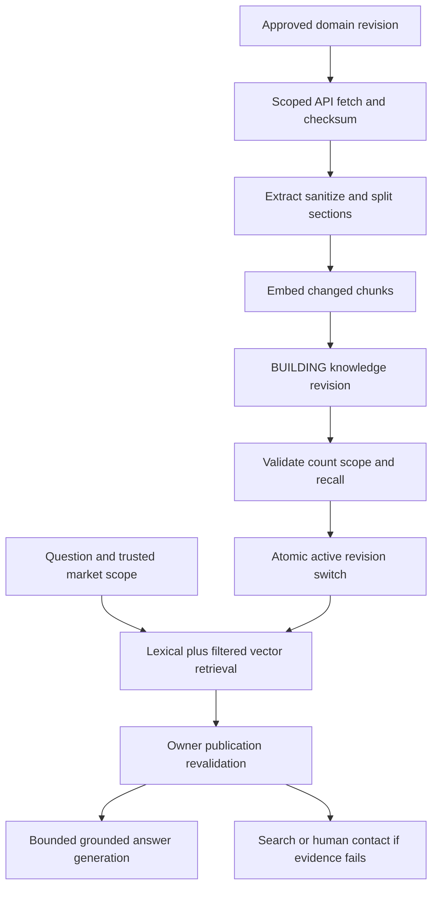

# Nigson Ai Architecture

Specification1.1.0; synchronized view; master is authoritative.

# Master section19: Search Architecture

Catalogue keyword search uses PostgreSQL generated `search_vector` with immutable `to_tsvector('simple', coalesce(name,'') || ' ' || coalesce(description,''))`, GIN index and parameterized plainto_tsquery; name has greater weight through setweight if separate generated expression is used. Simple configuration avoids incorrectly assuming one market language stemmer. Explicit category/brand/product-type/market filters precede pagination and ranking. Index product_category(category_id,product_id), SKU(product_id,active) and eligibility(market_id,product_id). Product type is a validated product_attribute key; if it becomes a frequent filter, introduce a typed indexed product_type column through Liquibase.

Ranking: exact normalized SKU match first, product name token match next, ts_rank_cd next, deterministic id tie-break. Limit input200 chars/20 tokens and statement timeout1s. Never concatenate SQL. Trigram indexes are optional after approved spelling tests; no OpenSearch baseline. Public search excludes archived/ineligible products, returns no wholesale price; organization price resolution is a separate authorized API.

Knowledge search at BP5 combines lexical and 1024-d cosine retrieval, at most20 candidates each. Filter active revision, PUBLIC visibility, locale, enabled market and withdrawn status before retrieval; after ANN search revalidate filter and owner publication. Use RRF `1/(60+rank_lexical) + 1/(60+rank_vector)`, keep8 chunks/max6000 evidence tokens. HNSW parameters initial m16, ef_construction64, ef_search80; measure recall/latency and candidate-filter behavior. A rebuild writes new revisions, validates completeness, atomically switches pointer and expires old evidence. Catalogue/ContentPublished events trigger incremental indexing; source APIs reconcile a nightly approved-ID snapshot to recover missed events. Never add PII or wholesale lists to knowledge.

# Master section20: AI Architecture

| Use case | Input and objective | Output and model | Retrieval/tools | Guardrails and fallback | Audit/approval |
|---|---|---|---|---|---|
| AI-UC-001 Company/FAQ assistant | Question <=2000 chars, approved market/locale; answer company and policy facts | AnswerDTO; configured evaluated Bedrock chat model through gateway | approved content/FAQ RAG | source citations mandatory, unsupported question escalates to configured human channel | run/prompt/model/source revisions and redacted feedback; publisher approves facts |
| AI-UC-002 Conversational discovery | Needs/domain/use constraints | eligible products with grounded reason, optional clarification | RAG plus search_catalog/get_product_details and live-price tool if needed | do not invent SKU/specification/discount; default normal search | record tool outcome and catalogue revision; business selects eligible catalogue |
| AI-UC-003 Order status assistance | Authenticated owner's order question | status/tracking only | get_order_status with verified signed actor | no lookup for anonymous actor; no order mutation; manual account page fallback | scope/outcome hash, no private response text in metrics |
| AI-UC-004 Insight aggregation | redacted intents, empty searches and escalations | daily counts/top gaps; deterministic aggregation, model not required | owned run/search aggregates | minimum group count5 before display; no transcript export by default | analyst permission, audit exports |
| AI-UC-005 Product suggestions | product or category + market | curated related/featured/popular list | commerce recommendation rules | deterministic eligibility and no unapproved profiling | catalogue staff approval; AI only explains factual reasons |

Default prompt `nigson-assistant` revision1 has system behavior, approved evidence block, typed tools and strict AnswerDTO schema. Product/team may edit a new prompt revision, never a live existing revision. Do not fine-tune or train a model for this baseline. Do not add an AI dependency to checkout. No recommendation learning platform, autonomous approvals, financial agent or WhatsApp chatbot is implemented.

Human handoff is a configured HTTPS contact or approved click-to-chat link. AI does not send messages to staff by itself unless that feature is separately approved. AI gives a safe handoff path and a redacted user-visible explanation when facts or provider availability are insufficient. Fallback direct catalogue search, public FAQ link and account tracking remain available without AI.

Provider account, chat model ID, region, permitted data classification and knowledge-owner approval are activation dependencies. The backend ships a concrete Bedrock adapter and offline deterministic test provider; the test provider is rejected in stage/prod. Tests cannot claim model accuracy from a canned test double.

# Master section21: AI Gateway

The AI gateway is a module inside the AI service, not a fifth deployable. Ports: ChatProvider.generate/stream typed messages+tool schemas+validated settings; EmbeddingProvider.embed typed batches; ProviderUsage maps input/output tokens and provider request ID; ModelPolicyRepository returns an explicit approved revision. Only infrastructure provider adapters call model SDKs. Other Java services never call models directly.

Implement Bedrock using boto3 or an approved async SDK wrapper. Converse/ConverseStream is used only for a chat model listed as compatible in the selected region. Titan embeddings v2 use the documented InvokeModel payload, normalized dimensions1024. IAM allows only configured model resources; no broad marketplace/model invocation wildcard by default. Alternate model is optional same-provider explicit evaluated fallback, not silently another data processor.

Defaults: connect2s, first-byte8s, total provider12s within workflow20s; max output1500 tokens; max combined context12000; concurrent chat calls10/service replica; embedding concurrency2 with batch<=16 texts. Retry only classified transient 429/5xx before streaming content, max1 retry with jitter0.2..1s and remaining-deadline check. After partial streaming never concatenate a second model answer into the same response. Repair invalid structured output at most once if budget remains and count it as a graph step. No retry loop can exceed deadline or token reservation.

Reserve per-run budget pessimistically before invocation; persist actual usage and rate revision afterward. Config rate table supplies estimates with effective revision, not live scraped price. Initial local/test spend caps use synthetic rates; production enabled model policy requires approved currency/rate/budget. Daily spend hard stop returns deterministic fallback. Emit request count, token/cost estimate, provider latency/error and structured-output failures without prompts. Schema-validate final AnswerDTO; check cited IDs correspond to validated evidence and any product IDs are eligible tool outputs. Provider refusal is mapped to supported fallback, not shown as internal error.

Prompt/model/retrieval revisions are immutable and rollback selects the last passed combination. A provider change is an ADR plus full evaluation and approved data-routing configuration, never a hidden flag change.

# Master section22: RAG Architecture

Parse only approved structured CMS content, sanitized product facts and CLEAN public PDF brochures. PDF parser runs sandboxed with file/page/CPU limits; text-only launch ingestion ignores inaccessible scanned images and flags them to the content owner instead of inventing OCR accuracy. Source size <=10MiB/100pages. Preserve section titles and canonical URLs.

Chunk target600 tokens, overlap80, max1200; section boundaries take precedence, no meaningless split mid-SKU/spec field. Store source service/resource/revision/checksum, section, locale, market, visibility, publication approval, embedding model revision, ordinal and token count. `vector(1024)` uses normalized Titan v2 reference embeddings. Embedding interface validates count/dimension/finiteness; failed batch keeps revision BUILDING/FAILED and never activates a partial index.

Retrieval counts/ranking defined in section19. Optional reranker remains disabled until evaluated incremental benefit; no new paid service assumed. Citations derive canonical URL/title/section/revision from validated source metadata, never model-generated URLs. Validate sources again immediately before final answer; remove withdrawn sources and regenerate only if bounded budget allows, otherwise handoff. Public knowledge cannot include careers files, distributor identity documents, emails, lead details, private wholesale prices or orders.

Dimension/model changes: migration creates a separate vector space with explicit embedding_revision and HNSW index; dual-build, validate, switch and retain rollback. Do not write mismatched vectors into an existing column. Nightly source reconciliation plus event ingestion repairs lag. Withdrawal clears active visibility locally when event arrives and owner validation already prevents stale citation before event delivery.

# Master section23: Agent Architecture

One bounded LangGraph workflow; no multi-agent orchestration. Graph nodes: authorize -> classify -> retrieve -> validate_sources -> optional_read_tools -> compose -> validate_answer -> respond or escalate. A classifier outputs COMPANY|PRODUCT|ORDER_STATUS|UNSUPPORTED and needed clarification, never arbitrary task planning. Persist typed encrypted checkpoint state; resume only safe local/read-only steps. Completed run replay returns original final response, and reconnection never re-executes already accounted model calls without explicit bounded recovery.

Limits per run: 8 graph steps, 4 tool invocations, 20 seconds wall clock, 12000 total token budget including repair, 1500 output tokens, max1 output repair, max10 active runs per replica and max1 active run per conversation. Anonymous session rate10 messages/hour, authenticated30/hour default; WAF plus owned per-session accounting for distributed limit. No indefinite wait or model-generated code execution.

Tool registry is static typed configuration: search_catalog(market,q,filters), get_product_details(productId,market), get_available_price(skuId,quantity,market) and get_order_status(orderId). Organization/party context is injected from trusted session, not a tool argument. Tools have max3s deadlines and scope/resource checks. Reject unknown tools, arbitrary URL/sql/file tools and unexpected keys. Product tool results include authoritative IDs and revision; price tool uses Money/currency from commerce without AI arithmetic.

Memory: thread-local bounded recent turns in encrypted checkpointer, 24h default retention, max10 turns within token limit. No persistent cross-user preference inference without explicit consent. Audit tool name, argument hash, scope, run ID, outcome, duration and model policy. Handoff is the only human checkpoint; all financial/admin write tools are excluded, rather than ambiguously awaiting model approval.

# Master section24: MCP Strategy

MCP is an optional future interoperability interface, feature disabled at launch/BP5 baseline unless an approved external client requires it. The internal AI graph uses typed HTTP ports, not MCP for Java methods. Generate documentation and tool schemas; do not deploy an unused MCP server.

If activated through ADR-MCP: expose only search_catalog/get_product_details/get_available_price and owner-bound get_order_status through an AI-service gateway facade, reuse exact domain tool validation, and implement the current MCP authorization profile with audience-bound OAuth tokens, registered clients, approved origin checks, scopes, rate limits and audit. Do not accept token passthrough to arbitrary downstream services. Workload/actor delegation is reissued for intended commerce resource and cannot be provided by the model. Initial rate30 requests/min/client, burst5, query limits identical to REST. MCP does not create new capabilities or grant broader dataset visibility. Financial, stock, application-approval and admin writes remain unavailable. Version the tool JSON schemas and pin protocol/client library versions when this optional work is approved.

