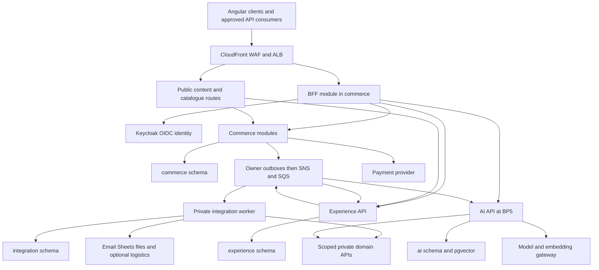
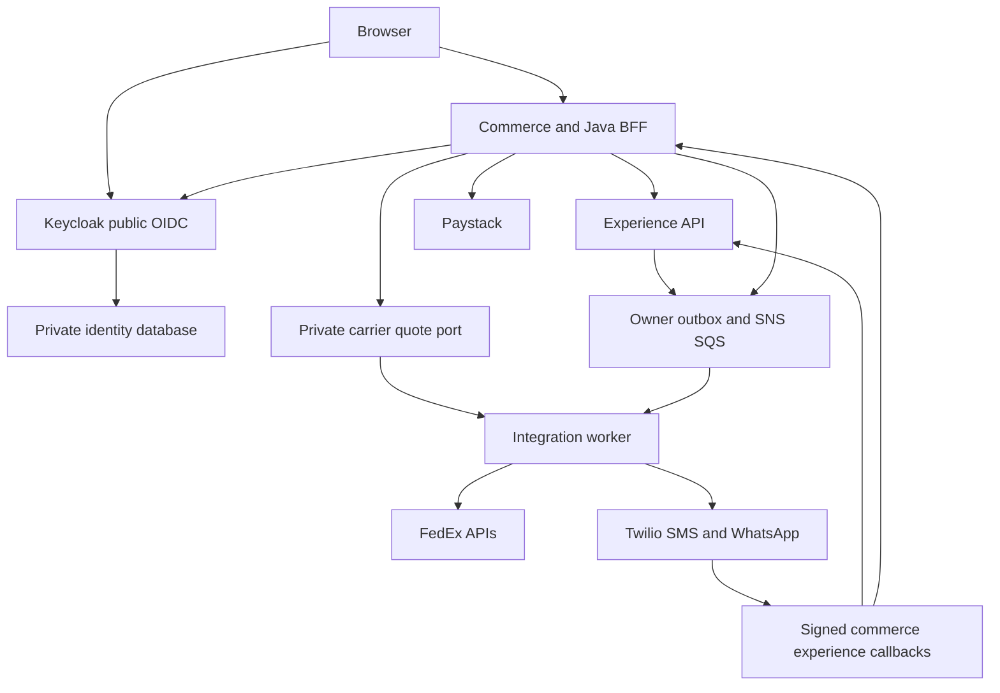

# Nigson Architecture

Specification1.1.0; synchronized view; master is authoritative.


# Master section2: Executive Technical Summary

Implement commerce and experience APIs plus a private integration worker in Java. Add the Python AI service only for BP5. Commerce contains modular catalogue, party, pricing, cart, inventory, payment, order, reward, quote and fulfillment contexts and the Java BFF. Keep checkout's financial and stock invariants in one PostgreSQL transaction boundary.

Use one managed PostgreSQL 18 instance initially, with commerce, experience, integration and ai schemas and separate runtime/migration roles. Only the owning service may access its schema. Each publisher commits an outbox event with its business change; SNS fans out to dedicated SQS queues. Duplicate delivery is expected and handled through persisted business keys.

Authentication uses self-hosted Keycloak OIDC, server-side BFF sessions, staff MFA and resource/organization authorization. Production hosting is ECS Fargate, ALB, CloudFront/WAF, private RDS, S3, Secrets Manager, KMS and CloudWatch. The AI service owns a bounded RAG graph and provider gateway; it may read approved content and live authorized commerce data, never alter financial or stock state.

Retain Java 25, Spring Boot 4.1.1, Spring Modulith 2.1.1, Maven, Spring Security, Spring Data JPA, Hibernate, Liquibase, PostgreSQL 18, Python 3.12, FastAPI, Pydantic and LangGraph. Use the Spring Boot BOM for managed dependencies; record locked non-BOM versions in EP00. PostgreSQL 18.6 and pgvector 0.8.2 are baseline candidates; verify region/image availability and pin image digests. Use JUnit Jupiter managed by the Boot test BOM rather than forcing an incompatible JUnit 5 version. No Spring Cloud gateway, Eureka, Kafka, OpenSearch, Kubernetes or Helm is part of the launch contract. Caching may use optional Valkey after measurement. Backend scope supplies contracts for Angular; it does not generate the frontend.

Primary technical references, verified for this specification: [Spring Boot](https://docs.spring.io/spring-boot/system-requirements.html), [Spring Modulith](https://docs.spring.io/spring-modulith/reference/), [pgvector](https://github.com/pgvector/pgvector), [Paystack transaction API](https://paystack.com/docs/api/transaction/), [Paystack webhooks](https://paystack.com/docs/payments/webhooks/), [Bedrock embeddings](https://docs.aws.amazon.com/bedrock/latest/userguide/titan-embedding-models.html), [Spring Session JDBC](https://docs.spring.io/spring-session/reference/api.html). Technical facts from these sources are limited to version/feature verification; all Nigson policies below are explicit recommendations.


# Master section3: Architecture Assumptions

### ASSUMPTION-001

- **Description:** Account-only checkout at launch
- **Reason:** Source leaves guest checkout undecided.
- **Implementation impact:** All carts/orders require mapped party; guest checkout is deferred, not silently implemented.

### ASSUMPTION-002

- **Status:** Confirmed by user; replaces specification1.0.0.
- **Description:** Nigeria and Nigerian Naira approved for launch
- **Reason:** User clarification, 4 October2026.
- **Implementation impact:** Seed market code NG, destination country NG, currency NGN with minor_unit2. The country/currency approval is complete. Tax, returns, retail prices and actual serviceable delivery areas remain separate configuration inputs; never substitute a guessed tax rate.

### ASSUMPTION-003

- **Status:** Confirmed by user; replaces specification1.0.0.
- **Description:** Paystack is the only launch payment gateway
- **Reason:** User explicitly selected Paystack and requested a mock server before adding demo/live credentials.
- **Implementation impact:** Implement real initialize/verify/refund adapters and signed webhook verification through PaymentProvider. Implement a local stateful HTTP mock with dummy keys; PAYSTACK_MODE=mock|test|live selects configuration, not different domain logic. Real test/live keys are added on release; no other payment gateway in launch code.

### ASSUMPTION-004

- **Status:** Confirmed by user; replaces specification1.0.0.
- **Description:** Carrier API logistics required at launch; FedEx selected as initial adapter
- **Reason:** User authorized FedEx or another prominent Nigeria carrier and mock-first implementation.
- **Implementation impact:** Implement FedEx OAuth, rate requests, shipment creation/labels, cancellation and tracking polling through CarrierProvider, plus local stateful mocks. Carrier work is BP1 required, not deferred to BP4. Real service/account/route availability is checked with release credentials; no claim that every domestic Nigerian route supports a FedEx service. Manual exception handling is a contingency only.

### ASSUMPTION-005

- **Description:** Java BFF shares the commerce process
- **Reason:** Source specifies BFF in commerce.
- **Implementation impact:** Use Spring Session JDBC in commerce; default idle TTL 30m, absolute 12h, staff recent MFA <=15m; encrypted refresh tokens.

### ASSUMPTION-006

- **Description:** One location, extensible stock ledger
- **Reason:** Source launch inventory is platform-managed.
- **Implementation impact:** Location allocation order is configured; launch permits one location per line. Additional locations do not change SKU units.

### ASSUMPTION-007

- **Description:** Reservation TTL 15m and priced quote TTL 5m
- **Reason:** Exact timing not specified.
- **Implementation impact:** Configuration validates TTL bounds; late settlement follows explicit hold/re-reservation rules; never assume expired equals unpaid.

### ASSUMPTION-008

- **Description:** Paystack full capture, no partial order payments
- **Reason:** Source does not request installments or split payment.
- **Implementation impact:** One accepted settlement per order; partial refunds supported; decline partial settlement as mismatch for resolution.

### ASSUMPTION-009

- **Description:** Single company with organizations, not SaaS tenancy
- **Reason:** Source is Nigson platform with distributors.
- **Implementation impact:** Do not generate tenant onboarding or one-database-per-customer infrastructure; party may belong to several organizations.

### ASSUMPTION-010

- **Description:** Currency minor-unit rounding HALF_UP
- **Reason:** No rounding/tax policy specified.
- **Implementation impact:** Use BigDecimal; round each line net/tax under configured policy and derive totals from rounded lines. Tax rules and rates need explicit activation.

### ASSUMPTION-011

- **Description:** Commercial features disabled until rules approved
- **Reason:** Amounts and thresholds are missing.
- **Implementation impact:** Implement versioned rule engines and staff configuration; no production free rewards or blanket discounts seeded.

### ASSUMPTION-012

- **Status:** Confirmed by user; replaces specification1.0.0.
- **Description:** Email, SMS and WhatsApp integrations required
- **Reason:** User expanded automated communications beyond entry links.
- **Implementation impact:** Keep email and newsletter double opt-in; add Twilio SMS and Twilio WhatsApp Business adapters, signed status/inbound callbacks, verified destinations, purpose/channel consent and templates. Mock-first implementation uses dummy credentials and synthetic recipients. Credentials, sender identities and approved WhatsApp templates are supplied for provider testing/release.

### ASSUMPTION-013

- **Status:** Confirmed by user; replaces specification1.0.0.
- **Description:** Keycloak is the identity provider in every environment, including production
- **Reason:** User explicitly replaced the Cognito production recommendation.
- **Implementation impact:** Deploy and configure Keycloak with supported PostgreSQL identity database, OIDC/PKCE, confidential BFF/workload clients, staff MFA, TLS/proxy settings, private admin access, HA/backup/upgrade runbooks. Spring Session JDBC BFF sessions remain in commerce; business schemas never own password hashes.

### ASSUMPTION-014

- **Description:** Bedrock reference model/embedding provider
- **Reason:** AWS reference hosting and approved AI service in architecture.
- **Implementation impact:** Use boto3 Converse/ConverseStream for compatible selected chat model, InvokeModel Titan v2 for normalized 1024 embeddings; chat model ID is required activation config, not fabricated default.

### ASSUMPTION-015

- **Description:** No raw transcripts retained by default
- **Reason:** Privacy and AI retention undecided.
- **Implementation impact:** Encrypt bounded checkpoints <=24h; redact run logs. Optional approved transcript retention requires explicit policy.

### ASSUMPTION-016

- **Description:** SQS standard queues, SNS routing
- **Reason:** Architecture explicitly picks SNS/SQS.
- **Implementation impact:** At-least-once, no global ordering, consumer-local dedup. Use aggregate versions and authoritative reads; no exactly-once transport claim.

### ASSUMPTION-017

- **Description:** Terraform selected from IaC options
- **Reason:** Architecture allows Terraform or OpenTofu.
- **Implementation impact:** Use Terraform pinned stable 1.x in EP00; no Helm/EKS manifests unless separate approved architecture change.

### ASSUMPTION-018

- **Description:** Recovery profile and load fixture are engineering targets
- **Reason:** Production demand/budget unspecified.
- **Implementation impact:** Initial test workload: 100 concurrent sessions, 20 catalogue RPS plus 2 checkout RPS, 30m; 10k products/20k SKUs synthetic. Verify real sizing before commitment.

### ASSUMPTION-019

- **Description:** Retention defaults are provisional
- **Reason:** Operating jurisdiction unspecified.
- **Implementation impact:** Configurable defaults: outbox 30d after publish, dedup 90d, notification context 30d, careers 180d, audit/financial 7y, AI checkpoints 24h; approval required before production retention activation.

### ASSUMPTION-020

- **Description:** Two-person sensitive finance/entitlement approval supported
- **Reason:** Source expects governance but not exact thresholds.
- **Implementation impact:** Finance refund policy and sales discount thresholds are config. Default require second actor on refund approval and distributor approval for production; business may approve adjusted controls.

### ASSUMPTION-021

- **Description:** CMS structured JSON, sanitized rich text
- **Reason:** No CMS product named.
- **Implementation impact:** Implement content schemas and revision workflows in experience, not a new service or external CMS dependency.

### ASSUMPTION-022

- **Description:** Signed actor delegation for private BFF/tool hops
- **Reason:** Independent APIs need trusted context without trusting model/body IDs.
- **Implementation impact:** Workload OAuth token plus short-lived signed actor assertion; audience-bound, operation-scoped, validated at target; detailed security contract in section 15.

Missing real credentials/account configuration, catalogue, tax/returns and service-area policy are production activation blockers only. Continue independent local/sandbox implementation and record their status. Never mark their production tests as passed without evidence.


Remaining activation inputs are credentials/accounts/senders/templates, Nigeria tax/returns/prices/service areas, hosting/data location and unchanged campaign/AI policies. Nigeria/NGN, Paystack selection, automated messaging and production Keycloak are no longer unresolved provider/market decisions. Dummy values are local/test-only and cannot authenticate to real providers.


# Master section4: Backend Architecture



The four database nodes are separate schema/role boundaries on one RDS instance initially. The worker has no ALB/public route. `/internal/**` paths are reachable only through private service discovery and workload policies. BFF handling must not become a separate service in this scope. Never infer a synchronous dependency from every event arrow: outbox publication occurs after local commits. SNS subscriptions also supply experience its entitlement/quote projection queue.

Commerce module dependency direction: party/authorization and catalogue/market -> pricing/inventory -> cart/order -> payment/fulfillment; promotion/reward expose pricing ports. Use application orchestration for checkout; modules do not directly import each other's internal persistence types. Reward and notification handling cannot extend the atomic payment transaction with remote calls. Experience modules depend on typed commerce ports for proofs/entitlements, not its database.


## Updated platform topology



Mocks replace only Paystack/FedEx/Twilio target configuration in local/test. Keycloak is real locally and hardened in production. AI/BP5 and the four owner-schema boundaries remain as the earlier diagram specifies.


# Master section5: Service Catalog

| Service | Responsibility | Schema | APIs | Produced events | Consumed events |
|---|---|---|---|---|---|
| commerce | Commerce core and Java BFF | commerce | API-001, API-002, API-003, API-004, API-005, API-006, API-007, API-008, API-009, API-010, API-011, API-012, API-013, API-014, API-015, API-016, API-017, API-018, API-019, API-020, API-021, API-022, API-023, API-024, API-025, API-026, API-027, API-028, API-029, API-030, API-031, API-032, API-033, API-034, API-035, API-036, API-037, API-038, API-039, API-040, API-041, API-042, API-043, API-044, API-045, API-046, API-047, API-048, API-049, API-050, API-051, API-052, API-053, API-054, API-055, API-056, API-057, API-058, API-059, API-060, API-061, API-062, API-063, API-064, API-065, API-066, API-067, API-068, API-069, API-070, API-071, API-072, API-073, API-074, API-075, API-111, API-112, API-113, API-117, API-118, API-119, API-120, API-121, API-122, API-123, API-124, API-132, API-133, API-134, API-135, API-149, API-150, API-151, API-152, API-153, API-154, API-155, API-159, API-160, API-161, API-162, API-163, API-164, API-165, API-169, API-170, API-171, API-173, API-174 | EVT-001, EVT-002, EVT-003, EVT-004, EVT-005, EVT-006, EVT-007, EVT-008, EVT-009, EVT-010, EVT-011, EVT-012, EVT-013, EVT-014, EVT-015, EVT-025, EVT-026 | EVT-002, EVT-004, EVT-011, EVT-012 |
| experience | CMS engagement and business intake | experience | API-076, API-077, API-078, API-079, API-080, API-081, API-082, API-083, API-084, API-085, API-086, API-087, API-088, API-089, API-090, API-091, API-092, API-093, API-094, API-095, API-096, API-097, API-098, API-099, API-100, API-101, API-102, API-103, API-104, API-105, API-106, API-107, API-108, API-109, API-110, API-114, API-115, API-116, API-125, API-126, API-127, API-128, API-129, API-130, API-131, API-136, API-137, API-138, API-139, API-156, API-157, API-158, API-172, API-175, API-176, API-177 | EVT-016, EVT-017, EVT-018, EVT-019, EVT-020, EVT-021, EVT-022, EVT-023, EVT-024, EVT-025 | EVT-013, EVT-014, EVT-015, EVT-020 |
| integration | Private adapters notifications and scheduled work | integration | API-140, API-141, API-142 |  | EVT-001, EVT-002, EVT-003, EVT-004, EVT-005, EVT-006, EVT-007, EVT-008, EVT-009, EVT-010, EVT-011, EVT-012, EVT-013, EVT-014, EVT-015, EVT-016, EVT-017, EVT-018, EVT-019, EVT-021, EVT-022, EVT-023, EVT-024, EVT-025, EVT-026 |
| ai | Bounded customer assistant knowledge and provider gateway | ai | API-143, API-144, API-145, API-146, API-147, API-148, API-166, API-167, API-168, API-178, API-179, API-180 |  | EVT-006, EVT-008, EVT-017, EVT-018 |

## Commerce core and Java BFF

### Responsibilities

Modules: party, authorization, catalogue, pricing, market, cart, order, inventory, payment, fulfillment, quote, promotion, reward, files, reporting, session. All money and stock effects are atomic local commands; public retail data may cache but prices and entitlements are authoritative.

### Owned entities and database tables

`party`, `customer_profile`, `staff_role_assignment`, `organization`, `organization_membership`, `address`, `account_entitlement`, `brand`, `category`, `product`, `sku`, `product_category`, `product_attribute`, `asset_reference`, `currency`, `market`, `market_destination`, `product_market_eligibility`, `price_book`, `price_entry`, `price_assignment`, `wholesale_rule`, `delivery_rule`, `cart`, `cart_line`, `checkout_quote`, `sales_order`, `order_line`, `order_total_component`, `order_status_history`, `stock_location`, `inventory_balance`, `inventory_reservation`, `inventory_movement`, `payment_attempt`, `payment_transaction`, `webhook_receipt`, `refund`, `refund_line`, `shipment`, `shipment_line`, `shipment_event`, `quote`, `quote_revision`, `quote_line`, `promotion_rule`, `coupon`, `coupon_redemption`, `reward_entry`, `referral_code`, `referral_attribution`, `wheel_campaign`, `wheel_outcome`, `wheel_draw`, `product_recommendation`, `abandoned_cart_candidate`, `outbox_event`, `processed_event`, `idempotency_record`, `audit_record`, `feature_configuration`, `spring_session`, `spring_session_attributes`.

### REST APIs

API-001, API-002, API-003, API-004, API-005, API-006, API-007, API-008, API-009, API-010, API-011, API-012, API-013, API-014, API-015, API-016, API-017, API-018, API-019, API-020, API-021, API-022, API-023, API-024, API-025, API-026, API-027, API-028, API-029, API-030, API-031, API-032, API-033, API-034, API-035, API-036, API-037, API-038, API-039, API-040, API-041, API-042, API-043, API-044, API-045, API-046, API-047, API-048, API-049, API-050, API-051, API-052, API-053, API-054, API-055, API-056, API-057, API-058, API-059, API-060, API-061, API-062, API-063, API-064, API-065, API-066, API-067, API-068, API-069, API-070, API-071, API-072, API-073, API-074, API-075, API-111, API-112, API-113, API-117, API-118, API-119, API-120, API-121, API-122, API-123, API-124, API-132, API-133, API-134, API-135, API-149, API-150, API-151, API-152, API-153, API-154, API-155, API-159, API-160, API-161, API-162, API-163, API-164, API-165, API-169, API-170, API-171, API-173, API-174. Every route, DTO and rule is specified in section 13.

### Events published and consumed

EVT-001 order.pending.v1, EVT-002 order.paid.v1, EVT-003 order.processing.v1, EVT-004 order.cancelled.v1, EVT-005 inventory.availability.changed.v1, EVT-006 catalogue.product.changed.v1, EVT-007 pricing.changed.v1, EVT-008 market.changed.v1, EVT-009 shipment.changed.v1, EVT-010 refund.requested.v1, EVT-011 refund.approved.v1, EVT-012 refund.succeeded.v1, EVT-013 quote.offered.v1, EVT-014 quote.accepted.v1, EVT-015 distributor.entitlement.changed.v1, EVT-025 file.scan.requested.v1, EVT-026 cart.recovery.requested.v1.

### External and internal dependencies

External: Keycloak/OIDC; Paystack-only launch adapter; S3; SNS; KMS. Internal: experience through proofs/lead context only; no checkout remote dependency.

### Caching

Use section 18 policies; no financial authorization from cache. Every service supports cache-disabled operation.

### Authorization and validation

Deny by default; enforce service-specific API permissions in section 13, signed workload/actor scope in section 15 and invariants in sections 8/10. Reject unknown enum/JSON rule values. Never bind request bodies to persistence entities.

### Failure handling

Apply section 44 budgets. Commit primary data and outbox locally, surface a correlated Problem response on failure, persist provider uncertainty, and expose reconciliation status without pretending that a remote effect succeeded.

## CMS engagement and business intake

### Responsibilities

Modules: content, lead, distributor, engagement, consent, careers, files, reporting. Publication and suppression become immediately authoritative in this service; failures of worker do not erase primary records.

### Owned entities and database tables

`content_item`, `content_revision`, `file_asset`, `lead`, `lead_activity`, `distributor_application`, `application_document`, `review`, `consent_event`, `newsletter_subscription`, `communication_suppression`, `career_opportunity`, `career_application`, `campaign`, `channel_configuration`, `outbox_event`, `processed_event`, `idempotency_record`, `audit_record`, `feature_configuration`, `lead_requested_item`, `upload_session`.

### REST APIs

API-076, API-077, API-078, API-079, API-080, API-081, API-082, API-083, API-084, API-085, API-086, API-087, API-088, API-089, API-090, API-091, API-092, API-093, API-094, API-095, API-096, API-097, API-098, API-099, API-100, API-101, API-102, API-103, API-104, API-105, API-106, API-107, API-108, API-109, API-110, API-114, API-115, API-116, API-125, API-126, API-127, API-128, API-129, API-130, API-131, API-136, API-137, API-138, API-139, API-156, API-157, API-158, API-172, API-175, API-176, API-177. Every route, DTO and rule is specified in section 13.

### Events published and consumed

EVT-013 quote.offered.v1, EVT-014 quote.accepted.v1, EVT-015 distributor.entitlement.changed.v1, EVT-016 lead.created.v1, EVT-017 content.published.v1, EVT-018 content.withdrawn.v1, EVT-019 distributor.application.created.v1, EVT-020 distributor.decision.requested.v1, EVT-021 review.published.v1, EVT-022 newsletter.verification.requested.v1, EVT-023 consent.changed.v1, EVT-024 career.application.created.v1, EVT-025 file.scan.requested.v1.

### External and internal dependencies

External: S3; SNS; KMS. Internal: commerce proof/entitlement APIs; acknowledged approval relay.

### Caching

Use section 18 policies; no financial authorization from cache. Every service supports cache-disabled operation.

### Authorization and validation

Deny by default; enforce service-specific API permissions in section 13, signed workload/actor scope in section 15 and invariants in sections 8/10. Reject unknown enum/JSON rule values. Never bind request bodies to persistence entities.

### Failure handling

Apply section 44 budgets. Commit primary data and outbox locally, surface a correlated Problem response on failure, persist provider uncertainty, and expose reconciliation status without pretending that a remote effect succeeded.

## Private adapters notifications and scheduled work

### Responsibilities

Modules: notification, provider, files, reporting, platform. All remote attempts carry stable references; UNKNOWN external outcomes reconcile before replay; no direct domain-table access.

### Owned entities and database tables

`notification_template`, `notification_job`, `notification_attempt`, `integration_job`, `provider_cursor`, `sheet_sync_record`, `outbox_event`, `processed_event`, `idempotency_record`, `audit_record`, `feature_configuration`.

### REST APIs

API-140, API-141, API-142. Every route, DTO and rule is specified in section 13.

### Events published and consumed

EVT-001 order.pending.v1, EVT-002 order.paid.v1, EVT-003 order.processing.v1, EVT-004 order.cancelled.v1, EVT-005 inventory.availability.changed.v1, EVT-006 catalogue.product.changed.v1, EVT-007 pricing.changed.v1, EVT-008 market.changed.v1, EVT-009 shipment.changed.v1, EVT-010 refund.requested.v1, EVT-011 refund.approved.v1, EVT-012 refund.succeeded.v1, EVT-013 quote.offered.v1, EVT-014 quote.accepted.v1, EVT-015 distributor.entitlement.changed.v1, EVT-016 lead.created.v1, EVT-017 content.published.v1, EVT-018 content.withdrawn.v1, EVT-019 distributor.application.created.v1, EVT-021 review.published.v1, EVT-022 newsletter.verification.requested.v1, EVT-023 consent.changed.v1, EVT-024 career.application.created.v1, EVT-025 file.scan.requested.v1, EVT-026 cart.recovery.requested.v1.

### External and internal dependencies

External: SES/SMTP; Sheets; required FedEx logistics; S3 scanner; SNS/SQS. Internal: scoped commerce/experience APIs only.

### Caching

Use section 18 policies; no financial authorization from cache. Every service supports cache-disabled operation.

### Authorization and validation

Deny by default; enforce service-specific API permissions in section 13, signed workload/actor scope in section 15 and invariants in sections 8/10. Reject unknown enum/JSON rule values. Never bind request bodies to persistence entities.

### Failure handling

Apply section 44 budgets. Commit primary data and outbox locally, surface a correlated Problem response on failure, persist provider uncertainty, and expose reconciliation status without pretending that a remote effect succeeded.

## Bounded customer assistant knowledge and provider gateway

### Responsibilities

Modules: assistant, knowledge, gateway, evaluation, platform. No business mutation tools, arbitrary SQL/URL tools or private knowledge; provider outages degrade to contact and search.

### Owned entities and database tables

`knowledge_document`, `knowledge_revision`, `knowledge_chunk`, `embedding_revision`, `conversation`, `ai_run`, `ai_checkpoint`, `tool_invocation`, `ai_feedback`, `evaluation_suite`, `evaluation_result`, `outbox_event`, `processed_event`, `idempotency_record`, `audit_record`, `feature_configuration`, `ingestion_job`, `model_policy`, `prompt_revision`, `model_rate`.

### REST APIs

API-143, API-144, API-145, API-146, API-147, API-148, API-166, API-167, API-168, API-178, API-179, API-180. Every route, DTO and rule is specified in section 13.

### Events published and consumed

EVT-006 catalogue.product.changed.v1, EVT-008 market.changed.v1, EVT-017 content.published.v1, EVT-018 content.withdrawn.v1.

### External and internal dependencies

External: Bedrock reference adapter; S3 report objects; SQS; KMS. Internal: approved content and catalogue APIs; signed-actor commerce tools.

### Caching

Use section 18 policies; no financial authorization from cache. Every service supports cache-disabled operation.

### Authorization and validation

Deny by default; enforce service-specific API permissions in section 13, signed workload/actor scope in section 15 and invariants in sections 8/10. Reject unknown enum/JSON rule values. Never bind request bodies to persistence entities.

### Failure handling

Apply section 44 budgets. Commit primary data and outbox locally, surface a correlated Problem response on failure, persist provider uncertainty, and expose reconciliation status without pretending that a remote effect succeeded.


## Launch amendment coverage

| Owner | New tables / responsibilities | New APIs |
|---|---|---|
| commerce | carrier_quote | API-181, API-188, API-191, API-195 |
| experience | communication_destination, destination_verification, inbound_message | API-183, API-184, API-185, API-186, API-187, API-190, API-192, API-194 |
| integration | carrier_booking, message_receipt | API-182, API-189, API-193 |


Identity platform: production Keycloak, dedicated identity DB and clients/MFA; IDP-001. Updated owner catalogs in sections8/10 and endpoints in section13 are authoritative; older summary list is supplemented by this matrix.


# Master section6: Repository Structure

Use a backend monorepo at the current repository root; do not create a nested git repository. The frontend apps may coexist but are outside this generation task. Java services are Maven modules; AI is a separate locked Python project. Shared packages contain protocol utilities only, not domain entities or repositories.

```text
BACKEND_IMPLEMENTATION_MASTER.md
IMPLEMENTATION_STATUS.md
pom.xml  mvnw  mvnw.cmd  .mvn/wrapper/
services/commerce/pom.xml
services/experience/pom.xml
services/integration/pom.xml
services/ai/pyproject.toml  uv.lock
services/<java-service>/src/main/java/com/nigson/<service>/
services/<java-service>/src/main/resources/application.yml
services/<java-service>/src/main/resources/db/changelog/
services/<java-service>/src/test/java/com/nigson/<service>/
services/<java-service>/src/test/resources/fixtures/
services/<service>/Dockerfile
shared/common-security/
shared/common-observability/
shared/common-events/
shared/common-problem/
contracts/openapi/commerce.yaml  experience.yaml  ai.yaml  integration-private.yaml
contracts/events/<event-name>.schema.json
contracts/rules/  contracts/content/  contracts/ai/
database/bootstrap/  database/changelog/ai/
infrastructure/terraform/modules/{network,compute,database,messaging,storage,identity,secrets,monitoring}/
infrastructure/terraform/environments/{dev,stage,prod}/
infrastructure/docker/{localstack,keycloak,otel,postgres}/
.github/workflows/{ci,deploy,ai-evaluation,restore-drill}.yml
docs/{ARCHITECTURE,API_CONTRACT,DATA_MODEL,EVENT_CATALOG,SECURITY,AI_ARCHITECTURE,LOCAL_DEVELOPMENT}.md
docs/adr/  docs/implementation/  docs/runbooks/
tests/contract/  tests/e2e/  tests/load/  tests/fixtures/
scripts/  .env.example  docker-compose.yml  Makefile  README.md
```

Do not generate `platform/api-gateway`, discovery server, config server, `kubernetes/` or `helm/` directories. AWS ALB/service discovery and environment/secrets configuration replace those unnecessary deployables. Java Maven packaging produces three executable JARs and shared library JARs. Each service image carries only its required shared code; release independently through paths-filtered CI while contracts remain versioned in one repo.


Required implementation paths added: tests/mocks/{paystack,fedex,twilio}, contracts/providers/{paystack,fedex,twilio}, infrastructure/docker/keycloak, infrastructure/terraform/modules/identity, docs/runbooks/{provider-release,keycloak,carrier,messaging}. No actual mock/application source is generated by this specification edit.


# Master section7: Standard Service Structure

Java root is `com.nigson.<service>`. Each first-level business module has its own `package-info.java` with Spring Modulith declaration, an exported `api` package containing domain-facing ports/value contracts, and `internal` application/domain/infrastructure/API-adapter code. REST controllers are internal delivery adapters, not public module interfaces. Exported module ports do not expose JPA entities.

```text
com/nigson/commerce/CommerceApplication.java
com/nigson/commerce/order/package-info.java
com/nigson/commerce/order/api/{OrderCommands,OrderQueries,OrderSummary,OrderPaid}.java
com/nigson/commerce/order/internal/api/{controller,request,response,mapper}/
com/nigson/commerce/order/internal/application/{command,query,service}/
com/nigson/commerce/order/internal/domain/{model,valueobject,repository,event}/
com/nigson/commerce/order/internal/infrastructure/{persistence,messaging,external,configuration}/
com/nigson/commerce/order/internal/{security,exception,observability}/
```

Domain repository interfaces belong to domain; JPA/SQL implementations to infrastructure. Controllers call application services. Use constructor injection, Java records for DTOs, immutable value objects and application-layer transaction boundaries. Use JDBC/explicit SQL for atomic inventory, outbox leases and projection updates where JPA locking semantics would be obscure. Disable Open Session in View and require explicit fetch plans.

Experience follows the same module pattern. Integration exposes only private API adapters and queue/scheduler delivery adapters. A Modulith architecture test and ArchUnit rules reject cycles and external references to another module's `internal` packages.

Python: `src/nigson_ai/{api,application,domain,infrastructure,gateway,knowledge,workflow,security,observability}`. FastAPI routes depend on typed use cases; use async PostgreSQL and HTTP clients with bounded pools. Pydantic request/response types forbid unexpected keys. LangGraph state is typed and stored through the owned checkpointer, not implicit unmanaged migrations.


# Master section46: Implementation Phases

| Engineering phase | Goal | Product mapping | Exit gate |
|---|---|---|---|
| EP00 | Repository and repeatable builds | Before BP1 | FOUND-001; FOUND-002; FOUND-003 |
| EP01 | Owner schemas and reliable platform primitives | BP1 foundation | DATA-001; PLAT-001; PLAT-002 |
| EP02 | Identity, BFF, authorization and private trust | BP1 foundation | SEC-001; COM-AUTHO-001; COM-PARTY-001; COM-SESSI-001 |
| EP03 | Corporate content, catalogue, assets and intake | BP1 | COM-CATAL-001; COM-FILES-001; COM-NOTIF-001; COM-PLATF-001; COM-PROVI-001; EXP-CONTE-001; EXP-FILES-001; EXP-LEAD-001; EXP-NOTIF-001; EXP-PLATF-001 |
| EP04 | Markets, prices, inventory and delivery rules | BP1 | COM-INVEN-001; COM-MARKE-001; COM-PRICI-001 |
| EP05 | Cart, checkout, payments, orders and fulfillment | BP1 release | COM-CART-001; COM-FULFI-001; COM-ORDER-001; COM-PAYME-001; INT-NOTIF-001; INT-PROVI-001 |
| EP06 | Promotions, loyalty, referrals and wheel | BP2 | COM-PROMO-001; COM-REWAR-001 |
| EP07 | Reviews, consent, campaigns, careers and notifications | BP2 release | EXP-CAREE-001; EXP-CONSE-001; EXP-ENGAG-001; EXP-FILES-002; EXP-NOTIF-002; INT-PROVI-002 |
| EP08 | Distributor membership, wholesale and quotations | BP3 release | COM-AUTHO-002; COM-PARTY-002; COM-PRICI-002; COM-QUOTE-001; COM-REWAR-002; EXP-DISTR-001; EXP-LEAD-002 |
| EP09 | Operations, reports, recovery and carrier optimization | BP4 | COM-AUDIT-001; COM-CART-002; COM-FULFI-002; COM-REPOR-001; EXP-AUDIT-001; EXP-REPOR-001; OPS-001 |
| EP10 | Deployment, restore, performance and BP4 gate | BP1 deploy; deepen at BP4 | INFRA-001; OPS-002 |
| EP11 | AI policy, knowledge ingestion and evaluations | BP5 | AI-EVALU-001; AI-GATEW-001; AI-KNOWL-001 |
| EP12 | Bounded assistant, trusted tools and international activation | BP5 | AI-ASSIS-001; COM-CATAL-002; COM-MARKE-002; COM-ORDER-002; EXP-CONTE-002 |
| EP13 | End-to-end qualification and release handover | Every BP release; final BP5 | REL-001 |


EP numbers are logical workstream groupings, not permission to defer deployment readiness until BP4. DATA-001 creates versioned schema increments; each release applies only the required migrations. INFRA-001 and the BP1 subset of OPS-002/REL-001 are mandatory before BP1 launch and may progress alongside EP03–05. EP10's broader operations gate is repeated at BP4. EP13 qualification repeats at each BP release; its final dependency graph represents the final BP5 gate.

Release composition: BP1 EP00–05 plus infrastructure/restore/security smoke; BP2 EP06–07 plus relevant gates; BP3 EP08; BP4 EP09–10; BP5 EP11–12 plus final EP13. No AI service/paid models are required for BP1–4. Backend contract tests precede frontend integration; Playwright customer/staff journeys are required once the web application is available, and remain BLOCKED rather than falsely PASS if absent.

Within each domain task: write contract/race test -> migration -> domain invariant -> application transaction -> repository/provider port -> controller/schema -> role/object guards -> events/metrics -> integration/fault evidence -> docs/status. A task may span sessions; commit meaningful increments without checking it complete early.


BP1 launch gate now additionally requires MOCK-001, IDP-001, NGN-001, PAYSTACK-001, CARRIER-001 and MSG-001. Carrier/messaging are not BP4/BP2 deferrals. EP09 deepens operations; newsletters/promotions retain BP2. Four domain services plus production Keycloak platform service; AI remains BP5. Re-run INFRA-001/OPS-002 identity/callback/restore smoke before BP1 release.


# Master section51: Dependency Matrix

| Task | Must complete first | Activation note |
|---|---|---|
| FOUND-001 | None | Real provider credentials/accounts/senders/templates/routes and remaining policies block live activation only; offline implementation proceeds. |
| FOUND-002 | FOUND-001 | Real provider credentials/accounts/senders/templates/routes and remaining policies block live activation only; offline implementation proceeds. |
| FOUND-003 | FOUND-002 | Real provider credentials/accounts/senders/templates/routes and remaining policies block live activation only; offline implementation proceeds. |
| DATA-001 | FOUND-003 | Real provider credentials/accounts/senders/templates/routes and remaining policies block live activation only; offline implementation proceeds. |
| PLAT-001 | DATA-001 | Real provider credentials/accounts/senders/templates/routes and remaining policies block live activation only; offline implementation proceeds. |
| PLAT-002 | PLAT-001 | Real provider credentials/accounts/senders/templates/routes and remaining policies block live activation only; offline implementation proceeds. |
| SEC-001 | PLAT-002, IDP-001 | Real provider credentials/accounts/senders/templates/routes and remaining policies block live activation only; offline implementation proceeds. |
| COM-AUTHO-001 | SEC-001 | Real provider credentials/accounts/senders/templates/routes and remaining policies block live activation only; offline implementation proceeds. |
| COM-PARTY-001 | SEC-001 | Real provider credentials/accounts/senders/templates/routes and remaining policies block live activation only; offline implementation proceeds. |
| COM-SESSI-001 | SEC-001 | Real provider credentials/accounts/senders/templates/routes and remaining policies block live activation only; offline implementation proceeds. |
| COM-CATAL-001 | SEC-001 | Real provider credentials/accounts/senders/templates/routes and remaining policies block live activation only; offline implementation proceeds. |
| COM-FILES-001 | SEC-001 | Real provider credentials/accounts/senders/templates/routes and remaining policies block live activation only; offline implementation proceeds. |
| COM-NOTIF-001 | SEC-001 | Real provider credentials/accounts/senders/templates/routes and remaining policies block live activation only; offline implementation proceeds. |
| COM-PLATF-001 | SEC-001 | Real provider credentials/accounts/senders/templates/routes and remaining policies block live activation only; offline implementation proceeds. |
| COM-PROVI-001 | SEC-001 | Real provider credentials/accounts/senders/templates/routes and remaining policies block live activation only; offline implementation proceeds. |
| EXP-CONTE-001 | SEC-001 | Real provider credentials/accounts/senders/templates/routes and remaining policies block live activation only; offline implementation proceeds. |
| EXP-FILES-001 | SEC-001 | Real provider credentials/accounts/senders/templates/routes and remaining policies block live activation only; offline implementation proceeds. |
| EXP-LEAD-001 | SEC-001 | Real provider credentials/accounts/senders/templates/routes and remaining policies block live activation only; offline implementation proceeds. |
| EXP-NOTIF-001 | SEC-001 | Real provider credentials/accounts/senders/templates/routes and remaining policies block live activation only; offline implementation proceeds. |
| EXP-PLATF-001 | SEC-001 | Real provider credentials/accounts/senders/templates/routes and remaining policies block live activation only; offline implementation proceeds. |
| COM-INVEN-001 | SEC-001, DATA-001 | Real provider credentials/accounts/senders/templates/routes and remaining policies block live activation only; offline implementation proceeds. |
| COM-MARKE-001 | SEC-001, DATA-001 | Real provider credentials/accounts/senders/templates/routes and remaining policies block live activation only; offline implementation proceeds. |
| COM-PRICI-001 | SEC-001, DATA-001 | Real provider credentials/accounts/senders/templates/routes and remaining policies block live activation only; offline implementation proceeds. |
| COM-CART-001 | SEC-001, DATA-001, PLAT-001, COM-CATAL-001, COM-PRICI-001, COM-MARKE-001, COM-INVEN-001 | Real provider credentials/accounts/senders/templates/routes and remaining policies block live activation only; offline implementation proceeds. |
| COM-FULFI-001 | SEC-001, DATA-001, PLAT-001, COM-CATAL-001, COM-PRICI-001, COM-MARKE-001, COM-INVEN-001 | Real provider credentials/accounts/senders/templates/routes and remaining policies block live activation only; offline implementation proceeds. |
| COM-ORDER-001 | SEC-001, DATA-001, PLAT-001, COM-CATAL-001, COM-PRICI-001, COM-MARKE-001, COM-INVEN-001 | Real provider credentials/accounts/senders/templates/routes and remaining policies block live activation only; offline implementation proceeds. |
| COM-PAYME-001 | SEC-001, DATA-001, PLAT-001, COM-CATAL-001, COM-PRICI-001, COM-MARKE-001, COM-INVEN-001 | Real provider credentials/accounts/senders/templates/routes and remaining policies block live activation only; offline implementation proceeds. |
| INT-NOTIF-001 | SEC-001, DATA-001, PLAT-001 | Real provider credentials/accounts/senders/templates/routes and remaining policies block live activation only; offline implementation proceeds. |
| INT-PROVI-001 | SEC-001, DATA-001, PLAT-001 | Real provider credentials/accounts/senders/templates/routes and remaining policies block live activation only; offline implementation proceeds. |
| COM-PROMO-001 | SEC-001, DATA-001, PLAT-001, COM-ORDER-001, COM-PAYME-001 | Real provider credentials/accounts/senders/templates/routes and remaining policies block live activation only; offline implementation proceeds. |
| COM-REWAR-001 | SEC-001, DATA-001, PLAT-001, COM-ORDER-001, COM-PAYME-001 | Real provider credentials/accounts/senders/templates/routes and remaining policies block live activation only; offline implementation proceeds. |
| EXP-CAREE-001 | SEC-001, DATA-001, PLAT-001 | Real provider credentials/accounts/senders/templates/routes and remaining policies block live activation only; offline implementation proceeds. |
| EXP-CONSE-001 | SEC-001, DATA-001, PLAT-001 | Real provider credentials/accounts/senders/templates/routes and remaining policies block live activation only; offline implementation proceeds. |
| EXP-ENGAG-001 | SEC-001, DATA-001, PLAT-001 | Real provider credentials/accounts/senders/templates/routes and remaining policies block live activation only; offline implementation proceeds. |
| EXP-FILES-002 | SEC-001, DATA-001, PLAT-001 | Real provider credentials/accounts/senders/templates/routes and remaining policies block live activation only; offline implementation proceeds. |
| EXP-NOTIF-002 | SEC-001, DATA-001, PLAT-001 | Real provider credentials/accounts/senders/templates/routes and remaining policies block live activation only; offline implementation proceeds. |
| INT-PROVI-002 | SEC-001, DATA-001, PLAT-001 | Real provider credentials/accounts/senders/templates/routes and remaining policies block live activation only; offline implementation proceeds. |
| COM-AUTHO-002 | SEC-001, DATA-001, PLAT-001, COM-PARTY-001, COM-PRICI-001 | Real provider credentials/accounts/senders/templates/routes and remaining policies block live activation only; offline implementation proceeds. |
| COM-PARTY-002 | SEC-001, DATA-001, PLAT-001, COM-PARTY-001, COM-PRICI-001 | Real provider credentials/accounts/senders/templates/routes and remaining policies block live activation only; offline implementation proceeds. |
| COM-PRICI-002 | SEC-001, DATA-001, PLAT-001, COM-PARTY-001, COM-PRICI-001 | Real provider credentials/accounts/senders/templates/routes and remaining policies block live activation only; offline implementation proceeds. |
| COM-QUOTE-001 | SEC-001, DATA-001, PLAT-001, COM-PARTY-001, COM-PRICI-001 | Real provider credentials/accounts/senders/templates/routes and remaining policies block live activation only; offline implementation proceeds. |
| COM-REWAR-002 | SEC-001, DATA-001, PLAT-001, COM-ORDER-001, COM-PAYME-001, COM-PARTY-001, COM-PRICI-001 | Real provider credentials/accounts/senders/templates/routes and remaining policies block live activation only; offline implementation proceeds. |
| EXP-DISTR-001 | SEC-001, DATA-001, PLAT-001, COM-PARTY-001, COM-PRICI-001 | Real provider credentials/accounts/senders/templates/routes and remaining policies block live activation only; offline implementation proceeds. |
| EXP-LEAD-002 | SEC-001, DATA-001, PLAT-001, COM-PARTY-001, COM-PRICI-001 | Real provider credentials/accounts/senders/templates/routes and remaining policies block live activation only; offline implementation proceeds. |
| COM-AUDIT-001 | SEC-001, DATA-001, PLAT-001 | Real provider credentials/accounts/senders/templates/routes and remaining policies block live activation only; offline implementation proceeds. |
| COM-CART-002 | SEC-001, DATA-001, PLAT-001, COM-CATAL-001, COM-PRICI-002, COM-MARKE-001, COM-INVEN-001 | Real provider credentials/accounts/senders/templates/routes and remaining policies block live activation only; offline implementation proceeds. |
| COM-FULFI-002 | SEC-001, DATA-001, PLAT-001, COM-CATAL-001, COM-PRICI-002, COM-MARKE-001, COM-INVEN-001 | Real provider credentials/accounts/senders/templates/routes and remaining policies block live activation only; offline implementation proceeds. |
| COM-REPOR-001 | SEC-001, DATA-001, PLAT-001 | Real provider credentials/accounts/senders/templates/routes and remaining policies block live activation only; offline implementation proceeds. |
| EXP-AUDIT-001 | SEC-001, DATA-001, PLAT-001 | Real provider credentials/accounts/senders/templates/routes and remaining policies block live activation only; offline implementation proceeds. |
| EXP-REPOR-001 | SEC-001, DATA-001, PLAT-001 | Real provider credentials/accounts/senders/templates/routes and remaining policies block live activation only; offline implementation proceeds. |
| AI-EVALU-001 | SEC-001, DATA-001, PLAT-001 | Real provider credentials/accounts/senders/templates/routes and remaining policies block live activation only; offline implementation proceeds. |
| AI-GATEW-001 | SEC-001, DATA-001, PLAT-001 | Real provider credentials/accounts/senders/templates/routes and remaining policies block live activation only; offline implementation proceeds. |
| AI-KNOWL-001 | SEC-001, DATA-001, PLAT-001 | Real provider credentials/accounts/senders/templates/routes and remaining policies block live activation only; offline implementation proceeds. |
| AI-ASSIS-001 | SEC-001, DATA-001, PLAT-001, AI-GATEW-001, AI-KNOWL-001, AI-EVALU-001 | Real provider credentials/accounts/senders/templates/routes and remaining policies block live activation only; offline implementation proceeds. |
| COM-CATAL-002 | SEC-001, DATA-001, PLAT-001 | Real provider credentials/accounts/senders/templates/routes and remaining policies block live activation only; offline implementation proceeds. |
| COM-MARKE-002 | SEC-001, DATA-001, PLAT-001 | Real provider credentials/accounts/senders/templates/routes and remaining policies block live activation only; offline implementation proceeds. |
| COM-ORDER-002 | SEC-001, DATA-001, PLAT-001, COM-CATAL-001, COM-PRICI-002, COM-MARKE-001, COM-INVEN-001 | Real provider credentials/accounts/senders/templates/routes and remaining policies block live activation only; offline implementation proceeds. |
| EXP-CONTE-002 | SEC-001, DATA-001, PLAT-001 | Real provider credentials/accounts/senders/templates/routes and remaining policies block live activation only; offline implementation proceeds. |
| OPS-001 | PLAT-002, CARRIER-001 | Real provider credentials/accounts/senders/templates/routes and remaining policies block live activation only; offline implementation proceeds. |
| INFRA-001 | FOUND-002, PLAT-002, SEC-001 | Real provider credentials/accounts/senders/templates/routes and remaining policies block live activation only; offline implementation proceeds. |
| OPS-002 | INFRA-001, PLAT-001 | Real provider credentials/accounts/senders/templates/routes and remaining policies block live activation only; offline implementation proceeds. |
| REL-001 | OPS-002, SEC-001, COM-AUTHO-001, COM-PARTY-001, COM-SESSI-001, COM-CATAL-001, COM-FILES-001, COM-NOTIF-001, COM-PLATF-001, COM-PROVI-001, EXP-CONTE-001, EXP-FILES-001, EXP-LEAD-001, EXP-NOTIF-001, EXP-PLATF-001, COM-INVEN-001, COM-MARKE-001, COM-PRICI-001, COM-CART-001, COM-FULFI-001, COM-ORDER-001, COM-PAYME-001, INT-NOTIF-001, INT-PROVI-001, COM-PROMO-001, COM-REWAR-001, EXP-CAREE-001, EXP-CONSE-001, EXP-ENGAG-001, EXP-FILES-002, EXP-NOTIF-002, INT-PROVI-002, COM-AUTHO-002, COM-PARTY-002, COM-PRICI-002, COM-QUOTE-001, COM-REWAR-002, EXP-DISTR-001, EXP-LEAD-002, COM-AUDIT-001, COM-CART-002, COM-FULFI-002, COM-REPOR-001, EXP-AUDIT-001, EXP-REPOR-001, AI-EVALU-001, AI-GATEW-001, AI-KNOWL-001, AI-ASSIS-001, COM-CATAL-002, COM-MARKE-002, COM-ORDER-002, EXP-CONTE-002, OPS-001, MOCK-001, IDP-001, NGN-001, PAYSTACK-001, CARRIER-001, MSG-001 | Real provider credentials/accounts/senders/templates/routes and remaining policies block live activation only; offline implementation proceeds. |
| MOCK-001 | FOUND-003 | Real provider credentials/accounts/senders/templates/routes and remaining policies block live activation only; offline implementation proceeds. |
| IDP-001 | PLAT-002 | Real provider credentials/accounts/senders/templates/routes and remaining policies block live activation only; offline implementation proceeds. |
| NGN-001 | DATA-001, SEC-001 | Real provider credentials/accounts/senders/templates/routes and remaining policies block live activation only; offline implementation proceeds. |
| PAYSTACK-001 | MOCK-001, NGN-001, PLAT-001 | Real provider credentials/accounts/senders/templates/routes and remaining policies block live activation only; offline implementation proceeds. |
| CARRIER-001 | MOCK-001, NGN-001, PLAT-001, SEC-001 | Real provider credentials/accounts/senders/templates/routes and remaining policies block live activation only; offline implementation proceeds. |
| MSG-001 | MOCK-001, SEC-001, PLAT-001 | Real provider credentials/accounts/senders/templates/routes and remaining policies block live activation only; offline implementation proceeds. |

Nigeria/NGN and launch Paystack are confirmed. Keycloak production, FedEx launch, SMS/WhatsApp launch are required. Business tax/returns/prices/service areas and real account setup remain inputs. Bedrock/BP5/campaign approvals unchanged. No external provider calls inside financial locks.

