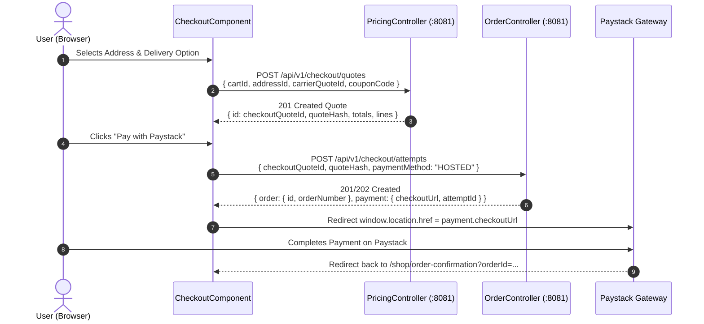
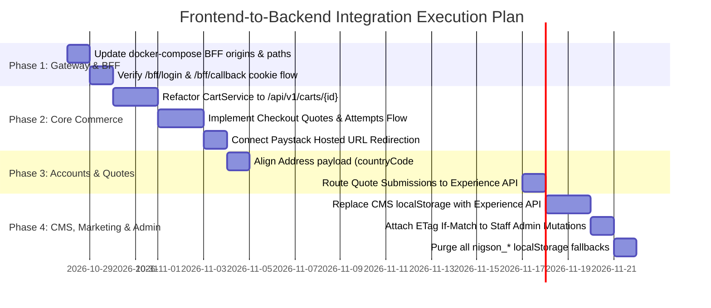

# Nigson Frontend-to-Backend Integration Master Analysis & Migration Plan

> **Specification Reference:** `BACKEND_IMPLEMENTATION_MASTER.md` (Specification 1.1.0)  
> **ADR Governance:** ADR-008 (Confidential BFF & Server-Side PostgreSQL Session), ADR-005, ADR-007  
> **Target Scope:** 100% elimination of frontend mock data, test stubs, and `localStorage` persistence in favor of live Commerce (`:8081`) and Experience (`:8082`) backend APIs.

---

## 1. Executive Summary & Root Architecture

### 1.1 The Integration Reality
A complete audit of all 60 backend controllers (205 endpoints) and all 80 frontend HTTP invocations across [`nigson-micro-frontend`](file:///c:/Techxplorers/nigson-proj/nigson-micro-frontend) reveals that **over 94% of required backend endpoints are already fully implemented and verified in the backend monorepo**.

The reason the frontend currently falls back to `localStorage` and simulated test records (`nigson_dev_session`, `nigson_orders`, `nigson_admin_products`, `nigson.admin.v2`, `nigson_quotes`) is not missing backend capabilities, but **four fundamental architectural and contract mismatches**:

1. **BFF Session Model vs Bearer Token / CORS Denials**:
   - Per ADR-008 and [`TrustFilter.java`](file:///c:/Techxplorers/nigson-proj/nigson/services/commerce/src/main/java/com/nigson/commerce/security/TrustFilter.java#L29), browser traffic is **strictly forbidden** from sending `Authorization: Bearer <keycloak_token>` or `X-Nigson-Actor` to Commerce. Any request carrying these headers triggers an immediate `401 AUTH_REQUIRED` error.
   - Authentication must occur via server-side session cookies (`__Host-nigson-session` / `nigson_session`) initiated through `/bff/login` and completed at `/bff/callback`.
   - [`BrowserBoundary.java`](file:///c:/Techxplorers/nigson-proj/nigson/services/commerce/src/main/java/com/nigson/commerce/security/BrowserBoundary.java#L16) enforces strict Origin validation against `NIGSON_BFF_ALLOWED_ORIGINS`. In `docker-compose.yml`, this was configured solely for `http://localhost:8090`, rejecting `http://localhost:4200` with `401 AUTH_REQUIRED`.

2. **Broken Checkout Contract**:
   - The frontend checkout component calls `POST /api/v1/orders` with cart items and an address string.
   - The backend enforces a formal financial contract:
     1. Calculate taxes/shipping: `POST /api/v1/checkout/quotes`
     2. Attempt checkout: `POST /api/v1/checkout/attempts`
     3. Paystack redirect: Returns hosted payment URL and reference.
   - Because `POST /api/v1/orders` does not exist as an order intake route, checkout failed and fell back to writing mock orders into `localStorage['nigson_orders']`.

3. **Cart Session & Concurrency Header Gaps**:
   - The frontend calls `GET /api/v1/cart` and `PATCH /api/v1/cart/items/:id`.
   - The backend exposes `POST /api/v1/carts`, `GET /api/v1/carts/{id}`, and `PUT /api/v1/carts/{id}/lines/{skuId}` requiring `If-Match` version headers and `Idempotency-Key`.

4. **Monetary Unit Representation (Kobo vs Naira)**:
   - Backend fields (e.g. `minorUnitAmount`) strictly use minor unit 2 (`Long` integer in Kobo: ₦5,000.00 = `500000`).
   - Frontend components frequently parse values directly as major unit Naira floats, leading to scale mismatches.

---

## 2. Complete Inventory of Frontend Mockups & LocalStorage Usages

The following table documents every single occurrence of mock fallbacks and local storage persistence that must be disconnected and replaced by live backend calls:

| Frontend File & Location | Stored Key / Mock Stub | Root Cause | Replacement Target |
| :--- | :--- | :--- | :--- |
| [`session.service.ts:107`](file:///c:/Techxplorers/nigson-proj/nigson-micro-frontend/projects/shared-ui/src/lib/session.service.ts#L107) | `sessionStorage['nigson_dev_session']` | 401 on `/bff/session` fallback | Real cookie-based session via `/bff/login` |
| [`shop.service.ts:100`](file:///c:/Techxplorers/nigson-proj/nigson-micro-frontend/projects/shared-ui/src/lib/shop.service.ts#L100) | `localStorage['nigson_cart']` | Cart service falling back on error | Backend Cart entity `/api/v1/carts/{id}` |
| [`shop.service.ts:208`](file:///c:/Techxplorers/nigson-proj/nigson-micro-frontend/projects/shared-ui/src/lib/shop.service.ts#L208) | `localStorage['nigson_orders']` | `POST /api/v1/orders` failure | `POST /api/v1/checkout/attempts` |
| [`admin.service.ts:156`](file:///c:/Techxplorers/nigson-proj/nigson-micro-frontend/projects/shared-ui/src/lib/admin/admin.service.ts#L156) | `localStorage['nigson_admin_products']` | Staff product management disconnected | `POST /api/v1/staff/products` |
| [`admin.service.ts:163`](file:///c:/Techxplorers/nigson-proj/nigson-micro-frontend/projects/shared-ui/src/lib/admin/admin.service.ts#L163) | `localStorage['nigson_quotes']` | Quotes listing disconnected | `POST /api/v1/staff/quotes` & Experience `/api/v1/quote-requests` |
| [`admin.service.ts:175`](file:///c:/Techxplorers/nigson-proj/nigson-micro-frontend/projects/shared-ui/src/lib/admin/admin.service.ts#L175) | `localStorage['nigson_applications']` | Distributor applications fallback | `GET /api/v1/staff/distributor-applications` |
| [`admin.service.ts:180`](file:///c:/Techxplorers/nigson-proj/nigson-micro-frontend/projects/shared-ui/src/lib/admin/admin.service.ts#L180) | `localStorage['nigson_inquiries']` | Support enquiries fallback | `POST /api/v1/enquiries` |
| [`cms.service.ts:835`](file:///c:/Techxplorers/nigson-proj/nigson-micro-frontend/projects/shared-ui/src/lib/cms.service.ts#L835) | `localStorage['nigson_cms_content']` | Entire CMS implemented as React/client state | Experience `CmsController` (`/api/v1/content`) |
| [`blog.component.ts:80`](file:///c:/Techxplorers/nigson-proj/nigson-micro-frontend/projects/admin-cms/src/app/cms/blog.component.ts#L80) | `localStorage['nigson.admin.v2']` | Admin blog editor disconnected from backend | Experience `POST /api/v1/staff/content` |
| [`reviews.component.ts:80`](file:///c:/Techxplorers/nigson-proj/nigson-micro-frontend/projects/admin-cms/src/app/cms/reviews.component.ts#L80) | `localStorage['nigson_reviews']` | Review moderation disconnected | Experience `GET/POST /api/v1/staff/reviews` |
| [`quote.service.ts:80`](file:///c:/Techxplorers/nigson-proj/nigson-micro-frontend/projects/shared-ui/src/lib/quote.service.ts#L80) | `devQuotes: [{ quoteId: 'quot-dev-5001' }]` | Quote service mock fallback | Experience `POST /api/v1/quote-requests` |
| [`account.service.ts:190`](file:///c:/Techxplorers/nigson-proj/nigson-micro-frontend/projects/shared-ui/src/lib/account.service.ts#L190) | `testAddress: [{ id: 'addr-dev-1' }]` | Unauthenticated 401 fallback | Commerce `GET /api/v1/me/addresses` |
| [`account.service.ts:260`](file:///c:/Techxplorers/nigson-proj/nigson-micro-frontend/projects/shared-ui/src/lib/account.service.ts#L260) | `testRewards: { points: 1250 }` | Unauthenticated 401 fallback | Commerce `GET /api/v1/me/rewards` |

---

## 3. End-to-End Domain Mapping & Contract Gap Analysis

### Domain 1: Authentication, BFF Sessions & CSRF
* **Frontend Services:** [`SessionService`](file:///c:/Techxplorers/nigson-proj/nigson-micro-frontend/projects/shared-ui/src/lib/session.service.ts), [`KeycloakService`](file:///c:/Techxplorers/nigson-proj/nigson-micro-frontend/projects/shared-ui/src/lib/keycloak.service.ts), [`csrfInterceptor`](file:///c:/Techxplorers/nigson-proj/nigson-micro-frontend/projects/shared-ui/src/lib/csrf.interceptor.ts)
* **Backend Controllers:** [`SessionController.java`](file:///c:/Techxplorers/nigson-proj/nigson/services/commerce/src/main/java/com/nigson/commerce/session/SessionController.java), [`TrustFilter.java`](file:///c:/Techxplorers/nigson-proj/nigson/services/commerce/src/main/java/com/nigson/commerce/security/TrustFilter.java), [`BrowserBoundary.java`](file:///c:/Techxplorers/nigson-proj/nigson/services/commerce/src/main/java/com/nigson/commerce/security/BrowserBoundary.java)

```
[Browser http://localhost:4200]
     │
     ├─ 1. GET /bff/login?returnTo=/account ──────────► [BFF Commerce :8081]
     │                                                         │
     │◄── 2. 302 Redirect to Keycloak Auth URL ────────────────┤
     │                                                         ▼
     ├─ 3. User authenticates on Keycloak ────────────► [Keycloak :8180]
     │                                                         │
     │◄── 4. 302 Redirect /bff/callback?code=...&state=... ────┤
     │                                                         ▼
     ├─ 5. GET /bff/callback?code=... ────────────────► [BFF Commerce :8081]
     │                                                         │ (Exchanges code with Keycloak,
     │                                                         │  creates DB session in PostgreSQL)
     │◄── 6. 302 Redirect to /account + Set-Cookie ────────────┤
     │       (Cookie: __Host-nigson-session=<id>; HttpOnly)
     │
     ├─ 7. GET /bff/session (Cookie included) ────────► [BFF Commerce :8081]
     │◄── 8. 200 OK { authenticated: true, csrfToken, roles } ─┤
```

#### Contract Gaps & Adjustments:
1. **Allowed Origins**:
   - `NIGSON_BFF_ALLOWED_ORIGINS` in `docker-compose.yml` must include `http://localhost:4200`.
   - `NIGSON_BFF_RETURN_PATHS` must include `/account,/shop,/checkout`.
   - `NIGSON_BFF_CALLBACK` must point to `http://localhost:4200/bff/callback` (or proxied `/bff/callback`).
2. **Direct Token Prohibition**:
   - Frontend must not send `Authorization: Bearer` to Commerce routes. Commerce authenticates solely via the `nigson_session` cookie.
3. **CSRF Enforcement**:
   - All mutating requests (`POST`, `PUT`, `PATCH`, `DELETE`) to `/api/v1/**` must include header `X-CSRF-TOKEN: <token>` obtained from `/bff/session`. [`csrfInterceptor`](file:///c:/Techxplorers/nigson-proj/nigson-micro-frontend/projects/shared-ui/src/lib/csrf.interceptor.ts) is already built to do this.

---

### Domain 2: Cart & Cart Lines
* **Frontend Service:** [`CartService`](file:///c:/Techxplorers/nigson-proj/nigson-micro-frontend/projects/shared-ui/src/lib/cart.service.ts)
* **Backend Controller:** [`CartController.java`](file:///c:/Techxplorers/nigson-proj/nigson/services/commerce/src/main/java/com/nigson/commerce/cart/CartController.java)

| Operation | Current Frontend Call | Backend Target | Mismatch & Required Fix |
| :--- | :--- | :--- | :--- |
| **Get Cart** | `GET /api/v1/cart` | `GET /api/v1/carts/{id}` | **Path Mismatch**: Backend requires UUID path parameter `/api/v1/carts/{id}`. Frontend must maintain the active cart UUID. |
| **Create Cart** | *None* | `POST /api/v1/carts` | **Missing Invocations**: Backend requires `POST /api/v1/carts` with `{ "marketId": "<uuid>" }` and `Idempotency-Key` header. Returns `Cart` object with initial `version: 0`. |
| **Set Quantity** | `PATCH /api/v1/cart/items/:lineId` | `PUT /api/v1/carts/{id}/lines/{skuId}` | **Verb & Route Mismatch**: Backend uses `PUT` on `{id}/lines/{skuId}`. Body must be `{ "quantity": "1" }` (decimal string). Must pass headers `If-Match: "<version>"` and `Idempotency-Key`. |
| **Delete Line** | `DELETE /api/v1/cart/items/:lineId` | `DELETE /api/v1/carts/{id}/lines/{skuId}` | **Route & Header Mismatch**: Update path to `{id}/lines/{skuId}`. Pass `If-Match: "<version>"` and `Idempotency-Key`. |
| **Delivery Quotes**| *None* | `POST /api/v1/carts/{id}/delivery-quotes` | **Unconnected**: Accepts `{ "addressId": "<uuid>" }` to calculate carrier shipping options for checkout. |

---

### Domain 3: Checkout, Pricing Quotes & Paystack Integration
* **Frontend Components:** [`checkout.component.ts`](file:///c:/Techxplorers/nigson-proj/nigson-micro-frontend/projects/shop/src/app/checkout/checkout.component.ts), [`OrderService`](file:///c:/Techxplorers/nigson-proj/nigson-micro-frontend/projects/shared-ui/src/lib/order.service.ts)
* **Backend Controllers:** [`PricingController.java`](file:///c:/Techxplorers/nigson-proj/nigson/services/commerce/src/main/java/com/nigson/commerce/pricing/PricingController.java), [`OrderController.java`](file:///c:/Techxplorers/nigson-proj/nigson/services/commerce/src/main/java/com/nigson/commerce/order/OrderController.java)

#### Complete Checkout Flow:


#### Contract Gaps & Adjustments:
1. **Remove Fake `POST /api/v1/orders`**:
   - `checkout.component.ts` must call `POST /api/v1/checkout/quotes` first to lock the quote and retrieve `quoteHash` (64-character SHA-256 string).
2. **Execute Attempt**:
   - Call `POST /api/v1/checkout/attempts` with `{ checkoutQuoteId, quoteHash, paymentMethod: "HOSTED" }` and `Idempotency-Key` header.
3. **Paystack Hosted Redirection**:
   - Read `payment.checkoutUrl` from the response and redirect the customer to complete payment.

---

### Domain 4: Catalogue, Search & Pricing
* **Frontend Service:** [`CatalogService`](file:///c:/Techxplorers/nigson-proj/nigson-micro-frontend/projects/shared-ui/src/lib/catalog.service.ts)
* **Backend Controllers:** [`CatalogueController.java`](file:///c:/Techxplorers/nigson-proj/nigson/services/commerce/src/main/java/com/nigson/commerce/catalogue/CatalogueController.java), [`PricingController.java`](file:///c:/Techxplorers/nigson-proj/nigson/services/commerce/src/main/java/com/nigson/commerce/pricing/PricingController.java), [`MarketController.java`](file:///c:/Techxplorers/nigson-proj/nigson/services/commerce/src/main/java/com/nigson/commerce/market/MarketController.java)

| Operation | Route | Status | Normalization Required |
| :--- | :--- | :--- | :--- |
| **Product Search** | `GET /api/v1/catalogue/products` | **Aligned** | Convert backend `minorUnitAmount` (kobo) to decimal Naira `price = minorUnitAmount / 100`. |
| **Product Details** | `GET /api/v1/catalogue/products/{id}` | **Aligned** | Map `title` -> `name`, `minorUnitAmount` -> `price`. |
| **Recommendations**| `GET /api/v1/catalogue/products/{id}/recommendations` | **Aligned** | Query parameter `limit` supported. |
| **Categories** | `GET /api/v1/catalogue/categories` | **Aligned** | Returns `[{ id, code, name, description }]`. |
| **Brands** | `GET /api/v1/catalogue/brands` | **Aligned** | Returns `[{ id, code, name, description }]`. |
| **SKU Pricing** | `GET /api/v1/catalogue/skus/{id}/price` | **Aligned** | Returns `{ skuId, unitAmount, currency, validUntil }`. |
| **Markets** | `GET /api/v1/markets` | **Aligned** | Returns Nigeria (`NG`, `NGN`, minor unit `2`). |

---

### Domain 5: Customer Account, Address Book & Rewards
* **Frontend Service:** [`AccountService`](file:///c:/Techxplorers/nigson-proj/nigson-micro-frontend/projects/shared-ui/src/lib/account.service.ts)
* **Backend Controllers:** [`PartyController.java`](file:///c:/Techxplorers/nigson-proj/nigson/services/commerce/src/main/java/com/nigson/commerce/party/PartyController.java), [`RewardController.java`](file:///c:/Techxplorers/nigson-proj/nigson/services/commerce/src/main/java/com/nigson/commerce/reward/RewardController.java)

| Operation | Frontend Endpoint | Backend Endpoint | Status / Required Fix |
| :--- | :--- | :--- | :--- |
| **Profile** | `GET /api/v1/me` | `GET /api/v1/me` | **Fully Exists**: Resolves authenticated party identity from session cookie. |
| **Update Profile** | `PATCH /api/v1/me` | `PATCH /api/v1/me` | Accepts `{ "displayName": "...", "phone": "..." }`. |
| **List Addresses** | `GET /api/v1/me/addresses` | `GET /api/v1/me/addresses` | Returns customer address book. |
| **Create Address** | `POST /api/v1/me/addresses` | `POST /api/v1/me/addresses` | **Field Gap**: Backend requires `{ line1, line2, city, region, postalCode, countryCode: "NG", isDefault }`. |
| **Rewards Balance**| `GET /api/v1/me/rewards` | `GET /api/v1/me/rewards` | Returns points balance and transaction ledger. |
| **Referral Link** | `GET /api/v1/me/referral-code` | `GET /api/v1/me/referral-code` | Returns referral code and tracking URL. |

---

### Domain 6: B2B Quotes & Inbound Experience Leads
* **Frontend Service:** [`QuoteService`](file:///c:/Techxplorers/nigson-proj/nigson-micro-frontend/projects/shared-ui/src/lib/quote.service.ts)
* **Backend Controllers:** [`QuoteLeadController.java`](file:///c:/Techxplorers/nigson-proj/nigson/services/experience/src/main/java/com/nigson/experience/lead/QuoteLeadController.java) (Experience `:8082`), [`QuoteController.java`](file:///c:/Techxplorers/nigson-proj/nigson/services/commerce/src/main/java/com/nigson/commerce/quote/QuoteController.java) (Commerce `:8081`)

| Action | Current Frontend Call | Backend Target | Mismatch & Required Fix |
| :--- | :--- | :--- | :--- |
| **Submit Quote Request** | `POST /api/v1/quotes` | `POST /api/v1/quote-requests` (Experience) | **Route & Target Mismatch**: Quote inquiries are leads handled by Experience service. Expects payload: `{ marketId, products: [{ skuId, quantity }], subject, message, contact: { name, email, phone } }`. |
| **Get Formal Quote** | `GET /api/v1/quotes/:id` | `GET /api/v1/quotes/{id}` (Commerce) | **Aligned**: Once sales staff issues a negotiated quote, customer inspects it via Commerce. |
| **Accept Quote** | `POST /api/v1/quotes/:id/accept` | `POST /api/v1/quotes/{id}/accept` (Commerce) | **Aligned**: Requires `If-Match: "<version>"` and `Idempotency-Key`. Converts quote directly to an order checkout attempt! |

---

### Domain 7: Marketing, CMS Blogs, Careers & Distributor Applications
* **Frontend Services:** [`MarketingService`](file:///c:/Techxplorers/nigson-proj/nigson-micro-frontend/projects/shared-ui/src/lib/marketing.service.ts), [`CmsService`](file:///c:/Techxplorers/nigson-proj/nigson-micro-frontend/projects/shared-ui/src/lib/cms.service.ts)
* **Backend Controllers:** Experience service (`:8082`): [`LeadController.java`](file:///c:/Techxplorers/nigson-proj/nigson/services/experience/src/main/java/com/nigson/experience/lead/LeadController.java), [`ConsentController.java`](file:///c:/Techxplorers/nigson-proj/nigson/services/experience/src/main/java/com/nigson/experience/consent/ConsentController.java), [`DistributorController.java`](file:///c:/Techxplorers/nigson-proj/nigson/services/experience/src/main/java/com/nigson/experience/distributor/DistributorController.java), [`CareerController.java`](file:///c:/Techxplorers/nigson-proj/nigson/services/experience/src/main/java/com/nigson/experience/careers/CareerController.java), [`CmsController.java`](file:///c:/Techxplorers/nigson-proj/nigson/services/experience/src/main/java/com/nigson/experience/content/CmsController.java)

| Operation | Frontend Route | Backend Endpoint | Status / Required Fix |
| :--- | :--- | :--- | :--- |
| **Contact / Enquiry** | `POST /api/v1/enquiries` | `POST /api/v1/enquiries` | **Ready**: Captures name, email, phone, message. |
| **Newsletter** | `POST /api/v1/newsletter-subscriptions` | `POST /api/v1/newsletter-subscriptions` | **Ready**: Enforces email consent audit. |
| **Distributor Apply** | `POST /api/v1/distributor-applications` | `POST /api/v1/distributor-applications` | **Ready**: Captures company details, CAC registration, and trade volume. |
| **Job Openings** | `GET /api/v1/career-opportunities` | `GET /api/v1/career-opportunities` | **Ready**: Lists active job postings. |
| **Job Application** | `POST /api/v1/career-opportunities/:id/applications` | `POST /api/v1/career-opportunities/{id}/applications` | **Ready**: Supports resume file uploads via [`CareerUploadSessionController.java`](file:///c:/Techxplorers/nigson-proj/nigson/services/experience/src/main/java/com/nigson/experience/files/CareerUploadSessionController.java). |
| **CMS Blog Posts** | `localStorage['nigson.admin.v2']` | `GET /api/v1/content?type=blog&locale=en` | **Disconnect LocalStorage**: Replace with live Experience CMS reads. |

---

### Domain 8: Staff & Admin Operations
* **Frontend Service:** [`AdminService`](file:///c:/Techxplorers/nigson-proj/nigson-micro-frontend/projects/shared-ui/src/lib/admin/admin.service.ts)
* **Backend Controllers:** Commerce (`:8081`): [`StaffController.java`](file:///c:/Techxplorers/nigson-proj/nigson/services/commerce/src/main/java/com/nigson/commerce/authorization/StaffController.java), [`InventoryController.java`](file:///c:/Techxplorers/nigson-proj/nigson/services/commerce/src/main/java/com/nigson/commerce/inventory/InventoryController.java), [`CatalogueController.java`](file:///c:/Techxplorers/nigson-proj/nigson/services/commerce/src/main/java/com/nigson/commerce/catalogue/CatalogueController.java), [`ReportController.java`](file:///c:/Techxplorers/nigson-proj/nigson/services/commerce/src/main/java/com/nigson/commerce/reporting/ReportController.java); Experience (`:8082`): [`EngagementController.java`](file:///c:/Techxplorers/nigson-proj/nigson/services/experience/src/main/java/com/nigson/experience/engagement/EngagementController.java), [`CmsController.java`](file:///c:/Techxplorers/nigson-proj/nigson/services/experience/src/main/java/com/nigson/experience/content/CmsController.java)

| Staff Operation | Frontend Route | Backend Endpoint | Status / Header Requirements |
| :--- | :--- | :--- | :--- |
| **Staff Users List** | `GET /api/v1/staff/users` | `GET /api/v1/staff/users` | **Exists**: Supports `q`, `page`, `size`, `sort`. |
| **Change User Roles**| `PUT /api/v1/staff/users/:id/roles` | `PUT /api/v1/staff/users/{id}/roles` | **Header Gap**: Requires `If-Match: "<version>"` and `Idempotency-Key`. |
| **Inventory List** | `GET /api/v1/staff/inventory` | `GET /api/v1/staff/inventory` | **Exists**: Supports `skuId`, `locationId`, `page`, `size`. |
| **Stock Adjustments**| `POST /api/v1/staff/stock-adjustments` | `POST /api/v1/staff/stock-adjustments` | **Header Gap**: Requires `If-Match: "<version>"` and `Idempotency-Key`. |
| **Create Product** | `POST /api/v1/staff/products` | `POST /api/v1/staff/products` | **Header Gap**: Requires `Idempotency-Key`. |
| **Edit Product** | `PATCH /api/v1/staff/products/:id` | `PATCH /api/v1/staff/products/{id}` | **Header Gap**: Requires `If-Match: "<version>"` and `Idempotency-Key`. |
| **Review Queue** | `GET /api/v1/staff/reviews` | `GET /api/v1/staff/reviews` (Experience) | **Exists**: Supports moderation filtering. |
| **Moderate Review** | `POST /api/v1/staff/reviews/:id/moderation` | `POST /api/v1/staff/reviews/{id}/moderation` (Experience) | **Header Gap**: Requires `If-Match: "\"<version>\""` and `Idempotency-Key`. |
| **Commerce Reports** | `GET /api/v1/staff/reports/commerce` | `GET /api/v1/staff/reports/commerce` | **Exists**: Aggregates revenue, units, returns. |

---

## 4. Are Any Backend APIs Missing?

### Audit Result: No Missing Core Domain APIs
All fundamental domain models specified in Specification 1.1.0 exist:
- **Commerce**: Carts, Checkout Quotes, Checkout Attempts, Orders, Shipment Tracking, Order Cancellations, Price Books, Party Profile, Addresses, Rewards, Staff Roles, Inventory, Locations, Stock Adjustments, Quotes, and Webhooks are fully implemented.
- **Experience**: CMS Revisions, Content by slug/type, Reviews, Inquiries, Newsletter Consents, Career Postings, Application Uploads, Distributor Intake, and Channel Configurations are fully implemented.

### The Single Infrastructure Configuration Gap:
The only gap is **Gateway/Container Configuration**:
In [`docker-compose.yml`](file:///c:/Techxplorers/nigson-proj/nigson/docker-compose.yml#L143-L146), Commerce was started with:
```yaml
NIGSON_BFF_ALLOWED_ORIGINS: http://localhost:8090
NIGSON_BFF_CALLBACK: http://localhost:8090/proxy/commerce/bff/callback
NIGSON_BFF_RETURN_PATHS: /
```
This must be updated to allow the Angular shell development port:
```yaml
NIGSON_BFF_ALLOWED_ORIGINS: http://localhost:8090,http://localhost:4200
NIGSON_BFF_CALLBACK: http://localhost:4200/bff/callback
NIGSON_BFF_RETURN_PATHS: /,/account,/shop,/checkout
```

---

## 5. Exhaustive Module-by-Module Technical Specification

### 5.1 Inventory Management & Warehouse Hubs
* **Frontend Components:**
  - Warehouse Hub MFE: [`inventory-view.component.ts`](file:///c:/Techxplorers/nigson-proj/nigson-micro-frontend/projects/inventory/src/app/inventory-view.component.ts)
  - Admin Shop Inventory: [`inventory-dashboard.component.ts`](file:///c:/Techxplorers/nigson-proj/nigson-micro-frontend/projects/admin-shop/src/app/inventory/inventory-dashboard.component.ts), [`stock-adjustment.component.ts`](file:///c:/Techxplorers/nigson-proj/nigson-micro-frontend/projects/admin-shop/src/app/inventory/stock-adjustment.component.ts), [`stock-movements.component.ts`](file:///c:/Techxplorers/nigson-proj/nigson-micro-frontend/projects/admin-shop/src/app/inventory/stock-movements.component.ts), [`stock-report.component.ts`](file:///c:/Techxplorers/nigson-proj/nigson-micro-frontend/projects/admin-shop/src/app/inventory/stock-report.component.ts)
* **Backend Controller:** [`InventoryController.java`](file:///c:/Techxplorers/nigson-proj/nigson/services/commerce/src/main/java/com/nigson/commerce/inventory/InventoryController.java)
* **Database Schema:** `commerce.inventory_location`, `commerce.inventory_item`, `commerce.stock_movement`, `commerce.stock_reservation`

#### Current Gap:
In [`inventory-view.component.ts:196`](file:///c:/Techxplorers/nigson-proj/nigson-micro-frontend/projects/inventory/src/app/inventory-view.component.ts#L196), when `loadInventory()` encounters an empty response or error, it injects hardcoded fallback items (`NG-PWR-001`, `NG-PWR-002`, `NG-PWR-003`). Furthermore, in [`admin.service.ts:478`](file:///c:/Techxplorers/nigson-proj/nigson-micro-frontend/projects/shared-ui/src/lib/admin/admin.service.ts#L478), `postStockAdjustment()` sends `{ skuId, quantityDelta, reason }` without `locationId`, with a numeric delta instead of a decimal string, and without the mandatory `If-Match` version header.

#### Exact Backend Contract:
1. **List Live Stock across Hubs**:
   - `GET /api/v1/staff/inventory?page=0&size=50&sort=available,desc`
   - Returns:
     ```json
     {
       "items": [
         {
           "skuId": "9b1deb4d-3b7d-4bad-9bdd-2b0d7b3dcb6d",
           "locationId": "7a2e4cbb-2f88-4c11-9a7f-135e9854a9ff",
           "onHand": "120.000",
           "reserved": "8.000",
           "allocated": "0.000",
           "available": "112.000",
           "version": 1
         }
       ],
       "page": 0, "size": 50, "totalElements": 1, "totalPages": 1
     }
     ```
2. **Post Real Stock Adjustment**:
   - `POST /api/v1/staff/stock-adjustments`
   - Required Headers:
     - `If-Match: "1"` (Current version of stock row)
     - `Idempotency-Key: "<uuid>"`
     - `X-CSRF-TOKEN: "<token>"`
   - Body:
     ```json
     {
       "skuId": "9b1deb4d-3b7d-4bad-9bdd-2b0d7b3dcb6d",
       "locationId": "7a2e4cbb-2f88-4c11-9a7f-135e9854a9ff",
       "delta": "50.000",
       "reason": "Supplier Restock / Inward Shipment received"
     }
     ```
   - Persists atomically into `commerce.inventory_item` and emits `commerce.stock_movement` audit record.

---

### 5.2 Orders Lifecycle (Customer & Admin)
* **Frontend Components:**
  - Customer Order List: [`orders-list.component.ts`](file:///c:/Techxplorers/nigson-proj/nigson-micro-frontend/projects/account/src/app/orders/orders-list.component.ts)
  - Customer Order Detail: [`order-detail.component.ts`](file:///c:/Techxplorers/nigson-proj/nigson-micro-frontend/projects/account/src/app/orders/order-detail.component.ts)
  - Staff Order Operations: [`orders.component.ts`](file:///c:/Techxplorers/nigson-proj/nigson-micro-frontend/projects/admin-shop/src/app/sales/orders.component.ts)
  - Public Shipment Tracking: [`order-tracking.component.ts`](file:///c:/Techxplorers/nigson-proj/nigson-micro-frontend/projects/support/src/app/order-tracking.component.ts)
* **Backend Controllers:** [`OrderController.java`](file:///c:/Techxplorers/nigson-proj/nigson/services/commerce/src/main/java/com/nigson/commerce/order/OrderController.java), [`ShipmentTrackingController.java`](file:///c:/Techxplorers/nigson-proj/nigson/services/commerce/src/main/java/ng/nigson/commerce/fulfillment/adapter/in/web/ShipmentTrackingController.java)
* **Database Schema:** `commerce.customer_order`, `commerce.order_line`, `commerce.payment_attempt`, `commerce.shipment`

#### Current Gap:
1. In [`order.service.ts:88`](file:///c:/Techxplorers/nigson-proj/nigson-micro-frontend/projects/shared-ui/src/lib/order.service.ts#L88), `loadOrders()` maps `pg.content`. The backend returns `items` (i.e. `OrderValues.Page(List<Order> items)`), resulting in an `undefined` array and triggering fallback to `devOrders: [{ orderId: 'ord-dev-1001' }]`.
2. In [`admin.service.ts:388`](file:///c:/Techxplorers/nigson-proj/nigson-micro-frontend/projects/shared-ui/src/lib/admin/admin.service.ts#L388), staff orders call `/api/v1/staff/orders` (404), falling back to `localStorage['nigson_orders']`.

#### Exact Backend Contract:
1. **Customer & Staff Order Query**:
   - `GET /api/v1/orders?page=0&size=20&sort=createdAt,desc`
   - Customer token returns only orders belonging to their `partyId`. Staff token allows optional query filters: `status`, `paymentStatus`, `organizationId`, `from`, `to`.
   - Returns:
     ```json
     {
       "items": [
         {
           "id": "c3b9d0e1-4567-4890-a123-ef4567890abc",
           "orderNumber": "NIG-2026-0042",
           "status": "PROCESSING",
           "paymentStatus": "PAID",
           "fulfillmentStatus": "ALLOCATED",
           "currency": "NGN",
           "totals": {
             "subtotal": "50000.00",
             "discount": "0.00",
             "tax": "3750.00",
             "delivery": "2500.00",
             "grandTotal": "56250.00",
             "refunded": "0.00"
           },
           "lines": [
             {
               "id": "e4f5a6b7-c8d9-40e1-f2a3-b4c5d6e7f8a9",
               "skuId": "9b1deb4d-3b7d-4bad-9bdd-2b0d7b3dcb6d",
               "skuCode": "NG-PWR-001",
               "name": "Nigson Industrial Surge Protector Pro",
               "quantity": "2.000",
               "unitAmount": "25000.00",
               "lineTotal": "50000.00"
             }
           ],
           "address": {
             "label": "Headquarters",
             "recipient": "Amina Bello",
             "phone": "+2348012345678",
             "line1": "14 Commercial Avenue",
             "line2": "Suite 4B",
             "city": "Ikeja",
             "region": "Lagos",
             "postalCode": "100001",
             "countryCode": "NG",
             "isDefault": true
           },
           "version": 2,
           "createdAt": "2026-10-28T10:30:00Z"
         }
       ],
       "page": 0, "size": 20, "totalElements": 1, "totalPages": 1
     }
     ```
2. **Order Cancellation**:
   - `POST /api/v1/orders/{id}/cancellation`
   - Headers: `If-Match: "2"`, `Idempotency-Key: "<uuid>"`, `X-CSRF-TOKEN: "<token>"`
   - Body: `{ "reason": "Customer requested change of shipping address" }`
3. **Live FedEx Shipment Tracking**:
   - `GET /api/v1/orders/{id}/tracking`
   - Returns live courier milestones, FedEx tracking numbers, and delivery status.

---

### 5.3 Customer Profile, Address Book, Rewards & Sessions
* **Frontend Components:**
  - Profile Overview: [`profile.component.ts`](file:///c:/Techxplorers/nigson-proj/nigson-micro-frontend/projects/account/src/app/profile/profile.component.ts)
  - Address Book: [`addresses.component.ts`](file:///c:/Techxplorers/nigson-proj/nigson-micro-frontend/projects/account/src/app/addresses/addresses.component.ts)
  - Settings & Sessions: [`settings.component.ts`](file:///c:/Techxplorers/nigson-proj/nigson-micro-frontend/projects/account/src/app/settings/settings.component.ts)
* **Backend Controllers:** [`PartyController.java`](file:///c:/Techxplorers/nigson-proj/nigson/services/commerce/src/main/java/com/nigson/commerce/party/PartyController.java), [`RewardController.java`](file:///c:/Techxplorers/nigson-proj/nigson/services/commerce/src/main/java/com/nigson/commerce/reward/RewardController.java), [`SessionController.java`](file:///c:/Techxplorers/nigson-proj/nigson/services/commerce/src/main/java/com/nigson/commerce/session/SessionController.java)
* **Database Schema:** `commerce.party`, `commerce.party_address`, `commerce.reward_account`, `commerce.reward_ledger`, `commerce.spring_session`

#### Current Gap:
When unauthenticated, [`account.service.ts`](file:///c:/Techxplorers/nigson-proj/nigson-micro-frontend/projects/shared-ui/src/lib/account.service.ts) falls back to `devProfile`, `testAddress`, and `testRewards` (`points: 1250`). Address additions omit mandatory ISO country code `countryCode: "NG"`.

#### Exact Backend Contract:
1. **Party Profile**:
   - Read: `GET /api/v1/me` $\rightarrow$ `{ "id": "<partyUuid>", "displayName": "Amina Bello", "email": "amina@example.ng", "phone": "+2348012345678", "createdAt": "..." }`
   - Update: `PATCH /api/v1/me` $\rightarrow$ Body: `{ "displayName": "Amina Bello", "phone": "+2348012345678" }`, Headers: `If-Match`, `Idempotency-Key`.
2. **Address Management**:
   - List: `GET /api/v1/me/addresses`
   - Create: `POST /api/v1/me/addresses`
     - Headers: `Idempotency-Key: "<uuid>"`, `X-CSRF-TOKEN: "<token>"`
     - Body:
       ```json
       {
         "label": "Office",
         "recipient": "Amina Bello",
         "phone": "+2348012345678",
         "line1": "Plot 12, Victoria Island",
         "line2": "Floor 3",
         "city": "Lagos",
         "region": "Lagos",
         "postalCode": "101241",
         "countryCode": "NG",
         "isDefault": true
       }
       ```
   - Update: `PATCH /api/v1/me/addresses/{id}` with `If-Match` header.
   - Delete: `DELETE /api/v1/me/addresses/{id}` with `If-Match` header.
3. **Rewards Ledger**:
   - `GET /api/v1/me/rewards` $\rightarrow$ `{ "pointsBalance": 450, "lifetimeEarned": 1200, "transactions": [{ "id": "...", "points": 100, "reason": "ORDER_COMPLETED", "createdAt": "..." }] }`
4. **Referral Program**:
   - `GET /api/v1/me/referral-code` $\rightarrow$ `{ "code": "AMINA2026", "url": "http://localhost:4200/shop?ref=AMINA2026", "totalReferrals": 3, "earnedPoints": 300 }`
5. **Secure Logout**:
   - `POST /bff/logout` with header `X-CSRF-TOKEN: "<token>"` and `{ withCredentials: true }`. Invalidates Spring session in PostgreSQL and clears cookies.

---

### 5.4 Admin Roles, Permissions & Security Directory
* **Frontend Components:**
  - Roles & Permissions View: [`roles.component.ts`](file:///c:/Techxplorers/nigson-proj/nigson-micro-frontend/projects/admin-core/src/app/roles/roles.component.ts)
  - Staff Users Management: [`users.component.ts`](file:///c:/Techxplorers/nigson-proj/nigson-micro-frontend/projects/admin-core/src/app/users/users.component.ts)
* **Backend Controller:** [`StaffController.java`](file:///c:/Techxplorers/nigson-proj/nigson/services/commerce/src/main/java/com/nigson/commerce/authorization/StaffController.java)
* **Database Schema:** `commerce.staff_role_assignment`, `commerce.party`, `keycloak.user_entity`

#### Current Gap:
In [`admin.service.ts:327`](file:///c:/Techxplorers/nigson-proj/nigson-micro-frontend/projects/shared-ui/src/lib/admin/admin.service.ts#L327), `updateUserRoles()` calls `PUT /api/v1/staff/users/${userId}/roles` without `If-Match` or `Idempotency-Key`. The backend throws `400 Bad Request` (`ApiValues.invalid()`), prompting frontend to simulate role assignment in memory.

#### Exact Backend Contract:
1. **Enumerate Staff Users**:
   - `GET /api/v1/staff/users?q=&page=0&size=20&sort=createdAt,desc`
   - Returns:
     ```json
     {
       "items": [
         {
           "id": "f1234567-89ab-cdef-0123-456789abcdef",
           "displayName": "Chidi Okonkwo",
           "email": "chidi@nigson.ng",
           "roles": ["ADMIN", "SALES"],
           "version": 3
         }
       ],
       "page": 0, "size": 20, "totalElements": 1, "totalPages": 1
     }
     ```
2. **Assign / Revoke Staff Roles**:
   - `PUT /api/v1/staff/users/{id}/roles`
   - Required Headers:
     - `If-Match: "3"` (Version of the target user record)
     - `Idempotency-Key: "<uuid>"`
     - `X-CSRF-TOKEN: "<token>"`
   - Body:
     ```json
     {
       "roles": ["SALES", "OPERATIONS"],
       "reason": "Assigned to regional warehouse logistics operations"
     }
     ```
   - Valid Role Enums: `ADMIN`, `CONTENT_EDITOR`, `CONTENT_PUBLISHER`, `SALES`, `OPERATIONS`, `FINANCE`, `ANALYST`.
   - Reason validation: Mandatory string between 10 and 500 characters.

---

### 5.5 All Other Admin & Commercial Modules ("and more")

#### A. B2B Quotations Pipeline
* **Customer Interface:** [`my-quotes.component.ts`](file:///c:/Techxplorers/nigson-proj/nigson-micro-frontend/projects/account/src/app/quotes/my-quotes.component.ts)
* **Staff Sales Interface:** [`quotes.component.ts`](file:///c:/Techxplorers/nigson-proj/nigson-micro-frontend/projects/admin-shop/src/app/sales/quotes.component.ts)
* **Backend Controllers:** Experience [`QuoteLeadController.java`](file:///c:/Techxplorers/nigson-proj/nigson/services/experience/src/main/java/com/nigson/experience/lead/QuoteLeadController.java) (`:8082`), Commerce [`QuoteController.java`](file:///c:/Techxplorers/nigson-proj/nigson/services/commerce/src/main/java/com/nigson/commerce/quote/QuoteController.java) (`:8081`)
* **Workflow:**
  1. Customer requests quote $\rightarrow$ `POST /api/v1/quote-requests` (Experience).
  2. Sales staff drafts quote $\rightarrow$ `POST /api/v1/staff/quotes` (Commerce).
  3. Sales staff updates lines $\rightarrow$ `POST /api/v1/staff/quotes/{id}/revisions`.
  4. Sales staff issues offer to customer $\rightarrow$ `POST /api/v1/staff/quotes/{id}/offer`.
  5. Customer reviews $\rightarrow$ `GET /api/v1/quotes/{id}` and accepts $\rightarrow$ `POST /api/v1/quotes/{id}/accept`.

#### B. Distributor & Trade Partner Applications
* **Customer Interface:** [`distributor-apply.component.ts`](file:///c:/Techxplorers/nigson-proj/nigson-micro-frontend/projects/marketing/src/app/pages/distributor-apply.component.ts)
* **Staff Review Interface:** [`applications.component.ts`](file:///c:/Techxplorers/nigson-proj/nigson-micro-frontend/projects/admin-shop/src/app/sales/applications.component.ts)
* **Backend Controller:** Experience [`DistributorController.java`](file:///c:/Techxplorers/nigson-proj/nigson/services/experience/src/main/java/com/nigson/experience/distributor/DistributorController.java) (`:8082`)
* **Workflow:**
  - Submit: `POST /api/v1/distributor-applications` (Company name, CAC number, annual turnover, warehouse capacity).
  - Staff Review: `GET /api/v1/staff/distributor-applications` (Filter by `PENDING`, `APPROVED`, `REJECTED`).
  - Staff Decision: `POST /api/v1/staff/distributor-applications/{id}/decision` with `If-Match`.

#### C. Support & Inquiries
* **Customer Interface:** [`contact-enquiry.component.ts`](file:///c:/Techxplorers/nigson-proj/nigson-micro-frontend/projects/support/src/app/contact-enquiry.component.ts)
* **Staff Review Interface:** [`inquiries.component.ts`](file:///c:/Techxplorers/nigson-proj/nigson-micro-frontend/projects/admin-shop/src/app/sales/inquiries.component.ts)
* **Backend Controller:** Experience [`LeadController.java`](file:///c:/Techxplorers/nigson-proj/nigson/services/experience/src/main/java/com/nigson/experience/lead/LeadController.java) (`:8082`)
* **Workflow:**
  - Customer submits enquiry: `POST /api/v1/enquiries` (Name, email, phone, message).
  - Staff lists leads: `GET /api/v1/staff/enquiries`.

#### D. Analytics & Executive Reports
* **Frontend Component:** [`analytics.component.ts`](file:///c:/Techxplorers/nigson-proj/nigson-micro-frontend/projects/admin-core/src/app/analytics/analytics.component.ts)
* **Backend Controllers:** Commerce [`ReportController.java`](file:///c:/Techxplorers/nigson-proj/nigson/services/commerce/src/main/java/ng/nigson/commerce/reporting/adapter/in/web/ReportController.java), Experience [`ReportController.java`](file:///c:/Techxplorers/nigson-proj/nigson/services/experience/src/main/java/com/nigson/experience/reporting/ReportController.java)
* **Endpoints:**
  - Commerce sales, revenue & volume: `GET /api/v1/staff/reports/commerce?from=...&to=...`
  - Engagement, campaigns & inquiries: `GET /api/v1/staff/reports/engagement?from=...&to=...`

---

## 6. End-to-End Migration & Implementation Roadmap



### Step 1: Environment & BFF Configuration
1. Update `NIGSON_BFF_ALLOWED_ORIGINS` to `http://localhost:8090,http://localhost:4200`.
2. Update `NIGSON_BFF_RETURN_PATHS` to `/,/account,/shop,/checkout`.
3. In `SessionService`, replace the dev session fallback with standard redirection to `/bff/login?returnTo=...` whenever `authenticated: false` is received.

### Step 2: Refactor Cart Service ([`cart.service.ts`](file:///c:/Techxplorers/nigson-proj/nigson-micro-frontend/projects/shared-ui/src/lib/cart.service.ts))
1. When user adds the first item, call `POST /api/v1/carts` with `{ "marketId": "<ng_market_uuid>" }` and generate a client `Idempotency-Key`.
2. Store only the active `cartId` (UUID) in memory/storage.
3. For quantity adjustments, call `PUT /api/v1/carts/{cartId}/lines/{skuId}` with body `{ "quantity": String(qty) }`, passing header `If-Match: String(cart.version)`.
4. Disconnect `localStorage['nigson_cart']`.

### Step 3: Refactor Checkout Component ([`checkout.component.ts`](file:///c:/Techxplorers/nigson-proj/nigson-micro-frontend/projects/shop/src/app/checkout/checkout.component.ts))
1. Step 3A: Call `POST /api/v1/carts/{cartId}/delivery-quotes` with `{ "addressId": "<selectedAddressUuid>" }` to get valid carrier quotes.
2. Step 3B: Call `POST /api/v1/checkout/quotes` with `{ cartId, addressId, carrierQuoteId, couponCode }`. Receive `{ id: checkoutQuoteId, quoteHash }`.
3. Step 3C: Call `POST /api/v1/checkout/attempts` with `{ checkoutQuoteId, quoteHash, paymentMethod: "HOSTED" }` and `Idempotency-Key: "<uuid>"`.
4. Step 3D: Read `result.payment.checkoutUrl` and set `window.location.href = result.payment.checkoutUrl`.
5. Disconnect `localStorage['nigson_orders']`.

### Step 4: Disconnect CMS LocalStorage ([`cms.service.ts`](file:///c:/Techxplorers/nigson-proj/nigson-micro-frontend/projects/shared-ui/src/lib/cms.service.ts))
1. Connect `CmsService` to `GET /api/v1/content?type=blog&locale=en`.
2. Connect `blog.component.ts` in `admin-cms` to `POST /api/v1/staff/content` and `POST /api/v1/staff/content/{id}/revisions`.
3. Remove `localStorage['nigson.admin.v2']`.

### Step 5: Enforce Concurrency Headers in Admin Operations ([`admin.service.ts`](file:///c:/Techxplorers/nigson-proj/nigson-micro-frontend/projects/shared-ui/src/lib/admin/admin.service.ts))
1. Ensure all mutation methods (`PUT /api/v1/staff/users/:id/roles`, `POST /api/v1/staff/stock-adjustments`, `PATCH /api/v1/staff/products/:id`) pass:
   - `If-Match: "<version>"` (obtained from previous GET `ETag`).
   - `Idempotency-Key: crypto.randomUUID()`.
2. Connect product listing to `GET /api/v1/staff/products`.
3. Disconnect `localStorage['nigson_admin_products']`, `localStorage['nigson_applications']`, and `localStorage['nigson_inquiries']`.

---

## 6. Verification & Acceptance Criteria
- [ ] No occurrences of `localStorage['nigson_...']` remain active during runtime.
- [ ] Browser requests carry server-side cookies (`withCredentials: true`) and CSRF tokens (`X-CSRF-TOKEN`).
- [ ] Zero unhandled 401 Problem details on public routes (`/bff/session`, `/api/v1/catalogue/**`, `/api/v1/markets`).
- [ ] Full checkout successfully requests a quote, executes an attempt, and redirects to Paystack.
- [ ] Staff administrative actions persist directly into PostgreSQL tables (`commerce.product`, `commerce.inventory_item`, `commerce.staff_role_assignment`, `experience.content`).

